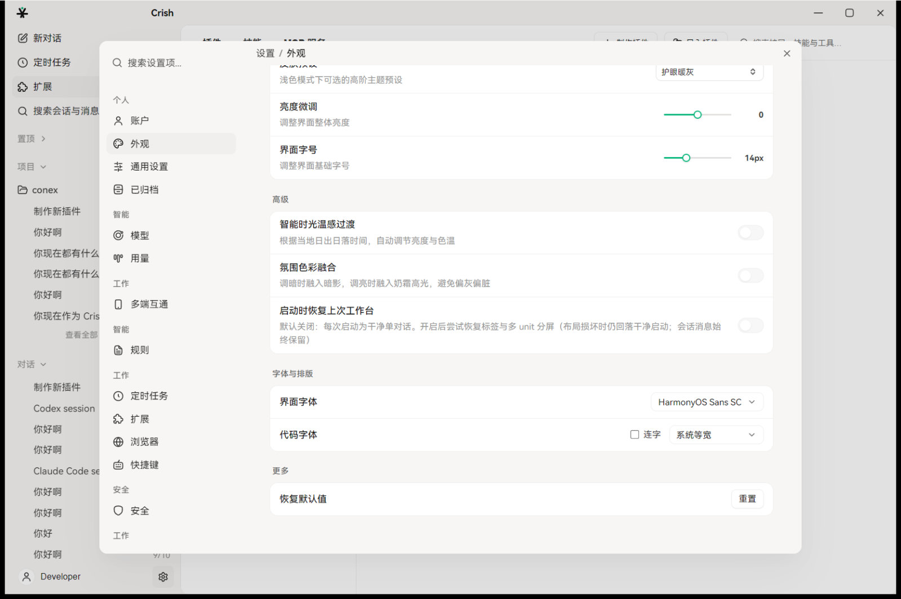
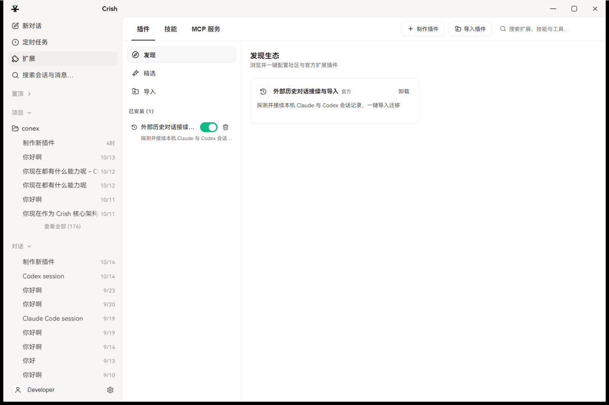

# Crish — 桌面 AI Agent 工作台

[English](README_en.md) | [简体中文](README.md)

[](LICENSE)
[](https://github.com/atobelix/crish/releases)

维护者：[张浩健](https://github.com/atobelix)。仓库目录名是 `conex`，产品名是 **Crish**。这是个人项目，没有社区组织，也没有对外邮箱。

源码：<https://github.com/atobelix/crish>

Crish 是本地优先的 AI Agent 桌面工作台：Tauri 2 壳、React 19 桌面界面、Rust 引擎（`crates/`）。引擎和界面在同一个进程里，通过 Tauri IPC 通信。TUI 和 Web 还没有做，下面架构图里标成规划。

## 安装

不需要从源码编译也能用。到 [Releases](https://github.com/atobelix/crish/releases) 下载安装包。对外版本是 **0.1.1**。

Windows 安装包：

- `Crish_0.1.1_x64-setup.exe`：安装向导
- `Crish_0.1.1_x64_en-US.msi`：msi

Linux 和 macOS 的安装包由同一条发布流水线上传。以 Release 页面上实际挂出的文件为准。`v0.1.0` 是更早的标签，不要把它当成当前版本。

第一次打开后，到设置里填写模型服务的密钥，或接本地 [Ollama](https://ollama.com/)。然后新建对话。

## 截图

设置里的外观页：



扩展页（插件、技能、MCP 服务）：



## 功能

- 多模型：OpenAI 兼容、Anthropic、Gemini、Ollama（`crates/agent-provider`）
- 会话循环：运行、停止、审批（`crates/session-loop`、`crates/orchestrator`）
- 工具：文件、shell、搜索，以及审批（`crates/agent-tools`）
- 命令策略：`crates/conex-sandbox`
- Markdown 渲染：`crates/conex-markdown`
- 会话存储和搜索：`crates/conex-db`、`crates/conex-search`、`crates/conex-diff`
- 内置终端：`apps/crish-desktop`
- 插件、技能、MCP 服务

## 从源码构建

需要 Node.js 24（与 `.nvmrc` 一致，`package.json` engines 为 `^24.3.0`）、npm 11.6.2+、Rust 1.99.1（edition 2021；版本由根目录 `rust-toolchain.toml` 固定，rustup 会自动安装），以及 Tauri 2 的系统依赖。

Linux（Ubuntu / Debian）：

```bash
sudo apt update && sudo apt install -y libwebkit2gtk-4.1-dev build-essential curl wget file libssl-dev libayatana-appindicator3-dev librsvg2-dev patchelf
```

Windows 需要 [Visual Studio C++ Build Tools](https://visualstudio.microsoft.com/visual-cpp-build-tools/)（勾选“使用 C++ 的桌面开发”）和 WebView2。Windows 10/11 通常已经带了 WebView2。

macOS：`xcode-select --install`

```bash
git clone https://github.com/atobelix/crish.git
cd crish
npm install
npm run dev:workbench
```

`npm run dev:desktop` 只起 React 界面（Vite，端口 5174），没有 Tauri 壳，不能当成完整应用。

| 命令 | 作用 |
| --- | --- |
| `npm run dev:workbench` | 启动桌面应用 |
| `npm run dev:desktop` | 只启动界面 |
| `npm run build:desktop` | 构建界面 |
| `npm run check:desktop` | 类型检查和界面门禁 |
| `cargo build --workspace` | 构建 Rust 工作区 |
| `cargo test --workspace` | Rust 测试 |
| `cargo clippy --workspace -- -D warnings` | Clippy |

## 架构

```text
引擎（Rust，进程内）
  core_* 命令、workbench-run-event、CoreError
        |
        +-- GUI（React，已有）workbench_* 桌面能力
        +-- TUI（规划中）
        +-- Web（规划中）
```

细节见 [`ARCHITECTURE.md`](ARCHITECTURE.md)。

## 文档

| 文档 | 说明 |
| --- | --- |
| [`ARCHITECTURE.md`](ARCHITECTURE.md) | 架构 |
| [`CONTRIBUTING.md`](CONTRIBUTING.md) | 如果要改代码 |
| [`CHANGELOG.md`](CHANGELOG.md) | 变更记录 |
| [`SECURITY.md`](SECURITY.md) | 漏洞私下报告 |
| [`LICENSE`](LICENSE) | MIT |
| [`NOTICE`](NOTICE) | 第三方声明 |
| [`THIRD-PARTY-LICENSES.md`](THIRD-PARTY-LICENSES.md) | 依赖许可证 |

问题写在 [Issues](https://github.com/atobelix/crish/issues)。漏洞不要发到公开 Issue，按 [`SECURITY.md`](SECURITY.md) 走 GitHub 私人报告。

## License

MIT，Copyright (c) 2026 张浩健。见 [`LICENSE`](LICENSE)。
