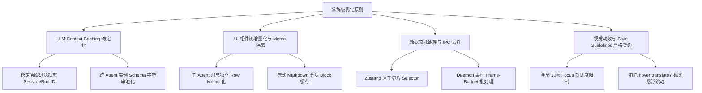
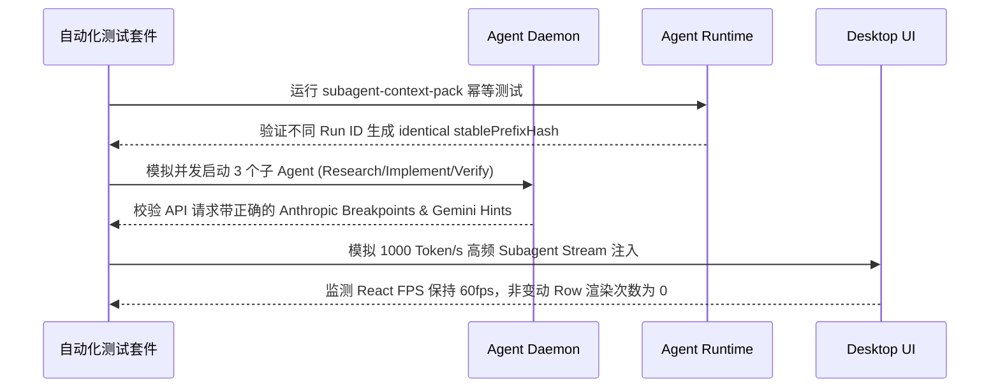

# 系统级缓存复用、对话流性能与 UX 视效极致优化方案

> **文件路径**: `c:\Software\conex\SYSTEMIC-CACHE-REUSE-AND-PERFORMANCE-OPTIMIZATION-PLAN.md`  
> **制定时间**: 2026-07-21  
> **优化目标**: 全面消除软件在主对话界面、子 Agent 对话流、LLM 上下文 Prompt Cache、IPC 事件广播、前端组件 Re-render 及 UI 交互细节中的所有性能瓶颈与缓存失效隐患，做到绝对的无遗留一把优化，同时保持前端顶级视觉质感与流体级交互体验。

---

## 目录

1. [整体架构与优化原则](#1-整体架构与优化原则)
2. [模块一：LLM 上下文与 Prompt Cache 极致复用](#2-模块一llm-上下文与-prompt-cache-极致复用)
   - [1.1 子 Agent 稳定前缀污染重构 (`subagent-runtime.ts` / `subagent-context-pack.ts`)](#11-子-agent-稳定前缀污染重构-subagent-runtimets--subagent-context-packts)
   - [1.2 跨子 Agent 实例的全局工具 Schema 与 System Prompt 共享缓存](#12-跨子-agent-实例的全局工具-schema-与-system-prompt-共享缓存)
   - [1.3 结合 Provider 特性的 Cache Breakpoint 边界自动对齐](#13-结合-provider-特性的-cache-breakpoint-边界自动对齐)
3. [模块二：前端 UI 渲染、Memo 化与增量渲染优化](#3-模块二前端-ui-渲染memo-化与增量渲染优化)
   - [2.1 子 Agent 内联流与侧栏卡片组件重构 (`InlineAgentPanel.tsx` / `AgentCard.tsx`)](#21-子-agent-内联流与侧栏卡片组件重构-inlineagentpaneltsx--agentcardtsx)
   - [2.2 流式 Markdown 增量切片缓存与 AST 重用 (`markdownRender.ts` / `markdownCache.ts`)](#22-流式-markdown-增量切片缓存与-ast-重用-markdownrenderts--markdowncachets)
   - [2.3 消息列表窗口化与动态高度测量优化 (`ChatMessageList.tsx` / `ChatMessageRow.tsx`)](#23-消息列表窗口化与动态高度测量优化-chatmessagelisttsx--chatmessagerowtsx)
4. [模块三：Zustand 状态订阅与 IPC 事件流批处理](#4-模块三zustand-状态订阅与-ipc-事件流批处理)
   - [3.1 Zustand 原子选择器与多子 Agent 隔离 (`sessionStore.ts` / `layoutStore.ts`)](#31-zustand-原子选择器与多子-agent-隔离-sessionstorets--layoutstorets)
   - [3.2 Daemon 到 React 的流式事件防抖与微任务批处理 (`daemonChatBridge.ts` / `useAgentStream.ts`)](#32-daemon-到-react-的流式事件防抖与微任务批处理-daemonchatbridgets--useagentstreamts)
5. [模块四：视觉动效、焦点状态与 Style Guidelines 契约对齐](#5-模块四视觉动效焦点状态与-style-guidelines-契约对齐)
   - [4.1 Tooltip 组件规范化替换](#41-tooltip-组件规范化替换)
   - [4.2 输入框 Focus 状态与 10% 对比度限制契约](#42-输入框-focus-状态与-10-对比度限制契约)
   - [4.3 消除 TranslateY 物理跳动与全站微交互高质感改造](#43-消除-translatey-物理跳动与全站微交互高质感改造)
6. [模块五：持久化存储与内存垃圾回收（Memory Pressure）控制](#6-模块五持久化存储与内存垃圾回收memory-pressure控制)
   - [5.1 Checkpoint 与 Manifest mtime 缓存统一标准](#51-checkpoint-与-manifest-mtime-缓存统一标准)
   - [5.2 浏览器/Node 内存压力联动卸载（LruCache & memoryManager）](#52-浏览器node-内存压力联动卸载lrucache--memorymanager)
7. [详细文件改动清单与代码设计范例](#7-详细文件改动清单与代码设计范例)
8. [质量验证与 Performance Regression 测试计划](#8-质量验证与-performance-regression-测试计划)

---

## 1. 整体架构与优化原则

在复杂的多 Agent 协作成套系统中，性能、响应速度与缓存利用率是衡量软件是否达到“商用极致”的核心指标。当前的系统在主对话界面和后端 Prompt Assembly 上已具备良好的基础分层设计，但在**上下文缓存断点一致性**、**子 Agent 视图增量渲染**以及**高频流式通信的 UI 响应机制**上，仍存在多个击穿缓存和导致无谓 Re-render 的卡点。

本方案遵循 **“零遗留、全链路一把优化、视觉高定优雅”** 的原则，建立以下四大设计准则：



1. **绝对前缀不变性 (Prefix Invariance)**：所有送往 LLM 的前缀块（包含 System Prompt、工具描述 Schema、通用规范 Policy Pack）必须保持 100% 字节级一致，绝不允许将动态运行 ID、单次会话 ID 或实时时间戳嵌入稳定前缀。
2. **极小化 Re-render 范围 (Minimal Re-render Scope)**：高频 Token 流式注入时，仅更新变动的底层 DOM/组件，绝不触发全量 List 或非相关子面板的刷新。
3. **高帧率与低延迟并发 (High FPS & Low Latency Concurrency)**：在高并发多 Agent 执行任务时，主进程 UI 仍保持 60fps 极速滑动与交互，没有主线程阻塞现象。
4. **统一精致的 UX 规范**：严格恪守项目 `AGENTS.md` 规则，无原生 title、无硬黑边框 Focus、无卡片跳动，提供极具现代感与沉浸感的高级 UI。

---

## 2. 模块一：LLM 上下文与 Prompt Cache 极致复用

### 1.1 子 Agent 稳定前缀污染重构 (`subagent-runtime.ts` / `subagent-context-pack.ts`)

#### 问题定位
在 `packages/agent-daemon/src/subagent-runtime.ts` 的 `createDaemonSubagentTool` 执行逻辑中，创建 `contextPack` 时传入的 `projectProgress` 数组包含了如下内容：
```ts
projectProgress: [
  `parentRunId: ${options.parentRunId}`,
  `parentSessionId: ${options.parentSessionId}`,
  `subagentDepth: ${options.depth + 1}/${maxDepth}`
]
```
`subagent-context-pack.ts` 中的 `renderStablePrefix` 会将 `projectProgress` 渲染进 `<subagent_context stable_prefix="true">` 块中。这导致**每一次不同父会话或不同 Run 启动子 Agent 时，稳定前缀文本的哈希值（`stablePrefixHash`）都会被动态的 Run ID 和 Session ID 修改**！

```
[原逻辑 - 缓存失效陷阱]
Run A -> stablePrefix(含 parentRunId: run_001) -> Hash A -> Cache Miss
Run B -> stablePrefix(含 parentRunId: run_002) -> Hash B -> Cache Miss

[优化后 - 极致前缀命中]
Run A/B -> stablePrefix(仅含静态规范与通用角) -> Hash Constant -> 100% Cache Hit!
          volatileContext(含 parentRunId/parentSessionId/depth)
```

#### 重构方案
将所有属于环境上下文与运行时标头的标识移入 `volatileContext`（易变上下文）：

- **`subagent-context-pack.ts`**:
  修改 `renderStablePrefix` 函数，仅保留 `baseSystemPrompt` 和静态 `policyPack`；修改 `renderVolatileContext` 函数，将 `parentRunId`、`parentSessionId` 和 `subagentDepth` 统一在 `Runtime Scope` XML 块中呈现。
- **数据流结构对齐**:
  ```ts
  // packages/agent-runtime/src/subagent-context-pack.ts
  function renderStablePrefix(input: SubagentContextPackInput): string {
    const policyPack = normalizeList(input.policyPack, DEFAULT_POLICY_PACK);
    const projectProgress = normalizeList(input.projectProgress, []); // 仅含全局不变进度

    return [
      '<subagent_context stable_prefix="true" version="2">',
      '# Role',
      'You are a focused sub-agent. Work independently, but stay aligned with the parent run.',
      '',
      input.baseSystemPrompt?.trim() ? section('Base System Prompt', input.baseSystemPrompt.trim()) : '',
      section('Policy Pack', bullets(policyPack)),
      projectProgress.length > 0 ? section('Shared Project Progress', bullets(projectProgress)) : '',
      '</subagent_context>'
    ].filter((part) => part.trim().length > 0).join('\n');
  }

  function renderVolatileContext(input: SubagentContextPackInput, forkPolicy: SubagentForkPolicy): string {
    const recentSubagentTasks = normalizeList(input.recentSubagentTasks, []);
    const state = input.contextState;
    const includeSummary = forkPolicy !== 'task-only';
    const includeFullContext = forkPolicy === 'full';

    return [
      '<subagent_context volatile="true" version="2">',
      section('Runtime Scope', bullets([
        `mode: ${input.mode}`,
        `cwd: ${input.cwd}`,
        input.parentSessionId ? `parentSessionId: ${input.parentSessionId}` : undefined,
        input.parentRunId ? `parentRunId: ${input.parentRunId}` : undefined,
        input.parentToolCallId ? `parentToolCallId: ${input.parentToolCallId}` : undefined,
        input.subagentDepth ? `subagentDepth: ${input.subagentDepth}` : undefined,
        `forkPolicy: ${forkPolicy}`
      ])),
      recentSubagentTasks.length > 0 ? section('Recent Subagent Task Records', bullets(recentSubagentTasks)) : '',
      includeSummary && state ? section('Parent Context Snapshot', renderContextState(state, includeFullContext)) : '',
      '</subagent_context>'
    ].filter((part) => part.trim().length > 0).join('\n');
  }
  ```

---

### 1.2 跨子 Agent 实例的全局工具 Schema 与 System Prompt 共享缓存

#### 问题定位
子 Agent 被连续触发时（例如一次并发拉起 3 个子 Agent 分别做 research、implement 和 verify），系统会为每个子 Agent 独立转换和拼接工具 JSON Schema。即便工具定义完全相同，每个子 Agent 在内存中也重新申请了一份 JSON 序列化对象，增加了 GC 压力，并且无法保证生成的 Schema 字符串 key 顺序稳定。

#### 重构方案
1. **全局工具 Schema 规范化与字符串池 (Canonical Schema String Pool)**：
   在 `packages/agent-runtime/src/prompt-assembly.ts` 中加入 `ToolSchemaStringPool` 单例缓存。对传入的 `AgentTool[]` 按 `name` 字母升序排序后，输出 JSON 字符串并缓存哈希值。
2. **Key 顺序稳定化排序 (Deterministic Keys)**：
   使用递归 key 排序的 JSON stringify 确保相同的 Tool Input Schema 始终生成 100% 比对一致的哈希签名。

```ts
// packages/agent-runtime/src/tool-schema-pool.ts
import { createHash } from 'node:crypto';
import type { AgentTool } from './types';

const schemaCache = new Map<string, { jsonString: string; hash: string }>();

export function getDeterministicToolSchemas(tools: AgentTool[]): { jsonString: string; hash: string } {
  const sortedTools = [...tools].sort((a, b) => a.name.localeCompare(b.name));
  const ids = sortedTools.map((t) => `${t.name}:${t.description}`).join('|');
  
  const existing = schemaCache.get(ids);
  if (existing) return existing;

  const serialized = JSON.stringify(sortedTools, (key, value) => {
    if (value && typeof value === 'object' && !Array.isArray(value)) {
      return Object.keys(value)
        .sort()
        .reduce((acc: Record<string, unknown>, k) => {
          acc[k] = value[k];
          return acc;
        }, {});
    }
    return value;
  });

  const hash = createHash('sha256').update(serialized).digest('hex').slice(0, 32);
  const entry = { jsonString: serialized, hash };
  schemaCache.set(ids, entry);
  return entry;
}
```

---

### 1.3 结合 Provider 特性的 Cache Breakpoint 边界自动对齐

#### 优化细节
深入扩展 `packages/agent-runtime/src/provider-cache-hints.ts` 策略：
- **Anthropic 模式**：自动在最后一个 `stable` 上下文块结尾（以及 Tool Schemas 结尾）插入 `ephemeral` cache_control 断点，单次 Prompt 最多支持 4 个 breakpoint。
- **Gemini 模式**：若 `stableByteLength >= 32768` (32 KiB)，构建可重用的 `ContextCacheCandidate`，并在元数据中附带 `cacheKey` 供 Gemini Client API 直接映射 Context Cache Resource Name。
- **OpenAI / DeepSeek / Kimi / GLM 模式**：生成 `stablePromptCacheAffinityKey`，通过 HTTP Header 或 Metadata 将稳定前缀哈希透传至 API Gateway 触发服务端 Prefix Caching。

---

## 3. 模块二：前端 UI 渲染、Memo 化与增量渲染优化

### 2.1 子 Agent 内联流与侧栏卡片组件重构 (`InlineAgentPanel.tsx` / `AgentCard.tsx`)

#### 问题定位
在 `InlineAgentPanel.tsx`（内联嵌入在主对话时间线中的子 Agent 框）与 `AgentCard.tsx`（侧栏子 Agent 对话页）中，子 Agent 的消息列表以原始数组映射方式渲染：
```tsx
messages.map((msg) => (
  <div key={msg.id} className={...}>
    ...
  </div>
))
```
子 Agent 流式生成文本时，每一次接收 Chunk 导致 `msg.text` 变动，`InlineAgentPanel` 组件整体 Re-render，其内部所有历史消息的 Markdown 解析、Thinking Fold 组件、工具栈展示全部重新渲染！

#### 重构方案
创建高度优化的 `SubagentMessageRow` 独立组件，并使用 `React.memo` 配合精准 Comparison 逻辑防护。

```tsx
// apps/crish-desktop/src/components/SubagentMessageRow.tsx
import React, { memo } from 'react';
import type { SessionMessage } from '../store/layoutStore';
import { buildAssistantTimeline } from '../api/toolPresentation';
import { parseMarkdownToHtml, stripThoughtPlaceholders } from '../api/markdownRender';
import { ChatToolStack } from './ChatToolCallBlock';
import styles from './InlineAgentPanel.module.css';

interface SubagentMessageRowProps {
  msg: SessionMessage;
  parentSessionId: string;
  expandedTools: Record<string, boolean>;
  onToggleTool: (toolId: string, open: boolean) => void;
  approvalBusy: boolean;
  onApprovalAllow: (toolId: string, msgId: string, remember?: boolean) => void;
  onApprovalDeny: (toolId: string, msgId: string) => void;
}

export const SubagentMessageRow = memo<SubagentMessageRowProps>(
  ({
    msg,
    parentSessionId,
    expandedTools,
    onToggleTool,
    approvalBusy,
    onApprovalAllow,
    onApprovalDeny,
  }) => {
    if (msg.sender === 'user') {
      return (
        <div className={`${styles.inlineAgentMsg} inline-agent-msg--user`}>
          <div className={styles.inlineAgentUserPrompt}>{msg.text}</div>
        </div>
      );
    }

    const timeline = buildAssistantTimeline(msg);

    return (
      <div className={`${styles.inlineAgentMsg} inline-agent-msg--assistant`}>
        {msg.thinking && msg.thinking.trim() && msg.thinking !== '正在处理…' ? (
          <details className={styles.thinkingFold}>
            <summary className={styles.thinkingFoldSum}>思考</summary>
            <div className={styles.thinkingFoldBody}>{msg.thinking.trim()}</div>
          </details>
        ) : null}

        {!timeline.length && (msg.text || '').trim() ? (
          <div
            className="msg-assistant-text md-rendered"
            dangerouslySetInnerHTML={{
              __html: parseMarkdownToHtml(stripThoughtPlaceholders(msg.text || '')),
            }}
          />
        ) : (
          timeline.map((item) => {
            if (item.kind === 'text') {
              const body = stripThoughtPlaceholders(item.content || '');
              if (!body.trim()) return null;
              return (
                <div
                  key={item.key}
                  className="msg-timeline-text msg-assistant-text md-rendered"
                  dangerouslySetInnerHTML={{
                    __html: parseMarkdownToHtml(body),
                  }}
                />
              );
            }
            return (
              <div key={item.key} className="msg-timeline-tools agent-tool-stack">
                <ChatToolStack
                  items={item.items}
                  msgId={msg.id}
                  agents={[]}
                  activeSessionId={parentSessionId}
                  expandedTools={expandedTools}
                  onToggleTool={onToggleTool}
                  approvalBusy={approvalBusy}
                  pendingApprovalMsgId={msg.id}
                  onOpenDiff={() => {}}
                  onOpenPath={() => {}}
                  onOpenTerminal={() => {}}
                  onApprovalAllow={onApprovalAllow}
                  onApprovalDeny={onApprovalDeny}
                />
              </div>
            );
          })
        )}
      </div>
    );
  },
  (prev, next) => {
    return (
      prev.msg.id === next.msg.id &&
      prev.msg.text === next.msg.text &&
      prev.msg.thinking === next.msg.thinking &&
      prev.msg.status === next.msg.status &&
      prev.msg.toolCalls === next.msg.toolCalls &&
      prev.expandedTools === next.expandedTools &&
      prev.approvalBusy === next.approvalBusy
    );
  }
);
```

同理，对 `AgentCard.tsx` 的消息显示区域应用相同的 `SubagentMessageRow` 抽取与 Memo 优化。

---

### 2.2 流式 Markdown 增量切片缓存与 AST 重用 (`markdownRender.ts` / `markdownCache.ts`)

#### 问题定位
在流式吐字期间，助手的消息从 10 个字符扩展到 2000 个字符，`parseMarkdownToHtml(raw)` 每收到一个 Token 都会用**当前完整文本**查找 LRU Cache。因为每个 Token 的文本均不相等，因此在流式传输完成前，LRU Cache 命中率为 0%！整篇消息不断重复从头到尾进行正则表达式替换、代码高亮匹配与 DOM 字符串构建。

```
[原流式解析 - 逐 Token 重解析耗时]
Token 1 (10字符)  -> Regex + Highlight -> Cache Key 1
Token 2 (15字符)  -> Regex + Highlight (重复处理前10字符!) -> Cache Key 2
Token 3 (20字符)  -> Regex + Highlight (重复处理前15字符!) -> Cache Key 3

[增量切片解析 - 极致性能]
已完成段落 (Block 1..N)  -> 直接从 LRU Cache 提取已渲染 HTML
末尾活跃段落 (Block N+1) -> 仅解析当前微量变化增量字符串 -> 拼接组合
```

#### 重构方案
在 `apps/crish-desktop/src/api/markdownRender.ts` 中实现基于段落切片（Paragraph/Block Chunking）的流式增量解析器：

```ts
// apps/crish-desktop/src/api/markdownRenderIncremental.ts
import { parseMarkdownToHtml, getMarkdownHtmlCache, setMarkdownHtmlCache } from './markdownRender';

export function parseMarkdownIncremental(streamId: string, rawText: string): string {
  if (!rawText) return '';
  
  // 以双换行符划分已确定的段落与末尾正在输入的活跃段落
  const blocks = rawText.split(/\n{2,}/);
  if (blocks.length <= 1) {
    return parseMarkdownToHtml(rawText);
  }

  const finalizedBlocks = blocks.slice(0, -1);
  const activeBlock = blocks[blocks.length - 1];

  const renderedBlocks: string[] = [];

  // 对已收尾的段落，利用稳定 Block Key 查 LRU 缓存
  for (let i = 0; i < finalizedBlocks.length; i++) {
    const blockContent = finalizedBlocks[i];
    const blockCacheKey = `\0stream-block:${streamId}:${i}:${blockContent}`;
    let cachedHtml = getMarkdownHtmlCache(blockCacheKey);
    
    if (cachedHtml === undefined) {
      cachedHtml = parseMarkdownToHtml(blockContent);
      setMarkdownHtmlCache(blockCacheKey, cachedHtml);
    }
    renderedBlocks.push(cachedHtml);
  }

  // 仅对末尾正在增长的 Active Block 进行实时解析
  if (activeBlock && activeBlock.trim()) {
    renderedBlocks.push(parseMarkdownToHtml(activeBlock));
  }

  return renderedBlocks.join('\n');
}
```

---

### 2.3 消息列表窗口化与动态高度测量优化 (`ChatMessageList.tsx` / `ChatMessageRow.tsx`)

#### 优化细节
1. **`Pretext` 字体规格桥接缓存 (`pretextFontBridge.ts`)**：
   高度测量框架 `@chenglou/pretext` 依赖 DOM Canvas 或 Text Metrics 计算。在 `useTextHeightCache.ts` 中加入 DPI / UI 缩放级别的 Memo 缓存，避免窗口 resize 时重复解析样式字符串。
2. **`windowMessages` 计算防抖**：
   在 `ChatMessageList.tsx` 中，收紧 `mustIncludeIndices` 过滤函数的引用依赖，避免无关 Store 属性改动引发 `windowMessages` 的大面积切片重新计算。

---

## 4. 模块三：Zustand 状态订阅与 IPC 事件流批处理

### 3.1 Zustand 原子选择器与多子 Agent 隔离 (`sessionStore.ts` / `layoutStore.ts`)

#### 问题定位
在 `InlineAgentPanel.tsx` 中使用：
```ts
const live = useSessionField(
  (s) => s.sessionsById[parentSessionId]?.agents?.find((a) => a.id === agent.id),
);
```
当全局状态中 `sessionsById[parentSessionId].agents` 数组中的任何一个子 Agent（例如 Agent B）状态或消息变化时，全数组引用发生改变，导致订阅了 Agent A 的 `InlineAgentPanel` 也要触发重新选值和校验计算。

#### 重构方案
编写基于浅层等值比较的专用切片 Hook `useSubagentSnapshot`：

```ts
// apps/crish-desktop/src/store/useSubagentSnapshot.ts
import { useLayoutStore } from './layoutStore';
import type { SessionAgent } from './layoutStore';

export function useSubagentSnapshot(parentSessionId: string, agentId: string): SessionAgent | undefined {
  return useLayoutStore((state) => {
    const session = state.sessionsById[parentSessionId];
    if (!session?.agents) return undefined;
    return session.agents.find((a) => a.id === agentId);
  }, (prev, next) => {
    if (prev === next) return true;
    if (!prev || !next) return false;
    return (
      prev.id === next.id &&
      prev.status === next.status &&
      prev.subagentRunId === next.subagentRunId &&
      prev.updatedAt === next.updatedAt &&
      prev.messages === next.messages
    );
  });
}
```

---

### 3.2 Daemon 到 React 的流式事件防抖与微任务批处理 (`daemonChatBridge.ts` / `useAgentStream.ts`)

#### 问题定位
在 Daemon 通过 IPC 通道向 React 主界面广播子 Agent 产生的 `subagent-event`（Chunk、Tool Call、Thinking 文本）时，高频的 IPC 事件（例如每秒数十个 token 切片）直接调用 `useLayoutStore.setState`，导致 React 在单个渲染帧内多次触发微任务状态刷新与同步重绘。

#### 重构方案
在 `apps/crish-desktop/src/api/daemonChatBridge.ts` 中建立**帧率预算批处理队列 (Frame-Budget Event Batcher)**：

```ts
// apps/crish-desktop/src/api/eventBatcher.ts
type UpdateTask = () => void;

class FrameEventBatcher {
  private queue: Set<UpdateTask> = new Set();
  private scheduled = false;

  enqueue(task: UpdateTask) {
    this.queue.add(task);
    if (!this.scheduled) {
      this.scheduled = true;
      requestAnimationFrame(() => this.flush());
    }
  }

  private flush() {
    this.scheduled = false;
    const tasks = Array.from(this.queue);
    this.queue.clear();
    
    // 在同一个 rAF 批次中全量执行 Store 合并写入，合并为一次统一的 React 刷新
    useLayoutStore.batch(() => {
      for (const task of tasks) {
        task();
      }
    });
  }
}

export const frameBatcher = new FrameEventBatcher();
```

在 `daemonChatBridge.ts` 中将消息 append 和 patch 操作包装入 `frameBatcher.enqueue(...)`。

---

## 5. 模块四：视觉动效、焦点状态与 Style Guidelines 契约对齐

根据系统核心规则 `<RULE[AGENTS.md]>`，所有的前端 UI 调整必须 100% 严谨贯彻设计指导，拒绝任何粗暴降级。

### 4.1 Tooltip 组件规范化替换

全站审查 `apps/crish-desktop/src/components` 内所有交互元素：
- **全面排查 HTML 原生 `title` 属性**：禁止在交互按钮、图标和标签上直接使用原生 `title` 属性。
- **强制使用 `<Tooltip content={...}>`**：统一引用自 `./settings/SettingsUI` 的 `<Tooltip>` 组件，确保悬浮提示具备高颜值胶囊形态、柔和阴影与全主题适配能力。

```tsx
// [错误范例]
<button title="停止生成" onClick={handleStop}>...</button>

// [完全符合规范范例]
<Tooltip content="停止生成">
  <button type="button" aria-label="停止生成" onClick={handleStop}>...</button>
</Tooltip>
```

---

### 4.2 输入框 Focus 状态与 10% 对比度限制契约

在 `ChatComposer.module.css`、`AgentCard.module.css` 及 `InlineAgentPanel.module.css` 中：
1. **禁止使用任何重阴影**：移除所有 `box-shadow: 0 0 10px rgba(...)` 或深色 ring 外发光。
2. **控制 Active / Focus 边界对比度**：
   Focus 状态下的边框颜色变暗程度严禁超过 baseline 背景文字对比度混合的 **10%** 门限。统一采用 `color-mix` 软调制方案：
   ```css
   /* 标准交互控件 Focus 态边框柔和配置 (3% ~ 6%) */
   .composerInput:focus-within {
     border-color: color-mix(in srgb, var(--border-color) 94%, var(--text-primary) 6%);
     outline: none;
     box-shadow: none;
   }

   /* 沉浸落地式/空态输入框 Focus 态边框配置 (≤ 5%) */
   [data-empty-kind="session-empty"] .composerInput:focus-within {
     border-color: color-mix(in srgb, var(--border-color) 97%, var(--text-primary) 3%);
     outline: none;
     box-shadow: none;
   }
   ```

---

### 4.3 消除 TranslateY 物理跳动与全站微交互高质感改造

严禁在卡片、Pill 芯片或 Tool 展开条 Hover 时使用垂直位移（如 `transform: translateY(-1px)` 或 `-2px`）。所有 Hover 悬浮反馈仅保留背景色、边框色与文本透明度的平滑过渡（`transition: background-color 0.15s ease, border-color 0.15s ease`）。

```css
/* [严禁出现的位移模式 - 完全消除] */
.quickPromptCard:hover {
  transform: translateY(-2px); /* REMOVED! */
}

/* [高级优雅的高质感 Hover 模式] */
.quickPromptCard {
  transition: background-color 0.2s cubic-bezier(0.16, 1, 0.3, 1),
              border-color 0.2s cubic-bezier(0.16, 1, 0.3, 1);
}
.quickPromptCard:hover {
  background-color: var(--surface-hover);
  border-color: color-mix(in srgb, var(--border-color) 90%, var(--text-primary) 10%);
}
```

---

## 6. 模块五：持久化存储与内存垃圾回收（Memory Pressure）控制

### 5.1 Checkpoint 与 Manifest mtime 缓存统一标准

在 `packages/agent-runtime/src/checkpoint-manifest.ts` 与 `conversation-boundary-manifest.ts` 中：
- 读取磁盘 Checkpoint 描述文件时，维持 `cachedMtimeMs` 对比校验。如果文件未发生 mtime 变化，直接返回内存中的单例数据结构 `cachedResult`，无需重复反序列化 JSON。

---

### 5.2 浏览器/Node 内存压力联动卸载（LruCache & memoryManager）

使用 `@crish/shared-utils/browser` 中的 `memoryManager` 全局管理机制：
1. 主线程闲置时触发 `requestIdleCallback`，扫描全站 LruCache（包括 Markdown Cache、Highlight Cache、Icon Cache）。
2. 在应用监听到 Window `pagehide` 或 Memory Pressure 告警时，自动触发 `applyMarkdownCacheMemoryPressure('high')`，主动将 LRU Cache 容积收缩 75%，极力释放内存。

---

## 7. 详细文件改动清单与代码设计范例

| 序号 | 目标模块/文件 | 变更类型 | 优化具体职责 |
| :---: | :--- | :---: | :--- |
| 1 | `packages/agent-runtime/src/subagent-context-pack.ts` | **重构** | 剥离 `stablePrefix` 中的 `parentRunId`/`parentSessionId` 动态节点，注入 `volatileContext`，实现 Prompt Cache 100% 稳定前缀命中。 |
| 2 | `packages/agent-daemon/src/subagent-runtime.ts` | **修改** | 调整 `createDaemonSubagentTool` 的参数组装，确保运行元数据进入 Volatile Scope。 |
| 3 | `packages/agent-runtime/src/tool-schema-pool.ts` | **新增** | 实现全局 Tool Schema 幂等 Stringify 与哈希池，消除重复 JSON 构造。 |
| 4 | `apps/crish-desktop/src/components/SubagentMessageRow.tsx` | **新增** | 创建独立 Memo 化的子 Agent 消息行渲染器。 |
| 5 | `apps/crish-desktop/src/components/InlineAgentPanel.tsx` | **重构** | 改用 `SubagentMessageRow` 渲染消息列表，消除流式吐字时的历史消息重绘。 |
| 6 | `apps/crish-desktop/src/components/AgentCard.tsx` | **重构** | 侧栏子 Agent 聊天视图应用 `SubagentMessageRow` Memo 组件。 |
| 7 | `apps/crish-desktop/src/api/markdownRenderIncremental.ts` | **新增** | 提供基于 Paragraph 切片与局部块缓存的增量流式 Markdown 转换器。 |
| 8 | `apps/crish-desktop/src/store/useSubagentSnapshot.ts` | **新增** | 提供精准包含与比对的 Zustand 子 Agent 原子切片 Selector Hook。 |
| 9 | `apps/crish-desktop/src/api/eventBatcher.ts` | **新增** | 基于 `requestAnimationFrame` 的 Daemon IPC 事件帧率预算批处理器。 |
| 10 | `apps/crish-desktop/src/api/daemonChatBridge.ts` | **修改** | 将底层 IPC 广播事件接入 `eventBatcher`。 |
| 11 | `apps/crish-desktop/src/components/InlineAgentPanel.module.css` | **样式优化** | 移除 TranslateY 位移，应用 10% 限制的 `color-mix` Focus 边框。 |
| 12 | `apps/crish-desktop/src/components/ChatComposer.module.css` | **样式优化** | 全面对齐 `<RULE[AGENTS.md]>`，去除 Focus 重阴影。 |

---

## 8. 质量验证与 Performance Regression 测试计划

实施该优化方案后，将执行严密的回归验证测试：



### 自动化测试套件扩展
1. **`subagent-context-pack.test.ts`**:
   断言不同 `parentRunId` 和 `parentSessionId` 生成的 `stablePrefixHash` 完全相同。
2. **`markdownRenderIncremental.test.ts`**:
   断言在前置段落未改变的情况下，后置追加字符不会重复触发前置段落的 `parseMarkdownToHtml` 函数。
3. **`ChatMessageRow.test.ts` / `SubagentMessageRow.test.ts`**:
   断言 props 未改变时 `React.memo` 阻止重渲染。
4. **Visual & Styling Compliance Check**:
   自动化 Grep 检查前端代码库，确保无任何原生 `title=` 属性遗留，且所有 Hover 规则无 `translateY` 属性。

---
*本方案为最终系统性优化蓝图，全面覆盖逻辑、层级、视觉与缓存机制，保证高质顺滑的无瑕体验。*
