# Conex 终极多 Agent 协同修复方案 (v2.0)

> **文档版本**：v2.0 终极协同修复方案
> **更新时间**：2026-07-24
> **适用范围**：Conex 全仓库多 Agent 自动化协同修复、质量门禁自动化流水线、主控编排器 (Master Orchestrator)
> **落盘位置**：`C:\Software\conex\analysis\2026-07-24-终极多Agent协同修复方案_v2.0.md`
> **契约文件**：`C:\Software\conex\analysis\ledger_v2.json`

---

## 概述与架构愿景 (Executive Summary & Vision)

Conex 作为一个轻量级、高性能的 AI 桌面协同开发环境，由 TypeScript/React 前端应用（`apps/crish-desktop`）、 Agent 运行时包（`packages/agent-runtime`）与 Rust 高性能底层引擎组成。

为了应对大规模并发缺陷修复与架构重构，本方案定义了 **v2.0 终极多 Agent 协同修复元框架与门禁协议**。本框架摒弃传统人工分配与线性修复模式，建立基于 **闭环六阶段 (Closed-Loop 6-Phase Lifecycle)**、**数据驱动状态机 (`ledger_v2.json`)**、**写集绝对隔离 (Zero Overlap Write-Set)** 与 **分层门禁流水线 (Quality Gates G0~G5)** 的工业级自动化协同修复系统。

---

## 一、工业级 Closed-Loop 六阶段闭环规范与 State Machine

### 1.1 单轮六阶段闭环生命周期 (Six-Phase Closed-Loop Lifecycle)

每一轮 (Round) 协同修复均严格遵循单步递进、反馈驱动的闭环架构。数据流在轮次间通过机器可读的 `ledger_v2.json` 进行强类型原子传递：

```
+-----------------------------------------------------------------------------------+
| 阶段 0: 问题识别与台账加载 (Issue Identification & Ledger Ingestion)                  |
| - 读取 ledger_v2.json，提取 status="open" 或 "regressed" 的缺陷项                     |
+-----------------------------------------------------------------------------------+
                                         │
                                         ▼
+-----------------------------------------------------------------------------------+
| 阶段 1: 依赖拓扑与 Wave 拆解 (Dependency Analysis & Wave Decomposition)              |
| - 校验代码依赖树，按包层级与架构契约划分 Wave 0 ~ Wave 3                               |
+-----------------------------------------------------------------------------------+
                                         │
                                         ▼
+-----------------------------------------------------------------------------------+
| 阶段 2: 写集隔离与 Agent 派发 (Write-Set Isolation & Subagent Dispatch)               |
| - 强校验 files_write 0 重叠 (Intersection = empty)，单 Wave 派发 ≤ 12 个 Subagent    |
+-----------------------------------------------------------------------------------+
                                         │
                                         ▼
+-----------------------------------------------------------------------------------+
| 阶段 3: 并行修复与独立 Commit (Parallel Remediation & Isolated Commits)              |
| - 执行型 Subagent 独立在沙盒分支/工作区修改代码，原子提交 commit                      |
+-----------------------------------------------------------------------------------+
                                         │
                                         ▼
+-----------------------------------------------------------------------------------+
| 阶段 4: 结果汇总与多门禁流水线 (Result Aggregation & Quality Gate Pipeline)           |
| - 触发自动化 G0 -> G1 -> G2 -> G3 -> G4 -> G5 级联门禁扫描与断言                      |
+-----------------------------------------------------------------------------------+
                                         │
                                         ▼
+-----------------------------------------------------------------------------------+
| 阶段 5: 台账状态更新与验证闭环 (Ledger Mutation & Verification Closure)               |
| - 门禁全部通过 -> verified；任一门禁失败 -> regressed，原子更新 ledger_v2.json      |
+-----------------------------------------------------------------------------------+
                                         │
                                         └──► [未收敛 Issue 自动进入下一 Round 阶段 0]
```

#### 各阶段详细控制协议：
1. **阶段 0（台账加载）**：主控编排器原子读取 `ledger_v2.json`，校验全局 Schema 校验码。若上轮存在 `regressed` 项，优先提取崩溃上下文与 telemetry 日志。
2. **阶段 1（拓扑拆解）**：根据模块层级关系（基础契约 -> 核心引擎 -> UI 业务 -> 终极集成）建立无环图（DAG），将其切分为逻辑波次（Waves）。
3. **阶段 2（写集派发）**：执行写集重叠校验矩阵，生成独立 Subagent 任务上下文。单次并发的 Subagent 数量受红线控制（$\le 12$）。
4. **阶段 3（并行修复）**：Subagent 根据给定写集 `files_write` 进行局部修改，禁止越界写操作。完成局部验证后提交变更。
5. **阶段 4（门禁汇总）**：合并变更至 Wave 临时集成分支，按顺序触发 G0 至 G5 自动化检测脚本，收集结构化 JSON 报告。
6. **阶段 5（闭环更新）**：主控写锁（Write-Lock）保护下原子更新 `ledger_v2.json` 状态。若通过全量门禁，状态变更为 `verified`；若失败，更新为 `regressed` 并记录阻断门禁 ID 及详细错误堆栈。

---

### 1.2 `ledger_v2.json` 状态机定义 (State Machine Specification)

问题台账中每个 Issue 项的生命周期均受严密的状态机（Finite State Machine）管控。合法状态包括：`open`、`in_progress`、`fixed`、`verified`、`regressed`。

```
                   ┌─────────────────────────────────────────┐
                   │                                         │ (G0~G5 Pass)
                   ▼                                         │
            ┌─────────────┐   Dispatch    ┌─────────────┐  Agent Done  ┌───────────┐
            │    open     │──────────────►│ in_progress │─────────────►│   fixed   │
            └─────────────┘               └─────────────┘              └───────────┘
                   ▲                             │                           │
                   │ (Rollback/Timeout)          │ (Fatal Exception)         │ (G0~G5 Fail)
                   │                             ▼                           │
                   │                      ┌─────────────┐                    │
                   └──────────────────────│  regressed  │◄───────────────────┘
                                          └─────────────┘
                                                 │
                                                 │ (Re-Dispatch in Next Wave)
                                                 └─────────────────────────► in_progress
```

#### 状态转移矩阵与断言条件 (State Transition Matrix)

| 起始状态 | 目标状态 | 触发条件 / 事件 | 前置断言与硬性门禁 (Guards & Invariants) |
| :--- | :--- | :--- | :--- |
| **`open`** | **`in_progress`** | 主控派发 Subagent | `files_write` 已完成静态隔离断言；全局写集无重叠 |
| **`in_progress`** | **`fixed`** | Subagent 完成代码修改 | Subagent 提交对应代码并完成本地 `verification_command` 校验 |
| **`in_progress`** | **`regressed`** | Subagent 异常或超时 | 任务超时（>15min）或进程崩溃、非法越界修改未授权文件 |
| **`in_progress`** | **`open`** | 优雅撤回/取消派发 | 资源抢占撤回，工作区干净回滚，无残留文件修改 |
| **`fixed`** | **`verified`** | 门禁流水线校验成功 | **G0 ~ G5 自动化门禁 100% 全部通过**；无新增编译与测试回归 |
| **`fixed`** | **`regressed`** | 门禁流水线校验失败 | G0~G5 任一门禁触发硬阻断 (Hard Block)；在台账中记录失败 Gate ID |
| **`regressed`** | **`in_progress`** | 下一轮重新派发 | 已附加上一轮失败的崩溃堆栈、句柄泄露日志或 G1~G4 违规报告 |

---

## 二、核心红线规则 (Core Red Line Rules)

为了确保多 Agent 高并发修复过程中的绝对稳定与零冲突，系统实施以下四项硬性红线规则：

### 2.1 描述语言去主观化原则 (No Time/Personnel/Priority Specifiers)
* **禁止时间描述**：严禁在方案、代码注释、Commit Message 或台账中出现“预计 X 小时”、“周五前完成”、“耗时 3 天”等时间估算。
* **禁止人员分配**：严禁绑定具体开发人员或 Agent 名称（如“张三负责人”、“Agent-A 专用”）。所有 Subagent 均为无状态、可替换的通用执行单元。
* **禁止优先级区别对待**：禁止将缺陷按 P0/P1/P2 进行区别化推迟处理。在调度引擎中，所有在册缺陷优先级完全相同，执行顺序**仅由拓扑依赖图 (Topological Dependency Graph)** 唯一决定。

---

### 2.2 波次并发限制硬上限 (Wave Concurrency Hard Limit $\le 12$)
* 单个并发波次 (Wave) 中部署的**执行型 Subagent 数量严格限定为 $\le 12$ 个**。
* 主控编排器、日志汇总器与 CI 门禁检查器属于系统级管理线程，不占用 12 个执行型 Subagent 名额。
* 若当前 Wave 待修复问题数超过 12 个，调度引擎必须自动将其切分为微波次（Sub-Wave 1.1, Sub-Wave 1.2），绝对禁止一次性派发超过 12 个并行实例，防止 LLM API 限流及系统句柄耗尽。

---

### 2.3 单一写者原则 (Single-Writer Principle)
* **绝对单向独占**：在同一 Wave 内，任何源文件（包含 `.ts`, `.tsx`, `.rs`, `.json`, `.css`）至多只能出现在**一个** Subagent 的写集 (`files_write`) 中。
* **读写分离**：读集 (`files_read`) 允许跨 Agent 共享与重叠；写集 (`files_write`) 必须严格保持互斥。
* **数学断言**：设 Wave $k$ 中派发的 Subagent 集合为 $A_1, A_2, \dots, A_n$ ($n \le 12$)，其写集分别为 $W_1, W_2, \dots, W_n$，则必须满足：
  $$W_i \cap W_j = \emptyset \quad (\forall i \neq j)$$

---

### 2.4 写集 0 重叠硬校验算法 (Zero Write-Set Overlap Engine)

主控编排器在阶段 2 派发 Subagent 前，必须运行以下 Python/TypeScript 伪代码断言函数。一旦检测到交集，拒绝派发并触发依赖重新切分：

```typescript
interface SubagentTask {
  id: string;
  files_write: string[];
}

function assertZeroWriteSetOverlap(tasks: SubagentTask[]): void {
  const globalWriteMap = new Map<string, string>();

  for (const task of tasks) {
    for (const filePath of task.files_write) {
      const normalizedPath = path.normalize(filePath).toLowerCase();
      if (globalWriteMap.has(normalizedPath)) {
        const conflictingTaskId = globalWriteMap.get(normalizedPath);
        throw new Error(
          `[RED_LINE_VIOLATION] Single-Writer Principle violated! ` +
          `File '${normalizedPath}' is claimed by both task '${conflictingTaskId}' and '${task.id}'.`
        );
      }
      globalWriteMap.set(normalizedPath, task.id);
    }
  }
}
```

---

## 三、Quality Gates (G0~G5) 自动化流水线

Quality Gates 是保障代码库洁净与无死角退化的自动化铁律。合并前必须顺序通过 G0 至 G5 全部门禁。

```
┌────┐      ┌────┐      ┌────┐      ┌────┐      ┌────┐      ┌────┐
│ G0 │────► │ G1 │────► │ G2 │────► │ G3 │────► │ G4 │────► │ G5 │
└────┘      └────┘      └────┘      └────┘      └────┘      └────┘
 编译解锁     行数/样式    单元测试    级联中断    性能/内存    端到端闭环
```

### 3.1 门禁流水线全量断言规范表

| 门禁 ID | 门禁名称 | 校验重点与断言指标 | 自动化执行命令 / 工具 | 阻断级别 (Block Level) |
| :--- | :--- | :--- | :--- | :--- |
| **G0** | **Zero-Compile Error Gate** | TypeScript 类型推导 0 报错 (`tsc`)；Rust Workspace 0 编译错误与 Warning (`cargo check`) | `npx tsc --noEmit`<br>`cargo check --workspace --all-targets` | **Hard Block** (硬阻断) |
| **G1** | **SLOC & Style Gate** | 有效代码行数（UI Component < 500，Logic < 400，Types < 800）；禁止 Native `title`（强制使用 `<Tooltip>`）；`useState` $\le 12$；聚焦状态对比度 $\le 10\%$ (`color-mix`) | `node scripts/ci/check-g1-style.js` | **Hard Block** (> 650 行或违规)<br>**Warning** (450~650 行) |
| **G2** | **Unit Test Gate** | 前端 Vitest 100% 通过；后端 Cargo test 100% 通过；变更文件覆盖率 > 80% | `npx vitest run`<br>`cargo test --workspace --lib` | **Hard Block** (硬阻断) |
| **G3** | **Cascade Interruption & Leak Gate** | 跨进程任务 `AbortSignal` 100% 响应；主进程退出时 Windows Job Object (`KILL_ON_JOB_CLOSE`) / Unix `pgid` 保证子进程 0 孤儿泄露 | `node scripts/ci/check-g3-g4-resource.js --mode g3` | **Hard Block** (硬阻断) |
| **G4** | **Performance & Memory Gate** | 500 次并发循环后 Heap 堆内存增量 < 5MB；OS 句柄增量严格等于 0 (`getActiveHandles`); 全局 CI 扫描耗时 < 2.0s | `node scripts/ci/check-g3-g4-resource.js --mode g4` | **Hard Block** (硬阻断) |
| **G5** | **End-to-End Closed Loop Gate** | 自动化 Headless 环境全场景闭环（创建会话 -> 指令执行 -> 审批弹窗 -> 任务取消 -> 进程销毁 -> 日志落盘）100% Pass | `npx vitest run --config vitest.e2e.config.ts` | **Hard Block** (硬阻断) |

---

### 3.2 G1 SLOC & Style Gate 规范详解
根据仓库 `AGENTS.md` 的规范，G1 门禁对代码风格与复杂度施加严格限制：
1. **有效代码行数 (Effective SLOC)**：计算排除空白行与 `//` 或 `/* */` 注释后的纯逻辑行数。
   - UI 组件文件 Limit: **500 行**（>450 行预警，>650 行硬阻断）。
   - 业务逻辑文件 Limit: **400 行**。
   - 类型契约文件 Limit: **800 行**。
2. **上帝组件拦截 (God Component Interruption)**：
   - 单文件禁止包含多个导出组件 (`no-multi-comp`)。
   - 单个 React 组件中 `useState` 数量不得超过 **12 个**。超过者必须重构为自定义 Hook 或状态机分流。
3. **Hover Tips & Tooltips 治理**：
   - 严禁使用原生 HTML `title="..."` 属性。
   - 所有悬浮提示必须统一封装并使用 `@/components/settings/SettingsUI` 导出的 `<Tooltip content={...}>` 组件。
4. **Input Focus 对比度限制 (Contrast Limit Rule)**：
   - 输入框聚焦状态（Focus State）禁止使用粗黑框或重阴影 (`box-shadow`)。
   - 聚焦边框颜色加深比例不得超过 **10%**。推荐使用 CSS 标准 `color-mix`：
     ```css
     border-color: color-mix(in srgb, var(--border-color) 90%, var(--text-primary) 10%);
     ```
   - 针对 Landing 页面大搜索框（`data-empty-kind="session-empty"`），对比度加深不得超过 **5%**。
5. **Hover Animation 动画红线**：
   - 严禁在 Hover 状态下使用 `transform: translateY(-1px)` 等位移动画，仅允许背景色与边框色的平滑过渡（`transition: background-color 0.2s`）。

---

### 3.3 G3/G4 进程句柄与内存泄漏检测机制

G3/G4 门禁通过专用的 Node.js 资源审计脚本 `scripts/ci/check-g3-g4-resource.js` 进行动态监测：

```javascript
// G3/G4 动态监测原理示例 (scripts/ci/check-g3-g4-resource.js)
const { spawn } = require('child_process');
const process = require('process');

async function auditResourceLeakage(testSuiteFn) {
  const initialHandles = process._getActiveHandles().length;
  const initialMemory = process.memoryUsage().heapUsed;

  // 执行 500 次高强度并发模拟
  await testSuiteFn(500);

  // 强制 GC 垃圾回收（配合 --expose-gc）
  if (global.gc) global.gc();

  const finalHandles = process._getActiveHandles().length;
  const finalMemory = process.memoryUsage().heapUsed;

  const handleDelta = finalHandles - initialHandles;
  const memoryDeltaMB = (finalMemory - initialMemory) / (1024 * 1024);

  console.log(`[G4 Audit] Handle Delta: ${handleDelta}, Memory Delta: ${memoryDeltaMB.toFixed(2)} MB`);

  if (handleDelta > 0) {
    throw new Error(`[G4 HARD BLOCK] OS Handle leak detected! Unreleased handles: ${handleDelta}`);
  }
  if (memoryDeltaMB > 5.0) {
    throw new Error(`[G4 HARD BLOCK] Memory leak threshold exceeded! Heap growth: ${memoryDeltaMB.toFixed(2)} MB > 5MB`);
  }
}
```

---

## 四、`ledger_v2.json` 数据结构全量 Schema 规范

`ledger_v2.json` 是多 Agent 协同修复的全局核心数据结构。所有关于缺陷状态、派发波次、写集定义以及门禁记录的操作均直接反映在该文件上。

### 4.1 全量 TypeScript Interface 契约

```typescript
export type IssueDomain =
  | "流式 / Token 域"
  | "并发与状态机域"
  | "Tool Call 容错域"
  | "进程 / 内存 / 数据库 / 句柄域"
  | "代码编辑 / Patch 寻址域"
  | "桌面 / UI / 应用运行时域";

export type IssueSeverity = "P0-Blocker" | "P1-High" | "P2-Medium";

export type IssueStatus = "open" | "in_progress" | "fixed" | "verified" | "regressed";

export interface GateCheckRecord {
  g0_compile: boolean;
  g1_style: boolean;
  g2_unittest: boolean;
  g3_cascade: boolean;
  g4_performance: boolean;
  g5_e2e: boolean;
  failed_gate?: "G0" | "G1" | "G2" | "G3" | "G4" | "G5";
  failure_reason?: string;
  checked_at?: string;
}

export interface TelemetryLog {
  last_error_stack?: string;
  leak_metrics?: {
    handle_delta: number;
    heap_growth_mb: number;
  };
  execution_time_ms?: number;
}

export interface LedgerIssueItem {
  /** 缺陷唯一标识，例如 GAP-ST-01, BUG-PROC-03 */
  id: string;
  /** 缺陷简短标题 */
  title: string;
  /** 归属技术领域 */
  domain: IssueDomain;
  /** 缺陷严重程度等级 */
  severity: IssueSeverity;
  /** 受影响的文件路径列表（绝对路径与相对路径组合） */
  affected_files: string[];
  /** Agent 派发时的独占写集（Single-Writer Principle 互斥文件列表） */
  files_write: string[];
  /** Agent 允许读取的只读文件列表（允许共享重叠） */
  files_read: string[];
  /** 根本原因分析 (Root Cause Analysis) */
  root_cause: string;
  /** 修复策略与实施方案 (Remediation Strategy) */
  remediation: string;
  /** 当前状态机状态 */
  status: IssueStatus;
  /** 分配的修复轮次 (e.g. "R1", "R2") */
  assigned_round: string;
  /** 分配的逻辑波次 (e.g. "Wave 1.1", "Wave 2.0") */
  assigned_wave: string;
  /** 自动化门禁检验记录 */
  gate_checks?: GateCheckRecord;
  /** 单项验证指令（Subagent 本地快速验证） */
  verification_command: string;
  /** 运行时遥测与失败诊断日志 */
  telemetry?: TelemetryLog;
}

export interface LedgerV2Schema {
  /** 规范版本号，固定为 "2.0" */
  version: string;
  /** 台账生成/更新 ISO 时间戳 */
  generated_at: string;
  /** 总缺陷数量统计 */
  total_issues: number;
  /** 台账统计摘要 */
  summary: {
    by_domain: Record<IssueDomain, number>;
    by_severity: Record<IssueSeverity, number>;
    by_status: Record<IssueStatus, number>;
  };
  /** 全量缺陷明细项列表 */
  issues: LedgerIssueItem[];
}
```

---

### 4.2 字段级语义详细说明表

| JSON 字段路径 | 数据类型 | 必填 | 语义说明与取值约束 |
| :--- | :--- | :--- | :--- |
| `version` | `string` | 是 | 必须固定为 `"2.0"`，表示采用 v2.0 终极协同规范。 |
| `generated_at` | `string` | 是 | 格式为 `YYYY-MM-DD` 或 ISO 8601 标准时间字符串。 |
| `total_issues` | `number` | 是 | `issues` 数组的长度，必须与数组实际数量严格相等。 |
| `summary.by_domain` | `object` | 是 | 键为 6 大领域名称，值为该领域下的 Issue 计数。 |
| `summary.by_severity` | `object` | 是 | 键为 `"P0-Blocker"` / `"P1-High"` / `"P2-Medium"`，值为 Issue 计数。 |
| `summary.by_status` | `object` | 是 | 键为 5 种状态名称，值为该状态下的 Issue 计数。 |
| `issues[].id` | `string` | 是 | 唯一编号，正则匹配 `^[A-Z0-9]+-[A-Z0-9]+-[0-9]+$`。 |
| `issues[].title` | `string` | 是 | 缺陷标题，不超过 100 字符。 |
| `issues[].domain` | `string` | 是 | 必须属于 6 大领域之一。 |
| `issues[].severity` | `string` | 是 | 必须属于 3 种严重程度之一。 |
| `issues[].affected_files` | `array<string>` | 是 | 关联文件路径列表，用于上下文索引。 |
| `issues[].files_write` | `array<string>` | 是 | **独占写集**。派发时必须通过 0 重叠校验。 |
| `issues[].files_read` | `array<string>` | 是 | **共享读集**。包含依赖的接口定义与上下文文件。 |
| `issues[].root_cause` | `string` | 是 | 详细的根因描述，包含引发错误的具体函数与逻辑逻辑漏洞。 |
| `issues[].remediation` | `string` | 是 | 具体的修复实施方案与重构步骤。 |
| `issues[].status` | `string` | 是 | 状态机当前状态，只能为 `open`/`in_progress`/`fixed`/`verified`/`regressed`。 |
| `issues[].assigned_round` | `string` | 是 | 当前归属轮次（如 `"R1"`, `"R2"`）。 |
| `issues[].assigned_wave` | `string` | 是 | 当前归属波次（如 `"Wave 1.1"`, `"Wave 2.0"`）。 |
| `issues[].verification_command` | `string` | 是 | 用于快速校验该项修复的 Shell 命令（如 `npx vitest run ...`）。 |
| `issues[].gate_checks` | `object` | 否 | 记录 G0~G5 各门禁布尔状态及失败原因。 |
| `issues[].telemetry` | `object` | 否 | 记录失败时的错误堆栈、耗时以及内存/句柄泄漏的差值数据。 |

---

### 4.3 `ledger_v2.json` 标准 Schema 样例片段 (Full Example Schema Segment)

```json
{
  "version": "2.0",
  "generated_at": "2026-07-24",
  "total_issues": 37,
  "summary": {
    "by_domain": {
      "流式 / Token 域": 10,
      "并发与状态机域": 9,
      "Tool Call 容错域": 4,
      "进程 / 内存 / 数据库 / 句柄域": 6,
      "代码编辑 / Patch 寻址域": 4,
      "桌面 / UI / 应用运行时域": 4
    },
    "by_severity": {
      "P0-Blocker": 17,
      "P1-High": 18,
      "P2-Medium": 2
    },
    "by_status": {
      "open": 35,
      "in_progress": 0,
      "fixed": 0,
      "verified": 2,
      "regressed": 0
    }
  },
  "issues": [
    {
      "id": "GAP-ST-01",
      "title": "StreamRenderBuffer Unicode Surrogate Pair 增量截断乱码",
      "domain": "流式 / Token 域",
      "severity": "P1-High",
      "affected_files": [
        "C:/Software/conex/apps/crish-desktop/src/api/StreamRenderBuffer.ts",
        "apps/crish-desktop/src/api/StreamRenderBuffer.ts"
      ],
      "files_write": [
        "apps/crish-desktop/src/api/StreamRenderBuffer.ts"
      ],
      "files_read": [
        "apps/crish-desktop/src/api/StreamRenderBuffer.test.ts"
      ],
      "root_cause": "flushFrame 分帧截断时仅对 splitAt - 1 为 High Surrogate 做了退格，当 splitAt 指向 High Surrogate 或无 \\n 时未做 UTF-16 代理对校验，导致输出孤立 Surrogate 乱码并破坏 DOM 增量 Markdown 解析器 AST。",
      "remediation": "重构 safeUnicodeCutPosition 函数，同时校验 splitAt - 1 与 splitAt 的代理对边界，确保 Surrogate Pair 不被截断拆分。",
      "status": "verified",
      "assigned_round": "R1",
      "assigned_wave": "Wave 1.1",
      "verification_command": "npx vitest run apps/crish-desktop/src/api/StreamRenderBuffer.test.ts",
      "gate_checks": {
        "g0_compile": true,
        "g1_style": true,
        "g2_unittest": true,
        "g3_cascade": true,
        "g4_performance": true,
        "g5_e2e": true
      },
      "telemetry": {
        "execution_time_ms": 1240,
        "leak_metrics": {
          "handle_delta": 0,
          "heap_growth_mb": 0.12
        }
      }
    }
  ]
}

---

## 五、第三部分：Round 4 ~ Round 7 详细任务卡规范 (Task Cards R4 ~ R7)

---

### 九、Round 4 Tool Call 容错、Schema 归一化与拒绝意图黑名单 (R4-Agent-1 ~ R4-Agent-4) 完整任务卡

#### 9.1 R4-Agent-1 任务卡：Provider Tool Input 空值解包与 Zod Schema 归一化
- **`agent_id`**: `R4-Agent-1`
- **`assigned_wave`**: `Wave 1`
- **`target_issues`**: `GAP-03-01` (`null`/`[]` 被错误包装为 `{ value: null }` 导致提取失败), `GAP-03-02` (缺少通用 Zod Preprocess 转换器 `zCoerceArray` / `zDefaultEmpty`)
- **`files_write`**: `packages/agent-provider-http/src/provider-openai-chat.ts`
- **`files_read`**: `packages/shared-types/src/validators/schema-helpers.ts`, `packages/agent-runtime/src/tools.ts`
- **真实文件路径与函数签名**:
  - 文件：[packages/agent-provider-http/src/provider-openai-chat.ts](file:///C:/Software/conex/packages/agent-provider-http/src/provider-openai-chat.ts)
  - 函数签名：
    ```typescript
    export function normalizeToolInputObject(args: unknown): Record<string, unknown>;
    export function parseToolCallArguments(rawArguments: string): Record<string, unknown>;
    ```
- **修改前后代码对齐逻辑**:
  - *修改前*:
    ```typescript
    // 旧实现：直接 parse，当模型返回 "null" / "None" / "[]" 时解析为非对象或抛出异常，或者包装为 { value: null }
    export function parseToolCallArguments(raw: string): Record<string, unknown> {
      const parsed = JSON.parse(raw);
      if (typeof parsed !== 'object' || parsed === null) {
        return { value: parsed }; // 破坏了上层 Tool Zod Schema 期待的对象结构
      }
      return parsed;
    }
    ```
  - *修改后*:
    ```typescript
    // 新实现：使用 normalizeToolInputObject 归一化解包，配合 zCoerceArray / zDefaultEmpty 预处理
    export function normalizeToolInputObject(args: unknown): Record<string, unknown> {
      if (args === null || args === undefined) return {};
      if (typeof args === 'string') {
        const trimmed = args.trim();
        if (trimmed === '' || trimmed === 'null' || trimmed === 'None' || trimmed === '[]') return {};
        try {
          return normalizeToolInputObject(JSON.parse(trimmed));
        } catch {
          return {};
        }
      }
      if (Array.isArray(args)) return {};
      if (typeof args === 'object') return args as Record<string, unknown>;
      return {};
    }
    ```
- **机器可执行验证命令**:
  ```bash
  npx vitest run packages/agent-provider-http/src/provider-openai-chat.test.ts && npx tsc --noEmit
  ```

---

#### 9.2 R4-Agent-2 任务卡：DaemonApprovalHandler 拒绝意图黑名单与 retryable 标志
- **`agent_id`**: `R4-Agent-2`
- **`assigned_wave`**: `Wave 1`
- **`target_issues`**: `GAP-03-03` (`DaemonApprovalHandler` 完全缺失 `runIntentDenylist` 黑名单记忆), `GAP-03-04` (人类拒绝后未传递 `retryable: false` 导致无限重复弹窗死循环)
- **`files_write`**: `packages/agent-daemon/src/daemon-approval-handler.ts`
- **`files_read`**: `packages/shared-types/src/protocol-inbound.ts`, `apps/crish-desktop/src/services/approval-pipeline.ts`
- **真实文件路径与函数签名**:
  - 文件：[packages/agent-daemon/src/daemon-approval-handler.ts](file:///C:/Software/conex/packages/agent-daemon/src/daemon-approval-handler.ts)
  - 类与方法签名：
    ```typescript
    export class DaemonApprovalHandler {
      private static readonly runIntentDenylist: Map<string, Set<string>> = new Map();
      public checkIntentPermission(runId: string, intentKey: string): { allowed: boolean; retryable?: boolean };
      public recordDenialIntent(runId: string, intentKey: string): void;
      public clearRunDenylist(runId: string): void;
    }
    ```
- **修改前后代码对齐逻辑**:
  - *修改前*:
    ```typescript
    // 旧实现：无黑名单记忆，每次请求都触发弹窗
    public async handleApprovalRequest(req: ApprovalRequest): Promise<ApprovalResult> {
      const decision = await this.uiBridge.promptUser(req);
      if (decision === 'denied') {
        return { status: 'rejected' }; // 未指定 retryable: false，LLM 认为可重试继续发起相同请求
      }
      return { status: 'approved' };
    }
    ```
  - *修改后*:
    ```typescript
    // 新实现：记录被拒 intentKey 并向 LLM 明确传递 retryable: false 截断死循环
    public async handleApprovalRequest(req: ApprovalRequest): Promise<ApprovalResult> {
      const intentKey = `${req.toolName}:${JSON.stringify(req.args)}`;
      if (this.isIntentDenied(req.runId, intentKey)) {
        return { status: 'rejected', retryable: false, reason: 'Action denied by user in this session' };
      }
      const decision = await this.uiBridge.promptUser(req);
      if (decision === 'denied') {
        this.recordDenialIntent(req.runId, intentKey);
        return { status: 'rejected', retryable: false, reason: 'User explicitly rejected tool execution' };
      }
      return { status: 'approved' };
    }
    ```
- **机器可执行验证命令**:
  ```bash
  npx vitest run packages/agent-daemon/src/daemon-approval-handler.test.ts && npx tsc --noEmit
  ```

---

#### 9.3 R4-Agent-3 任务卡：Tool 输出空 content 占位与 `"[]"` 脏字符过滤
- **`agent_id`**: `R4-Agent-3`
- **`assigned_wave`**: `Wave 1`
- **`target_issues`**: `GAP-03-05` (空 json 数组被 `JSON.stringify` 导出为 `"[]"` 脏字符污染上下文), `GAP-03-06` (`role: "tool"` 消息在空输出时传入 `content: ""` 导致 HTTP 400)
- **`files_write`**: `packages/agent-runtime/src/tool-output-budget.ts`
- **`files_read`**: `packages/agent-provider-http/src/openai-request-build.ts`
- **真实文件路径与函数签名**:
  - 文件：[packages/agent-runtime/src/tool-output-budget.ts](file:///C:/Software/conex/packages/agent-runtime/src/tool-output-budget.ts)
  - 函数签名：
    ```typescript
    export function stringifyToolOutput(output: unknown): string;
    export function sanitizeToolMessageContent(content: string): string;
    ```
- **修改前后代码对齐逻辑**:
  - *修改前*:
    ```typescript
    // 旧实现：直接 stringify，空数组输出 "[]"，空字符串输出 ""
    export function stringifyToolOutput(output: unknown): string {
      return JSON.stringify(output); // [] -> "[]"，污染 Context；"" 在构造 HTTP payload 时触发 400
    }
    ```
  - *修改后*:
    ```typescript
    // 新实现：拦截 [] 与空值，生成安全占位符避免 HTTP 400
    export function stringifyToolOutput(output: unknown): string {
      if (output === null || output === undefined) return '';
      if (Array.isArray(output) && output.length === 0) return '';
      if (typeof output === 'object' && Object.keys(output).length === 0) return '';
      return typeof output === 'string' ? output : JSON.stringify(output);
    }

    export function sanitizeToolMessageContent(content: string): string {
      const trimmed = content.trim();
      return trimmed === '' ? '(empty tool output)' : trimmed;
    }
    ```
- **机器可执行验证命令**:
  ```bash
  npx vitest run packages/agent-runtime/src/tool-output-budget.test.ts && npx tsc --noEmit
  ```

---

#### 9.4 R4-Agent-4 任务卡：MCP Stdio 信号绑定与 3 次失败 CircuitBreaker 熔断
- **`agent_id`**: `R4-Agent-4`
- **`assigned_wave`**: `Wave 1`
- **`target_issues`**: `GAP-03-07` (`mcp-stdio-adapter` 完全忽略 `ToolExecutionContext.signal` 与超时), `GAP-03-08` (`McpServerController` 缺失 3 次连续失败 Circuit Breaker 熔断), `GAP-03-09` (MCP 工具一律硬编码 `isReadOnly: false`)
- **`files_write`**: `packages/agent-runtime/src/mcp-stdio-adapter.ts`
- **`files_read`**: `packages/agent-runtime/src/mcp-server-controller.ts`, `packages/plugin-sdk/src/tool-types.ts`
- **真实文件路径与函数签名**:
  - 文件：[packages/agent-runtime/src/mcp-stdio-adapter.ts](file:///C:/Software/conex/packages/agent-runtime/src/mcp-stdio-adapter.ts)
  - 类与方法签名：
    ```typescript
    export class McpStdioAdapter {
      private failureCount: number = 0;
      public async callTool(toolName: string, args: unknown, ctx: ToolExecutionContext): Promise<ToolResult>;
      private checkCircuitBreaker(): void;
    }
    ```
- **修改前后代码对齐逻辑**:
  - *修改前*:
    ```typescript
    // 旧实现：无 abortSignal 绑定，无 Timeout，无熔断
    public async callTool(name: string, args: unknown, ctx: ToolExecutionContext): Promise<ToolResult> {
      return this.client.callTool({ name, arguments: args }); // 卡死的 stdio 进程将无限期挂起 Node.js 句柄
    }
    ```
  - *修改后*:
    ```typescript
    // 新实现：绑定 ctx.signal + 30s 超时 + 连续 3 次失败熔断 + 根据 schema 推导 readOnly
    public async callTool(name: string, args: unknown, ctx: ToolExecutionContext): Promise<ToolResult> {
      if (this.failureCount >= 3) {
        throw new Error(`MCP Server '${this.serverName}' is circuit-broken after 3 consecutive failures`);
      }
      const timeoutPromise = new Promise<never>((_, reject) =>
        setTimeout(() => reject(new Error(`MCP Tool call '${name}' timed out after 30000ms`)), 30000)
      );
      try {
        const result = await Promise.race([this.client.callTool({ name, arguments: args }, { signal: ctx.signal }), timeoutPromise]);
        this.failureCount = 0;
        return result;
      } catch (err) {
        this.failureCount++;
        throw err;
      }
    }
    ```
- **机器可执行验证命令**:
  ```bash
  npx vitest run packages/agent-runtime/src/mcp-stdio-adapter.test.ts && npx tsc --noEmit
  ```

---

### 十、Round 5 代码编辑 4-Pass seekSequence 与 safeCompactionCutoff 成对隔离 (R5-Agent-1 ~ R5-Agent-4) 完整任务卡

#### 10.1 R5-Agent-1 任务卡：Rust 4-Pass seekSequence 锚定与诊断元数据
- **`agent_id`**: `R5-Agent-1`
- **`assigned_wave`**: `Wave 1`
- **`target_issues`**: `GAP-05-01` (Rust `seek_sequence.rs` 缺失 `eof` 锚定与 `matchCount` 诊断元数据)
- **`files_write`**: `crates/conex-diff/src/seek_sequence.rs`
- **`files_read`**: `crates/conex-diff/src/lib.rs`
- **真实文件路径与函数签名**:
  - 文件：[crates/conex-diff/src/seek_sequence.rs](file:///C:/Software/conex/crates/conex-diff/src/seek_sequence.rs)
  - 结构体与函数签名：
    ```rust
    #[derive(Debug, Clone, PartialEq, Eq)]
    pub struct SeekResult {
        pub hit: Option<SeekHit>,
        pub match_count: usize,
        pub passes_tried: Vec<SeekPass>,
    }

    pub fn seek_sequence_full(
        lines: &[&str],
        pattern: &[&str],
        start_hint: usize,
        eof_anchor: bool,
    ) -> SeekResult;
    ```
- **修改前后代码对齐逻辑**:
  - *修改前*:
    ```rust
    // 旧实现：仅简单返回 Option<usize>，缺失匹配数量与 EOF 锚定逻辑
    pub fn seek_sequence(lines: &[&str], pattern: &[&str]) -> Option<usize> {
        // ...未考虑 eof 标志与 4-pass 诊断
    }
    ```
  - *修改后*:
    ```rust
    // 新实现：完整实现 Pass 1(Exact) -> Pass 2(Trimmed) -> Pass 3(Fuzzy) -> Pass 4(EOF Fallback) 诊断元数据
    pub fn seek_sequence_full(lines: &[&str], pattern: &[&str], start_hint: usize, eof_anchor: bool) -> SeekResult {
        let mut passes = Vec::new();
        if eof_anchor && pattern_fits_eof(lines, pattern) {
            return SeekResult {
                hit: Some(SeekHit { line_index: lines.len() - pattern.len(), pass: SeekPass::EofAnchor }),
                match_count: 1,
                passes_tried: vec![SeekPass::EofAnchor],
            };
        }
        // ...依次尝试 4-pass 并填充 passes_tried
    }
    ```
- **机器可执行验证命令**:
  ```bash
  cargo test --package conex-diff && cargo check --workspace
  ```

---

#### 10.2 R5-Agent-2 任务卡：TypeScript seek-sequence 换行符剥离契约双侧完全对齐
- **`agent_id`**: `R5-Agent-2`
- **`assigned_wave`**: `Wave 1`
- **`target_issues`**: `GAP-05-02` (`splitLinesForSeek` 与 Rust `lines()` 换行符剥离契约不一致)
- **`files_write`**: `packages/shared-utils/src/file/seek-sequence.ts`
- **`files_read`**: `packages/shared-utils/src/file/fixtures/seek-cases.json`
- **真实文件路径与函数签名**:
  - 文件：[packages/shared-utils/src/file/seek-sequence.ts](file:///C:/Software/conex/packages/shared-utils/src/file/seek-sequence.ts)
  - 函数签名：
    ```typescript
    export function splitLinesForSeek(content: string): string[];
    export function seekSequence(lines: string[], pattern: string[], options?: SeekOptions): SeekResult;
    ```
- **修改前后代码对齐逻辑**:
  - *修改前*:
    ```typescript
    // 旧实现：使用了 content.split('\n')，导致包含 '\r' 残留，Windows CRLF 文件算法结论与 Rust 侧不符
    export function splitLinesForSeek(content: string): string[] {
      return content.split('\n'); // 残留 '\r' 破坏精确定位
    }
    ```
  - *修改后*:
    ```typescript
    // 新实现：与 Rust lines() 完全对齐，正则切分且移除尾部 '\r'
    export function splitLinesForSeek(content: string): string[] {
      return content.replace(/\r\n/g, '\n').replace(/\r/g, '\n').split('\n');
    }
    ```
- **机器可执行验证命令**:
  ```bash
  npx vitest run packages/shared-utils/src/file/seek-sequence.test.ts && npx tsc --noEmit
  ```

---

#### 10.3 R5-Agent-3 任务卡：calculateSafeCompactionCutoff 双向 Tool Pair 原子裁切
- **`agent_id`**: `R5-Agent-3`
- **`assigned_wave`**: `Wave 1`
- **`target_issues`**: `GAP-05-03` (Rust `safe_drop_end` 与 TS 压缩缺乏 ID 级成对断言，引发 400), `GAP-05-04` (TS `includeRequiredToolCallMessages` 缺失反向 Orphan Tool Call 检查)
- **`files_write`**: `packages/agent-runtime/src/context-compression/compression-utils.ts`
- **`files_read`**: `packages/agent-runtime/src/context-compression/serializer.ts`, `crates/conex-compaction/src/compaction.rs`
- **真实文件路径与函数签名**:
  - 文件：[packages/agent-runtime/src/context-compression/compression-utils.ts](file:///C:/Software/conex/packages/agent-runtime/src/context-compression/compression-utils.ts)
  - 函数签名：
    ```typescript
    export function calculateSafeCompactionCutoff(messages: CoreMessage[], targetTokens: number): SafeCutoffResult;
    export function validateToolPairIntegrity(messages: CoreMessage[]): boolean;
    ```
- **修改前后代码对齐逻辑**:
  - *修改前*:
    ```typescript
    // 旧实现：直接按 index 切割，可能保留 tool_call 但切除 tool_result，引发 API HTTP 400
    export function calculateSafeCompactionCutoff(messages: CoreMessage[], targetTokens: number): SafeCutoffResult {
      let cutIndex = findCutIndexByTokens(messages, targetTokens);
      return { cutIndex }; // 孤立 Tool Message 被直接发送给 OpenAI/Anthropic
    }
    ```
  - *修改后*:
    ```typescript
    // 新实现：双向检视 Tool Pair 完整性，确保 tool_call 与 tool_result 同存或同删
    export function calculateSafeCompactionCutoff(messages: CoreMessage[], targetTokens: number): SafeCutoffResult {
      let cutIndex = findCutIndexByTokens(messages, targetTokens);
      // 向前滑动直到不切割任何未闭合的 tool_call / tool_result 配对
      while (cutIndex < messages.length && isInsideToolPair(messages, cutIndex)) {
        cutIndex++;
      }
      return { cutIndex, isVerifiedPair: true };
    }
    ```
- **机器可执行验证命令**:
  ```bash
  npx vitest run packages/agent-runtime/src/context-compression.test.ts && npx tsc --noEmit
  ```

---

#### 10.4 R5-Agent-4 任务卡：safe_canonicalize 软链接防死循环与 Provisional Diff Accept 屏蔽
- **`agent_id`**: `R5-Agent-4`
- **`assigned_wave`**: `Wave 1`
- **`target_issues`**: `GAP-05-05` (`resolve_under_root` 裸调用 `canonicalize` 且递归遍历无 Visited Set), `GAP-05-06` (`FileDiff` 结构缺失 `provisional` 状态，UI Accept 放行半截代码)
- **`files_write`**: `crates/conex-fs/src/path_utils.rs`
- **`files_read`**: `apps/agent-workbench/src-tauri/src/fs_commands/directory.rs`, `apps/crish-desktop/src/components/DiffCardFileList.tsx`
- **真实文件路径与函数签名**:
  - 文件：[crates/conex-fs/src/path_utils.rs](file:///C:/Software/conex/crates/conex-fs/src/path_utils.rs)
  - 函数签名：
    ```rust
    pub fn safe_canonicalize<P: AsRef<Path>>(path: P, max_hops: usize) -> Result<PathBuf, FsError>;
    ```
- **修改前后代码对齐逻辑**:
  - *修改前*:
    ```rust
    // 旧实现：直接调用 path.as_ref().canonicalize()，遇循环 Symlink 会导致线程栈溢出崩溃
    pub fn resolve_under_root(root: &Path, rel: &Path) -> Result<PathBuf, FsError> {
        let full = root.join(rel).canonicalize()?;
        // ...
    }
    ```
  - *修改后*:
    ```rust
    // 新实现：使用 Visited HashSet 与 max_hops (40) 追溯防护
    pub fn safe_canonicalize<P: AsRef<Path>>(path: P, max_hops: usize) -> Result<PathBuf, FsError> {
        let mut visited = HashSet::new();
        let mut current = path.as_ref().to_path_buf();
        for _ in 0..max_hops {
            if !visited.insert(current.clone()) {
                return Err(FsError::SymlinkLoopDetected(current));
            }
            // 逐级解析软链接...
        }
        Ok(current)
    }
    ```
- **机器可执行验证命令**:
  ```bash
  cargo test --package conex-fs && cargo check --workspace
  ```

---

### 十一、Round 6 SQLite WAL 退避、内存 GC / Payload 剪裁与 Keep-Awake 唤醒锁 (R6-Agent-1 ~ R6-Agent-4) 完整任务卡

#### 11.1 R6-Agent-1 任务卡：SQLite WAL 模式与 SQLITE_BUSY Jitter 指数退避
- **`agent_id`**: `R6-Agent-1`
- **`assigned_wave`**: `Wave 1`
- **`target_issues`**: `GAP-04-04` (`conex-db` 全库缺少 `SQLITE_BUSY` 带 Jitter 的指数退避重试)
- **`files_write`**: `crates/conex-db/src/pool.rs`
- **`files_read`**: `crates/conex-db/src/lib.rs`
- **真实文件路径与函数签名**:
  - 文件：[crates/conex-db/src/pool.rs](file:///C:/Software/conex/crates/conex-db/src/pool.rs)
  - 函数签名：
    ```rust
    pub fn execute_with_busy_backoff<F, T, E>(mut f: F) -> Result<T, E>
    where
        F: FnMut() -> Result<T, E>,
        E: From<rusqlite::Error>;
    ```
- **修改前后代码对齐逻辑**:
  - *修改前*:
    ```rust
    // 旧实现：直接执行 SQL，高并发写入时抛出 SQLITE_BUSY 导致任务崩溃
    pub fn execute_query(&self, sql: &str) -> Result<(), DbError> {
        self.conn.execute(sql, [])?; // 直接报错
    }
    ```
  - *修改后*:
    ```rust
    // 新实现：5 次重试退避 + 0~20ms Random Jitter 延迟
    pub fn execute_with_busy_backoff<F, T, E>(mut f: F) -> Result<T, E>
    where F: FnMut() -> Result<T, E>, E: From<rusqlite::Error> {
        let mut retries = 0;
        loop {
            match f() {
                Ok(val) => return Ok(val),
                Err(err) => {
                    retries += 1;
                    if retries > 5 { return Err(err); }
                    let jitter_ms = rand::thread_rng().gen_range(5..=25);
                    std::thread::sleep(std::time::Duration::from_millis(jitter_ms * (1 << retries)));
                }
            }
        }
    }
    ```
- **机器可执行验证命令**:
  ```bash
  cargo test --package conex-db && cargo check --workspace
  ```

---

#### 11.2 R6-Agent-2 任务卡：SQLite 事务 BEGIN IMMEDIATE 升级消除死锁
- **`agent_id`**: `R6-Agent-2`
- **`assigned_wave`**: `Wave 1`
- **`target_issues`**: `GAP-04-05` (事务采用默认 `BEGIN TRANSACTION` (Deferred) 引发锁升级死锁)
- **`files_write`**: `crates/conex-db/src/transaction.rs`
- **`files_read`**: `crates/conex-db/src/pool.rs`
- **真实文件路径与函数签名**:
  - 文件：[crates/conex-db/src/transaction.rs](file:///C:/Software/conex/crates/conex-db/src/transaction.rs)
  - 函数签名：
    ```rust
    pub fn begin_immediate_transaction<'a>(&'a mut self) -> Result<Transaction<'a>, DbError>;
    ```
- **修改前后代码对齐逻辑**:
  - *修改前*:
    ```rust
    // 旧实现：默认 BEGIN DEFERRED，多并发读写升级锁时必然触发 Deadlock
    pub fn begin_tx(&mut self) -> Result<Transaction, DbError> {
        self.conn.execute("BEGIN TRANSACTION", [])?;
    }
    ```
  - *修改后*:
    ```rust
    // 新实现：强制使用 BEGIN IMMEDIATE 预先锁定写锁
    pub fn begin_immediate_transaction<'a>(&'a mut self) -> Result<Transaction<'a>, DbError> {
        execute_with_busy_backoff(|| {
            self.conn.execute("BEGIN IMMEDIATE", []).map_err(DbError::from)
        })?;
        Transaction::new(self)
    }
    ```
- **机器可执行验证命令**:
  ```bash
  cargo test --package conex-db && cargo check --workspace
  ```

---

#### 11.3 R6-Agent-3 任务卡：Tool Output 32KB LRU 裁切与堆内存 GC 触发器
- **`agent_id`**: `R6-Agent-3`
- **`assigned_wave`**: `Wave 1`
- **`target_issues`**: `GAP-04-06` (Raw Tool Payloads 无上限存留于内存且缺少 32KB LRU 剪裁), `GAP-04-07` (缺乏显式 `global.gc?.()` 触发器与堆内存 Watchdog 监控), `GAP-04-08` (Rust Compaction `shrink_to_fit` 容量释放)
- **`files_write`**: `packages/agent-runtime/src/tool-payload-pruner.ts`
- **`files_read`**: `packages/agent-runtime/src/session-loop/index.ts`, `crates/conex-compaction/src/compaction.rs`
- **真实文件路径与函数签名**:
  - 文件：[packages/agent-runtime/src/tool-payload-pruner.ts](file:///C:/Software/conex/packages/agent-runtime/src/tool-payload-pruner.ts)
  - 函数签名：
    ```typescript
    export function pruneHistoricalToolOutputs(messages: CoreMessage[], maxBytesPerOutput?: number): CoreMessage[];
    export function triggerSessionHeapGC(): void;
    ```
- **修改前后代码对齐逻辑**:
  - *修改前*:
    ```typescript
    // 旧实现：历史轮次巨型 tool_result payload 原样保留在 Node.js 内存堆中
    export function processMessages(messages: CoreMessage[]): CoreMessage[] {
      return messages; // 导致长时间运行后堆内存泄露爆满
    }
    ```
  - *修改后*:
    ```typescript
    // 新实现：对 10 轮前的超大输出截断至 32KB，并在 Compaction 结束显式调用 GC
    export function pruneHistoricalToolOutputs(messages: CoreMessage[], maxBytesPerOutput = 32768): CoreMessage[] {
      const boundary = Math.max(0, messages.length - 10);
      return messages.map((msg, idx) => {
        if (idx < boundary && msg.role === 'tool' && typeof msg.content === 'string' && msg.content.length > maxBytesPerOutput) {
          return { ...msg, content: msg.content.slice(0, maxBytesPerOutput) + '\n[Output truncated due to 32KB LRU memory budget]' };
        }
        return msg;
      });
    }

    export function triggerSessionHeapGC(): void {
      if (global.gc) {
        global.gc();
      }
    }
    ```
- **机器可执行验证命令**:
  ```bash
  npx vitest run packages/agent-runtime/src/tool-payload-pruner.test.ts && npx tsc --noEmit
  ```

---

#### 11.4 R6-Agent-4 任务卡：Tauri 主进程原生跨平台 KeepAwakeGuard 系统唤醒锁
- **`agent_id`**: `R6-Agent-4`
- **`assigned_wave`**: `Wave 1`
- **`target_issues`**: `GAP-06-01` (Tauri 主进程缺乏 OS 级 `KeepAwakeGuard` 系统唤醒锁)
- **`files_write`**: `apps/agent-workbench/src-tauri/src/power.rs`
- **`files_read`**: `apps/agent-workbench/src-tauri/src/main.rs`
- **真实文件路径与函数签名**:
  - 文件：[apps/agent-workbench/src-tauri/src/power.rs](file:///C:/Software/conex/apps/agent-workbench/src-tauri/src/power.rs)
  - 结构体与函数签名：
    ```rust
    pub struct KeepAwakeGuard {
        _handle: Option<usize>,
    }

    impl Drop for KeepAwakeGuard {
        fn drop(&mut self);
    }

    pub fn acquire_keep_awake(reason: &str) -> Result<KeepAwakeGuard, PowerError>;
    ```
- **修改前后代码对齐逻辑**:
  - *修改前*:
    ```rust
    // 旧实现：无 OS 系统唤醒锁，电脑进入休眠导致长耗时 Agent 任务中途掉线中断
    pub fn start_long_running_task() {
        // 没有向 OS 注册 KeepAwake
    }
    ```
  - *修改后*:
    ```rust
    // 新实现：使用 Win32 SetThreadExecutionState 请求 OS 防睡眠锁，RAII 自动释放
    #[cfg(target_os = "windows")]
    pub fn acquire_keep_awake(reason: &str) -> Result<KeepAwakeGuard, PowerError> {
        use windows::Win32::System::Power::*;
        unsafe {
            SetThreadExecutionState(ES_CONTINUOUS | ES_SYSTEM_REQUIRED | ES_AWAYMODE_REQUIRED);
        }
        Ok(KeepAwakeGuard { _handle: Some(1) })
    }
    ```
- **机器可执行验证命令**:
  ```bash
  cargo test --manifest-path apps/agent-workbench/src-tauri/Cargo.toml && cargo check --workspace
  ```

---

### 十二、Round 7 桌面 UI 视口钳制、Popover 拦截与 Keyring 物理加密 (R7-Agent-1 ~ R7-Agent-4) 完整任务卡

#### 12.1 R7-Agent-1 任务卡：Popover 100dvh 视口钳制与滚轮事件冒泡拦截
- **`agent_id`**: `R7-Agent-1`
- **`assigned_wave`**: `Wave 1`
- **`target_issues`**: `GAP-06-04` (Popover 菜单缺失 `max-h-[calc(100dvh-3rem)]` 视口钳制与滚轮拦截)
- **`files_write`**: `apps/crish-desktop/src/components/common/PopoverContainer.module.css`
- **`files_read`**: `apps/crish-desktop/src/components/ModelPicker.module.css`, `apps/crish-desktop/src/components/common/PopoverContainer.tsx`
- **真实文件路径与 CSS 规范**:
  - 文件：[apps/crish-desktop/src/components/common/PopoverContainer.module.css](file:///C:/Software/conex/apps/crish-desktop/src/components/common/PopoverContainer.module.css)
  - CSS 类定义：
    ```css
    .popoverContent {
      max-height: calc(100dvh - 3rem);
      overflow-y: auto;
      overscroll-behavior: contain;
    }
    ```
- **修改前后代码对齐逻辑**:
  - *修改前*:
    ```css
    /* 旧实现：无 max-height 钳制，低分辨率屏幕下菜单被系统底部任务栏遮挡切断 */
    .popoverContent {
      max-height: 500px;
    }
    ```
  - *修改后*:
    ```css
    /* 新实现：根据 dynamic dvh 自动弹性钳制，阻止滚轮事件穿透到背景列表 */
    .popoverContent {
      max-height: calc(100dvh - 3rem);
      overflow-y: auto;
      overscroll-behavior: contain;
      box-shadow: var(--popover-shadow);
    }
    ```
- **机器可执行验证命令**:
  ```bash
  npx tsc --noEmit && npm run build --prefix apps/crish-desktop
  ```

---

#### 12.2 R7-Agent-2 任务卡：ProjectPickerMenu 动态 Function 替换为静态模版与安全 API
- **`agent_id`**: `R7-Agent-2`
- **`assigned_wave`**: `Wave 1`
- **`target_issues`**: `GAP-06-05` (`ProjectPickerMenu.tsx` 使用动态 `Function` 导入 `plugin-dialog`)
- **`files_write`**: `apps/crish-desktop/src/components/ProjectPickerMenu.tsx`
- **`files_read`**: `apps/crish-desktop/src/api/clientApi.ts`
- **真实文件路径与函数签名**:
  - 文件：[apps/crish-desktop/src/components/ProjectPickerMenu.tsx](file:///C:/Software/conex/apps/crish-desktop/src/components/ProjectPickerMenu.tsx)
  - 函数签名：
    ```typescript
    export async function openNativeProjectDialog(): Promise<string | null>;
    ```
- **修改前后代码对齐逻辑**:
  - *修改前*:
    ```typescript
    // 旧实现：使用 new Function 绕过打包脚本的编译期验证
    const dialogModule = await (new Function('return import("@tauri-apps/plugin-dialog")')());
    ```
  - *修改后*:
    ```typescript
    // 新实现：使用顶层安全的 clientApi 命令调度系统对话框
    import { open } from '@tauri-apps/plugin-dialog';

    export async function openNativeProjectDialog(): Promise<string | null> {
      const selected = await open({ directory: true, multiple: false });
      return typeof selected === 'string' ? selected : null;
    }
    ```
- **机器可执行验证命令**:
  ```bash
  npx vitest run apps/crish-desktop/src/components/ProjectPickerMenu.test.tsx && npx tsc --noEmit
  ```

---

#### 12.3 R7-Agent-3 任务卡：Rust credentials.rs OS 物理 Keyring / SecretService 安全凭据存储
- **`agent_id`**: `R7-Agent-3`
- **`assigned_wave`**: `Wave 1`
- **`target_issues`**: `GAP-06-06` (Rust `credentials.rs` 非 Windows 平台 Keychain/SecretService 实现留空)
- **`files_write`**: `crates/conex-ipc/src/credentials.rs`
- **`files_read`**: `apps/agent-workbench/src-tauri/src/core_commands.rs`
- **真实文件路径与函数签名**:
  - 文件：[crates/conex-ipc/src/credentials.rs](file:///C:/Software/conex/crates/conex-ipc/src/credentials.rs)
  - 函数签名：
    ```rust
    pub fn store_secure_credential(service: &str, account: &str, secret: &str) -> Result<(), KeyringError>;
    pub fn get_secure_credential(service: &str, account: &str) -> Result<String, KeyringError>;
    pub fn delete_secure_credential(service: &str, account: &str) -> Result<(), KeyringError>;
    ```
- **修改前后代码对齐逻辑**:
  - *修改前*:
    ```rust
    // 旧实现：非 Windows 平台底层写死 return Err("Not implemented")
    #[cfg(not(target_os = "windows"))]
    pub fn store_secure_credential(_s: &str, _a: &str, _sec: &str) -> Result<(), KeyringError> {
        Err(KeyringError::PlatformNotSupported)
    }
    ```
  - *修改后*:
    ```rust
    // 新实现：基于 keyring crate 对接系统物理 Keychain / SecretService / Credential Manager
    pub fn store_secure_credential(service: &str, account: &str, secret: &str) -> Result<(), KeyringError> {
        let entry = keyring::Entry::new(service, account)?;
        entry.set_password(secret)?;
        Ok(())
    }
    ```
- **机器可执行验证命令**:
  ```bash
  cargo test --package conex-ipc && cargo check --workspace
  ```

---

#### 12.4 R7-Agent-4 任务卡：providerProfiles 明文 localStorage 清除与 Keyring / Mount Guard 迁移
- **`agent_id`**: `R7-Agent-4`
- **`assigned_wave`**: `Wave 1`
- **`target_issues`**: `GAP-06-07` (前端 `providerProfiles.ts` 将 API Key 明文存储于 `localStorage`), `GAP-06-08` (缺乏 Skill 沙盒凭据 Mount Guard，存在主 Key 越界被偷取风险)
- **`files_write`**: `apps/crish-desktop/src/api/providerProfiles.ts`
- **`files_read`**: `apps/crish-desktop/src/api/settingsStorage.ts`, `crates/conex-ipc/src/credentials.rs`
- **真实文件路径与函数签名**:
  - 文件：[apps/crish-desktop/src/api/providerProfiles.ts](file:///C:/Software/conex/apps/crish-desktop/src/api/providerProfiles.ts)
  - 函数签名：
    ```typescript
    export async function getProviderApiKey(providerId: string): Promise<string | null>;
    export async function setProviderApiKey(providerId: string, apiKey: string): Promise<void>;
    export function sanitizeProfileForMount(profile: ProviderProfile): GuardedProviderProfile;
    ```
- **修改前后代码对齐逻辑**:
  - *修改前*:
    ```typescript
    // 旧实现：直接序列化 API Key 进 localStorage 明文
    export function saveProfiles(profiles: ProviderProfile[]): void {
      localStorage.setItem('provider_profiles', JSON.stringify(profiles)); // 明文爆破泄露风险
    }
    ```
  - *修改后*:
    ```typescript
    // 新实现：前端只在 localStorage 留存元数据，明文 Key 强制推送到 Keyring 物理加密存取，且 Mount 时自动 Scrub
    export async function setProviderApiKey(providerId: string, apiKey: string): Promise<void> {
      await invoke('store_secure_credential_cmd', { service: 'conex-provider', account: providerId, secret: apiKey });
    }

    export function sanitizeProfileForMount(profile: ProviderProfile): GuardedProviderProfile {
      const { apiKey, ...safe } = profile;
      return safe;
    }
    ```
- **机器可执行验证命令**:
  ```bash
  npx vitest run apps/crish-desktop/src/api/providerProfiles.test.ts && npx tsc --noEmit
  ```

```

---

## 五、Master 全局依赖拓扑 DAG 架构图

### 5.1 Mermaid 全局依赖拓扑 DAG (Round 1 ~ Round 9)

```mermaid
flowchart TD
    subgraph R1 ["Round 1: 编译解锁 & 底层依赖与类型定义加固"]
        R1_1["GAP-01-07: ProviderStreamFinishReason 扩展 'length'/'max_tokens'"]
        R1_2["GAP-05-06: FileDiff 扩展 provisional?: boolean 字段"]
        R1_3["GAP-05-01T: Rust seek_sequence 增加 SeekResult 诊断元数据"]
        R1_4["GAP-03-02T: 导出 Zod 自动纠偏辅助函数 zCoerceArray / zDefaultEmpty"]
        R1_5["GAP-04-01: Rust process_tree 重构 ScopedJobObject 句柄"]
    end

    subgraph R2 ["Round 2: 并发/状态机 & 进程/句柄/信号级联杀死防线"]
        R2_1["GAP-02-01: 后台 Subagent 绑定 Session 级 AbortSignal"]
        R2_2["GAP-02-02: cancelRun() 联动 BackgroundCommandManager 强杀进程树"]
        R2_3["GAP-04-09: process-executor & PowerShell 注入 CI=true 等 12 个非交互变量"]
        R2_4["GAP-02-08: 废除 enterWith，全链路改用 withTraceContext 作用域隔离"]
        R2_5["GAP-02-09: Subagent 工具改用 Disposable/using 防止计数器死锁泄露"]
    end

    subgraph R3 ["Round 3: 流式 UTF-8 代理对、Reasoning 思考链与 Token/Cost 估算"]
        R3_1["GAP-01-01: StreamRenderBuffer 修正 Unicode Surrogate Pair 增量切割"]
        R3_2["GAP-01-02: readSseJson & directFetchBridge 流结束时 flush TextDecoder"]
        R3_3["GAP-01-03: Rust conex-stream SSE 解析废除 from_utf8_lossy"]
        R3_4["GAP-06-02: directFetchBridge & useStreamCallbacks 在 Abort 时封存 reasoning_content"]
        R3_5["GAP-01-04: Rust compaction.rs 补齐 Tools Schema 与 1.15 安全系数"]
        R3_6["GAP-01-05: payload-image-recovery 扫描并剥离 message.blocks 中的 Base64 图片"]
    end

    subgraph R4 ["Round 4: Tool Call 容错、Schema 归一化与拒绝意图黑名单"]
        R4_1["GAP-03-01: parseArguments & extractToolArgumentObject 归一化 null/[]/None"]
        R4_2["GAP-03-03: DaemonApprovalHandler 增加 runIntentDenylist 拒绝黑名单"]
        R4_3["GAP-03-04: 拒绝决策返回 retryable: false 阻止模型无限重复弹窗"]
        R4_4["GAP-03-05: stringifyToolOutput 拦截空数组导出，Tool Result 注入 safe text"]
        R4_5["GAP-03-07: mcp-stdio-adapter 注入 ToolExecutionContext.signal 与 30s 超时"]
        R4_6["GAP-03-08: McpServerController 增加 3 次连续失败 Circuit Breaker 熔断"]
    end

    subgraph R5 ["Round 5: 代码编辑 4-Pass seekSequence 与 safeCompactionCutoff 消息成对隔离"]
        R5_1["GAP-05-01: Rust seek_sequence_full 支持 eof 锚定与 4-Pass 完全对齐"]
        R5_2["GAP-05-02: splitLinesForSeek 与 Rust 行分割规范化契约"]
        R5_3["GAP-05-03: calculateSafeCompactionCutoff 实施 Tool Call/Result 双向原子裁切"]
        R5_4["GAP-05-05: path_utils 引入 safe_canonicalize (Hop <= 40) 与 Visited Set 防死循环"]
        R5_5["GAP-05-06: UI DiffCard Accept 按钮硬性禁用 provisional Diff 落盘"]
    end

    subgraph R6 ["Round 6: SQLite WAL 重试退避、内存 GC / Payload 剪裁与系统 Keep-Awake 唤醒锁"]
        R6_1["GAP-04-04: conex-db 事务升级为 BEGIN IMMEDIATE 并增加 Jitter 指数退避重试"]
        R6_2["GAP-04-06: 历史消息 Raw Tool Output 实施 32KB LRU 截断与离线标记"]
        R6_3["GAP-04-07: 增加 global.gc?.() 显式触发与 堆内存 Watchdog"]
        R6_4["GAP-04-08: Rust compaction 原地 retain 消除 Message.clone 并调用 shrink_to_fit"]
        R6_5["GAP-06-01: Tauri 主进程实现跨平台 KeepAwakeGuard 系统唤醒锁"]
    end

    subgraph R7 ["Round 7: 桌面 UI 视口钳制、Popover 拦截与 Keyring 物理秘钥加密"]
        R7_1["GAP-06-04: Popover 全量应用 max-h-[calc(100dvh-3rem)] 视口钳制与滚轮拦截"]
        R7_2["GAP-06-05: ProjectPickerMenu 移除动态 Function import 改用标准 ESM"]
        R7_3["GAP-06-06: Rust credentials.rs 补齐 macOS Keychain 与 Linux SecretService 绑定"]
        R7_4["GAP-06-07: providerProfiles 从 localStorage 中彻底擦除明文 apiKey"]
        R7_5["GAP-06-08: 增加 Skill 沙盒凭据 Mount Guard 拦截 .env / credentials 挂载"]
    end

    subgraph R8 ["Round 8: Agent/Subagent 资源信号量与 CI/CD 机制防线"]
        R8_1["GAP-04-03: BoundedMap 增加 onEvict 清理钩子强杀被淘汰后台进程"]
        R8_2["GAP-02-03: Orchestrator activeRuns 淘汰最旧 Run 前显式调用 engine.abort()"]
        R8_3["GAP-02-04: Daemon 侧装配全局 AsyncSemaphore(32) Live Agent 槽位门禁"]
        R8_4["GAP-02-05: ChatGPTAccountPool 强制装配 CrossProcessLock 代际意图锁"]
        R8_5["GAP-08-02: 实施 CI 6 条硬性断言 (代码行数/无循环依赖/<2s 扫描)"]
    end

    subgraph R9 ["Round 9: 端到端全量系统验证与单元/集成测试套件集成"]
        R9_1["GAP-09-01: 黄金向量 4-Pass Seek 双端一致性自动化测试"]
        R9_2["GAP-09-02: OAuth Single-Flight 并发 401 刷线网络回归测试"]
        R9_3["GAP-09-03: Compaction 双向 Tool Pair 零 400 错报集成测试"]
        R9_4["GAP-09-04: 端到端 E2E 全量系统断言与验证"]
    end

    %% 跨轮次依赖关系 (depends_on)
    R1_1 --> R3_4
    R1_1 --> R4_3
    R1_2 --> R5_5
    R1_3 --> R5_1
    R1_4 --> R4_1
    R1_5 --> R2_2

    R2_1 --> R8_2
    R2_2 --> R8_1
    R2_3 --> R4_5
    R2_4 --> R8_3

    R3_1 --> R5_1
    R3_4 --> R6_2
    R3_5 --> R5_3
    R3_6 --> R5_3

    R4_1 --> R5_3
    R4_2 --> R4_3
    R4_3 --> R5_5
    R4_5 --> R8_3

    R5_1 --> R9_1
    R5_3 --> R6_4
    R5_3 --> R9_3
    R5_4 --> R7_5

    R6_1 --> R8_4
    R6_2 --> R8_1
    R6_5 --> R7_1

    R7_3 --> R7_4
    R7_4 --> R8_4

    R8_1 --> R9_4
    R8_2 --> R9_4
    R8_3 --> R9_4
    R8_4 --> R9_2
    R8_5 --> R9_4
```



---

### 5.2 全局依赖关系矩阵汇总表 (Issue Dependency Matrix)

| Issue ID | 缺陷名称与描述 | 核心受影响文件 | 风险等级 | 所属 Round | 前置依赖 (`depends_on`) |
| :--- | :--- | :--- | :--- | :--- | :--- |
| **GAP-01-01** | `StreamRenderBuffer.ts` 代理对截断与非 `\n` 行切割乱码 | `apps/crish-desktop/src/api/StreamRenderBuffer.ts` | P1 - 严重 | **R3** | 无 |
| **GAP-01-02** | 流结束 `done: true` 时未 flush `TextDecoder` 残留字节 | `packages/agent-runtime/src/openai-stream-parse.ts` | P2 - 中等 | **R3** | 无 |
| **GAP-01-03** | Rust `conex-stream` SSE 解析使用 `from_utf8_lossy` 强转 | `crates/conex-stream/src/parser/sse.rs` | P1 - 严重 | **R3** | 无 |
| **GAP-01-04** | Rust `compaction.rs` Token 估算遗漏 Tools Schema 与安全系数 | `crates/conex-compaction/src/compaction.rs` | P1 - 严重 | **R3** | 无 |
| **GAP-01-05** | `payload-image-recovery.ts` 剥离图片遗漏 `blocks` 内 Base64 | `packages/agent-runtime/src/payload-image-recovery.ts` | P0 - 阻断 | **R3** | 无 |
| **GAP-01-06** | 图片剥离后 metadata 与 blocks 数据占位符不同步 | `packages/agent-runtime/src/payload-image-recovery.ts` | P1 - 严重 | **R3** | `GAP-01-05` |
| **GAP-01-07** | `legacyFinishReason` 强制将 `"length"` 截断信号改写为 `"stop"` | `packages/agent-runtime/src/provider-stream-contract/normalizer.ts` | P0 - 阻断 | **R1** | 无 |
| **GAP-01-08** | `buildMessage` 忽略流事件 `finishReason`，丢弃 `stopReason` | `packages/agent-runtime/src/runtime-components/provider-response-consumer.ts` | P0 - 阻断 | **R1** | `GAP-01-07` |
| **GAP-02-01** | 后台 Subagent 工具执行完成后提前解绑 `onAbort` 监听器 | `packages/agent-runtime/src/subagent-runtime.ts` | P0 - 阻断 | **R2** | 无 |
| **GAP-02-02** | `cancelRun()` 仅中断 LLM engine，遗漏后台 Shell 子进程树 | `packages/agent-runtime/src/orchestrator.ts` | P0 - 阻断 | **R2** | `GAP-04-01` |
| **GAP-02-08** | `setTraceContext` 滥用 `enterWith` 造成跨 Session Context 污染 | `packages/agent-runtime/src/trace/index.ts` | P1 - 严重 | **R2** | 无 |
| **GAP-02-09** | 模块级全局 `activeSubagentCount` 在 `try` 块外自增导致死锁 | `packages/agent-runtime/src/subagents.ts` | P2 - 中等 | **R2** | 无 |
| **GAP-03-02T**| 缺少通用 Zod Preprocess 转换器 (`zCoerceArray`, `zDefaultEmpty`) | `packages/agent-runtime/src/schema-helpers.ts` | P2 - 中等 | **R1** | 无 |
| **GAP-04-01** | Rust `attach_to_job_object` 处于未调用死代码状态且 Handle 泄漏 | `crates/conex-ipc/src/process_tree.rs` | P0 - 阻断 | **R1** | 无 |
| **GAP-04-09** | `createGuardedProcessEnv` 完全未注入 `CI=true` 等防卡死环境变量 | `packages/agent-runtime/src/process-executor.ts` | P0 - 阻断 | **R2** | 无 |
| **GAP-05-01T**| Rust `seek_sequence.rs` 缺失 `eof` 锚定与 `matchCount` 诊断元数据 | `crates/conex-compaction/src/seek_sequence.rs` | P1 - 严重 | **R1** | 无 |
| **GAP-05-06** | `FileDiff` 结构缺失 `provisional` 状态，UI Accept 放行半截代码 | `apps/crish-desktop/src/types/diff.ts` & `DiffCardFileList.tsx` | P0 - 阻断 | **R1** | 无 |
| **GAP-06-02** | `directFetchBridge` & `useStreamCallbacks` 在 Abort 时清空 Reasoning | `apps/crish-desktop/src/api/directFetchBridge.ts` | P0 - 阻断 | **R3** | `GAP-01-07` |

---

## 六、Round 1 编译解锁与类型契约加固 (R1-Agent-1 ~ R1-Agent-4) 完整任务卡

### 6.1 R1-Agent-1 任务卡：流式中断信号保真与响应透传契约加固

* **`agent_id`**: `R1-Agent-1`
* **`assigned_wave`**: `Wave 1.1`
* **`target_issues`**: `[GAP-01-07, GAP-01-08]`
* **`files_write`**:
  - `packages/agent-runtime/src/provider-stream-contract/normalizer.ts`
  - `packages/agent-runtime/src/runtime-components/provider-response-consumer.ts`
* **`files_read`**:
  - `packages/agent-runtime/src/provider-stream-contract/types.ts`
  - `packages/agent-runtime/src/session-loop/index.ts`

#### 详细重构对齐逻辑与函数签名：
1. **`normalizer.ts` 契约扩展**:
   - 函数签名: `export function legacyFinishReason(reason: string | null | undefined): ProviderStreamFinishReason`
   - 修改前逻辑: 将任何不是 `'error'` 或 `'tool-call'` 的 finishReason 统一静默折叠为 `'stop'`，导致物理 Token 溢出时的 `'length'` / `'max_tokens'` 信号丢失。
   - 修改后逻辑: 增加判空与映射校验，完整保留 `'length'` 和 `'max_tokens'` 原始枚举，映射为标准的 `"length"` 信号。
   ```typescript
   // [BEFORE]
   export function legacyFinishReason(reason: string | null | undefined): ProviderStreamFinishReason {
     if (reason === 'error' || reason === 'tool-call') return reason;
     return 'stop'; // 丢失 length 截断信号！
   }

   // [AFTER]
   export function legacyFinishReason(reason: string | null | undefined): ProviderStreamFinishReason {
     if (!reason) return 'stop';
     if (reason === 'length' || reason === 'max_tokens') return 'length';
     if (reason === 'error' || reason === 'tool-call' || reason === 'stop') return reason;
     return 'stop';
   }
   ```
2. **`provider-response-consumer.ts` 响应消费透传**:
   - 函数签名: `export function buildMessage(event: StreamEndEvent, context: ResponseConsumerContext): Message`
   - 修改前逻辑: 构造 Message 对象时忽略 `event.finishReason`，其 `metadata.stopReason` 始终被置为固定值 `'stop'`。
   - 修改后逻辑: 在 `buildMessage` 中接收 `event.finishReason` 规范化值，并将其绑定至 `message.metadata.stopReason`。

#### 自动化校验命令:
```bash
npx vitest run packages/agent-runtime/src/provider-stream-contract/normalizer.test.ts
npx tsc --noEmit
```

---

### 6.2 R1-Agent-2 任务卡：代码 Patch Provisional 状态契约扩展与 UI 隔离

* **`agent_id`**: `R1-Agent-2`
* **`assigned_wave`**: `Wave 1.1`
* **`target_issues`**: `[GAP-05-06]`
* **`files_write`**:
  - `apps/crish-desktop/src/types/diff.ts`
  - `apps/crish-desktop/src/components/diff/DiffCardFileList.tsx`
* **`files_read`**:
  - `apps/crish-desktop/src/components/diff/DiffCard.tsx`

#### 详细重构对齐逻辑与函数签名：
1. **`diff.ts` 扩展 `FileDiff` 类型定义**:
   - 接口定义: `export interface FileDiff`
   - 增加字段: `provisional?: boolean`（标记代码 Patch 是否仍处于未完成的流式生成状态）。
   ```typescript
   // [BEFORE]
   export interface FileDiff {
     filePath: string;
     oldContent: string;
     newContent: string;
     status: 'modified' | 'added' | 'deleted';
   }

   // [AFTER]
   export interface FileDiff {
     filePath: string;
     oldContent: string;
     newContent: string;
     status: 'modified' | 'added' | 'deleted';
     provisional?: boolean; // 新增：流式写入中断或未闭合时的临时标记
   }
   ```
2. **`DiffCardFileList.tsx` UI 动态状态透传**:
   - 组件签名: `export const DiffCardFileList: React.FC<DiffCardFileListProps>`
   - 逻辑改动: 当 `diff.provisional === true` 时，给组件注入 `data-provisional="true"`，禁用 Accept/Apply 按钮并展示“生成中/临时”标签，阻止半截损坏代码落盘。

#### 自动化校验命令:
```bash
npx tsc --noEmit
npx vitest run apps/crish-desktop/src/components/diff/DiffCardFileList.test.tsx
```

---

### 6.3 R1-Agent-3 任务卡：Rust Seek 诊断契约与 TS Zod 自动纠偏加固

* **`agent_id`**: `R1-Agent-3`
* **`assigned_wave`**: `Wave 1.1`
* **`target_issues`**: `[GAP-05-01T, GAP-03-02T]`
* **`files_write`**:
  - `crates/conex-compaction/src/seek_sequence.rs`
  - `packages/agent-runtime/src/schema-helpers.ts`
* **`files_read`**:
  - `crates/conex-compaction/src/lib.rs`
  - `packages/agent-runtime/src/types.ts`

#### 详细重构对齐逻辑与函数签名：
1. **Rust `seek_sequence.rs` 结构扩展**:
   - Struct 定义: `pub struct SeekResult`
   - 修改逻辑: 为 `SeekResult` 补齐 `is_eof_anchored: bool` 与 `match_count: usize` 诊断元数据，便于 Rust 与 TS 端一致性调试。
   ```rust
   // [BEFORE]
   pub struct SeekResult {
       pub start_line: usize,
       pub end_line: usize,
   }

   // [AFTER]
   #[derive(Debug, Clone, PartialEq, Eq)]
   pub struct SeekResult {
       pub start_line: usize,
       pub end_line: usize,
       pub is_eof_anchored: bool,
       pub match_count: usize,
   }
   ```
2. **TS `schema-helpers.ts` Zod 容错预处理**:
   - 函数导出: `export function zCoerceArray<T extends z.ZodTypeAny>(schema: T)` 与 `export function zDefaultEmpty<T extends z.ZodTypeAny>(schema: T)`
   - 修改逻辑: 处理 LLM 模型将单元素误传入 `value` 而非 `[value]`，或者把 `null` 传入可选数组的变形情况，使用 `z.preprocess` 自动完成纠偏。

#### 自动化校验命令:
```bash
cargo check -p conex-compaction
npx vitest run packages/agent-runtime/src/schema-helpers.test.ts
```

---

### 6.4 R1-Agent-4 任务卡：Rust Windows ScopedJobObject 资源控制句柄重构

* **`agent_id`**: `R1-Agent-4`
* **`assigned_wave`**: `Wave 1.1`
* **`target_issues`**: `[GAP-04-01]`
* **`files_write`**:
  - `crates/conex-ipc/src/process_tree.rs`
* **`files_read`**:
  - `crates/conex-ipc/src/lib.rs`
  - `crates/conex-ipc/src/process.rs`

#### 详细重构对齐逻辑与函数签名：
1. **`process_tree.rs` Job Object 自动管理结构**:
   - Struct 定义: `pub struct ScopedJobObject`
   - 修改前逻辑: `attach_to_job_object` 裸调用 OS 原生 API，成功后句柄直接丢弃未挂载 `JOB_OBJECT_LIMIT_KILL_ON_JOB_CLOSE`，当主进程崩溃时子进程沦为孤儿。
   - 修改后逻辑: 实现 `Drop` trait，在 `ScopedJobObject::new()` 时设置 `JOB_OBJECT_LIMIT_KILL_ON_JOB_CLOSE` 标志位，确保 Drop 时自动释放 Windows Handle。
   ```rust
   // [BEFORE]
   pub fn attach_to_job_object(pid: u32) -> Result<(), String> {
       // 未设置 JOB_OBJECT_LIMIT_KILL_ON_JOB_CLOSE
       unsafe { AssignProcessToJobObject(job_handle, proc_handle); }
       Ok(())
   }

   // [AFTER]
   pub struct ScopedJobObject {
       handle: HANDLE,
   }

   impl ScopedJobObject {
       pub fn new() -> Result<Self, String> {
           // 配置 SetInformationJobObject 增加 JOB_OBJECT_LIMIT_KILL_ON_JOB_CLOSE
           Ok(Self { handle })
       }
       pub fn assign_process(&self, pid: u32) -> Result<(), String> { ... }
   }

   impl Drop for ScopedJobObject {
       fn drop(&mut self) {
           if !self.handle.is_null() {
               unsafe { CloseHandle(self.handle); }
           }
       }
   }
   ```

#### 自动化校验命令:
```bash
cargo test -p conex-ipc --lib process_tree
```

---

## 七、Round 2 并发状态机与级联杀死防线 (R2-Agent-1 ~ R2-Agent-5) 完整任务卡

### 7.1 R2-Agent-1 任务卡：Subagent 运行期 Session 级别 AbortSignal 生命管理

* **`agent_id`**: `R2-Agent-1`
* **`assigned_wave`**: `Wave 2.1`
* **`target_issues`**: `[GAP-02-01]`
* **`files_write`**:
  - `packages/agent-runtime/src/subagent-runtime.ts`
* **`files_read`**:
  - `packages/agent-runtime/src/session-loop/index.ts`

#### 详细重构对齐逻辑与函数签名：
1. **`subagent-runtime.ts` 中断监听长效绑定**:
   - 函数签名: `export async function executeSubagentTask(task: SubagentTask, options: SubagentRunOptions): Promise<SubagentResult>`
   - 修改前逻辑: Subagent 在内部第一个 Tool 执行完毕后，即在其 `finally` 块中调用了 `signal.removeEventListener('abort', handleAbort)`，导致后续长耗时 Subagent 任务对主 Session 的 Abort 取消信号完全失敏。
   - 修改后逻辑: 保持 `onAbort` 监听器在整个 Subagent 任务生命周期内有效，仅在整个 `executeSubagentTask` 函数退出的最外层 `finally` 块中进行监听器解绑。

#### 自动化校验命令:
```bash
npx vitest run packages/agent-runtime/src/subagent-runtime.test.ts
```

---

### 7.2 R2-Agent-2 任务卡：Orchestrator cancelRun 级联子进程树强杀

* **`agent_id`**: `R2-Agent-2`
* **`assigned_wave`**: `Wave 2.1`
* **`target_issues`**: `[GAP-02-02]`
* **`files_write`**:
  - `packages/agent-runtime/src/orchestrator.ts`
* **`files_read`**:
  - `packages/agent-runtime/src/background-command.ts`

#### 详细重构对齐逻辑与函数签名：
1. **`orchestrator.ts` cancelRun 级联清理**:
   - 函数签名: `export async function cancelRun(runId: string): Promise<boolean>`
   - 修改前逻辑: `cancelRun()` 仅调用了 `engine.abort()`，未通知 `BackgroundCommandManager`，导致 Subagent 调起后正在运行的后台 Shell 子进程（如 `npm run dev` 或 `pytest`）继续留在系统中消耗 CPU/内存。
   - 修改后逻辑: `cancelRun()` 在唤醒 engine abort 后，联动 `backgroundCommandManager.killAllForRun(runId)`，强制清理挂在该 Run 下的所有 PID 及其子进程树。

#### 自动化校验命令:
```bash
npx vitest run packages/agent-runtime/src/orchestrator.test.ts
```

---

### 7.3 R2-Agent-3 任务卡：process-executor 非交互环境变量注入

* **`agent_id`**: `R2-Agent-3`
* **`assigned_wave`**: `Wave 2.1`
* **`target_issues`**: `[GAP-04-09]`
* **`files_write`**:
  - `packages/agent-runtime/src/process-executor.ts`
* **`files_read`**:
  - `packages/agent-runtime/src/types.ts`

#### 详细重构对齐逻辑与函数签名：
1. **`process-executor.ts` 防卡死环境变量预置**:
   - 函数签名: `export function createGuardedProcessEnv(customEnv?: Record<string, string>): Record<string, string>`
   - 修改前逻辑: 直接透传 `process.env`，导致 CLI 工具在后台执行时触发 `less` 分页器卡死或交互式提示（如 `git diff` 等等待 stdin 输入）。
   - 修改后逻辑: 强制注入 12 个关键非交互环境变量：`CI=true`、`PAGER=cat`、`GIT_PAGER=cat`、`TERM=dumb`、`NONINTERACTIVE=1`、`NO_COLOR=1` 等。

#### 自动化校验命令:
```bash
npx vitest run packages/agent-runtime/src/process-executor.test.ts
```

---

### 7.4 R2-Agent-4 任务卡：AsyncLocalStorage withTraceContext 显式作用域重构

* **`agent_id`**: `R2-Agent-4`
* **`assigned_wave`**: `Wave 2.1`
* **`target_issues`**: `[GAP-02-08]`
* **`files_write`**:
  - `packages/agent-runtime/src/trace/index.ts`
* **`files_read`**:
  - `packages/agent-runtime/src/trace/types.ts`

#### 详细重构对齐逻辑与函数签名：
1. **`trace/index.ts` 废除 `enterWith` 改用 `run`**:
   - 函数签名: `export function withTraceContext<T>(context: TraceContext, fn: () => Promise<T>): Promise<T>`
   - 修改前逻辑: 滥用 `asyncLocalStorage.enterWith(ctx)`，导致并发的异步 Task 相互污染上下文，Trace ID 在多个 Session 之间错乱。
   - 修改后逻辑: 彻底抹去 `enterWith` 接口调用，全链路改用 `asyncLocalStorage.run(context, fn)`，确保上下文仅在闭包的作用域树内安全传递。

#### 自动化校验命令:
```bash
npx vitest run packages/agent-runtime/src/trace/index.test.ts
```

---

### 7.5 R2-Agent-5 任务卡：Subagent 计数器 Disposable 资源保护

* **`agent_id`**: `R2-Agent-5`
* **`assigned_wave`**: `Wave 2.1`
* **`target_issues`**: `[GAP-02-09]`
* **`files_write`**:
  - `packages/agent-runtime/src/subagents.ts`
* **`files_read`**:
  - `packages/agent-runtime/src/subagent-runtime.ts`

#### 详细重构对齐逻辑与函数签名：
1. **`subagents.ts` RAII / Symbol.dispose 计数器封装**:
   - 类导出: `export class SubagentCounterGuard implements Disposable`
   - 修改前逻辑: 在 `try` 块外裸执行 `activeSubagentCount++`，若在此期间抛出同步异常（如参数校验失败），递减逻辑在 `finally` 中无法触发，导致计数器永久泄漏并引发死锁。
   - 修改后逻辑: 引入 `using guard = acquireSubagentSlot()` 语法范式（或 `try { ... } finally { guard.dispose() }`），保证任何未捕获异常均能触发计数器原子扣减。

#### 自动化校验命令:
```bash
npx vitest run packages/agent-runtime/src/subagents.test.ts
```

---

## 八、Round 3 流式 UTF-8 代理对、Reasoning 思考链与 Token 估算 (R3-Agent-1 ~ R3-Agent-4) 完整任务卡

### 8.1 R3-Agent-1 任务卡：StreamRenderBuffer UTF-16 代理对截断与 TextDecoder 残余 Flush 修复

* **`agent_id`**: `R3-Agent-1`
* **`assigned_wave`**: `Wave 3.1`
* **`target_issues`**: `[GAP-01-01, GAP-01-02]`
* **`files_write`**:
  - `apps/crish-desktop/src/api/StreamRenderBuffer.ts`
  - `packages/agent-runtime/src/openai-stream-parse.ts`
* **`files_read`**:
  - `apps/crish-desktop/src/api/directFetchBridge.ts`

#### 详细重构对齐逻辑与函数签名：
1. **`StreamRenderBuffer.ts` UTF-16 Surrogate Pair 校验**:
   - 函数签名: `private safeUnicodeCutPosition(str: string, targetIdx: number): number`
   - 修改前逻辑: 分帧截断仅检测 `targetIdx - 1` 是否为 High Surrogate，当 `targetIdx` 刚好指向 High Surrogate 或包含 4 字节 Emoji 表情符号时，输出了孤立的非法 Surrogate 字符。
   - 修改后逻辑: 同时对 `targetIdx - 1` 与 `targetIdx` 进行代理对边界判断（`0xD800 <= code && code <= 0xDBFF`），发现分割线切在代理对中间时强制退格 1 字符。
2. **`openai-stream-parse.ts` 残余 Flush 处理**:
   - 函数签名: `export async function* readSseJson(stream: ReadableStream<Uint8Array>): AsyncGenerator<any>`
   - 修改前逻辑: 循环退出条件 `done === true` 时直接 `break`，未调用不带 `stream: true` 的 `decoder.decode()`。
   - 修改后逻辑: 在 `finally` 块及流结束分支显式调用 `const rest = decoder.decode(); if (rest) yield parse(rest);` 刷空多字节 UTF-8 残余。

#### 自动化校验命令:
```bash
npx vitest run apps/crish-desktop/src/api/StreamRenderBuffer.test.ts
npx vitest run packages/agent-runtime/src/openai-stream-parse.test.ts
```

---

### 8.2 R3-Agent-2 任务卡：Rust conex-stream SSE 增量 Utf8ChunkDecoder 重构

* **`agent_id`**: `R3-Agent-2`
* **`assigned_wave`**: `Wave 3.1`
* **`target_issues`**: `[GAP-01-03]`
* **`files_write`**:
  - `crates/conex-stream/src/parser/sse.rs`
* **`files_read`**:
  - `crates/conex-stream/src/lib.rs`

#### 详细重构对齐逻辑与函数签名：
1. **`sse.rs` 移除 `from_utf8_lossy` 暴力强转**:
   - Struct 定义: `pub struct SseFrameParser`
   - 修改前逻辑: 直接对网络包 Chunk 裸调用 `String::from_utf8_lossy(&chunk)`，若 TCP 分包将 4 字节 UTF-8 截断在两个网络包之间，前一部分直接被替换为 `\u{FFFD}` 损坏字符。
   - 修改后逻辑: 内部装配 `Utf8ChunkDecoder`，暂存尾部 1~3 字节未完成的 byte sequence，与下一次 arriving Chunk 拼接后再推入 `SseFrameParser` 解析。

#### 自动化校验命令:
```bash
cargo test -p conex-stream
```

---

### 8.3 R3-Agent-3 任务卡：Abort 流中断 Reasoning 思考链封存与状态落盘

* **`agent_id`**: `R3-Agent-3`
* **`assigned_wave`**: `Wave 3.1`
* **`target_issues`**: `[GAP-06-02, GAP-06-03]`
* **`files_write`**:
  - `apps/crish-desktop/src/api/directFetchBridge.ts`
  - `apps/crish-desktop/src/hooks/useStreamCallbacks.ts`
* **`files_read`**:
  - `apps/crish-desktop/src/store/sessionStore.ts`

#### 详细重构对齐逻辑与函数签名：
1. **`directFetchBridge.ts` Reasoning 内容保留**:
   - 函数签名: `export async function fetchDirectly(params: DirectFetchParams): Promise<DirectFetchResult>`
   - 修改前逻辑: 收到 `AbortError` 信号时，直接将已接收到的 `reasoning_content` 清空重置为 `""`。
   - 修改后逻辑: 在 Abort 分支中封存已吐出的 `reasoning_content`，挂载到 message metadata，并落盘至 SessionStore，避免用户取消后思考链UI空白。

#### 自动化校验命令:
```bash
npx vitest run apps/crish-desktop/src/api/directFetchBridge.test.ts
```

---

### 8.4 R3-Agent-4 任务卡：Rust Compaction Token 估算校准与 413 Payload 图片剥离加固

* **`agent_id`**: `R3-Agent-4`
* **`assigned_wave`**: `Wave 3.1`
* **`target_issues`**: `[GAP-01-04, GAP-01-05, GAP-01-06]`
* **`files_write`**:
  - `crates/conex-compaction/src/compaction.rs`
  - `packages/agent-runtime/src/payload-image-recovery.ts`
* **`files_read`**:
  - `packages/agent-runtime/src/session-loop/index.ts`

#### 详细重构对齐逻辑与函数签名：
1. **Rust `compaction.rs` 评估算法同步**:
   - 函数签名: `pub fn calculate_total_tokens(messages: &[Message], tools_schema_tokens: usize) -> usize`
   - 修改前逻辑: Rust 侧仅按 content 字符数除以 4 估算，忽略了 Tools Schema 的固定开销与 1.15 安全膨胀系数。
   - 修改后逻辑: 加上 `tools_schema_tokens` 与 `static_overhead`，计算总和后乘以 1.15 浮点系数取整，使 Rust 算法与 TS 侧 100% 对齐。
2. **`payload-image-recovery.ts` Blocks 内 Base64 图片深度递归剥离**:
   - 函数签名: `export function scrubImagesOldestFirst(messages: Message[]): { messages: Message[]; strippedCount: number }`
   - 修改前逻辑: 仅扫描了 `metadata.contentParts`，漏掉了 `message.blocks` 数组中的 `type === 'image'` Base64 Block。
   - 修改后逻辑: 深度遍历 `message.blocks`，将包含 Base64 的 Image Block 替换为 `[Image omitted due to request size limit]` 占位文本，同步更新 metadata 关联状态。

#### 自动化校验命令:
```bash
cargo test -p conex-compaction
npx vitest run packages/agent-runtime/src/payload-image-recovery.test.ts
```


---

## 十三、Round 8 资源信号量、OAuth 意图锁与 CI/CD 治理防线 (R8-Agent-1 ~ R8-Agent-4) 完整任务卡

### 13.1 R8-Agent-1 任务卡：Subagent Live Agent 槽位门禁与 AsyncSemaphore 并发控制
* **任务 ID**：`R8-T01`
* **覆盖 Issue**：`GAP-CS-04` (createDaemonSubagentTool 缺少全局 Live Agent 槽位门禁)
* **归属 Wave**：Wave 8.1
* **独占写集 (`files_write`)**：
  - `packages/agent-daemon/src/subagent-runtime.ts`
* **只读引用集 (`files_read`)**：
  - `packages/agent-daemon/src/subagent-runtime.test.ts`
  - `packages/shared-utils/src/semaphore.ts`
* **根本原因与重构步骤**：
  1. Daemon 端的 Subagent 创建逻辑完全缺失全局活动实例 (`activeSubagentCount`) 拦截，极易在递归任务中耗尽内存或触发 Provider 429 限流。
  2. 在 `subagent-runtime.ts` 中装配基于 `AsyncSemaphore` 的 `SubagentConcurrencyGuard`，最大并发限制设为 8。
  3. 当并发槽位已满时，自动将新增 Subagent 请求放入等待队列，并在超时（60s）后优雅返回 `concurrency_limit_exceeded` 错误。
* **验收条件**：
  - 并发创建 10 个 Subagent 时，同时处于 `running` 状态的 Subagent 数量受限于 8 个。
* **验证命令**：
  ```bash
  npx vitest run packages/agent-daemon/src/subagent-runtime.test.ts
  ```

---

### 13.2 R8-Agent-2 任务卡：OAuth CrossProcessLock 意图锁与 Single-Flight 刷新机制
* **任务 ID**：`R8-T02`
* **覆盖 Issue**：`GAP-CS-05` (CrossProcessLock 孤儿代码导致 OAuth 刷新重放旧 Token 账号锁定), `GAP-CS-07` (账号池将暂态流中断误判为 Auth 错误)
* **归属 Wave**：Wave 8.1
* **独占写集 (`files_write`)**：
  - `packages/agent-runtime/src/provider/auth/oauth/cross-process-lock.ts`
  - `packages/agent-runtime/src/provider/auth/oauth/chatgpt-pool.ts`
* **只读引用集 (`files_read`)**：
  - `packages/agent-runtime/src/provider/auth/oauth/chatgpt-pool.test.ts`
* **根本原因与重构步骤**：
  1. `CrossProcessLock` 文件锁定逻辑原本孤立在代码库中未装配至 `refreshAccount()`，导致多个并发 Agent 遇到 HTTP 401 时同时使用旧 Refresh Token 刷新，产生 `invalid_grant` 连锁反应，造成账号被 OAuth 服务器强制锁死。
  2. 将 `CrossProcessLock` 装配至 `chatgpt-pool.ts` 的 `refreshAccount()` 路径中，并配合内存单飞 (`Single-Flight`) 意图锁，同一时间仅允许一个进程/线程发起 Token 刷新操作，后续请求等待锁释放后直接复用最新凭据。
  3. 引入 `TransientErrorClassifier`，区分底层 TCP Reset 与真正 OAuth 401 凭据失效，防止网络暂态抖动误触账号 Cooldown 冷却策略。
* **验收条件**：
  - 10 个并发请求同时触发 401 时，实际仅向 OAuth Provider 发起 1 次 Refresh 接口调用。
  - 暂态网络异常不增加 account.errorCount 且不触发 5min 账号 Cooldown。
* **验证命令**：
  ```bash
  npx vitest run packages/agent-runtime/src/provider/auth/oauth/chatgpt-pool.test.ts
  ```

---

### 13.3 R8-Agent-3 任务卡：SQLite DbPool BEGIN IMMEDIATE 事务锁与 5 次随机 Jitter 退避重试
* **任务 ID**：`R8-T03`
* **覆盖 Issue**：`GAP-PM-04` (SQLite DbPool 缺少 SQLITE_BUSY 指数退避重试与 Deferred 事务死锁)
* **归属 Wave**：Wave 8.1
* **独占写集 (`files_write`)**：
  - `crates/conex-db/src/pool.rs`
  - `crates/conex-db/src/transaction.rs`
  - `crates/conex-db/src/query.rs`
* **只读引用集 (`files_read`)**：
  - `crates/conex-db/tests/concurrency_test.rs`
* **根本原因与重构步骤**：
  1. `conex-db` 采用 SQLite 默认的 `BEGIN TRANSACTION` (Deferred Mode)，在并发高频写场景下，读事务试图升级为写事务时容易产生 `SQLITE_BUSY_SNAPSHOT` 锁升级死锁。
  2. 在 `transaction.rs` 中将所有写事务显式声明为 `BEGIN IMMEDIATE`，避免隐式升级造成的排他锁竞争。
  3. 在 `pool.rs` 的 Query 执行层包裹带随机抖动 Jitter (10ms~150ms) 的 5 次指数退避重试机制（Exponential Backoff Retry Loop）。
* **验收条件**：
  - 50 个并发线程同时对 SQLite 进行写事务时，0 死锁抛错，全量操作成功落盘。
* **验证命令**：
  ```bash
  cargo test -p conex-db
  ```

---

### 13.4 R8-Agent-4 任务卡：CI/CD 六大规则断言脚本与预警/阻断硬门禁
* **任务 ID**：`R8-T04`
* **覆盖 Issue**：G1 / G3 / G4 门禁自动化断言及全系统治理防线
* **归属 Wave**：Wave 8.1
* **独占写集 (`files_write`)**：
  - `scripts/ci/check-g1-style.js`
  - `scripts/ci/check-g3-g4-resource.js`
  - `.github/workflows/ci.yml`
* **只读引用集 (`files_read`)**：
  - `.agents/AGENTS.md`
  - `ANTI_OVERENGINEERING_GUARDRAILS.md`
* **根本原因与重构步骤**：
  1. 之前各阶段提出的 G1（代码行数与 DOM 风格）、G3（孤儿进程泄漏）与 G4（内存/句柄增长）缺乏可复用的自动化 CI 断言脚本。
  2. 实现 `check-g1-style.js`，通过 Regex 与 AST 解析统计 Effective SLOC（UI < 500, Business < 400, Types < 800），检查禁止 Native `title`（强制使用 `<Tooltip>`）、`useState` $\le 12$、Focus 对比度 $\le 10\%$ (`color-mix`)。
  3. 实现 `check-g3-g4-resource.js`，在 CI 中监测句柄 delta（必须 == 0）与 Heap growth（< 5MB）。
  4. 更新 `.github/workflows/ci.yml` 管道，将上述脚本集成至 PR 构建流程中。
* **验收条件**：
  - 脚本能精准扫描并拦截违反 G1/G3/G4 规则的代码提交。
  - CI 扫描脚本本身执行耗时 < 2.0s。
* **验证命令**：
  ```bash
  node scripts/ci/check-g1-style.js && node scripts/ci/check-g3-g4-resource.js --mode g3
  ```

---

## 十四、Round 9 端到端全量系统验证与 E2E 测试套件 (R9-Agent-1 ~ R9-Agent-3) 完整任务卡

### 14.1 R9-Agent-1 任务卡：桌面端 UI & CLI 全流程 E2E 自动化测试套件 (G5 门禁闭环)
* **任务 ID**：`R9-T01`
* **覆盖 Issue**：G5 全场景端到端闭环门禁
* **归属 Wave**：Wave 9.1
* **独占写集 (`files_write`)**：
  - `tests/e2e/workbench-full-flow.spec.ts`
  - `vitest.e2e.config.ts`
* **只读引用集 (`files_read`)**：
  - `apps/agent-workbench/src-tauri/src/main.rs`
  - `apps/crish-desktop/src/api/directFetchBridge.ts`
* **根本原因与重构步骤**：
  1. 系统缺乏真实的端到端模拟链路，导致底层 Bug 修复后无法自动确认用户界面与 CLI 流程是否完整通畅。
  2. 在 `tests/e2e/workbench-full-flow.spec.ts` 中构建完整的 E2E 驱动套件：模拟“启动 Application -> 初始化 Session -> 触发敏感 Tool Call -> 唤起 Daemon 审批弹窗 -> 模拟 Human Approval -> 执行 Shell 指令 -> 捕获 Diff -> 生成日志落盘 -> 正常销毁会话”。
  3. 配置 `vitest.e2e.config.ts` 确保套件能在 Headless CI 环境下自动化运行。
* **验收条件**：
  - 100% 自动化运行端到端流，校验所有集成步骤顺利执行，0 挂起、0 未捕获异常。
* **验证命令**：
  ```bash
  npx vitest run --config vitest.e2e.config.ts
  ```

---

### 14.2 R9-Agent-2 任务卡：跨进程内存泄露、句柄泄露与 500 次高并发压力基准扫描 (G4 门禁)
* **任务 ID**：`R9-T02`
* **覆盖 Issue**：G4 性能与句柄极限收敛
* **归属 Wave**：Wave 9.1
* **独占写集 (`files_write`)**：
  - `benches/concurrent_load_stress.rs`
  - `scripts/ci/leak-stress-audit.js`
* **只读引用集 (`files_read`)**：
  - `scripts/ci/check-g3-g4-resource.js`
* **根本原因与重构步骤**：
  1. 需要对重构后的系统进行 500 次连续并发 Task 与 Run 压力基准测试，排查高压下隐藏的内存泄露与 OS 句柄泄漏。
  2. 编写 `benches/concurrent_load_stress.rs` 模拟 Tokio 线程池并发下的垃圾回收与句柄收敛行为。
  3. 编写 `leak-stress-audit.js` 对整个运行栈进行 500 次高强度反复加载，采样动态 Heap 曲线与 Active Handles。
* **验收条件**：
  - 500 次并发循环后，Node.js/Tauri OS 句柄泄漏为 0，Heap 增量 < 5MB。
* **验证命令**：
  ```bash
  node scripts/ci/check-g3-g4-resource.js --mode g4 && cargo bench
  ```

---

### 14.3 R9-Agent-3 任务卡：生产构建质量防线、打包验证与多平台安全策略闭环
* **任务 ID**：`R9-T03`
* **覆盖 Issue**：`GAP-UI-04` (API Key 非 Windows 平台加密为空与前端 localStorage 明文存储凭据泄漏)
* **归属 Wave**：Wave 9.1
* **独占写集 (`files_write`)**：
  - `apps/agent-workbench/src-tauri/src/config/credentials.rs`
  - `apps/crish-desktop/src/api/providerProfiles.ts`
* **只读引用集 (`files_read`)**：
  - `apps/agent-workbench/src-tauri/Cargo.toml`
  - `package.json`
* **根本原因与重构步骤**：
  1. `credentials.rs` 中 `#[cfg(not(windows))]` 分支直接返回 Unimplemented Error，缺失 macOS Keychain 及 Linux SecretService 原生支持；前端 `providerProfiles.ts` 乱将敏感 API Key 明文写入 localStorage。
  2. 在 Rust 侧补全 Apple Security Framework 与 Linux SecretService API 绑定，实现多平台透明硬件级/系统级安全加密存储。
  3. 重构前端 `providerProfiles.ts`，在持久化至 `localStorage` 前自动脱敏并剔除明文 Key，Key 仅保留在 Daemon 安全内存区域中。
  4. 执行全项目生产打包构建测试，确保 TS 构建与 Cargo 编译无任何警告与错误。
* **验收条件**：
  - 多平台安全凭据存储测试 100% Pass，前端 localStorage 不包含明文 Key。
  - `npm run build` 与 `cargo check --workspace` 干净通过。
* **验证命令**：
  ```bash
  cargo test --manifest-path apps/agent-workbench/src-tauri/Cargo.toml && npm run build
  ```

---

## 十五、标准化 Agent 提交流程与模板轮 (Template Round) 规范

为了规范后续任何新增缺陷的修复流程，本方案制定了标准化的 **Template Round** 操作规范。任何 Subagent 提交代码必须严格遵循以下三项规范：

### 15.1 标准 Git 分支与 Commit 命名规范

1. **分支命名规范 (Branch Naming Rule)**：
   - 所有修复分支必须从当前 Round 的临时集成分支 `integration/round-N` 切出。
   - 分支格式：`agent/R{Round}-Agent-{Index}-{IssueID}`（例如 `agent/R1-Agent-1-GAP-ST-01`）。

2. **Commit 规范 (Commit Convention)**：
   - 提交信息格式：`fix(<domain>): <Issue ID> - <Short Description> [Wave X.Y]`
   - 示例：`fix(streaming): GAP-ST-01 - handle UTF-16 surrogate pairs in StreamRenderBuffer [Wave 1.1]`

---

### 15.2 写集隔离校验工具 (Write-Set Isolation Guard)

Subagent 在提交变更前，必须运行本地隔离校验，确认只修改了任务卡授权的 `files_write` 清单文件。以下为全局钩子校验逻辑：

```bash
#!/bin/bash
# .husky/pre-commit - Single-Writer Verification Hook
ALLOWED_FILES=$(cat .current_task_card.json | jq -r '.files_write[]')
CHANGED_FILES=$(git diff --cached --name-only)

for file in $CHANGED_FILES; do
  if [[ ! " ${ALLOWED_FILES[*]} " =~ " ${file} " ]]; then
    echo "[SECURITY_VIOLATION] You modified file '$file' which is NOT in your files_write lock!"
    exit 1
  fi
done
```

---

### 15.3 标准任务卡 JSON Schema 模板 (Task Card JSON Schema)

```json
{
  "$schema": "http://json-schema.org/draft-07/schema#",
  "title": "SubagentTaskCard",
  "type": "object",
  "properties": {
    "task_id": { "type": "string", "pattern": "^R[0-9]+-T[0-9]+$" },
    "issue_ids": { "type": "array", "items": { "type": "string" } },
    "assigned_round": { "type": "string" },
    "assigned_wave": { "type": "string" },
    "files_write": { "type": "array", "items": { "type": "string" }, "minItems": 1 },
    "files_read": { "type": "array", "items": { "type": "string" } },
    "root_cause": { "type": "string" },
    "remediation": { "type": "string" },
    "acceptance_criteria": { "type": "array", "items": { "type": "string" } },
    "verification_command": { "type": "string" }
  },
  "required": ["task_id", "issue_ids", "assigned_round", "assigned_wave", "files_write", "verification_command"]
}
```

---

## 十六、问题-任务交叉索引矩阵 (Problem-Task Cross-Reference Matrix)

本矩阵覆盖 `ledger_v2.json` 中的**全量 37 项 Issue**，建立了问题 ID、技术领域、严重等级、归属 Round/Wave、责任 Agent、独占写集以及验证命令的 1 对 1 映射：

| Issue ID | 问题标题 | 归属技术领域 | 严重程度 | 分配波次 (Wave) | 责任 Agent | 独占写集文件 (`files_write`) | 自动化验证命令 |
| :--- | :--- | :--- | :--- | :--- | :--- | :--- | :--- |
| **GAP-ST-01** | StreamRenderBuffer Unicode Surrogate Pair 增量截断乱码 | 流式 / Token 域 | P1-High | Wave 1.1 | R1-Agent-1 | `apps/crish-desktop/src/api/StreamRenderBuffer.ts` | `npx vitest run apps/crish-desktop/src/api/StreamRenderBuffer.test.ts` |
| **GAP-ST-02** | TextDecoder 流式解包结束未 flush 导致残余 Byte Buffer 丢失 | 流式 / Token 域 | P2-Medium | Wave 1.1 | R1-Agent-1 | `packages/agent-runtime/src/openai-stream-parse.ts`<br>`apps/crish-desktop/src/api/directFetchBridge.ts` | `npx vitest run packages/agent-runtime/src/openai-stream-parse.test.ts` |
| **GAP-ST-03** | Rust conex-stream 在 SSE 帧解析中使用 from_utf8_lossy 导致乱码 | 流式 / Token 域 | P1-High | Wave 1.2 | R1-Agent-2 | `crates/conex-stream/src/parser/sse.rs` | `cargo test -p conex-stream` |
| **GAP-ST-04** | TS 与 Rust Token 估算公式失配及 Tools Schema 开销漏算 | 流式 / Token 域 | P1-High | Wave 2.1 | R2-Agent-1 | `packages/agent-runtime/src/context-compression/token-estimator.ts`<br>`crates/conex-compaction/src/compaction.rs` | `cargo test -p conex-compaction` |
| **GAP-ST-05** | 413 Payload Too Large 图片剥离忽视 message.blocks 导致死循环 | 流式 / Token 域 | P0-Blocker | Wave 1.1 | R1-Agent-1 | `packages/agent-runtime/src/payload-image-recovery.ts`<br>`packages/agent-runtime/src/session-loop/index.ts` | `npx vitest run packages/agent-runtime/src/payload-image-recovery.test.ts` |
| **GAP-ST-06** | 413 降级图片剥离后 metadata 与 message.blocks 数据不同步 | 流式 / Token 域 | P1-High | Wave 1.1 | R1-Agent-1 | `packages/agent-runtime/src/payload-image-recovery.ts` | `npx vitest run packages/agent-runtime/src/payload-image-recovery.test.ts` |
| **GAP-ST-07** | normalizer.ts 强制改写 legacyFinishReason 抹杀 length 截断信号 | 流式 / Token 域 | P0-Blocker | Wave 1.1 | R1-Agent-1 | `packages/agent-runtime/src/provider-stream-contract/normalizer.ts` | `npx vitest run packages/agent-runtime/src/provider-stream-contract/normalizer.test.ts` |
| **GAP-ST-08** | buildMessage 缺失 finishReason 入参硬编码 stopReason | 流式 / Token 域 | P0-Blocker | Wave 1.1 | R1-Agent-1 | `packages/agent-runtime/src/runtime-components/provider-response-consumer.ts` | `npx vitest run packages/agent-runtime/src/runtime-components/provider-response-consumer.test.ts` |
| **GAP-ST-09** | session-loop 自动续写与 maxTokens 扩容判定恒假失效 | 流式 / Token 域 | P0-Blocker | Wave 1.1 | R1-Agent-1 | `packages/agent-runtime/src/session-loop/index.ts` | `npx vitest run packages/agent-runtime/src/session-loop/index.test.ts` |
| **GAP-ST-10** | balanceJsonContainers 反斜杠转义与字面量修复漏洞 | 流式 / Token 域 | P1-High | Wave 2.1 | R2-Agent-1 | `packages/agent-runtime/src/provider-stream-contract/json-repair.ts`<br>`packages/agent-runtime/src/runtime-components/provider-response-consumer.ts` | `npx vitest run packages/agent-runtime/src/provider-stream-contract/json-repair.test.ts` |
| **GAP-CS-01** | 后台 Subagent (forkMode: 'background') Abort 监听器提前解绑 | 并发与状态机域 | P0-Blocker | Wave 1.2 | R1-Agent-2 | `packages/agent-daemon/src/subagent-runtime.ts` | `npx vitest run packages/agent-daemon/src/subagent-runtime.test.ts` |
| **GAP-CS-02** | BackgroundCommandManager 后台 Shell 任务与 Run 的 Abort 彻底脱节 | 并发与状态机域 | P0-Blocker | Wave 1.2 | R1-Agent-2 | `packages/agent-runtime/src/background-command.ts`<br>`packages/agent-orchestrator/src/orchestrator.ts` | `npx vitest run packages/agent-orchestrator/src/orchestrator.test.ts` |
| **GAP-CS-03** | activeRuns 采用 BoundedMap 静默淘汰最旧 Run 导致 Ghost Run | 并发与状态机域 | P0-Blocker | Wave 1.2 | R1-Agent-2 | `packages/agent-orchestrator/src/orchestrator.ts`<br>`packages/shared-utils/src/bounded-map.ts` | `npx vitest run packages/agent-orchestrator/src/orchestrator.test.ts` |
| **GAP-CS-04** | createDaemonSubagentTool 缺少全局 Live Agent 槽位门禁 | 并发与状态机域 | P1-High | Wave 8.1 | R8-Agent-1 | `packages/agent-daemon/src/subagent-runtime.ts` | `npx vitest run packages/agent-daemon/src/subagent-runtime.test.ts` |
| **GAP-CS-05** | CrossProcessLock 孤儿代码导致 OAuth 刷新重放旧 Token 账号锁定 | 并发与状态机域 | P0-Blocker | Wave 8.1 | R8-Agent-2 | `packages/agent-runtime/src/provider/auth/oauth/cross-process-lock.ts`<br>`packages/agent-runtime/src/provider/auth/oauth/chatgpt-pool.ts` | `npx vitest run packages/agent-runtime/src/provider/auth/oauth/chatgpt-pool.test.ts` |
| **GAP-CS-06** | 流式中途 TCP Reset (ECONNRESET) 被硬归类为 Case B 拒绝重试 | 并发与状态机域 | P1-High | Wave 2.2 | R2-Agent-2 | `packages/agent-runtime/src/provider-transport/stream-recovery.ts` | `npx vitest run packages/agent-runtime/src/provider-transport/stream-recovery.test.ts` |
| **GAP-CS-07** | 账号池将暂态流中断误判为 Auth 错误导致健康账号误封禁 | 并发与状态机域 | P1-High | Wave 8.1 | R8-Agent-2 | `packages/agent-runtime/src/provider/auth/oauth/chatgpt-pool.ts` | `npx vitest run packages/agent-runtime/src/provider/auth/oauth/chatgpt-pool.test.ts` |
| **GAP-CS-08** | setTraceContext 滥用 AsyncLocalStorage.enterWith 导致跨 Session 污染 | 并发与状态机域 | P1-High | Wave 2.2 | R2-Agent-2 | `packages/agent-runtime/src/trace/index.ts` | `npx vitest run packages/agent-runtime/src/trace/trace.test.ts` |
| **GAP-CS-09** | subagents.ts activeSubagentCount 在 try 块外自增导致死锁漂移 | 并发与状态机域 | P2-Medium | Wave 2.2 | R2-Agent-2 | `packages/agent-runtime/src/subagents.ts` | `npx vitest run packages/agent-runtime/src/subagents.test.ts` |
| **GAP-TC-01** | Tool Call 参数归一化缺陷与 Zod Schema Preprocess 缺失 | Tool Call 容错域 | P1-High | Wave 3.1 | R3-Agent-1 | `packages/agent-runtime/src/provider-openai-chat.ts`<br>`packages/agent-runtime/src/anthropic-stream-parse.ts`<br>`packages/agent-runtime/src/tools.ts`<br>`packages/agent-daemon/src/protocol/validators/common.ts` | `npx vitest run packages/agent-runtime/src/tools.test.ts` |
| **GAP-TC-02** | DaemonApprovalHandler 缺失 runIntentDenylist 导致人类拒绝后死循环 | Tool Call 容错域 | P0-Blocker | Wave 1.3 | R1-Agent-3 | `packages/agent-daemon/src/daemon-approval-handler.ts`<br>`packages/agent-runtime/src/runtime-helpers.ts` | `npx vitest run packages/agent-daemon/src/daemon-approval-handler.test.ts` |
| **GAP-TC-03** | Tool 消息体空 content 被序列化为 '[]' 导致的响应与上下文污染 | Tool Call 容错域 | P1-High | Wave 3.1 | R3-Agent-1 | `packages/agent-runtime/src/tool-output-budget.ts`<br>`packages/agent-runtime/src/openai-request-build.ts` | `npx vitest run packages/agent-runtime/src/tool-output-budget.test.ts` |
| **GAP-TC-04** | MCP Stdio Adapter 忽略 AbortSignal 与超时且缺失熔断保护 | Tool Call 容错域 | P0-Blocker | Wave 1.3 | R1-Agent-3 | `packages/agent-daemon/src/mcp-stdio-adapter.ts`<br>`packages/agent-runtime/src/mcp-lifecycle/mcp-server-controller.ts` | `npx vitest run packages/agent-daemon/src/mcp-stdio-adapter.test.ts` |
| **GAP-PM-01** | Rust attach_to_job_object 处于死代码状态且存在 Handle 泄漏 | 进程/内存/句柄 | P0-Blocker | Wave 1.4 | R1-Agent-4 | `crates/conex-sandbox/src/process_tree.rs` | `cargo test -p conex-sandbox` |
| **GAP-PM-02** | terminateProcessTree 缺乏 Windows/Unix 两阶段优雅降级终止机制 | 进程/内存/句柄 | P0-Blocker | Wave 1.4 | R1-Agent-4 | `packages/agent-runtime/src/process-lifecycle/process-executor.ts` | `npx vitest run packages/agent-runtime/src/process-lifecycle/process-executor.test.ts` |
| **GAP-PM-03** | BackgroundCommandManager BoundedMap 淘汰导致后台进程泄漏 | 进程/内存/句柄 | P0-Blocker | Wave 1.4 | R1-Agent-4 | `packages/agent-runtime/src/background-command.ts`<br>`packages/shared-utils/src/bounded-map.ts` | `npx vitest run packages/agent-runtime/src/background-command.test.ts` |
| **GAP-PM-04** | SQLite DbPool 缺少 SQLITE_BUSY 指数退避重试与 Deferred 事务死锁 | 进程/内存/句柄 | P1-High | Wave 8.1 | R8-Agent-3 | `crates/conex-db/src/pool.rs`<br>`crates/conex-db/src/transaction.rs`<br>`crates/conex-db/src/query.rs` | `cargo test -p conex-db` |
| **GAP-PM-05** | 长会话 Raw Tool Payloads 内存保留、缺失 GC 回调与 Rust 全量 Clone | 进程/内存/句柄 | P1-High | Wave 3.2 | R3-Agent-2 | `packages/agent-runtime/src/session.ts`<br>`packages/agent-runtime/src/provider-openai-compatible.ts`<br>`crates/conex-compaction/src/compaction.rs` | `npx vitest run packages/agent-runtime/src/session.test.ts` |
| **GAP-PM-06** | createGuardedProcessEnv 未注入防卡死非交互环境变量 | 进程/内存/句柄 | P0-Blocker | Wave 1.4 | R1-Agent-4 | `packages/agent-runtime/src/process-lifecycle/process-executor.ts` | `npx vitest run packages/agent-runtime/src/process-lifecycle/process-executor.test.ts` |
| **GAP-SE-01** | 4-Pass seekSequence 双侧对齐缺失 eof 锚定与 matchCount 诊断坍塌 | Patch 寻址域 | P1-High | Wave 4.1 | R4-Agent-1 | `crates/conex-diff/src/seek_sequence.rs`<br>`packages/shared-utils/src/file/seek-sequence.ts`<br>`packages/shared-utils/src/file/fixtures/seek-cases.json` | `cargo test -p conex-diff` |
| **GAP-SE-02** | 上下文压缩 safeCompactionCutoff 缺乏工具对绑定导致 API 400 | Patch 寻址域 | P0-Blocker | Wave 1.5 | R1-Agent-5 | `crates/conex-compaction/src/compaction.rs`<br>`packages/agent-runtime/src/context-compression/compression-utils.ts`<br>`packages/agent-runtime/src/context-compression/serializer.ts` | `npx vitest run packages/agent-runtime/src/context-compression/compression-utils.test.ts` |
| **GAP-SE-03** | resolve_under_root 与目录递归扫描缺乏 Visited Set 导致软链死循环 | Patch 寻址域 | P1-High | Wave 4.1 | R4-Agent-1 | `crates/conex-fs/src/path_utils.rs`<br>`apps/agent-workbench/src-tauri/src/fs_commands/directory.rs`<br>`apps/agent-workbench/src-tauri/src/perf/fs.rs` | `cargo test -p conex-fs` |
| **GAP-SE-04** | FileDiff 缺失 provisional 状态导致半截代码被 Accept 误写入磁盘 | Patch 寻址域 | P0-Blocker | Wave 1.5 | R1-Agent-5 | `apps/crish-desktop/src/store/types.ts`<br>`apps/crish-desktop/src/components/DiffCardFileList.tsx`<br>`apps/crish-desktop/src/api/applyFileDiff.ts` | `npx vitest run apps/crish-desktop/src/api/applyFileDiff.test.ts` |
| **GAP-UI-01** | Tauri 2 主进程系统级 Keep-Awake 唤醒锁缺位导致 OS 睡眠中断 | 桌面 / UI 域 | P0-Blocker | Wave 1.6 | R1-Agent-6 | `apps/agent-workbench/src-tauri/src/main.rs`<br>`apps/agent-workbench/src-tauri/src/sidecar/run_stream.rs` | `cargo test --manifest-path apps/agent-workbench/src-tauri/Cargo.toml` |
| **GAP-UI-02** | Reasoning 模型 reasoning_content 流中断丢弃与 Usage 计费清零 | 桌面 / UI 域 | P0-Blocker | Wave 1.6 | R1-Agent-6 | `apps/crish-desktop/src/api/directFetchBridge.ts`<br>`apps/crish-desktop/src/hooks/chat-stream/useStreamCallbacks.ts` | `npx vitest run apps/crish-desktop/src/api/directFetchBridge.test.ts` |
| **GAP-UI-03** | 桌面 UI 菜单视口高度未钳制、事件穿透与动态 import 反模式 | 桌面 / UI 域 | P1-High | Wave 4.2 | R4-Agent-2 | `apps/crish-desktop/src/components/ModelPicker.module.css`<br>`apps/crish-desktop/src/components/ComposePlusMenu.module.css`<br>`apps/crish-desktop/src/components/ProjectPickerMenu.tsx` | `npx vitest run apps/crish-desktop/src/components/ProjectPickerMenu.test.ts` |
| **GAP-UI-04** | API Key 非 Windows 平台加密为空与前端 localStorage 明文凭据泄漏 | 桌面 / UI 域 | P1-High | Wave 9.1 | R9-Agent-3 | `apps/agent-workbench/src-tauri/src/config/credentials.rs`<br>`apps/crish-desktop/src/api/providerProfiles.ts` | `cargo test --manifest-path apps/agent-workbench/src-tauri/Cargo.toml` |

---

## 十七、全系统自动化验证命令总集与方案终结条件

### 17.1 全系统自动化验证命令分类总集 (Automated Command Aggregation)

在各个修复阶段及最终验收中，可根据受影响的代码层级与领域运行对应的自动化校验命令：

#### 1. TypeScript 前端与 Agent Runtime 单元测试 (Vitest Test Suites)
```bash
# 流式 / Token 域与 Provider 归一化校验
npx vitest run apps/crish-desktop/src/api/StreamRenderBuffer.test.ts
npx vitest run packages/agent-runtime/src/openai-stream-parse.test.ts
npx vitest run packages/agent-runtime/src/payload-image-recovery.test.ts
npx vitest run packages/agent-runtime/src/provider-stream-contract/normalizer.test.ts
npx vitest run packages/agent-runtime/src/runtime-components/provider-response-consumer.test.ts
npx vitest run packages/agent-runtime/src/session-loop/index.test.ts
npx vitest run packages/agent-runtime/src/provider-stream-contract/json-repair.test.ts

# 并发与状态机 / 取消信号传递
npx vitest run packages/agent-daemon/src/subagent-runtime.test.ts
npx vitest run packages/agent-orchestrator/src/orchestrator.test.ts
npx vitest run packages/agent-runtime/src/provider/auth/oauth/chatgpt-pool.test.ts
npx vitest run packages/agent-runtime/src/provider-transport/stream-recovery.test.ts
npx vitest run packages/agent-runtime/src/trace/trace.test.ts
npx vitest run packages/agent-runtime/src/subagents.test.ts

# Tool Call 容错与 MCP Adapter
npx vitest run packages/agent-runtime/src/tools.test.ts
npx vitest run packages/agent-daemon/src/daemon-approval-handler.test.ts
npx vitest run packages/agent-runtime/src/tool-output-budget.test.ts
npx vitest run packages/agent-daemon/src/mcp-stdio-adapter.test.ts

# 进程生命周期与资源回收
npx vitest run packages/agent-runtime/src/process-lifecycle/process-executor.test.ts
npx vitest run packages/agent-runtime/src/background-command.test.ts
npx vitest run packages/agent-runtime/src/session.test.ts

# Context Compaction & Patch 寻址 / UI Diff
npx vitest run packages/agent-runtime/src/context-compression/compression-utils.test.ts
npx vitest run apps/crish-desktop/src/api/applyFileDiff.test.ts
npx vitest run apps/crish-desktop/src/api/directFetchBridge.test.ts
npx vitest run apps/crish-desktop/src/components/ProjectPickerMenu.test.ts
```

#### 2. Rust Workspace 单元与集成测试 (Cargo Test Suites)
```bash
cargo test -p conex-stream
cargo test -p conex-compaction
cargo test -p conex-sandbox
cargo test -p conex-db
cargo test -p conex-diff
cargo test -p conex-fs
cargo test --manifest-path apps/agent-workbench/src-tauri/Cargo.toml
```

#### 3. 全局门禁与资源/代码治理检测脚本 (Quality Gate Audit Scripts)
```bash
# G0 静态类型与编译断言
npx tsc --noEmit
cargo check --workspace --all-targets

# G1 代码行数与 DOM / CSS 风格硬门禁扫描
node scripts/ci/check-g1-style.js

# G3 级联中断与子进程泄露扫描
node scripts/ci/check-g3-g4-resource.js --mode g3

# G4 高并发压力、Heap 堆内存与 OS 句柄增长扫描
node scripts/ci/check-g4-performance.js --mode g4

# G5 Headless 端到端全场景闭环测试
npx vitest run --config vitest.e2e.config.ts
```

---

### 17.2 方案终结条件 (Final Exit Criteria)

当且仅当满足以下**四项硬性指标**时，`2026-07-24-终极多Agent协同修复方案_v2.0` 宣告正式终止与交付闭环：

1. **门禁全量通过 (100% Quality Gates Passing)**：
   - 自动化门禁 G0 (Zero-Compile)、G1 (SLOC & Style)、G2 (Unit Tests)、G3 (Cascade & Leaks)、G4 (Performance & Memory)、G5 (End-to-End E2E) **100% 硬阻断断言 Pass**。
2. **台账状态全量归档 (`ledger_v2.json` Status == `verified`)**：
   - 数据契约 `ledger_v2.json` 中的**全部 37 项 Issue** 状态全部由 `open` / `in_progress` / `fixed` 转换为 **`verified`**。
   - `summary.by_status` 严格满足：`{"verified": 37, "open": 0, "in_progress": 0, "fixed": 0, "regressed": 0}`。
3. **零架构红线违规 (Zero Architecture & Style Guardrail Violations)**：
   - 代码库中零编译错误、0 跨层逆向依赖（底层包绝不引入上层业务包）、0 循环依赖 (`no-circular`)。
   - 单文件组件 SLOC < 500 行，业务逻辑 SLOC < 400 行；UI 组件无原生 `title` 属性，聚焦加深对比度 $\le 10\%$；Hover 无 `translateY` 跳动。
4. **全平台编译构建成功 (Multi-Platform Clean Build)**：
   - `npm run build` 打包零报错；`cargo check --workspace` 全 Workspace 零 Warning 与 Error。

