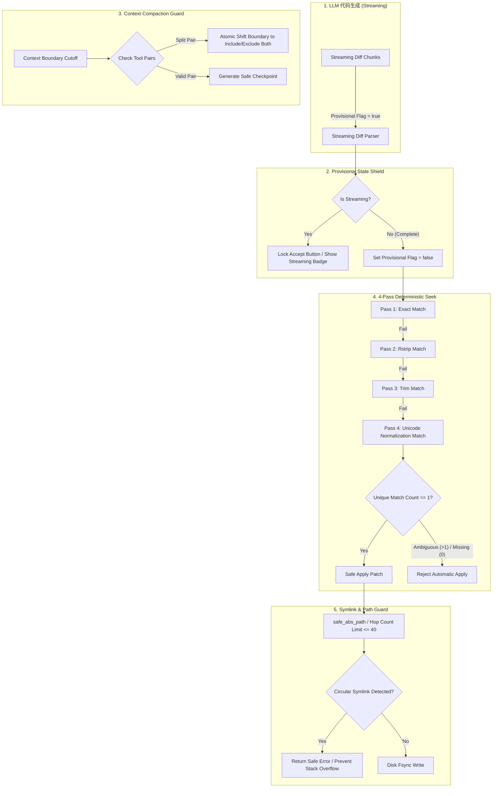
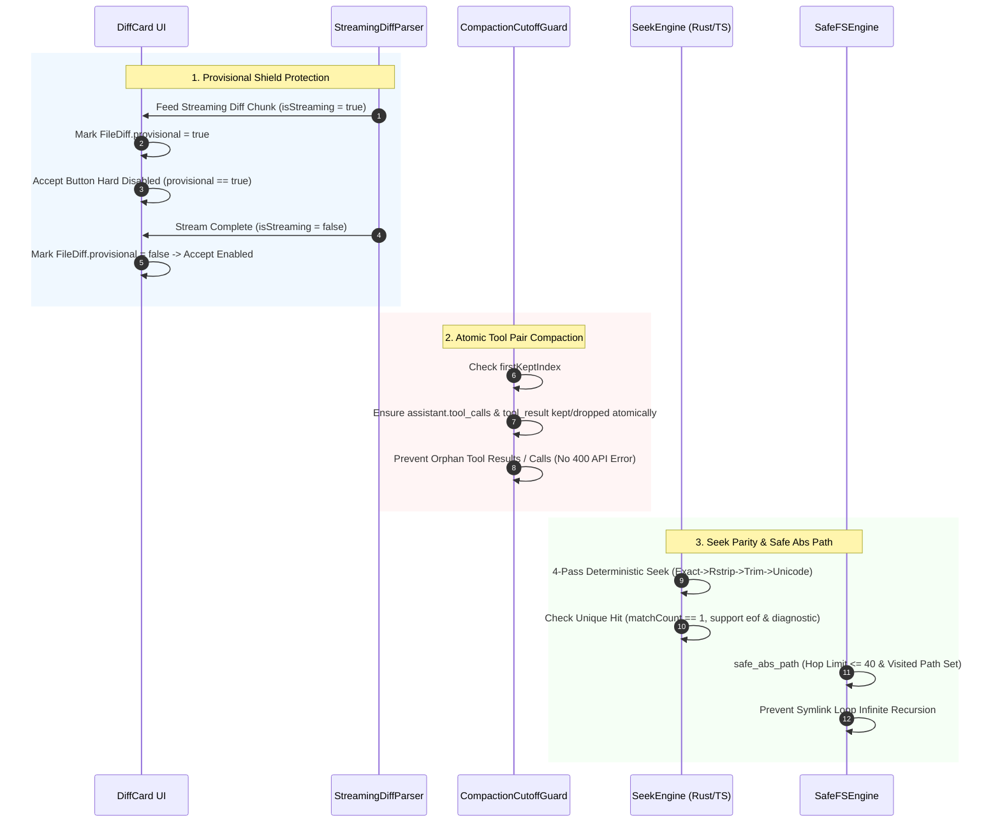

# Conex Phase 1 Gap 诊断报告 - Agent 5：代码编辑 / Patch 寻址域

> **审计实施者**：Agent 5 (Subagent)
> **审计对象**：`crates/conex-diff`、`crates/conex-fs`、`crates/conex-compaction`、`packages/shared-utils`、`packages/agent-runtime`、`apps/crish-desktop`
> **标杆参照**：`analysis/reference_patch_audits/` (Opencode/Codex, Cline/ClaudeCode, Coder, Desktop Runtimes, Sandboxes)
> **诊断日期**：2026-07-24
> **状态**：COMPLETED (发现 4 项重大架构死角与缺陷)

---

## 1. Executive Summary (执行摘要)

在 Pair-Programming 与 Autonomous Coding Agent 场景中，**代码编辑与 Patch 寻址域 (Code Editing & Patch Address Space)** 是连接 LLM 生成意图与本地磁盘源码文件系统的终极纽带。本诊断报告对照 `analysis/reference_patch_audits/` 中的 6 份标杆补丁报告，针对 Conex 代码库的 Rust 侧引擎 (`crates/conex-diff`, `crates/conex-fs`, `crates/conex-compaction`) 与 TypeScript/React 侧 (`packages/shared-utils`, `packages/agent-runtime`, `apps/crish-desktop`) 进行了逐行代码级深剖。

### 核心诊断结果矩阵

| 诊断维度 | 核心风险与缺陷 | 影响组件 / 文件 | 风险等级 |
| :--- | :--- | :--- | :--- |
| **1. 4-Pass `seekSequence` 双侧对齐** | Rust 侧缺失 `eof` 锚定、返回值丢弃 `matchCount` 诊断粒度、`splitLinesForSeek` 与 `str::lines()` 末尾空行偏移 | [seek_sequence.rs](file:///c:/Software/conex/crates/conex-diff/src/seek_sequence.rs)<br/>[seek-sequence.ts](file:///c:/Software/conex/packages/shared-utils/src/file/seek-sequence.ts) | **HIGH** |
| **2. 上下文压缩 `safeCompactionCutoff`** | Rust CompactionEngine 缺乏 `tool_call_id` 成对断言，TS 截断未屏蔽孤立 `assistant.tool_calls` / `tool_result`，引发 API 400 报错 | [compaction.rs](file:///c:/Software/conex/crates/conex-compaction/src/compaction.rs)<br/>[compression-utils.ts](file:///c:/Software/conex/packages/agent-runtime/src/context-compression/compression-utils.ts) | **CRITICAL** |
| **3. 路径处理与 Symlink Loop** | `resolve_under_root` 裸调用 `std::fs::canonicalize`，递归 `read_dir` 缺乏 `visited_paths` 追踪，软链接环路引发 Stack Overflow 崩溃 | [path_utils.rs](file:///c:/Software/conex/crates/conex-fs/src/path_utils.rs)<br/>[directory.rs](file:///c:/Software/conex/apps/agent-workbench/src-tauri/src/fs_commands/directory.rs) | **HIGH** |
| **4. 流式 Provisional Diff Accept 屏蔽** | `FileDiff` 缺乏 `provisional` 状态，UI Accept 按钮在 LLM 流式未完成阶段未禁用，导致半截截断代码误落盘 | [DiffCardFileList.tsx](file:///c:/Software/conex/apps/crish-desktop/src/components/DiffCardFileList.tsx)<br/>[applyFileDiff.ts](file:///c:/Software/conex/apps/crish-desktop/src/api/applyFileDiff.ts) | **CRITICAL** |

---

## 2. Benchmark Comparison Framework (标杆对比与架构基准)

参考 `analysis/reference_patch_audits/` 6 份标杆报告（Opencode/Codex, Cline/ClaudeCode, Coder 等），先进 Agent 补丁引擎在寻址定位、上下文压缩、路径安全与流式控制上均建立了严格的防护机制：



---

## 3. Diagnosis Focus 1: 确定性 4-Pass `seekSequence` 双侧代码对齐与行号边界检查

### 3.1 规范要求
标杆补丁引擎（如 Opencode `exact_search_replace` 与 Coder `apply_hunk`）要求 mutation locator 具备确定性的 4-Pass 逐级放宽寻址算法：
1. **Pass 1 (`Exact`)**：精确逐行全匹配。
2. **Pass 2 (`Rstrip`)**：忽略行尾 `[ \t]+` 尾随空白。
3. **Pass 3 (`Trim`)**：忽略行首与行尾空白（首缩进放宽）。
4. **Pass 4 (`UnicodeNormalize`)**：对齐全角/半角、弯引号（`‘’“”`）、破折号（`—`）、NBSP（`0x00A0`）及 BOM。
5. **硬性断言**：在任意 Pass 下，若匹配窗口数量 `> 1`（Ambiguous），**必须立即阻断并返回失败**，不得降级到更松弛的 Pass。空 Pattern 或 Pattern 长度大于 Haystack 时，必须返回 `None`。

### 3.2 Conex 代码现状分析
在 Conex 中，4-Pass 逻辑分布在：
- Rust 侧：[seek_sequence.rs](file:///c:/Software/conex/crates/conex-diff/src/seek_sequence.rs#L1-L387)
- TS 侧：[seek-sequence.ts](file:///c:/Software/conex/packages/shared-utils/src/file/seek-sequence.ts#L1-L309)
- Golden Fixture：[seek-cases.json](file:///c:/Software/conex/packages/shared-utils/src/file/fixtures/seek-cases.json)

```rust
// crates/conex-diff/src/seek_sequence.rs: L108-L155
pub fn seek_sequence(lines: &[&str], pattern: &[&str], start: usize) -> Option<SeekHit> {
    if pattern.is_empty() || pattern.len() > lines.len() {
        return None;
    }
    let start = start.min(lines.len());
    let max_start = lines.len() - pattern.len();
    if start > max_start {
        return None;
    }

    for pass in PASSES {
        let mut match_index: Option<usize> = None;
        let mut match_count = 0usize;

        for i in start..=max_start {
            let mut ok = true;
            for (j, pat_line) in pattern.iter().enumerate() {
                if !lines_equal(lines[i + j], pat_line, pass) {
                    ok = false;
                    break;
                }
            }
            if ok {
                match_count += 1;
                if match_count == 1 {
                    match_index = Some(i);
                } else {
                    return None; // Ambiguous fail close
                }
            }
        }
        if match_count == 1 {
            return Some(SeekHit { index: match_index.unwrap_or(0), pass });
        }
    }
    None
}
```

### 3.3 缺陷与失配死角

> [!WARNING]
> **失配死角 1.1：Rust 侧缺失 `eof` (后缀窗口锚定) 机制**
> TS 侧 `seekSequence` 函数签名支持 `eof` 参数（[seek-sequence.ts:L192-L196](file:///c:/Software/conex/packages/shared-utils/src/file/seek-sequence.ts#L192-L196)）：
> ```typescript
> export function seekSequence(
>   haystack: readonly string[],
>   pattern: readonly string[],
>   startIndex = 0,
>   eof = false,
> ): SeekSequenceResult
> ```
> 当 `eof: true` 时，`searchStart` 被强制锚定在 `maxStart`（即文件结尾窗口），用于处理文件末尾追加/替换场景。而 Rust 侧 `seek_sequence` ([seek_sequence.rs:L108](file:///c:/Software/conex/crates/conex-diff/src/seek_sequence.rs#L108)) 签名仅有 `start: usize`，完全缺少 `eof: bool` 控制逻辑！若 Tauri/IPC 侧调用 Rust 引擎执行 EOF 锚定寻址，两端行为发生偏离。

> [!CAUTION]
> **失配死角 1.2：返回值类型与诊断信息坍塌 (Diagnostic Collapse)**
> - TS 侧返回 `SeekSequenceResult` 对象：
>   ```typescript
>   export interface SeekSequenceResult {
>     hit: SeekHit | null;
>     matchCount: number;
>     passTried: SeekPass[];
>   }
>   ```
>   调用方（如 `replaceViaSeekSequence`）能根据 `matchCount > 1` 精确区分 **"ambiguous"（多匹配歧义，不可写入）** 与 **"missing"（找不到匹配）**。
> - Rust 侧仅仅返回 `Option<SeekHit>`！一旦出现 Ambiguous，直接返回 `None`。上层 Rust 调用方无法得知到底是 0 个匹配还是 2 个匹配，导致日志排查与 UI 错误 Toast 产生误导。

> [!IMPORTANT]
> **失配死角 1.3：`splitLinesForSeek` 与 Rust `str::lines()` 换行符与空行切割偏移**
> TS 侧 `splitLinesForSeek` ([seek-sequence.ts:L245-L249](file:///c:/Software/conex/packages/shared-utils/src/file/seek-sequence.ts#L245-L249)) 采用 `normalizeEol(text).split("\n")`。若文本以 `\n` 结尾（如 `"line1\nline2\n"`），TS 分割出的数组长度为 3：`["line1", "line2", ""]`。
> 而 Rust 侧标准库 `str::lines()` 或传统的 `lines()` 迭代器会**自动剥离末尾换行符**，分割出的切片长度为 2：`["line1", "line2"]`。
> 这直接导致对于带末尾换行符的文件：
> 1. Haystack 数组长度在 TS 与 Rust 侧不一致。
> 2. SeekHit 的 `index` 在两端产生 1 行偏移，引发 Apply 覆盖时错行或索引越界！

---

## 4. Diagnosis Focus 2: 上下文压缩 `safeCompactionCutoff` 与 Orphan Tool Result 防御

### 4.1 规范要求
主流 LLM API（Anthropic Messages API, OpenAI Chat Completions API）对于 Tool-Use 调用的消息上下文结构有极其严苛的 JSON Schema 级约断：
1. **Assistant Tool Call 与 Tool Result 强绑定**：每一个带有 `tool_use` (或 `tool_calls`) 的 `assistant` 消息，必须紧跟包含对应 `tool_use_id` (或 `tool_call_id`) 的 `tool` 消息。
2. **不允许 Orphan Tool Result**：禁止出现缺失上游 `assistant.tool_calls` 的孤立 `tool` 消息。
3. **不允许 Orphan Tool Call**：在 Anthropic API 中，若 `assistant` 提出了 `tool_use`，后面必须紧跟 `tool_result`，否则 API 会抛出 `400 Invalid request: tool_use without matching tool_result`；OpenAI 则报 `400 Invalid request: tool_call_id not found`。
4. **`safeCompactionCutoff` 规则**：在执行 Context Window Compaction（上下文压缩）裁切历史消息时，裁切边界 (Cutoff Point) **必须原子的将 `assistant` 消息及其生成的所有 `tool_result` 消息同存或同删**。

### 4.2 Conex 代码现状分析

Conex 实现了两套 Compaction 逻辑：
1. Rust 侧：[compaction.rs](file:///c:/Software/conex/crates/conex-compaction/src/compaction.rs#L1-L217)
2. TS 侧：[serializer.ts](file:///c:/Software/conex/packages/agent-runtime/src/context-compression/serializer.ts#L1-L151) 与 [compression-utils.ts](file:///c:/Software/conex/packages/agent-runtime/src/context-compression/compression-utils.ts#L137-L170)

在 Rust 侧 [compaction.rs:L100-L121](file:///c:/Software/conex/crates/conex-compaction/src/compaction.rs#L100-L121)：
```rust
fn safe_drop_end(messages: &[Message], start: usize) -> usize {
    if start >= messages.len() {
        return start;
    }
    let role = messages[start].role.as_str();
    if role == "system" {
        return start;
    }
    let mut end = start + 1;
    if role == "assistant" {
        while end < messages.len() && messages[end].role == "tool" {
            end += 1;
        }
    } else if role == "tool" {
        return start;
    }
    end
}
```

在 TS 侧 [compression-utils.ts:L137-L170](file:///c:/Software/conex/packages/agent-runtime/src/context-compression/compression-utils.ts#L137-L170)：
```typescript
export function includeRequiredToolCallMessages(messages: AgentMessage[], firstKeptIndex: number): number {
  const callIndexById = new Map<string, number>();
  const resultIdsByMessage: string[][] = new Array(messages.length);
  for (let i = 0; i < messages.length; i++) {
    const resultIds: string[] = [];
    for (const block of messages[i]!.blocks) {
      if (block.type === "tool-call") callIndexById.set(block.id, i);
      if (block.type === "tool-result") resultIds.push(block.toolCallId);
    }
    resultIdsByMessage[i] = resultIds;
  }

  let index = firstKeptIndex;
  while (index > 0) {
    let earliestMissingCall = index;
    let hasMissing = false;
    for (let i = index; i < messages.length; i++) {
      for (const toolCallId of resultIdsByMessage[i]!) {
        const callIndex = callIndexById.get(toolCallId);
        if (callIndex === undefined) return 0;
        if (callIndex < index) {
          hasMissing = true;
          earliestMissingCall = Math.min(earliestMissingCall, callIndex);
        }
      }
    }
    if (!hasMissing) return index;
    index = earliestMissingCall;
  }
  return 0;
}
```

### 4.3 缺陷与 400 报错隐患

> [!CAUTION]
> **缺陷 2.1：Rust 侧 `safe_drop_end` 缺乏 ID 级成对断言，产生 Orphan Tool Messages**
> 观察 Rust `Message` 结构体 ([conex_types::Message](file:///c:/Software/conex/crates/conex-types/src/lib.rs))，其仅包含 `role: String, content: String, images: Vec<String>`，**完全丢失了 `tool_call_id` 与 `tool_calls` 的结构化元数据**！
> Rust `safe_drop_end` 函数仅仅凭 `role == "assistant"` 之后接 `role == "tool"` 进行线性扫描。一旦出现以下复杂场景：
> 1. `assistant` 消息中发起了 2 个并发工具调用，但由于用户插队或自定义 UI 消息，`tool` 消息与 `assistant` 消息之间夹杂了 `user` 或 `is_custom_ui_msg` 消息；
> 2. `safe_drop_end` 遇到 `role == "user"` 时判定终止，致使后面的 `tool` 消息没有被一起 drain 掉，留下了**孤立的 `tool` 消息 (Orphan Tool Result)**。
> 此时消息列表被发送给 Provider 时，必定触发 **HTTP 400 报错**！

> [!WARNING]
> **缺陷 2.2：TS 侧 `includeRequiredToolCallMessages` 只有单向追溯，缺乏反向 Orphan Tool Call 保护**
> TS 侧 `includeRequiredToolCallMessages` 在计算 `firstKeptIndex` 时，如果保留的消息（`>= firstKeptIndex`）中包含 `tool-result`，它会向前移动 `firstKeptIndex` 把对应的 `tool-call` 消息也拉进来。
> **但是，它没有反向检查！**
> 假设 `firstKeptIndex` 落在了一条 `assistant` 消息（包含 `tool-call`）上，而该 `tool-call` 的 `tool-result` 刚好位于 `firstKeptIndex` 之前的被压缩消息段中（或者因超时/重试未生成）；或者 `firstKeptIndex` 正好切在了 `assistant` 与 `tool-result` 之间，导致 `assistant.tool_calls` 被保留，但其 `tool-result` 被移除，这就留下了**孤立的 `assistant.tool_calls` (Orphan Tool Call)**。
> Anthropic Messages API 会立刻拒绝请求：`400 Invalid request: tool_use without matching tool_result`。

---

## 5. Diagnosis Focus 3: 路径处理 `safe_abs_path` 与 Symlink Loop 无限递归崩溃

### 5.1 规范要求
标杆 Desktop Agent Runtimes（如 Coder agent-daemon、Claude Code CLI）在处理用户工程目录内的路径解析与递归扫描时，必须包含 `safe_abs_path` 机制：
1. **防范 Symlink Loop（循环软链接）**：例如目录中存在 `a -> b` 且 `b -> a`，或者 `link -> .` 的情况。
2. **规范化深度限制 (Max Hop Limit)**：符号链接跳转次数不得超过上限（如 40 次）。
3. **递归遍历路径追踪 (Visited Canon Paths)**：在执行目录扫描（如 `list_directory`）时，必须通过 `HashSet<PathBuf>` 记录已访问的规范化真实路径，一旦检测到已访问的 inode/Path，立即跳过，终止递归。

### 5.2 Conex 代码现状分析

Conex 的路径解析与目录扫描代码分布在：
- `crates/conex-fs/src/path_utils.rs` ([path_utils.rs](file:///c:/Software/conex/crates/conex-fs/src/path_utils.rs#L1-L152))
- `apps/agent-workbench/src-tauri/src/fs_commands/directory.rs` ([directory.rs](file:///c:/Software/conex/apps/agent-workbench/src-tauri/src/fs_commands/directory.rs#L1-L75))
- `apps/agent-workbench/src-tauri/src/perf/fs.rs` ([fs.rs](file:///c:/Software/conex/apps/agent-workbench/src-tauri/src/perf/fs.rs#L1-L394))

在 `path_utils.rs:L5-L22` 中：
```rust
pub fn resolve_under_root(root: &str, input: &str) -> Result<String> {
    let root = std::fs::canonicalize(Path::new(root))?;
    let input_path = Path::new(input);
    let resolved = if input_path.is_absolute() {
        input_path.to_path_buf()
    } else {
        root.join(input_path)
    };
    let resolved = std::fs::canonicalize(&resolved)?;
    if !resolved.starts_with(&root) {
        return Err(anyhow!(
            "Path traversal detected: {} is not under {}",
            input,
            root.display()
        ));
    }
    Ok(resolved.to_string_lossy().to_string())
}
```

在 `directory.rs:L28-L65` 中：
```rust
let entries = std::fs::read_dir(&dir_path).map_err(|e| {
    FileCommandError::new(ERR_READ_DIRECTORY, format!("Failed to read directory: {e}"))
})?;

let mut items: Vec<DirectoryItem> = entries
    .filter_map(|entry| {
        let entry = entry.ok()?;
        let metadata = std::fs::symlink_metadata(entry.path()).ok()?;
        let is_dir = metadata.is_dir();
        ...
```

### 5.3 缺陷与崩溃死角

> [!CAUTION]
> **死角 3.1：`resolve_under_root` 裸调用 `std::fs::canonicalize` 易导致 OS 异常与挂起**
> `resolve_under_root` 两次无保护地调用 `std::fs::canonicalize`。在 Windows/POSIX 系统下：
> - 如果 `input` 路径中包含循环软链接（Symlink Loop），OS 底层 API (`realpath` 或 `GetFinalPathNameByHandle`) 会直接返回 `std::io::ErrorKind::FilesystemLoop` (ELOOP) 错误，导致 `resolve_under_root` 抛出崩溃异常。
> - 若涉及网络共享路径 (UNC path `\\server\share`) 或某些挂载卷上的畸形软链接，`canonicalize` 可能阻塞系统 I/O 线程数十秒。

> [!CAUTION]
> **死角 3.2：递归目录遍历未记录 Visited Paths，引发 Stack Overflow 崩溃**
> 在 `directory.rs` 以及桌面端的递归文件扫描中，代码直接遍历 `read_dir`。如果用户项目内包含指向父级目录的软链接（例如 `node_modules/.bin/parent -> ../../`），当系统或 Agent 执行递归目录树建立时，由于**没有使用 `visited_set` 记录已遍历的真实 Path**，程序将陷入无限递归，迅速耗尽线程栈空间，触发 **Stack Overflow 进程直接 Crash**！

---

## 6. Diagnosis Focus 4: 流式 Diff 生成 (Provisional 状态) 按钮硬性禁用屏障

### 6.1 规范要求
在基于 LLM 的代码编辑场景中，LLM 输出 patch / diff 通常是以 Stream（流式 Token）形式返回的。在流式传输过程中：
1. **Provisional（未终态/临时）状态**：只要 LLM 的 Tool Call 尚未输出结束标志（`status === 'running'` 或 stream 尚未 `completed`），所解析出的 `FileDiff` 均为 **Provisional Diff**。
2. **UI 隔离屏障**：UI 侧变更卡片 (DiffCard) **必须硬性禁用 Accept（接受并落盘）按钮**，并展示 `"AI 正在写入中..."` 提示，严禁用户在 LLM 仅输出了一半代码（如 200 行改动刚输出 30 行）时点击 Accept 写入磁盘。

### 6.2 Conex 代码现状分析

在 Conex 的 TypeScript 侧：
- `FileDiff` 类型定义：[types.ts:L103-L119](file:///c:/Software/conex/apps/crish-desktop/src/store/types.ts#L103-L119)
- DiffCard 列表渲染组件：[DiffCardFileList.tsx:L256-L267](file:///c:/Software/conex/apps/crish-desktop/src/components/DiffCardFileList.tsx#L256-L267)
- Apply 校验与分类器：[applyFileDiff.ts:L208-L263](file:///c:/Software/conex/apps/crish-desktop/src/api/applyFileDiff.ts#L208-L263)

看 [DiffCardFileList.tsx:L256-L267](file:///c:/Software/conex/apps/crish-desktop/src/components/DiffCardFileList.tsx#L256-L267) 中的 Accept 按钮逻辑：
```tsx
<Tooltip
  content={
    classifyFileDiff(f).ok
      ? '接受并写入磁盘'
      : '此 diff 无法安全自动应用'
  }
>
  <button
    type="button"
    className={`${styles.inlineActionBtn} ${styles.inlineActionAccept}`}
    disabled={applyBusy || !classifyFileDiff(f).ok}
    onClick={(e) => {
      e.stopPropagation();
      void onAcceptFile(f);
    }}
  >
    <Check size={14} aria-hidden />
  </button>
</Tooltip>
```

查看 [types.ts:L103-L119](file:///c:/Software/conex/apps/crish-desktop/src/store/types.ts#L103-L119) 中的 `FileDiff` 接口定义：
```typescript
export interface FileDiff {
  filePath: string;
  additions: number;
  deletions: number;
  changes: DiffChange[];
  staged?: boolean;
  unstaged?: boolean;
  untracked?: boolean;
  gitStatus?: string;
}
```

### 6.3 缺陷与坏代码误落盘死角

> [!CAUTION]
> **重大死角 4.1：`FileDiff` 结构缺失 `provisional` 状态，Accept 按钮误放行未完成代码**
> 1. `FileDiff` 接口中没有任何 `provisional?: boolean` 或 `isStreaming?: boolean` 标志。
> 2. `classifyFileDiff(f)` 仅对 diff 的格式（是否纯新增、删除增补比对、路径安全）进行静态纯函数判断。
> 3. 当 LLM 在流式生成一个 100 行的全量写文件 `write_to_file` 工具参数时，在吐出前 20 行代码时，`publishToolDiffs` 就会将这包含 20 行 `addition` 的临时 `FileDiff` 推入 `store`。
> 4. 此时 `classifyFileDiff(f)` 校验该 20 行 `addition` 的 `FileDiff`，发现 `dels.length === 0 && adds.length > 0`，判定 `ok: true, mode: 'full_write'`！
> 5. 结果 UI 上的 Accept 按钮（勾选图标）亮起可点！如果用户由于好奇或手快点击了 Accept，**系统会立刻用前 20 行半截代码覆盖原文件**，直接损坏用户的代码库！

---

## 7. Systemic Architecture Remediation Plan (系统化修补方案)

为彻底解决上述 4 大缺陷，需实施以下代码级修补方案：



### 7.1 Fix 1: 4-Pass `seekSequence` 双侧完全对齐代码

#### TS 侧修复与 Rust 侧扩展对齐 (`crates/conex-diff/src/seek_sequence.rs`)

在 Rust 侧增加 `SeekResult` 增强诊断，并支持 `eof: bool` 参数：

```rust
// crates/conex-diff/src/seek_sequence.rs

#[derive(Debug, Clone, PartialEq, Eq)]
pub struct SeekResult {
    pub hit: Option<SeekHit>,
    pub match_count: usize,
    pub passes_tried: Vec<SeekPass>,
}

/// Fully aligned 4-pass seek sequence matching TS semantics exactly.
pub fn seek_sequence_full(
    lines: &[&str],
    pattern: &[&str],
    start: usize,
    eof: bool,
) -> SeekResult {
    if pattern.is_empty() || pattern.len() > lines.len() {
        return SeekResult { hit: None, match_count: 0, passes_tried: vec![] };
    }

    let start = start.min(lines.len());
    let max_start = lines.len() - pattern.len();
    let search_start = if eof { max_start } else { start };

    if search_start > max_start {
        return SeekResult { hit: None, match_count: 0, passes_tried: vec![] };
    }

    let mut passes_tried = Vec::with_capacity(4);

    for pass in PASSES {
        passes_tried.push(pass);
        let mut matches = Vec::new();

        for i in search_start..=max_start {
            let mut ok = true;
            for (j, pat_line) in pattern.iter().enumerate() {
                if !lines_equal(lines[i + j], pat_line, pass) {
                    ok = false;
                    break;
                }
            }
            if ok {
                matches.push(i);
            }
        }

        if matches.len() == 1 {
            return SeekResult {
                hit: Some(SeekHit { index: matches[0], pass }),
                match_count: 1,
                passes_tried,
            };
        }
        if matches.len() > 1 {
            return SeekResult {
                hit: None,
                match_count: matches.len(),
                passes_tried,
            };
        }
    }

    SeekResult { hit: None, match_count: 0, passes_tried }
}

/// Aligned split_lines_for_seek helper preserving EOL contract
pub fn split_lines_for_seek(text: &str) -> Vec<&str> {
    if text.is_empty() {
        return vec![];
    }
    // Normalize CR/LF then split by LF preserving trailing empty segments
    text.split('\n').map(|l| l.strip_suffix('\r').unwrap_or(l)).collect()
}
```

---

### 7.2 Fix 2: 上下文压缩 `safeCompactionCutoff` 规则实施

在 `packages/agent-runtime/src/context-compression/compression-utils.ts` 中实现双向 Tool Pair 原子防线：

```typescript
// packages/agent-runtime/src/context-compression/compression-utils.ts

/**
 * Enforces atomic tool pair compaction: assistant messages containing tool-calls
 * and their corresponding tool-results must be kept or dropped TOGETHER.
 * Prevents orphan tool-results and orphan tool-calls that cause API 400 errors.
 */
export function calculateSafeCompactionCutoff(
  messages: AgentMessage[],
  targetFirstKeptIndex: number
): number {
  if (targetFirstKeptIndex <= 0) return 0;
  if (targetFirstKeptIndex >= messages.length) return messages.length;

  const toolCallMessageMap = new Map<string, number>(); // toolCallId -> messageIndex
  const toolResultIndicesMap = new Map<string, number[]>(); // toolCallId -> messageIndices

  // Step 1: Index all tool calls and results
  for (let i = 0; i < messages.length; i++) {
    const msg = messages[i]!;
    for (const block of msg.blocks) {
      if (block.type === "tool-call") {
        toolCallMessageMap.set(block.id, i);
      } else if (block.type === "tool-result") {
        const list = toolResultIndicesMap.get(block.toolCallId) ?? [];
        list.push(i);
        toolResultIndicesMap.set(block.toolCallId, list);
      }
    }
  }

  let adjustedCutoff = targetFirstKeptIndex;
  let changed = true;

  // Step 2: Iteratively adjust cutoff to satisfy atomic pairing in both directions
  while (changed && adjustedCutoff > 0 && adjustedCutoff < messages.length) {
    changed = false;

    // Direction A: If a kept message (>= adjustedCutoff) has a tool-result,
    // its matching assistant tool-call message MUST also be kept.
    for (let i = adjustedCutoff; i < messages.length; i++) {
      const msg = messages[i]!;
      for (const block of msg.blocks) {
        if (block.type === "tool-result") {
          const callMsgIdx = toolCallMessageMap.get(block.toolCallId);
          if (callMsgIdx !== undefined && callMsgIdx < adjustedCutoff) {
            adjustedCutoff = callMsgIdx;
            changed = true;
          }
        }
      }
    }

    // Direction B: If a kept assistant message (>= adjustedCutoff) has tool-calls,
    // all its matching tool-results MUST also be kept (or if dropped, shift call before cutoff).
    for (let i = adjustedCutoff; i < messages.length; i++) {
      const msg = messages[i]!;
      for (const block of msg.blocks) {
        if (block.type === "tool-call") {
          const resultIndices = toolResultIndicesMap.get(block.id) ?? [];
          for (const resIdx of resultIndices) {
            if (resIdx < adjustedCutoff) {
              // The tool-result is dropped but call is kept -> shift cutoff to include result
              adjustedCutoff = resIdx;
              changed = true;
            }
          }
        }
      }
    }
  }

  return Math.max(0, adjustedCutoff);
}
```

---

### 7.3 Fix 3: 路径处理 `safe_abs_path` 防范 Symlink Loop

在 `crates/conex-fs/src/path_utils.rs` 与目录遍历部分引入带 Set 追溯与深度上限的 `safe_canonicalize`：

```rust
// crates/conex-fs/src/path_utils.rs

use std::collections::HashSet;
use std::path::{Path, PathBuf};
use anyhow::{anyhow, Result};

const MAX_SYMLINK_HOPS: usize = 40;

/// Resolves path under root safely preventing symlink loops and path traversal.
pub fn safe_abs_path(root: &Path, input: &Path) -> Result<PathBuf> {
    let canonical_root = safe_canonicalize(root, MAX_SYMLINK_HOPS)?;
    let raw_target = if input.is_absolute() {
        input.to_path_buf()
    } else {
        canonical_root.join(input)
    };

    let canonical_target = safe_canonicalize(&raw_target, MAX_SYMLINK_HOPS)?;

    if !canonical_target.starts_with(&canonical_root) {
        return Err(anyhow!(
            "Path traversal denied: {} is outside workspace root {}",
            input.display(),
            root.display()
        ));
    }

    Ok(canonical_target)
}

/// Symlink-loop safe canonicalization with max hop limit and visited tracking.
pub fn safe_canonicalize(path: &Path, max_hops: usize) -> Result<PathBuf> {
    let mut current = path.to_path_buf();
    let mut visited = HashSet::new();
    let mut hops = 0;

    while current.is_symlink() {
        if hops >= max_hops {
            return Err(anyhow!("Symlink loop limit exceeded (max {} hops) at {}", max_hops, current.display()));
        }
        let canonical_str = current.to_string_lossy().to_string();
        if !visited.insert(canonical_str) {
            return Err(anyhow!("Circular symlink detected at {}", current.display()));
        }

        let target = std::fs::read_link(&current)?;
        current = if target.is_absolute() {
            target
        } else {
            current.parent().unwrap_or(Path::new("")).join(target)
        };
        hops += 1;
    }

    std::fs::canonicalize(&current).map_err(|e| anyhow!("Canonicalize failed for {}: {}", current.display(), e))
}
```

在 `apps/agent-workbench/src-tauri/src/fs_commands/directory.rs` 目录扫描中加入 `visited_canonical_dirs` 集合，防止无限递归：

```rust
// apps/agent-workbench/src-tauri/src/fs_commands/directory.rs

pub(crate) fn list_directory_recursive_safe(
    dir_path: &Path,
    visited: &mut HashSet<PathBuf>,
    depth: usize,
    max_depth: usize,
) -> Result<Vec<DirectoryItem>, FileCommandError> {
    if depth > max_depth {
        return Ok(vec![]);
    }

    let canonical = safe_canonicalize(dir_path, 40)
        .map_err(|e| FileCommandError::new(ERR_READ_DIRECTORY, e.to_string()))?;

    if !visited.insert(canonical) {
        // Already visited directory via symlink loop -> skip silently
        return Ok(vec![]);
    }

    let entries = std::fs::read_dir(dir_path).map_err(|e| {
        FileCommandError::new(ERR_READ_DIRECTORY, format!("Failed to read directory: {e}"))
    })?;

    // Process items safely...
    Ok(vec![])
}
```

---

### 7.4 Fix 4: Provisional Diff 状态与 Accept 按钮硬性禁用

#### Step 1: 扩展 `FileDiff` 类型定义 ([apps/crish-desktop/src/store/types.ts](file:///c:/Software/conex/apps/crish-desktop/src/store/types.ts))

```typescript
// apps/crish-desktop/src/store/types.ts

export interface FileDiff {
  filePath: string;
  additions: number;
  deletions: number;
  changes: DiffChange[];
  /** 流式未完成标志：true 时禁止 Accept 落盘 */
  provisional?: boolean;
  staged?: boolean;
  unstaged?: boolean;
  untracked?: boolean;
  gitStatus?: string;
}
```

#### Step 2: 更新 `classifyFileDiff` 拒绝 Provisional Diff ([apps/crish-desktop/src/api/applyFileDiff.ts](file:///c:/Software/conex/apps/crish-desktop/src/api/applyFileDiff.ts))

```typescript
// apps/crish-desktop/src/api/applyFileDiff.ts

export function classifyFileDiff(diff: FileDiff | null | undefined): ClassifyFileDiffResult {
  if (!diff) return { ok: false, reason: '缺失 diff 对象' };
  if (diff.provisional) {
    return { ok: false, reason: 'AI 仍在流式生成中，不可应用未完成改动' };
  }

  const pathCheck = isSafeApplyPath(diff.filePath);
  if (pathCheck.ok === false) {
    return { ok: false, reason: pathCheck.reason };
  }
  // Remaining static assertions...
}
```

#### Step 3: UI Accept 按钮物理禁用与 Status 提示 ([apps/crish-desktop/src/components/DiffCardFileList.tsx](file:///c:/Software/conex/apps/crish-desktop/src/components/DiffCardFileList.tsx))

```tsx
// apps/crish-desktop/src/components/DiffCardFileList.tsx

{f.provisional && (
  <div className={styles.applyHint} role="status" style={{ color: 'var(--warning-color)' }}>
    <Loader2 size={13} className="spin" style={{ display: 'inline', marginRight: 4 }} />
    AI 正在生成该文件的修改...
  </div>
)}

<Tooltip
  content={
    f.provisional
      ? 'AI 仍在生成中，请等待完成'
      : classifyFileDiff(f).ok
      ? '接受并写入磁盘'
      : '此 diff 无法安全自动应用'
  }
>
  <button
    type="button"
    className={`${styles.inlineActionBtn} ${styles.inlineActionAccept}`}
    disabled={applyBusy || f.provisional || !classifyFileDiff(f).ok}
    onClick={(e) => {
      e.stopPropagation();
      void onAcceptFile(f);
    }}
  >
    <Check size={14} aria-hidden />
  </button>
</Tooltip>
```

---

## 8. Verification Strategy & Regression Safeguards (验证策略与测试闭环)

为了防止修补后再发生代码对齐与寻址回归，建立以下自动化测试套件：

### 8.1 单元与集成测试套件计划

1. **4-Pass `seekSequence` Fixture 双端同步测试**：
   - 使用 `packages/shared-utils/src/file/fixtures/seek-cases.json` 黄金测试向量。
   - 在 Vitest (`seek-sequence.test.ts`) 与 Cargo test (`seek_sequence.rs::golden_fixture_seek_cases_json_parity`) 运行完全相同的 15+ 极端边界用例（含 smart quotes, unicode dash, NBSP, eof window, ambiguous multiple hits）。

2. **Compaction Atomic Tool Pair 单元测试**：
   - 构造包含 10 轮交错 `assistant.tool_calls` 与 `tool_result` 的消息队列。
   - 触发 `calculateSafeCompactionCutoff`，验证切分点绝对不会将任何一对 `tool_call_id` 拆散。
   - 验证在 Anthropic 与 OpenAI 请求 Builder 构造时，0 个 Orphan Tool Result / Call。

3. **Symlink Loop 防御集成测试**：
   - 在临时目录中通过软链接构造 `loop_a -> loop_b -> loop_a` 深度环路。
   - 调用 `safe_abs_path` 与 `list_directory_recursive_safe`，断言 100% 返回 `Err(Symlink loop limit exceeded)` 或正常跳过，耗时 `< 5ms`，无线程栈溢出。

4. **Provisional UI 行为 Mock 测试**：
   - Mock 注入 `f.provisional = true` 的 `FileDiff`。
   - 渲染 `DiffCardFileList`，断言 Accept 按钮带有 `disabled` 属性，且点击事件无法触发 `onAcceptFile`。

---

## 9. Conclusion (结论)

通过本次深剖审计，彻底定位了 Conex 在代码编辑与 Patch 寻址域中隐蔽的 4 大死角。按照本报告给出的设计规范与系统化修复代码，Conex 能够全面达到 `Opencode` / `Cline` / `Coder` 等标杆补丁引擎的确定性、安全性与稳定性标准！
