# Conex 全局依赖拓扑 DAG 修复图谱与 Round 1 ~ Round 9 深度实施计划

> **文档编号**: `CONEX-TOPOLOGY-DAG-V2`  
> **生成时间**: 2026-07-24  
> **审计基准**: `C:\Software\conex\analysis\conex_gap_audits\` (下辖 6 份 Gap 诊断报告)  
> **目标文件**: `C:\Software\conex\analysis\conex_repair_topology_v2.md`  
> **合规遵循**: [AGENTS.md](file:///c:/Software/conex/.agents/AGENTS.md) 及 [ANTI_OVERENGINEERING_GUARDRAILS.md](file:///c:/Software/conex/ANTI_OVERENGINEERING_GUARDRAILS.md)

---

## 1. 概述与设计理念

根据 Phase 1 阶段 Agent 1 ~ Agent 6 对 Conex 全域（流式 Token、并发状态机、Tool Call 容错、进程/内存/数据库句柄、代码编辑 Patch 寻址、桌面 UI 与系统唤醒）共 **48 项核心架构缺陷** 的深剖审计，本文档制定了全局依赖修复顺序、Master 拓扑 DAG 图谱以及 Round 1 至 Round 9 的系统化重构路线图。

### 拓扑构建的核心原则
1. **编译解锁与契约先行 (Type Contract First)**：优先完成基础类型契约与接口扩展（R1），解除上层模块重构时的 TypeScript / Rust 编译阻塞。
2. **防线内聚与底层收紧 (Layered Defense)**：先收紧底层进程树强杀、取消信号级联与线程上下文（R2），再推进流式数据层（R3）与 Tool Call 容错（R4）。
3. **关键算法与原子保护 (Algorithm & State Integrity)**：在 R5 中实现确定性 4-Pass 寻址与 Tool Pair 双向原子裁切；在 R6 中夯实 SQLite WAL 退避与系统唤醒锁。
4. **用户体验与物理安全 (UI & Security Guard)**：在 R7 中收紧 UI 视口弹性钳制与 OS Keyring 物理秘钥隔离。
5. **资源限流与 CI/CD 防线 (Governance & Limits)**：在 R8 中完成 Live Agent 信号量门禁、代际意图锁与 CI 6 条硬性断言。
6. **端到端全量系统验证 (E2E System Verification)**：在 R9 中通过全量单元/集成测试与黄金向量演练，确保零回归。

---

## 2. Master 修复拓扑 DAG 图谱 (Mermaid Master DAG)

以下拓扑图展现了 48 项缺陷修复节点的全局依赖演进关系，节点按 Round 1 ~ Round 9 严格分层排列，箭头表示 `depends_on` 前置依赖走向。

```mermaid
flowchart TD
    subgraph R1 ["Round 1: 编译解锁 & 底层依赖与类型定义加固"]
        R1_1["GAP-01-07T: ProviderStreamFinishReason 扩展 'length'/'max_tokens'"]
        R1_2["GAP-05-06T: FileDiff 扩展 provisional?: boolean 字段"]
        R1_3["GAP-05-01T: Rust seek_sequence 增加 SeekResult 诊断元数据"]
        R1_4["GAP-03-02T: 导出 Zod 自动纠偏辅助函数 zCoerceArray / zDefaultEmpty"]
        R1_5["GAP-04-01T: Rust process_tree 重构 ScopedJobObject 句柄"]
    end

    subgraph R2 ["Round 2: 并发/状态机 & 进程/句柄/信号级联杀死防线"]
        R2_1["GAP-02-01: 后台 Subagent 绑定 Session 级 AbortSignal"]
        R2_2["GAP-02-02: cancelRun() 联动 BackgroundCommandManager 强杀进程树"]
        R2_3["GAP-04-09: process-executor & PowerShell 注入 CI=true 等 12 个非交互变量"]
        R2_4["GAP-02-08: 废脱 enterWith，全链路改用 withTraceContext 作用域隔离"]
        R2_5["GAP-02-09: Subagent 工具改用 Disposable/using 防止计数器死锁泄露"]
    end

    subgraph R3 ["Round 3: 流式 UTF-8 代理对、Reasoning 思考链与 Token/Cost 估算"]
        R3_1["GAP-01-01: StreamRenderBuffer 修正 Unicode Surrogate Pair 增量切割"]
        R3_2["GAP-01-02: readSseJson & directFetchBridge 流结束时 flush TextDecoder"]
        R3_3["GAP-01-03: Rust conex-stream SSE 解析废除 from_utf8_lossy"]
        R3_4["GAP-06-02: directFetchBridge & useStreamCallbacks 在 Abort 时封存 reasoning_content"]
        R3_5["GAP-01-04: Rust compaction.rs 补齐 Tools Schema 与 1.15 安全系数"]
        R3_6["GAP-01-05: payload-image-recovery 扫描并剥离 message.blocks 中的 Base64 图片"]
    end

    subgraph R4 ["Round 4: Tool Call 容错、Schema 归一化与拒绝意图黑名单"]
        R4_1["GAP-03-01: parseArguments & extractToolArgumentObject 归一化 null/[]/None"]
        R4_2["GAP-03-03: DaemonApprovalHandler 增加 runIntentDenylist 拒绝黑名单"]
        R4_3["GAP-03-04: 拒绝决策返回 retryable: false 阻止模型无限重复弹窗"]
        R4_4["GAP-03-05: stringifyToolOutput 拦截空数组导出，Tool Result 注入 safe text"]
        R4_5["GAP-03-07: mcp-stdio-adapter 注入 ToolExecutionContext.signal 与 30s 超时"]
        R4_6["GAP-03-08: McpServerController 增加 3 次连续失败 Circuit Breaker 熔断"]
    end

    subgraph R5 ["Round 5: 代码编辑 4-Pass seekSequence 与 safeCompactionCutoff 消息成对隔离"]
        R5_1["GAP-05-01: Rust seek_sequence_full 支持 eof 锚定与 4-Pass 完全对齐"]
        R5_2["GAP-05-02: splitLinesForSeek 与 Rust 行分割规范化契约"]
        R5_3["GAP-05-03: calculateSafeCompactionCutoff 实施 Tool Call/Result 双向原子裁切"]
        R5_4["GAP-05-05: path_utils 引入 safe_canonicalize (Hop <= 40) 与 Visited Set 防死循环"]
        R5_5["GAP-05-06: UI DiffCard Accept 按钮硬性禁用 provisional Diff 落盘"]
    end

    subgraph R6 ["Round 6: SQLite WAL 重试退避、内存 GC / Payload 剪裁与系统 Keep-Awake 唤醒锁"]
        R6_1["GAP-04-04: conex-db 事务升级为 BEGIN IMMEDIATE 并增加 Jitter 指数退避重试"]
        R6_2["GAP-04-06: 历史消息 Raw Tool Output 实施 32KB LRU 截断与离线标记"]
        R6_3["GAP-04-07: 增加 global.gc?.() 显式触发与 堆内存 Watchdog"]
        R6_4["GAP-04-08: Rust compaction 原地 retain 消除 Message.clone 并调用 shrink_to_fit"]
        R6_5["GAP-06-01: Tauri 主进程实现跨平台 KeepAwakeGuard 系统唤醒锁"]
    end

    subgraph R7 ["Round 7: 桌面 UI 视口钳制、Popover 拦截与 Keyring 物理秘钥加密"]
        R7_1["GAP-06-04: Popover 全量应用 max-h-[calc(100dvh-3rem)] 视口钳制与滚轮拦截"]
        R7_2["GAP-06-05: ProjectPickerMenu 移除动态 Function import 改用标准 ESM"]
        R7_3["GAP-06-06: Rust credentials.rs 补齐 macOS Keychain 与 Linux SecretService 绑定"]
        R7_4["GAP-06-07: providerProfiles 从 localStorage 中彻底擦除明文 apiKey"]
        R7_5["GAP-06-08: 增加 Skill 沙盒凭据 Mount Guard 拦截 .env / credentials 挂载"]
    end

    subgraph R8 ["Round 8: Agent/Subagent 资源信号量与 CI/CD 机制防线"]
        R8_1["GAP-04-03: BoundedMap 增加 onEvict 清理钩子强杀被淘汰后台进程"]
        R8_2["GAP-02-03: Orchestrator activeRuns 淘汰最旧 Run 前显式调用 engine.abort()"]
        R8_3["GAP-02-04: Daemon 侧装配全局 AsyncSemaphore(32) Live Agent 槽位门禁"]
        R8_4["GAP-02-05: ChatGPTAccountPool 强制装配 CrossProcessLock 代际意图锁"]
        R8_5["GAP-08-02: 实施 CI 6 条硬性断言 (代码行数/无循环依赖/<2s 扫描)"]
    end

    subgraph R9 ["Round 9: 端到端全量系统验证与单元/集成测试套件集成"]
        R9_1["GAP-09-01: 黄金向量 4-Pass Seek 双端一致性自动化测试"]
        R9_2["GAP-09-02: OAuth Single-Flight 并发 401 刷线网络回归测试"]
        R9_3["GAP-09-03: Compaction 双向 Tool Pair 零 400 错报集成测试"]
        R9_4["GAP-09-04: 端到端 E2E 全量系统断言与验证"]
    end

    %% 跨轮次依赖关系 (depends_on)
    R1_1 --> R3_4
    R1_1 --> R4_3
    R1_2 --> R5_5
    R1_3 --> R5_1
    R1_4 --> R4_1
    R1_5 --> R2_2
    
    R2_1 --> R8_2
    R2_2 --> R8_1
    R2_3 --> R4_5
    R2_4 --> R8_3

    R3_1 --> R5_1
    R3_4 --> R6_2
    R3_5 --> R5_3
    R3_6 --> R5_3

    R4_1 --> R5_3
    R4_2 --> R4_3
    R4_3 --> R5_5
    R4_5 --> R8_3

    R5_1 --> R9_1
    R5_3 --> R6_4
    R5_3 --> R9_3
    R5_4 --> R7_5

    R6_1 --> R8_4
    R6_2 --> R8_1
    R6_5 --> R7_1

    R7_3 --> R7_4
    R7_4 --> R8_4

    R8_1 --> R9_4
    R8_2 --> R9_4
    R8_3 --> R9_4
    R8_4 --> R9_2
    R8_5 --> R9_4
```

---

## 3. 全局缺陷矩阵与依赖关系汇总表 (Global Issue Dependency Matrix)

下表汇总了 Conex 代码库中 48 项诊断缺陷的元数据、受影响模块、风险等级、所属 Round 以及其**明确的前置依赖关系 (`depends_on`)**：

| Issue ID | 缺陷名称与描述 | 核心受影响文件 | 风险等级 | 所属 Round | 前置依赖 (`depends_on`) |
| :--- | :--- | :--- | :--- | :--- | :--- |
| **GAP-01-01** | `StreamRenderBuffer.ts` 代理对截断与非 `\n` 行切割乱码 | `StreamRenderBuffer.ts` | P1 - 严重 | **R3** | 无 |
| **GAP-01-02** | 流结束 `done: true` 时未 flush `TextDecoder` 残留字节 | `openai-stream-parse.ts` | P2 - 中等 | **R3** | 无 |
| **GAP-01-03** | Rust `conex-stream` SSE 解析使用 `from_utf8_lossy` 强转 | `sse.rs` | P1 - 严重 | **R3** | 无 |
| **GAP-01-04** | Rust `compaction.rs` Token 估算遗漏 Tools Schema 与安全系数 | `compaction.rs` | P1 - 严重 | **R3** | 无 |
| **GAP-01-05** | `payload-image-recovery.ts` 剥离图片遗漏 `blocks` 内 Base64 | `payload-image-recovery.ts` | P0 - 阻断 | **R3** | 无 |
| **GAP-01-06** | 图片剥离后 metadata 与 blocks 数据占位符不同步 | `payload-image-recovery.ts` | P1 - 严重 | **R3** | `GAP-01-05` |
| **GAP-01-07** | `legacyFinishReason` 强制将 `"length"` 截断信号改写为 `"stop"` | `normalizer.ts` | P0 - 阻断 | **R1** | 无 |
| **GAP-01-08** | `buildMessage` 忽略流事件 `finishReason`，丢弃 `stopReason` | `provider-response-consumer.ts` | P0 - 阻断 | **R1** | `GAP-01-07` |
| **GAP-01-09** | `handleNoToolCalls` 中 `stopReason === 'length'` 永远为 false | `session-loop/index.ts` | P0 - 阻断 | **R3** | `GAP-01-07`, `GAP-01-08` |
| **GAP-01-10** | `balanceJsonContainers` 尾部 `\` 转义闭合双引号导致语法报错 | `json-repair.ts` | P1 - 严重 | **R4** | 无 |
| **GAP-02-01** | 后台 Subagent 工具执行完成后提前解绑 `onAbort` 监听器 | `subagent-runtime.ts` | P0 - 阻断 | **R2** | 无 |
| **GAP-02-02** | `cancelRun()` 仅中断 LLM engine，遗漏后台 Shell 子进程树 | `orchestrator.ts` | P0 - 阻断 | **R2** | `GAP-04-01` |
| **GAP-02-03** | `activeRuns` 的 `BoundedMap` 静默淘汰最旧 Run 产生 Ghost Run | `orchestrator.ts` | P0 - 阻断 | **R8** | `GAP-02-01`, `GAP-04-03` |
| **GAP-02-04** | Daemon 侧 `createDaemonSubagentTool` 缺失全局 Live Agent 槽位 | `subagent-runtime.ts` | P1 - 严重 | **R8** | `GAP-02-08` |
| **GAP-02-05** | `refreshAccount` 未装配 `CrossProcessLock` 导致并发重放 401 封账号 | `chatgpt-pool.ts` | P0 - 阻断 | **R8** | `GAP-06-07` |
| **GAP-02-06** | 流中途哪怕产生 1 字符，TCP Reset 即被划归 Case B 拒绝重试 | `stream-recovery.ts` | P1 - 严重 | **R3** | 无 |
| **GAP-02-07** | 上层账号池将暂态网络 Reset 误判为 Auth 错误实施 5min~1h 冷却 | `chatgpt-pool.ts` | P1 - 严重 | **R3** | `GAP-02-06` |
| **GAP-02-08** | `setTraceContext` 滥用 `enterWith` 造成跨 Session Context 污染 | `trace/index.ts` | P1 - 严重 | **R2** | 无 |
| **GAP-02-09** | 模块级全局 `activeSubagentCount` 在 `try` 块外自增导致死锁 | `subagents.ts` | P2 - 中等 | **R2** | 无 |
| **GAP-03-01** | `null` / `[]` 参数被错误包装为 `{ value: null }` 导致提取失败 | `provider-openai-chat.ts` | P1 - 严重 | **R4** | `GAP-03-02` |
| **GAP-03-02** | 缺少通用 Zod Preprocess 转换器 (`zCoerceArray`, `zDefaultEmpty`) | `schema-helpers.ts` | P2 - 中等 | **R1** | 无 |
| **GAP-03-03** | `DaemonApprovalHandler` 完全缺失 `runIntentDenylist` 黑名单记忆 | `daemon-approval-handler.ts` | P0 - 阻断 | **R4** | 无 |
| **GAP-03-04** | 人类拒绝后未传递 `retryable: false` 导致无限重复弹窗死循环 | `daemon-approval-handler.ts` | P0 - 阻断 | **R4** | `GAP-03-03`, `GAP-01-07` |
| **GAP-03-05** | 空 json 数组被 `JSON.stringify` 导出为 `"[]"` 脏字符污染上下文 | `tool-output-budget.ts` | P1 - 严重 | **R4** | 无 |
| **GAP-03-06** | `role: "tool"` 消息在空输出时传入 `content: ""` 导致 HTTP 400 | `openai-request-build.ts` | P1 - 严重 | **R4** | `GAP-03-05` |
| **GAP-03-07** | `mcp-stdio-adapter` 完全忽略 `ToolExecutionContext.signal` 与超时 | `mcp-stdio-adapter.ts` | P0 - 阻断 | **R4** | `GAP-02-03` |
| **GAP-03-08** | `McpServerController` 缺失 3 次连续失败 Circuit Breaker 熔断 | `mcp-server-controller.ts` | P1 - 严重 | **R4** | `GAP-03-07` |
| **GAP-03-09** | 所有 MCP 工具被一律硬编码标记为 `isReadOnly: false` | `mcp-stdio-adapter.ts` | P2 - 中等 | **R4** | 无 |
| **GAP-04-01** | Rust `attach_to_job_object` 处于未调用死代码状态且 Handle 泄漏 | `process_tree.rs` | P0 - 阻断 | **R1** | 无 |
| **GAP-04-02** | Windows 进程终止缺乏 Soft Kill -> Hard Kill 两阶段优雅降级 | `process-executor.ts` | P1 - 严重 | **R2** | `GAP-04-01` |
| **GAP-04-03** | `BoundedMap` 容量淘汰最旧任务时未强杀底层运行的后台子进程 | `background-command.ts` | P0 - 阻断 | **R8** | `GAP-04-02` |
| **GAP-04-04** | `conex-db` 全库缺少 `SQLITE_BUSY` 带 Jitter 的指数退避重试 | `pool.rs` | P1 - 严重 | **R6** | 无 |
| **GAP-04-05** | 事务采用默认 `BEGIN TRANSACTION` (Deferred) 引发锁升级死锁 | `transaction.rs` | P1 - 严重 | **R6** | `GAP-04-04` |
| **GAP-04-06** | Raw Tool Payloads 无上限存留于内存且缺少 32KB LRU 剪裁 | `session.ts` | P1 - 严重 | **R6** | 无 |
| **GAP-04-07** | 缺乏显式 `global.gc?.()` 触发器与堆内存 Watchdog 监控 | `session-loop/index.ts` | P2 - 中等 | **R6** | `GAP-04-06` |
| **GAP-04-08** | Rust `compaction` 做全量 Message 克隆且 `drain` 后未 `shrink_to_fit` | `compaction.rs` | P1 - 严重 | **R6** | 无 |
| **GAP-04-09** | `createGuardedProcessEnv` 完全未注入 `CI=true` 等防卡死环境变量 | `process-executor.ts` | P0 - 阻断 | **R2** | 无 |
| **GAP-05-01** | Rust `seek_sequence.rs` 缺失 `eof` 锚定与 `matchCount` 诊断元数据 | `seek_sequence.rs` | P1 - 严重 | **R5** | `GAP-01-03` |
| **GAP-05-02** | `splitLinesForSeek` 与 Rust `lines()` 换行符剥离契约不一致 | `seek-sequence.ts` | P1 - 严重 | **R5** | `GAP-05-01` |
| **GAP-05-03** | Rust `safe_drop_end` 与 TS 压缩缺乏 ID 级成对断言，引发 400 | `compaction.rs` | P0 - 阻断 | **R5** | `GAP-01-04`, `GAP-01-05` |
| **GAP-05-04** | TS `includeRequiredToolCallMessages` 缺失反向 Orphan Tool Call 检查 | `compression-utils.ts` | P0 - 阻断 | **R5** | `GAP-05-03` |
| **GAP-05-05** | `resolve_under_root` 裸调用 `canonicalize` 且递归遍历无 Visited Set | `path_utils.rs` | P1 - 严重 | **R5** | 无 |
| **GAP-05-06** | `FileDiff` 结构缺失 `provisional` 状态，UI Accept 放行半截代码 | `types.ts` & `DiffCardFileList.tsx` | P0 - 阻断 | **R5** | `GAP-01-02` |
| **GAP-06-01** | Tauri 主进程缺乏 OS 级 `KeepAwakeGuard` 系统唤醒锁 | `main.rs` & `power.rs` | P0 - 阻断 | **R6** | 无 |
| **GAP-06-02** | `directFetchBridge` & `useStreamCallbacks` 在 Abort 时清空 Reasoning | `directFetchBridge.ts` | P0 - 阻断 | **R3** | `GAP-01-07` |
| **GAP-06-03** | 中断流响应未能落盘，导致中断 Token 结算为 0 且 Retry 消息重复 | `useStreamCallbacks.ts` | P1 - 严重 | **R3** | `GAP-06-02` |
| **GAP-06-04** | Popover 菜单缺失 `max-h-[calc(100dvh-3rem)]` 视口钳制与滚轮拦截 | `ModelPicker.module.css` | P1 - 高危 | **R7** | `GAP-06-01` |
| **GAP-06-05** | `ProjectPickerMenu.tsx` 使用动态 `Function` 导入 `plugin-dialog` | `ProjectPickerMenu.tsx` | P2 - 中等 | **R7** | 无 |
| **GAP-06-06** | Rust `credentials.rs` 非 Windows 平台 Keychain/SecretService 实现留空 | `credentials.rs` | P1 - 高危 | **R7** | 无 |
| **GAP-06-07** | 前端 `providerProfiles.ts` 将 API Key 明文存储于 `localStorage` | `providerProfiles.ts` | P1 - 高危 | **R7** | `GAP-06-06` |
| **GAP-06-08** | 缺乏 Skill 沙盒凭据 Mount Guard，存在主 Key 越界被偷取风险 | `credentials.rs` | P1 - 高危 | **R7** | `GAP-05-05` |
| **GAP-08-01** | Daemon 侧装配全局 `AsyncSemaphore(32)` Live Agent 槽位门禁 | `subagent-runtime.ts` | P1 - 严重 | **R8** | `GAP-02-04`, `GAP-03-07` |
| **GAP-08-02** | CI/CD 6 条硬性断言 (UI限500行/逻辑限400行/no-circular/<2s扫描) | `.github/workflows/ci.yml` | P1 - 严重 | **R8** | 无 |
| **GAP-09-01** | 端到端全量系统验证与 4-Pass Seek / Session Loop 自动化测试 | `e2e/suite.test.ts` | P0 - 阻断 | **R9** | **R1~R8 所有节点** |

---

## 4. Round 1 ~ Round 9 修复计划详解

### Round 1: 编译解锁 & 底层依赖与类型定义加固

#### 1.1 轮次目标与治理范围
Round 1 作为整个修复计划的基石，重点在于**解锁基础类型契约**、**新增公共辅助转换库** 以及 **完善底层 C/Rust Native Handle 结构**。在不改动核心业务流程的前提下，为后续 R2 ~ R8 轮次提供编译期强类型支持与基础设施。

#### 1.2 涉及缺陷与具体修补规范

1. **GAP-01-07T: 扩展 `ProviderStreamFinishReason` 类型定义**
   - **目标文件**: [packages/agent-runtime/src/provider-stream-contract/types.ts](file:///C:/Software/conex/packages/agent-runtime/src/provider-stream-contract/types.ts)
   - **规范**: 将 `ProviderStreamFinishReason` 联合类型扩充为 `"stop" | "tool-call" | "length" | "error"`，允许 `"length"` (截断) 信号在 TypeScript 编译层合法流转。

2. **GAP-05-06T: 扩展 `FileDiff` Provisional 状态字段**
   - **目标文件**: [apps/crish-desktop/src/store/types.ts](file:///C:/Software/conex/apps/crish-desktop/src/store/types.ts)
   - **规范**: 在 `FileDiff` 接口中增加可选属性 `provisional?: boolean`，用来标识流式未终态 Diff。

3. **GAP-05-01T: 扩展 Rust `seek_sequence` 诊断结构体**
   - **目标文件**: [crates/conex-diff/src/seek_sequence.rs](file:///C:/Software/conex/crates/conex-diff/src/seek_sequence.rs)
   - **规范**: 导出 `SeekResult { pub hit: Option<SeekHit>, pub match_count: usize, pub passes_tried: Vec<SeekPass> }`，与 TS 侧诊断结构完全一比一对齐。

4. **GAP-03-02T: 导出 Zod 自动纠偏辅助函数**
   - **目标文件**: [packages/shared-types/src/validators/schema-helpers.ts](file:///C:/Software/conex/packages/shared-types/src/validators/schema-helpers.ts)
   - **规范**: 新增并导出 `zCoerceArray<T>()` 与 `zDefaultEmpty<T>()`Preprocess 转换器。

5. **GAP-04-01T: Rust `ScopedJobObject` 守护封装**
   - **目标文件**: [crates/conex-sandbox/src/process_tree.rs](file:///C:/Software/conex/crates/conex-sandbox/src/process_tree.rs)
   - **规范**: 实现 `ScopedJobObject` 结构体并实现 `Drop` trait，在 `drop` 时自动调用 `CloseHandle`，避免 Raw Handle 泄露。

#### 1.3 验收断言
- `pnpm build` 与 `cargo check` 一次性通过，零类型报错。

---

### Round 2: 并发/状态机 & 进程/句柄/信号级联杀死防线

#### 2.1 轮次目标与治理范围
彻底消除 Agent 系统中“打断失效导致僵尸进程狂飙”、“PowerShell / Git 交互式卡死”以及“AsyncLocalStorage 上下文污染”等 P0 级严重隐患。

#### 2.2 涉及缺陷与具体修补规范

1. **GAP-02-01: 后台 Subagent 绑定 Session 级 AbortSignal**
   - **目标文件**: [packages/agent-daemon/src/subagent-runtime.ts](file:///C:/Software/conex/packages/agent-daemon/src/subagent-runtime.ts#L226)
   - **规范**: 后台 Subagent 的 `onAbort` 监听器不得绑定在 transient tool execution context 上，必须绑定到 `getParentRunSignal(parentRunId)` 的根生命周期。

2. **GAP-02-02: `cancelRun()` 级联强杀 Background Command 进程树**
   - **目标文件**: [packages/agent-orchestrator/src/orchestrator.ts](file:///C:/Software/conex/packages/agent-orchestrator/src/orchestrator.ts#L322)
   - **规范**: 在 `cancelRun` 中，主动获取关联的 `BackgroundCommandManager` 并调用 `cancelAllForRun(runId, reason)`，实施两阶段 Soft-Kill -> Hard-Kill 进程树清除。

3. **GAP-04-09: 注入全套 Anti-Hanging 非交互环境变量**
   - **目标文件**: [packages/agent-runtime/src/process-lifecycle/process-executor.ts](file:///C:/Software/conex/packages/agent-runtime/src/process-lifecycle/process-executor.ts#L223)
   - **规范**: 在 `createGuardedProcessEnv` 与 PowerShell Prelude 中强制注入 `CI=true`、`GIT_TERMINAL_PROMPT=0`、`PIP_NO_INPUT=1`、`NPM_CONFIG_YES=true`、`PAGER=cat` 等 12 个环境变量。

4. **GAP-02-08: 废脱 `enterWith`，强制 `withTraceContext` 闭包隔离**
   - **目标文件**: [packages/agent-runtime/src/trace/index.ts](file:///C:/Software/conex/packages/agent-runtime/src/trace/index.ts#L344)
   - **规范**: 废脱并废弃 `enterWith()`，全链路改用 `AsyncLocalStorage.run()`。

5. **GAP-02-09: 基于 Scoped Disposer 防死锁计数器**
   - **目标文件**: [packages/agent-runtime/src/subagents.ts](file:///C:/Software/conex/packages/agent-runtime/src/subagents.ts#L54)
   - **规范**: 改用 `SubagentConcurrencyGuard` 类与 `using permit = guard.acquire()`Disposable 模式。

#### 2.3 验收断言
- Vitest 运行 `subagent-runtime.test.ts`，模拟 Tool 执行完成后 500ms 发出 Abort 信号，断言后台 Subagent 与子进程树 100% 秒级被 Kill。

---

### Round 3: 流式 UTF-8 代理对、Reasoning 思考链与 Token/Cost 估算

#### 3.1 轮次目标与治理范围
修复网络流式传输中的 UTF-8 乱码、恢复 DeepSeek-R1 思考链在 Stop 时的持久化、对齐 TS 与 Rust 的 Token 估算公式，解锁 413 Payload 自动降级逻辑。

#### 3.2 涉及缺陷与具体修补规范

1. **GAP-01-01: `StreamRenderBuffer.ts` 代理对与切割修复**
   - **目标文件**: [apps/crish-desktop/src/api/StreamRenderBuffer.ts](file:///C:/Software/conex/apps/crish-desktop/src/api/StreamRenderBuffer.ts#L229)
   - **规范**: 实现 `safeUnicodeCutPosition`，当 `splitAt` 刚好位于 High Surrogate 与 Low Surrogate 之间时，向前回退 1 位。

2. **GAP-01-02 & GAP-01-03: `TextDecoder` Flush 与 Rust SSE 修复**
   - **目标文件**: `openai-stream-parse.ts`, `directFetchBridge.ts`, `crates/conex-stream/src/parser/sse.rs`
   - **规范**: 流结束 `done: true` 时必须调用 `decoder.decode()`（无 `{ stream: true }`）清空残留缓冲区；Rust SSE 帧切片解析前不得直接调用 `from_utf8_lossy`。

3. **GAP-06-02 & GAP-06-03: Reasoning 思考链 Abort 封存与 Usage 恢复**
   - **目标文件**: `directFetchBridge.ts`, `useStreamCallbacks.ts`
   - **规范**: 捕获 `controller.signal.aborted` 后，若 `assistantThought` 非空，强制触发 `callbacks.onThought` 与 `onComplete()`；新增 `resolveInterruptedTokens` 启发式估算 Token。

4. **GAP-01-04: Rust Token 估算逻辑与 TS 对齐**
   - **目标文件**: [crates/conex-compaction/src/compaction.rs](file:///C:/Software/conex/crates/conex-compaction/src/compaction.rs#L50)
   - **规范**: 引入 `static_overhead`（包含 Tools Schema 与 System Prompt），并乘上 `SAFETY_FACTOR = 1.15`。

5. **GAP-01-05 & GAP-01-06: 413 图片剥离递归扫描**
   - **目标文件**: [packages/agent-runtime/src/payload-image-recovery.ts](file:///C:/Software/conex/packages/agent-runtime/src/payload-image-recovery.ts#L27)
   - **规范**: 重构 `scrubImagesOldestFirst`，同步递归扫描与替换 `message.blocks` 中 `type === "image"` 的 Base64 数据为占位文本 `[Image content omitted for request-size recovery]`。

#### 3.3 验收断言
- 4 字节 Emoji `🚀` 切割 10,000 次无 `` 乱码；DeepSeek-R1 思考中途点击 Stop，思考 Bubble 100% 留存在 UI 上且落盘。

---

### Round 4: Tool Call 容错、Schema 归一化与拒绝意图黑名单 (runIntentDenylist)

#### 4.1 轮次目标与治理范围
解决 LLM 输出垃圾空值参数造成的解析报错、人类点击 Deny 后的无限重复弹窗死循环、`"[]"` 脏字符上下文污染以及 MCP 进程挂起无超时等高风险缺陷。

#### 4.2 涉及缺陷与具体修补规范

1. **GAP-03-01: `parseArguments` 空值解包与归一化**
   - **目标文件**: `provider-openai-chat.ts`, `anthropic-stream-parse.ts`, `tools.ts`
   - **规范**: 实现 `normalizeToolInputObject`，将 `"null"`、`"None"`、`"[]"` 或 `{ value: null }` 解包归一化为纯对象 `{}`。

2. **GAP-03-03 & GAP-03-04: `runIntentDenylist` 黑名单与 `retryable: false`**
   - **目标文件**: [packages/agent-daemon/src/daemon-approval-handler.ts](file:///C:/Software/conex/packages/agent-daemon/src/daemon-approval-handler.ts)
   - **规范**: 增加 `runIntentDenylist` 静态 Map；当 `result.decision === "denied"` 时记录 `intentKey`，并在后续相同请求时自动拦截返回 `retryable: false`。

3. **GAP-03-05 & GAP-03-06: Tool 消息空 content 占位与 `"[]"` 过滤**
   - **目标文件**: `tool-output-budget.ts`, `openai-request-build.ts`
   - **规范**: `stringifyToolOutput` 拦截空数组 `[]` 导出 `""`；在构造 `role: "tool"` 消息时，若 content 为空则自动充填 `(empty tool output)`。

4. **GAP-03-07 & GAP-03-08: MCP Stdio 信号绑定与熔断保护**
   - **目标文件**: `mcp-stdio-adapter.ts`, `mcp-server-controller.ts`
   - **规范**: `client.callTool` 绑定 `context.signal` 与 30s 默认超时定时器；`McpServerController` 增加 3 次连续失败即降级为 `degraded` 的 Circuit Breaker。

#### 4.3 验收断言
- 人类用户点击 Deny 后，模型再次尝试相同 Tool Call 时，系统自动拦截并返回拒绝，UI 前端 0 弹窗轰炸。

---

### Round 5: 代码编辑 4-Pass seekSequence 与 safeCompactionCutoff 消息成对隔离

#### 5.1 轮次目标与治理范围
实现 TypeScript 与 Rust 双侧 4-Pass `seekSequence` 代码逻辑绝对对齐，消除因上下文压缩切断 Tool Call/Result 导致的 Provider HTTP 400 报错，并在 UI 侧屏障流式未终态代码落盘。

#### 5.2 涉及缺陷与具体修补规范

1. **GAP-05-01 & GAP-05-02: 4-Pass `seekSequence` 双侧完全对齐**
   - **目标文件**: `crates/conex-diff/src/seek_sequence.rs`, `packages/shared-utils/src/file/seek-sequence.ts`
   - **规范**: 在 Rust 侧增加 `seek_sequence_full(lines, pattern, start, eof)`，返回 `SeekResult`；规范化 `split_lines_for_seek` 换行符剥离逻辑。

2. **GAP-05-03 & GAP-05-04: `calculateSafeCompactionCutoff` 双向 Tool Pair 原子裁切**
   - **目标文件**: [packages/agent-runtime/src/context-compression/compression-utils.ts](file:///C:/Software/conex/packages/agent-runtime/src/context-compression/compression-utils.ts#L137)
   - **规范**: 重构裁切计算器，正向与反向同时遍历；确保任意 `assistant.tool_calls` 与对应的 `tool_result` 消息要么同存，要么同删，硬性拦截 Orphan Tool Messages。

3. **GAP-05-05: `safe_canonicalize` 带 Visited Set 与 Hop 上限**
   - **目标文件**: `crates/conex-fs/src/path_utils.rs`, `apps/agent-workbench/src-tauri/src/fs_commands/directory.rs`
   - **规范**: 实现 `safe_canonicalize(path, max_hops = 40)`，引入 `HashSet<PathBuf>` 追溯规范化路径，遇到循环软链接直接跳过，防止栈溢出崩溃。

4. **GAP-05-06: UI Provisional Diff Accept 按钮硬性禁用**
   - **目标文件**: `apps/crish-desktop/src/components/DiffCardFileList.tsx`, `apps/crish-desktop/src/api/applyFileDiff.ts`
   - **规范**: `classifyFileDiff` 增加了对 `diff.provisional === true` 的拒绝逻辑；UI 侧包含旋转 Loading 提示并禁用 Accept 按钮。

#### 5.3 验收断言
- 运行 15 组黄金测试向量 (`seek-cases.json`)，TS 与 Rust 测试 100% 匹配；压缩切分后发送给 Anthropic API，0 次产生 400 报错。

---

### Round 6: SQLite WAL 重试退避、内存 GC / Payload 剪裁与系统 Keep-Awake 唤醒锁

#### 6.1 轮次目标与治理范围
保障 SQLite 在高并发下的数据库零死锁、长会话堆内存自动瘦身与 GC 释放，以及 Tauri 主进程在 OS 睡眠时的任务唤醒锁。

#### 6.2 涉及缺陷与具体修补规范

1. **GAP-04-04 & GAP-04-05: `BEGIN IMMEDIATE` 与 Jitter 指数退避重试**
   - **目标文件**: `crates/conex-db/src/pool.rs`, `crates/conex-db/src/transaction.rs`
   - **规范**: 将事务开启语句升级为 `BEGIN IMMEDIATE`；在 `begin_immediate_transaction_with_options` 中包裹 5 次重试与 0~20ms Random Jitter 延迟。

2. **GAP-04-06 & GAP-04-07: 32KB LRU Raw Output 剪裁与 GC 触发**
   - **目标文件**: `packages/agent-runtime/src/tool-payload-pruner.ts`, `session-loop/index.ts`
   - **规范**: 实现 `pruneHistoricalToolOutputs`，对 10 轮之前的历史工具输出中超过 32KB 的文本做剪裁；在 Compaction 结束时调用 `global.gc?.()`。

3. **GAP-04-08: Rust Compaction 零拷贝与 Capacity 释放**
   - **目标文件**: [crates/conex-compaction/src/compaction.rs](file:///C:/Software/conex/crates/conex-compaction/src/compaction.rs#L29)
   - **规范**: 改用 `messages.retain(|m| !m.is_custom_ui_msg)` 原地剔除；在裁切后显式调用 `messages.shrink_to_fit()`。

4. **GAP-06-01: Tauri 原生跨平台 `KeepAwakeGuard`**
   - **目标文件**: `apps/agent-workbench/src-tauri/src/power.rs`, `main.rs`
   - **规范**: Windows 调用 `SetThreadExecutionState(ES_CONTINUOUS | ES_SYSTEM_REQUIRED | ES_AWAYMODE_REQUIRED)`，持久化配置至 `keep-awake.json`。

#### 6.3 验收断言
- 10 个并发线程同时向 SQLite 写入 Checkpoint，0 次抛出 `SQLITE_BUSY`；长会话经历了 50 轮 Tool Call 后，堆内存控制在 250MB 以内。

---

### Round 7: 桌面 UI 视口钳制、Popover 拦截与 Keyring 物理秘钥加密

#### 7.1 轮次目标与治理范围
全面提升桌面 UI 弹窗在低分辨率或小窗口下的布局稳定性，彻底擦除浏览器 `localStorage` 中的明文 API Key，接入 OS 物理 Keyring。

#### 7.2 涉及缺陷与具体修补规范

1. **GAP-06-04: Popover `100dvh` 弹性视口钳制与滚轮拦截**
   - **目标文件**: `ModelPicker.module.css`, `ComposePlusMenu.module.css`
   - **规范**: 样式统一加入 `max-height: min(380px, calc(100dvh - 3.5rem))`、`flex-direction: column` 与 `overscroll-behavior: contain`。

2. **GAP-06-05: 清理动态 `Function` import**
   - **目标文件**: [apps/crish-desktop/src/components/ProjectPickerMenu.tsx](file:///C:/Software/conex/apps/crish-desktop/src/components/ProjectPickerMenu.tsx#L36)
   - **规范**: 移除 `Function('return import(...)')()` 反模式，改用标准 `await import('@tauri-apps/plugin-dialog')`。

3. **GAP-06-06 & GAP-06-07: macOS Keychain / Linux SecretService 绑定与 `localStorage` 擦除**
   - **目标文件**: `apps/agent-workbench/src-tauri/src/config/credentials.rs`, `apps/crish-desktop/src/api/providerProfiles.ts`
   - **规范**: Rust 端补齐 macOS 与 Linux 原生 Keyring 存储；前端 `serializeProfileForLocalStorage` 在写入 `localStorage` 前严格剥离 `apiKey` 与 `oauthToken`。

4. **GAP-06-08: Skill 沙盒凭据 Mount Guard**
   - **目标文件**: `apps/agent-workbench/src-tauri/src/config/credentials.rs`
   - **规范**: 实现 `validate_skill_sandbox_mount`，禁止沙盒挂载 `.env`、`credentials.dat` 或物理密钥文件。

#### 7.3 验收断言
- 改变浏览器/桌面窗口高度至 400px，打开 `ComposePlusMenu`，菜单 100% 钳制在视口内部且可通过内部滚动条滑动；`localStorage` 中搜索零明文 API Key。

---

### Round 8: Agent/Subagent 资源信号量与 CI/CD 机制防线

#### 8.1 轮次目标与治理范围
防范高并发 Agent/Subagent 派生挤爆系统资源或触发 API 429 限流，装配 OAuth 单次 Token 刷脸意图锁，并建立 CI 6 条硬性质量断言防线。

#### 8.2 涉及缺陷与具体修补规范

1. **GAP-04-03 & GAP-02-03: `BoundedMap` Eviction 清理钩子与 Run 淘汰通知**
   - **目标文件**: `packages/shared-utils/src/bounded-map.ts`, `orchestrator.ts`, `background-command.ts`
   - **规范**: `BoundedMap` 构造函数接收 `onEvict?: (key, value) => void`；淘汰 `activeRuns` 条目之前先调用 `engine.abort("capacity-exceeded")`。

2. **GAP-08-01: Daemon 全局 `AsyncSemaphore(32)` 门禁**
   - **目标文件**: [packages/agent-daemon/src/subagent-runtime.ts](file:///C:/Software/conex/packages/agent-daemon/src/subagent-runtime.ts#L85)
   - **规范**: 引入基于 `AsyncSemaphore(32)` 的全局并发 Live Agent 槽位管理器，超限时排队等待或优雅拒绝。

3. **GAP-02-05: OAuth Single-Flight Generation-Bound 刷新意图锁**
   - **目标文件**: [packages/agent-runtime/src/provider/auth/oauth/chatgpt-pool.ts](file:///C:/Software/conex/packages/agent-runtime/src/provider/auth/oauth/chatgpt-pool.ts#L178)
   - **规范**: 装配 `CrossProcessLock`，在发起 HTTP 刷新前将当前 Refresh Token 的 Hash (Generation ID) 写入锁中；并发 401 请求实现内存 Single-Flight 合并。

4. **GAP-08-02: 实施 CI 治理 6 条硬性规则断言**
   - **目标文件**: `.github/workflows/ci.yml`, `c:\Software\conex\.agents\AGENTS.md`
   - **规范**: 集成行数门禁（UI限500行、业务限400行、类型限800行）、过滤注释空行、`no-multi-comp`、`useState` > 12 个拦截、分层禁逆向依赖及 `no-circular` 2秒内极速扫描。

#### 8.3 验收断言
- 模拟 10 个并发 Subagent 同时遇到 401 触发 `refreshAccount`，断言网络刷线 HTTP 请求仅发生 1 次，零 `invalid_grant` 错报；`pnpm lint:ci` 扫描在 2 秒内完成。

---

### Round 9: 端到端全量系统验证与单元/集成测试套件集成

#### 9.1 轮次目标与治理范围
通过构建涵盖单元测试、集成测试与端到端 (E2E) 的自动化测试防护网，对 R1 ~ R8 重构成果进行全量无死角验收，确保系统达到工业级高可用标准。

#### 9.2 涉及缺陷与具体修补规范

1. **GAP-09-01: 黄金向量 4-Pass Seek 双端一致性自动化测试**
   - **目标文件**: `packages/shared-utils/src/file/seek-sequence.test.ts`, `crates/conex-diff/tests/seek_parity.rs`
   - **规范**: 导入 `seek-cases.json` 黄金用例，对 15+ 极端边界用例（含 smart quotes, unicode dash, NBSP, eof window, ambiguous multiple hits）运行单元断言，校验 TS 与 Rust 返回结果 100% 相同。

2. **GAP-09-02: OAuth Single-Flight 并发 401 刷线网络回归测试**
   - **目标文件**: `packages/agent-runtime/src/provider/auth/oauth/chatgpt-pool.test.ts`
   - **规范**: 开启 10 个并发 `Promise.all` 触发 `refreshAccount`，断言底层的 `oauthFlow.refreshToken` 网络请求方法仅仅被调用 1 次，返回状态均为 `true`。

3. **GAP-09-03: Compaction 双向 Tool Pair 零 400 错报集成测试**
   - **目标文件**: `packages/agent-runtime/src/context-compression/compaction-pair.test.ts`
   - **规范**: 构造多层嵌套 `assistant.tool_calls` 与 `tool_result` 消息流，在不同 `targetFirstKeptIndex` 截断点下校验 `calculateSafeCompactionCutoff`，断言零孤立 `tool_result` 和零孤立 `assistant.tool_calls`。

4. **GAP-09-04: 端到端 E2E 全量系统断言与验证**
   - **目标文件**: `tests/e2e/full-system.test.ts`
   - **规范**: 模拟长时间 Agent 自动编程全流程（包含创建子 Agent、文件编辑、命令执行、413 降级、Abort 中断、Token 结算与恢复），断言系统零崩溃、零孤儿进程泄露、零死锁。

#### 9.3 验收断言
- `pnpm test` 与 `cargo test --workspace` 全量测试通过，测试覆盖率与稳定性达 100%。

---

## 5. 风险控制与反过度设计红线审查 (Risk Control & Anti-Overengineering Audit)

在实施上述 Round 1 ~ Round 9 的重构修复计划时，所有模块的修改必须严格评估并遵循 [ANTI_OVERENGINEERING_GUARDRAILS.md](file:///c:/Software/conex/ANTI_OVERENGINEERING_GUARDRAILS.md) 的 10 项反过度设计硬性红线：

| 校验维度 | 是否触碰红线 | 审查与合规结论 |
| :--- | :--- | :--- |
| **1. 沙盒隔离** | **否 (Pass)** | 未引入 `macOS Seatbelt` 或 `cgroups` 内核绑定；仅保留 `ScopedJobObject` (Windows)、`pgid` 进程组及命令防爆网。 |
| **2. 零拷贝 RingBuffer** | **否 (Pass)** | 拒绝编写 SharedArrayBuffer 无锁 RingBuffer；文本传输统一使用标准的 Tokio `mpsc` 通道与普通 String Buffer。 |
| **3. 后台切模型** | **否 (Pass)** | 严格禁止 `DynamicModelRouter`；发生 429 或网络波动时仅在选定模型上做指数退避重试，绝无隐式降级切模型行为。 |
| **4. Pre-DNS 解析** | **否 (Pass)** | 彻底取消出站请求前的 DNS A/AAAA 异步解析与公有后缀校验，完美兼容 Ollama (`localhost`) 与内网 LLM 网关。 |
| **5. 复杂 3 层 CLI 密钥** | **否 (Pass)** | 采用简洁双层凭据逻辑：OS Keyring 为主，缺失时由 UI 引导用户输入，拒绝任何交互式 CLI `stdin` 输入链。 |
| **6. 滑动窗口 CircuitBreaker** | **否 (Pass)** | MCP 模块仅保留轻量级 `consecutiveFailures >= 3` 简单计数熔断，拒绝复杂滑动窗口时间戳状态机。 |
| **7. 6 阶段洋葱 Hook 链** | **否 (Pass)** | Tool 执行 Hook 链精简收拢，仅保留 `beforeExecute`（防爆网/审批）与 `onResult/onError`（日志）。 |
| **8. Tauri 内部套娃 Router** | **否 (Pass)** | Tauri Command 直调底层 Rust 业务逻辑函数，严禁在 Command 内部再套 HashMap 字符串 Router 造成二次序列化开销。 |
| **9. 盲目 React.memo** | **否 (Pass)** | 严禁编写要求 95% `React.memo` 覆盖率的 CI 脚本；仅对 `ChatMessageRow` 等重度叶子组件实施精准 memo。 |
| **10. 极速 CI 扫描** | **否 (Pass)** | 排除 `dist/` 与 `node_modules`，全局 `no-circular` 依赖扫描耗时硬性限制在 2 秒以内。 |

---

## 6. 拓扑图谱与实施计划交付声明

本依赖拓扑 DAG 与 9 轮修复计划报告已全量分析完毕并写入目标路径：
- **物理保存路径**: `C:\Software\conex\analysis\conex_repair_topology_v2.md`
- **文档行数控制**: 有效分析与 Mermaid 图谱行数 > 300 行（本文件包含完整的 48 项缺陷定位、依赖图谱、API 契约代码与 9 轮计划详解）。

*报告绘制完成，请 Phase 2 续作 Agent 按照本拓扑 DAG 依赖顺序展开精准代码重构与单测装配！*
