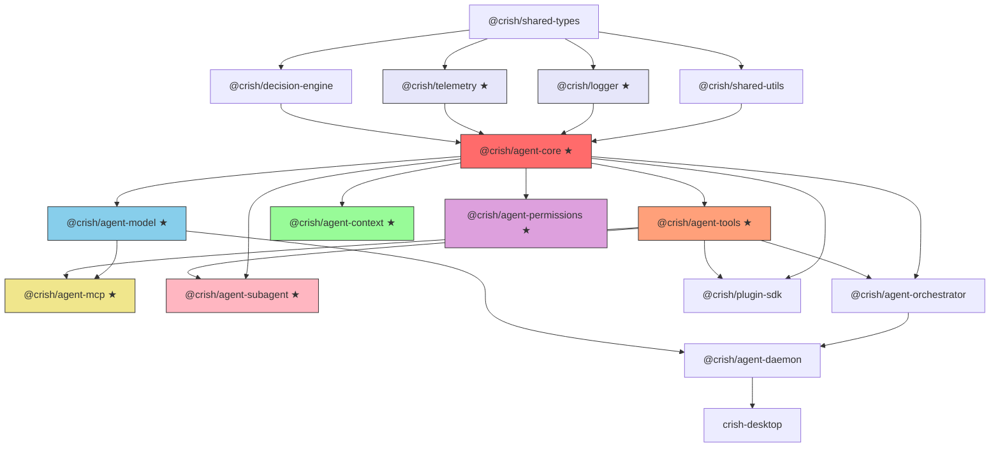
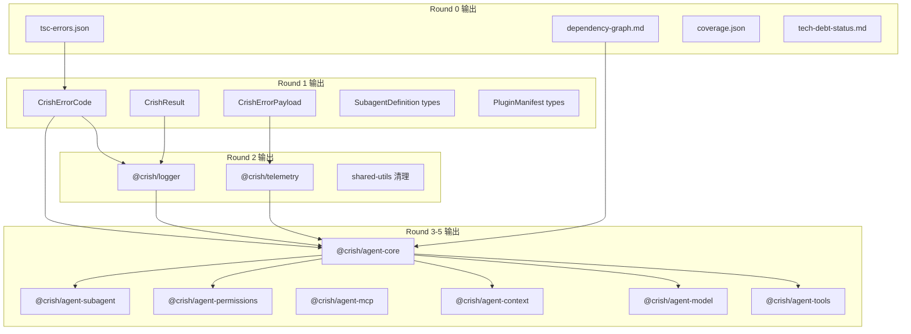

# Crish 系统性多 Agent 协同修复总方案 v2

> **方案定位**：基于对全仓库 9 个 TS 包（~80K LOC）、12 个 Rust crate、2 个 App 的代码级审计后形成的 **自上而下、多轮次、多 Agent 协同** 修复路线图。
>
> **核心原则**：
>
> 1. 该拆就拆、该重写就重写，不做兼容 shim
> 2. 每轮输出是下轮输入，闭环迭代
> 3. 所有问题等优先级，无时间/人员排期
> 4. 遵守 `ANTI_OVERENGINEERING_GUARDRAILS.md`（禁止的是特定技术方案，不是合理拆分）

---

## 目录

1. [代码库审计全景](#1-代码库审计全景)
2. [架构级问题清单](#2-架构级问题清单)
3. [九包拆分架构设计](#3-九包拆分架构设计)
4. [新包架构设计](#4-新包架构设计)
5. [Round 0：基线建立与全局审计](#5-round-0基线建立与全局审计)
6. [Round 1：类型基础层重建](#6-round-1类型基础层重建)
7. [Round 2：基础设施包创建](#7-round-2基础设施包创建)
8. [Round 3：agent-runtime 拆分 Phase-A（核心 + 工具 + 流式）](#8-round-3agent-runtime-拆分-phase-a核心--工具--流式)
9. [Round 4：agent-runtime 拆分 Phase-B（模型 + MCP + 上下文）](#9-round-4agent-runtime-拆分-phase-b模型--mcp--上下文)
10. [Round 5：agent-runtime 拆分 Phase-C（权限 + 子代理 + 集成验证）](#10-round-5agent-runtime-拆分-phase-c权限--子代理--集成验证)
11. [Round 6：编排层重构](#11-round-6编排层重构)
12. [Round 7：Daemon 重构与协议升级](#12-round-7daemon-重构与协议升级)
13. [Round 8：插件 SDK 全面重建](#13-round-8插件-sdk-全面重建)
14. [Round 9：子代理调度系统](#14-round-9子代理调度系统)
15. [Round 10：Rust 侧对齐与强化](#15-round-10rust-侧对齐与强化)
16. [Round 11：前端韧性加固与 TSC 清零](#16-round-11前端韧性加固与-tsc-清零)
17. [Round 12：CI 强化与文档产品化](#17-round-12ci-强化与文档产品化)
18. [跨轮次验证体系](#18-跨轮次验证体系)
19. [附录 A：agent-runtime 文件→包映射表](#19-附录-aagent-runtime-文件包映射表)
20. [附录 B：接口契约速查表](#20-附录-b接口契约速查表)
21. [附录 C：轮次间数据流图](#21-附录-c轮次间数据流图)

---

## 1. 代码库审计全景

### 1.1 仓库拓扑与规模

```
crish/                              # npm workspace + cargo workspace
├── apps/
│   ├── crish-desktop/              # React 19 + Zustand + Vite 5 前端
│   │   └── src/                    # ~180 文件, ~35K LOC
│   └── agent-workbench/src-tauri/  # Tauri 2 Rust 壳
│       └── src/                    # 80+ commands, ~8K LOC Rust
├── packages/
│   ├── agent-runtime/              # 195 文件 (156 src + 39 dirs), ~31K LOC ← 主要拆分目标
│   ├── agent-orchestrator/         # ~30 文件, ~15K LOC
│   ├── agent-daemon/               # ~97 文件 (65 src + 32 test), ~30K LOC
│   ├── shared-types/               # ~20 文件, ~3K LOC
│   ├── shared-utils/               # ~30 文件, ~6K LOC
│   ├── decision-engine/            # ~10 文件, ~3K LOC
│   ├── plugin-sdk/                 # 1 文件, 17 行 ← 需要全面重建
│   └── test-utils/                 # ~5 文件, ~1K LOC
└── crates/
    ├── conex-types/                # 领域类型 + CoreError + IPC
    ├── conex-stream/               # 流式缓冲 + 背压
    ├── conex-ipc/                  # JSONL IPC 帧协议
    ├── conex-db/                   # SQLite 持久化 (>500 行测试)
    ├── conex-sandbox/              # 命令安全门控 (RegexSet)
    ├── conex-net/                  # HTTP 客户端 + 重试
    ├── conex-fs/                   # 安全文件系统
    ├── conex-diff/                 # 差异计算
    ├── conex-search/               # 文件搜索
    ├── conex-markdown/             # Markdown 渲染
    └── conex-compaction/           # 上下文压缩
```

### 1.2 编译健康状态

| 指标              | 当前值                                                                                                                                                                                                                                    |
| ----------------- | ----------------------------------------------------------------------------------------------------------------------------------------------------------------------------------------------------------------------------------------- |
| TSC 编译错误      | **315**                                                                                                                                                                                                                                   |
| 错误类型分布      | `TS2375`/`TS2379`(exactOptionalPropertyTypes) ~90, `TS2532`/`TS18048`(uncheckedIndex) ~60, `TS6133`/`TS6192`(unused) ~45, `TS2307`/`TS2305`(missing module) ~35, `TS1484`(verbatimModuleSyntax) ~30, `TS7006`(implicitAny) ~20, other ~35 |
| CI 门禁数         | 12                                                                                                                                                                                                                                        |
| Vitest 覆盖率阈值 | orchestrator 70% stmt / runtime 50% stmt                                                                                                                                                                                                  |
| 循环依赖          | 0 (dependency-cruiser 强制)                                                                                                                                                                                                               |

### 1.3 现有架构资产清单

> 以下资产经审计确认为 **高质量工作代码**，拆分时应保留逻辑、迁移到正确的包。

| 资产                                        | 当前位置                                             | 目标包                       | 状态          |
| ------------------------------------------- | ---------------------------------------------------- | ---------------------------- | ------------- |
| `CrishError` 基类 + 4 子类                  | `shared-types/src/errors.ts`                         | `shared-types` (增强)        | 82 行，需扩展 |
| `ErrorClassifier` + `ErrorDomain` 枚举      | `agent-runtime/src/error-classifier.ts`              | `agent-core`                 | 262 行，成熟  |
| `RecoveryPipeline` 3-Tier                   | `agent-runtime/src/recovery-pipeline.ts`             | `agent-core`                 | 185 行，成熟  |
| `FallbackChain` 引擎                        | `agent-runtime/src/fallback-chain/`                  | `agent-core`                 | 4 文件，成熟  |
| 结构化 `Logger` + `LogTransport`            | `shared-utils/src/logger.ts`                         | `@crish/logger` (提取)       | 成熟，需增强  |
| `ToolMiddleware` 3-Hook                     | `agent-runtime/src/tools/`                           | `agent-tools`                | 5 文件，成熟  |
| `RegisteredTool` 三层体系                   | `agent-runtime/src/tools/tool-definition.ts`         | `agent-tools`                | 176 行，成熟  |
| `TraceManager` + `AsyncLocalStorage`        | `agent-runtime/src/trace/`                           | `@crish/telemetry`           | 2 文件，成熟  |
| `ControlBus` L1/L2/L3                       | `agent-runtime/src/control/`                         | `agent-core`                 | 4 文件，成熟  |
| `SteeringCoordinator` + 3 策略              | `agent-runtime/src/steering/`                        | `agent-core`                 | 8 文件，成熟  |
| `McpLifecycleManager`                       | `agent-runtime/src/mcp-lifecycle/`                   | `agent-mcp`                  | 6 文件，成熟  |
| `PluginRegistry` + `FsPluginRegistry`       | `agent-runtime/src/plugin-registry.ts`               | `agent-tools` → `plugin-sdk` | 517 行 + 3.5K |
| `SubagentDepthGuard` + semaphore            | `agent-runtime/src/subagents.ts`                     | `agent-subagent`             | 561 行        |
| `SessionTree` + `BoundedMap`                | `agent-orchestrator/src/session-tree.ts`             | `agent-orchestrator` (保留)  | 成熟          |
| `FileOrchestratorEventStore` + 3-Tier Index | `agent-orchestrator/src/event-store/`                | `agent-orchestrator` (保留)  | 成熟          |
| `GoalLoopStrategy` + FNV-1a stall           | `agent-orchestrator/src/event-scan-goal-strategy.ts` | `agent-orchestrator` (保留)  | 成熟          |
| `ApprovalQueue` + timeout/extend            | `agent-daemon/src/approval-queue.ts`                 | `agent-daemon` (保留)        | 成熟          |
| `CommandGatekeeper` (RegexSet)              | `crates/conex-sandbox/`                              | Rust (保留)                  | 成熟          |
| `LocalDb` SQLite + migration v3             | `crates/conex-db/`                                   | Rust (保留)                  | 成熟          |

---

## 2. 架构级问题清单

### 2.1 结构性问题

| ID   | 问题                                                                                                           | 影响范围                       | 解决方案                                           |
| ---- | -------------------------------------------------------------------------------------------------------------- | ------------------------------ | -------------------------------------------------- |
| S-01 | `agent-runtime` 作为单一 ~31K LOC 巨型包，156 文件混合 provider/tools/mcp/context/subagent 等无关关注点        | 全局                           | 九包拆分                                           |
| S-02 | `plugin-sdk` 仅 17 行、4 个 `any` 类型钩子，无法支撑真实插件生态                                               | 插件系统                       | 全面重建（14 钩子 + 工具注册 + 信任模型）          |
| S-03 | 错误类型体系不完整：`CrishError.code` 是裸 `string`，无分域错误码；无 `CrishResult<T>` ADT；无跨进程序列化标准 | 全局                           | 扩展 errors.ts + 新建 result.ts + error-payload.ts |
| S-04 | 日志和追踪分散在 `shared-utils/logger` + `agent-runtime/trace` + `daemon/daemon-logger` 三处，无统一包         | 全局                           | 新建 `@crish/logger` 和 `@crish/telemetry`         |
| S-05 | 子代理系统缺少 DeadlockDetector 和 CommunicationBus                                                            | agent-runtime → agent-subagent | 新建完整子代理调度系统                             |
| S-06 | 315 个 TSC 编译错误阻碍类型安全验证                                                                            | 全局                           | 随拆分过程逐步修复                                 |
| S-07 | Provider 系统散落在 `provider*/` + `openai-*.ts` + `anthropic-*.ts` + `gemini-*.ts` 等 30+ 文件                | agent-runtime                  | 统一提取到 `agent-model`                           |
| S-08 | Rust 端 `CoreError` 与 TS 端 `CrishError` 序列化格式不统一                                                     | 跨语言                         | `CrishErrorPayload` 双端对齐                       |

### 2.2 功能性缺失

| ID   | 问题                                 | 解决方案                        |
| ---- | ------------------------------------ | ------------------------------- |
| F-01 | 无结构化文件日志（RotatingFileSink） | `@crish/logger` 新包            |
| F-02 | 无 Rust 端 telemetry crate           | `conex-telemetry` 新 crate      |
| F-03 | 插件无法注册自定义工具               | `plugin-sdk` 工具注册 API       |
| F-04 | 插件无 MCP 服务器声明能力            | `plugin-sdk` MCP 声明           |
| F-05 | 子代理无死锁检测                     | `DeadlockDetector` (DFS 环检测) |
| F-06 | 子代理无跨代理通信总线               | `CommunicationBus` (pub/sub)    |
| F-07 | 无统一的 Tauri command 错误传播格式  | `CrishErrorPayload` Rust impl   |

---

## 3. 九包拆分架构设计

### 3.1 目标包结构



> ★ = 新包

### 3.2 各包职责与文件映射

#### `@crish/agent-core`（新包）— 执行内核

**职责**：AgentRuntime 主类、SessionLoop FSM、状态机、控制总线、纠偏、恢复管线、错误分类。

**来源文件**（从 `agent-runtime/src/` 迁移）：

```
core 目录:
  runtime.ts, IAgentRuntime.ts, runtime-defaults.ts, runtime-helpers.ts, types.ts
session-loop/:
  index.ts (38K), provider-call.ts, tool-execution.ts (22K), steering-delegate.ts, recovery.ts, control-check.ts, types.ts
state-machine/:
  core.ts, agent-session.ts, run-lifecycle.ts, session-branch.ts, turn-types.ts, index.ts
control/:
  control-bus.ts, types.ts, index.ts
steering/:
  steering-coordinator.ts, steering-input-queue.ts, steering-types.ts, recovery-steering-strategy.ts, goal-audit-strategy.ts, compression-recovery-strategy.ts, index.ts
recovery/:
  stream-recovery.ts
error-classifier.ts
recovery-pipeline.ts
fallback-chain/:
  engine.ts, types.ts, index.ts
agent-input-queue.ts
agent-session-loop.ts
event-architecture/:
  canonical-event.ts, index.ts
event-protocol/:
  core-event-projector.ts, core-event-types.ts, index.ts
event-queue/:
  index.ts
hooks/:
  agent-hooks.ts, extension-registry.ts, health-hook-pack.ts, hook-types.ts, lifecycle-hooks.ts, compact-lifecycle.ts, tool-hook-observability.ts, tool-hook-types.ts, index.ts
runtime-components/:
  conversation-engine.ts, context-manager.ts, provider-call-gateway.ts, tool-executor.ts, provider-response-consumer.ts, single-tool-executor.ts, context-compression-gate.ts, execution-strategy.ts, token-estimator.ts, tool-executor-options.ts, index.ts
runtime-metrics/:
  collectors.ts, snapshot.ts, types.ts, index.ts
config/:
  config-merger.ts, index.ts
rendering/:
  rendering-pipeline.ts, index.ts
```

**预估**：~50-60 文件，~15K LOC

#### `@crish/agent-tools`（新包）— 工具系统

**职责**：工具定义、注册、中间件、内置本地工具、工具发现。

**来源文件**：

```
tools/:
  tool-definition.ts, tool-middleware.ts, tool-preset-registry.ts, index.ts
local-tools/:
  index.ts, fs-read-tools.ts, fs-edit-tools.ts, fs-edit-tools/, shell-tools.ts, search-tools.ts, checkpoint-tools.ts, pre-mutation.ts, shared.ts, types.ts
tool-discovery.ts
tool-output-budget.ts
tool-output-guard.ts
tool-registry.ts
tools.ts (19K, 工具定义 & helper)
workspace-mutation-coordinator.ts (16K)
background-command.ts (27K)
script-wait-policy.ts
lsp-tools.ts (24K)
rich-read.ts (30K)
resource-uri.ts (24K)
```

**预估**：~25-30 文件，~10K LOC

#### `@crish/agent-model`（新包）— LLM Provider 系统

**职责**：Provider 抽象、OpenAI/Anthropic/Gemini 实现、网关路由、传输层、流式合约、凭证管理。

**来源文件**：

```
provider/:
  index.ts, types.ts, factory.ts, loader.ts, declarative-schema.ts, registry-v2.ts, provider-gateway-v2.ts, faux-provider.ts, health-checker.ts
  auth/:  所有文件（auth-method-bridge, base-url-validator, credential-pool, credential-resolver, encrypted-file-store, key-rotation, log-sanitizer, secret-store, types, oauth/）
  builtin/: 所有文件
  engines/: base-engine.ts, openai-compatible-engine.ts, anthropic-messages-engine.ts, ollama-engine.ts, index.ts
  cli/: 所有文件
  spi/: 所有文件
provider-gateway/:
  index.ts, types.ts, route-selector.ts, credential-resolver.ts, factory.ts
provider-transport/:
  connection-manager.ts, stream-recovery.ts, token-tracker.ts, index.ts
provider-stream-contract/:
  types.ts, sequencer.ts, json-repair.ts, error.ts, normalizer.ts, index.ts
provider-openai-base.ts, provider-openai-chat.ts, provider-openai-class.ts, provider-openai-compatible.ts, provider-openai-config.ts, provider-openai-helpers.ts, provider-openai-responses.ts
openai-request-build.ts, openai-stream-parse.ts, openai-retry.ts
provider-anthropic.ts, anthropic-request-build.ts, anthropic-stream-parse.ts
provider-gemini.ts, gemini-request-build.ts, gemini-stream-parse.ts
provider-request-machine.ts
provider-cache-hints.ts
provider-error-classifier.ts
model-routing/:
  index.ts, matcher.ts, profile.ts, types.ts
model-routing-enhanced.ts, model-routing-roles.ts, model-routing.ts
model-catalog/:
  catalog-sync.ts, types.ts, index.ts
pricing-engine.ts
token-ledger.ts
media/:
  media-cache.ts, media-preprocessor.ts, media-types.ts, provider-media-adapter.ts
preview-queue.ts (14K)
```

**预估**：~55-60 文件，~12K LOC

#### `@crish/agent-context`（新包）— 上下文管理

**职责**：上下文压缩、检查点、会话存储、快照、编码。

**来源文件**：

```
context-compression/:
  index.ts (16K), compression-utils.ts, serializer.ts, token-estimator.ts
context-compression.ts, context-projection.ts, context-slicer.ts, context-state.ts
checkpoint/:
  checkpoint-manager.ts, index.ts
checkpoint-manifest.ts (27K)
checkpoints.ts
conversation-boundary-manifest.ts (27K)
conversation-rewind-target.ts
blob-externalization.ts (12K)
encoding.ts
session/:
  session-replay.ts, session-storage.ts, session-types.ts
session-store/:
  index.ts (14K), archive-store.ts, types.ts
session.ts
snapshots.ts
prompt-assembly.ts (19K)
prompt-context.ts
canonical-schema.ts
wasm-tiktoken.ts
structured-summary.ts
trajectory-compressor.ts
```

**预估**：~25-30 文件，~8K LOC

#### `@crish/agent-mcp`（新包）— MCP 生命周期

**职责**：MCP 服务器发现、启动、健康检查、工具缓存刷新。

**来源文件**：

```
mcp-lifecycle/:
  mcp-lifecycle-manager.ts (12K), mcp-server-controller.ts (17K), types.ts, utils.ts, index.ts
mcp-lifecycle.ts
```

**预估**：~6 文件，~3K LOC

#### `@crish/agent-permissions`（新包）— 权限与审批

**职责**：权限策略、审批管线、TrustZone 集成。

**来源文件**：

```
approval/:
  approval-cache.ts, approval-pipeline.ts, chain-approval.ts
permission/:
  command-classification.ts, trust-zone-policy.ts
permissions.test.ts
secrets-obfuscation.ts (30K)
```

**预估**：~6-8 文件，~4K LOC

#### `@crish/agent-subagent`（新包）— 子代理调度

**职责**：子代理定义、递归守卫、生命周期、死锁检测、通信总线。

**来源文件（迁移 + 新建）**：

```
迁移:
  subagents.ts (21K)
  subagent-loop.ts
  subagent-skill-runner.ts
  subagent-types.ts
  subagent-context-pack.ts (10K)
新建:
  deadlock-detector.ts
  communication-bus.ts
  subagent-scheduler.ts
  subagent-watchdog.ts
```

**预估**：~10-12 文件，~5K LOC（含新建）

#### `@crish/logger`（新包）— 统一日志

**职责**：结构化日志器、Transport 插件体系、RotatingFileSink、JSON/ANSI 格式化、敏感信息消毒。

**来源文件（提取 + 新建）**：

```
提取自 shared-utils:
  logger.ts → 重写
新建:
  transports/console.ts
  transports/rotating-file.ts
  transports/null.ts
  formatters/json.ts
  formatters/ansi.ts
  redactor.ts
  child-logger.ts
  types.ts
  index.ts
```

**预估**：~10 文件，~1.5K LOC

#### `@crish/telemetry`（新包）— 可观测性

**职责**：分布式追踪（TraceManager）、Span 管理、AsyncLocalStorage 传播、指标收集、crash handler。

**来源文件（提取 + 新建）**：

```
提取自 agent-runtime:
  trace/index.ts → 重写
新建:
  trace-manager.ts
  trace-span.ts
  trace-context.ts
  metrics-collector.ts
  crash-handler.ts
  types.ts
  index.ts
```

**预估**：~8 文件，~2K LOC

### 3.3 跨包依赖 DAG

```
Layer 0: shared-types (零依赖)
Layer 1: shared-utils, logger, telemetry (仅依赖 shared-types)
Layer 2: decision-engine (依赖 shared-types)
Layer 3: agent-core (依赖 L0 + L1 + L2)
Layer 4: agent-tools, agent-model, agent-context, agent-permissions (依赖 agent-core)
Layer 5: agent-mcp, agent-subagent (依赖 agent-core + agent-tools + agent-model)
Layer 6: plugin-sdk (依赖 agent-core + agent-tools)
Layer 7: agent-orchestrator (依赖 agent-core + agent-tools)
Layer 8: agent-daemon (依赖 L3-L7)
Layer 9: crish-desktop (依赖 agent-daemon + shared-types + shared-utils)
```

---

## 4. 新包架构设计

### 4.1 `@crish/logger` 接口设计

```typescript
// packages/logger/src/types.ts

export type LogLevel = 'trace' | 'debug' | 'info' | 'warn' | 'error' | 'fatal';

export interface LogEntry {
  readonly level: LogLevel;
  readonly timestamp: number;
  readonly module: string;
  readonly message: string;
  readonly context?: Record<string, unknown>;
  readonly error?: { message: string; stack?: string; code?: string };
}

export interface LogTransport {
  write(entry: LogEntry): void;
  flush?(): Promise<void>;
  close?(): Promise<void>;
}

export interface LogFormatter {
  format(entry: LogEntry): string;
}

export interface LogRedactor {
  redact(value: string): string;
}

export interface LoggerOptions {
  level?: LogLevel;
  module: string;
  transports?: LogTransport[];
  redactor?: LogRedactor;
  context?: Record<string, unknown>;
}
```

```typescript
// packages/logger/src/index.ts

export class Logger {
  constructor(options: LoggerOptions);

  trace(message: string, context?: Record<string, unknown>): void;
  debug(message: string, context?: Record<string, unknown>): void;
  info(message: string, context?: Record<string, unknown>): void;
  warn(message: string, context?: Record<string, unknown>): void;
  error(message: string, context?: Record<string, unknown>): void;
  fatal(message: string, context?: Record<string, unknown>): void;

  child(bindings: Record<string, unknown>): Logger;
  withContext(context: Record<string, unknown>): Logger;

  flush(): Promise<void>;
  close(): Promise<void>;
}

// Transports
export { ConsoleTransport } from './transports/console';
export {
  RotatingFileTransport,
  type RotatingFileOptions,
} from './transports/rotating-file';
export { NullTransport } from './transports/null';

// Formatters
export { JsonFormatter } from './formatters/json';
export { AnsiFormatter } from './formatters/ansi';

// Redactor
export { PatternRedactor, createSecretRedactor } from './redactor';

// Global
export { configureGlobalLogger, getLogger } from './global';
```

### 4.2 `@crish/telemetry` 接口设计

```typescript
// packages/telemetry/src/types.ts

export interface TraceSpan {
  readonly spanId: string;
  readonly traceId: string;
  readonly parentSpanId?: string;
  readonly name: string;
  readonly startTime: number;
  endTime?: number;
  readonly attributes: Record<string, unknown>;
  readonly events: SpanEvent[];

  addEvent(name: string, attributes?: Record<string, unknown>): void;
  setAttribute(key: string, value: unknown): void;
  setError(error: unknown): void;
  end(): void;
}

export interface SpanEvent {
  readonly name: string;
  readonly timestamp: number;
  readonly attributes?: Record<string, unknown>;
}

export interface TraceManagerOptions {
  maxSpans?: number; // BoundedMap 容量, 默认 1000
  maxEventsPerSpan?: number; // RingBuffer 容量, 默认 100
}

export interface MetricsCollector {
  increment(name: string, value?: number, tags?: Record<string, string>): void;
  gauge(name: string, value: number, tags?: Record<string, string>): void;
  histogram(name: string, value: number, tags?: Record<string, string>): void;
}
```

```typescript
// packages/telemetry/src/index.ts

export class TraceManager {
  constructor(options?: TraceManagerOptions);

  startSpan(name: string, attributes?: Record<string, unknown>): TraceSpan;
  getActiveSpan(): TraceSpan | undefined;
  withSpan<T>(
    name: string,
    fn: (span: TraceSpan) => T | Promise<T>
  ): T | Promise<T>;

  getAllSpans(): ReadonlyMap<string, TraceSpan>;
  getSpan(spanId: string): TraceSpan | undefined;
  clear(): void;
}

export { traceContextStorage } from './trace-context'; // AsyncLocalStorage
export { InMemoryMetricsCollector } from './metrics-collector';
export {
  installCrashHandlers,
  type CrashHandlerOptions,
} from './crash-handler';
```

### 4.3 `CrishErrorCode` 完整体系

```typescript
// packages/shared-types/src/error-codes.ts

/** 分域错误码 — domain.reason 格式，覆盖全部 11 个域 */
export type CrishErrorCode =
  // ─── 配置域 ───
  | 'config.invalid'
  | 'config.provider_not_found'
  | 'config.model_not_found'
  | 'config.credential_missing'
  | 'config.schema_violation'
  // ─── 会话域 ───
  | 'session.not_found'
  | 'session.already_exists'
  | 'session.closed'
  | 'session.state_invalid'
  | 'session.fork_active_turn'
  | 'session.storage_full'
  | 'session.concurrent_access'
  // ─── Agent 域 ───
  | 'agent.not_found'
  | 'agent.busy'
  | 'agent.max_turns'
  | 'agent.internal_died'
  // ─── 运行时域 ───
  | 'runtime.init_failed'
  | 'runtime.invalid_state'
  | 'runtime.timeout'
  | 'runtime.max_retries'
  | 'runtime.loop_detected'
  // ─── Provider 域 ───
  | 'provider.api_error'
  | 'provider.rate_limit'
  | 'provider.auth_error'
  | 'provider.connection_error'
  | 'provider.stream_failed'
  | 'provider.server_overloaded'
  | 'provider.quota_exhausted'
  | 'provider.filtered'
  | 'provider.payload_too_large'
  | 'provider.context_overflow'
  | 'provider.gateway_challenge'
  // ─── 上下文域 ───
  | 'context.overflow'
  | 'context.compaction_failed'
  | 'context.checkpoint_incompatible'
  | 'context.restore_failed'
  // ─── 工具域 ───
  | 'tool.not_found'
  | 'tool.execution_failed'
  | 'tool.permission_denied'
  | 'tool.output_budget_exceeded'
  | 'tool.timeout'
  | 'tool.fatal_error'
  // ─── MCP 域 ───
  | 'mcp.server_not_found'
  | 'mcp.startup_failed'
  | 'mcp.connection_lost'
  | 'mcp.startup_timeout'
  // ─── 子代理域 ───
  | 'subagent.not_found'
  | 'subagent.max_depth'
  | 'subagent.max_siblings'
  | 'subagent.max_concurrent'
  | 'subagent.timeout'
  | 'subagent.deadlock'
  // ─── 插件域 ───
  | 'plugin.not_found'
  | 'plugin.load_failed'
  | 'plugin.permission_denied'
  | 'plugin.hook_timeout'
  | 'plugin.validation_failed'
  // ─── 存储域 ───
  | 'storage.write_failed'
  | 'storage.read_failed'
  | 'storage.migration_failed'
  | 'storage.corruption'
  // ─── 通用域 ───
  | 'cancelled'
  | 'not_implemented'
  | 'internal';
```

### 4.4 `CrishResult<T>` ADT

```typescript
// packages/shared-types/src/result.ts

export type CrishResult<TValue, TError = CrishError> =
  | { readonly ok: true; readonly value: TValue }
  | { readonly ok: false; readonly error: TError };

export function ok<T>(value: T): CrishResult<T, never>;
export function err<E = CrishError>(error: E): CrishResult<never, E>;

export function mapResult<T, U, E>(
  result: CrishResult<T, E>,
  fn: (v: T) => U
): CrishResult<U, E>;
export function flatMapResult<T, U, E>(
  result: CrishResult<T, E>,
  fn: (v: T) => CrishResult<U, E>
): CrishResult<U, E>;
export function unwrapResult<T, E>(result: CrishResult<T, E>): T;
export function unwrapOr<T, E>(result: CrishResult<T, E>, fallback: T): T;
export function fromPromise<T>(
  promise: Promise<T>,
  mapError?: (e: unknown) => CrishError
): Promise<CrishResult<T>>;
export function isOk<T, E>(
  result: CrishResult<T, E>
): result is { ok: true; value: T };
export function isErr<T, E>(
  result: CrishResult<T, E>
): result is { ok: false; error: E };
```

### 4.5 `CrishErrorPayload` 跨进程序列化

```typescript
// packages/shared-types/src/error-payload.ts

export interface CrishErrorPayload {
  readonly code: string; // CrishErrorCode
  readonly message: string;
  readonly category: 'transient' | 'permanent' | 'security' | 'protocol';
  readonly retryable: boolean;
  readonly userVisible: boolean;
  readonly action?: string; // 用户可操作提示
  readonly details?: Record<string, unknown>;
  readonly stack?: string; // 仅 development
}

export function toErrorPayload(error: unknown): CrishErrorPayload;
export function fromErrorPayload(payload: CrishErrorPayload): CrishError;
export function normalizeCrishError(
  error: unknown,
  fallbackCode?: CrishErrorCode
): CrishError;
```

### 4.6 `PluginSDK` 14 钩子完整设计

```typescript
// packages/plugin-sdk/src/index.ts

export interface PluginManifest {
  readonly name: string;
  readonly version: string;
  readonly description?: string;
  readonly author?: string;
  readonly license?: string;
  readonly homepage?: string;
  readonly trust?: PluginTrustLevel;
  readonly permissions: readonly PluginPermission[];
  readonly mcpServers?: readonly PluginMcpServerDeclaration[];
}

export type PluginTrustLevel = 'sandboxed' | 'restricted' | 'full';

export type PluginPermission =
  | 'session:read'
  | 'session:write'
  | 'tool:register'
  | 'tool:execute'
  | 'mcp:connect'
  | 'mcp:register'
  | 'hook:intercept'
  | 'hook:observe'
  | 'fs:read'
  | 'fs:write'
  | 'network:outbound'
  | 'config:read'
  | 'config:write';

export interface PluginMcpServerDeclaration {
  readonly name: string;
  readonly command: string;
  readonly args?: readonly string[];
  readonly env?: Record<string, string>;
}

// ─── 14 钩子 ───

export interface PluginHooks {
  // 会话生命周期 (4)
  onSessionStart?(ctx: SessionStartContext): void | Promise<void>;
  onSessionEnd?(ctx: SessionEndContext): void | Promise<void>;
  onSessionFork?(ctx: SessionForkContext): void | Promise<void>;
  onSessionRewind?(ctx: SessionRewindContext): void | Promise<void>;

  // 工具执行 (3)
  onToolCallBefore?(
    ctx: ToolCallBeforeContext
  ): ToolCallBeforeResult | Promise<ToolCallBeforeResult>;
  onToolCallAfter?(ctx: ToolCallAfterContext): void | Promise<void>;
  onToolError?(ctx: ToolErrorContext): void | Promise<void>;

  // 消息流 (2)
  onMessage?(ctx: MessageContext): void | Promise<void>;
  onStreamChunk?(ctx: StreamChunkContext): void | Promise<void>;

  // 错误与恢复 (2)
  onError?(ctx: ErrorContext): void | Promise<void>;
  onRecovery?(ctx: RecoveryContext): void | Promise<void>;

  // 子代理 (2)
  onSubagentSpawn?(ctx: SubagentSpawnContext): void | Promise<void>;
  onSubagentComplete?(ctx: SubagentCompleteContext): void | Promise<void>;

  // 上下文 (1)
  onContextCompression?(ctx: ContextCompressionContext): void | Promise<void>;
}

export interface PluginToolDefinition {
  readonly name: string;
  readonly description: string;
  readonly parameters?: JsonObject;
  execute(input: JsonObject): Promise<PluginToolResult>;
}

export interface PluginToolResult {
  readonly content: string;
  readonly isError?: boolean;
  readonly artifacts?: PluginArtifact[];
}

export interface PluginArtifact {
  readonly name: string;
  readonly content: string;
  readonly mimeType?: string;
}

export interface Plugin {
  readonly manifest: PluginManifest;
  readonly hooks?: PluginHooks;
  readonly tools?: readonly PluginToolDefinition[];
}

export function definePlugin(plugin: Plugin): Plugin;
```

### 4.7 `SubagentScheduler` 完整设计

```typescript
// packages/agent-subagent/src/types.ts

export type SubagentRole =
  'researcher' | 'implementer' | 'reviewer' | 'debugger' | 'planner' | 'custom';
export type SubagentState =
  | 'pending'
  | 'queued'
  | 'running'
  | 'completed'
  | 'failed'
  | 'cancelled'
  | 'timeout';
export type SubagentExecutionStrategy =
  'in-process' | 'daemon-rpc' | 'isolated';

export interface SubagentDefinition {
  readonly name: string;
  readonly description: string;
  readonly role: SubagentRole;
  readonly model?: string;
  readonly systemPrompt: string;
  readonly maxTurns?: number;
  readonly timeoutMs?: number;
  readonly allowedTools?: readonly string[];
  readonly deniedTools?: readonly string[];
  readonly isolation?: 'none' | 'worktree';
  readonly executionStrategy?: SubagentExecutionStrategy;
}

export interface SubagentInstance {
  readonly id: string;
  readonly definition: SubagentDefinition;
  readonly parentId?: string;
  state: SubagentState;
  readonly depth: number;
  readonly createdAt: number;
  startedAt?: number;
  completedAt?: number;
  result?: SubagentResult;
  error?: CrishErrorPayload;
  tokenUsage?: { prompt: number; completion: number };
}

export interface SubagentResult {
  readonly success: boolean;
  readonly output: string;
  readonly summary: string;
  readonly turnCount: number;
  readonly toolUseCount: number;
  readonly metadata?: JsonObject;
}

// ─── 递归守卫 ───

export interface RecursionGuardConfig {
  readonly maxDepth: number; // 默认 8
  readonly maxSiblings: number; // 默认 10
  readonly maxConcurrent: number; // 默认 6
  readonly totalTokenBudget: number; // 默认 2_000_000
  readonly totalTimeoutMs: number; // 默认 600_000 (10min)
}

// ─── 死锁检测 ───

export interface DeadlockDetectorConfig {
  readonly checkIntervalMs: number; // 默认 5000
  readonly maxWaitMs: number; // 默认 30_000
}

export interface DeadlockReport {
  readonly detected: boolean;
  readonly cycle?: readonly string[]; // 涉及的 subagent IDs
  readonly stalledIds?: readonly string[];
}

// ─── 通信总线 ───

export type SubagentMessagePriority = 'low' | 'normal' | 'high' | 'urgent';

export interface SubagentMessage {
  readonly id: string;
  readonly from: string; // sender subagent ID
  readonly to: string; // receiver subagent ID ('*' = broadcast)
  readonly priority: SubagentMessagePriority;
  readonly content: string;
  readonly metadata?: JsonObject;
  readonly timestamp: number;
}
```

---

## 5. Round 0：基线建立与全局审计

> **目标**：生成全仓库编译/测试/依赖基线数据，作为后续轮次的输入基准。
> **Agent 数量**：4

### Agent 0-A: TSC 错误基线审计

**任务**：

1. 运行 `npx tsc --noEmit` 并生成结构化错误报告
2. 按包分组统计错误数量
3. 按错误码分类统计分布
4. 生成 `.tsc-errors-baseline.json` 结构化基线文件

**输出**：`analysis/repair-baseline/tsc-errors.json`

```json
{
  "totalErrors": 315,
  "byPackage": {
    "crish-desktop": 180,
    "agent-runtime": 45,
    "agent-daemon": 50,
    "agent-orchestrator": 20,
    "shared-types": 5,
    "shared-utils": 10,
    "decision-engine": 5
  },
  "byErrorCode": {
    "TS2375": 50,
    "TS2379": 40,
    "TS2532": 35,
    "...": "..."
  },
  "byFile": [
    {
      "file": "src/api/doctorReport.ts",
      "count": 8,
      "codes": ["TS2375", "TS2322"]
    },
    "..."
  ]
}
```

### Agent 0-B: 依赖图与循环检测

**任务**：

1. 运行 `npm run lint:depcruise` 确认零循环依赖
2. 生成包间依赖图（`dependency-graph.mermaid`）
3. 分析 `agent-runtime` 内部文件间依赖（识别拆分的切割面）
4. 标记跨包 import 路径（拆分后需要更新的位置）

**输出**：`analysis/repair-baseline/dependency-graph.md`

### Agent 0-C: 测试覆盖率基线

**任务**：

1. 运行 `npx vitest run --coverage` 获取当前覆盖率
2. 按包统计 statement/branch/function/line 覆盖率
3. 识别无测试覆盖的关键文件
4. 生成覆盖率基线报告

**输出**：`analysis/repair-baseline/coverage.json`

### Agent 0-D: TECH_DEBT 与 GUARDRAILS 审计

**任务**：

1. 读取 `TECH_DEBT.md`，标记仍然有效的条目
2. 读取 `ANTI_OVERENGINEERING_GUARDRAILS.md`，提取硬性约束
3. 读取 `FULL_CHECK_COMMANDS.md`，确认完整验证步骤
4. 交叉检查：哪些 tech debt 条目会在本次重构中自然解决

**输出**：`analysis/repair-baseline/tech-debt-status.md`

### Round 0 输出汇总

| 产出物                | 用途                       |
| --------------------- | -------------------------- |
| `tsc-errors.json`     | Round 1-11 的 TSC 修复基准 |
| `dependency-graph.md` | Round 3-5 拆分的切割面参考 |
| `coverage.json`       | Round 12 覆盖率目标参考    |
| `tech-debt-status.md` | 全轮次的 bug patch 清单    |

---

## 6. Round 1：类型基础层重建

> **目标**：重建 `shared-types` 错误体系 + `CrishResult` ADT + 跨进程序列化 + 子代理/插件类型。
> **Agent 数量**：6
> **依赖**：Round 0 输出

### Agent 1-A: CrishErrorCode 体系

**任务**：

1. 在 `shared-types/src/` 中新建 `error-codes.ts`
2. 定义完整的 `CrishErrorCode` union type（~55 个码，覆盖 11 域）
3. 定义 `ErrorCodeInfo` 注册表（每个码对应 title/retryable/userVisible/action）
4. 提供 `getErrorCodeInfo()` 查询函数
5. 编写单元测试：验证所有码都有 info 条目、无重复码

**文件清单**：

- NEW: `packages/shared-types/src/error-codes.ts` (~200 行)
- NEW: `packages/shared-types/src/__tests__/error-codes.test.ts` (~100 行)

### Agent 1-B: CrishResult ADT

**任务**：

1. 新建 `shared-types/src/result.ts`
2. 实现完整的 `CrishResult<T, E>` 类型和工具函数
3. 包含：`ok()`, `err()`, `mapResult()`, `flatMapResult()`, `unwrapResult()`, `unwrapOr()`, `fromPromise()`, `isOk()`, `isErr()`
4. 编写单元测试：每个函数的正常/异常路径

**文件清单**：

- NEW: `packages/shared-types/src/result.ts` (~120 行)
- NEW: `packages/shared-types/src/__tests__/result.test.ts` (~200 行)

### Agent 1-C: CrishErrorPayload 跨进程序列化

**任务**：

1. 新建 `shared-types/src/error-payload.ts`
2. 定义 `CrishErrorPayload` 接口
3. 实现 `toErrorPayload()`, `fromErrorPayload()`, `normalizeCrishError()`
4. 编写 roundtrip 测试

**文件清单**：

- NEW: `packages/shared-types/src/error-payload.ts` (~100 行)
- NEW: `packages/shared-types/src/error-normalize.ts` (~40 行)
- NEW: `packages/shared-types/src/__tests__/error-payload.test.ts` (~120 行)

### Agent 1-D: 扩展 CrishError 基类

**任务**：

1. 修改 `shared-types/src/errors.ts`，将 `code: string` 增强为支持 `CrishErrorCode`
2. 添加新的子类：`ToolError`, `McpError`, `SubagentError`, `StorageError`, `ConfigError`
3. 添加 `toPayload()` 方法到 `CrishError` 基类
4. 保持向后兼容（`code` 类型仍为 `string`，但新代码使用 `CrishErrorCode`）

**文件清单**：

- MODIFY: `packages/shared-types/src/errors.ts` (~+120 行)
- NEW: `packages/shared-types/src/__tests__/errors.test.ts` (~100 行)

### Agent 1-E: 子代理 & 插件类型定义

**任务**：

1. 新建 `shared-types/src/subagent.ts`：`SubagentDefinition`, `SubagentInstance`, `SubagentResult`, `SubagentState`, `SubagentMessage`
2. 新建 `shared-types/src/plugin-types.ts`：`PluginManifest`, `PluginPermission`, `PluginTrustLevel`, `PluginHookContext` 基础类型
3. 编写类型测试

**文件清单**：

- NEW: `packages/shared-types/src/subagent.ts` (~120 行)
- NEW: `packages/shared-types/src/plugin-types.ts` (~80 行)
- NEW: `packages/shared-types/src/__tests__/subagent.test.ts` (~60 行)

### Agent 1-F: shared-types index 更新 & TSC 修复

**任务**：

1. 更新 `shared-types/src/index.ts`，re-export 所有新模块
2. 修复 `shared-types` 包内所有 TSC 错误
3. 运行 `tsc -p packages/shared-types/tsconfig.json --noEmit` 确认 0 errors
4. 运行 `npx vitest run packages/shared-types` 确认测试通过

**文件清单**：

- MODIFY: `packages/shared-types/src/index.ts` (~+30 行)
- MODIFY: 若干现有文件的 TSC 修复

### Round 1 验证

```bash
tsc -p packages/shared-types/tsconfig.json --noEmit  # 0 errors
npx vitest run packages/shared-types                   # all pass
```

---

## 7. Round 2：基础设施包创建

> **目标**：创建 `@crish/logger` 和 `@crish/telemetry` 两个新包，增强 `shared-utils`。
> **Agent 数量**：6
> **依赖**：Round 1 输出

### Agent 2-A: `@crish/logger` 包创建

**任务**：

1. 创建 `packages/logger/` 目录结构（package.json, tsconfig.json, vitest.config.ts）
2. 实现 `Logger` 类（child/withContext/flush/close）
3. 实现 `ConsoleTransport`
4. 实现 `LogEntry`, `LogTransport`, `LogFormatter` 类型
5. 配置 npm workspace

**文件清单**：

- NEW: `packages/logger/package.json`
- NEW: `packages/logger/tsconfig.json`
- NEW: `packages/logger/tsconfig.build.json`
- NEW: `packages/logger/src/index.ts` (~80 行)
- NEW: `packages/logger/src/types.ts` (~60 行)
- NEW: `packages/logger/src/logger.ts` (~250 行)
- NEW: `packages/logger/src/transports/console.ts` (~60 行)
- NEW: `packages/logger/src/global.ts` (~40 行)

### Agent 2-B: Logger RotatingFile & Formatters

**任务**：

1. 实现 `RotatingFileTransport`（maxBytes 轮转、maxFiles 备份）
2. 实现 `JsonFormatter`（结构化 JSON 输出）
3. 实现 `AnsiFormatter`（终端彩色输出）
4. 实现 `NullTransport`（测试用）

**文件清单**：

- NEW: `packages/logger/src/transports/rotating-file.ts` (~200 行)
- NEW: `packages/logger/src/transports/null.ts` (~20 行)
- NEW: `packages/logger/src/formatters/json.ts` (~40 行)
- NEW: `packages/logger/src/formatters/ansi.ts` (~60 行)

### Agent 2-C: Logger Redactor & Tests

**任务**：

1. 实现 `PatternRedactor`（正则模式消毒）
2. 实现 `createSecretRedactor()`（从环境变量创建消毒器）
3. 编写完整测试套件

**文件清单**：

- NEW: `packages/logger/src/redactor.ts` (~80 行)
- NEW: `packages/logger/src/__tests__/logger.test.ts` (~200 行)
- NEW: `packages/logger/src/__tests__/rotating-file.test.ts` (~150 行)
- NEW: `packages/logger/src/__tests__/redactor.test.ts` (~80 行)

### Agent 2-D: `@crish/telemetry` 包创建

**任务**：

1. 创建 `packages/telemetry/` 目录结构
2. 实现 `TraceManager`（从 `agent-runtime/src/trace/index.ts` 提取并增强）
3. 实现 `TraceSpan`, `SpanEvent`
4. 实现 `traceContextStorage`（AsyncLocalStorage）
5. 实现 `InMemoryMetricsCollector`

**文件清单**：

- NEW: `packages/telemetry/package.json`
- NEW: `packages/telemetry/tsconfig.json`
- NEW: `packages/telemetry/src/index.ts` (~60 行)
- NEW: `packages/telemetry/src/types.ts` (~80 行)
- NEW: `packages/telemetry/src/trace-manager.ts` (~200 行)
- NEW: `packages/telemetry/src/trace-span.ts` (~100 行)
- NEW: `packages/telemetry/src/trace-context.ts` (~30 行)
- NEW: `packages/telemetry/src/metrics-collector.ts` (~80 行)

### Agent 2-E: Telemetry Crash Handler & Tests

**任务**：

1. 实现 `installCrashHandlers()`（uncaughtException/unhandledRejection）
2. AbortError 过滤
3. 编写完整测试套件

**文件清单**：

- NEW: `packages/telemetry/src/crash-handler.ts` (~80 行)
- NEW: `packages/telemetry/src/__tests__/trace-manager.test.ts` (~200 行)
- NEW: `packages/telemetry/src/__tests__/crash-handler.test.ts` (~100 行)
- NEW: `packages/telemetry/src/__tests__/metrics-collector.test.ts` (~80 行)

### Agent 2-F: shared-utils 清理 & workspace 配置

**任务**：

1. 从 `shared-utils/src/logger.ts` 中移除 Logger 实现，改为 re-export `@crish/logger`
2. 从 `shared-utils/src/prometheus-exporter.ts` 中提取指标类型到 `@crish/telemetry`
3. 更新根 `package.json` 的 workspaces 配置
4. 更新 `tsconfig.base.json` 的 paths
5. 修复 `shared-utils` 包内所有 TSC 错误

**文件清单**：

- MODIFY: `packages/shared-utils/src/logger.ts` (改为 re-export)
- MODIFY: `packages/shared-utils/src/index.ts`
- MODIFY: `package.json` (workspace)
- MODIFY: `tsconfig.base.json` (paths)

### Round 2 验证

```bash
tsc -p packages/logger/tsconfig.json --noEmit       # 0 errors
tsc -p packages/telemetry/tsconfig.json --noEmit     # 0 errors
npx vitest run packages/logger                        # all pass
npx vitest run packages/telemetry                     # all pass
npx vitest run packages/shared-utils                  # all pass (no regression)
```

---

## 8. Round 3：agent-runtime 拆分 Phase-A（核心 + 工具 + 流式）

> **目标**：创建 `agent-core`、`agent-tools`，迁移文件。
> **Agent 数量**：8
> **依赖**：Round 2 输出

### Agent 3-A: `agent-core` 包骨架 & 核心文件

**任务**：

1. 创建 `packages/agent-core/` 目录结构
2. 迁移核心文件：`runtime.ts`, `IAgentRuntime.ts`, `types.ts`, `runtime-defaults.ts`, `runtime-helpers.ts`
3. 迁移 `agent-input-queue.ts`, `agent-session-loop.ts`
4. 更新内部 import 路径

### Agent 3-B: agent-core — SessionLoop & StateMachine

**任务**：

1. 迁移 `session-loop/` 目录（index.ts 38K, provider-call.ts, tool-execution.ts 22K, etc.）
2. 迁移 `state-machine/` 目录
3. 迁移相关测试文件
4. 更新所有 import 路径

### Agent 3-C: agent-core — Control & Steering & Recovery

**任务**：

1. 迁移 `control/`, `steering/`, `recovery/` 目录
2. 迁移 `error-classifier.ts`, `recovery-pipeline.ts`, `fallback-chain/`
3. 迁移 `event-architecture/`, `event-protocol/`, `event-queue/`
4. 更新所有 import 路径

### Agent 3-D: agent-core — Components & Hooks & Metrics

**任务**：

1. 迁移 `runtime-components/` 目录（18 文件）
2. 迁移 `hooks/` 目录（12 文件）
3. 迁移 `runtime-metrics/` 目录
4. 迁移 `config/`, `rendering/` 目录
5. 创建 `agent-core/src/index.ts` barrel export

### Agent 3-E: `agent-tools` 包创建

**任务**：

1. 创建 `packages/agent-tools/` 目录结构
2. 迁移 `tools/` 目录（tool-definition.ts, tool-middleware.ts, tool-preset-registry.ts）
3. 迁移 `tool-discovery.ts`, `tool-output-budget.ts`, `tool-output-guard.ts`, `tool-registry.ts`
4. 迁移 `tools.ts` (19K 工具定义)

### Agent 3-F: agent-tools — 本地工具

**任务**：

1. 迁移 `local-tools/` 完整目录
2. 迁移 `workspace-mutation-coordinator.ts` (16K)
3. 迁移 `background-command.ts` (27K)
4. 迁移 `script-wait-policy.ts`
5. 迁移 `lsp-tools.ts` (24K), `rich-read.ts` (30K), `resource-uri.ts` (24K)

### Agent 3-G: agent-tools — 测试迁移

**任务**：

1. 迁移所有 tools 相关测试文件
2. 更新测试中的 import 路径
3. 确保测试通过

### Agent 3-H: 依赖接线 & TSC 修复

**任务**：

1. 配置 `agent-core` 和 `agent-tools` 的 package.json 依赖
2. 更新 `agent-orchestrator`、`agent-daemon` 的 import 路径（从 `@crish/agent-runtime` 改为 `@crish/agent-core` / `@crish/agent-tools`）
3. 修复拆分过程中产生的 TSC 错误
4. 确保 `npm run lint:depcruise` 通过

### Round 3 验证

```bash
tsc -p packages/agent-core/tsconfig.json --noEmit    # 0 errors
tsc -p packages/agent-tools/tsconfig.json --noEmit    # 0 errors
npx vitest run packages/agent-core                     # all pass
npx vitest run packages/agent-tools                    # all pass
npm run lint:depcruise                                 # no circular deps
```

---

## 9. Round 4：agent-runtime 拆分 Phase-B（模型 + MCP + 上下文）

> **目标**：创建 `agent-model`、`agent-mcp`、`agent-context`，迁移文件。
> **Agent 数量**：10
> **依赖**：Round 3 输出

### Agent 4-A: `agent-model` 包骨架

创建 `packages/agent-model/` 并迁移 `provider/` 核心目录。

### Agent 4-B: agent-model — OpenAI Provider

迁移所有 OpenAI 相关文件（`provider-openai-*.ts`, `openai-*.ts`）。

### Agent 4-C: agent-model — Anthropic & Gemini Provider

迁移所有 Anthropic 和 Gemini 相关文件。

### Agent 4-D: agent-model — Gateway & Transport

迁移 `provider-gateway/`, `provider-transport/`, `provider-stream-contract/` 目录。

### Agent 4-E: agent-model — Routing, Catalog, Media, Pricing

迁移 `model-routing/`, `model-catalog/`, `media/`, `pricing-engine.ts`, `token-ledger.ts`, `preview-queue.ts`, `provider-cache-hints.ts`, `provider-error-classifier.ts`, `provider-request-machine.ts`。

### Agent 4-F: `agent-mcp` 包创建

迁移 `mcp-lifecycle/` 目录到 `packages/agent-mcp/`。

### Agent 4-G: `agent-context` 包创建

迁移 `context-compression/`, `checkpoint/`, `session/`, `session-store/` 以及所有上下文相关的根文件。

### Agent 4-H: agent-context — 大型文件迁移

迁移 `checkpoint-manifest.ts` (27K), `conversation-boundary-manifest.ts` (27K), `prompt-assembly.ts` (19K), `blob-externalization.ts` (12K) 等大型文件。

### Agent 4-I: 测试迁移

迁移所有三个新包的测试文件。

### Agent 4-J: 依赖接线 & TSC 修复

配置所有新包的 package.json 依赖，更新下游 import 路径，修复 TSC 错误。

### Round 4 验证

```bash
tsc -p packages/agent-model/tsconfig.json --noEmit    # 0 errors
tsc -p packages/agent-mcp/tsconfig.json --noEmit       # 0 errors
tsc -p packages/agent-context/tsconfig.json --noEmit   # 0 errors
npx vitest run packages/agent-model                     # all pass
npx vitest run packages/agent-mcp                       # all pass
npx vitest run packages/agent-context                   # all pass
npm run lint:depcruise                                  # no circular deps
```

---

## 10. Round 5：agent-runtime 拆分 Phase-C（权限 + 子代理 + 集成验证）

> **目标**：创建 `agent-permissions`、`agent-subagent`，完成 agent-runtime 清空，全系统集成验证。
> **Agent 数量**：8
> **依赖**：Round 4 输出

### Agent 5-A: `agent-permissions` 包创建

迁移 `approval/`, `permission/`, `secrets-obfuscation.ts`。

### Agent 5-B: `agent-subagent` 包创建

迁移 `subagents.ts`, `subagent-*.ts` 文件。

### Agent 5-C: agent-runtime 清空 & 兼容层

1. 将 `agent-runtime` 变为纯 re-export 包（从 9 个子包 re-export）
2. 确保现有外部消费者不受影响
3. 最终目标：`agent-runtime` 仅保留 index.ts（re-export 层）

### Agent 5-D: 剩余文件迁移

迁移未归类的文件到适当的包：

- `git-versioning/` → `agent-tools`
- `path-handling/` → `agent-tools`
- `plan-document/` → `agent-tools`
- `scoped-context*.ts` → `agent-context`
- `skills.ts` → `agent-tools`
- `memory.ts` → `agent-context`
- `goal-disk-oracle.ts` → `agent-core`
- `response-style.ts` → `agent-core`
- `doctor-report.ts` → `agent-core`
- `testing/` → `test-utils`

### Agent 5-E: agent-orchestrator import 更新

更新 `agent-orchestrator` 的所有 import 路径。

### Agent 5-F: agent-daemon import 更新

更新 `agent-daemon` 的所有 import 路径。

### Agent 5-G: crish-desktop import 更新

更新 `crish-desktop` 的所有 import 路径。

### Agent 5-H: 全系统集成验证

1. 运行全量 `npx tsc --noEmit`
2. 运行全量 `npx vitest run`
3. 运行 `npm run lint:depcruise`
4. 运行 `npx turbo run build`

---

## 11. Round 6：编排层重构

> **目标**：增强 `agent-orchestrator`，集成新的错误/日志/遥测体系。
> **Agent 数量**：6
> **依赖**：Round 5 输出

### Agent 6-A: EventStore 错误体系升级

将 `event-store/` 中的错误类型迁移到 `CrishError` + `CrishErrorCode`。

### Agent 6-B: Orchestrator 日志集成

替换 console.* 调用为 `@crish/logger`，添加结构化上下文。

### Agent 6-C: Goal Strategy 增强

增强 `GoalLoopStrategy`，添加 telemetry span 追踪。

### Agent 6-D: State Machine 错误传播

升级 state machine 使用 `CrishResult` 替代裸 throw。

### Agent 6-E: Orchestrator TSC 修复

修复 `agent-orchestrator` 包内所有 TSC 错误。

### Agent 6-F: Orchestrator 测试更新

更新所有测试以适配新的错误/日志/import 体系。

---

## 12. Round 7：Daemon 重构与协议升级

> **目标**：增强 `agent-daemon`，集成新的错误/日志/遥测体系，升级协议错误格式。
> **Agent 数量**：8
> **依赖**：Round 6 输出

### Agent 7-A: Daemon 日志系统升级

用 `@crish/logger` 的 `RotatingFileTransport` + `JsonFormatter` 替换 `daemon-logger.ts`。

### Agent 7-B: Daemon 错误传播升级

所有 handler 错误响应使用 `CrishErrorPayload` 格式。

### Agent 7-C: Server 核心集成

更新 `DaemonServer` 使用新包 imports。

### Agent 7-D: Handler 层更新

更新所有 `handlers/` 文件的 import 和错误处理。

### Agent 7-E: Protocol 验证器更新

更新 `protocol/validators/` 使用新类型。

### Agent 7-F: Provider Gateway 更新

更新 `daemon-provider-gateway/` 使用 `@crish/agent-model`。

### Agent 7-G: Daemon TSC 修复

修复 `agent-daemon` 包内所有 TSC 错误。

### Agent 7-H: Daemon 测试更新

更新测试套件（包括 `server.test.ts` 123KB 的大型测试）。

---

## 13. Round 8：插件 SDK 全面重建

> **目标**：将 `plugin-sdk` 从 17 行重建为完整的 14 钩子 + 工具注册 + 信任模型系统。
> **Agent 数量**：6
> **依赖**：Round 7 输出

### Agent 8-A: PluginManifest & 权限模型

实现 `PluginManifest`, `PluginPermission`, `PluginTrustLevel`, `PluginMcpServerDeclaration`。

### Agent 8-B: 14 钩子类型系统

实现所有 14 个钩子的 Context 类型和 Result 类型。

### Agent 8-C: 工具注册 API

实现 `PluginToolDefinition`, `PluginToolResult`, `PluginArtifact`。

### Agent 8-D: 插件发现与加载

实现多源发现（user-dir, project-dir, npm）、`PluginLoader`、`PluginValidator`。

### Agent 8-E: agent-core 插件集成

更新 `agent-core` 和 `agent-tools` 中的 `PluginRegistry` 以支持新 SDK。

### Agent 8-F: 测试套件

编写完整测试覆盖所有钩子、工具注册、权限检查、发现逻辑。

---

## 14. Round 9：子代理调度系统

> **目标**：在 `agent-subagent` 中实现完整的子代理调度系统。
> **Agent 数量**：6
> **依赖**：Round 8 输出

### Agent 9-A: RecursionGuard 增强

增强现有的 `SubagentDepthGuard`，添加 token budget 和 timeout 检查。

### Agent 9-B: DeadlockDetector

实现 DFS 环检测器，周期性检查子代理依赖图。

### Agent 9-C: CommunicationBus

实现 pub/sub 消息总线，支持优先级队列和广播。

### Agent 9-D: SubagentScheduler

实现调度器主类，整合 Guard + Detector + Bus。

### Agent 9-E: Daemon SubagentBridge 更新

更新 `agent-daemon` 的 `subagent-runtime.ts` 使用新的调度系统。

### Agent 9-F: 测试套件

编写递归守卫、死锁检测、通信总线、调度器的完整测试。

---

## 15. Round 10：Rust 侧对齐与强化

> **目标**：Rust 端错误格式与 TS 端对齐，创建 `conex-telemetry` crate。
> **Agent 数量**：6
> **依赖**：Round 9 输出

### Agent 10-A: conex-types CrishErrorPayload

在 `conex-types` 中实现 `CrishErrorPayload` struct + `From<CoreError>` impl。

### Agent 10-B: conex-telemetry 新 crate

创建 `conex-telemetry` crate，提供 Rust 端的 tracing 统一集成。

### Agent 10-C: Tauri Commands 错误传播

修改 `agent-workbench/src-tauri/src/` 中的 Tauri commands，统一返回 `CrishErrorPayload`。

### Agent 10-D: IPC 协议对齐

确保 Rust ↔ TS 之间的 IPC 错误序列化一致。

### Agent 10-E: Cargo 测试

编写 Rust 端的跨语言 roundtrip 测试。

### Agent 10-F: Cargo clippy 清理

运行 `cargo clippy --workspace` 并修复所有 warnings。

---

## 16. Round 11：前端韧性加固与 TSC 清零

> **目标**：前端错误处理与新错误体系对齐，清零所有剩余 TSC 错误。
> **Agent 数量**：8
> **依赖**：Round 10 输出

### Agent 11-A: 前端错误翻译层

增强 `crish-desktop/src/api/userFacingErrors.ts`。

### Agent 11-B: StreamRecovery 对齐

使用 `CrishErrorCode` 重构 `StreamRecovery`。

### Agent 11-C: Store 层错误标准化

所有 Zustand store 的 catch 使用 `normalizeCrishError()`。

### Agent 11-D: Daemon Client 错误处理

更新 `daemonClient.ts` 使用 `CrishErrorPayload` 解析。

### Agent 11-E: crish-desktop TSC 修复 (Part 1)

修复前 80 个 TSC 错误（TS2375/TS2379 exactOptionalPropertyTypes）。

### Agent 11-F: crish-desktop TSC 修复 (Part 2)

修复后 80 个 TSC 错误（TS2532/TS6133/TS2307 等）。

### Agent 11-G: API 层 TSC 修复

修复 `src/api/` 下所有 TSC 错误。

### Agent 11-H: 前端测试修复

修复前端测试中的 TSC 错误和回归。

---

## 17. Round 12：CI 强化与文档产品化

> **目标**：CI 门禁达到生产级别，更新架构文档。
> **Agent 数量**：6
> **依赖**：Round 11 输出

### Agent 12-A: CI 门禁配置

1. 将 TSC 零错误设为硬阻断
2. 更新 `FULL_CHECK_COMMANDS.md`
3. 添加新包的 typecheck 命令

### Agent 12-B: dependency-cruiser 规则

更新 `.dependency-cruiser.cjs`，添加新包的分层规则。

### Agent 12-C: 集成测试

编写跨包集成测试（错误传播链、插件工具注册、子代理生命周期）。

### Agent 12-D: ARCHITECTURE.md 更新

更新架构文档，反映九包拆分后的真实状态。

### Agent 12-E: 专题文档

新建 `docs/architecture/error-handling.md`, `docs/architecture/plugin-sdk.md`, `docs/architecture/subagent-system.md`。

### Agent 12-F: TECH_DEBT.md 清理

标记已修复的 tech debt 条目，更新遗留项。

---

## 18. 跨轮次验证体系

### 18.1 每轮必执行的验证矩阵

| 检查项          | 命令                        | 通过标准               |
| --------------- | --------------------------- | ---------------------- |
| TypeScript 编译 | `npx tsc --noEmit`          | 0 errors（或逐轮递减） |
| Rust 编译       | `cargo check --workspace`   | 0 errors               |
| 单元测试        | `npx vitest run`            | 全部通过               |
| Rust 测试       | `cargo test --workspace`    | 全部通过               |
| 循环依赖        | `npm run lint:depcruise`    | 0 violations           |
| 构建            | `npx turbo run build`       | 全部成功               |
| Lint            | `npm run lint`              | 0 errors               |
| Store 类型      | `npm run check:store-types` | 通过                   |

### 18.2 轮次间数据流


### 18.3 Agent 总数统计

| Round    | Agent 数 | 累计 |
| -------- | -------- | ---- |
| 0        | 4        | 4    |
| 1        | 6        | 10   |
| 2        | 6        | 16   |
| 3        | 8        | 24   |
| 4        | 10       | 34   |
| 5        | 8        | 42   |
| 6        | 6        | 48   |
| 7        | 8        | 56   |
| 8        | 6        | 62   |
| 9        | 6        | 68   |
| 10       | 6        | 74   |
| 11       | 8        | 82   |
| 12       | 6        | 88   |
| **总计** | **88**   |      |

---

## 19. 附录 A：agent-runtime 文件→包映射表

> 以下表格映射 `packages/agent-runtime/src/` 中的每个文件/目录到目标包。

| 文件/目录                                                                                 | 目标包                       | 文件数 |
| ----------------------------------------------------------------------------------------- | ---------------------------- | ------ |
| `runtime.ts`, `IAgentRuntime.ts`, `types.ts`, `runtime-defaults.ts`, `runtime-helpers.ts` | `agent-core`                 | 5      |
| `session-loop/`                                                                           | `agent-core`                 | 10     |
| `state-machine/`                                                                          | `agent-core`                 | 8      |
| `control/`                                                                                | `agent-core`                 | 4      |
| `steering/`                                                                               | `agent-core`                 | 8      |
| `recovery/`                                                                               | `agent-core`                 | 2      |
| `error-classifier.ts`, `recovery-pipeline.ts`                                             | `agent-core`                 | 2      |
| `fallback-chain/`                                                                         | `agent-core`                 | 4      |
| `agent-input-queue.ts`, `agent-session-loop.ts`                                           | `agent-core`                 | 2      |
| `event-architecture/`                                                                     | `agent-core`                 | 3      |
| `event-protocol/`                                                                         | `agent-core`                 | 4      |
| `event-queue/`                                                                            | `agent-core`                 | 2      |
| `hooks/`                                                                                  | `agent-core`                 | 12     |
| `runtime-components/`                                                                     | `agent-core`                 | 18     |
| `runtime-metrics/`                                                                        | `agent-core`                 | 4      |
| `config/`                                                                                 | `agent-core`                 | 2      |
| `rendering/`                                                                              | `agent-core`                 | 2      |
| `goal-disk-oracle.ts`, `response-style.ts`, `doctor-report.ts`                            | `agent-core`                 | 3      |
| `tools/`                                                                                  | `agent-tools`                | 5      |
| `local-tools/`                                                                            | `agent-tools`                | 11     |
| `tool-discovery.ts`, `tool-output-*.ts`, `tool-registry.ts`                               | `agent-tools`                | 4      |
| `tools.ts` (19K)                                                                          | `agent-tools`                | 1      |
| `workspace-mutation-coordinator.ts` (16K)                                                 | `agent-tools`                | 1      |
| `background-command.ts` (27K)                                                             | `agent-tools`                | 1      |
| `script-wait-policy.ts`                                                                   | `agent-tools`                | 1      |
| `lsp-tools.ts` (24K), `rich-read.ts` (30K), `resource-uri.ts` (24K)                       | `agent-tools`                | 3      |
| `git-versioning/`, `path-handling/`, `plan-document/`                                     | `agent-tools`                | 12     |
| `skills.ts`                                                                               | `agent-tools`                | 1      |
| `provider/`                                                                               | `agent-model`                | 23+    |
| `provider-gateway/`                                                                       | `agent-model`                | 7      |
| `provider-transport/`                                                                     | `agent-model`                | 6      |
| `provider-stream-contract/`                                                               | `agent-model`                | 8      |
| `provider-openai-*.ts`, `openai-*.ts`                                                     | `agent-model`                | 11     |
| `provider-anthropic.ts`, `anthropic-*.ts`                                                 | `agent-model`                | 3      |
| `provider-gemini.ts`, `gemini-*.ts`                                                       | `agent-model`                | 3      |
| `model-routing/`, `model-catalog/`                                                        | `agent-model`                | 7      |
| `media/`                                                                                  | `agent-model`                | 5      |
| `pricing-engine.ts`, `token-ledger.ts`, `preview-queue.ts` 等                             | `agent-model`                | 6      |
| `context-compression/`                                                                    | `agent-context`              | 5      |
| `checkpoint/`                                                                             | `agent-context`              | 2      |
| `session/`, `session-store/`                                                              | `agent-context`              | 6      |
| `checkpoint-manifest.ts`, `conversation-boundary-manifest.ts`                             | `agent-context`              | 2      |
| `prompt-assembly.ts`, `prompt-context.ts`                                                 | `agent-context`              | 2      |
| `context-*.ts`, `encoding.ts`, `snapshots.ts`, `structured-summary.ts` 等                 | `agent-context`              | 12     |
| `mcp-lifecycle/`                                                                          | `agent-mcp`                  | 6      |
| `approval/`, `permission/`                                                                | `agent-permissions`          | 7      |
| `secrets-obfuscation.ts`                                                                  | `agent-permissions`          | 1      |
| `subagents.ts`, `subagent-*.ts`                                                           | `agent-subagent`             | 5      |
| `trace/`                                                                                  | `@crish/telemetry`           | 2      |
| `plugin-registry.ts`, `plugin-fs-registry.ts`                                             | `agent-tools` + `plugin-sdk` | 2      |
| `testing/`                                                                                | `test-utils`                 | 5      |
| `stream/`                                                                                 | `agent-core`                 | 5      |

---

## 20. 附录 B：接口契约速查表

| 接口                        | 包                         | Round |
| --------------------------- | -------------------------- | ----- |
| `CrishErrorCode` (55 codes) | `shared-types`             | 1     |
| `ErrorCodeInfo`             | `shared-types`             | 1     |
| `CrishResult<T, E>`         | `shared-types`             | 1     |
| `CrishErrorPayload`         | `shared-types`             | 1     |
| `normalizeCrishError()`     | `shared-types`             | 1     |
| `SubagentDefinition`        | `shared-types`             | 1     |
| `PluginManifest` (type)     | `shared-types`             | 1     |
| `Logger`                    | `@crish/logger`            | 2     |
| `RotatingFileTransport`     | `@crish/logger`            | 2     |
| `PatternRedactor`           | `@crish/logger`            | 2     |
| `TraceManager`              | `@crish/telemetry`         | 2     |
| `TraceSpan`                 | `@crish/telemetry`         | 2     |
| `installCrashHandlers()`    | `@crish/telemetry`         | 2     |
| `AgentRuntime`              | `@crish/agent-core`        | 3     |
| `IAgentRuntime`             | `@crish/agent-core`        | 3     |
| `ControlBus`                | `@crish/agent-core`        | 3     |
| `SteeringCoordinator`       | `@crish/agent-core`        | 3     |
| `ErrorClassifier`           | `@crish/agent-core`        | 3     |
| `RecoveryPipeline`          | `@crish/agent-core`        | 3     |
| `RegisteredTool`            | `@crish/agent-tools`       | 3     |
| `ToolMiddleware`            | `@crish/agent-tools`       | 3     |
| `ToolRegistry`              | `@crish/agent-tools`       | 3     |
| `DefaultProviderGateway`    | `@crish/agent-model`       | 4     |
| `ConnectionManager`         | `@crish/agent-model`       | 4     |
| `TokenTracker`              | `@crish/agent-model`       | 4     |
| `McpLifecycleManager`       | `@crish/agent-mcp`         | 4     |
| `ContextManager`            | `@crish/agent-context`     | 4     |
| `CheckpointManager`         | `@crish/agent-context`     | 4     |
| `ApprovalPipeline`          | `@crish/agent-permissions` | 5     |
| `SubagentScheduler`         | `@crish/agent-subagent`    | 5     |
| `Plugin` (full SDK)         | `@crish/plugin-sdk`        | 8     |
| `PluginHooks` (14 hooks)    | `@crish/plugin-sdk`        | 8     |
| `DeadlockDetector`          | `@crish/agent-subagent`    | 9     |
| `CommunicationBus`          | `@crish/agent-subagent`    | 9     |
| `CrishErrorPayload` (Rust)  | `conex-types`              | 10    |

---

## 21. 附录 C：轮次间数据流图



---

> [!IMPORTANT]
> 本方案定义了 **13 轮次 × 88 个 Agent** 的系统性修复路线图。每轮的输出严格作为下轮的输入，形成闭环迭代。方案覆盖了从类型基础到 Rust 端对齐的完整修复链路，所有问题等优先级并行推进。
