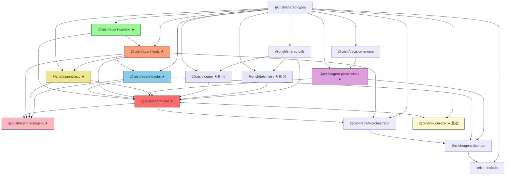

# Crish 系统性修复方案 v2 — 总览

> **方案定位**：基于对全仓库 9 个 TS 包（~80K LOC）、12 个 Rust crate、2 个 App 的代码级审计，以及四维度子agent深度分析后形成的**修正版**多轮次修复路线图。
>
> **本方案替代** `implementation_plan.md`（v1）。v1 存在的文件映射冲突、依赖方向错误、轮次拓扑违反、过度工程化等问题已在 v2 中修正。
>
> **核心原则**：
>
> 1. 该拆就拆、该重写就重写，遵守 `ANTI_OVERENGINEERING_GUARDRAILS.md` 禁令 10-31（架构治理禁令）
> 2. 每轮输出是下轮输入，闭环迭代，严格拓扑顺序
> 3. 迁移遵循"共存→迁移→删除"三阶段策略（禁令 23）
> 4. 每个 Agent 任务量 ≥ 5 文件或 ≥ 300 行变更（禁令 28）

---

## 1. 代码库审计全景

### 1.1 仓库拓扑与规模

```
crish/                              # npm workspace + cargo workspace
├── apps/
│   ├── crish-desktop/              # React 19 + Zustand + Vite 5 前端
│   │   └── src/                    # ~180 文件, ~35K LOC
│   └── agent-workbench/src-tauri/  # Tauri 2 Rust 壳
│       └── src/                    # 80+ commands, ~8K LOC Rust
├── packages/
│   ├── agent-runtime/              # ~220 文件, ~31K LOC ← 主要拆分目标
│   ├── agent-orchestrator/         # ~30 文件, ~15K LOC
│   ├── agent-daemon/               # ~97 文件 (65 src + 32 test), ~30K LOC
│   ├── shared-types/               # ~20 文件, ~3K LOC
│   ├── shared-utils/               # ~30 文件, ~6K LOC
│   ├── decision-engine/            # ~10 文件, ~3K LOC
│   ├── plugin-sdk/                 # 1 文件, 17 行 ← 需要全面重建
│   └── test-utils/                 # ~5 文件, ~1K LOC
└── crates/
    ├── conex-types/                # 领域类型 + CoreError(6 variant) + IPC
    ├── conex-stream/               # 流式缓冲 + 背压
    ├── conex-ipc/                  # JSONL IPC 帧协议
    ├── conex-db/                   # SQLite 持久化 (>500 行测试)
    ├── conex-sandbox/              # 命令安全门控 (RegexSet)
    ├── conex-net/                  # HTTP 客户端 + 重试
    ├── conex-fs/                   # 安全文件系统
    ├── conex-diff/                 # 差异计算
    ├── conex-search/               # 文件搜索
    ├── conex-markdown/             # Markdown 渲染
    └── conex-compaction/           # 上下文压缩
```

### 1.2 编译健康状态

| 指标                      | 当前值                                                                                                                                                                                                                                    |
| ------------------------- | ----------------------------------------------------------------------------------------------------------------------------------------------------------------------------------------------------------------------------------------- |
| TSC 编译错误              | **315**（目标：Round 11 后 < 50）                                                                                                                                                                                                         |
| 错误类型分布              | `TS2375`/`TS2379`(exactOptionalPropertyTypes) ~90, `TS2532`/`TS18048`(uncheckedIndex) ~60, `TS6133`/`TS6192`(unused) ~45, `TS2307`/`TS2305`(missing module) ~35, `TS1484`(verbatimModuleSyntax) ~30, `TS7006`(implicitAny) ~20, other ~35 |
| CI 门禁数                 | 12                                                                                                                                                                                                                                        |
| Vitest 覆盖率阈值         | orchestrator 70% stmt / runtime 50% stmt                                                                                                                                                                                                  |
| 循环依赖                  | 0 (dependency-cruiser 强制) — **拆分过程中必须保持为 0**                                                                                                                                                                                  |
| throw new Error 数量      | 250 处 / 96 文件（源码 177 + 测试 73，迁移工作量基准）                                                                                                                                                                                    |
| throw new Crish* 子类数量 | 141 处 / 22 文件（CrishError 82 + ProviderError 25 + SessionError 31 + ProtocolError 3）                                                                                                                                                  |
| Rust 错误枚举数           | 5 个枚举 + 1 个 anyhow crate（CoreError 6v / IpcError 4v / MarkdownError 2v / StreamError 1v / NetError 2v）                                                                                                                              |

### 1.3 现有架构资产清单

> 以下资产经审计确认为**高质量工作代码**，拆分时应保留逻辑、迁移到正确的包。资产状态已通过实际代码验证。

| 资产                                        | 当前位置                                             | 目标包                      | 状态                                                                             |
| ------------------------------------------- | ---------------------------------------------------- | --------------------------- | -------------------------------------------------------------------------------- |
| `CrishError` 基类 + 4 子类                  | `shared-types/src/errors.ts`                         | `shared-types` (增强)       | 81 行，需扩展（code 当前为裸 string）                                            |
| `ErrorClassifier` + `ErrorDomain` 枚举      | `agent-runtime/src/error-classifier.ts`              | `shared-utils`              | 261 行，成熟（下沉 shared-utils 以消除反向依赖，见 02-FILE-MAPPING §3 解耦调整） |
| `RecoveryPipeline` 3-Tier                   | `agent-runtime/src/recovery-pipeline.ts`             | `agent-core`                | 184 行，成熟（含 PipelineResult ADT）                                            |
| `FallbackChain` 引擎                        | `agent-runtime/src/fallback-chain/`                  | `agent-core`                | 4 文件，成熟                                                                     |
| 结构化 `Logger` + `LogTransport`            | `shared-utils/src/logger.ts`                         | `@crish/logger` (提取)      | 108 行，需增强（无 flush/span）                                                  |
| `DaemonFileLogger`                          | `agent-daemon/src/daemon-logger.ts`                  | `@crish/logger` (合并)      | 52 行，极简（无轮转）                                                            |
| `ToolMiddleware` 3-Hook                     | `agent-runtime/src/tools/`                           | `agent-tools`               | 5 文件，成熟                                                                     |
| `RegisteredTool` 三层体系                   | `agent-runtime/src/tools/tool-definition.ts`         | `agent-tools`               | 176 行，成熟                                                                     |
| `TraceManager` + `AsyncLocalStorage`        | `agent-runtime/src/trace/`                           | `@crish/telemetry`          | 367 行，成熟（无 OTel 导出）                                                     |
| `ControlBus` L1/L2/L3                       | `agent-runtime/src/control/`                         | `agent-core`                | 4 文件，成熟                                                                     |
| `SteeringCoordinator` + 3 策略              | `agent-runtime/src/steering/`                        | `agent-core`                | 8 文件，成熟                                                                     |
| `LifecycleHookRegistry` v2 (observe/on)     | `agent-runtime/src/hooks/lifecycle-hooks.ts`         | `agent-core` (hooks/)       | 348 行，成熟（**必须保留双模式**）                                               |
| `McpLifecycleManager`                       | `agent-runtime/src/mcp-lifecycle/`                   | `agent-mcp`                 | 6 文件，成熟（增加 registerPluginServer）                                        |
| `PluginRegistry` (ToolSource 适配器)        | `agent-runtime/src/plugin-registry.ts`               | `plugin-sdk/src/registry/`  | 516 行（非真正注册表，迁移价值有限）                                             |
| `SubagentDepthGuard` + semaphore            | `agent-runtime/src/subagents.ts`                     | `agent-subagent`            | 560 行（~60% 保留，~40% 重写）                                                   |
| `SessionTree` + `BoundedMap`                | `agent-orchestrator/src/session-tree.ts`             | `agent-orchestrator` (保留) | 成熟                                                                             |
| `FileOrchestratorEventStore` + 3-Tier Index | `agent-orchestrator/src/event-store/`                | `agent-orchestrator` (保留) | 成熟                                                                             |
| `GoalLoopStrategy` + FNV-1a stall           | `agent-orchestrator/src/event-scan-goal-strategy.ts` | `agent-orchestrator` (保留) | 成熟                                                                             |
| `ApprovalQueue` + timeout/extend            | `agent-daemon/src/approval-queue.ts`                 | `agent-daemon` (保留)       | 成熟                                                                             |
| `CommandGatekeeper` (RegexSet)              | `crates/conex-sandbox/`                              | Rust (保留)                 | 成熟                                                                             |
| `LocalDb` SQLite + migration v3             | `crates/conex-db/`                                   | Rust (保留)                 | 成熟                                                                             |

---

## 2. 架构级问题清单

### 2.1 结构性问题

| ID   | 问题                                                                                                       | 影响范围                       | 解决方案                                                          | 对应 Round |
| ---- | ---------------------------------------------------------------------------------------------------------- | ------------------------------ | ----------------------------------------------------------------- | ---------- |
| S-01 | `agent-runtime` ~31K LOC 单体包，~220 文件混合 provider/tools/mcp/context/subagent 等无关关注点            | 全局                           | 九包拆分（拓扑顺序 leaf→middle→top）                              | R3-R5      |
| S-02 | `plugin-sdk` 仅 17 行、4 个 `any` 钩子，无法支撑插件生态                                                   | 插件系统                       | 单包全面重建（14 钩子 + observe/on 双模式 + 工具注册 + 信任模型） | R8         |
| S-03 | 错误类型体系不完整：`CrishError.code` 裸 string，无分域错误码；无 `CrishResult<T>` ADT；无跨进程序列化标准 | 全局                           | 扩展 errors.ts + 新建 result.ts + error-payload.ts                | R1         |
| S-04 | 日志和追踪分散在 `shared-utils/logger` + `agent-runtime/trace` + `daemon/daemon-logger` 三处               | 全局                           | 新建 `@crish/logger` 和 `@crish/telemetry`                        | R2         |
| S-05 | 子代理系统缺少 DeadlockDetector 和完整调度器                                                               | agent-runtime → agent-subagent | 新建子代理调度系统（5 必要组件）                                  | R9         |
| S-06 | 315 个 TSC 编译错误阻碍类型安全验证                                                                        | 全局                           | 随拆分过程逐步修复，R11 降至 < 50                                 | R3-R11     |
| S-07 | Provider 系统散落在 `provider*/` + `openai-*.ts` + `anthropic-*.ts` + `gemini-*.ts` 等 57 文件             | agent-runtime                  | 统一提取到 `agent-model`                                          | R4         |
| S-08 | Rust 端 `CoreError`（6 variant）与 TS 端 `CrishError` 序列化格式不统一                                     | 跨语言                         | `CrishErrorPayload` 双端对齐                                      | R10        |
| S-09 | `decision-engine` 与 `agent-permissions` 的 `command-classification` 职责重叠                              | 权限域                         | 明确切线：decision-engine 管决策，agent-permissions 管执行        | R3         |
| S-10 | 250 处 `throw new Error` 使用裸 Error，无错误码、无 retryable 标记                                         | 全局                           | 按包逐个迁移到 `CrishError`（三阶段策略）                         | R3-R11     |

### 2.2 功能性缺失

| ID   | 问题                                                        | 解决方案                                     | 对应 Round |
| ---- | ----------------------------------------------------------- | -------------------------------------------- | ---------- |
| F-01 | 无结构化文件日志（RotatingFileSink）+ Windows 文件锁处理    | `@crish/logger` 新包                         | R2         |
| F-02 | 无 Rust 端 telemetry crate                                  | `conex-telemetry` 新 crate                   | R10        |
| F-03 | 插件无法注册自定义工具                                      | `plugin-sdk` 工具注册 API                    | R8         |
| F-04 | 插件无 MCP 服务器声明能力                                   | `agent-mcp` 的 `registerPluginServer` 入口   | R8         |
| F-05 | 子代理无死锁检测                                            | `DeadlockDetector`（spawn 时 O(depth) 检查） | R9         |
| F-06 | 子代理调度无显式状态机和超时管理                            | `SubagentScheduler` + `SubagentInstance`     | R9         |
| F-07 | 无统一的 Tauri command 错误传播格式                         | `CrishErrorPayload` Rust impl                | R10        |
| F-08 | `CrishResult` 缺少 mapResult/flatMapResult/match 等工具函数 | shared-types 扩展                            | R1         |
| F-09 | `CrishErrorPayload` 丢失 cause 链                           | 采用递归 cause 设计（最多 8 层）             | R1         |
| F-10 | 现有 `LifecycleHookRegistry` 的 observe/on 双模式无文档化   | 钩子类型系统重建时保留并文档化               | R8         |

---

## 3. 修正后的依赖图

> **权威依赖图**。所有 Round 文档引用依赖关系时必须指向本节。
> mermaid 箭头 `A --> B` 统一表示 **B 依赖 A**（B 的 package.json 中有 A，A 是 B 的下层基础）。
> 箭头从底层指向高层，与拓扑层级一致。
> 依赖方向已通过实际代码 import 验证（特别是 `subagents.ts` 的 import `AgentRuntime` from `./runtime` 证明了 agent-subagent 依赖 agent-core）。



> ★ = 新包

### 3.1 依赖图关键修正（相对于 v1）

| 修正项                  | v1 错误                           | v2 修正                                                               | 验证依据                                                               |
| ----------------------- | --------------------------------- | --------------------------------------------------------------------- | ---------------------------------------------------------------------- |
| agent-subagent 依赖方向 | `AC --> AS`（core 依赖 subagent） | `AC --> AS` 改为 `AS 依赖 AC`（subagent 依赖 core）                   | `subagents.ts` import `AgentRuntime` from `./runtime`                  |
| agent-mcp 依赖声明      | 依赖 agent-tools + agent-model    | **仅依赖 shared-types + shared-utils**（通过 agent-tools 的类型引用） | `mcp-lifecycle-manager.ts` 仅 import `../types`（将迁入 shared-types） |
| agent-stream 独立包     | 独立 agent-stream 包              | **取消，并入 agent-model**                                            | stream-parse 与 provider 实现强内聚                                    |
| plugin 子包拆分         | 6 个独立包                        | **plugin-sdk 单包**（含 registry/skills 子目录）                      | 避免循环依赖 + 禁令 10                                                 |
| plugin-mcp 独立包       | 独立 plugin-mcp 包                | **并入 agent-mcp**（增加 registerPluginServer 入口）                  | 职责与 McpLifecycleManager 完全重叠                                    |

### 3.2 拓扑层级与创建顺序

```
Layer 0: shared-types, shared-utils, decision-engine (已存在，Round 1 增强)
Layer 1: @crish/logger, @crish/telemetry (Round 2 创建)
Layer 2: agent-context, agent-permissions, agent-mcp[骨架] (Round 3 创建 — leaf 层)
Layer 3: agent-tools, agent-model, agent-mcp[完整] (Round 4 创建 — middle 层)
Layer 4: agent-core (Round 5 创建 — top 层)
Layer 5: agent-subagent (Round 5 创建骨架，Round 9 完整化 — 始终为 Layer 5)
Layer 6: agent-orchestrator (Round 6 重构)
Layer 7: agent-daemon (Round 7 重构)
Layer 8: plugin-sdk (Round 8 重建)
Layer 9: Rust crates (Round 10 对齐)
Layer 10: crish-desktop (Round 11 韧性加固)
```

**关键拓扑约束**：

- Round 3 必须先于 Round 4（agent-tools 依赖 agent-context）
- Round 4 必须先于 Round 5（agent-core 依赖 agent-tools/agent-model/agent-context）
- Round 8 必须先于 Round 9（agent-subagent 的发现机制依赖 PluginRegistry）

---

## 4. 十二轮编排逻辑

### 4.1 轮次总览

| Round | 名称                      | 目标包                                            | Agent 数 | 前置轮次 | 关键交付物                                                                           |
| ----- | ------------------------- | ------------------------------------------------- | -------- | -------- | ------------------------------------------------------------------------------------ |
| 1     | 类型基础层 + 基线审计     | shared-types (增强)                               | 5        | —        | CrishError + CrishResult + CrishErrorPayload + 64 正式码 + 10 reserved 码 + 基线数据 |
| 2     | 基础设施包                | @crish/logger, @crish/telemetry                   | 4        | R1       | Logger + RotatingFileSink + Telemetry + CrashHandler                                 |
| 3     | 拆分 Phase-A (leaf)       | agent-context, agent-permissions, agent-mcp[骨架] | 5        | R2       | 3 个 leaf 包 + decision-engine 边界明确                                              |
| 4     | 拆分 Phase-B (middle)     | agent-tools, agent-model, agent-mcp[完整]         | 5        | R3       | 3 个 middle 包 + provider 系统统一                                                   |
| 5     | 拆分 Phase-C (top) + 集成 | agent-core, agent-subagent[骨架], legacy shim     | 5        | R4       | agent-core + shim + 全系统集成验证                                                   |
| 6     | 编排层重构                | agent-orchestrator                                | 4        | R5       | CrishError 集成 + 日志集成 + TSC 修复                                                |
| 7     | Daemon 重构               | agent-daemon                                      | 4        | R6       | 日志升级 + 错误传播 + TSC 修复                                                       |
| 8     | 插件 SDK 全面重建         | plugin-sdk                                        | 6        | R5       | 14 钩子 + observe/on + 工具注册 + 信任模型                                           |
| 9     | 子代理调度系统            | agent-subagent[完整]                              | 5        | R8       | RecursionGuard + Scheduler + DeadlockDetector + ControlBus 扩展                      |
| 10    | Rust 侧对齐               | conex-types, conex-telemetry, Tauri               | 4        | R9       | CrishErrorPayload Rust impl + IPC 对齐                                               |
| 11    | 前端韧性 + TSC            | crish-desktop                                     | 5        | R10      | 错误翻译层 + TSC < 50 + 测试修复                                                     |
| 12    | CI 强化与文档             | CI, docs                                          | 4        | R11      | CI 门禁 + depcruise 规则 + ARCHITECTURE.md                                           |

### 4.2 轮次依赖链

```
R1 ──→ R2 ──→ R3 ──→ R4 ──→ R5 ──┬──→ R6 ──→ R7 ──┐
                                  │                  │
                                  ├──→ R8 ──→ R9 ──→ R10 ──→ R11 ──→ R12
                                  │
                                  └──→ (R5 完成后 R6 和 R8 可并行启动)
```

**可并行轮次**：

- R6（orchestrator）与 R8（plugin-sdk）在 R5 完成后可并行——orchestrator 不依赖 plugin-sdk，plugin-sdk 也不依赖 orchestrator
- R7（daemon）依赖 R6 完成，必须串行
- R9（subagent）依赖 R8 完成，必须串行

**伪并行警告（已修正）**：

- v1 声称 R8/R9 可并行，但子代理的 PluginDiscoverySource 硬依赖插件 SDK → v2 声明为串行
- v1 声称 R10/R11 可并行，但前端错误处理依赖 Rust 端 CrishErrorPayload → v2 声明为串行

### 4.3 每轮验证门禁

每轮结束前必须通过以下 8 项检查（`ANTI_OVERENGINEERING_GUARDRAILS.md` 禁令 27 禁止伪并行）：

| 检查项           | 命令                        | 通过标准                    |
| ---------------- | --------------------------- | --------------------------- |
| TypeScript 编译  | `npx tsc --noEmit`          | 错误数 ≤ 该轮基线（不恶化） |
| Rust 编译        | `cargo check --workspace`   | 0 errors                    |
| 单元测试（TS）   | `npx vitest run`            | 全部通过                    |
| 单元测试（Rust） | `cargo test --workspace`    | 全部通过                    |
| 循环依赖         | `npm run lint:depcruise`    | 0 violations                |
| 构建             | `npx turbo run build`       | 全部成功                    |
| Lint             | `npm run lint`              | 0 errors                    |
| Store 类型       | `npm run check:store-types` | 通过                        |

**最终目标**（Round 11 结束时）：TSC 错误 < 50（不要求 0）。

---

## 5. Agent 分配总览

### 5.1 总量

- **总轮次**：12 轮
- **总 Agent 数**：56 个
- **每轮 Agent 数**：4-6 个（上限 6）
- **单 Agent 工作量**：≥ 5 文件修改或 ≥ 300 行变更（禁令 28）

### 5.2 Agent 类型

| 类型       | 职责                                              | 占比 |
| ---------- | ------------------------------------------------- | ---- |
| **创建型** | 新建包骨架、package.json、tsconfig.json、index.ts | ~20% |
| **迁移型** | 从 agent-runtime 迁移文件到新包，更新 import 路径 | ~35% |
| **实现型** | 编写新代码（CrishError、Logger、Scheduler 等）    | ~25% |
| **修复型** | 修复 TSC 错误、lint 错误、测试失败                | ~15% |
| **验证型** | 运行验证门禁、生成基线报告                        | ~5%  |

### 5.3 Agent 任务设计原则

1. **每个 Agent 有独立的输入输出契约**：明确"接收什么文件/接口"和"产出什么文件/接口"
2. **文件集不相交**：同一轮内的并行 Agent 操作的文件集必须完全不相交
3. **验证闭环**：每个 Agent 完成后能独立验证其产出（不需要等其他 Agent）
4. **协调最小化**：同轮内 Agent 间协调次数 ≤ 2 次

---

## 6. 跨轮次验证体系

### 6.1 基线建立（Round 1 Phase 1）

Round 1 的前半部分为基线审计，产出以下基线文件：

| 基线文件                         | 内容                                                        | 用途                   |
| -------------------------------- | ----------------------------------------------------------- | ---------------------- |
| `tsc-errors-baseline.json`       | 315 个 TSC 错误的详细列表（文件+行号+错误码）               | 每轮"不恶化"基准       |
| `dependency-graph-baseline.json` | 当前包依赖关系图                                            | 拆分后验证拓扑正确性   |
| `test-coverage-baseline.json`    | 当前各包测试覆盖率                                          | 拆分后验证覆盖率不下降 |
| `throw-inventory.json`           | 250 处 throw new Error + 141 处 throw new Crish* 子类的清单 | 迁移追踪               |
| `tech-debt-inventory.md`         | TECH_DEBT 清单                                              | 迁移完成后清理         |

### 6.2 每轮验证流程

```
Round N 开始
  ├── 读取 Round N-1 的交付物清单
  ├── 记录当前 tsc-errors-baseline.json
  ├── 执行 Agent 任务（并行或串行）
  ├── 每个 Agent 完成后独立验证
  └── Round N 验证门禁
      ├── tsc 错误数 ≤ baseline
      ├── cargo check 0 errors
      ├── vitest 全部通过
      ├── cargo test 全部通过
      ├── depcruise 0 violations
      ├── turbo build 全部成功
      ├── lint 0 errors
      └── store-types 通过
  ├── 生成 Round N 交付物清单
  └── Round N 结束 → Round N+1
```

### 6.3 回归风险控制

| 风险            | 缓解措施                                         |
| --------------- | ------------------------------------------------ |
| Import 路径断裂 | legacy shim + 显式命名导出 + deprecation warning |
| 运行时行为变化  | 共存阶段 + 逐包迁移 + 每包测试验证               |
| 测试用例丢失    | 迁移前后测试文件计数检查 + 覆盖率不下降门禁      |
| 循环依赖引入    | depcruise 门禁 + 拓扑层验证                      |
| TSC 错误恶化    | 每轮基线对比 + 不恶化门禁                        |

---

## 7. 文档索引

| 文档                                 | 内容                              | 状态                                              |
| ------------------------------------ | --------------------------------- | ------------------------------------------------- |
| `ANTI_OVERENGINEERING_GUARDRAILS.md` | 架构治理禁令（禁令 1-31）         | 已精简（禁令 10-31 从~~230行精简为~~100行纯禁令） |
| `v2/01-OVERVIEW.md`                  | 本文档（总览）                    | 当前                                              |
| `v2/02-FILE-MAPPING.md`              | 统一文件→包映射表 + 权威依赖图    | 已创建（含解耦调整记录）                          |
| `v2/03-ERROR-MIGRATION.md`           | 错误码迁移映射表 + throw 迁移追踪 | 已创建（64 正式码 + 10 reserved）                 |
| `v2/ROUND-01-type-foundation.md`     | Round 1 详细设计                  | 已创建                                            |
| `v2/ROUND-02-infrastructure.md`      | Round 2 详细设计                  | 已创建                                            |
| `v2/ROUND-03-split-phase-A.md`       | Round 3 详细设计                  | 已创建                                            |
| `v2/ROUND-04-split-phase-B.md`       | Round 4 详细设计                  | 已创建                                            |
| `v2/ROUND-05-split-phase-C.md`       | Round 5 详细设计                  | 已创建                                            |
| `v2/ROUND-06-orchestrator.md`        | Round 6 详细设计                  | 已创建                                            |
| `v2/ROUND-07-daemon.md`              | Round 7 详细设计                  | 已创建                                            |
| `v2/ROUND-08-plugin-sdk.md`          | Round 8 详细设计                  | 已创建                                            |
| `v2/ROUND-09-subagent.md`            | Round 9 详细设计                  | 已创建                                            |
| `v2/ROUND-10-rust.md`                | Round 10 详细设计                 | 已创建                                            |
| `v2/ROUND-11-frontend.md`            | Round 11 详细设计                 | 已创建                                            |
| `v2/ROUND-12-ci-docs.md`             | Round 12 详细设计                 | 已创建                                            |
| `v2/04-INTERFACE-CONTRACTS.md`       | 接口契约速查表                    | 已创建（64 正式码 + 10 reserved，10 类接口）      |

> **v1 文档状态**：`implementation_plan.md` 和 `plan-01~04` 保留作为参考，但已标注"已被 v2 superseded"。

---

## 8. 轮次间数据流图

> 以下 mermaid 图展示各 Round 的关键交付物如何作为下轮输入传递（对齐 `implementation_plan.md` 附录 C）。

```mermaid
graph LR
    %% Round 1 产出
    R1["Round 1<br/>类型基础层"] --> |CrishError + CrishResult<br/>CrishErrorPayload + 64码<br/>基线数据| R2["Round 2<br/>基础设施包"]

    %% Round 2 产出
    R2 --> |@crish/logger<br/>@crish/telemetry<br/>TraceManager| R3["Round 3<br/>拆分 Phase-A"]

    %% Round 3 产出
    R3 --> |agent-context<br/>agent-permissions<br/>agent-mcp骨架| R4["Round 4<br/>拆分 Phase-B"]

    %% Round 4 产出
    R4 --> |agent-tools<br/>agent-model<br/>agent-mcp完整| R5["Round 5<br/>拆分 Phase-C"]

    %% Round 5 产出
    R5 --> |agent-core<br/>agent-subagent骨架<br/>legacy shim| R6["Round 6<br/>编排层重构"]
    R5 --> |同上| R8["Round 8<br/>插件SDK重建"]

    %% Round 6 产出
    R6 --> |CrishError集成<br/>日志集成| R7["Round 7<br/>Daemon重构"]

    %% Round 7 产出
    R7 --> |ErrorMessage扩展<br/>payload: CrishErrorPayload| R10["Round 10<br/>Rust对齐"]

    %% Round 8 产出
    R8 --> |PluginManifest<br/>PluginRegistry<br/>14钩子| R9["Round 9<br/>子代理调度"]

    %% Round 9 产出
    R9 --> |RecursionGuard<br/>SubagentScheduler<br/>DeadlockDetector<br/>子代理错误码| R10

    %% Round 10 产出
    R10 --> |CrishErrorPayload Rust<br/>conex-telemetry<br/>IPC对齐| R11["Round 11<br/>前端韧性"]

    %% Round 11 产出
    R11 --> |toUserVisibleError<br/>TSC < 50<br/>错误翻译层| R12["Round 12<br/>CI与文档"]

    %% Round 12 产出
    R12 --> |CI门禁<br/>depcruise规则<br/>ARCHITECTURE.md<br/>删除legacy shim| DONE["完成"]

    %% 跨轮数据流标注
    R1 -.-> |基线json文件<br/>每轮使用| R12
    R2 -.-> |logger被所有<br/>后续轮使用| R12

    style R5 fill:#ff6b6b,stroke:#333
    style R8 fill:#fffacd,stroke:#333
    style R9 fill:#ffb6c1,stroke:#333
    style DONE fill:#98fb98,stroke:#333
```

### 8.1 关键数据契约

| 上游 Round | 下游 Round | 交付物                                                                              | 契约形式                   |
| ---------- | ---------- | ----------------------------------------------------------------------------------- | -------------------------- |
| R1         | R2-R12     | `CrishErrorCode`（64 正式码 + 10 reserved）                                         | TS 类型 + 注册表           |
| R1         | R2-R12     | `CrishErrorPayload`（跨进程序列化）                                                 | TS interface + Rust struct |
| R1         | R12        | `tsc-errors-baseline.json`                                                          | JSON 文件                  |
| R2         | R3-R12     | `@crish/logger` 的 `Logger` 接口                                                    | TS class                   |
| R5         | R6-R12     | `agent-runtime` legacy shim（显式命名导出 + deprecation warning）                   | TS barrel                  |
| R7         | R10-R11    | `ErrorMessage.payload?: CrishErrorPayload`                                          | TS interface 扩展          |
| R8         | R9         | `PluginManifest.agents` + `PluginRegistry.discoverAgents()`                         | TS interface               |
| R9         | R10        | 子代理错误码（`subagent.depth_exceeded` / `subagent.deadlock_detected`）            | CrishErrorCode 注册        |
| R10        | R11        | Rust 端 `CrishErrorPayload` struct + `IpcResponse.error: Option<CrishErrorPayload>` | Rust struct + serde        |

### 8.2 基线文件流转

```
R1 产出基线:
  tsc-errors-baseline.json ────────→ 每轮开始时读取（不恶化门禁）
  dependency-graph-baseline.json ──→ R3-R5 拆分后验证拓扑
  test-coverage-baseline.json ─────→ 每轮验证覆盖率不下降
  throw-inventory.json ───────────→ R3-R11 迁移追踪
  tech-debt-inventory.md ─────────→ R12 清理
```
