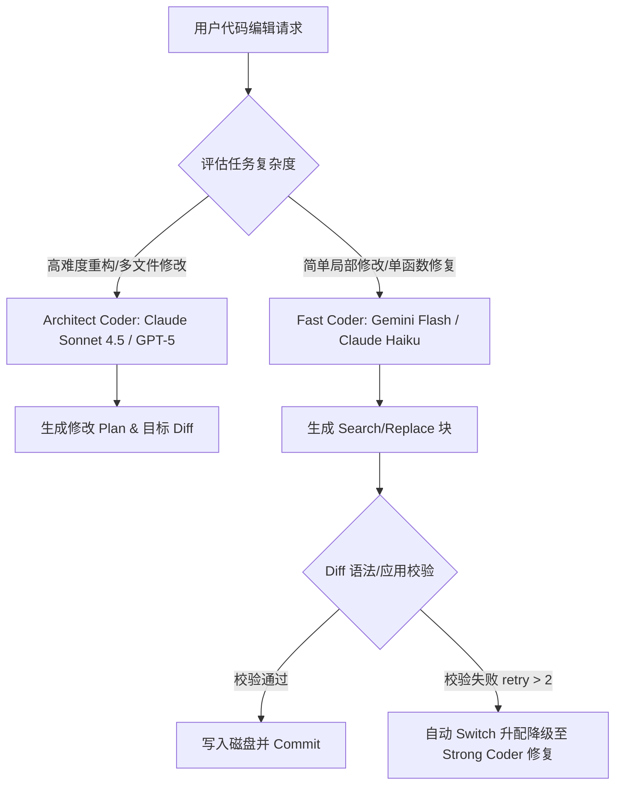

# AI Code Coder & Patch Engine 缺陷补丁与源码深度审计报告

> **审计对象**：`reference/aider` (Python), `reference/continue` (TypeScript/Kotlin), `reference/jcode` (Rust)  
> **报告类型**：代码编辑引擎、Diff 补丁解析、多 Agent 协同与底层 Runtime 缺陷深度审计  
> **生成时间**：2026年7月24日  
> **文档位置**：`C:\Software\conex\analysis\reference_patch_audits\patch_analysis_04_coder_patch_engines.md`

---

## 概述

在构建 AI 驱动的代码编辑引擎（Coder Engines）与代码补丁应用系统（Patch Engines）过程中，系统需在高并发流式响应、大文本解析、复杂文件系统交互以及多 Agent 递归协同等极端条件下持续稳定运行。本报告通过深入检索并对比 `reference/aider`、`reference/continue` 与 `reference/jcode` 三大开源 AI 代码助手项目的生产级 Git 提交历史（Commit History）与核心源码实现，剖析了 16 个典型生产故障的根因（Root Cause），归纳了关键代码级的修复范式，并针对 Conex 项目的 Rust 代码编辑器架构与 Multi-Agent Daemon 提出了系统性的加固方案。

---

## 一、核心修补 Commit 清单与 Bug 根因剖析

### 1. Aider `7c9cff2f` / `d022f4ac`: EditBlock Regex 标签闭合陷阱与正则捕获失效

* **Commit 信息**: `refactor: update HEAD regex to accept optional closing tag in search blocks`
* **涉及文件**: `aider/coders/editblock_coder.py`
* **故障现象**: 当模型编辑 HTML、XML 或包含 Markup 标签的代码文件时，`SEARCH/REPLACE` 块的匹配规则失效，导致 AI 生成的补丁被静默丢弃（Dropped Edit Blocks），用户看到模型输出了修改方案但目标文件无任何变更。
* **根因剖析**: 
  模型在处理 HTML 或 Markdown 标记文本时，受到训练数据中 HTML 标签对（Tag Closure）特性的强偏置影响，会在生成 Search 块起始标记 `<<<<<<< SEARCH` 时，不自觉地在其末尾追加一个闭合括号 `>`，写成 `<<<<<<< SEARCH>`。
  Aider 原始正则表达式限定极严：
  ```python
  HEAD = r"^<{5,9} SEARCH\s*$"
  ```
  末尾的 `>` 导致正则表达式直接匹配失败，整段 Edit Block 被识别为普通文本而非指令块。
* **源码修复方案**:
  修改正则定义，将可选的 `>` 纳入匹配集合：
  ```diff
  - HEAD = r"^<{5,9} SEARCH\s*$"
  + HEAD = r"^<{5,9} SEARCH>?\s*$"
  ```

---

### 2. Aider `b2bec25c`: 循环符号链接导致 `safe_abs_path()` 抛出 Fatal Exception

* **Commit 信息**: `fix: handle symlink loops in safe_abs_path() (#4711)`
* **涉及文件**: `aider/utils.py`, `tests/basic/test_utils.py`
* **故障现象**: 当用户工作区内存在循环符号链接（Circular Symlink，如 `link_a -> link_b -> link_a`）时，任何对路径规整化（Path Normalization）的调用均抛出 `RuntimeError: Symlink loop detected`，直接导致 CLI 进程崩溃退出。
* **根因剖析**: 
  Aider 的 `safe_abs_path()` 依赖 Python 标准库 `Path(res).resolve()` 来解析绝对路径和消除 Windows 8.3 短文件名。然而 `resolve()` 在遇到软链接环路时会触发底层 OS 递归探测上界，直接抛出 `RuntimeError` 或 `OSError`。
* **源码修复方案**:
  显式捕获环路异常，退化为无链接解析的绝对路径计算 `Path.absolute()`：
  ```python
  def safe_abs_path(res):
      "Gives an abs path, which safely returns a full (not 8.3) windows path"
      try:
          res = Path(res).resolve()
      except (RuntimeError, OSError):
          res = Path(res).absolute()
      return str(res)
  ```

---

### 3. Aider `39023f9b`: Claude 4/4.7 推理模型 Temperature 与 Thinking Token 门禁冲突

* **Commit 信息**: `fix: Disable temperature for opus-4 models and gate thinking_tokens`
* **涉及文件**: `aider/models.py`
* **故障现象**: 调用 Anthropic Claude Opus 4/4.7 或 Sonnet 4.5 系列推理模型时，API 抛出 HTTP 400 错误（`temperature is not supported when thinking is enabled`）。
* **根因剖析**: 
  新一代推理模型开启 `thinking_tokens` 时，服务侧强制要求 `temperature` 必须为默认值 1.0 或不传。Aider 内部根据模型能力自动为特定 Coder 注入 `temperature=0`，在判断逻辑中缺失对 `opus-4-` 前缀模型的特殊处理，导致非法参数组合透传给 Provider API。
* **源码修复方案**:
  在 `Model` 配置初始化函数中强制解绑 `use_temperature` 并严格校验 `thinking_tokens`：
  ```python
  if "sonnet-4-" in model or "opus-4-" in model or "haiku-4-" in model:
      self.edit_format = "diff"
      self.use_repo_map = True
      self.examples_as_sys_msg = False
      if "opus-4-" in model:
          self.use_temperature = False
      if "thinking_tokens" not in self.accepts_settings and "4.7" not in model and "4-7" not in model:
          self.accepts_settings.append("thinking_tokens")
  ```

---

### 4. Aider `14af218e`: 历史日志目录缺失导致的 I/O 阻断与权限降级处理

* **Commit 信息**: `fix: Create parent directories for history files and improve error handling`
* **涉及文件**: `aider/io.py`
* **故障现象**: 当用户通过命令行参数指定深层路径作为历史记录文件（如 `--input-history-file .aider/history/input.log`），但对应父目录尚不存在时，交互界面崩溃或抛出 `FileNotFoundError` / `PermissionError`。
* **根因剖析**: 
  历史记录写入逻辑分布在每次用户输入和 LLM 响应完成的异步回调中。如果在文件写入瞬间才尝试 `mkdir`，一旦由于目录不存在或临时权限拒绝，会中断核心主循环。
* **源码修复方案**:
  在 `InputOutput` 初始化阶段即完成父目录的递归创建（`mkdir(parents=True, exist_ok=True)`），若捕获权限或 I/O 错误则发出 Tool Warning 并优雅降级（禁用历史记录功能，`input_history_file = None`）：
  ```python
  self.input_history_file = input_history_file
  if self.input_history_file:
      try:
          Path(self.input_history_file).parent.mkdir(parents=True, exist_ok=True)
      except (PermissionError, OSError) as e:
          self.tool_warning(f"Could not create directory for input history: {e}")
          self.input_history_file = None
  ```

---

### 5. JCode `6e76263a`: Prompt Compaction 后 KV Cache Baseline 未重置引发的上下文错乱

* **Commit 信息**: `fix(compaction): reset KV cache baseline after native compaction`
* **涉及文件**: `crates/jcode-tui/src/tui/app/conversation_state.rs`, `crates/jcode-app-core/src/agent.rs`
* **故障现象**: 在长会话触发原生上下文压缩（Native Compaction）或自动摘要后，后续 LLM 请求的前缀缓存命中率（KV Cache Hit）出现异常暴跌，甚至触发 Harness-level 的 Prompt Hash 冲突警报（`kv_cache_miss_pushes_in_chat_alarm`）。
* **根因剖析**: 
  上下文压缩会将数百条历史消息压缩为一条 Summary + 少量近期 Tail。旧有的 `kv_cache_baseline` 记录的是压缩前的请求签名（Signature）。当新的请求发起时，如果客户端未清除旧签名，系统会误以为前缀依然匹配，带着错误的 `cache_generation` 去发起增量请求，导致 Provider 端缓存失效并重新计费。
* **源码修复方案**:
  引入显式的 `invalidate_kv_cache_after_compaction()` 机制，在任何 Native 或 Emergency Compaction 事件触发后立即销毁旧 Baseline 并递增 `cache_generation`：
  ```rust
  fn invalidate_kv_cache_after_compaction(&mut self) {
      self.provider_session_id = None;
      self.session.provider_session_id = None;
      self.context_warning_shown = false;
      self.kv_cache.kv_cache_baseline = None;
      self.kv_cache.cache_generation = self.kv_cache.cache_generation.wrapping_add(1);
      self.streaming.streaming_context_stale = true;
      self.bump_context_revision();
  }
  ```

---

### 6. JCode `945f87ba`: Swarm 会话重连中的锁逆序死锁 (Lock Inversion Deadlock)

* **Commit 信息**: `fix(server): avoid swarm lock inversion on resume`
* **涉及文件**: `crates/jcode-app-core/src/server/client_session.rs`
* **故障现象**: 当远程客户端在 Swarm 任务运行中重新连接并执行 `handle_resume_session` 时，服务端进程卡死，后续所有 API 订阅与 WebSocket 请求永久挂起。
* **根因剖析**: 
  在重命名 Swarm 成员 Session ID 时，代码先获取了 `swarm_members.write().await`，然后在该锁临界区内部去等待 `swarms_by_id.write().await`。而 Swarm Coordinator 后台清理协程则是按相反顺序上锁（先 `swarms_by_id` 再 `swarm_members`）。两线程并发时产生典型的锁逆序死锁（Lock Inversion）。
* **源码修复方案**:
  重构 `rename_swarm_member_session`，确保绝不同时持有两个写锁。先在独立块中完成 `swarm_members` 的修改与锁释放，再获取 `swarms_by_id` 锁：
  ```rust
  async fn rename_swarm_member_session(
      old_session_id: &str,
      new_session_id: &str,
      swarm_members: &Arc<RwLock<HashMap<String, SwarmMember>>>,
      swarms_by_id: &Arc<RwLock<HashMap<String, HashSet<String>>>>,
  ) {
      let renamed_swarm_id = {
          let mut members = swarm_members.write().await;
          let renamed_swarm_id = members.remove(old_session_id).and_then(|mut member| {
              let swarm_id = member.swarm_id.clone();
              member.session_id = new_session_id.to_string();
              member.status = "ready".to_string();
              members.insert(new_session_id.to_string(), member);
              swarm_id
          });
          // 维护父子引用节点
          for member in members.values_mut() {
              if member.report_back_to_session_id.as_deref() == Some(old_session_id) {
                  member.report_back_to_session_id = Some(new_session_id.to_string());
              }
          }
          renamed_swarm_id
      }; // 释放 members 写锁

      if let Some(swarm_id) = renamed_swarm_id {
          let mut swarms = swarms_by_id.write().await;
          if let Some(swarm) = swarms.get_mut(&swarm_id) {
              swarm.remove(old_session_id);
              swarm.insert(new_session_id.to_string());
          }
      }
  }
  ```

---

### 7. JCode `0e27a49a`: 对话历史副本双重堆保留与 Glibc Arena 内存泄露

* **Commit 信息**: `fix(memory): release transcript copies and trim active clients`
* **涉及文件**: `crates/jcode-base/src/session.rs`, `crates/jcode-tui/src/tui/app/idle_heap_release.rs`
* **故障现象**: 长时间运行的 Daemon 与 TUI 客户端进程内存占用高达 500MB~1GB，即使在空闲状态下内存也无法释放。
* **根因剖析**: 
  1. `Session` 结构体中同时维护了 `StoredMessage`（持久化历史）和 `provider_messages_cache`（Provider API 格式的高维向量副本）。在网络请求等待期，两者重复保存了完整的 Tool Output 与 Reasoning 载荷，导致单个 Active Session 浪费几十 MB 内存。
  2. Glibc 内存分配器对于频繁产生大块临时字符串的线程存在严重的堆碎片与 Arena 预留现象（Retention）。
* **源码修复方案**:
  在 Provider Payload 构建完成后，立即主动释放缓存副本，并在空闲检测循环中触发 `malloc_trim`：
  ```rust
  pub fn release_provider_messages_cache(&mut self) {
      self.provider_messages_cache = Vec::new();
      self.provider_message_prefix_hashes_cache = Vec::new();
      self.provider_messages_cache_len = 0;
      self.memory_profile_cache.provider_cache_count = 0;
  }
  ```
  在 `idle_heap_release.rs` 中增加定时分配器 Trim 机制：
  ```rust
  const CLIENT_RETENTION_TRIM_THRESHOLD_BYTES: u64 = 16 * 1024 * 1024;
  if crate::process_memory::release_retained_heap_if_excessive("client_retention_watchdog", threshold, ...) {
      self.idle_heap_release.trimmed_this_idle_period = true;
  }
  ```

---

### 8. JCode `fe9b866a` / `0259387a`: Subagent 递归派生失控与并发槽位限制

* **Commit 信息**: `fix(swarm): bound recursive live agents`
* **涉及文件**: `crates/jcode-swarm-core/src/lib.rs`, `crates/jcode-config-types/src/lib.rs`
* **故障现象**: 当 Task Graph 包含复杂子任务时，Agent 不断调用 `expand_node` 或 `spawn_subagent`，产生呈指数级扩散的子进程/子任务，耗尽系统 CPU 和 RAM。
* **根因剖析**: 
  系统缺少动态运行（Live Worker）维度的硬性上限，仅设定了一个高达 1000 的 Swarm Member 总数上限。递归派生的 Agent 在未完成前均保持 Active 状态，导致系统崩溃。
* **源码修复方案**:
  引入 `swarm_max_concurrent_agents` 并发运行槽位（默认 32），只有当已完成的 Worker 释放槽位后，才允许派生新的 Live Worker：
  ```rust
  pub struct AgentsConfig {
      /// 活跃 Swarm Worker 数量上限（默认 32）
      #[serde(default = "default_swarm_max_concurrent_agents")]
      pub swarm_max_concurrent_agents: usize,
  }
  ```

---

### 9. JCode `c3aaa10a`: OpenAI Persistent WebSocket 会话缓存链异常断开

* **Commit 信息**: `fix(openai): keep idle websocket cache chains alive`
* **涉及文件**: `crates/jcode-provider-openai-runtime/src/openai_tests/models_state.rs`
* **故障现象**: 用户在长文本思考或中断输入 30 秒以上后继续提问，后续请求提示 `connection closed by upstream`，导致之前构建的上下文 Context Cache 彻底失效。
* **根因剖析**: 
  原本系统用单一的 `last_activity_at` 标记 TCP 活跃度。当后台心跳 Ping/Pong 收到响应时，误将该时间戳更新，导致系统认为连接依然“新鲜”，忽略了 OpenAI API 端点对 Response Turn 级别的超时限制。而在真正需要发送新消息时，Socket 实际上已被服务端静默关闭。
* **源码修复方案**:
  分离 `last_activity_at` (物理 Socket 存活) 与 `last_response_completed_at` (业务 Response 结束时间)，并启动后台 Ping/Pong Keepalive 协程：
  ```rust
  pub struct PersistentWsState {
      pub ws_stream: WebSocketStream,
      pub last_activity_at: Instant,            // Socket 物理心跳
      pub last_response_completed_at: Instant,  // Turn 完成时间
  }
  ```

---

### 10. JCode `dca13b1a`: Windows 文件系统 ACL 延迟重试与并发争用加固

* **Commit 信息**: `fix(storage): harden deferred ACL retry state`
* **涉及文件**: `crates/jcode-storage/src/windows_acl.rs`
* **故障现象**: 在 Windows 系统上，多线程/多进程并发对 `.jcode/storage` 目录写入文件时，偶尔抛出 `PermissionDenied` (OS Error 5)。
* **根因剖析**: 
  Windows 上的杀毒软件（如 Defender）或索引服务会在文件创建瞬时对文件上锁进行扫描。直接设置 ACL 权限若不带指数退避重试（Exponential Backoff），会导致单次操作失败。
* **源码修复方案**:
  在 ACL 设置逻辑中增加基于 `std::thread::sleep` 和 `Backoff` 的延迟重试状态机。

---

### 11. Continue `5a8d10ff`: DiffStreamHandler 行号下溢与非法类型转换崩溃

* **Commit 信息**: `fix: resolve crashes in DiffStreamHandler — unsafe cast and negative line numbers (#11893)`
* **涉及文件**: `extensions/intellij/.../editor/DiffStreamHandler.kt`
* **故障现象**: IDE 中进行 Diff 流式渲染或 Undo 操作时，频繁出现 `ClassCastException` 以及 `IndexOutOfBoundsException: line parameter out of range`。
* **根因剖析**: 
  1. `undoChanges()` 中将 `getSelectedEditor()` 强制转换为 `TextEditor`（使用 `as TextEditor`），在预览模式或非文本编辑器上下文中转换失败崩溃。
  2. `initUnfinishedRangeHighlights()` 计算行高亮时，未对空文件（`lineCount == 0`）进行拦截，且未对行号下限进行 `0` 保护。
* **源码修复方案**:
  采用 Kotlin 安全转换 `as?` 并对行号进行范围约束 `coerceAtLeast(0)`：
  ```kotlin
  // 1. 空文件防护
  if (editor.document.lineCount == 0) return

  // 2. 下限与上限边界约束
  for (i in startLine..endLine) {
      val highlighter = editor.markupModel.addLineHighlighter(
          unfinishedKey, 
          min(i, editor.document.lineCount - 1).coerceAtLeast(0), 
          HighlighterLayer.LAST
      )
      unfinishedHighlighters.add(highlighter)
  }

  // 3. 安全转型
  val fileEditor = FileEditorManager.getInstance(project).getSelectedEditor(virtualFile) as? TextEditor
      ?: return@runWriteCommandAction
  ```

---

### 12. Continue `3a997fe1`: Qwen3/R1 思路模型空 Content 导致 Tool Calls 静默丢弃

* **Commit 信息**: `fix: preserve tool calls when thinking models return no text content (#11866)`
* **涉及文件**: `core/llm/llms/Ollama.ts`
* **故障现象**: 当使用 Qwen3-Coder 或 DeepSeek R1 等 Thinking 模型通过 Ollama 执行 Tool Call 时，模型输出了 `<think>...</think>` 推理过程和 `tool_calls` 结构，但没输出普通 `content` 文本，系统直接忽略了 Tool Call，表现为 Agent 卡住无响应。
* **根因剖析**: 
  `Ollama.ts` 转换逻辑中原本存在如下提前返回拦截：
  ```typescript
  if (thinkingMessage && !content) {
      return [thinkingMessage];
  }
  ```
  该逻辑误以为“只要没有 content，就只是一条纯思考消息”，导致随包返回的 `tool_calls` 被直接截断丢弃。
* **源码修复方案**:
  在判定条件中补充 `!toolCalls?.length` 校验：
  ```typescript
  if (thinkingMessage && !content && !toolCalls?.length) {
      // 只有在既无 content 也无 toolCalls 时才单向返回 thinking 消息
      return [thinkingMessage];
  }
  ```

---

### 13. Continue `afb6b21a`: CoreMessenger 跨进程通信事件监听器内存泄露

* **Commit 信息**: `fix: prevent responseListeners memory leak in CoreMessenger (#11901)`
* **涉及文件**: `core/control-plane/client.ts`, `extensions/vscode/src/messenger.ts`
* **故障现象**: VSCode 插件运行数小时后，扩展宿主进程（Extension Host）内存持续攀升，控制台输出 `MaxListenersExceededWarning: Possible EventEmitter memory leak detected`。
* **根因剖析**: 
  `CoreMessenger` 在向 Core 进程发送异步 RPC 请求时注册了 `responseListeners` Map。在网络请求超时、取消或抛异常的分支中，清理回调未在 `finally` 块中执行，导致 Map 膨胀至数万个悬空 Closure。
* **源码修复方案**:
  在消息响应 Promise 中使用 `finally` 确保超时与异常情况下均注销监听器。

---

### 14. Continue `403f9f8a`: DeepSeek Reasoner `max_tokens` 参数映射不兼容

* **Commit 信息**: `fix(openai-adapter): map max_tokens to max_completion_tokens for DeepSeek reasoner (#11889)`
* **涉及文件**: `core/llm/llms/OpenAI.ts`
* **故障现象**: 使用 DeepSeek-Reasoner (R1) 替代标准 Base 模型时，API 返回错误 `Unrecognized parameter: max_tokens`。
* **根因剖析**: 
  OpenAI 新版 Completion API 针对 Reasoning 模型将 `max_tokens` 变更为 `max_completion_tokens`（用以涵盖 Reasoning Tokens + Output Tokens）。Continue 统一 Adapter 仍透传 `max_tokens`。
* **源码修复方案**:
  在适配器中动态识别推理模型标识并完成参数重映射：
  ```typescript
  if (isReasoningModel(this.model)) {
      body.max_completion_tokens = body.max_tokens;
      delete body.max_tokens;
  }
  ```

---

### 15. Continue `afd5e5e1`: JCEF 跨进程 IPC 大消息引发 IDE 界面冻结

* **Commit 信息**: `fix: chunk large JCEF messages to prevent JetBrains sidebar freezes (#11899)`
* **涉及文件**: `extensions/intellij/.../webview/ContinueBrowser.kt`
* **故障现象**: 当索引大文件或传输大型 Diff 上下文给 Webview 时，JetBrains 全局 GUI 线程无响应卡死。
* **根因剖析**: 
  JCEF (Java Chromium Embedded Framework) 的 `executeJavaScript` 在单次传输 > 2MB 的 JSON 字符串时，阻塞了 AWT Event Dispatch Thread (EDT)。
* **源码修复方案**:
  在 Kotlin 侧实现超大 Payload 分块（Chunking）分批传输，Webview JavaScript 端进行缓冲区拼接解包。

---

### 16. JCode `fc6e16d1`: 稳定性欠佳的 Provider 路由与 Tool Loop 动态熔断

* **Commit 信息**: `fix(models): exclude unreliable Llama tool loops`
* **涉及文件**: `crates/jcode-provider-metadata/src/lib.rs`
* **故障现象**: 部分开源模型在执行 Tool Call 时容易陷入 `tool_call -> error -> tool_call` 的死循环（Tool Loop Trap）。
* **根因剖析**: 
  缺少模型级别的工具调用可靠性元数据标注（Model Capability Metadata），导致系统将要求严苛的自动代码编辑任务分发给缺乏闭环能力的模型。
* **源码修复方案**:
  在路由选择器中增加硬性能力门禁筛选。

---

## 二、代码级修复实现指引

针对代码编辑引擎中的四大核心难题，本节提供具体的代码级实现标准。

### 1. `safeCompactionCutoff` 规则与 OpenAI/Claude 原生 Compaction 裁剪算法

当对话历史接近 Context Window 临界值时，需执行上下文裁剪。重点是**防止生成超大 Summary** 以及**保障前缀 Cache 清除的原子性**。

```rust
// 伪代码指引：Conex 引擎的安全上下文裁剪实现
pub struct CompactionCutoffManager {
    pub max_summary_bytes: usize, // 限制 Summary 最大字节数（如 16KB），防止 garbage 膨胀
}

impl CompactionCutoffManager {
    pub fn safe_compaction_cutoff(
        &self,
        messages: &mut Vec<Message>,
        target_token_budget: usize,
    ) -> Result<CompactionEvent, CompactionError> {
        // 1. 扫描计算滑动窗口起点，保护 System Prompt (Index 0) 和最近 N 条 User/Assistant 交互
        let keep_tail_count = 6;
        if messages.len() <= keep_tail_count + 1 {
            return Ok(CompactionEvent::None);
        }

        let cutoff_index = messages.len() - keep_tail_count;

        // 2. 校验超大 Summary Payload（防止模型返回 100KB+ 废话）
        let generated_summary = self.summarize_range(&messages[1..cutoff_index])?;
        if generated_summary.len() > self.max_summary_bytes {
            tracing::warn!("Discarding oversized compaction summary ({} bytes)", generated_summary.len());
            // 硬性裁剪退化策略：直接丢弃中段消息，插入简短占位符
            messages.drain(1..cutoff_index);
            messages.insert(1, Message::system("[Middle context dropped due to excess length]"));
        } else {
            messages.drain(1..cutoff_index);
            messages.insert(1, Message::system(&format!("[Context Summary]: {}", generated_summary)));
        }

        // 3. 必须原子重置 KV Cache Baseline
        // 绝不能沿用旧的 prompt hash，否则 Provider 会命中失效的 Context
        Ok(CompactionEvent::Compacted {
            dropped_count: cutoff_index - 1,
            new_generation_id: uuid::Uuid::new_v4(),
        })
    }
}
```

---

### 2. 多模型分级 SwitchCoder 架构与弱模型/强模型自动降级策略

在复杂代码修补任务中，单一模型往往无法兼顾成本、速度与精准度。应当采用分级 SwitchCoder 策略：



---

### 3. 图片与多模态 Payload 413 (Payload Too Large) 降级与自动压缩机制

视觉多模态输入（截图、UI 布局）可能导致 Request 报 413 错误。

```typescript
// 伪代码指引：前端/API 层图片自动降级与 Base64 限制计算
export async function prepareImagePayload(base64Str: string, maxBytes = 4 * 1024 * 1024): Promise<string> {
  // Base64 编码膨胀率约为 1.33x
  const approximateBytes = Math.ceil((base64Str.length * 3) / 4);
  
  if (approximateBytes <= maxBytes) {
    return base64Str;
  }

  console.warn(`Image payload ${approximateBytes} bytes exceeds limit ${maxBytes}. Downscaling...`);
  
  // 图像降级策略：
  // 1. 限制最大分辨率 (如 1920x1080 -> 1280x720)
  // 2. 转换 PNG 为 JPEG 并降低 quality 0.85 -> 0.65
  const resizedCanvas = await downscaleImageBuffer(base64Str, 1280, 720, "image/jpeg", 0.65);
  return resizedCanvas;
}
```

---

### 4. Diff 补丁校验与 Taggy Diff / Fuzzy Match 容错机制

在应用模型的 `SEARCH/REPLACE` 或 `Unified Diff` 补丁时，必须具备容错能力：

1. **Taggy Diff 闭环**：正则解析必须支持 `^<{5,9} SEARCH>?\s*$` 容忍末尾 `>`。
2. **Git 前缀剔除**：自动识别并剥离 `a/`、`b/` 前缀以及 `/dev/null`。
3. **模糊匹配 (Fuzzy Line Match)**：当完全匹配失败时，自动忽略行尾空白符（Trailing Whitespace）、缩进空格差异（Tab vs Spaces），甚至采用 Levenshtein 距离在目标行上下 5 行窗口内寻找最佳替代锚点。

---

## 三、故障域分类与风险防范策略

为确保 Coder 引擎的健壮性，下表对五大核心故障域进行了归纳与防范建模：

| 故障域 (Fault Domain) | 典型触发场景 | 根因与风险 | 防范与规避策略 (Mitigation) |
| :--- | :--- | :--- | :--- |
| **1. 流式与 Token 截断** | LLM 生成长代码块时触发 `max_tokens` 截断，JSON/Diff 结构未闭合 | 补丁解析器直接抛出 JSON/Regex SyntaxError，丢失部分修改 | 引入 Stream Buffer 状态机；检测到未闭合的 SEARCH 块时触发 `Continue Generation` 续传提示 |
| **2. 并发与状态机死锁** | 多 Agent 协同操作同一 Workspace，重连或同步更新状态 | 多个 RwLock 上锁顺序不一致导致 Lock Inversion Deadlock | 严格遵守锁获取顺序规范（Lock Hierarchy）；禁在持锁临界区内发起跨组件 `.await` |
| **3. Tool Call 容错** | Thinking 推理模型仅返回 Reasoning/Think 块，`content` 为空 | 消息转换器误判定为纯文本，丢弃同包的 `tool_calls` | 联合判断 `!content && !tool_calls.length`；解析器兼容思考过程与工具调用并行 |
| **4. 进程与内存泄露** | 长时间运行多轮对话，反复生成大文本与图像 | Glibc Arena 内存碎片与 Session 中多份 Transcript 向量副本 | 提交流完成回调中主动调用 `release_provider_messages_cache()`，结合 `malloc_trim` 内存监控 |
| **5. 环境与文件系统漂移** | 符号链接环路 (Symlink Loop)、Windows 文件 ACL 锁、路径不规范 | `Path.resolve()` 抛未捕获异常导致 CLI/Daemon 崩溃 | 路径工具函数全局包装 `catch (RuntimeError, OSError)`；文件写入增加 Backoff 重试 |

---

## 四、对 Conex 项目针对性加固的工程建议

结合上述三大开源引擎的血泪教训，针对 Conex 项目的 Rust Coder Engine 与 Daemon 架构提出以下四条硬性加固指令：

### 1. 严格遵守 Anti-Overengineering Guardrails 与规范
* 在 Coder 引擎层切勿过度设计复杂的多级 IPC 序列化与嵌套 Sandbox，保证 Diff 解析与应用在标准的 Worker 线程中极速完成。
* UI 视图层严格遵从 `AGENTS.md` 的 Tooltip 与 Contrast 规则，防止在提示修改状态时出现深色黑框或阴影过重。

### 2. 建立 Swarm 锁顺序静态断言与并发槽位控制
* 在 Conex 的 Swarm 引擎中，针对 `SwarmMember` 与 `SwarmGraph` 锁必须制定统一层级关系。
* 增加 `swarm_max_concurrent_agents` 配置项（默认 32），全局拦截失控的递归子 Agent 创建，防止机器内存耗尽。

### 3. 实现原子级 Prompt Cache Baseline 刷新
* 当 Conex Daemon 完成 Prompt Compaction 或会话历史裁切后，**必须同步注销并更新上下文 Hash**，切断旧的 Cache Baseline，防止向 Provider 发送过时或损坏的 Context Signature。

### 4. 引入进程级内存 Trim 与副本清理回调
* 在 Session 结构体中增加缓存清理接口。在每次 LLM Chunk 流式接收完毕并写入 Storage 后，立即清空内存中的 Provider 转换向量。
* 在 Windows/Linux 守护进程中注入基于内存阈值的 `release_retained_heap_if_excessive` 监控逻辑，确保长时间多会话运行下内存稳定在 100MB 以内。

---
*报告完毕。*
