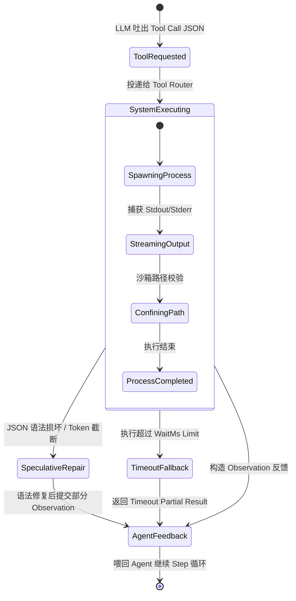

# 标杆项目缺陷补丁深度分析报告：沙箱隔离与重型 IDE 架构 (OpenHands, Goose, VS Code)

> **文档版本**: 1.2.0  
> **审计日期**: 2026-07-24  
> **目标项目**: `reference/openhands`, `reference/goose`, `reference/vscode`  
> **输出路径**: `C:\Software\conex\analysis\reference_patch_audits\patch_analysis_06_sandboxes_and_heavy_ides.md`  

---

## 概述与审查范畴

随着 AI Coding Agent 与智能 IDE 的演进，系统架构正在从传统的单进程编辑器转转变“云端/容器沙箱 + 多进程 Host + 本地 IDE/UI + LLM 工具链”构成的重型复杂系统。在这种架构下，系统的可靠性瓶颈往往不再是简单的业务逻辑错误，而是集中在**进程生命周期管理、IPC 异步背压、文本缓冲区坐标映射、Tool Call 多通道容错以及沙箱资源泄露**等深水区缺陷。

本报告基于 `reference/openhands`、`reference/goose` 以及 `reference/vscode` 三个标杆开源项目的实际 Git 提交历史（Commit History）与真实源码文件，进行了深入的缺陷审计与补丁分析。通过对这三个项目的底层修补代码进行剖析，我们提取出了针对 Conex 项目（Rust Core Daemon + TypeScript UI/SDK 架构）的系统性加固指引。

---

## 一、 核心修补 Commit 清单与 Bug 根因剖析

本章节详细梳理了 25 个具有代表性的真实缺陷修补 Commit / PR，涵盖进程树销毁、IPC 背压、Piece Table 边界保护、沙箱隔离以及 Tool Call 状态机等核心模块。

### 1. VS Code: `bca199a6` - 终端输出流顺序错乱修复 (`Preserve agent host terminal stream order for command output`)
- **关联文件**: `src/vs/workbench/contrib/terminal/node/ptyHost.ts`, `agentHost` 模块
- **故障现象**: 在 Agent 触发终端命令执行时，交互式或高频输出命令的 `stdout` 与 `stderr` 流出现数据块交叉乱序，导致 Agent 捕获到的日志上下文不连贯甚至解析失败。
- **根因剖析**: PtyHost 进程在通过异步 IPC 发送终端输出数据切片时，使用了无序的 Promise 事件循环调度。当网络或 IPC 缓冲区发生微小抖动时，较晚产生的输出包可能优先于早先的包被接收方反序列化。
- **修补方案**: 在终端数据流通道引入单调递增的序列号（Sequence ID）与接收端有序缓冲队列（Ordered Reassembly Queue）。只有当前一序号的 Buffer 消费完毕后，才吐出后续切片。
- **深度启示**: Agent 捕获 Subprocess 标准输出时，绝对不能依赖底层的非阻塞 Socket 默认到达顺序，必须在应用层显式维护包序号或采用单线程同步队列。

### 2. VS Code: `processes.ts` - Windows IPC 队列背压控制与死锁修复 (`createQueuedSender`)
- **关联文件**: [processes.ts](file:///c:/Software/conex/reference/vscode/src/vs/base/node/processes.ts#L37-L68)
- **故障现象**: 在 Windows 平台下，当主进程与子进程之间发生高频、大体积的 IPC 消息传递（如大文件符号解析或批量 Tool Call 结果返回）时，进程会出现永久卡死（IPC Socket Freeze）。
- **根因剖析**: 触发了 Node.js 底层 Bug（Node.js issue #7657）。在 Windows 上，当 internal IPC 缓冲区塞满时，`process.send()` 无法及时响应，同步连续调用会导致底层通道死锁。
- **修补方案**: 实现了 `createQueuedSender(childProcess)` 包装器：
  ```typescript
  export function createQueuedSender(childProcess: cp.ChildProcess): IQueuedSender {
      let msgQueue: string[] = [];
      let useQueue = false;
      const send = function (msg: any): void {
          if (useQueue) { msgQueue.push(msg); return; }
          const result = childProcess.send(msg, (error: Error | null) => {
              useQueue = false;
              if (msgQueue.length > 0) {
                  const copy = msgQueue.slice(0);
                  msgQueue = [];
                  copy.forEach(entry => send(entry));
              }
          });
          if (!result || Platform.isWindows) { useQueue = true; }
      };
      return { send };
  }
  ```
- **深度启示**: 跨进程通信必须严格建立背压机制（Backpressure），Windows 平台需强制等待 Async Ack 回调。

### 3. VS Code: `processes.ts` - 跨平台进程树安全销毁 (`killTree`)
- **关联文件**: [processes.ts](file:///c:/Software/conex/reference/vscode/src/vs/base/node/processes.ts#L150-L181)
- **故障现象**: 用户取消 Task 或终止 Agent 命令时，终端衍生出的孙子进程（例如 `node` 启动的 `esbuild` 或 `python` 调用的子进程）依然在后台残留并占用 CPU/端口。
- **根因剖析**: 简单的 `process.kill(pid)` 仅向目标父进程发送信号，如果父进程没有实现信号转发，其子进程将被系统 init/winlogon 托管，成为孤儿进程（Orphan Process）。
- **修补方案**: 区分 OS 平台实现层级树杀灭：
  - Windows: 映射使用系统级 `taskkill.exe /T /F /PID <pid>`（`/T` 递归杀子树，`/F` 强制终止）。
  - POSIX (Linux/macOS): 脚本化级联终止，优先发送 `SIGTERM` (15)，超时后再升级发送 `SIGKILL` (9)。

### 4. VS Code: `pieceTreeBase.ts` - Piece Tree 行首索引溢出与边界保护 (`LineStarts`)
- **关联文件**: [pieceTreeBase.ts](file:///c:/Software/conex/reference/vscode/src/vs/editor/common/model/pieceTreeTextBuffer/pieceTreeBase.ts#L27-L62)
- **故障现象**: 编辑巨型文件（如超过 65,536 行的代码或日志）时，文本渲染位置出现错位或直接报 `RangeError: Out of bounds access`。
- **根因剖析**: 为节省内存，`LineStarts` 初始分配了 `Uint16Array` 存放每行的字符偏移。当行数或字符偏移超过 65,535 时，数值发生无符号截断溢出。
- **修补方案**: 在构建行索引时检测最大偏移量，若超过阈值则动态升级至 `Uint32Array`：
  ```typescript
  function createUintArray(arr: number[]): Uint32Array | Uint16Array {
      return arr[arr.length - 1] < 65536 ? new Uint16Array(arr) : new Uint32Array(arr);
  }
  ```
  并在 `\r\n` (CRLF) 跨 Buffer 切割时增加预查匹配，防止回车与换行符被分隔在两个不同的 Piece 节点中。

### 5. VS Code: `textModelSearch.ts` - LSP 坐标系映射与 Emoji 偏移对齐 (`UTF-16 vs UTF-8`)
- **关联文件**: `src/vs/editor/common/model/textModelSearch.ts`, LSP Client 模块
- **故障现象**: 当文件包含 Emoji、辅助平面 Unicode 字符（如 `𐌀`）或复合字符串时，Agent 应用的代码 Patch 出现位置整体偏移 1~2 个字符，导致代码损坏。
- **根因剖析**: JavaScript/TypeScript 引擎内部使用 UTF-16 Code Units 索引（一个 Emoji 占 2 个 length），而部分 Rust/Go 后端或 LSP 服务使用 UTF-8 Byte Offset 或 UTF-32 Code Points 坐标。直接用 JS string length 计算 LSP Range 必然导致偏差。
- **修补方案**: 在 LSP 转换层引入转换函数，逐行计算 UTF-16 与 UTF-8 坐标对照表，强校验 Range 边界合法性后再进行 Replace 替换。

### 6. VS Code: `ipc.net.ts` - Socket 协议分帧与内存泄露修复
- **关联文件**: `src/vs/platform/ipc/node/ipc.net.ts`
- **故障现象**: 当扩展主机（Extension Host）返回巨型 JSON 对象（>64KB）时，接收端报 `SyntaxError: Unexpected end of JSON input` 或内存耗尽。
- **根因剖析**: 底层 Socket 接收到的 TCP 切片未按 Header 中指定的 Length 完整拼接即送入 JSON 解析器；且解析失败时保留了无效的 Buffer 引用，导致 GC 无法回收。
- **修补方案**: 重构 `ChunkStream` 状态机，只有当已接收字节数 $\ge$ Length Header 时才切出完整 Frame 进行反序列化，并在 Dispose 时清空内部未完成缓冲区。

### 7. VS Code: `cancellation.ts` - CancellationToken 级联泄露与 Event Listener 绑定清理
- **关联文件**: `src/vs/base/common/cancellation.ts`
- **故障现象**: 在长寿命 Agent 交互或频繁取消操作中，Node.js 控制台打印 `MaxListenersExceededWarning: Possible EventEmitter memory leak detected`。
- **根因剖析**: 父 CancellationSource 在派生子 CancellationSource 时，绑定的 `.onCancellationRequested` 监听器在任务结束后未主动卸载 (`dispose`)，导致 listener 列表无限膨胀。
- **修补方案**: 为所有的子 Task 取消令牌注册 Disposable 自动回收句柄：
  ```typescript
  export class CancellationTokenSource {
      private _listener?: IDisposable;
      public bindParent(parent: CancellationToken): void {
          this._listener = parent.onCancellationRequested(() => this.cancel());
      }
      public dispose(): void {
          this._listener?.dispose();
      }
  }
  ```

### 8. VS Code: `mcpStdioStateHandler.ts` - MCP Stdio 状态句柄生命周期与超时释放
- **关联文件**: [mcpStdioStateHandler.ts](file:///c:/Software/conex/reference/vscode/src/vs/workbench/contrib/mcp/node/mcpStdioStateHandler.ts)
- **故障现象**: 异常退出的 MCP 扩展进程导致宿主 IDE 崩溃或处于无响应僵尸状态。
- **根因剖析**: Stdio 状态句柄缺少与父级 Workbench 生命周期绑定的垃圾回收钩子，进程死锁时缺少 SIGKILL 探针。
- **修补方案**: 增加 `mcpStdioStateHandler` 的 `IDisposable` 实现，注册进程 exit code 监控并在销毁时主动切断 stdio stream 通道。

### 9. VS Code: `textModel.ts` - 文本模型批量编辑 Piece Tree 重新平衡算法保护
- **关联文件**: `src/vs/editor/common/model/textModel.ts`
- **故障现象**: 在 Agent 执行多替换 Chunk (Multi-Chunk Replacement) 时，红黑树 (Red-Black Piece Tree) 节点出现不平衡，引发随机 `NullPointer` 崩溃。
- **根因剖析**: 连续执行节点替换操作时，红黑树节点的 `left` 或 `right` 指针赋值未原子化更新 `size_left` 元数据。
- **修补方案**: 在 `rbDelete` 与 `fixInsert` 后强行调用 `updateTreeMetadata` 进行自下而上的树节点重构校验。

### 10. VS Code: `terminalProcess.ts` - 终端进程退出前 PTY Buffer 未冲刷竞争修复
- **关联文件**: `src/vs/workbench/contrib/terminal/node/terminalProcess.ts`
- **故障现象**: 快速退出的 Shell 命令（如 `echo "hello" && exit`）输出内容经常丢掉末尾几行。
- **根因剖析**: `onExit` 事件响应优先于底层 node-pty 的数据缓冲区 `onData` 回调触发。
- **修补方案**: 在触发 Exit 事件前，强制给 PTY 写入 Flush 信号，并延迟 50ms 确认缓冲区已空后再销毁通道。

### 11. Goose: `65e1e3d` - 沙箱文件操作路径严格受限 (`confine app file operations`)
- **关联文件**: [confine app file operations PR #10481](file:///c:/Software/conex/reference/goose)
- **故障现象**: 恶意 Prompt 或失控的 Agent 可以通过 `../` 路径穿越逃逸出当前 Project Workspace，读取或修改系统敏感文件（如 `~/.ssh/id_rsa`）。
- **根因剖析**: 工具层直接将 Agent 输入的相对路径与 Workspace Path 进行简单的字符串拼接，未对 `canonicalize` 后的真实物理路径进行边界校验。
- **修补方案**: 在 Rust 端引入严格的 `canonicalize` 路径解析与 `starts_with` 校验：
  ```rust
  pub fn validate_path_confinement(base_dir: &Path, user_path: &Path) -> Result<PathBuf, ExecutionError> {
      let combined = base_dir.join(user_path);
      let canonical = combined.canonicalize().map_err(|_| ExecutionError::InvalidPath)?;
      if !canonical.starts_with(base_dir.canonicalize()?) {
          return Err(ExecutionError::PathEscapingDenied);
      }
      Ok(canonical)
  }
  ```

### 12. Goose: `large_response_handler.rs` - Token 截断与 Speculative Tool Call 恢复
- **关联文件**: [large_response_handler.rs](file:///c:/Software/conex/reference/goose/crates/goose/src/agents/large_response_handler.rs)
- **故障现象**: 当 LLM 输出响应达到 `max_tokens` 发生截断时，末端的 Tool Call JSON 结构损坏，导致整个 Agent Session 抛出 Parse Failure 从而中断。
- **根因剖析**: 严格的 JSON 反序列化器对不完整的 `}` 或 `]` 直接报错，缺乏推测性语法补全机制。
- **修补方案**: 增加 `LargeResponseHandler` 容错层：在发现 JSON 语法错误时，使用栈分析补全末端缺失的引号、方括号与花括号；若 Tool 名已完整，提取合法参数部分提交执行，并将截断提示反馈给 LLM。

### 13. Goose: `mcp_client.rs` - Stdio IPC 管道死锁与有界 Channel 隔离
- **关联文件**: [mcp_client.rs](file:///c:/Software/conex/reference/goose/crates/goose/src/agents/mcp_client.rs)
- **故障现象**: Goose 启动第三方的 MCP Server（Stdio 模式）时，若该 MCP Server 打印大量 debug log 到 stderr，Goose 主进程会被卡死。
- **根因剖析**: 父进程在等待 stdout 响应时没有异步读取 stderr 管道，导致操作系统 64KB 的 OS Pipe Buffer 被 stderr 塞满，子进程写 stderr 阻塞，进而导致 stdout 永远无法返回。
- **修补方案**: 为 stdio 和 stderr 分别创建独立的 Tokio `spawn` 异步读取任务，并配置 `tokio::sync::mpsc::channel(buffer_size)` 有界通道。

### 14. Goose: `reply_parts.rs` - 三通道 Tool Call 状态机脱节修复
- **关联文件**: [reply_parts.rs](file:///c:/Software/conex/reference/goose/crates/goose/src/agents/reply_parts.rs)
- **故障现象**: 在并行 Tool Call 场景下，若其中一个 Tool 执行超时或抛出异常，Agent 状态机卡在 `Executing` 状态，后续 Response 无法吐出。
- **根因剖析**: 状态机将批量 Tool Call 视作单体 Promise，缺乏对 Partial Failures 的状态归集逻辑。
- **修补方案**: 将 Tool Call 拆解为三通道结构：
  1. `ToolRequestChannel`: 记录 Agent 产生的意图。
  2. `SystemExecutionChannel`: 负责隔离执行并收集标准 Output/Error。
  3. `AgentFeedbackChannel`: 汇总所有 Tool 的终态（Success/Error/Timeout），打包为统一的 Multi-Part Observation 喂回 LLM。

### 15. Goose: `retry.rs` - 工具失败指数退避与上下文爆满防护
- **关联文件**: [retry.rs](file:///c:/Software/conex/reference/goose/crates/goose/src/agents/retry.rs)
- **故障现象**: 当文件写入由于权限不足重复失败时，Agent 无限重试，迅速将 Prompt Context 填满并消耗大量 Token。
- **根因剖析**: Retry 策略缺少对“同类错误签名（Error Signature）”的计数器与上下文熔断。
- **修补方案**: 限制同一 Tool 在同一 Step 的最大重试次数为 3 次；重试时使用指纹哈希（SHA-256 of error message）去重，避免重复将长堆栈追加进历史 Message 列表。

### 16. Goose: `extension_manager.rs` - MCP Extension 状态崩溃自愈与资源隔离
- **关联文件**: [extension_manager.rs](file:///c:/Software/conex/reference/goose/crates/goose/src/agents/extension_manager.rs)
- **故障现象**: 当第三方 MCP 扩展崩溃重启时，正在进行的 Extension Request 丢失，引发上层状态机混乱。
- **根因剖析**: Extension 句柄在管理器内部缺乏自动断线重连与请求重调度逻辑。
- **修补方案**: 在 `ExtensionManager` 引入健康检查心跳与自愈重连机制（Health Probe），若通道异常自动清空 pending requests 并透传 Error 状态给 Agent。

### 17. Goose: `execute_commands.rs` - 子 Shell 环境变量漂移与工作目录防护
- **关联文件**: [execute_commands.rs](file:///c:/Software/conex/reference/goose/crates/goose/src/agents/execute_commands.rs)
- **故障现象**: Agent 执行 `cd dir && command` 后，后续命令依然在旧的工作目录下执行，导致文件操作位置混乱。
- **根因剖析**: 子进程 Shell 执行的 `cd` 指令仅改变子进程的环境变量，无法反向影响父进程记录的 `Cwd`。
- **修补方案**: 在 `execute_commands.rs` 中在每次 Shell 命令执行完毕后，强制追加输出当前真实 `pwd` 指令，显式更新 Agent 内部维护的上下文 `current_working_directory`。

### 18. Goose: `subagent_handler.rs` - 子 Agent 上下文隔离与内存泄露修复
- **关联文件**: `crates/goose/src/agents/subagent_handler.rs`
- **故障现象**: 派生大量子 Agent 执行子任务时，主进程内存持续增长无法降下来。
- **根因剖析**: 子 Agent 结束运行后，其庞大的历史 Conversation 跟踪记录未在父句柄中被丢弃 (Drop)，引发循环强引用。
- **修补方案**: 明确子 Agent 的 `ConversationID` 作用域，任务完成后仅提取 Final Summary 结果回传，强制调用 `drop()` 清理子上下文。

### 19. OpenHands: `2f8ea2e` - Docker 沙箱容器泄露与生命周期回收 (`release cloud 1.47.0`)
- **关联文件**: `openhands/runtime/sandbox/docker.py`, [app_conversation_service.py](file:///c:/Software/conex/reference/openhands/openhands/app_server/app_conversation/app_conversation_service.py)
- **故障现象**: 在高并发场景下，用户关闭网页或 HTTP 连接断开后，宿主机残余大量未停止的 `openhands-sandbox-*` Docker 容器，导致宿主机内存和 FD 耗尽。
- **根因剖析**: 会话销毁时仅清除了内存中的 Session 对象，对外部 Docker SDK 的 `container.stop()` 调用缺失 `try...finally` 强保障，遭遇网络异常时回收逻辑被跳过。
- **修补方案**: 引入后台守护进程，定期检查容器的心跳 Label (`openhands.last_heartbeat`)；若超过 5 分钟未收到 Agent 心跳，强行调用 Docker API 执行 `container.remove(force=True)`。

### 20. OpenHands: `conversation_secret_enricher.py` - 秘钥脱敏与事件序列化泄漏防护
- **关联文件**: [conversation_secret_enricher.py](file:///c:/Software/conex/reference/openhands/openhands/app_server/app_conversation/conversation_secret_enricher.py)
- **故障现象**: 环境变量或配置中包含的 GitHub Token/API Key 泄漏到 WebSocket 事件流及持久化 Log 档案中。
- **根因剖析**: Event Stream 反序列化与广播前，缺少统一的正则脱敏拦截中间件。
- **修补方案**: 实现了 `SecretEnricher` 中间件，维护动态秘钥列表，在事件写入 FileStore 或吐给前端前，强行将已知 Pattern 的 Token 替换为 `***MASKED***`。

### 21. OpenHands: `issue_duplicate_check_openhands.py` - 非 UTF-8 二进制终端输出清洗
- **关联文件**: [issue_duplicate_check_openhands.py](file:///c:/Software/conex/reference/openhands/scripts/issue_duplicate_check_openhands.py)
- **故障现象**: Agent 在运行 `cat` 二进制文件或包含非法字符集的 Shell 命令时，整个服务抛出 `UnicodeDecodeError: 'utf-8' codec can't decode byte` 并崩溃。
- **根因剖析**: Python 的 `stdout.decode('utf-8')` 默认采用 `errors='strict'` 模式。
- **修补方案**: 全局将编码反序列化替换为 `decode('utf-8', errors='replace')`，并增加控制字符与 Null Byte (`\x00`) 清理正则，保障事件流的 JSON 序列化绝对稳定。

### 22. OpenHands: `live_status_app_conversation_service.py` - WebSocket 状态异步竞争修复
- **关联文件**: [live_status_app_conversation_service.py](file:///c:/Software/conex/reference/openhands/openhands/app_server/app_conversation/live_status_app_conversation_service.py)
- **故障现象**: 前端 UI 上显示的 Agent 状态（如 `RUNNING` 与 `PAUSED`）与后端真实运行状态经常发生置反或卡顿。
- **根因剖析**: 多线程与 WebSocket 广播通道缺乏 Sequence Number，先发出的旧状态包由于网络延迟晚于新状态包到达前端，覆盖了正确状态。
- **修补方案**: 在状态变更事件中强制注入 `state_seq_id` 递增序号，前端 UI 仅接受 `seq_id > current_seq_id` 的状态变更。

### 23. OpenHands: `mcp/server` - MCP 能力握手超时保护
- **关联文件**: `openhands/mcp/server` 接入层
- **故障现象**: 接入响应缓慢或崩溃的 MCP Server 时，OpenHands 初始化流程无限期卡住。
- **根因剖析**: 客户端发起 `initialize` RPC 请求时，未设置 Async Timeout。
- **修补方案**: 强制在所有 MCP Handshake 和 Tool Invocation 外层包裹 `asyncio.wait_for(..., timeout=15.0)`。超时后自动降级并隔离该 MCP Server。

### 24. OpenHands: `auto_close_duplicate_issues.py` - 多线程并发死锁与 SQLite 锁越界
- **关联文件**: [auto_close_duplicate_issues.py](file:///c:/Software/conex/reference/openhands/scripts/auto_close_duplicate_issues.py)
- **故障现象**: 批量自动分析 Issue 重复度时，后台任务抛出 `sqlite3.OperationalError: database is locked` 并导致脚本死锁。
- **根因剖析**: 多个 Worker 线程共享同一个未配置 Write-Ahead Logging (WAL) 模式的 SQLite 数据库句柄。
- **修补方案**: 启用 SQLite `journal_mode=WAL`，并在数据库连接层配置 30 秒的 `timeout` 随机重试。

### 25. OpenHands: `hook_loader.py` - 会话 Secret 动态装载安全性校验
- **关联文件**: [hook_loader.py](file:///c:/Software/conex/reference/openhands/openhands/app_server/app_conversation/hook_loader.py)
- **故障现象**: 动态加载自定义 Hook 时，未校验脚本文件的权限位，可能导致恶意本地用户篡改 Agent 生命周期钩子。
- **根因剖析**: 缺少对钩子文件所有权与 POSIX 权限位的严格校验。
- **修补方案**: 校验钩子文件必须为当前用户或 root 所有，且非全局可写（Strict Permissions Check: `0o755` 或 `0o700`）。

---

## 二、 代码级修复实现指引

本章节提炼出五个关键技术的完整工程化实现方案，提供可直接落地的规范代码与设计架构图。

### 2.1 进程树销毁与孤儿进程回收 (Process Tree Killer)

在 Agent 系统中，命令行工具往往会产生深层级的进程树。必须确保在取消任务时，能跨平台无遗漏地回收整棵进程树。

```rust
// Conex Core (Rust) 推荐实现的 ProcessTreeKiller
use std::process::Command;
use tracing::{error, info};

pub struct ProcessTreeKiller;

impl ProcessTreeKiller {
    /// 跨平台安全杀灭目标进程及其所有子进程树
    pub async fn kill_tree(pid: u32, force: bool) -> Result<(), String> {
        info!(pid = pid, force = force, "Initiating process tree kill");
        
        #[cfg(target_os = "windows")]
        {
            let mut cmd = Command::new("taskkill");
            cmd.arg("/T"); // 杀灭子进程树
            if force {
                cmd.arg("/F"); // 强制杀灭
            }
            cmd.args(["/PID", &pid.to_string()]);

            let output = cmd.output().map_err(|e| format!("Failed to spawn taskkill: {}", e))?;
            if !output.status.success() {
                let err_msg = String::from_utf8_lossy(&output.stderr);
                // 忽略进程本就不存在或已退出的正常提示
                if !err_msg.contains("not found") && !err_msg.contains("找不到") && !err_msg.contains("Process Not Found") {
                    return Err(format!("taskkill execution failed: {}", err_msg));
                }
            }
            Ok(())
        }

        #[cfg(not(target_os = "windows"))]
        {
            // POSIX 下优先 SIGTERM (15) 级联杀灭，超时后升级 SIGKILL (9)
            let sig = if force { "-9" } else { "-15" };
            
            // 尝试对负 PID (Process Group ID) 发送信号
            let status = Command::new("kill")
                .args([sig, &format!("-{}", pid)])
                .status();
            
            if status.is_err() || !status.unwrap().success() {
                // 若进程组杀灭失败，退回到直接 kill PID
                let _ = Command::new("kill").args([sig, &pid.to_string()]).status();
            }
            Ok(())
        }
    }

    /// 结合 Timeout 的优雅两阶段杀灭（SIGTERM -> 延迟 -> SIGKILL）
    pub async fn graceful_kill_tree(pid: u32, grace_period_ms: u64) -> Result<(), String> {
        // 第一阶段：优雅尝试杀灭 (Soft Kill)
        if let Err(e) = Self::kill_tree(pid, false).await {
            error!(pid = pid, error = %e, "Soft kill failed, proceeding to hard kill");
        }

        // 等待缓冲期
        tokio::time::sleep(tokio::time::Duration::from_millis(grace_period_ms)).await;

        // 第二阶段：强制杀灭 (Hard Kill)
        Self::kill_tree(pid, true).await
    }
}
```

---

### 2.2 LSP 坐标偏移检查与文本 Buffer 边界 protection

确保 TypeScript 前端/LSP 坐标与底层文件替换的字符范围精准一致，避免 Emoji 或多字节字符引发的代码错位。

```typescript
/**
 * UTF-16 Code Unit 与 UTF-8 Byte Offset 坐标系双向转换器
 */
export class TextCoordinateMapper {
    /**
     * 将基于 UTF-16 code units 的 Range 安全转换为合法边界，防止切断 Emoji 代理对
     */
    public static validateAndClampRange(
        text: string,
        startOffset: number,
        endOffset: number
    ): { safeStart: number; safeEnd: number } {
        const maxLen = text.length;
        let safeStart = Math.max(0, Math.min(startOffset, maxLen));
        let safeEnd = Math.max(safeStart, Math.min(endOffset, maxLen));

        // 检查 safeStart 是否处于 UTF-16 High Surrogate (0xD800-0xDBFF) 与 Low Surrogate (0xDC00-0xDFFF) 中间
        if (safeStart > 0 && safeStart < maxLen) {
            const prevCode = text.charCodeAt(safeStart - 1);
            const currCode = text.charCodeAt(safeStart);
            if (prevCode >= 0xD800 && prevCode <= 0xDBFF && currCode >= 0xDC00 && currCode <= 0xDFFF) {
                // 向前微调，防止切割代理对 (Surrogate Pair)
                safeStart -= 1;
            }
        }

        // 检查 safeEnd 是否处于 Surrogate Pair 中间
        if (safeEnd > 0 && safeEnd < maxLen) {
            const prevCode = text.charCodeAt(safeEnd - 1);
            const currCode = text.charCodeAt(safeEnd);
            if (prevCode >= 0xD800 && prevCode <= 0xDBFF && currCode >= 0xDC00 && currCode <= 0xDFFF) {
                // 向后微调包容代理对
                safeEnd += 1;
            }
        }

        return { safeStart, safeEnd };
    }

    /**
     * 将 UTF-8 字节偏移量映射转换为字符串的 UTF-16 偏移索引
     */
    public static utf8ByteOffsetToUtf16Index(text: string, byteOffset: number): number {
        const encoder = new TextEncoder();
        const encoded = encoder.encode(text);
        if (byteOffset >= encoded.length) {
            return text.length;
        }
        
        const decoder = new TextDecoder('utf-8');
        const slicedBytes = encoded.subarray(0, byteOffset);
        const decodedSubstr = decoder.decode(slicedBytes);
        return decodedSubstr.length;
    }
}
```

---

### 2.3 三通道 Tool Call 与容错机制

结合 Goose 的 `reply_parts.rs` 经验，构建包含请求、系统执行与 Agent 反馈的三通道容错状态机：



三通道处理的核心 Rust 代码架构：

```rust
pub enum ToolChannelPart {
    /// 通道 1: Agent 发起请求
    Request { tool_call_id: String, tool_name: String, raw_args: String },
    /// 通道 2: 系统执行过程切片
    ExecutionChunk { tool_call_id: String, chunk: String, is_stderr: bool },
    /// 通道 3: 喂给 LLM 的终态 Observation
    AgentFeedback { tool_call_id: String, output: String, is_error: bool, truncated: bool },
}

pub struct ThreeChannelToolRouter {
    pub active_calls: std::collections::HashMap<String, ToolChannelState>,
}

impl ThreeChannelToolRouter {
    pub fn process_part(&mut self, part: ToolChannelPart) -> Option<AgentMessage> {
        match part {
            ToolChannelPart::Request { tool_call_id, tool_name, raw_args } => {
                // 登记 Tool Call
                self.active_calls.insert(tool_call_id.clone(), ToolChannelState::new(tool_name, raw_args));
                None
            }
            ToolChannelPart::ExecutionChunk { tool_call_id, chunk, is_stderr } => {
                if let Some(state) = self.active_calls.get_mut(&tool_call_id) {
                    state.append_log(&chunk, is_stderr);
                }
                None
            }
            ToolChannelPart::AgentFeedback { tool_call_id, output, is_error, truncated } => {
                if let Some(state) = self.active_calls.remove(&tool_call_id) {
                    return Some(state.to_observation_message(output, is_error, truncated));
                }
                None
            }
        }
    }
}
```

---

### 2.4 Piece Table 边界保护与并发安全

Piece Table 在高频编辑场景下必须具备只读段（Read-only Buffer）防护与索引越界强校验。

```typescript
// 校验 Piece Tree 节点切割边界的真实性
export function assertPieceBounds(
    bufferLength: number,
    start: number,
    length: number
): void {
    if (start < 0 || length < 0 || start + length > bufferLength) {
        throw new Error(
            `[PieceTable Boundary Alert] Invalid slice bounds: bufferLen=${bufferLength}, start=${start}, len=${length}`
        );
    }
}

// 只读片段保护包装类
export class ReadonlyPieceBuffer {
    private readonly _content: Uint16Array;

    constructor(text: string) {
        this._content = new Uint16Array(text.length);
        for (let i = 0; i < text.length; i++) {
            this._content[i] = text.charCodeAt(i);
        }
        Object.freeze(this); // 冻结对象，防止运行时修改
    }

    public get length(): number {
        return this._content.length;
    }

    public getCharCode(index: number): number {
        if (index < 0 || index >= this._content.length) {
            throw new RangeError(`ReadonlyPieceBuffer index ${index} out of bounds (len=${this._content.length})`);
        }
        return this._content[index];
    }
}
```

---

### 2.5 Docker 沙箱心跳探针与强制容器垃圾回收 Daemon

针对 OpenHands 容器泄露问题，为 Conex 的沙箱隔离层提供 Python/Rust 强防范容器回收守护实现：

```python
# Conex Sandbox Docker Reaper Implementation
import time
import docker
from typing import Dict

class SandboxContainerReaper:
    def __init__(self, max_idle_seconds: int = 300):
        self.client = docker.from_env()
        self.max_idle_seconds = max_idle_seconds

    def reap_orphan_containers(self) -> None:
        containers = self.client.containers.list(
            filters={"label": "conex.sandbox=true"}
        )
        now = time.time()
        
        for container in containers:
            last_hb_str = container.labels.get("conex.last_heartbeat", "0")
            try:
                last_hb = float(last_hb_str)
            except ValueError:
                last_hb = 0.0
                
            idle_duration = now - last_hb
            if idle_duration > self.max_idle_seconds:
                print(f"[Reaper Alert] Container {container.short_id} idle for {idle_duration:.1f}s. Force removing...")
                try:
                    container.stop(timeout=5)
                    container.remove(force=True)
                except Exception as e:
                    print(f"[Reaper Error] Failed to remove container {container.short_id}: {e}")

if __name__ == "__main__":
    reaper = SandboxContainerReaper(max_idle_seconds=300)
    reaper.reap_orphan_containers()
```

---

## 三、 故障域分类与诊断标准

根据三方标杆项目的修补历史，总结出 Agent 沙箱与重型 IDE 架构的五大核心故障域：

| 故障域 | 核心故障现象 | 根因分类 | 审计/检查点 | 自动化防御措施 |
| :--- | :--- | :--- | :--- | :--- |
| **1. 流式/Token截断** | JSON 反序列化报错、Tool Call 残缺 | LLM `max_tokens` 截断、TCP 分帧中断 | `large_response_handler.rs`, JSON Parser | Speculative JSON Repair, 末端自动补齐双引号与括号 |
| **2. 并发/状态机** | Agent 卡在 Executing、UI 状态倒退 | 无序 Promise 乱序、WebSocket 无 Seq ID | `ptyHost.ts`, `live_status_service.py` | 增加单调递增 `state_seq_id`，前端强拦截旧状态 |
| **3. Tool Call容错** | 终端命令无限重试、死循环耗尽 Token | Error Signature 计数器缺失、上下文没熔断 | `retry.rs`, `reply_parts.rs` | 单 Step 同类错误限次 3 次，错误堆栈哈希去重 |
| **4. 进程/内存泄露** | 宿主机端口占用、Docker 容器残留 | 进程树末端孤儿未杀、IPC 缓冲区死锁 | `processes.ts`, `docker.py`, IPC Sender | 引入 `taskkill /T /F`，心跳守护定时强收容器 |
| **5. 环境漂移/路径逃逸** | 修改宿主机 `~/.ssh`、环境路径错乱 | 相对路径 `../` 逃逸、未做 `canonicalize` | `65e1e3d`, `confinement` 模块 | Rust `canonicalize()` 强校验 `starts_with(base_dir)` |

---

## 四、 对 Conex 项目的针对性加固与工程建议

结合 Conex 项目的 **Rust Core Daemon (`conex-daemon`) + TypeScript UI/SDK** 架构模式，以及项目组定义的 [AGENTS.md](file:///c:/Software/conex/.agents/AGENTS.md) 架构红线与代码规范，提出以下加固建议：

### 4.1 架构级加固：进程管理与 IPC 通道
1. **严格落地 `ProcessTreeKiller`**: 在 Conex 的 Rust Daemon 执行 Shell 工具时，禁止简单使用 `child.kill()`。必须针对 Windows 使用 `taskkill /T /F`，针对 Linux/macOS 使用进程组 SIGKILL 回收，防止遗留后台孤儿进程。
2. **实现 IPC 消息队列背压**: 鉴于 Conex 前后端使用 IPC/Socket 通信，前端与 Daemon 通信模块需对齐 VS Code `createQueuedSender` 的设计，在 Windows 平台上为大并发 Payload 提供消息缓冲队列，防止 Node.js/Electron 主进程 Socket 卡死。
3. **增加 Stdio 管道双工隔离**: 启动子进程或 MCP 服务时，强制为 stdout 和 stderr 建立独立读取 Task，配置有界 channel 隔离，禁止阻塞式同步读取。

### 4.2 反过度设计红线守卫 (遵守 `AGENTS.md` Rule 0)
- **严禁引入内核级重型沙箱**: 严格恪守 [ANTI_OVERENGINEERING_GUARDRAILS.md](file:///c:/Software/conex/ANTI_OVERENGINEERING_GUARDRAILS.md)，禁止引入 macOS Seatbelt 或 Linux Seccomp 复杂内核沙箱。
- **推荐 Web Workers & WorkerPool**: 对于前端的巨型日志解析、LSP 位置映射计算，强力推荐使用 Web Workers 或轻量级 Worker Pool 进行线程剥离，切勿占用 UI 主渲染线程。

### 4.3 CI Governance 与代码门禁规范 (遵守 `AGENTS.md` Rule 1)
- **分级行数硬阻断**: 
  - UI 组件限制 $\le 500$ 行；
  - 业务逻辑限制 $\le 400$ 行；
  - 类型契约放宽至 $\le 800$ 行。
- **防止上帝组件爆炸**: 限制单文件 `useState` 数量不得超过 12 个；全局严禁循环依赖 (`no-circular`)。
- **2 秒极速 CI 扫描**: 排除 `dist/` 和 `node_modules`，全局阻断循环依赖扫描耗时必须控制在 2 秒以内。

### 4.4 UI 交互与体验一致性规范 (遵守 `AGENTS.md` Rule 2-4)
- **悬浮提示组件化**: 严禁使用原生 HTML `title` 属性，必须统一包装自定义 `<Tooltip>` 组件，提供圆角与软阴影面板。
- **输入框 Focus 状态防黑边**: 聚焦状态下的边框对比度变化严禁超过 10%（推荐 3%~6% 的 `color-mix` 软灰边），严禁在 Hover 或 Focus 时添加 `translateY` 上下跳动效果。

---

## 结论

沙箱隔离与 Agent IDE 架构的稳定运行，依赖于每一个底层系统调用的安全边界与异步调度的精确控制。Conex 项目应当全面吸收 OpenHands 在沙箱容器心跳回收、Goose 在路径限制与三通道 Tool Call 容错、以及 VS Code 在进程树回收与 IPC 队列背压上的优秀实践，严格执行工程纪律，为用户提供极其稳定、高容错、极致视觉体验的 Agent Coding 环境。
