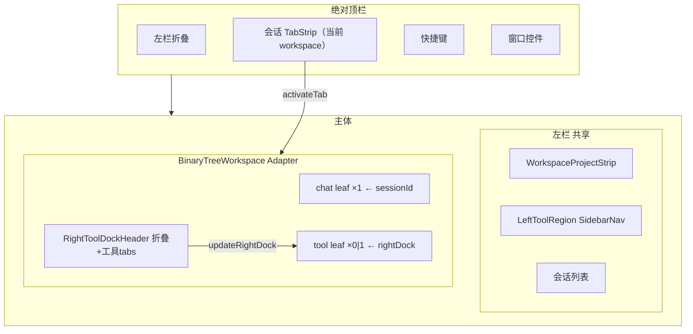
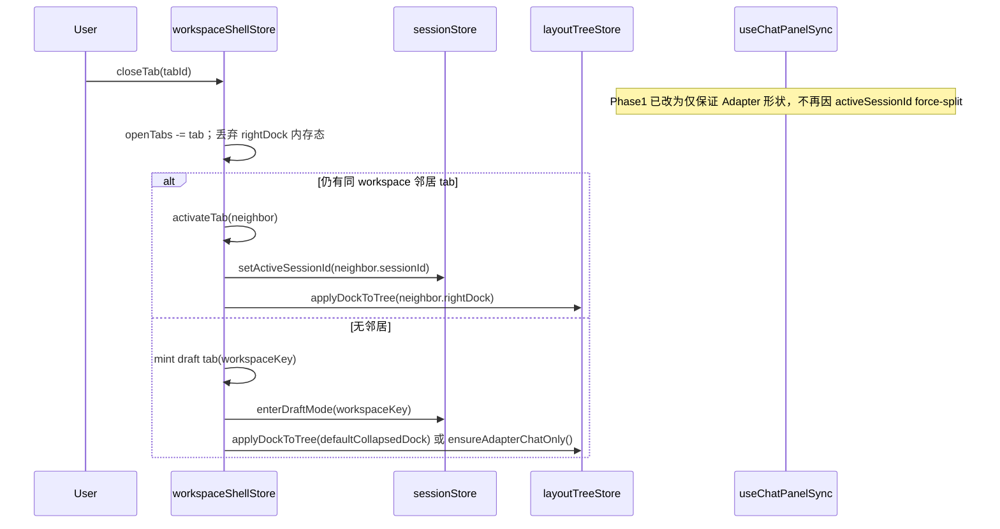
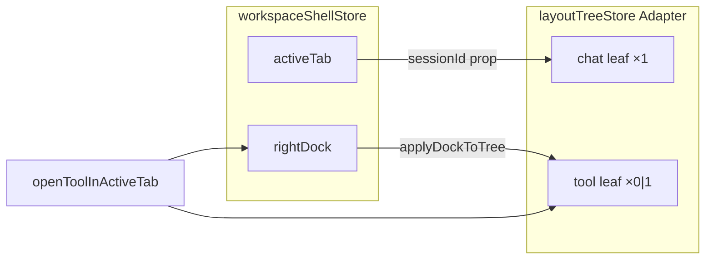

# Crish Desktop Shell Chrome & Workspace Binding 重设计

| 字段 | 值 |
|------|-----|
| **文档标题** | Shell Chrome 与 Workspace 绑定模型重设计 |
| **作者** | （待填） |
| **日期** | 2026-07-27 |
| **修订** | R2 — 追加 Phase 2 Conversation Unit（多 unit / per-session 右坞投影）；R1 实施中 |
| **状态** | Phase 1 Implemented；**Phase 2 in progress**（R1 binding + dock projection） |
| **范围** | `apps/crish-desktop` |
| **相关代码基线** | BinaryTreeWorkspace + AppTopBar + workspaceChromeTabs + Sidebar |
| **实施备注** | 2026-07-27 Phase 1：TabSurface/右坞/冷启动/drop-only 拖拽；顶栏只读 shell；persist rehydrate 在 clean 模式强制单 chat。Phase 2：见 §19；计划 `docs/plans/2026-07-conversation-unit-shell.md` |

---

## 1. Overview

当前 Crish Desktop 壳层存在三类结构性问题：

1. **顶栏 chrome 职责混乱**：绝对顶栏同时放了左/右折叠、会话标签、功能标签与窗口控件；`SidebarHeader` 又重复放了一颗左侧折叠按钮。
2. **Tab / 会话 / 面板三方未绑定**：顶栏会话标签存于 `crish_open_session_tabs_v1`（`workspaceChromeTabs.ts`），布局叶子仅有 `panelId: 'chat'` 与 `tabs: ['chat']`，**不含 sessionId**；`ChatCard` 只读全局 `activeSessionId`。关闭标签只删 open-tabs map，不关闭对话表面；多个 chat leaf 渲染同一会话。
3. **侧栏列表交互双路径**：`useDragReorder`（HTML5）与 `startSessionDrag`（pointer + `moveSessionRealtime` 实时突变）同时挂在 `SessionRow` 上，导致松手后列表粘滞、取消拖拽误进置顶等。另：顶栏 `useTopBarDrag` 与树 `useTreeDrag` 仍可创建多 chat leaf，与「单表面」目标冲突。

本设计以 **TabSurface（标签表面）** 为一级领域模型：每个打开的**会话**标签绑定 `sessionId` 与 **独立 RightToolDock 状态**；左侧会话列表与 `SidebarNav` 为**全局共享导航**；绝对顶栏只保留导航与窗口控件；冷启动默认干净新表面。

**Phase 1 宿主明确采用 Adapter 模式**（见 §4.5.3 / K7）：保留 `BinaryTreeWorkspace` 作为运行时宿主，强制最大结构 `chat` 或 `chat+tool`（恰好 0–1 个 tool leaf），由 `activeTab.rightDock` 驱动 tool leaf；禁止多 chat leaf。不在本阶段替换整棵 binary tree 为全新 flex 壳。

---

## 2. Background & Motivation

### 2.1 当前壳层层级（已核实）

```
App
├── AppTopBar
│   ├── rail: 左栏折叠（保留，唯一）
│   ├── main: UnifiedTopBar
│   │     ├── TopBarChatZone   ← 会话标签（来自 open-session-tabs map）
│   │     └── TopBarToolZone×N ← 按 tool leaf 平铺的功能标签
│   └── trail: 右面板折叠（需下沉）· 快捷键 · 窗口 min/max/close
└── main-layout
    ├── Sidebar
    │   ├── SidebarHeader ← 重复的左栏折叠（需删除）
    │   ├── SidebarNav（新对话 / 定时任务 / 搜索）
    │   └── PinnedSection / ProjectsSection / GeneralSection
    └── BinaryTreeWorkspace
          └── TreeLeafPanel×N（chat | tools）
                └── ChatCard  ← 全部绑定全局 activeSessionId
```

关键文件：

| 区域 | 路径 |
|------|------|
| 壳入口 | `apps/crish-desktop/src/App.tsx` |
| 绝对顶栏 | `apps/crish-desktop/src/components/AppTopBar.tsx` |
| 统一标签栏 | `apps/crish-desktop/src/components/binary-tree/UnifiedTopBar.tsx` 等 |
| 会话标签逻辑 | `apps/crish-desktop/src/api/workspaceChromeTabs.ts` |
| 顶栏状态 hook | `apps/crish-desktop/src/components/workspaceChromeHooks.ts` |
| 布局树 | `apps/crish-desktop/src/store/layout-tree/*` |
| 面板打开 | `store/layout-tree/treePanelAccess.ts`、`hooks/useTreePanelEvents.ts` |
| Chat 同步 | `apps/crish-desktop/src/hooks/useChatPanelSync.ts` |
| 侧栏 | `apps/crish-desktop/src/components/Sidebar.tsx` + `sidebar/*` |
| 拖拽 A | `hooks/useDragReorder.ts` + `DragReorderSection.tsx` |
| 拖拽 B | `useSidebarSessionList.startSessionDrag` → `moveSessionRealtime` |
| 顶栏拖拽 | `binary-tree/useTopBarDrag.ts` |
| 树拖拽 | `hooks/useTreeDrag.ts` |
| 项目选择 | `app/AppBootstrap.ts` → `pickWorkspaceFolder`（将抽出到 `api/pickWorkspaceFolder.ts`） |

### 2.2 痛点清单（产品可感知）

| ID | 现象 | 根因 |
|----|------|------|
| P1 | 两颗左侧折叠按钮 | `AppTopBar` rail + `SidebarHeader` 32px 顶栏 |
| P2 | 右面板开关在绝对顶栏，与「当前标签」无关 | `useRightSidebarState` 全局 `toolColumnCollapsed` |
| P3 | 关顶栏会话标签后对话窗口仍在 | `onCloseSession` 只调 `closeSessionTab`，不关 layout leaf / 不释放 surface |
| P4 | 多分屏多个空 chat 显示同一空状态 | leaf 无 sessionId；`ChatCard` 读全局 `activeSessionId` |
| P5 | 切会话标签时右侧工具列被迫重绑 | 工具列是全局 tree，不按 tab 隔离 |
| P6 | 置顶区与会话列表疑似重复同一会话 | **主因**：拖拽 pointermove 实时 `isPinned=true`；投影层 `partitionSidebarSessions` 本身已是 pinned XOR unpinned |
| P7 | 会话拖拽松手后列表粘滞 / 取消跳到置顶 | dual path：pointer 路径 **move 时即 commit** pin/reorder |
| P8 | 「新建项目」经常唤不起 Windows 原生目录对话框 | `package.json` **未依赖** `@tauri-apps/plugin-dialog`；动态 import 失败后静默 fallback；多处重复脆弱 import |
| P9 | 冷启动恢复上次布局/多标签/多面板 | `crish-layout-tree-v1` zustand persist 无条件 hydrate + open tabs + disk `activeSessionId` |

### 2.3 为何优先重写而非继续补丁

- `LayoutLeaf.panelId = 'chat'` 与会话身份正交；在现有 leaf 上硬塞 session 会与 tool tab 语义冲突。
- `useChatPanelSync` 只会「保证有 chat leaf」，不会「保证 leaf ↔ session 1:1」，且关 tab 后会再次 force-open。
- 双拖拽路径都写入同一 `moveSessionRealtime`，再叠加 HTML5 reorder 的 index 语义，行为空间不可测。
- 顶栏/树拖拽仍可制造多 chat leaf，与单表面目标冲突。
- 旧 columns `Workspace.tsx` 与 tree 双轨并存；新功能只走 tree/shell 路径。

---

## 3. Goals & Non-Goals

### 3.1 Goals

1. **绝对顶栏唯一左侧折叠**；`SidebarHeader` 删除折叠控件（含 32px 顶栏整块；drag region 改由绝对顶栏 / 侧栏其它区域承担，见 §4.4 / K13）。
2. **绝对顶栏仅含**：左栏折叠 · **会话** TabStrip · 快捷键/帮助 · 窗口控件。工作区/项目切换不放在绝对顶栏（见 §4.2.3 / K14）。
3. **标签下方仍有工具区**，分左右：
   - **左工具区（共享，非 per-tab）**：侧栏顶 `SidebarNav`（新对话 / 搜索 / 定时任务）+ 全局会话列表。
   - **右工具区（per-tab）**：每个会话 Tab 独立的 RightToolDock（开哪些工具、宽度、激活工具、折叠）。
4. **右侧工具坞状态 per-tab；左侧为共享导航（非 per-tab）**。可选的「按 tab 记忆左栏搜索过滤」为 Non-Goal，后续可单开。
5. **冷启动默认干净新表面**：一个 draft 对话 + 结构仅为 `chat` 或默认 `chat`（右坞折叠）+ 无多余空面板；设置项 `ui.restoreLastWorkspace`（默认 `false`）可选恢复。启动过程 **无中间多 leaf 闪帧**。
6. **关标签 = 关该标签表面**（主内容身份 + 其 right dock 状态 + 布局按 Adapter 表收敛）；不泄漏孤儿 chat leaf；**同 PR 重写 `useChatPanelSync`** 防自动再拆。
7. **Phase 1 禁止多 chat leaf**；若 Phase 2 做分屏，每个 chat pane **必须**绑定明确 `sessionId`。
8. **侧栏会话分区严格互斥**：同一 session 只出现在置顶 **或** 项目/通用列表之一（投影保持互补；脏 pin 由拖拽 commit 修复）。
9. **拖拽重写为单路径（侧栏）**：仅 drop 时 commit；取消原地；pin 仅落在 pin zone。**同时** Phase 1 禁止顶栏/树拖拽创建新 chat leaf；顶栏会话标签仅允许 strip 内 reorder（不落 canvas 分屏）。
10. **新建项目可靠打开 Windows 原生文件夹选择器**（声明依赖 + 单一 `openDirectoryDialog` + toast fallback）。
11. **PR 可并行拆分**，文件所有权无冲突；依赖顺序写死。

### 3.2 Non-Goals

- 不改 daemon / 消息持久化协议；会话历史 store 保留。
- 不重做 ChatCard 消息渲染引擎本身；但 **必须** 参数化 `sessionId` 渲染路径（§5.1）。
- 本阶段不删除 columns workspace 运行时开关；新功能只写 tree/shell。
- **Phase 1 不做** 独立 `TabKind: 'tool'` 顶栏标签（类型保留、UI 禁用）。
- **Phase 1 不做** 左栏 per-tab 宽度/搜索/滚动记忆。
- 不做跨窗口多实例同步。
- 不引入新 UI 框架。
- 中文 UI 文案保持中文。

---

## 4. Proposed Design

### 4.1 产品解释：侧边栏区域 per-tab 的两种读法

| 方案 | 含义 | 优点 | 缺点 |
|------|------|------|------|
| **A（采纳）** | **共享左会话列表 + 共享 LeftToolRegion** + **每 Tab 独立右工具坞** | 导航一致；命中 P5 | 左栏无 per-tab 过滤记忆 |
| B | 左右工具区状态全部 per-tab | 完全隔离 | 切 tab 侧栏跳变，成本高 |

**决策：方案 A。** 产品「每个标签打开都要对应的有侧边栏区域」解读为：**右坞状态随标签**；左侧是全局目录，视觉上仍在标签行之下。

### 4.2 领域模型

```
WorkspaceShell
├── AbsoluteTopBar
│   ├── sidebarToggle          // 唯一
│   ├── TabStrip               // conversation TabSurface[]（当前 workspace 作用域）
│   ├── cheatsheetBtn
│   └── windowControls
└── Body
    ├── LeftSidebar            // 全局；折叠只受 AbsoluteTopBar 控制
    │   ├── LeftToolRegion     // SidebarNav
    │   ├── [可选] WorkspaceProjectStrip  // 项目切换，不在绝对顶栏
    │   └── SessionList
    └── ActiveTabSurface（Adapter 宿主 BinaryTreeWorkspace）
        ├── MainCanvas         // 恰好 1 个 chat leaf ← sessionId
        └── RightToolDock      // 0 或 1 个 tool leaf，状态 keyed by tabId
              ├── header: 折叠 + 坞内工具 tabs
              └── body: panel by activePanelId
```

#### 4.2.1 核心类型

`apps/crish-desktop/src/store/workspace-shell/types.ts`（新建）：

```ts
/** Phase 1 UI 仅创建 conversation；tool 为预留，禁止出现在 openTabs */
export type TabKind = 'conversation' | 'tool';

export interface RightToolDockState {
  collapsed: boolean;
  openPanelIds: string[];      // 如 files | diff | terminal | overview | agent | runtime | preview
  activePanelId: string | null;
  widthRatio: number;          // 0.15–0.55 钳制；映射到 tree splitRatio
}

export interface TabSurface {
  tabId: string;
  kind: 'conversation';        // Phase 1 字面收窄；类型上 TabKind 仍含 tool 供 Phase 2
  sessionId: string;           // 必填（含 draft 哨兵）
  /** 所属工作区 key：project id 或 GENERAL_FOLDER */
  workspaceKey: string;
  title: string;
  rightDock: RightToolDockState;
}

export interface WorkspaceShellState {
  /** 全部打开标签（可含多 workspace）；TabStrip 按 activeWorkspaceKey 过滤 */
  openTabs: TabSurface[];
  activeTabId: string | null;
  leftSidebarCollapsed: boolean; // 或继续用 layoutStore.sidebarCollapsed，二选一单一来源
}
```

**K14 / Phase 1：** `kind: 'tool'` **保留类型、禁止入 openTabs**。工具只存在于会话 tab 的 `rightDock`，不占用绝对顶栏标签位。

#### 4.2.2 与旧模型映射

| 旧概念 | 新概念 | 迁移策略 |
|--------|--------|----------|
| `folderKey → sessionId[]` open tabs | `openTabs[]` 每项带 `workspaceKey` | restore 时展开 map；见 §4.2.3 |
| `LayoutLeaf panelId='chat'` | 唯一 chat leaf + `TabSurface.sessionId` | leaf 不承载会话身份 |
| `toolColumnCollapsed` 全局 | `activeTab.rightDock.collapsed` | activateTab 时 `applyDockToTree` |
| 多 tool leaf / 多 chat leaf | max `chat` 或 `chat+tool` | `normalizeToAdapterShape()` |
| `activeSessionId` | `activeTab.sessionId` 同步写 | `activateTab` 单一入口 |

#### 4.2.3 多项目 Tab 作用域（产品决策 B）

**决策：Tab 按 `workspaceKey` 作用域（方案 B）。**

| 行为 | 规则 |
|------|------|
| TabStrip 展示 | 仅 `tab.workspaceKey === currentWorkspaceFolderKey()` |
| 切换项目 / 通用 | 过滤 strip；`activeTabId` 若不属于新区，则激活该区最近 tab，若无则 `enterDraftMode(newKey)` 并 mint draft tab |
| 打开会话 | `workspaceKey = canonicalSessionFolder(session.folder)`；禁止跨区双开同一 session（全局 `sessionId` 唯一） |
| 持久化 restore | `OpenSessionTabsMap` 每个 key 下的 id 列表 → 多个 `TabSurface`，`workspaceKey=key`；`activeTabId` 优先落在当前 project |
| 工作区条 UI | **保留**项目/通用切换，位置：**左栏顶部（SidebarNav 之上或之下）或工作台内非绝对顶栏区域**；**不**进入 AbsoluteTopBar trail/main。现有 `buildWorkspaceTabs` 逻辑可复用到 `WorkspaceProjectStrip` 组件 |

### 4.3 目标 UI 结构



### 4.4 顶栏 Chrome 简化

**AbsoluteTopBar 保留：** 左折叠 · 会话 TabStrip · cheatsheet · window controls。

**移出：** 右面板折叠 → **RightToolDockHeader**（PR-Dock 交付；PR-1 仅去掉顶栏按钮并派发/占位，见 §15）。

**删除：** `SidebarHeader` 32px 折叠条。`shellChromeMode` 决策见 **K13**：产品默认 **inset**；classic 仍支持一版 CSS，删除侧栏顶条后两侧栏 drag 依赖绝对顶栏 `data-tauri-drag-region`；PR-1 验收两种 `data-shell-chrome` 下侧栏高度与拖拽不回归。

**UnifiedTopBar 演变：**

- Phase 1：绝对顶栏 **只** 会话 TabStrip（可继续用 `TopBarChatZone` 数据源改为 shell store）。
- 工具标签 **离开** 绝对顶栏几何吸附，进入 RightToolDockHeader（`openPanelIds`）。
- `TopBarToolZone` 在 PR-Dock 合入后删除或空壳；PR-8 清死代码。

### 4.5 Tab ↔ Session ↔ Surface 绑定

#### 4.5.1 不变量

1. 每个 conversation tab 恰好一个 `sessionId` + 一个 `workspaceKey`。
2. 同一 `sessionId` 全局最多一个 open tab。
3. 主 canvas **恰好一个** chat leaf；`ChatCard` **必填** `sessionId` prop。
4. tool leaf 0 或 1 个；内容与折叠由 `activeTab.rightDock` 驱动。
5. 关 tab：见 §4.5.2 与布局效应表。
6. 冷启动 clean：见 §4.6 启动时序（含 persist 门闩）。

#### 4.5.2 关闭标签序列与布局效应表（Adapter）



**`closeTab` → 布局效应（Phase 1 Adapter）**

| 条件 | layout-tree 动作 |
|------|------------------|
| 关闭非 active tab | 不改 tree；仅删 shell 状态 |
| 关闭 active tab → 激活邻居 | `applyDockToTree(neighbor.rightDock)`：若 neighbor.dock.collapsed 或 openPanelIds 空 → `ensureChatOnlyTree()`；否则 `ensureChatPlusToolTree(activePanelId)` 并 set tool leaf tabs |
| 关闭后 mint draft | `ensureChatOnlyTree()` + 默认 dock collapsed |
| 关 tab 时 tree 上曾有多 chat leaf（脏数据） | `normalizeToAdapterShape()`：保留一个 chat leaf，merge/drop 多余 chat leaf；tool 收敛为 0|1 |
| 不 | 删除 session 消息 |

**`useChatPanelSync` 重写（PR-2 硬性交付，不可延后）：**

| 旧行为 | 新行为 |
|--------|--------|
| `activeSessionId` 有值且无 chat leaf → `focusOrOpenTreePanel('chat')` | **删除** 该自动 split |
| — | 改为：`ensureAdapterShape()` 仅在 shell `activateTab` / `resetToCleanDraft` / `closeTab` 路径调用 |
| — | 若 dev 发现 chat leaf 数 ≠ 1，打 invariant 日志并 normalize，**不**根据 session 列表扩张 leaf |

**孤儿表面谓词（Success Metrics）：**

```
countChatLeaves(tree) === 1
&& count(openTabs.filter(t => t.workspaceKey === currentKey)) >= 1
&& 正在渲染的 ChatCard.sessionId === activeTab.sessionId
```

Phase 1 不要求 chat leaf 数等于 open tab 数（多 tab 共用同一 chat leaf，切换只换 sessionId prop）——**这是 Adapter 的关键简化**：多个会话标签共享一个 chat 宿主节点，身份在 shell store。

#### 4.5.3 Phase 1 宿主：**Adapter 模式**（K7 硬化）

| 项 | 规定 |
|----|------|
| **选择** | **Adapter mode**（非 Replace mode） |
| 运行时宿主 | 继续 `BinaryTreeWorkspace` + `layoutTreeStore` |
| 允许结构 | `root = chat leaf` **或** `branch(horizontal): [chat leaf, tool leaf]` |
| 禁止 | ≥2 chat leaves；≥2 tool leaves；垂直分屏聊天；tab→canvas 拖出新 chat leaf |
| 会话身份 | **仅** `workspaceShellStore.activeTab.sessionId` → `ChatCard` prop |
| 右坞 | `rightDock` ↔ 唯一 tool leaf 的 `tabs`/`activeTab`/`toolColumnCollapsed`/`splitRatio` |
| `focusOrOpenTreePanel(panelId)` | 适配为 `openToolInActiveTab(panelId)`（见 §4.5.4）；`panelId==='chat'` → 仅 ensure chat leaf + 聚焦，不 split 第二 chat |
| `resetTree` | clean boot / normalize 时可用；restore 后仍 `normalizeToAdapterShape` |
| Replace mode | **Phase 1 不做**；删除 BinaryTree 另开 RFC |
| columns Workspace | 仍可 fallback flag；新代码不写 |



#### 4.5.4 RightToolDock 具体架构（可实现）

**组件所有权**

| 单元 | 路径（建议） | 职责 |
|------|----------------|------|
| `RightToolDockHeader` | `components/right-tool-dock/RightToolDockHeader.tsx` | 折叠按钮、坞内工具 tab 条、+ 菜单 |
| `RightToolDockBody` | 复用 `TreeLeafPanel` 对 tool `activeTab` 的 panel 路由 **或** 薄封装 | 渲染 files/diff/terminal/… |
| `applyDockToTree` | `store/workspace-shell/applyDockToTree.ts` | dock state → tree 结构/tab/collapse/ratio |
| `openToolInActiveTab` | `store/workspace-shell/openTool.ts` | 更新 dock + apply |
| 事件桥 | 重写 `useTreePanelEvents.ts` | 全局 open-overview / open-terminal / crish-open-file 等 → `openToolInActiveTab` |
| 折叠入口 | 自 PR-1 起顶栏移除；**最终**挂 Header（PR-Dock） | `updateRightDock({ collapsed })` |

**打开路径（替换今日 `focusOrOpenTreePanel` 主路径）**

```ts
function openToolInActiveTab(panelId: OpenablePanelId): void {
  if (panelId === 'chat') {
    ensureChatLeaf();
    return;
  }
  const tab = getActiveTab();
  if (!tab) return;
  const dock = { ...tab.rightDock };
  if (!dock.openPanelIds.includes(panelId)) dock.openPanelIds = [...dock.openPanelIds, panelId];
  dock.activePanelId = panelId;
  dock.collapsed = false;
  updateRightDock(tab.tabId, dock);
  applyDockToTree(dock); // ensure chat+tool branch；tool leaf tabs=openPanelIds；activeTab=panelId
}

function applyDockToTree(dock: RightToolDockState): void {
  if (dock.collapsed || !dock.activePanelId) {
    ensureChatOnlyTree(); // merge 掉 tool 侧或 set toolColumnCollapsed
    setToolColumnCollapsed(true);
    return;
  }
  setToolColumnCollapsed(false);
  ensureChatPlusSingleToolLeaf(dock.openPanelIds, dock.activePanelId, dock.widthRatio);
}
```

**面板映射（与现 `TreeLeafPanel` switch 一致）**

`overview` | `files` | `diff` | `terminal` | `preview` | `runtime` | `agent`；（`tasks`/`plan` → overview 映射保持）

**切 tab：** `activateTab` → `setActiveSessionId` → `applyDockToTree(tab.rightDock)`，从而 **不会** 把 A 会话的 files 坞硬塞给 B（P5 修复）。

**与 AbsoluteTopBar：** 工具不再使用 `TopBarToolZone` 几何对齐。

### 4.6 冷启动与持久化（含 bootstrap 时序）

| Key | 现状 | clean 模式 | restore 模式 |
|-----|------|------------|--------------|
| `crish-layout-tree-v1` | zustand persist 自动 rehydrate | **门闩后** `resetTree('chat')` 覆盖 | rehydrate 后 `normalizeToAdapterShape` + 按 active dock apply |
| `crish_open_session_tabs_v1` / shell v1 | 读 map | 忽略 map；`resetToCleanDraft` | map→openTabs（带 workspaceKey） |
| sessions 消息 | disk hydrate | **保留** | 保留 |
| `activeSessionId` | disk 可能恢复上次 | **强制** `enterDraftMode`（覆盖 disk active） | 恢复 activeTab 对应 session |

#### 4.6.1 启动顺序（必须按序，禁止竞态）

```
1. 读 settings（含 ui.restoreLastWorkspace，默认 false）
2. layoutTreeStore：使用 controlled rehydrate
   - 推荐：persist 配置 skipHydration: true，或 onRehydrateStorage 回调内不 commit 到「已展示」状态
   - 在 workspace 首帧前完成步骤 3–5
3. if (!restoreLastWorkspace):
     a. 不采用 rehydrated multi-leaf（resetTree('chat')）
     b. clear open-tabs chrome keys 的「应用层读取」（可保留磁盘键以免误伤，但不 feed UI）
     c. enterDraftMode(currentWorkspaceKey)
     d. workspaceShellStore.resetToCleanDraft()
     e. applyDockToTree(defaultCollapsed)
   else:
     a. await rehydrate layout tree → normalizeToAdapterShape()
     b. migrate open tabs map → openTabs[]
     c. activateTab(restored)
4. 挂载 BinaryTreeWorkspace / 允许 useTreePanelEvents
5. 标记 shellReady=true（App 用其门闩 Suspense 内容，避免多 leaf 闪帧）
```

**验收：** 冷启动 clean 下，首帧与稳定帧均为单 chat leaf；无「先闪分屏再收回」。

**实现要点（PR-4）：**

- 在 `layoutTreeStore.ts` 增加 `shellHydrateMode: 'pending' | 'clean' | 'restore'` 或导出 `applyCleanColdStart()` / 与 `onRehydrateStorage` 协作。
- 禁止在 `shellReady` 前跑会 `splitLeaf` 的事件。
- `createDefaultCleanSurface` = `{ openTabs: [draftTab], activeTabId, tree: createDefaultTree('chat') }`。

### 4.7 左栏分区

**事实：** `partitionSidebarSessions` 已是 pinned / unpinned **互补**；P6 主因是拖拽 move 时写 `isPinned`。

| PR | 职责 |
|----|------|
| **PR-5** | 防御：渲染路径唯一性测试；审计 section 不双重传入；搜索/filter 下仍互补 |
| **PR-6** | **真正修复** 脏 pin：drop-only commit |

不变量：`∀ session id, 渲染出现次数 === 1`（搜索扁平列表同样）。

### 4.8 拖拽重写（侧栏 + 顶栏/树约束）

#### 4.8.1 侧栏（PR-6）

单路径 Pointer + drop commit（状态机同前版）。**禁止** move 调用 `moveSessionRealtime`。删除 HTML5 `DragReorderSection` 双挂或整路径删除。键盘 Alt+↑/↓ → 同一 `commitReorder`。

#### 4.8.2 顶栏会话拖拽（PR-2 或 PR-6 连带，见 PR 表）

| 能力 | Phase 1 |
|------|---------|
| TabStrip 内 reorder open tabs | **允许**（只改 shell `openTabs` 顺序 / 旧 moveSessionTab） |
| 拖到 canvas 触发 split 新 chat leaf | **禁止**（`useTopBarDrag` 关闭 session→canvas drop zone） |
| 拖到 pin（侧栏） | 不在顶栏路径处理 |

#### 4.8.3 树 leaf/tab 拖拽（PR-2 Adapter 约束）

| 能力 | Phase 1 |
|------|---------|
| 拖出第二个 chat leaf | **禁止**（`useTreeDrag` / `applyDrop`：chat 域 drop 若将产生第二 chat leaf → reject） |
| tool 域 tab 在单 tool leaf 内重排 | 允许（或改由 dock header 管理，PR-Dock 后可关 tree tool 拖拽） |
| 不变量测试 | `commitDrop` 后 `countChatLeaves <= 1` |

**Goal 补充：** 「无拖拽路径可创建新 chat leaf」（侧栏/顶栏/树三者）。

### 4.9 新建项目原生文件夹选择

**根因补全：**

1. `apps/crish-desktop/package.json` **未声明** `@tauri-apps/plugin-dialog`（仅 `@tauri-apps/api`）→ 动态 import 常失败。
2. 权限在宿主 `apps/agent-workbench/src-tauri` capabilities（`dialog:default` / `dialog:allow-open`），非 crish-desktop 包内。
3. 多处重复脆弱 import：`AppBootstrap.ts`、`ProjectPickerMenu.tsx`、`FirstRunWizard.tsx`、`skillsApi.ts`。

**改造（PR-7 独占文件）：**

1. 在 `crish-desktop` **添加依赖** `@tauri-apps/plugin-dialog`（版本与 monorepo/Tauri 对齐）。
2. 新建 `api/openDirectoryDialog.ts` + `api/pickWorkspaceFolder.ts`：
   - `openDirectoryDialog()`：唯一 native 入口；**勿**在 info 日志打印完整文件系统路径（可用 path 是否为空 / 目录名 hash）。
   - `pickWorkspaceFolder()`：成功 `addProjectFromPath`；取消 no-op；失败 toast 中文 + `emitUiEvent('open-project-picker')`。
3. 所有 call site 改为使用上述 helper；删除散落 `Function('return import(...)')`。
4. `AppBootstrap` **只**注册 `onUiEvent('pick-workspace', () => pickWorkspaceFolder())`，**不**内联 dialog 实现（避免与 PR-4 抢文件）。
5. 验收：Tauri prod 构建下 import 可解析；Windows 手测系统对话框。

### 4.10 死代码与双轨

| 目标 | 说明 |
|------|------|
| 双 Sidebar | App 用 `components/Sidebar.tsx`；`components/sidebar/Sidebar.tsx` 未挂 App → PR-8 合并删除 |
| 双拖拽 / TopBar tool zone | PR-6 / PR-Dock / PR-8 |
| AppHeader | 已空 @deprecated → PR-8 删 |
| columns | 不强制删 |

---

## 5. API / Interface Changes

### 5.1 ChatCard 绑定与调用图深度

**问题：** `ChatCard` 无 `sessionId` prop；`useChatCardState` 经 `selectActiveSessionId` 取会话；`useChatHandlers` / `useChatComposerProps` / `useChatEmptyKind` / stream / approval 均吃 `activeSessionId`。

**模式：**

| 层 | 规则 |
|----|------|
| 渲染与本地 UI 状态 | **`props.sessionId` 为唯一真源**；`sessionsById[sessionId]` |
| 写消息 / 停止 / 撤回 | API 显式传 `sessionId`，禁止隐式读 global |
| 全局 `activeSessionId` | 仅由 `activateTab` 同步；用于 daemon 默认路由、快捷键、侧栏高亮 |
| Phase 1 | 同时仅挂载 **一个** `ChatCard`；prop 与 global 在 activate 后一致，降低双源风险 |
| Phase 2 multi-pane | 必须 selector 全参数化；非 active pane 的 stream 按自身 sessionId 订阅 |

**PR-3 分阶段：**

1. **3a（与 Phase 1 合并）：** prop + 单 ChatCard assert；`useChatCardState(sessionId)` 参数化；内部不再 `selectActiveSessionId` 做渲染。
2. **3b（可后置）：** multi-pane 就绪（本设计 Phase 1 不交付）。

**PR-3 文件清单（扩大）：**

- `components/ChatCard.tsx`、`chat-card/useChatCardState.ts`、`useChatHandlers.ts`、`useChatComposerProps.ts`、`useChatEmptyKind.ts`、`useChatApprovalHandlers.ts`
- `TreeLeafPanel.tsx`（传入 activeTab.sessionId）
- `hooks/chat-stream/*` 中从 ChatCard 链路传入的 session 依赖（按引用改，不改协议）
- 相关单测 / `chatInvariants`

### 5.2 Tab / Dock API

```ts
openConversationTab(sessionId: string, workspaceKey?: string): string;
closeTab(tabId: string): void;           // 含布局效应表 + 禁用旧 map-only
activateTab(tabId: string): void;      // setActiveSessionId + applyDockToTree
updateRightDock(tabId: string, patch: Partial<RightToolDockState>): void;
openToolInActiveTab(panelId: string): void;
resetToCleanDraft(): void;
normalizeToAdapterShape(): void;
applyDockToTree(dock: RightToolDockState): void;
```

### 5.3 AppTopBar

删除 `useRightSidebarState` 依赖。右折叠由 RightToolDockHeader 负责（PR-Dock）。

### 5.4 SidebarHeader

删除折叠按钮与 `setSidebarCollapsed` 订阅。

---

## 6. Data Model Changes

### 6.1 持久化键

| Key | 内容 | clean | restore |
|-----|------|-------|---------|
| `crish_workspace_shell_v1` | openTabs（含 workspaceKey、rightDock）、activeTabId | 不读，运行时 draft | 读 |
| `crish_open_session_tabs_v1` | 旧 map | 不读 | 迁移进 shell v1 后可写双写一版 |
| `crish-layout-tree-v1` | tree | 门闩后 reset | normalize+adapter |
| `ui.restoreLastWorkspace` | bool 默认 false | — | — |

### 6.2 Session store

消息 schema 不变。`activeSessionId` 仅经 `activateTab` / `enterDraftMode` / 侧栏选中（后者调 `openConversationTab`→activate）。

### 6.3 迁移 map → openTabs

```ts
function migrateOpenTabsMap(map: OpenSessionTabsMap): TabSurface[] {
  const tabs: TabSurface[] = [];
  for (const [workspaceKey, ids] of Object.entries(map)) {
    for (const sessionId of ids) {
      if (!sessionExists(sessionId)) continue;
      tabs.push({
        tabId: newTabId(),
        kind: 'conversation',
        sessionId,
        workspaceKey,
        title: titleOf(sessionId),
        rightDock: defaultDock(), // collapsed: true
      });
    }
  }
  return tabs;
}
```

---

## 7. Alternatives Considered

### 方案 1：sessionId 塞进 LayoutLeaf.tabs — **否决**（污染 tool 语义）

### 方案 2：只挪 UI 开关 — **否决**（不修绑定）

### 方案 3：TabSurface + 共享左 + per-tab 右 + **Adapter 宿主** — **采纳**

### 方案 4：Replace mode 全新 flex 壳、废弃 BinaryTree — **Phase 1 否决**（成本高）；Phase 2+ 可选

### 方案 5：Tab 全局跨项目一条 strip — **否决**；采用 workspace 作用域（§4.2.3）以免项目 A 的会话标签在项目 B 工作台噪音

---

## 8. Security & Privacy

| 风险 | 严重度 | 缓解 |
|------|--------|------|
| 文件夹对话框路径 | 低 | 本地 Tauri；**日志不打印完整 path** |
| localStorage 项目名 | 低 | 同现网 |
| 拖拽 ghost DOM | 低 | unmount cleanup |
| restore 误开 | 低 | 默认 false |

---

## 9. Observability

1. 日志：`shell.tab.*`、`shell.cold_start`、`shell.pick_workspace`、`shell.session_drag`、`shell.dock.apply`
2. 指标：clean 冷启动占比；拖拽 cancel 率
3. **Dev invariant 谓词：**
   - `countChatLeaves(tree) === 1`
   - 当前可见 workspace 的 conversation tabs ≥ 1（clean/draft 后）
   - 唯一挂载 `ChatCard` 的 `sessionId === activeTab.sessionId`
   - 侧栏渲染模型 session id 唯一
   - openTabs 内 sessionId 全局唯一

「孤儿 chat leaf」定义：`countChatLeaves > 1` **或**（clean 稳定态）`countChatLeaves === 0` 且 shell 已 ready。

---

## 10. Rollout Plan

### 10.1 Feature flag 决策（K12）

**采用 trunk-based + 短列车，不用长期 `crish_shell_v2` 双读路径。**

| 阶段 | 策略 |
|------|------|
| PR-1 | 可单独合（纯 chrome 减法），行为兼容 |
| PR-2 + PR-Dock + PR-3a | **同一合并列车**（或 PR-2 合入后 24h 内合 Dock+3a）；避免半套 TabSurface 无 dock/无 prop |
| PR-4 | 依赖 PR-2 store API |
| 回滚 | git revert 列车；不维护 flag 双路径（双路径成本 > 收益） |

若发布窗口需要保险：仅允许 **编译期 / 环境** `SHELL_ADAPTER_V1=1` 在 dev 默认开，prod 一次转正；**禁止**在运行时长期保留 old closeSessionTab 与 new closeTab 两套语义。

### 10.2 阶段

- M1：PR-1 chrome  
- M2：PR-2 + PR-Dock + PR-3a 列车  
- M3：PR-4 冷启动  
- M4：PR-5 → PR-6  
- M5：PR-7、PR-8、PR-9  

---

## 11. Open Questions

| # | 问题 | 状态 |
|---|------|------|
| 1 | 同一 session 双 tab？ | **关闭：禁止** |
| 2 | Phase 1 对话分屏？ | **关闭：禁止**；Phase 2 |
| 3 | 右坞跨冷启动？ | **关闭：仅 restore 模式** |
| 4 | columns 删除时间表？ | 仍开放，另 RFC |
| 5 | shellChromeMode？ | **关闭见 K13** |
| 6 | Tab 跨项目？ | **关闭：workspace 作用域 B** |

---

## 12. References

- `AppTopBar.tsx`、`binary-tree/*`、`workspaceChromeTabs.ts`、`workspaceChromeHooks.ts`
- `store/layout-tree/*`、`treePanelAccess.ts`、`useChatPanelSync.ts`、`useTreePanelEvents.ts`
- `useSidebarSessionList.tsx`、`session-ordering.ts`、`useTopBarDrag.ts`、`useTreeDrag.ts`
- `AppBootstrap.ts`、`ProjectPickerMenu.tsx`、`FirstRunWizard.tsx`、`skillsApi.ts`
- 宿主 capabilities：`apps/agent-workbench/src-tauri`
- 产品需求与 design review R0

---

## 13. Key Decisions

| # | 决策 | 理由 |
|---|------|------|
| K1 | TabSurface 一级模型 | 会话身份不进 LayoutLeaf.tabs |
| K2 | 共享左导航 + per-tab 右坞 | 修 P5；避免侧栏跳变 |
| K3 | 绝对顶栏唯一折叠；右折叠在 Dock header | PO 顶栏极简 |
| K4 | 冷启动 clean + 设置 opt-in restore | 避免脏布局；消息不丢 |
| K5 | ChatCard 必填 sessionId；Phase1 单实例 | 修 P4 |
| K6 | 拖拽侧栏 drop-only；禁 chat 分屏拖拽 | 修 P6/P7/P4 |
| K7 | **Phase 1 = Adapter mode**（max chat \| chat+tool） | 可交付；避免 Replace 大爆炸 |
| K8 | 优先删双路径 | 可测性 |
| K9 | PR 所有权硬隔离 + 顺序依赖 | 多 agent |
| K10 | **open tabs 按 workspaceKey 作用域** | 对齐旧 map；降噪音 |
| K11 | **PR-Dock 一等公民** | 交付 P2/P5 |
| K12 | **无长期 runtime flag；PR-2/Dock/3a 列车** | 避免双语义 |
| K13 | **inset 为产品默认；classic CSS 仍验收一版** | 删 SidebarHeader 顶条后依赖绝对顶栏 drag |
| K14 | **Phase 1 仅 conversation tab；`kind:'tool'` 预留** | 工具进右坞 |
| K15 | **useChatPanelSync 在 PR-2 重写** | 否则关 tab 必回归 |
| K16 | **plugin-dialog 声明依赖 + 单一 helper** | 修 P8 真根因 |

---

## 14. Risks

| 风险 | 严重度 | 缓解 |
|------|--------|------|
| ChatCard 调用图深 | 高 | §5.1 参数化 + Phase1 单实例 |
| persist 与 clean 竞态 | 高 | §4.6.1 门闩 + shellReady |
| Adapter 与旧 split 入口残留 | 高 | applyDrop/useTopBarDrag 拒绝多 chat；测试 |
| PR 文件冲突 | 中 | §15 矩阵 |
| 无 flag 列车风险 | 中 | 短合并窗口 + revert |
| dialog 依赖与宿主 capability 不一致 | 中 | 文档 agent-workbench；CI 解析 import |

---

## 15. PR Plan（修订：所有权无冲突 + PR-Dock）

### 总顺序

```
PR-1 (chrome)
PR-7 (native picker)     ── 全程可并行
PR-5 (partition tests)   ── 可与 PR-1/7 并行；先于 PR-6
PR-2 (TabSurface+close+sync+禁多chat拖) 
  → PR-Dock (右坞)
  → PR-3a (ChatCard session)
PR-4 (cold start)        ── 依赖 PR-2
PR-6 (sidebar drag)      ── 依赖 PR-5
PR-8 (cleanup)           ── 依赖 PR-1, PR-2, PR-Dock, PR-6
PR-9 (tests)             ── 依赖主逻辑
```

**列车：** PR-2 → PR-Dock → PR-3a 应连续合并。

---

### PR-1：顶栏 Chrome 收敛

| 项 | 内容 |
|----|------|
| **Title** | shell: 绝对顶栏唯一左折叠，移除右栏开关与 SidebarHeader 重复折叠 |
| **Owner** | Agent-Chrome |
| **Deps** | 无 |
| **Files（独占）** | `AppTopBar.tsx`；`sidebar/SidebarHeader.tsx`；shell/sidebar 相关 CSS；**不改** `workspaceChromeHooks.ts` 语义 |
| **Description** | 删 SidebarHeader 折叠钮与 32px 条；AppTopBar 去掉右 toggle。右折叠改为可选 `window` 事件 `crish-toggle-right-dock` 的 **空监听占位**（或暂隐藏），**不**在 hooks 里改 close/open tab。验收 inset/classic 布局与拖拽。 |
| **冲突** | 低；禁止碰 TabStrip 数据源（留给 PR-2） |

---

### PR-2：TabSurface + 关标签 + Sync 重写 + 禁多 chat 拖

| 项 | 内容 |
|----|------|
| **Title** | shell: TabSurface 模型、closeTab 布局效应、重写 useChatPanelSync、禁拖出多 chat |
| **Owner** | Agent-Binding |
| **Deps** | PR-1 可并行；合并时 AppTopBar **仅 main TabStrip 数据源**由本 PR 改 |
| **Files（独占）** | `store/workspace-shell/**`（新建）；`api/workspaceChromeTabs.ts` 适配；`workspaceChromeHooks.ts`（close/open/activate）；`useChatPanelSync.ts`；`useTopBarDrag.ts`（禁 canvas split）；`useTreeDrag.ts` / `operations.applyDrop` 拒绝第二 chat leaf；`TopBarChatZone.tsx` / `UnifiedTopBar.tsx`（接 shell store）；**不**实现完整 Dock UI |
| **Description** | open/close/activate；close 布局效应表；workspaceKey 作用域；重写 sync；顶栏/树拖拽不变量。 |
| **验收** | 关 tab 不残留第二 chat leaf；sync 不再 force-split；`countChatLeaves===1` |

---

### PR-Dock：RightToolDock + 事件桥（**新增一等 PR**）

| 项 | 内容 |
|----|------|
| **Title** | shell: per-tab RightToolDock 与 openToolInActiveTab 适配 layout-tree |
| **Owner** | Agent-Dock |
| **Deps** | **PR-2** |
| **Files（独占）** | `components/right-tool-dock/**`；`store/workspace-shell/applyDockToTree.ts`、`openTool.ts`；`useTreePanelEvents.ts`；`treePanelAccess.ts`（改为委托 openTool）；`BinaryTreeWorkspace.tsx` 仅挂 Header 槽（最小 diff）；完成 PR-1 的折叠入口 |
| **Description** | Header 折叠+工具 tabs；`applyDockToTree`；全局打开工具事件走 active tab dock；切 tab 换坞。 |
| **验收** | 会话 A 开 files，切 B 默认坞，再切回 A 仍见 files；绝对顶栏无工具几何区 |

---

### PR-3a：ChatCard session 绑定

| 项 | 内容 |
|----|------|
| **Title** | shell: ChatCard / chat-card 钩子按 sessionId 渲染 |
| **Owner** | Agent-ChatBind |
| **Deps** | **PR-2**（建议紧随 PR-Dock） |
| **Files（独占）** | `ChatCard.tsx`；`chat-card/*`；`TreeLeafPanel.tsx`；stream 钩子中由 Card 传入的 session 参数；相关测试 |
| **Description** | §5.1；Phase1 单 ChatCard。 |
| **验收** | 组件树仅一处 ChatCard；prop 与 activeTab.sessionId 一致 |

---

### PR-4：冷启动 clean + 设置

| 项 | 内容 |
|----|------|
| **Title** | shell: 冷启动门闩与 ui.restoreLastWorkspace |
| **Owner** | Agent-Boot |
| **Deps** | **PR-2** |
| **Files（独占）** | `layoutTreeStore.ts` hydrate 门闩；bootstrap 链中 **shell hydrate 段**（`bootstrap-*.ts` / `useAppBootstrap` 的 **新增** effect 文件更佳：`app/hydrateWorkspaceShell.ts`）；settings schema + `SettingsAppearanceTab.tsx`；**禁止**修改 `pickWorkspaceFolder` |
| **Description** | §4.6.1 顺序；shellReady 门闩；disk active 在 clean 下被 draft 覆盖。 |
| **验收** | 无多 leaf 闪帧；开设置可 restore |

---

### PR-5：侧栏分区防御

| 项 | 内容 |
|----|------|
| **Title** | sidebar: 分区唯一性测试与渲染审计 |
| **Owner** | Agent-SidebarList |
| **Deps** | 无 |
| **Files（独占）** | `store/sessionIndex.ts`（仅当测出投影 bug）；`sessionIndex.test.ts`；`PinnedSection` / `ProjectsSection` / `GeneralSection` 的 **props 传入审计**；**禁止**改 `useSidebarSessionList.tsx` / `SessionRow.tsx` |
| **Description** | 确认投影互补；防 UI 双传；搜索模式唯一性测试。脏 pin **不**在本 PR 修。 |

---

### PR-6：侧栏拖拽单路径

| 项 | 内容 |
|----|------|
| **Title** | sidebar: drop-only 拖拽，删除双路径与 move-time pin |
| **Owner** | Agent-Drag |
| **Deps** | **PR-5** |
| **Files（独占）** | `useSidebarSessionList.tsx`；`SessionRow.tsx`；`DragReorderSection.tsx`；`useDragReorder.ts`；必要时 `session-ordering.ts` 的 `commitReorder` |
| **Description** | §4.8.1；真正修复 P6/P7。 |
| **验收** | cancel 不改 pin/order；pin 仅 drop zone |

---

### PR-7：原生目录对话框

| 项 | 内容 |
|----|------|
| **Title** | desktop: plugin-dialog 依赖与统一 openDirectoryDialog |
| **Owner** | Agent-Native |
| **Deps** | 无 |
| **Files（独占）** | `package.json`（依赖）；**新建** `api/openDirectoryDialog.ts`、`api/pickWorkspaceFolder.ts`；`ProjectPickerMenu.tsx`、`FirstRunWizard.tsx`、`skillsApi.ts` 改为调用 helper；`AppBootstrap.ts` **仅**一行事件注册改为 import helper（若冲突，Boot 只留 `onUiEvent`，实现全在 api/） |
| **Description** | §4.9；toast fallback；文档宿主 capability。 |
| **验收** | 依赖可解析；Windows 系统对话框 |

---

### PR-8：死代码清理

| 项 | 内容 |
|----|------|
| **Title** | chore: 双 Sidebar / AppHeader / TopBarToolZone 死路径清理 |
| **Owner** | Agent-Cleanup |
| **Deps** | PR-1, PR-2, PR-Dock, PR-6 |
| **Files** | 未使用 Sidebar 实现；`AppHeader.tsx`；废弃 TopBar tool 几何；文档 REFACTOR_NOTES |
| **验收** | 构建通过；无行为变化 |

---

### PR-9：测试与不变量

| 项 | 内容 |
|----|------|
| **Title** | test: shell / dock / cold start / drag / partition 不变量 |
| **Owner** | Agent-Test |
| **Deps** | PR-2–PR-6, PR-Dock, PR-3a, PR-4 |
| **Files** | `store/workspace-shell/*.test.ts`；扩展现有 chrome/drag/session 测试 |
| **验收** | §9 谓词有自动化；CI 绿 |

---

### 文件所有权矩阵（修订）

| 文件/目录 | 唯一写 Owner |
|-----------|----------------|
| `AppTopBar.tsx` | PR-1（rail/trail/CSS）；PR-2 **仅** main TabStrip 接线（约定：PR-1 不改 main 子树数据） |
| `SidebarHeader.tsx` | PR-1 |
| `store/workspace-shell/**` | PR-2 建；PR-Dock 追加 apply/open；禁止 PR-4 改类型语义以外的 tab API |
| `workspaceChromeHooks.ts` | **仅 PR-2** |
| `useChatPanelSync.ts` | **仅 PR-2** |
| `useTopBarDrag.ts` / tree drag 拒绝多 chat | **PR-2** |
| `right-tool-dock/**`、`useTreePanelEvents.ts`、`treePanelAccess.ts` | **PR-Dock** |
| `ChatCard` / `chat-card/**` / `TreeLeafPanel` | **PR-3a** |
| `hydrateWorkspaceShell.ts` / layout hydrate 门闩 / settings UI | **PR-4** |
| `sessionIndex*` + Section 组件 | **PR-5** |
| `useSidebarSessionList` / `SessionRow` / drag hooks | **PR-6** |
| `api/openDirectoryDialog.ts` / `api/pickWorkspaceFolder.ts` / dialog call sites | **PR-7** |
| `AppBootstrap.ts` | PR-7 最少 diff（事件→helper）；PR-4 **不**改此文件，改用 `app/hydrateWorkspaceShell.ts` |
| 删除类 | PR-8 |

```mermaid
gantt
  title PR 依赖（修订）
  dateFormat  X
  axisFormat  %s
  section 独立
  PR1_Chrome         :a1, 0, 2
  PR5_Partition      :a5, 0, 2
  PR7_Native         :a7, 0, 2
  section 绑定列车
  PR2_TabSurface     :a2, 1, 3
  PRDock_RightDock   :aD, after a2, 2
  PR3_ChatBind       :a3, after a2, 2
  PR4_ColdStart      :a4, after a2, 2
  section 侧栏
  PR6_Drag           :a6, after a5, 3
  section 收尾
  PR8_Cleanup        :a8, after a1 aD a6, 2
  PR9_Tests          :a9, after a3 a4 a6 aD, 2
```



---

## 16. Implementation Notes for Agents

1. 中文 UI；标识符 English。
2. **禁止**恢复「activeSessionId → force open chat leaf」补丁。
3. 新持久化必须尊重 `ui.restoreLastWorkspace` 与 §4.6.1 顺序。
4. Phase 1 打开工具 **必须** `openToolInActiveTab`，禁止直接 `splitLeaf` 出第二 chat。
5. Sidebar 以 `App.tsx` import 为准合并。
6. dialog **禁止** info 级完整路径日志。

---

## 17. Success Metrics

| 指标 | 目标 |
|------|------|
| 左折叠按钮数 | 1 |
| `countChatLeaves` | 1（shellReady 后） |
| 渲染 ChatCard 数 | 1（Phase 1） |
| `ChatCard.sessionId === activeTab.sessionId` | 恒成立 |
| 关 tab 后 open conversation tabs（当前 workspace）与用户操作一致 | 是 |
| 冷启动 clean 首帧多 leaf | 0 次 |
| 侧栏同一 session 渲染次数 | 1 |
| 拖拽 cancel 后 pin/order 变化 | 0 |
| 新建项目 native dialog（依赖+权限正确时） | 可用 |
| 切 tab 右坞状态隔离 | A/B 互不覆盖 |

---

## 18. Revision History

| 版本 | 说明 |
|------|------|
| R0 | 初稿 |
| R1 | Review：Adapter 宿主、RightToolDock 架构与 PR-Dock、冷启动 persist 门闩、workspaceKey 作用域、PR 所有权重切、拖拽全路径、ChatCard 调用图、plugin-dialog 依赖、closeTab 效应表、Goal 措辞、pin 诊断、flag/K12、shellChromeMode/K13、TabKind 预留 |
| R2 | 追加 **Phase 2 Conversation Unit** 节（多 unit、per-session 右坞投影、tab 拖 move-not-clone、unit chrome 坞开关、PTY→R3）；实施计划见 `docs/plans/2026-07-conversation-unit-shell.md` |

---

## 19. Phase 2 — Conversation Unit 模型（多对话 + per-session 右坞）

> **状态**：实施中（Round 1）。完整计划与 agent 进度：`docs/plans/2026-07-conversation-unit-shell.md`。  
> **原则**：不删除 / 不否定 Phase 1 历史（Adapter 宿主、TabSurface、冷启动门闩等仍有效）；本节约定 **在何处放开 Phase 1 约束**。

### 19.1 相对 Phase 1 的关键变化

| 项 | Phase 1（已落地） | Phase 2（目标） |
|----|-------------------|-----------------|
| Chat leaf 数量 | 强制恰好 1 | **允许多个 Conversation Unit**（多 chat leaf） |
| 会话身份 | 多 tab 共用同一 chat leaf，切 tab 换 `sessionId` prop | **1 session ↔ 0..1 unit**；每个 unit 的 chat leaf 绑定固定 `sessionId` |
| 右坞投影 | `applyDockToTree(activeTab.rightDock)` 改 **整棵** tree（全局 0\|1 tool leaf） | **仅投影进该 session 所属 unit**；其它 unit 不动；多 unit 可同时各自开坞 |
| 顶栏会话拖拽 | 禁止拖出第二 chat leaf | **允许**把 tab 放到画布上形成 / 调整 unit；**move 不 clone**（同 session 已有 leaf → focus/move，禁止再 split 出副本） |
| 右坞折叠入口 | 自顶栏移除，挂 RightToolDock / Header | **挂在 unit chrome**（`ChatHeader` 等），**禁止**回到 `AppTopBar` trail（邻 OS 窗控） |
| 终端 | 右坞 `terminal` 面板可用 | 仍可用；**交互式 PTY / 真 PowerShell** 明确 **推迟到 R3** |

### 19.2 Conversation Unit

每个出现在画布上的打开会话是一个 **Conversation Unit**：

```
Unit chrome（对话标题区 · 工具快捷 · 【右坞开关】）
├── Chat body  ← leaf.sessionId
└── Right tool dock（可选，状态 = 该会话 TabSurface.rightDock）
      └── tool tabs / body（可在 unit 内再分屏，R2）
```

**不变量（Phase 2）**

1. 同一 `sessionId` 在 layout 中至多一个 chat leaf（1:1；open tab 可无 pane）。
2. `TabSurface.rightDock` 仍是坞状态真源；UI 只渲染在 **该 session 的 unit 内**。
3. 多 unit 时，多个独立右坞可同时可见。
4. 关顶栏会话 tab = 移除该 unit（chat leaf + 其 tool 子树）并 reflow 邻居。
5. 宿主仍为 `BinaryTreeWorkspace`（Adapter 升级，非 Replace 新引擎）。

布局映射（概念）：

```
root = binary tree of UnitRoots
UnitRoot =
  | chatLeaf(sessionId)                              // 坞折叠
  | H-branch( chatLeaf(sessionId), toolSubtree )     // 坞展开
toolSubtree =
  | toolLeaf(tabs, activeTab, ownerSessionId)
  | branch of tool leaves（unit 内工具分屏，R2）
```

相对 Phase 1 的关键实现点：

- **停止**仅根据 active tab 的 dock **整树重写**。
- **改为** dock 变更只作用于 `sessionId` 对应 unit（`findChatLeafBySessionId` / `findUnitRootId` 等，见 `store/layout-tree/conversationUnit.ts`）。

### 19.3 绝对顶栏 vs unit chrome

| 区域 | 职责 |
|------|------|
| **AppTopBar** | 左栏折叠 · 会话 TabStrip · 帮助 · 窗口 min/max/close。**无**右坞 toggle |
| **Unit chrome**（如 ChatHeader） | 本会话工具快捷 + **右坞折叠/展开** + 会话级更多菜单 |
| **RightToolDockHeader** | 该 unit 内工具 tabs（总览/文件/…），不含 OS 窗控 |

### 19.4 会话 tab 拖拽：move 不是 clone

| 场景 | 行为 |
|------|------|
| 顶栏 tab 拖到画布 split 区，且该 session **尚无** chat leaf | 在目标处 split 出 unit 并绑定 `sessionId` |
| 该 session **已有** chat leaf | **focus / 移动**已有 unit，**禁止**再 `splitLeaf` 出第二个同 session pane |
| 反复拖同一 tab | 不产生额外 pane（修 U3） |
| TabStrip 内 reorder | 仍只改 shell `openTabs` 顺序 |

### 19.5 右坞 per-session 投影

- 打开工具 / 折叠坞：更新 **该 unit 对应** `TabSurface.rightDock`，再 `applyDockToTree` **scoped to unit**（实现中从全局 ensure* 收敛到 per-unit attach/detach）。
- 切 active tab：若该 session 已有 unit，focus 其 leaf；**不得**把 A 的 tool 列硬投影成「整 workspace 唯一 tool leaf」而抹掉 B 的 unit。
- Phase 1 的「多 tab 共用单 chat leaf + 切 tab 换坞」在 multi-unit 场景下被 unit 模型取代；单 unit 时仍可兼容。

### 19.6 终端与 R3 边界

| 能力 | 阶段 |
|------|------|
| 右坞打开 terminal 面板、只读/一次性命令式 `TerminalCard` | 可与 R1/R2 并存 |
| 交互式 ConPTY / PowerShell、xterm stdin、per-unit 多 PTY 生命周期 | **R3 only**（计划 C1–C8） |
| R1 **不得**以「先做半截 PTY」阻塞 binding / dock 正确性 | 硬约束 |

### 19.7 实施轮次（摘要）

详见计划文档；与文档同步的 agent 代号：

| Round | 焦点 | Agents |
|-------|------|--------|
| **R1** | session↔leaf 1:1、拖拽 idempotent、dock per-unit 投影、tab 生命周期、unit chrome 坞开关、min-size、单测、文档 | A1–A8（A8 = docs-sync） |
| **R2** | unit chrome 重设计、工具 tab 拖分屏（仅 unit 内）、openTool 作用域、ownerSessionId | B1–B8 |
| **R3** | 交互式 PTY PowerShell | C1–C8 |
| **R4** | 多 unit 持久化、性能、无障碍、QA | — |

### 19.8 Phase 1 目标中被本阶段显式放开的条目

- Goal §3.1.7 / K7 中「Phase 1 禁止多 chat leaf」→ Phase 2 **允许**，且 **每个** chat pane **必须**绑定明确 `sessionId`（与 Phase 1 原文「若 Phase 2 做分屏…」一致）。
- Goal §3.1.9 / §4.8.2「顶栏禁止拖出新 chat leaf」→ Phase 2 改为 **允许放置 unit，禁止 clone**。
- Success Metrics 中 Phase 1 的 `countChatLeaves === 1`、`渲染 ChatCard 数 === 1` → multi-unit 下改为：`∀ sessionId, count(chat leaves with that id) ≤ 1`，且每个可见 unit 的 `ChatCard.sessionId === leaf.sessionId`。

### 19.9 相关代码锚点（R1 起点）

| 区域 | 路径 |
|------|------|
| Unit 纯查询 | `apps/crish-desktop/src/store/layout-tree/conversationUnit.ts` |
| Dock 投影（待 per-unit 收敛） | `store/workspace-shell/adapterShape.ts` |
| Shell 生命周期 | `store/workspace-shell/workspaceShellStore.ts` |
| 顶栏会话拖 | `components/binary-tree/useTopBarDrag.ts` |
| Unit 坞开关 | `components/chat-card/ChatHeader.tsx` |
| 顶栏无坞开关 | `components/AppTopBar.tsx` |
| Min-size clamp | `hooks/treeResizeClamp.ts` |
| 计划与进度 | `docs/plans/2026-07-conversation-unit-shell.md` |

---

*本文档供多 Agent 实施；有歧义以 Key Decisions、Goals 与 Phase 2 不变量为准。Phase 1 正文保留作历史基线。*
