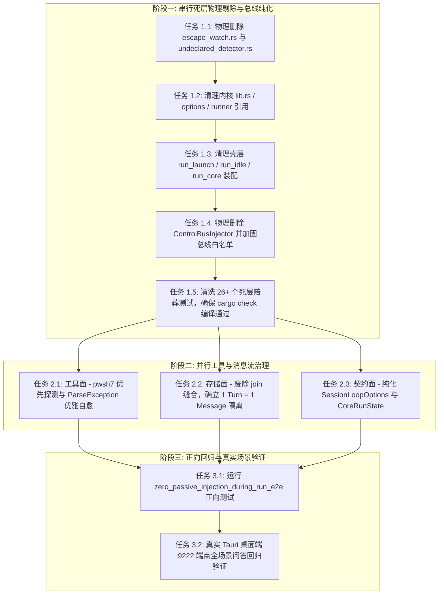

# 00-总方案：Agent 主动探查架构收敛与被动监视死层剔除

> **战役定位**：彻底废弃「被动后台逃逸监视与旁路注入」死层，收敛并确立「Agent 按需主动探查上下文」为唯一合法范式，从根源根除 `sess-1786855835905` 死循环自激雪崩故障。
> **主控原则（收敛版 v2）**：
>
> 1. **概念路径归一**：上下文获取与文件系统变更感知收敛为唯一 1 条路径（Agent 主动结构化工具调用）；
> 2. **收敛先于增强**：先执行死层物理删除与总线解绑，再执行工具健壮性加固；
> 3. **净负产出铁律**：本战役毛删除 ~1,948 行，新增 ~220 行，**净删除 $\ge 1,700$ 行**；
> 4. **禁止波次/批次命名**：全程采用领域词（Active Exploration Architecture）；
> 5. **保护核心安全资产**：坚决保留 18 个 `WritePathRegistry` 锁测试与 7 个 `tool.path_escape` 越界拦截测试，仅清洗保护死层的 26+ 个陪葬测试。

---

## 一、 架构转型：主动探查 vs 被动监视

```
【废弃的被动监视路径（自激雪崩源头）】
应用运行/写入日志 ──> WorkspaceWatcher 捕获 ──> EscapeWatch 误报 ──> ControlBusInjector ──> 强塞 FollowUp ──> 唤醒 AI 死循环排查（❌ 彻底物理删除）

【确立的唯一主动探查路径（干净、专注、可控）】
用户提出需求 ──> Agent 思考规划 ──> 按需主动调用工具 (file_stat / read_file / list_dir / grep_search / git status) ──> 获取结构化上下文（✅ 强化为唯一主路径）
```

---

## 二、 四大执行维度与删除面定案

### 维度 1：【核心死层清除】逃逸监视与判定器物理剔除（先删，串行）

- **核心问题**：`crates/session-loop/src/escape_watch.rs`（890 行）与 `undeclared_detector.rs`（201 行）全套代码退化为有害死层。
- **删除面清单**：
  - **物理删除文件**：`crates/session-loop/src/escape_watch.rs`、`crates/session-loop/src/undeclared_detector.rs`；
  - **解绑模块**：`crates/session-loop/src/lib.rs` 移除模块导出；
  - **清理配置**：`SessionLoopOptions.escape_watch`、`ActiveRun.escape_watch`、`CoreRunState.escape_watch` 字段全面移除；
  - **清理启动/收口**：`run_launch.rs:488-525` 移除 `spawn_escape_watch` 启动块；`run_idle.rs` 移除所有 `escape_watch.shutdown()` 调用；重命名 helper 为领域词 `resolve_run_workspace_root`。
- **负产出贡献**：**-1,091 行源码 + -150 行装配胶水**。

---

### 维度 2：【总线纯化】ControlBus 队列治理与 Follow-Up 语义纯化（串行）

- **核心问题**：`ControlBusInjector` 假借 `source: "system", reason: "escape-watch"` 向 `FollowUp` 队列注入伪装消息，导致 AI 发生伪自发唤醒。
- **删除面清单**：
  - **物理删除代码**：`apps/agent-workbench/src-tauri/src/run/run_core.rs:225-246` 的 `ControlBusInjector` 结构体及 `EscapeWatchInjector` trait 实现；
  - **总线白名单加固**：`ControlBus::request_follow_up` 增加强类型 `FollowUpSource` 校验（仅放行 `source: "ui"` 用户显式追问与 `source: "main-agent"` 模型自我规划）；对任何未经声明的来源直接拒绝入队并记录诊断，彻底关闭后门通道。
- **负产出贡献**：**-35 行注入代码 + 纯化总线契约**。

---

### 维度 3：【工具面】Agent 主动探查工具链健壮性与 PowerShell 防护（并行）

- **核心问题**：`sess-1786855835905` 中模型在 Windows 下使用 CMD 语法（`&`, `2>nul`）或 Unix 管道命令（`grep|head`）导致 `[scriptblock]::Create` 抛出 `ParseException`。
- **治理方案**：
  - **外壳探测优先级重构**：`shell_invoke.rs` / `process.rs` 改为 `pwsh.exe`（PowerShell 7+）绝对优先，废弃对老旧 PS 5.1 的硬编码；
  - **包装脚本容错加固**：`build_windows_powershell_script` 增加 `try-catch [System.Management.Automation.ParseException]` 优雅错误捕获，避免未捕获异常导致子进程崩溃；
  - **非侵入式自愈提示**：针对 `2>nul`、`set VAR=`、`grep|head` 等常见混淆，只做只读语法识别，在报错时自动附加「Windows pwsh 语法对照与建议」，坚决杜绝黑盒正则自动重写；
  - **主动结构化工具优先**：强化 `read_file`、`list_dir`、`grep_search`、`file_stat` 工具的 Schema 说明，引导模型优先使用结构化工具而非裸 Shell。
- **新增/重构代码**：**+120 行健壮性防御与自愈提示**。

---

### 维度 4：【存储与展现】会话消息（session_messages）多轮 Turn 隔离与防 Smashing（并行）

- **核心问题**：多轮 Turn 响应被前端/数据库强制追加并合并进同一个 `assistant-msg-id`，导致文本暴力拼接。
- **治理方案**：
  - **确立 1 Turn = 1 Message 原则**：每轮 Turn 产生的 Assistant 响应作为独立的 `SessionMessage` 实体保存；
  - **废除暴力缝合代码**：删除 `messageHandlers.ts` 的 `join('\n\n')` 拼接逻辑与全局累加字符串；
  - **启用增量原子落盘**：全面接线 `append_session_messages` 增量原子写入；
  - **系统诊断正文物理隔离**：系统级警告/通知一律路由至 `RunNotice` 横幅或元数据字段，严禁侵入消息正文。
- **负产出贡献**：**-80 行拼接废码 + 消息流原子化**。

---

### 维度 5：【测试治理】陪葬测试彻底清洗与零注入正向回归测试（串行）

- **核心问题**：26+ 个测试用例（约 485 行）专门断言逃逸注入的旧行为，阻碍死层出清。
- **治理方案**：
  - **陪葬测试清洗清单**：
    1. `apps/agent-workbench/src-tauri/src/core_run_commands_tests.rs`: 删除 `escape_watch_inject_reaches_main_agent` (L7969)、`EscapeProbeTool` (L8020)、`escape_detector_claims_suppress_audit_e2e` (L8094)、`escape_detector_unclaimed_path_reports_e2e` (L8163)、`write_claims_injected_registry_shared_with_tool_ctx` (L8225)、`escape_root_resolution_matches_with_options` (L8288) 等；
    2. `crates/session-loop/src/escape_watch.rs` 内部 13 个测试随模块删除；
    3. `crates/session-loop/src/undeclared_detector.rs` 内部 6 个测试随模块删除；
  - **红线保护资产（100% 保留）**：18 个 `WritePathRegistry` 锁测试、`tool.path_escape` 7 个沙箱越界拦截测试、符号链接安全测试；
  - **新增正向验证套件**：
    1. `zero_passive_injection_during_run_e2e`：断言在工作区高频并发写文件期间，系统 0 被动注入、0 旁路唤醒；
    2. `active_exploration_tool_chain_smoothness_e2e`：断言主动探查工具链全链路顺畅。
- **负产出贡献**：**-485 行陪葬测试 + 100 行正向回归断言**。

---

## 三、 执行时序与依赖编排（严格践行先删后改）



---

## 四、 负产出与收敛度量表

| 治理对象 / 模块                                  | 毛删除行数 (Gross Del) | 新增/重构行数 (Gross Add) | 净删除行数 (Net Del) | 消除死类型/死函数数            |
| :----------------------------------------------- | :--------------------- | :------------------------ | :------------------- | :----------------------------- |
| `crates/session-loop/src/escape_watch.rs`        | **890**                | 0                         | **-890**             | 4 个结构体, 5 个全局函数       |
| `crates/session-loop/src/undeclared_detector.rs` | **201**                | 0                         | **-201**             | 1 个结构体, 1 个 Trait         |
| `crates/session-loop` 装配与 options             | **85**                 | 0                         | **-85**              | 1 个字段 (`escape_watch`)      |
| `apps/agent-workbench/src-tauri/src/run/`        | **187**                | 20                        | **-167**             | `ControlBusInjector`           |
| `core_run_commands_tests.rs` 陪葬测试            | **485**                | 80 (正向回归)             | **-405**             | 26+ 个陪葬用例                 |
| 前端与消息流 `join('\n\n')` 缝合代码             | **100**                | 20                        | **-80**              | 暴力拼接逻辑                   |
| PowerShell 包装与自愈提示                        | 0                      | 100 (容错提示)            | **+100**             | 语法防护与自愈                 |
| **全仓合计总账**                                 | **1,948 行**           | **220 行**                | **-1,728 行**        | **6 类型 + 2 Trait + 26 测试** |

---

## 五、 验收标准（功能 + 负产出双验收）

1. **负产出硬指标**：全仓净减少代码 $\ge 1,500$ 行，未接线/临时标记新增 = 0，无任何无日期 fallback；
2. **零被动注入指标**：在整个 Run 执行期间，底层发生任何日志写入、数据库更新、文件读写操作时，系统产生的 `undeclared-write` 事件数 = 0，`FollowUp` 自动塞入系统消息数 = 0；
3. **工具执行指标**：在 Windows pwsh7 下运行任何合规主动探查命令 0 误报 `ParseException`，对 CMD 语法提供清晰的只读自愈指导；
4. **消息流指标**：多轮对话在 `session_messages` 中行数严格对应 Turn 数，禁止跨轮次文本无界串联；
5. **门禁指标**：`cargo test --workspace` 全部 70+ 套件绿灯，`npm run typecheck` + `npm run test` 全绿。
