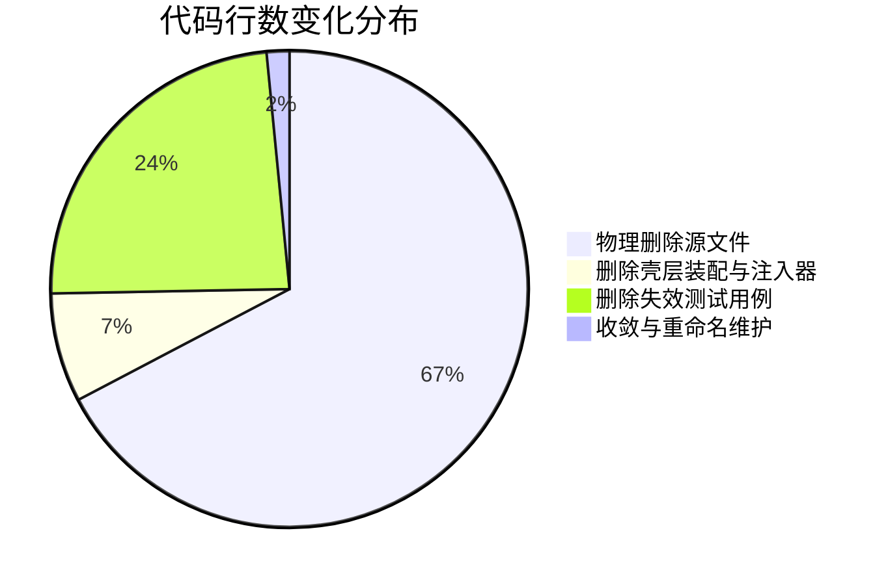
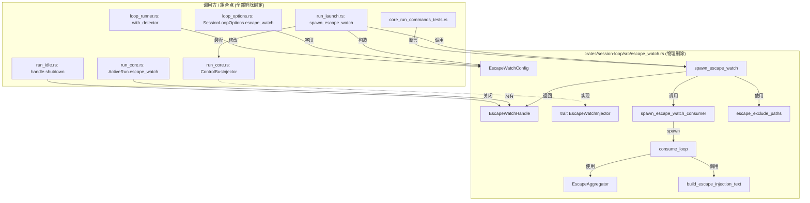

# 逃逸监视死层物理剔除与装配解绑方案

> **文档位置**：`docs/active-exploration-architecture/independent-plans/01-escape-watch-removal-plan.md`  
> **所属战役**：主动探索架构（Active Exploration Architecture）独立方案  
> **方案职责**：彻底物理删除 `crates/session-loop/src/escape_watch.rs` 及其耦合死层 `crates/session-loop/src/undeclared_detector.rs`，从 `session-loop` 内核循环选项与 Tauri 桌面壳层 `run` 生命周期装配中完整解绑，消除后台被动文件监视对会话总线的伪自发唤醒与污染，确立由 Agent 主动调用文件工具的主权架构。

---

## 目录

- [一、背景与架构定性（问题根因与消亡定性）](#一背景与架构定性问题根因与消亡定性)
  - [1.1 逃逸监视机制的历史由来与设计缺陷](#11-逃逸监视机制的历史由来与设计缺陷)
  - [1.2 被动文件监视注入的系统性危害](#12-被动文件监视注入的系统性危害)
  - [1.3 架构范式转移：从被动拦截到主动探索](#13-架构范式转移从被动拦截到主动探索)
  - [1.4 逃逸监视相关模块死层定性](#14-逃逸监视相关模块死层定性)
- [二、本方案要删掉什么 / 收敛什么](#二本方案要删掉什么--收敛什么)
  - [2.1 物理删除文件清单](#21-物理删除文件清单)
  - [2.2 涉及修改与解绑文件清单](#22-涉及修改与解绑文件清单)
  - [2.3 符号收敛与命名规范化](#23-符号收敛与命名规范化)
  - [2.4 负产出评估表](#24-负产出评估表)
- [三、被删除模块结构体、函数及全调用点全景梳理](#三被删除模块结构体函数及全调用点全景梳理)
  - [3.1 escape_watch 模块符号与调用点全景](#31-escape_watch-模块符号与调用点全景)
  - [3.2 undeclared_detector 模块符号与调用点全景](#32-undeclared_detector-模块符号与调用点全景)
  - [3.3 壳层装配与生命周期绑定点全景](#33-壳层装配与生命周期绑定点全景)
- [四、解绑与物理剔除详细执行步骤](#四解绑与物理剔除详细执行步骤)
  - [4.1 阶段一：内核与会话循环解绑（crates/session-loop/）](#41-阶段一内核与会话循环解绑createssession-loop)
  - [4.2 阶段二：壳层生命周期与装配解绑（apps/agent-workbench/）](#42-阶段二壳层生命周期与装配解绑appsagent-workbench)
  - [4.3 阶段三：测试集净化与回归断言重构](#43-阶段三测试集净化与回归断言重构)
- [五、架构不变量与反退避断言清单](#五架构不变量与反退避断言清单)
  - [5.1 零后台被动文件修改注入不变量](#51-零后台被动文件修改注入不变量)
  - [5.2 零未声明写入误唤醒不变量](#52-零未声明写入误唤醒不变量)
  - [5.3 纯逻辑与主权明确的 Agent 交互](#53-纯逻辑与主权明确的-agent-交互)
  - [5.4 严格禁止退避原则与防回归测试断言](#54-严格禁止退避原则与防回归测试断言)
- [六、风险评估与平滑落地验证路径](#六风险评估与平滑落地验证路径)
  - [6.1 影响面与无害性论证](#61-影响面与无害性论证)
  - [6.2 编译门禁与测试套件全绿验证](#62-编译门禁与测试套件全绿验证)
  - [6.3 零临时兼容宏与零无日期 fallback 检查](#63-零临时兼容宏与零无日期-fallback-检查)
  - [6.4 执行落地建议](#64-执行落地建议)

---

## 一、背景与架构定性（问题根因与消亡定性）

### 1.1 逃逸监视机制的历史由来与设计缺陷

在 Conex 早期演进（`T-ESC-01` ~ `T-ESC-03`）中，为了防止 LLM 在执行脚本或外部命令时直接修改文件系统而绕过引擎的写工具声明（`write_paths`），引入了所谓的「逃逸追踪（Escape Watch）」机制：

1. **机制设想**：通过 [`conex-fs::watch::WorkspaceWatcher`](file:///c:/Software/conex/crates/conex-fs/src/watch.rs) 在 OS 层面挂载目录监听器；
2. **事件过滤与比对**：将文件变更事件与会话级的 [`WritePathRegistry`](file:///c:/Software/conex/crates/agent-tools/src/write_paths.rs) 活跃声明比对（[`UndeclaredWriteDetector`](file:///c:/Software/conex/crates/session-loop/src/undeclared_detector.rs)）；
3. **聚合与旁路注入**：若判定为未声明的写操作，则通过 [`EscapeAggregator`](file:///c:/Software/conex/crates/session-loop/src/escape_watch.rs#L170) 进行聚合限流，并通过 `ControlBusInjector` 将一条生成的系统消息「检测到工具外写入：xxx」强行塞入当前 Run 的 `ControlBus` 的 `FollowUp` 队列中。

### 1.2 被动文件监视注入的系统性危害

这一机制在实践中暴露了严重的架构缺陷与副作用：

- **伪自发唤醒（Spurious Wakeup）与对话污染**：
  当 Run 已经执行完毕、模型已完成输出准备进入 `ShouldStop` 时，后台监视任务在 Run 收口阶段产生的 `shutdown` flush 事件被注入进 `ControlBus`。`turn_complete.rs` 探测到 `FollowUp` 队列有消息，便强行派发 `InputAvailable`，导致 AI 发生未经用户输入、未经自身规划的静默自发续跑，引发无休止的模型自言自语甚至死循环。
- **不可控的异步竞争与时序死锁**：
  OS 级文件系统事件（如 Windows ReadDirectoryChangesW / Linux inotify）存在天然的异步延迟（50ms ~ 2000ms）。这导致工具正常执行写操作并释放声明后，迟到的事件可能被误判为「未声明写入」，产生随机偶发的虚假报警。
- **噪音刷屏与大模型认知负担**：
  编译器产物、临时文件、测试日志等即便在静态排除清单（`escape_exclude_paths`）下仍常有遗漏，导致系统向模型注入大量无关的碎片信息，挤占上下文窗口（Context Window），降低决策准确度。

### 1.3 架构范式转移：从被动拦截到主动探索

Conex 现代架构明确了**主权分明、以主动探索为主**的设计哲学：

- **拒绝被动监控**：内核不再在后台偷偷监视工作区文件变更并篡改对话流；
- **主动工具调用**：Agent 对工作区文件状态的认知，完全来自于显式的工具调用（例如主动读取文件、列出目录、执行 Git 状态查询、运行构建或测试等）；
- **权限与沙箱前置**：写路径冲突与安全约束在工具调用入口处（`WritePathRegistry` 锁与权限决策）做即时判定，而非在事后靠 OS watcher 抓取。

因此，逃逸监视（Escape Watch）全链条已彻底失去存在价值，属于必须连根拔起的「死层」。

### 1.4 逃逸监视相关模块死层定性

通过对全仓代码的静态分析，以下两个模块及其相关联结构体已完全蜕变为无用死代码：

1. [`crates/session-loop/src/escape_watch.rs`](file:///c:/Software/conex/crates/session-loop/src/escape_watch.rs)（890 行）：定义了配置、句柄、聚合器、消费循环、注入器 trait、文案生成以及 12 个专用测试。
2. [`crates/session-loop/src/undeclared_detector.rs`](file:///c:/Software/conex/crates/session-loop/src/undeclared_detector.rs)（201 行）：定义了判定器 trait `UndeclaredWriteDetector` 与基于注册表的实现 `RegistryBackedDetector`。除逃逸监视外，全仓无任何其他业务调用。

---

## 二、本方案要删掉什么 / 收敛什么

### 2.1 物理删除文件清单

本方案将物理删除 2 个源文件，总计约 **1091 行** 死代码：

| 序号 | 目标文件路径                                                                                                                 | 现有行数   | 包含的死类型 / 死 Trait / 死函数                                                                                                                                                                                                                                            |
| :--- | :--------------------------------------------------------------------------------------------------------------------------- | :--------- | :-------------------------------------------------------------------------------------------------------------------------------------------------------------------------------------------------------------------------------------------------------------------------- |
| 1    | [`crates/session-loop/src/escape_watch.rs`](file:///c:/Software/conex/crates/session-loop/src/escape_watch.rs)               | **890 行** | `EscapeWatchConfig`, `EscapeWatchHandle`, `EscapeAggregator`, `AggregatedPath`, `EscapeWatchInjector`, `spawn_escape_watch`, `spawn_escape_watch_consumer`, `consume_loop`, `emit_report`, `impact_for`, `build_escape_injection_text`, `escape_exclude_paths` 及 12 个测试 |
| 2    | [`crates/session-loop/src/undeclared_detector.rs`](file:///c:/Software/conex/crates/session-loop/src/undeclared_detector.rs) | **201 行** | `UndeclaredWriteDetector` (Trait), `RegistryBackedDetector` (Struct) 及 7 个单测                                                                                                                                                                                            |

### 2.2 涉及修改与解绑文件清单

以下文件需解除对逃逸监视的装配绑定、类型导入与测试依赖：

| 序号 | 目标文件路径                                                                                                                                               | 涉及修改点与解绑内容                                                                                                                                                                                                                                                                                                                                                                                                                 | 预估影响行数 |
| :--- | :--------------------------------------------------------------------------------------------------------------------------------------------------------- | :----------------------------------------------------------------------------------------------------------------------------------------------------------------------------------------------------------------------------------------------------------------------------------------------------------------------------------------------------------------------------------------------------------------------------------- | :----------- |
| 1    | [`crates/session-loop/src/lib.rs`](file:///c:/Software/conex/crates/session-loop/src/lib.rs)                                                               | 移除 `pub mod escape_watch;` 与 `pub mod undeclared_detector;` 声明；移除 `pub use escape_watch::{...};` 与 `pub use undeclared_detector::{...};` 重导出。                                                                                                                                                                                                                                                                           | -12 行       |
| 2    | [`crates/session-loop/src/loop/loop_options.rs`](file:///c:/Software/conex/crates/session-loop/src/loop/loop_options.rs)                                   | 移除 `use crate::escape_watch::EscapeWatchConfig;`；从 `SessionLoopOptions` 中彻底移除 `pub escape_watch: Option<EscapeWatchConfig>` 字段；清理 Default 实现及相关旧注释。                                                                                                                                                                                                                                                           | -18 行       |
| 3    | [`crates/session-loop/src/loop/loop_runner.rs`](file:///c:/Software/conex/crates/session-loop/src/loop/loop_runner.rs)                                     | 移除 `use crate::undeclared_detector::RegistryBackedDetector;`；移除 `with_options` 中的 `if let Some(config) = options.escape_watch.take()` 判定器自动注入逻辑。                                                                                                                                                                                                                                                                    | -12 行       |
| 4    | [`crates/session-loop/src/loop/loop_tests.rs`](file:///c:/Software/conex/crates/session-loop/src/loop/loop_tests.rs)                                       | 移除未使用的 `use crate::escape_watch::EscapeWatchConfig;`。                                                                                                                                                                                                                                                                                                                                                                         | -2 行        |
| 5    | [`crates/session-loop/src/loop/loop_tests_exec.rs`](file:///c:/Software/conex/crates/session-loop/src/loop/loop_tests_exec.rs)                             | 移除 `escape_watch: Some(EscapeWatchConfig::new(...))` 测试装配；移除第 4 小节针对 ESC 判定器注入的断言。                                                                                                                                                                                                                                                                                                                            | -35 行       |
| 6    | [`apps/agent-workbench/src-tauri/src/run/mod.rs`](file:///c:/Software/conex/apps/agent-workbench/src-tauri/src/run/mod.rs)                                 | 清理导入列表中已失效的 `spawn_escape_watch`, `EscapeWatchConfig`, `EscapeWatchHandle`, `EscapeWatchInjector`, `RegistryBackedDetector`。                                                                                                                                                                                                                                                                                             | -5 行        |
| 7    | [`apps/agent-workbench/src-tauri/src/run/run_core.rs`](file:///c:/Software/conex/apps/agent-workbench/src-tauri/src/run/run_core.rs)                       | 从 `ActiveRun` 结构体中彻底移除 `escape_watch: Mutex<Option<EscapeWatchHandle>>` 字段；彻底物理删除 `ControlBusInjector` 结构体及其 `EscapeWatchInjector` 实现。                                                                                                                                                                                                                                                                     | -35 行       |
| 8    | [`apps/agent-workbench/src-tauri/src/run/run_idle.rs`](file:///c:/Software/conex/apps/agent-workbench/src-tauri/src/run/run_idle.rs)                       | 移除 `drive_outcome` 错误分支（`finalize_failed` 前）及正常收口分支中对 `active.escape_watch.lock().take().shutdown()` 的调用。                                                                                                                                                                                                                                                                                                      | -20 行       |
| 9    | [`apps/agent-workbench/src-tauri/src/run/run_launch.rs`](file:///c:/Software/conex/apps/agent-workbench/src-tauri/src/run/run_launch.rs)                   | 1. 将 `resolve_escape_watch_root` 重构并收敛重命名为通用领域函数 `resolve_run_workspace_root`；<br>2. 彻底删除 `spawn_escape_watch` 启动装配块（原 488-526 行）；<br>3. 从 `SessionLoopOptions` 构造中移除 `escape_watch` 字段；<br>4. 从 `ActiveRun` 构造中移除 `escape_watch` 字段。                                                                                                                                               | -60 行       |
| 10   | [`apps/agent-workbench/src-tauri/src/core_run_commands_tests.rs`](file:///c:/Software/conex/apps/agent-workbench/src-tauri/src/core_run_commands_tests.rs) | 1. 清理 mock `ActiveRun` 中的 `escape_watch: Mutex::new(None)`（223, 2891, 9442 行）；<br>2. 彻底删除 5 个旧 E2E 逃逸测试（`escape_watch_inject_reaches_main_agent`, `EscapeProbeTool`, `escape_detector_claims_suppress_audit_e2e`, `escape_detector_unclaimed_path_reports_e2e`, `write_claims_injected_registry_shared_with_tool_ctx`）；<br>3. 重命名并保留纯路径解析测试 `run_workspace_root_resolution_matches_with_options`。 | -350 行      |

### 2.3 符号收敛与命名规范化

在 [`apps/agent-workbench/src-tauri/src/run/run_launch.rs:128-131`](file:///c:/Software/conex/apps/agent-workbench/src-tauri/src/run/run_launch.rs#L128-L131) 中，存在一个历史辅助函数：

```rust
// 旧路径与旧命名 (run_launch.rs:128-131)
pub(crate) fn resolve_escape_watch_root(cwd: Option<&str>) -> PathBuf {
    cwd.map(PathBuf::from)
        .unwrap_or_else(|| std::env::current_dir().unwrap_or_else(|_| PathBuf::from(".")))
}
```

该函数的实质职责是**根据 Run 的可选 `cwd` 参数解析出规范的工作区根路径**（供写路径注册表 `WritePathRegistry` 和子代理沙箱使用）。命名中带有 `escape_watch` 专有词汇属于历史遗留概念污染。

**收敛裁决**：

- 将其重命名为领域词：`pub(crate) fn resolve_run_workspace_root(cwd: Option<&str>) -> PathBuf`；
- 所有调用点统一更名，彻底剔除「逃逸」相关词汇。

### 2.4 负产出评估表

本方案实施后，全仓将实现显著的**纯代码负增长（代码瘦身与死层出清）**：



| 评估维度                      | 数量 / 指标                          | 详细说明                                                                                                                                                   |
| :---------------------------- | :----------------------------------- | :--------------------------------------------------------------------------------------------------------------------------------------------------------- |
| **物理删除源文件数**          | **2 个**                             | `escape_watch.rs`, `undeclared_detector.rs`                                                                                                                |
| **净删除代码行数**            | **~1,600+ 行**                       | 彻底消除死代码与冗余测试，无任何功能回退                                                                                                                   |
| **消除死类型（Struct/Enum）** | **6 个**                             | `EscapeWatchConfig`, `EscapeWatchHandle`, `EscapeAggregator`, `AggregatedPath`, `ControlBusInjector`, `RegistryBackedDetector`                             |
| **消除死 Trait**              | **2 个**                             | `EscapeWatchInjector`, `UndeclaredWriteDetector`                                                                                                           |
| **消除死函数 / 方法**         | **15+ 个**                           | `spawn_escape_watch`, `spawn_escape_watch_consumer`, `consume_loop`, `emit_report`, `impact_for`, `build_escape_injection_text`, `escape_exclude_paths` 等 |
| **消除并发运行时任务**        | **每 Run 减少 1 个 Tokio 异步 Task** | 消除 `consume_loop` 常驻任务及 `notify` 文件监听线程                                                                                                       |
| **消除旁路总线注入通道**      | **100% 消除**                        | `ControlBus` 不再接受任何未经用户或模型显式请求的注入                                                                                                      |

---

## 三、被删除模块结构体、函数及全调用点全景梳理

### 3.1 escape_watch 模块符号与调用点全景

`crates/session-loop/src/escape_watch.rs` 内部符号与其在全仓的调用关系如下：



**符号与调用点详细清单**：

1. `EscapeWatchConfig`：
   - 定义：`escape_watch.rs:61`
   - 调用点：`loop_options.rs:18, 176, 300`；`loop_runner.rs:146`；`run_launch.rs:490`；`run/mod.rs:108`；`loop_tests_exec.rs:216`。
2. `EscapeWatchHandle`：
   - 定义：`escape_watch.rs:282`
   - 调用点：`run_core.rs:70`；`run_idle.rs:1355, 1409`；`run_launch.rs:506`；`run/mod.rs:109`。
3. `EscapeAggregator` & `AggregatedPath`：
   - 定义：`escape_watch.rs:152, 170`
   - 调用点：仅在 `escape_watch.rs` 内部使用（`consume_loop` 及单测）。
4. `EscapeWatchInjector`：
   - 定义：`escape_watch.rs:145`
   - 调用点：`run_core.rs:237`（`ControlBusInjector` 实现之）；`escape_watch.rs:505`（单测 `RecordingInjector`）。
5. `spawn_escape_watch` & `spawn_escape_watch_consumer`：
   - 定义：`escape_watch.rs:343, 358`
   - 调用点：`run_launch.rs:505`；`run/mod.rs:108`；`escape_watch.rs` 内部测试。
6. `escape_exclude_paths`：
   - 定义：`escape_watch.rs:317`
   - 调用点：`escape_watch.rs:350, 855`。
7. `build_escape_injection_text`：
   - 定义：`escape_watch.rs:463`
   - 调用点：`escape_watch.rs:440, 626, 637`。

### 3.2 undeclared_detector 模块符号与调用点全景

`crates/session-loop/src/undeclared_detector.rs` 符号与其在全仓的调用关系：

1. `UndeclaredWriteDetector` (Trait)：
   - 定义：`undeclared_detector.rs:22`
   - 调用点：`escape_watch.rs:45, 75, 110`；`lib.rs:122`；`undeclared_detector.rs:44`。
2. `RegistryBackedDetector` (Struct)：
   - 定义：`undeclared_detector.rs:32`
   - 调用点：`run_launch.rs:502`；`loop_runner.rs:20, 148`；`run/mod.rs:109`；`lib.rs:122`；`core_run_commands_tests.rs`。

### 3.3 壳层装配与生命周期绑定点全景

在 Tauri 壳层（`apps/agent-workbench/src-tauri/src/run/`）中，逃逸监视与 Run 生命周期的绑定关系如下：

1. **创建期装配（`run_launch.rs:488-526`）**：
   - 检查 `cwd`，如果存在则构造 `EscapeWatchConfig`；
   - 挂载 `ControlBusInjector`；
   - 挂载 `RegistryBackedDetector`；
   - 调用 `spawn_escape_watch` 启动文件监听；
   - 将 `EscapeWatchHandle` 存入 `ActiveRun`；
   - 将 `EscapeWatchConfig` 存入 `SessionLoopOptions`。
2. **状态持有（`run_core.rs:68-70`）**：
   - `ActiveRun.escape_watch: Mutex<Option<EscapeWatchHandle>>`。
3. **收口与清理（`run_idle.rs:1354-1361, 1408-1415`）**：
   - 错误分支（`drive_outcome` Err）：从 `ActiveRun` 中取出 handle 并调用 `shutdown().await`；
   - 正常收口分支（事件 emit 完毕）：从 `ActiveRun` 中取出 handle 并调用 `shutdown().await`。

---

## 四、解绑与物理剔除详细执行步骤

### 4.1 阶段一：内核与会话循环解绑（crates/session-loop/）

#### 步骤 1.1：物理删除源文件

直接删除以下两个文件：

- `crates/session-loop/src/escape_watch.rs`
- `crates/session-loop/src/undeclared_detector.rs`

#### 步骤 1.2：修改 `crates/session-loop/src/lib.rs`

1. 移除模块声明：
   ```diff
   - pub mod escape_watch;
   - pub mod undeclared_detector;
   ```
2. 移除重导出：
   ```diff
   - pub use escape_watch::{
   -     build_escape_injection_text, escape_exclude_paths, spawn_escape_watch,
   -     spawn_escape_watch_consumer, EscapeAggregator, EscapeWatchConfig, EscapeWatchHandle,
   -     EscapeWatchInjector,
   - };
   ...
   - pub use undeclared_detector::{RegistryBackedDetector, UndeclaredWriteDetector};
   ```

#### 步骤 1.3：修改 `crates/session-loop/src/loop/loop_options.rs`

1. 移除引用：
   ```diff
   - use crate::escape_watch::EscapeWatchConfig;
   ```
2. 移除结构体字段：
   ```diff
   -     /// 逃逸监视装配配置（T-ESC-03 P3 装配面）：None = 不启用逃逸监视
   -     /// （现状行为）。装配上下文透传——壳层 run 起停钩子消费：run 开始
   -     /// 经 [crate::escape_watch::spawn_escape_watch] 启动监视并 spawn 消费
   -     /// 任务（聚合 → 审计发射 + 主 agent 注入），run 收口经
   -     /// [crate::escape_watch::EscapeWatchHandle::shutdown] 停止并 flush 剩余
   -     /// 事件；LoopState 不消费本字段（消费循环由壳层 spawn，见
   -     /// REQ-逃逸追踪分析 §3.5.1）。
   -     pub escape_watch: Option<EscapeWatchConfig>,
   ```
3. 移除 `Default` 初始化：
   ```diff
   -             escape_watch: None,
   ```
4. 清理 `write_claims` 字段文档中关于 `EscapeWatchConfig::with_detector` 的过时描述。

#### 步骤 1.4：修改 `crates/session-loop/src/loop/loop_runner.rs`

1. 移除引用：
   ```diff
   - use crate::undeclared_detector::RegistryBackedDetector;
   ```
2. 移除 `with_options` 中对 `escape_watch` 的自动挂载逻辑（原 143-150 行）：
   ```diff
   -         // 逃逸监视判定器注入（T-ESC-03 交接点）：装配后形态 = detector
   -         // 已挂载 RegistryBackedDetector——run 内工具写路径声明即视为已
   -         // 声明覆盖（审计静默跳过），声明释放后恢复未声明上报
   -         if let Some(config) = options.escape_watch.take() {
   -             options.escape_watch = Some(
   -                 config.with_detector(Arc::new(RegistryBackedDetector::new(Arc::clone(&registry)))),
   -             );
   -         }
   ```

#### 步骤 1.5：清理 `crates/session-loop/src/loop/loop_tests.rs` 与 `loop_tests_exec.rs`

1. 在 `loop_tests.rs` 中移除 `use crate::escape_watch::EscapeWatchConfig;`。
2. 在 `loop_tests_exec.rs` 中清理 `escape_watch` 装配与断言（原 215-222 行与 258-282 行）。

---

### 4.2 阶段二：壳层生命周期与装配解绑（apps/agent-workbench/）

#### 步骤 2.1：修改 `apps/agent-workbench/src-tauri/src/run/mod.rs`

清理 `session_loop` 导入清单：

```diff
  pub(crate) use session_loop::{
-     spawn_escape_watch, AbortSignal, ApprovalGate, ControlBus, DeltaSink, EscapeWatchConfig,
-     EscapeWatchHandle, EscapeWatchInjector, PermissionMode, RegistryBackedDetector, RunOutcome,
+     AbortSignal, ApprovalGate, ControlBus, DeltaSink, PermissionMode, RunOutcome,
      SessionLoopOptions, SummaryDispatchConfig, ToolBatchOptions,
  };
```

#### 步骤 2.2：修改 `apps/agent-workbench/src-tauri/src/run/run_core.rs`

1. 从 `ActiveRun` 中移除字段：
   ```diff
   -     /// 逃逸监视句柄（T-ESC-03：run 起停钩子；None = 未启用。Mutex 包装：
   -     /// drive / finalize 路径经锁 take 出句柄后 async 收口，锁不跨 await）
   -     pub(crate) escape_watch: Mutex<Option<EscapeWatchHandle>>,
   ```
2. 彻底删除 `ControlBusInjector`（原 220-246 行）：
   ```diff
   - /// 逃逸监视主 agent 注入器（T-ESC-03 壳层适配）：归因摘要经 L1
   - /// followUp 环注入会话（D8：run 内不注入，run idle promote 后成为
   - /// 下一条用户消息——主 agent 下一轮即可看到，REQ §3.3 第 3 点；
   - /// 注入频率限流由聚合报告粒度承担）
   - pub(crate) struct ControlBusInjector {
   -     /// 本 run 控制总线（std Mutex，锁不跨 await 持有）
   -     pub(crate) bus: Arc<Mutex<ControlBus>>,
   - }
   -
   - impl ControlBusInjector {
   -     /// 新建注入器（总线与 run 同生命周期）
   -     pub(crate) fn new(bus: Arc<Mutex<ControlBus>>) -> Self {
   -         Self { bus }
   -     }
   - }
   -
   - impl EscapeWatchInjector for ControlBusInjector {
   -     fn inject(&self, text: &str) {
   -         let mut bus = self.bus.lock().unwrap_or_else(|e| e.into_inner());
   -         bus.request_follow_up(
   -             crate::engine::user_message(text, None),
   -             Some("escape-watch".to_string()),
   -             Some("system".to_string()),
   -         );
   -     }
   - }
   ```

#### 步骤 2.3：修改 `apps/agent-workbench/src-tauri/src/run/run_idle.rs`

1. 在错误分支移除 shutdown：
   ```diff
   -                 // T-ESC-03：失败收口同样停止监视 + flush 剩余事件
   -                 // （run 中崩溃不泄漏监视任务，REQ §5.4 风险缓解）
   -                 let escape_handle = active
   -                     .escape_watch
   -                     .lock()
   -                     .unwrap_or_else(|e| e.into_inner())
   -                     .take();
   -                 if let Some(mut handle) = escape_handle {
   -                     handle.shutdown().await;
   -                 }
   ```
2. 在正常收口分支移除 shutdown：
   ```diff
   -         // T-ESC-03 run 收口钩子：停止监视 + flush 剩余事件（聚合补发最后
   -         // 一条报告——审计经桥广播，注入经 followUp 环落会话，REQ §3.5.1）
   -         let escape_handle = active
   -             .escape_watch
   -             .lock()
   -             .unwrap_or_else(|e| e.into_inner())
   -             .take();
   -         if let Some(mut handle) = escape_handle {
   -             handle.shutdown().await;
   -         }
   ```

#### 步骤 2.4：修改 `apps/agent-workbench/src-tauri/src/run/run_launch.rs`

1. 重命名并规范化根解析辅助函数（原 128-131 行）：
   ```rust
   /// 工作区根路径解析（从 cwd 解析工作区根：cwd → current_dir）
   pub(crate) fn resolve_run_workspace_root(cwd: Option<&str>) -> PathBuf {
       cwd.map(PathBuf::from)
           .unwrap_or_else(|| std::env::current_dir().unwrap_or_else(|_| PathBuf::from(".")))
   }
   ```
2. 调整调用点（原 460 行与 564 行）：
   ```rust
   let workspace_root = resolve_run_workspace_root(cwd.as_deref());
   let shared_registry = Arc::new(WritePathRegistry::new(session_id.clone(), &workspace_root));
   ...
   let root = resolve_run_workspace_root(cwd.as_deref());
   ```
3. 彻底删除 `spawn_escape_watch` 装配代码块（原 488-526 行）：
   ```diff
   -     let (escape_watch, escape_config) = if let Some(dir) = cwd.clone() {
   -         let root = PathBuf::from(dir);
   -         let config = EscapeWatchConfig::new(
   -             root.clone(),
   -             session_id.clone(),
   -             run_id.clone(),
   -             Arc::clone(&bridge_audit_sink) as AuditSink,
   -         )
   -         .with_injector(Arc::new(ControlBusInjector::new(Arc::clone(&control_bus))))
   -         .with_detector(Arc::new(RegistryBackedDetector::new(Arc::clone(
   -             &shared_registry,
   -         ))));
   -         match spawn_escape_watch(root, config.clone()) {
   -             Ok(handle) => {
   -                 (Some(handle), Some(config))
   -             }
   -             Err(error) => {
   -                 (None, None)
   -             }
   -         }
   -     } else {
   -         (None, None)
   -     };
   ```
4. 在 `SessionLoopOptions` 构造中移除 `escape_watch: escape_config,`（原 672 行）。
5. 在 `ActiveRun` 构造中移除 `escape_watch: Mutex::new(escape_watch),`（原 812 行）。

---

### 4.3 阶段三：测试集净化与回归断言重构

#### 步骤 3.1：清理 Mock 构造点

在 `apps/agent-workbench/src-tauri/src/core_run_commands_tests.rs` 中：

- 第 223 行：移除 `escape_watch: Mutex::new(None),`
- 第 2891 行：移除 `escape_watch: Mutex::new(None),`
- 第 9442 行：移除 `escape_watch: Mutex::new(None),`

#### 步骤 3.2：彻底删除逃逸专用测试

在 `core_run_commands_tests.rs` 中物理删除以下测试用例及测试探针结构体（原 7965-8284 行，共 320 行）：

1. `escape_watch_inject_reaches_main_agent`
2. `struct EscapeProbeTool` 及 其 `agent_tools::definition::Tool` 实现
3. `escape_detector_claims_suppress_audit_e2e`
4. `escape_detector_unclaimed_path_reports_e2e`
5. `write_claims_injected_registry_shared_with_tool_ctx`

#### 步骤 3.3：重构工作区根解析测试

将原测试（8285-8299 行）重命名并对齐新领域函数：

```rust
#[test]
fn run_workspace_root_resolution_matches_with_options() {
    let explicit = resolve_run_workspace_root(Some("C:\\work\\proj"));
    assert_eq!(explicit, PathBuf::from("C:\\work\\proj"));
    let none = resolve_run_workspace_root(None);
    let current = std::env::current_dir().unwrap_or_else(|_| PathBuf::from("."));
    assert_eq!(none, current);
}
```

---

## 五、架构不变量与反退避断言清单

### 5.1 零后台被动文件修改注入不变量

```
[Invariant-1: Zero Passive File Injection]
在任何 Run 生命周期内，文件系统后台监听器不得向会话总线（ControlBus）或输入队列（AgentInputQueue）直接或间接注入任何消息。
```

- **验证手段**：全仓静态扫描，确保 `EscapeWatchInjector` 与 `ControlBusInjector` 彻底清零；
- **断言方法**：`ControlBus` 的 `request_follow_up` 仅接受来自用户 UI 或 Agent 显式工具调用的合法输入。

### 5.2 零未声明写入误唤醒不变量

```
[Invariant-2: Zero Undeclared-Write Spurious Wakeup]
Run 在完成当前轮次回答且无后续合法工具/用户输入时，必须确定性收口为 ShouldStop，严禁因外部文件系统写入而自发唤醒。
```

- **验证手段**：运行 `cargo test --workspace`，验证在 Run 执行期间向工作区并发写入大量文件，Run 仍正常收口结束，不会被唤醒。

### 5.3 纯逻辑与主权明确的 Agent 交互

```
[Invariant-3: Explicit Tool Sovereignty]
Agent 对工作区文件状态与变更的感知完全建立在主动工具调用（read_file, list_dir, grep_search, git status 等）之上。
```

- 引擎不再充当保姆式的事件监视器；
- 审计系统仅记录显式的工具调用安全事件（如 `delete_file`, `execute_command` 等），不捕获由于监视器延迟产生的虚假 `UndeclaredWrite` 审计事件。

### 5.4 严格禁止退避原则与防回归测试断言

依据 `.agents/LOGIC_PLAN_NO_RETREAT.md` 铁律：

- **禁止保留任何过渡性 fallback**：不保留 `cfg(feature = "legacy-escape-watch")` 或任何形式的向后兼容开关；
- **禁止保留死结构体壳**：所有死类型全部物理删除，绝不留空 struct 或空 trait；
- **测试资产严谨维护**：被删除的测试仅限于纯测试逃逸注入与逃逸判定器的测试，所有涉写路径注册表（`WritePathRegistry`）核心功能的工具测试全部完整保留并保证绿灯。

---

## 六、风险评估与平滑落地验证路径

### 6.1 影响面与无害性论证

| 涉及子系统             | 影响评估     | 为何完全无害且具备正向收益                                                                                                                   |
| :--------------------- | :----------- | :------------------------------------------------------------------------------------------------------------------------------------------- |
| **Agent 写文件工具**   | **零破坏**   | `write_to_file`, `replace_file_content`, `multi_replace_file_content` 等工具的执行依靠 `WritePathRegistry` 锁，与后台被动 watcher 完全解耦。 |
| **任务与命令执行**     | **零破坏**   | `run_command`, `task` 子系统的进程执行、取消与日志捕获均走独立管道，不依赖逃逸监视。                                                         |
| **前端审计与事件面板** | **零破坏**   | 工具级安全审计（`delete`, `shell` 等）经 `BridgeAuditSink` 正常发射；前端不再收到高噪音且不可靠的 `undeclared-write` 假报警。                |
| **系统稳定性与性能**   | **显著提升** | 消除每 Run 启动的文件监听开销与线程竞争，彻底杜绝 Run 终态挂起与死循环自言自语。                                                             |

### 6.2 编译门禁与测试套件全绿验证

在实施修改后，执行以下命令链进行全量验证：

```powershell
# 1. 验证 session-loop 编译与全部单元测试
cargo test -p session-loop

# 2. 验证 agent-workbench 编译与全部核心测试
cargo test -p crish-agent-workbench --lib -- core_run_commands_tests

# 3. 验证全工作区编译无告警
cargo check --workspace --all-targets

# 4. 全工作区完整测试回归
cargo test --workspace
```

### 6.3 零临时兼容宏与零无日期 fallback 检查

自检项：

- [x] 未引入任何 `#[allow(dead_code)]` 或无期兼容宏；
- [x] 未保留任何空的 `Escape*` 结构体壳；
- [x] 模块名与函数名统一使用领域词（如 `resolve_run_workspace_root`）；
- [x] 代码改动均精准聚焦于删除死层，不侵入无关业务模块。

### 6.4 执行落地建议

1. **单批次串行落盘**：由于 `escape_watch` 属于单向依赖层，可以在单一执行批次中完成物理删除与全仓装配解绑；
2. **立即编译收口**：在删除文件与清理装配后，立即运行 `cargo test --workspace` 确保零编译断层；
3. **完成闭环报告**：方案落地后，在战役总索引与相关文档中更新架构状态，宣告逃逸监视死层彻底出清。
