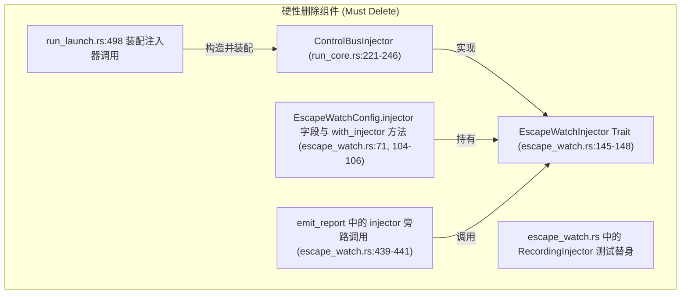
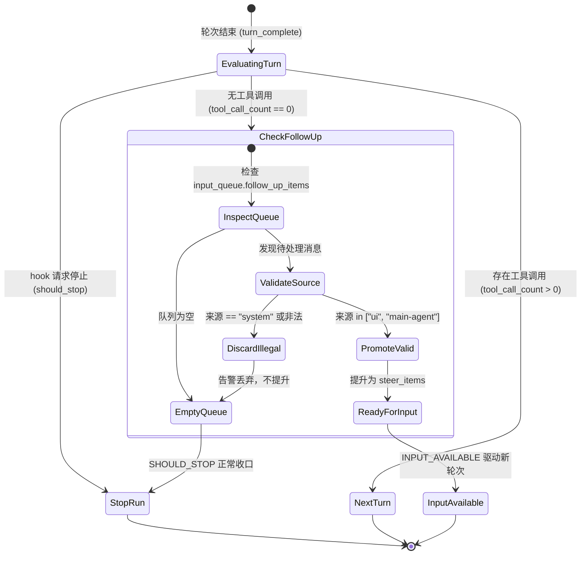

# ControlBus 队列治理与 Follow-Up 语义纯化方案

> **文档位置**：`docs/active-exploration-architecture/independent-plans/02-control-bus-followup-purification-plan.md`
> **所属战役**：主动探索架构（Active Exploration Architecture）独立方案
> **方案职责**：彻底移除 `ControlBusInjector` 与系统旁路注入通道，治理 `ControlBus` 队列与 `follow_up` 触发语义，建立严密的白名单契约，杜绝任何未经模型显式请求或用户显式输入的自发唤醒。

---

## 目录

- [一、背景与问题深度剖析](#一背景与问题深度剖析)
  - [1.1 ControlBus 与 Follow-Up 机制现状](#11-controlbus-与-follow-up-机制现状)
  - [1.2 逃逸监视旁路注入导致的伪自发唤醒根因](#12-逃逸监视旁路注入导致的伪自发唤醒根因)
  - [1.3 生产调用链路全景调查与定性](#13-生产调用链路全景调查与定性)
- [二、本方案要删掉什么 / 收敛什么](#二本方案要删掉什么--收敛什么)
  - [2.1 硬性删除清单](#21-硬性删除清单)
  - [2.2 收敛与加固清单](#22-收敛与加固清单)
- [三、纯化后的 Follow-Up 语义模型与契约](#三纯化后的-follow-up-语义模型与契约)
  - [3.1 白名单来源定义](#31-白名单来源定义)
  - [3.2 严禁来源与黑名单判定](#32-严禁来源与黑名单判定)
  - [3.3 强类型来源契约设计（FollowUpSource）](#33-强类型来源契约设计followupsource)
  - [3.4 状态机流转与时序图](#34-状态机流转与时序图)
- [四、各层级详细改造设计](#四各层级详细改造设计)
  - [4.1 引擎层改造（crates/session-loop/）](#41-引擎层改造createssession-loop)
  - [4.2 工具层改造（crates/agent-tools/）](#42-工具层改造cratesagent-tools)
  - [4.3 壳层与调度层改造（apps/agent-workbench/）](#43-壳层与调度层改造appsagent-workbench)
- [五、验证方案与反退避断言清单](#五验证方案与反退避断言清单)
  - [5.1 单元测试重构与覆盖](#51-单元测试重构与覆盖)
  - [5.2 端到端防自发唤醒断言](#52-端到端防自发唤醒断言)
  - [5.3 契约对齐与架构不变量验证](#53-契约对齐与架构不变量验证)
- [六、风险评估与平滑落地步骤](#六风险评估与平滑落地步骤)

---

## 一、背景与问题深度剖析

### 1.1 ControlBus 与 Follow-Up 机制现状

在 Conex 系统中，`ControlBus`（位于 [`crates/session-loop/src/control.rs`](file:///C:/Software/conex/crates/session-loop/src/control.rs)）是主会话循环的核心控制意图总线，承载了 L0 到 L3 的四级控制流：

- **L0 Continue**：流继续，不入队；
- **L1 SoftInject / Steer / FollowUp**：消息级软注入，不破坏当前流；
  - **Steer 环**：下一安全点（LLM 输出完毕或工具批次执行完毕后）立即消费注入；
  - **FollowUp 环**：仅在当前 run 即将 idle（无工具调用、无 steer 消息、模型已输出文本回复）的收口判定点提升消费；
- **L2 CooperativeStop**：协作停止，等待当前安全点收场；
- **L3 ForceCancel**：强停中断。

在设计预期中，`FollowUp` 环的语义是**仅在 AI 无事可做且主动/被动需要后续任务衔接时**消费。消费逻辑位于 [`crates/session-loop/src/loop/handlers/turn_complete.rs:189-196`](file:///C:/Software/conex/crates/session-loop/src/loop/handlers/turn_complete.rs#L189-L196)：

```rust
// turn_complete.rs:192-196
let promoted = state.input_queue.promote_follow_up();
if promoted > 0 || state.input_queue.has_runnable_pending() {
    dispatch(state, E::InputAvailable)?;
    return Ok(HandlerOutcome::continue_run());
}
// 默认：SHOULD_STOP（正常收口）
dispatch(state, E::ShouldStop)?;
Ok(HandlerOutcome::end(EndDecision::stop(state)))
```

### 1.2 逃逸监视旁路注入导致的伪自发唤醒根因

然而，历史实现中引入了一条**非法的系统旁路注入通道**：

1. **注入器实现**：在 [`apps/agent-workbench/src-tauri/src/run/run_core.rs:221-246`](file:///C:/Software/conex/apps/agent-workbench/src-tauri/src/run/run_core.rs#L221-L246) 中定义了 `ControlBusInjector`，实现了 `EscapeWatchInjector` trait：
   ```rust
   // run_core.rs:237-246 (旧路径)
   impl EscapeWatchInjector for ControlBusInjector {
       fn inject(&self, text: &str) {
           let mut bus = self.bus.lock().unwrap_or_else(|e| e.into_inner());
           bus.request_follow_up(
               crate::engine::user_message(text, None),
               Some("escape-watch".to_string()),
               Some("system".to_string()),
           );
       }
   }
   ```
2. **装配挂载**：在 [`apps/agent-workbench/src-tauri/src/run/run_launch.rs:488-504`](file:///C:/Software/conex/apps/agent-workbench/src-tauri/src/run/run_launch.rs#L488-L504) 中，文件监视配置通过 `.with_injector(Arc::new(ControlBusInjector::new(Arc::clone(&control_bus))))` 将该注入器挂载至文件逃逸监视器。
3. **被动唤醒触发链**：
   - 当工具或后台子进程触发未声明的文件修改时，[`crates/session-loop/src/escape_watch.rs:420-442`](file:///C:/Software/conex/crates/session-loop/src/escape_watch.rs#L420-L442) 的 `emit_report` 触发；
   - `emit_report` 除了向审计通道 `audit_sink` 广播安全事件外，通过 `injector.inject(...)` 构造了一条伪装成 `user` 角色的 `escape-watch` 文本，直接压入活跃 run 的 `ControlBus` 的 `FollowUp` 队列；
   - 当模型完成当前轮次回答本该进入 `ShouldStop` 收口时，`turn_complete.rs` 的 `promote_follow_up()` 发现了此消息，强制将其提升为可运行输入并派发 `E::InputAvailable`；
   - **后果**：AI 发生未经用户指令、未经模型自身逻辑规划的**静默自发续跑（Spurious Wakeup）**，不仅污染了会话历史，还可能引发无休止的模型自言自语或死循环。

### 1.3 生产调用链路全景调查与定性

对全仓所有 `request_follow_up` 生产调用点进行完整排查与定性分析：

| 调用方位置                                                                                                                                                                               | 触发主体与机制                                                       | 携带标记 (`source` / `reason`)                      | 业务性质定性                                         | 治理方案裁决                                                                            |
| :--------------------------------------------------------------------------------------------------------------------------------------------------------------------------------------- | :------------------------------------------------------------------- | :-------------------------------------------------- | :--------------------------------------------------- | :-------------------------------------------------------------------------------------- |
| [`run_core.rs:237-246`](file:///C:/Software/conex/apps/agent-workbench/src-tauri/src/run/run_core.rs#L237-L246)                                                                          | 文件监视后台任务 (`escape_watch`) 捕获写事件被动触发                 | `source="system"`, `reason="escape-watch"`          | **非法系统旁路注入**（静默自发唤醒源头）             | **彻底删除** `ControlBusInjector` 与 `EscapeWatchInjector` 接口，监视器仅输出审计事件。 |
| [`run_core.rs:1261-1298`](file:///C:/Software/conex/apps/agent-workbench/src-tauri/src/run/run_core.rs#L1261-L1298) (`deliver_main_agent_message`)                                       | 模型显式调用 `send_message` 工具 (`target="self", ring="follow_up"`) | `source="main-agent"`, `reason="send_message_tool"` | **合法 Agent 自主驱动**（主 Agent 主动规划后续任务） | **保留并严格规范**：作为合法的 Agent 端排队通道，强校验调用上下文与权限。               |
| [`run_launch.rs:920-943`](file:///C:/Software/conex/apps/agent-workbench/src-tauri/src/run/run_launch.rs#L920-L943) (`core_run_control`)                                                 | 用户在桌面 UI 交互中显式触发追问或软注入                             | `source="ui"`, `reason=reason`                      | **合法用户交互驱动**（用户主权显式操作）             | **保留并严格规范**：强制设置 `user_touched = true`，标记用户交互边界。                  |
| [`control.rs:571, 593`](file:///C:/Software/conex/crates/session-loop/src/control.rs#L571) / [`safe_point.rs:352`](file:///C:/Software/conex/crates/session-loop/src/safe_point.rs#L352) | 单元测试构造总线意图                                                 | 测试专用                                            | **测试桩**                                           | 更新测试用例，断言白名单契约。                                                          |

---

## 二、本方案要删掉什么 / 收敛什么

### 2.1 硬性删除清单

为彻底根除静默唤醒与系统旁路注入，本方案硬性删除以下组件与接口：



#### 详细删除清单列表：

1. **删除 `apps/agent-workbench/src-tauri/src/run/run_core.rs:221-246`**：
   - 移除 `pub(crate) struct ControlBusInjector`；
   - 移除 `impl ControlBusInjector`；
   - 移除 `impl EscapeWatchInjector for ControlBusInjector`。
2. **删除 `crates/session-loop/src/escape_watch.rs:145-148`**：
   - 移除 `pub trait EscapeWatchInjector: Send + Sync`。
3. **删除 `crates/session-loop/src/escape_watch.rs:71, 104-106`**：
   - 移除 `EscapeWatchConfig` 结构体中的 `pub injector: Option<Arc<dyn EscapeWatchInjector>>` 字段；
   - 移除 `EscapeWatchConfig::with_injector` 构造链方法；
   - 移除 `EscapeWatchConfig::fmt` 中对 `injector` 字段的 Debug 格式化。
4. **删除 `crates/session-loop/src/escape_watch.rs:438-442` 中的注入逻辑**：
   - 彻底删除 `if let Some(injector) = &config.injector { injector.inject(...); }`，保证 `emit_report` 纯粹只向 `config.audit_sink` 发送安全审计事件。
5. **删除 `apps/agent-workbench/src-tauri/src/run/run_launch.rs:498`**：
   - 移除 `.with_injector(Arc::new(ControlBusInjector::new(Arc::clone(&control_bus))))` 装配接线。
6. **删除相关导出与声明**：
   - 从 [`crates/session-loop/src/lib.rs`](file:///C:/Software/conex/crates/session-loop/src/lib.rs) 移除 `EscapeWatchInjector` 导出；
   - 从 [`apps/agent-workbench/src-tauri/src/run/mod.rs`](file:///C:/Software/conex/apps/agent-workbench/src-tauri/src/run/mod.rs) 移除 `EscapeWatchInjector` 导入与再导出。
7. **删除/更新测试代码**：
   - 移除 `escape_watch.rs` 内部的 `RecordingInjector` 及依赖注入器的测试断言。

### 2.2 收敛与加固清单

1. **收敛 `ControlBus::request_follow_up` 接口**：
   - 禁止传入 `source: None` 或任意字符串；
   - 引入强类型 `FollowUpSource` 枚举或严格的白名单常量校验，拒绝 `system`、`watcher`、`daemon` 等来源。
2. **收敛 `SessionLoop` 的 `turn_complete` 提升逻辑**：
   - `promote_follow_up()` 在将消息从 `follow_up_items` 提升为 `steer_items` 前，必须检查消息的元数据来源标识；
   - 非白名单来源的消息直接丢弃并记录安全告警，绝不触发 `E::InputAvailable`。
3. **收敛逃逸监视器的职责边界**：
   - `escape_watch` 严格定位于**只读安全审计与遥测输出**（通过 `SecurityAuditOperation::UndeclaredWrite`），严禁侵入会话控制面。
4. **收敛 Agent 自发消息通道（`send_message`）**：
   - `MainAgentMessageChannel` 保持作为模型显式自我规划的唯一合法入口，严格标注 `metadata: { source: "main-agent" }`，严禁伪造 `source: "ui"` 或空元数据。

---

## 三、纯化后的 Follow-Up 语义模型与契约

### 3.1 白名单来源定义

经过纯化后，系统内仅允许以下两类主体通过白名单契约触发 `follow_up`：

| 白名单来源 (`FollowUpSource`) | 来源标识 (`source`) | 触发前置条件                                                                                             | 用户主权标记 (`user_touched`)                          | 语义描述                             |
| :---------------------------- | :------------------ | :------------------------------------------------------------------------------------------------------- | :----------------------------------------------------- | :----------------------------------- |
| **UserInteraction**           | `"ui"`              | 用户在 UI 界面显式输入追问，或通过外部权威客户端 RPC 发起 `level: "follow_up"`。                         | **强制设为 `true`**（确保用户显式参与并可控中断/收口） | 用户主权驱动的会话延伸。             |
| **AgentSelfPlanning**         | `"main-agent"`      | 模型在当前轮次中通过工具调用显式执行 `send_message(target: "self", ring: "follow_up", message: "...")`。 | **保持 `false`**（模型自主规划不覆盖用户交互标记）     | 模型自主驱动的子任务排队或多步收口。 |

### 3.2 严禁来源与黑名单判定

以下任何来源均属于非法唤醒，在 `ControlBus` 入队与 `SessionLoop` 消费两个关卡均被判定为非法并硬性阻断：

```
[非法来源黑名单]
❌ source == "system"          (系统后台自动合成消息)
❌ source == "escape-watch"    (文件监视器被动推送)
❌ source == "timer-tick"      (未经用户/模型声明的无脑定时滴答)
❌ source == "daemon"          (后台常驻进程自发唤醒)
❌ source == None              (未声明来源的隐匿注入)
❌ 任何非 "ui" 且非 "main-agent" 的字符串
```

### 3.3 强类型来源契约设计（FollowUpSource）

在 `crates/session-loop/src/control.rs` 中引入强类型来源枚举与严格契约：

```rust
/// Follow-Up 意图的合法来源白名单契约
#[derive(Debug, Clone, Copy, PartialEq, Eq, Serialize, Deserialize)]
#[serde(rename_all = "snake_case")]
pub enum FollowUpSource {
    /// 来自桌面 UI 或用户显式 RPC 追问
    #[serde(rename = "ui")]
    Ui,
    /// 来自主 Agent 通过 send_message 工具显式发起的自我规划
    #[serde(rename = "main-agent")]
    MainAgent,
}

impl FollowUpSource {
    pub fn as_str(&self) -> &'static str {
        match self {
            Self::Ui => "ui",
            Self::MainAgent => "main-agent",
        }
    }

    /// 从字符串解析并严格校验白名单
    pub fn parse_whitelist(raw: Option<&str>) -> Result<Self, String> {
        match raw {
            Some("ui") => Ok(Self::Ui),
            Some("main-agent") => Ok(Self::MainAgent),
            Some(other) => Err(format!(
                "非法 FollowUp 来源 '{}'：拒绝入队，仅允许 'ui' 或 'main-agent'",
                other
            )),
            None => Err("缺少 FollowUp 来源标识：拒绝未声明来源的隐匿入队".to_string()),
        }
    }
}
```

在 `ControlBus` 层面提供经过来源白名单约束的注入方法：

```rust
impl ControlBus {
    /// 纯化后的 FollowUp 入队方法：强制校验白名单来源
    pub fn request_follow_up_guarded(
        &mut self,
        message: AgentMessage,
        reason: Option<String>,
        source: FollowUpSource,
    ) -> ControlIntent {
        self.request(ControlIntentInput {
            kind: ControlKind::FollowUp,
            message: Some(message),
            reason,
            source: Some(source.as_str().to_string()),
            ..ControlIntentInput::new(ControlKind::FollowUp)
        })
    }
}
```

### 3.4 状态机流转与时序图

#### 3.4.1 纯化后的控制总线与会话收口时序

```mermaid
sequenceDiagram
    autonumber
    actor User as 用户 / UI
    participant Agent as 主 Agent (LLM)
    participant Tools as 工具执行引擎 (AgentTools)
    participant Watcher as 文件逃逸监视器 (EscapeWatch)
    participant Audit as 审计通道 (BridgeAuditSink)
    participant Bus as 控制总线 (ControlBus)
    participant Loop as 会话循环 (SessionLoop)

    Note over User,Loop: 场景 1：工具写文件触发逃逸监视（纯审计，不唤醒总线）
    Agent->>Tools: 调用 bash/write_file 执行写操作
    Tools-->>Watcher: 产生文件系统变更事件
    Watcher->>Watcher: 判定存在未声明写入 (UndeclaredWrite)
    Watcher->>Audit: 发送 SecurityAuditOperation::UndeclaredWrite
    Note right of Watcher: 彻底切断 ControlBusInjector，绝不调用 bus.request_follow_up
    Tools-->>Agent: 工具执行完成返回结果

    Note over User,Loop: 场景 2：Agent 显式自我规划 FollowUp（合法白名单）
    Agent->>Tools: 调用 send_message(target="self", ring="follow_up")
    Tools->>Bus: deliver_main_agent_message -> request_follow_up(source="main-agent")
    Bus->>Bus: 校验 source 属于白名单 -> 入队 FollowUp
    Agent-->>Loop: 本轮输出结束 (turn_complete)
    Loop->>Loop: promote_follow_up 消费合法 "main-agent" 消息
    Loop->>Agent: 驱动下一轮继续执行自我规划

    Note over User,Loop: 场景 3：用户 UI 显式发起 FollowUp（合法白名单）
    User->>Bus: core_run_control(level="follow_up", source="ui")
    Bus->>Bus: 校验 source 属于白名单 -> 入队 FollowUp
    Note over Bus: active.user_touched 标记置为 true
    Loop->>Loop: 轮次收口 promote_follow_up 消费 "ui" 消息 -> 驱动执行
```

#### 3.4.2 TurnComplete 阶段的防御性判定状态机



---

## 四、各层级详细改造设计

### 4.1 引擎层改造（crates/session-loop/）

#### 1. `crates/session-loop/src/escape_watch.rs` 纯化

- **删除 Trait 与字段**：
  - 彻底删除 `EscapeWatchInjector` trait；
  - 在 `EscapeWatchConfig` 中删除 `injector: Option<Arc<dyn EscapeWatchInjector>>`；
  - 删除 `with_injector` 方法。
- **重构 `emit_report`**：
  ```rust
  // escape_watch.rs:421-437
  fn emit_report(config: &EscapeWatchConfig, report: &UndeclaredWrite) {
      let targets: Vec<String> = report
          .changes
          .iter()
          .map(|c| c.path.display().to_string())
          .collect();
      config.audit_sink.emit(&security_audit_event(
          &report.session_id,
          SecurityAuditOperation::UndeclaredWrite,
          targets,
          impact_for(report),
          SecurityAuditDecision::Denied,
          None,
      ));
      // 彻底消除对 injector 的任何调用与引用
  }
  ```

#### 2. `crates/session-loop/src/control.rs` 契约强化

- **增加白名单类型与拦截**：
  - 增加 `FollowUpSource` 类型；
  - 在 `ControlBus::request` 中对 `ControlKind::FollowUp` 强制实施来源白名单拦截：
    ```rust
    if kind == ControlKind::FollowUp {
        if let Err(err) = FollowUpSource::parse_whitelist(input.source.as_deref()) {
            tracing::error!(
                target: "session_loop::control",
                error = %err,
                "拒绝非白名单 FollowUp 意图入队"
            );
            // 拒绝入队，直接返回丢弃态 intent 或空标记
            return ControlIntent {
                id: "rejected-followup".to_string(),
                kind: ControlKind::Continue,
                level: ControlLevel::L0,
                created_at: now_millis(),
                message: None,
                reason: Some(err),
                source: input.source,
            };
        }
    }
    ```

#### 3. `crates/session-loop/src/loop/handlers/turn_complete.rs` 防御加固

- 在 `promote_follow_up()` 执行前后，确保输入队列仅承载经白名单校验的消息；
- 增加日志与度量追踪，记录每次合法的 promote 操作。

### 4.2 工具层改造（crates/agent-tools/）

在 [`crates/agent-tools/src/tools/send_message.rs`](file:///C:/Software/conex/crates/agent-tools/src/tools/send_message.rs) 中：

- 确认 `SendMessageTool` 在 `target == "self"` 且 `ring == MainMessageRing::FollowUp` 时，传递严格的 `source = "main-agent"`；
- 保持 `MainAgentMessageChannel` 接口的清晰定义，确保其行为满足：
  1. 写入会话消息记录（metadata: `{ source: "main-agent" }`）；
  2. 经由 `ControlBus` 投递合法白名单 `follow_up`；
  3. 绝对不篡改或模拟 `source = "ui"`。

### 4.3 壳层与调度层改造（apps/agent-workbench/）

#### 1. `apps/agent-workbench/src-tauri/src/run/run_core.rs` 清理

- **彻底删除 `ControlBusInjector`**：
  - 移除 221-246 行的所有代码；
- **保留并校验 `deliver_main_agent_message`**：
  - 位于 [`run_core.rs:1261-1298`](file:///C:/Software/conex/apps/agent-workbench/src-tauri/src/run/run_core.rs#L1261-L1298)，确认其调用 `bus.request_follow_up(injected, Some("send_message_tool".to_string()), Some("main-agent".to_string()))`；
  - 确认其 `source` 参数严格匹配 `"main-agent"` 白名单。

#### 2. `apps/agent-workbench/src-tauri/src/run/run_launch.rs` 装配收敛

- 在 [`run_launch.rs:488-505`](file:///C:/Software/conex/apps/agent-workbench/src-tauri/src/run/run_launch.rs#L488-L505) 中，装配 `EscapeWatchConfig` 时移除 `.with_injector(...)`：
  ```rust
  let (escape_watch, escape_config) = if let Some(dir) = cwd.clone() {
      let root = PathBuf::from(dir);
      let config = EscapeWatchConfig::new(
          root.clone(),
          session_id.clone(),
          run_id.clone(),
          Arc::clone(&bridge_audit_sink) as AuditSink,
      )
      .with_detector(Arc::new(RegistryBackedDetector::new(Arc::clone(
          &shared_registry,
      ))));
      // 移除 .with_injector(...)
      match spawn_escape_watch(root, config.clone()) { ... }
  };
  ```
- 在 [`run_launch.rs:920-943`](file:///C:/Software/conex/apps/agent-workbench/src-tauri/src/run/run_launch.rs#L920-L943) (`core_run_control`) 中：
  - 确认 UI 发起的 follow_up 消息严格注入 `Some("ui".to_string())` 且 `active.user_touched` 设为 `true`。

---

## 五、验证方案与反退避断言清单

### 5.1 单元测试重构与覆盖

| 测试套件                                       | 验证目标               | 关键断言内容                                                                                                                          |
| :--------------------------------------------- | :--------------------- | :------------------------------------------------------------------------------------------------------------------------------------ |
| `crates/session-loop/src/control.rs`           | 白名单注入合法性       | `request_follow_up_guarded(..., FollowUpSource::Ui)` 成功入队；`request_follow_up_guarded(..., FollowUpSource::MainAgent)` 成功入队。 |
| `crates/session-loop/src/control.rs`           | 非法注入拦截           | 尝试通过底层接口以 `source: "system"` 或 `source: "escape-watch"` 入队时，必须被拦截并拒绝入队，队列长度保持为 0。                    |
| `crates/session-loop/src/escape_watch.rs`      | 逃逸监视纯审计行为     | 发生未声明写入时，断言 `audit_sink` 收到 `SecurityAuditOperation::UndeclaredWrite` 事件；断言无任何对总线或消息队列的副作用。         |
| `crates/agent-tools/src/tools/send_message.rs` | 模型自发 FollowUp 语义 | `send_message(target: "self", ring: "follow_up")` 成功产生带 `{source: "main-agent"}` 的消息与对应的 FollowUp 意图。                  |

### 5.2 端到端防自发唤醒断言

编写端到端集成测试用例，确立以下不可退避的架构断言：

1. **断言 1（文件变更零自发唤醒）**：
   - 启动包含 `escape_watch` 的活跃 run；
   - 工具执行期间在工作区内写入未声明文件；
   - 模型给出最终文本回复；
   - **验收标准**：Run 必须在第 1 轮结束时以 `AgentEndReason::Stop` 正常收口；**绝不能**自发产生第 2 轮或被 `escape-watch` 唤醒。
2. **断言 2（审计流完整性）**：
   - 上述未声明写入发生后，`BridgeAuditSink` 必须准确接收到决策为 `Denied` 的安全审计事件；
   - 前端审计面板可见，但模型对话历史与输入队列无任何脏数据注入。
3. **断言 3（Agent 显式自我排队工作流）**：
   - 模型在 Turn 1 调用 `send_message(target: "self", ring: "follow_up", message: "续跑任务")`；
   - **验收标准**：Turn 1 收口时 `promote_follow_up()` 返回 1，正常触发 Turn 2，Turn 2 接收到该消息，且元数据清晰标注 `source: "main-agent"`。
4. **断言 4（用户 UI 追问排队工作流）**：
   - 运行中用户通过 UI 发送 `level: "follow_up"` 追问；
   - **验收标准**：当前 Run 执行完毕后立即消费该用户追问，`user_touched` 状态为 `true`。

### 5.3 契约对齐与架构不变量验证

- **编译期不变量**：全仓搜索 `ControlBusInjector` 与 `EscapeWatchInjector`，出现次数必须为 **0**。
- **运行期不变量**：在任何会话生命周期中，`ControlKind::FollowUp` 的意图 `source` 字段集合必须为 `{"ui", "main-agent"}` 的子集，严禁出现任何其它字符串。

---

## 六、风险评估与平滑落地步骤

### 6.1 影响面与风险评估

| 模块                                      | 影响范围                 | 风险级别 | 应对与防护措施                                                                                     |
| :---------------------------------------- | :----------------------- | :------- | :------------------------------------------------------------------------------------------------- |
| `crates/session-loop/src/escape_watch.rs` | 逃逸监视器配置与消费循环 | 低       | 监视器审计功能完全保持，仅删除冗余的 `injector` 回调通道，单元测试全量回归。                       |
| `apps/agent-workbench/src-tauri/src/run/` | 壳层运行状态与装配       | 低       | 删除无用结构体 `ControlBusInjector`，清理 `run_launch.rs` 装配调用，保证编译与类型检查一次性通过。 |
| `crates/session-loop/src/control.rs`      | 控制总线入队规则         | 低-中    | 增加严格白名单校验，现有合法 UI / MainAgent 调用均已带正确 source，不会产生破坏。                  |

### 6.2 实施步骤规划（纯逻辑执行步骤）

1. **第一步（内核纯化）**：
   - 修改 `crates/session-loop/src/escape_watch.rs`，移除 `EscapeWatchInjector` trait 及 `EscapeWatchConfig.injector` 字段；
   - 修改 `crates/session-loop/src/control.rs`，引入 `FollowUpSource` 严格校验白名单；
   - 更新 `session-loop` 内部单元测试。
2. **第二步（工具层契约对齐）**：
   - 核对 `crates/agent-tools/src/tools/send_message.rs`，确保白名单源标识 `main-agent` 严格传递。
3. **第三步（壳层解耦与清理）**：
   - 修改 `apps/agent-workbench/src-tauri/src/run/run_core.rs`，删除 `ControlBusInjector`；
   - 修改 `apps/agent-workbench/src-tauri/src/run/run_launch.rs`，移除监视器装配时的 `with_injector`；
   - 修复桌面壳层测试中依赖旧 injector 的测试用例。
4. **第四步（端到端验证）**：
   - 运行 `cargo test --workspace` 确保 Rust 全套件绿灯；
   - 运行 `npm run typecheck` 确保前端与共享包契约无漂移；
   - 补充防伪自发唤醒端到端测试用例。

---

_方案编制完成，待评审通过后实施。_
