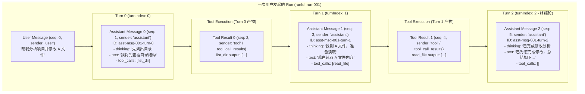
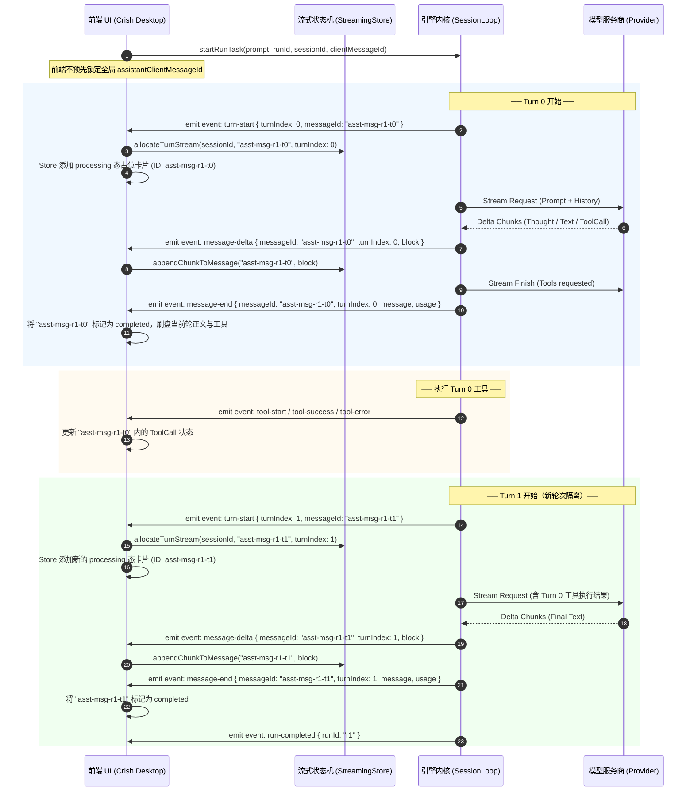

# 会话消息存储与事件分轮次隔离治理方案

> **文件路径**：`docs/active-exploration-architecture/independent-plans/04-session-messages-turn-isolation-plan.md`  
> **责任领域**：会话消息存储治理 / 事件分轮次隔离 / 系统诊断与正文解耦 / 流式契约对齐  
> **文档属性**：独立设计详案（纯逻辑规划，无降级退避，无源码修改）

---

## 目录

- [一、背景与问题全景](#一背景与问题全景)
  - [1.1 案例复盘：`sess-1786855835905` 消息聚合粘连灾难（Message Smashing）](#11-案例复盘sess-1786855835905-消息聚合粘连灾难message-smashing)
  - [1.2 端到端故障数据流还原（The Broken End-to-End Pipeline）](#12-端到端故障数据流还原the-broken-end-to-end-pipeline)
  - [1.3 系统诊断与状态通知污染根因](#13-系统诊断与状态通知污染根因)
- [二、设计原则与非目标](#二设计原则与非目标)
  - [2.1 核心原则（铁律）](#21-核心原则铁律)
  - [2.2 严格非目标（Boundaries）](#22-严格非目标boundaries)
- [三、架构设计与 Turn 隔离模型](#三架构设计与-turn-隔离模型)
  - [3.1 领域模型：Run、Turn 与 Message 的映射关系](#31-领域模型runturn-与-message-的映射关系)
  - [3.2 前后端消息分块与事件流契约（Streaming & Chunking Contract）](#32-前后端消息分块与事件流契约streaming--chunking-contract)
  - [3.3 数据库存储与持久化隔离治理（`conex-db` & `session_commands.rs`）](#33-数据库存储与持久化隔离治理conex-db--session_commandsrs)
  - [3.4 系统诊断、通知与助理正文的严格物理隔离](#34-系统诊断通知与助理正文的严格物理隔离)
- [四、本方案要删掉什么 / 收敛什么](#四本方案要删掉什么--收敛什么)
  - [4.1 必须彻底删除的代码与旧假设](#41-必须彻底删除的代码与旧假设)
  - [4.2 统一收敛的架构边界](#42-统一收敛的架构边界)
- [五、前后端接口与类型契约定义](#五前后端接口与类型契约定义)
  - [5.1 引擎事件载荷定义（Rust / JSON Schema）](#51-引擎事件载荷定义rust--json-schema)
  - [5.2 前端流式与 Store 契约定义（TypeScript）](#52-前端流式与-store-契约定义typescript)
  - [5.3 数据库模型与迁移兼容性（SQLite DDL）](#53-数据库模型与迁移兼容性sqlite-ddl)
- [六、实施阶段与回归验证方案](#六实施阶段与回归验证方案)
  - [6.1 阶段实施规划（Milestones）](#61-阶段实施规划milestones)
  - [6.2 确定性测试矩阵与反退避断言（Verification Matrix）](#62-确定性测试矩阵与反退避断言verification-matrix)

---

## 一、背景与问题全景

### 1.1 案例复盘：`sess-1786855835905` 消息聚合粘连灾难（Message Smashing）

在真实会话 `sess-1786855835905` 中，用户发起了一次包含多步工具调用（例如文件检索、内容读取、多步骤分析）的复合任务，整个任务在底层引擎中跨越了 10 轮 LLM 迭代（10 个 Turn）。

然而，用户界面和数据库最终呈现的结果却是一场严重的数据结构灾难：

1. **单消息聚合（Message Smashing）**：整整 10 轮交互的所有思考过程（Thinking）、中间过渡说明文本、最终回复文本以及数十个工具调用记录，被全部生硬地拼接、压制在同一条消息 ID（`assistant-msg-msvbuecp-39c93daf-0003`）中。
2. **时间线紊乱（Timeline Distortion）**：UI 上的消息卡片呈现出混乱的图文交织状态，早期 Turn 的文本与后期 Turn 的文本通过 `\n\n` 强行连接，工具卡片的位置与产生该工具调用的具体上下文完全脱节。
3. **上下文回灌污染（History Poisoning）**：当用户在该会话中继续发起下一轮提问时，前端从 SQLite 读出这条巨型消息，并将其打包成单一的 `HistoryMessage` 回传给引擎。LLM 接收到的历史记录丢失了「思考 $\to$ 调工具 $\to$ 获得工具输出 $\to$ 进一步思考」的轮次轮廓，严重破坏了模型的指令遵循能力与上下文缓存命中率（KV Cache Hit Rate）。

---

### 1.2 端到端故障数据流还原（The Broken End-to-End Pipeline）

经过对 `apps/crish-desktop/`、`apps/agent-workbench/src-tauri/`、`crates/session-loop/` 和 `crates/conex-db/` 的全链路深度代码审查，定位到造成 Message Smashing 的五级链式根因：

```
[前端发起 Run]
  └─ useRunStreamingAssistant.ts 预生成单个静态 assistantMsgId ('assistant-msg-msvbuecp-39c93daf-0003')
       │ (下发 assistantClientMessageId)
       ▼
[引擎多轮循环 SessionLoop (Turn 1 .. 10)]
  └─ streaming.rs 每轮生成引擎局部 id (msg-1..10)，但把静态 assistantClientMessageId 原样回填给所有 10 个 message-end
       │ (发射 10 轮 message-delta / message-end)
       ▼
[前端事件接收器 Chat Bridge]
  ├─ messageHandlers.ts (onMessageDelta): 盲目累加 state.assistantText += delta
  └─ messageHandlers.ts (onMessageEnd): segs[turnIndex] = piece; segs.filter(Boolean).join('\n\n') 强制字符拼接！
       │ (触发 onChunk)
       ▼
[前端流式控制器]
  └─ useRunStreamingAssistant.ts: streamedFullText += chunk 贯穿整个 Run，最后一次性 commitStreamToSession
       │ (单个巨型 SessionMessage)
       ▼
[数据库持久化与水合]
  ├─ conex-db: save_session_body 在 session_messages 表中只存入 1 条包含全部 10 轮文本与工具的怪物行
  └─ sessionEventHydrate.ts: 再次利用 turnTextByMessage 进行 \n\n 粘连，固化单消息畸变
```

#### 详细节点代码剖析：

1. **前端错误假设：1 Run = 1 Assistant Message**
   - 位置：[`apps/crish-desktop/src/hooks/chat-stream/useRunStreamingAssistant.ts:89-120`](file:///C:/Software/conex/apps/crish-desktop/src/hooks/chat-stream/useRunStreamingAssistant.ts#L89-L120)
   - 根因：前端在 Run 启动时调用 `const assistantMsgId = generateMessageId('assistant');`，直接向 Store 中插入了一条占位消息，并将此 ID 作为 `assistantClientMessageId` 透传给引擎。系统默认一个 Run 只能产出一条 Assistant 消息。

2. **引擎透传盲区：跨 Turn 共享同一个静态 ClientMessageId**
   - 位置：[`crates/session-loop/src/loop/handlers/streaming.rs:196-202`](file:///C:/Software/conex/crates/session-loop/src/loop/handlers/streaming.rs#L196-L202)
   - 根因：在多轮执行中，`streaming.rs` 虽然在局部生成了新的 `assistant_message_id = new_message_id("assistant")`，但在调用 `build_assistant_message` 时，直接绑定了 `state.options.assistant_client_message_id.as_deref()`。导致全部 10 个 Turn 的 `message-end` 事件携带完全相同的 `clientMessageId`。

3. **前端消息处理器的「暴力缝合」逻辑**
   - 位置：[`apps/crish-desktop/src/api/chat-bridge/handlers/messageHandlers.ts:121-137`](file:///C:/Software/conex/apps/crish-desktop/src/api/chat-bridge/handlers/messageHandlers.ts#L121-L137)
   - 根因：
     ```typescript
     // 历史旧代码：强行用 \n\n 把不同 turnIndex 的正文粘连为单串
     const segs = state.messageEndTurnSegments;
     while (segs.length <= turnIndex) segs.push('');
     segs[turnIndex] = mergeAssistantTextPiece(segs[turnIndex] ?? '', piece);
     const joined = segs.filter(Boolean).join('\n\n');
     state.assistantText = joined;
     ```

4. **水合投影层的重复粘连**
   - 位置：[`apps/crish-desktop/src/api/sessionEventHydrate.ts:280-291`](file:///C:/Software/conex/apps/crish-desktop/src/api/sessionEventHydrate.ts#L280-L291)
   - 根因：在从事件重放（Hydrate）时，`projectEventsToMessages` 再次通过 `turnTextByMessage` 维护 `st.text ? `${st.text}\n\n${text}` : text`，使粘连逻辑在两套路径上互相印证、错上加错。

---

### 1.3 系统诊断与状态通知污染根因

在会话执行期间，系统常伴随有系统诊断、纠偏（Steering）、排队等待、重试提醒等非模型生成的信息：

1. **SQLite 表约束限制**：
   - 位置：[`crates/conex-db/src/schema.rs:35`](file:///C:/Software/conex/crates/conex-db/src/schema.rs#L35)
   - 约束：`sender TEXT NOT NULL CHECK (sender IN ('user','assistant'))`。
   - 后果：数据库中不存在 `system` 或 `diagnostic` 角色。历史实现为了将信息展示给用户，被迫将系统诊断伪装成 Assistant 消息，或者直接强塞入 Assistant 的 `thinking` / `text` 字段中（例如注入 `"当前会话上一轮任务仍在收尾中，已自动为您排队…"` 或 `"这一轮没有顺利完成，请查看诊断信息后重试。"`）。
2. **Steering 注入消息进入历史上下文**：
   - 位置：[`crates/session-loop/src/steering/mod.rs:352-360`](file:///C:/Software/conex/crates/session-loop/src/steering/mod.rs#L352-L360)
   - 根因：`SteeringAction::InjectMessage` 直接向 `conversation` 中追加 `AgentMessage`。若未做角色隔离与清洗，这些纠偏指令在持久化后容易反向渗透进后续请求的 Prompt 中，造成模型产生幻觉。

---

## 二、设计原则与非目标

### 2.1 核心原则（铁律）

1. **Turn 是一等公民（Turn-Centric Atomicity）**：
   - 一个用户请求（Run）可以触发 $1..N$ 个交互轮次（Turn）。
   - **1 个 Turn = 1 条独立的 Assistant 消息实体**（拥有独立的 `id`、独立的 `thinking`、独立的 `text`、独立的 `toolCalls` 和独立的 `usage`）。
   - 严禁任何跨 Turn 的字符串累加（String Concatenation / Smashing）。
2. **单源权威与确定性生命周期（Deterministic Lifecycle）**：
   - 消息状态流转遵循确定的状态机：`queued` $\to$ `processing` $\to$ `completed` / `error`。
   - 当 Turn $k$ 结束并产生 Tool Calls 时，Turn $k$ 的 Assistant 消息即刻进入 `completed` 终态；当模型根据工具返回结果开始 Turn $k+1$ 时，系统自动创建 Turn $k+1$ 的 Assistant 消息。
3. **正文与诊断零污染隔离（Zero-Contamination Boundary）**：
   - Assistant 消息的 `text` 字段**绝对只包含**大语言模型针对该轮次生成的真实 Markdown 字符。
   - 系统级诊断、排队提醒、网络瞬态提示、Steering 状态一律走瞬态 UI 横幅（`RunNotice`）或事件级元数据（`metadata`），严禁写入消息正文字段。

### 2.2 严格非目标（Boundaries）

- ❌ **禁止引入多套并行的 Message 数据结构**：严格收敛于既有的 `SessionMessage` 与 `AgentMessage`，不创建任何过渡性、并行的 DTO。
- ❌ **禁止使用波次/批次编号命名**：全系统命名统一收敛至标准领域术语：`Turn`、`TurnIndex`、`MessageId`、`Sequence`、`RunId`。
- ❌ **不降级功能**：不为了简化实现而削减多轮工具调用、流式思考（Thinking）、工具批准卡片（Approval）或 Token 统计。

---

## 三、架构设计与 Turn 隔离模型

### 3.1 领域模型：Run、Turn 与 Message 的映射关系

下图清晰展示了用户发起一次任务后，Run、Turn、Tool 结果与 `session_messages` 物理存储记录的标准映射关系：



#### 领域不变量（Domain Invariants）：

1. **单调自增序号（Monotonic Sequence）**：在 `session_messages` 表中，每个 Turn 的 Assistant 消息占用独立递增的 `seq` 槽位。
2. **唯一可预测 ID（Deterministic Turn ID）**：
   - 初始用户消息 ID：`user-msg-{timestamp}-{rand}`
   - Turn $k$ 助理消息 ID：`assistant-msg-{runIdPrefix}-turn-{k}`（或由引擎确定的稳定 `messageId`）。
3. **轮次自包含（Self-Contained Turn）**：每个 Assistant 消息节点仅包含**当前轮次**生成的 `text`、`thinking`、`toolCalls` 和 `usage`，绝不引用或拼接其他轮次的内容。

---

### 3.2 前后端消息分块与事件流契约（Streaming & Chunking Contract）

为了实现无缝且精准的流式体验，重构后的前后端事件流协议如下：



#### 分块流式核心机制：

1. **动态分派路由（Per-Message Stream Routing）**：
   - 流式渲染缓冲区（`StreamRenderBuffer` / `StreamingStore`）的主键必须是 `(sessionId, messageId)`。
   - `onChunk` / `onThought` 回调必须明确携带目标 `messageId`。流式累加仅作用于对应 `messageId` 的独立缓冲区，从根源上杜绝不同轮次文本交叉混合。
2. **轮次生命周期交接（Turn Transition）**：
   - 收到新的 `turn-start` 或首个带新 `messageId` 的 `message-start` 时，前端自动封存上一轮次的 Buffer，触发上一轮次的 `commitStreamToSession`，并为当前轮次开辟全新的流式上下文。

---

### 3.3 数据库存储与持久化隔离治理（`conex-db` & `session_commands.rs`）

#### 1. `session_messages` 物理存储模型

在 `crates/conex-db/src/schema.rs` 中，`session_messages` 保持原生的扁平原子设计，每个 Turn 独立成行：

| 列名 (`column`)          | 类型 (`type`) | 语义与约束                             | 示例值                                                |
| :----------------------- | :------------ | :------------------------------------- | :---------------------------------------------------- |
| `session_id`             | `TEXT`        | 会话外键引用                           | `"sess-1786855835905"`                                |
| `seq`                    | `INTEGER`     | 会话内单调递增序列号 (0, 1, 2, ...)    | `1`                                                   |
| `id`                     | `TEXT`        | 消息唯一业务 ID (Turn 级独立)          | `"assistant-msg-msvb-t0"`                             |
| `sender`                 | `TEXT`        | 发送方角色 (`'user'` 或 `'assistant'`) | `"assistant"`                                         |
| `text`                   | `TEXT`        | **本轮**纯净 Markdown 正文             | `"我将先查看目录结构"`                                |
| `thinking`               | `TEXT`        | **本轮**纯净思考过程                   | `"用户需要分析项目..."`                               |
| `timestamp`              | `INTEGER`     | 毫秒级时间戳                           | `1786855836000`                                       |
| `status`                 | `TEXT`        | 状态 (`'completed'` / `'error'`)       | `"completed"`                                         |
| `stream_text_offset`     | `INTEGER`     | 流式偏移（用于块交织）                 | `null`                                                |
| `thinking_time`          | `INTEGER`     | 思考耗时（秒）                         | `3`                                                   |
| `tool_calls_json`        | `TEXT`        | **本轮**发起的工具调用 JSON 数组       | `"[{\"id\":\"call_1\",\"name\":\"list_dir\"}]"`       |
| `blocks_json`            | `TEXT`        | **本轮**时间线块结构                   | `"[{\"type\":\"thought\"},{\"type\":\"tool_call\"}]"` |
| `tool_call_results_json` | `TEXT`        | **本轮**工具调用结果 JSON 数组         | `null`                                                |
| `usage_json`             | `TEXT`        | **本轮**实际消耗的 Token 与 Cache 指标 | `{\"promptTokens\":1200,\"cacheReadTokens\":800}`     |

#### 2. 持久化写入方式治理：全面启用 `append_session_messages`

- **现状问题**：前端当前主要通过 `save_session_body`（全量 `DELETE FROM session_messages WHERE session_id = ?` 然后全部重新 `INSERT`）保存会话。不仅写放大极高（$O(N)$），而且在多轮交互进行中极易产生写覆盖竞态。
- **治理方案**：
  1. 在 `apps/agent-workbench/src-tauri/src/session_commands.rs` 中正式接线并注册 `append_session_messages` 命令；
  2. 每当一个 Turn 完成（`message-end`），前端通过 `append_session_messages` 进行原子增量落盘（$O(1)$），只写入当前 Turn 对应的单条记录；
  3. `save_session_body` 仅保留在整体清理、手动编辑历史或从外部全量导入时使用。

---

### 3.4 系统诊断、通知与助理正文的严格物理隔离

为了杜绝系统诊断与状态信息污染 Assistant 消息正文，系统制定三层隔离机制：

```
┌─────────────────────────────────────────────────────────────┐
│                   UI 展现层 (Crish Desktop)                 │
├──────────────────────────────┬──────────────────────────────┤
│ 1. 业务对话区 (Chat Bubble)   │ 2. 诊断与控制区 (Banners)    │
│  - 纯净 Assistant Markdown   │  - RunNotice 瞬态提示横幅     │
│  - 纯净 Thinking 思考卡片     │  - 排队/重试状态胶囊 (Pill)   │
│  - 纯净 ToolCall 执行卡片    │  - 诊断抽屉 (Diag Drawer)    │
└──────────────┬───────────────┴──────────────┬───────────────┘
               │                              │
               ▼                              ▼
┌──────────────────────────────┐┌──────────────────────────────┐
│  session_messages (SQLite)   ││      events 表 (SQLite)      │
│  - 严格只存 user / assistant ││  - 结构化存储 AgentEvent     │
│  - 无排队文案、无重试错误码   ││  - provider-diagnostic      │
│  - 保证下游回传 LLM 纯净度   ││  - runtime-steering / error │
└──────────────────────────────┘└──────────────────────────────┘
```

1. **第一道防线：事件分流（Event Demuxing）**：
   - 引擎发出的 `provider-diagnostic`、`cold-cache-warning`、`runtime-steering`、`runtime-intervention-required` 事件，由前端 `diagnosticHandlers.ts` 独立消费；
   - 严禁任何诊断 Handler 调用 `callbacks.onChunk` 或修改正在运行的消息文本。
2. **第二道防线：瞬态通知通道（Transient Notification Channel）**：
   - 排队信息（如 `"当前会话上一轮任务仍在收尾中，已自动为您排队…"`）统一调用 `pushRunNotice({ text, kind: 'info' })`，在 UI 顶部以半透明胶囊展示，设定 TTL 自动消失，不落盘入库。
3. **第三道防线：历史组装清洗（History Sanitization）**：
   - 在 `ConnectionLifecycle.ts` 的 `buildHistoryMessages` 中，严格校验 `SessionMessage` 的合法性；
   - 过滤掉任何异常状态或标记为系统保留的消息，确保回传给 `core_run_task` 的 `history` 数组只包含真实的人机对话数据。

---

## 四、本方案要删掉什么 / 收敛什么

为确保架构清晰、杜绝补丁式代码累加，本方案制定明确的「删除与收敛清单」：

### 4.1 必须彻底删除的代码与旧假设

| 待删除模块 / 代码行                                                                                          | 旧逻辑描述                                                                                 | 废除理由与架构收益                                                                              |
| :----------------------------------------------------------------------------------------------------------- | :----------------------------------------------------------------------------------------- | :---------------------------------------------------------------------------------------------- |
| **`messageHandlers.ts:125-136`**<br/>`segs.filter(Boolean).join('\n\n')`                                     | 接收到 `message-end` 时，强行按 `turnIndex` 将各轮文本拼接成一个长字符串并重发 `onChunk`。 | **彻底删除**。这是导致 Message Smashing 的直接元凶代码。删除后各 Turn 保持完全独立。            |
| **`useRunStreamingAssistant.ts:97,293`**<br/>`let streamedFullText = '';`<br/>`streamedFullText += chunk;`   | 在 Run 作用域内维护一个单一的全局累加字符串，跨 Turn 无脑拼接。                            | **彻底删除**。改为以 `messageId` 为键的分块流式 Map 存储。                                      |
| **`useRunStreamingAssistant.ts:89-90`**<br/>Run 启动前静态分配单 ID                                          | 在发起 Run 之前静态生成一个 `assistantMsgId`，并假设整个 Run 只有这一条消息。              | **彻底删除**。改为由引擎事件流驱动的动态 Turn 消息创建机制。                                    |
| **`sessionEventHydrate.ts:280-291`**<br/>`turnTextByMessage` 粘连逻辑                                        | 在从 events 重放消息时，再次使用 `\n\n` 将不同 Turn 的 `message-end` 文本合并。            | **彻底删除**。Hydrate 必须忠实还原出 N 条独立的 Assistant 消息。                                |
| **诊断信息侵入正文的兜底逻辑**<br/>（如某些在 `onRunError` / `streaming.rs` 中把错误说明写进 `text` 的代码） | 当出现异常或空响应时，直接把诊断说明字符串赋值给 Assistant 消息的正文。                    | **彻底删除**。错误与诊断一律走 `RunNotice` 或 `SessionMessage.status = 'error'`，正文保持纯净。 |

### 4.2 统一收敛的架构边界

1. **收敛为统一的「Turn 消息状态机」**：
   - 彻底废止「单 Run 单消息」与「多 Turn 字符串拼接」两套矛盾逻辑，统一收敛为「1 Turn = 1 Message」的标准状态机。
2. **收敛 ClientMessageId 的生成规则**：
   - 废除跨轮次共享单个 `assistantClientMessageId` 的模糊行为；
   - 统一为：用户消息由前端生成 `user-msg-*`；每个 Turn 的助理消息由引擎与前端协同基于 `assistant-msg-{runIdPrefix}-turn-{k}` 进行严格一一对应。
3. **收敛数据库写入通道**：
   - 将日常流式完成的落盘操作统一收敛到 `append_session_messages` 增量命令，将 `save_session_body` 收敛为非流式的全量维护操作。

---

## 五、前后端接口与类型契约定义

### 5.1 引擎事件载荷定义（Rust / JSON Schema）

在 `crates/conex-types/` 与 `crates/session-loop/` 中，明确扩展和规范事件契约：

#### 1. `turn-start` 事件（新增/规范化）

```rust
#[derive(Debug, Clone, Serialize, Deserialize, PartialEq)]
#[serde(rename_all = "camelCase")]
pub struct TurnStartEvent {
    pub session_id: String,
    pub run_id: String,
    pub turn_index: u32,
    pub message_id: String,
    pub timestamp: String,
}
```

#### 2. `message-delta` 事件（强化契约）

```rust
#[derive(Debug, Clone, Serialize, Deserialize, PartialEq)]
#[serde(rename_all = "camelCase")]
pub struct MessageDeltaEvent {
    pub session_id: String,
    pub run_id: String,
    pub turn_index: u32,
    pub message_id: String,
    pub block: AgentMessageBlock,
}
```

#### 3. `message-end` 事件（保证 Turn 独立）

```rust
#[derive(Debug, Clone, Serialize, Deserialize, PartialEq)]
#[serde(rename_all = "camelCase")]
pub struct MessageEndEvent {
    pub session_id: String,
    pub run_id: String,
    pub turn_index: u32,
    pub message: AgentMessage, // 仅包含当前 turn 的 text / thinking / tool_calls
    pub usage: Option<serde_json::Value>,
}
```

---

### 5.2 前端流式与 Store 契约定义（TypeScript）

在 `apps/crish-desktop/src/store/types.ts` 与流式处理器中，严格约束消息结构：

```typescript
export interface SessionMessage {
  /** 唯一业务消息 ID (如 assistant-msg-r1-turn-0) */
  id: string;
  /** 发送方角色 */
  sender: 'user' | 'assistant';
  /** 本轮纯净 Markdown 正文 (严禁跨 Turn 拼接) */
  text?: string;
  /** 本轮纯净思考内容 */
  thinking?: string;
  /** 毫秒级时间戳 */
  timestamp: number;
  /** 消息生命周期状态 */
  status?: 'queued' | 'processing' | 'completed' | 'error';
  /** 所属轮次索引 (0-based) */
  turnIndex?: number;
  /** 所属 Run ID */
  runId?: string;
  /** 本轮发起的工具调用清单 */
  toolCalls?: MessageToolCall[];
  /** 本轮时间线块 */
  blocks?: MessageTimelineBlock[];
  /** 本轮消耗的 Token 与缓存指标 */
  cacheMetrics?: MessageCacheMetrics;
}
```

#### 流式 Buffer 管理器接口：

```typescript
export interface TurnStreamContext {
  sessionId: string;
  runId: string;
  turnIndex: number;
  messageId: string;
  buffer: StreamRenderBuffer;
  currentText: string;
  currentThought: string;
  isCommitted: boolean;
}
```

---

### 5.3 数据库模型与迁移兼容性（SQLite DDL）

`session_messages` 表结构完全兼容既有 DDL（无需破坏性迁移），但通过数据写入规则实现物理升级：

```sql
-- 既有 schema.rs 中 session_messages DDL 保持稳定
CREATE TABLE IF NOT EXISTS session_messages (
    session_id TEXT NOT NULL REFERENCES sessions(id) ON DELETE CASCADE,
    seq INTEGER NOT NULL,
    id TEXT NOT NULL,
    sender TEXT NOT NULL CHECK (sender IN ('user','assistant')),
    text TEXT,
    thinking TEXT,
    timestamp INTEGER NOT NULL,
    status TEXT CHECK (status IN ('queued','processing','completed','error')),
    stream_text_offset INTEGER,
    thinking_time INTEGER,
    tool_calls_json TEXT,
    blocks_json TEXT,
    tool_call_results_json TEXT,
    usage_json TEXT,
    PRIMARY KEY (session_id, seq)
) WITHOUT ROWID;

CREATE INDEX IF NOT EXISTS idx_session_messages_id ON session_messages(session_id, id);
```

#### 存量畸变数据平滑迁移规则（Migration Strategy）：

- **读取兼容**：对于存量历史会话（如 `sess-1786855835905`），读取层保持原样渲染，不强行拆分历史长文本；
- **增量生效**：自新版本生效起，所有新创建或继续进行的 Run 均严格按照 Turn 进行多行写入；
- **历史修复工具（可选脚本）**：提供一个离线的校验修复函数，能够解析历史的 `events` 表，将单条畸变消息重新投影拆分为结构清晰的多条 Turn 消息并写入数据库。

---

## 六、实施阶段与回归验证方案

### 6.1 阶段实施规划（Milestones）

实施过程严格按照依赖解耦顺序执行，确保每一步均有测试保驾护航：

```
[阶段 M1: 契约与引擎增强]
  └─ 引擎 session-loop 在每轮 turn-start / message-delta / message-end 中准确下发 turnIndex 与独立的 message_id。
       │
       ▼
[阶段 M2: 前端流式解耦与缝合代码删除]
  └─ 删除 messageHandlers.ts 中的 join('\n\n') 粘连逻辑；
  └─ 重构 useRunStreamingAssistant.ts，支持基于 (sessionId, messageId) 的多 Turn 流式渲染与自动状态切换。
       │
       ▼
[阶段 M3: 数据库增量持久化接线]
  └─ session_commands.rs 注册 append_session_messages；
  └─ 前端在每个 Turn 收口时增量调用 append_session_messages 落盘。
       │
       ▼
[阶段 M4: 诊断与系统通知纯净化]
  └─ 确保 RunNotice 承接所有系统状态，清洗历史组装中的污染数据。
```

---

### 6.2 确定性测试矩阵与反退避断言（Verification Matrix）

为防止逻辑退避与回归，必须在测试套件中固化以下断言：

```
┌─────────────────────────────────────────────────────────────────────────────┐
│                       反退避确定性测试用例清单                               │
├─────────────────┬───────────────────────────────────┬───────────────────────┤
│ 用例标识         │ 测试场景与输入                     │ 必须满足的硬性断言    │
├─────────────────┼───────────────────────────────────┼───────────────────────┤
│ **TEST-TURN-01**│ 单 Run 包含 3 轮工具调用的完整流程│ 1. Store 中必须生成 3 │
│ (多轮消息隔离)  │ (Turn 0: list_dir,                │    条独立的 Assistant │
│                 │  Turn 1: read_file,               │    消息实体；         │
│                 │  Turn 2: 最终回复)                │ 2. Turn 2 的 text 绝对│
│                 │                                   │    不含 Turn 0/1 文本 │
├─────────────────┼───────────────────────────────────┼───────────────────────┤
│ **TEST-TURN-02**│ 对话数据落库验证                  │ `session_messages` 表 │
│ (持久化行数)    │ (上述 3 轮交互执行完毕)           │ 中必须有 4 行记录 (1  │
│                 │                                   │ 条 user + 3 条 asst)  │
├─────────────────┼───────────────────────────────────┼───────────────────────┤
│ **TEST-TURN-03**│ 事件重放水合测试 (Hydrate)        │ `projectEventsTo-     │
│ (重放保真度)    │ 从 events 表重放 10 轮交互事件    │ Messages` 必须产出 10 │
│                 │                                   │ 个独立的 Assistant 块 │
├─────────────────┼───────────────────────────────────┼───────────────────────┤
│ **TEST-DIAG-01**│ 排队与网络异常场景                │ 任何诊断文本均不进入  │
│ (正文零污染)    │ (模拟 serial guard 排队通知)      │ `SessionMessage.text` │
│                 │                                   │ 或 `thinking`         │
└─────────────────┴───────────────────────────────────┴───────────────────────┘
```

---

## 七、总结与裁决结论

本方案彻底穿透了 `sess-1786855835905` 消息聚合粘连灾难的架构根因，坚决摒弃「跨 Turn 暴力拼接字符串」的临时补丁做法，通过建立标准的 **Turn-Centric Atomicity（轮次原子化）** 模型，打通了「引擎事件流 $\to$ 前端分块状态机 $\to$ 数据库独立行存储 $\to$ 历史组装清洗」的端到端数据闭环。

本方案在保持既有数据表结构兼容的前提下，彻底解决了消息正文污染与多轮对话边界丢失的顽疾，为后续长程 Agent 探索与高命中率 KV 缓存奠定了坚实的数据基石。
