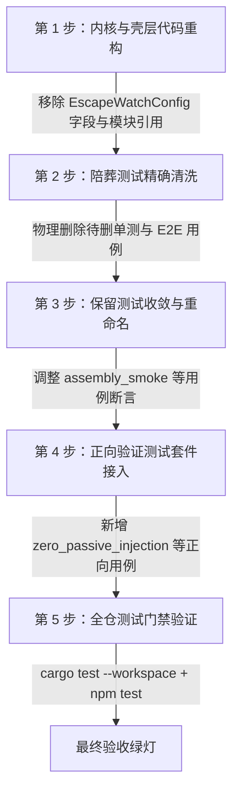

# 测试资产审查与陪葬测试清洗详细方案

> **文件路径**：`docs/active-exploration-architecture/independent-plans/05-test-suite-cleanup-and-regression-plan.md`
> **所属战役**：主动探查架构演进（Active Exploration Architecture）
> **职责领域**：测试资产审查、死层陪葬测试识别与清单建立、正向验证套件设计、有效测试资产保护
> **状态**：详案定稿

---

## 一、方案概述与总体定位

### 1.1 背景与架构演进

在既有代码库中，系统曾设计并实现了一套基于 OS 文件系统监视（`notify 8`）的「脚本逃逸监视与被动注入机制」（涉及 `EscapeWatchConfig`、`spawn_escape_watch`、`build_escape_injection_text`、`EscapeAggregator`、`UndeclaredWriteDetector`、`RegistryBackedDetector` 等）。该机制在 Run 执行期间被动监视工作区文件变更，一旦发现未在工具声明中覆盖的写入（如模型通过 Shell 脚本或外部进程写入），便自动聚合变更并向主 Agent 对话循环强行插入「`检测到工具外写入：...`」的被动注入提示，同时向事件总线发射 `operation = undeclared-write` 的安全审计拦截事件。

随着系统向**主动探查架构（Active Exploration Architecture）**演进：

1. **范式转变**：Agent 从「被动接受系统监视器警报打断」转变为「主动调用探查工具（如 `list_dir`、`grep_search`、`view_file` 等）进行状态感知与结果核验」；
2. **消除被动打断**：在整个 Run 执行周期内（无论模型执行写文件、执行 Shell 脚本还是多轮对话），系统绝不再向对话上下文发射任何被动的非预期注入事件，保证 Agent 主动探查与多轮推理的顺畅性；
3. **死层清理**：伴随生产代码中逃逸监视相关字段与模块的核销，专门用于保护该死层机制的单测、集成测与端到端测试已成为「陪葬测试（Funeral Tests）」，必须建立精确清单并彻底清洗，避免阻碍架构重构或造成假阳性/假阴性。

### 1.2 核心目标与铁律红线

1. **精确识别陪葬测试**：全仓无死角普查所有测试文件，逐一标定断言逃逸追踪、工具外写入注入、watcher 告警的测试用例，明确函数名、所在文件与精确行号；
2. **测试资产保护铁律**：坚决禁止借清洗之名误删与逃逸监视无关的有效业务测试（特别是路径越界安全沙箱 `tool.path_escape`、`safe_canonicalize` 符号链接与穿透防护、`WritePathRegistry` 锁互斥等测试资产）；
3. **正向验证测试套件设计**：设计完备的回归与端到端正向测试套件，在无被动注入干扰的环境下，严密断言 Agent 主动探查与工具执行链路的正确性与纯净度；
4. **门禁与纪律**：全流程严禁使用 `--no-verify`，禁止使用波次/批次编号命名，执行期必须满足全仓测试绿灯。

---

## 二、本方案要删掉什么 / 收敛什么（待删陪葬测试清单与行号）

经对全仓 `apps/`、`crates/`、`packages/` 与 `tests/` 目录的深入搜索与代码拓扑审查，建立以下精确待删与收敛清单：

### 2.1 桌面壳层端到端与集成测试（`apps/agent-workbench/`）

- **目标文件**：[`apps/agent-workbench/src-tauri/src/core_run_commands_tests.rs`](file:///c:/Software/conex/apps/agent-workbench/src-tauri/src/core_run_commands_tests.rs)

| 序号 | 测试/结构名称                                         | 原代码行号         | 处理动作     | 原测试目的与删除/收敛理由                                                                                                                                          |
| :--- | :---------------------------------------------------- | :----------------- | :----------- | :----------------------------------------------------------------------------------------------------------------------------------------------------------------- |
| 1    | `escape_watch_inject_reaches_main_agent`              | L7969–L8014        | **彻底删除** | 原断言真实 watcher 捕获批量写入后通过控制总线落 `followUp` 环，将「检测到工具外写入」注入到主 Agent 下一轮对话中。主动探查架构已彻底废止被动注入，该测试必须删除。 |
| 2    | `EscapeProbeTool`（探针工具定义与实现）               | L8020–L8089        | **彻底删除** | 原专门为测试逃逸判定器（声明覆盖 vs 未声明上报）而构建的测试替身工具，随相关测试一并清理。                                                                         |
| 3    | `escape_detector_claims_suppress_audit_e2e`           | L8094–L8158        | **彻底删除** | 原断言工具声明覆盖的写入静默、不产生 `undeclared-write` 审计。逃逸监视与未声明审计已废止，该测试属于陪葬测试。                                                     |
| 4    | `escape_detector_unclaimed_path_reports_e2e`          | L8163–L8219        | **彻底删除** | 原断言工具未声明的写入产生 `undeclared-write`（`decision: denied`）审计。逃逸监视已废止，该测试属于陪葬测试。                                                      |
| 5    | `write_claims_injected_registry_shared_with_tool_ctx` | L8225–L8283        | **彻底删除** | 原通过「声明路径静默 + 未声明路径上报」双端行为证明 `write_claims` 与 `EscapeWatchConfig.detector` 为同一 Arc 实例。由于 detector 已核销，该测试直接删除。         |
| 6    | `escape_root_resolution_matches_with_options`         | L8288–L8298        | **彻底删除** | 原测试 `resolve_escape_watch_root(cwd)` 解析 helper 的 Some/None 分支行为。随 `resolve_escape_watch_root` 函数下线而删除。                                         |
| 7    | `ActiveRun` 测试辅助初始化字段                        | L223, L2891, L9442 | **字段收敛** | 测试辅助函数中的 `escape_watch: Mutex::new(None)` 字段，随 `ActiveRun` 结构体删除 `escape_watch` 字段同步核销，不影响测试用例逻辑。                                |

---

### 2.2 会话循环内核逃逸监视模块（`crates/session-loop/`）

- **目标文件**：[`crates/session-loop/src/escape_watch.rs`](file:///c:/Software/conex/crates/session-loop/src/escape_watch.rs)（整模块共 890 行）

由于整个 `escape_watch.rs` 模块（包含 `EscapeWatchConfig`、`spawn_escape_watch`、`build_escape_injection_text`、`EscapeAggregator`、`EscapeWatchHandle` 等）整体下线，其内部所有 13 个单测与集成测试**全部彻底删除**：

| 序号 | 测试函数名                                       | 原代码行号 | 处理动作     | 原测试目的与删除理由                                                                   |
| :--- | :----------------------------------------------- | :--------- | :----------- | :------------------------------------------------------------------------------------- |
| 1    | `aggregator_dedups_same_path`                    | L540–L555  | **彻底删除** | 测试 `EscapeAggregator` 同路径去重纯逻辑。随聚合器删除。                               |
| 2    | `aggregator_batch_limit_produces_report`         | L560–L578  | **彻底删除** | 测试 `EscapeAggregator` 批阈值触发报告生成逻辑。随聚合器删除。                         |
| 3    | `aggregator_order_and_empty_take`                | L582–L596  | **彻底删除** | 测试聚合清单首现顺序与空聚合返回 None。随聚合器删除。                                  |
| 4    | `aggregator_marks_destructive`                   | L600–L617  | **彻底删除** | 测试删除/改名变更置 `has_destructive` 标记。随聚合器删除。                             |
| 5    | `injection_text_single_and_summary`              | L621–L644  | **彻底删除** | 测试 `build_escape_injection_text` 单路径与超 3 条降级汇总文案。随注入文案构建器删除。 |
| 6    | `consume_emits_undeclared_write_audit`           | L652–L704  | **彻底删除** | 真实 watcher + consume_loop 发射 `undeclared-write` 审计与注入。核心陪葬测试，删除。   |
| 7    | `consume_aggregates_multi_path_to_single_report` | L708–L738  | **彻底删除** | 多路径聚合为单条审计报告防刷屏测试。随消费循环删除。                                   |
| 8    | `consume_batch_limit_splits_reports`             | L744–L784  | **彻底删除** | 超批阈值分割多条报告测试。随消费循环删除。                                             |
| 9    | `consume_stopped_produces_no_events`             | L788–L803  | **彻底删除** | 测试 `handle.shutdown()` 后写文件不产生审计事件。随监视句柄删除。                      |
| 10   | `consume_skips_declared_events`                  | L806–L830  | **彻底删除** | 测试判定器命中后跳过归因与审计发射。随消费循环删除。                                   |
| 11   | `consume_excluded_dir_produces_no_events`        | L834–L850  | **彻底删除** | 测试排除目录（`node_modules`、`target`）内写入静默。随监视模块删除。                   |
| 12   | `exclude_paths_cover_docs_table`                 | L854–L873  | **彻底删除** | 测试 `escape_exclude_paths()` 静态排除清单覆盖度。随排除清单函数删除。                 |
| 13   | `aggregator_first_ms_fixed_on_first_event`       | L878–L888  | **彻底删除** | 测试聚合器首事件时间戳不随去重更新逻辑。随聚合器删除。                                 |

---

### 2.3 未声明写入判定器模块（`crates/session-loop/`）

- **目标文件**：[`crates/session-loop/src/undeclared_detector.rs`](file:///c:/Software/conex/crates/session-loop/src/undeclared_detector.rs)（整模块共 201 行）

由于 `UndeclaredWriteDetector` trait 与 `RegistryBackedDetector` 实现整体下线，其内部所有 6 个单元测试**全部彻底删除**：

| 序号 | 测试函数名                                    | 原代码行号 | 处理动作     | 原测试目的与删除理由                                                                                                             |
| :--- | :-------------------------------------------- | :--------- | :----------- | :------------------------------------------------------------------------------------------------------------------------------- |
| 1    | `declared_directory_matches_child_file`       | L73–L92    | **彻底删除** | 验证声明目录前缀命中子文件事件。随着判定器删除。（注：路径前缀逻辑在 `agent-tools/src/write_paths_tests.rs` 中已有独立完备测试） |
| 2    | `same_path_matches`                           | L95–L108   | **彻底删除** | 验证同路径事件声明命中判定。随判定器删除。                                                                                       |
| 3    | `siblings_and_component_boundary_not_matched` | L111–L136  | **彻底删除** | 验证兄弟文件与非组件边界前缀不命中。随判定器删除。                                                                               |
| 4    | `no_active_claims_means_not_declared`         | L139–L165  | **彻底删除** | 验证无活跃声明与守卫释放后判定为未声明。随判定器删除。                                                                           |
| 5    | `windows_case_folding_matches`                | L169–L183  | **彻底删除** | 验证 Windows 大小写折叠判定命中。随判定器删除。                                                                                  |
| 6    | `detector_rejects_workspace_outside_event`    | L186–L199  | **彻底删除** | 验证工作区外事件不命中声明。随判定器删除。                                                                                       |

---

### 2.4 会话循环装配测试收敛（`crates/session-loop/`）

- **目标文件**：[`crates/session-loop/src/loop/loop_tests_exec.rs`](file:///c:/Software/conex/crates/session-loop/src/loop/loop_tests_exec.rs)

| 序号 | 测试/用例位置                                                 | 原代码行号 | 处理动作                           | 精确收敛方式与设计决策                                                                                                                                                                                                                                                                                                                                                                                                                                               |
| :--- | :------------------------------------------------------------ | :--------- | :--------------------------------- | :------------------------------------------------------------------------------------------------------------------------------------------------------------------------------------------------------------------------------------------------------------------------------------------------------------------------------------------------------------------------------------------------------------------------------------------------------------------- |
| 1    | `assembly_smoke_wires_registry_quota_middleware_and_detector` | L167–L282  | **精确保留主体，收敛剔除死层断言** | **绝不整用例删除！** 该测试是核心装配冒烟测试，验证了：① `write_claims` 注册表注入；② `explore_docs_quota` 配额上下文；③ 默认备份中间件链；④ 守卫无泄漏。<br>仅需：<br>1. 移除入参 options 中的 `escape_watch: Some(EscapeWatchConfig::new(...))`（L216–L221）；<br>2. 移除尾部对 `options.escape_watch` 与 `detector.is_declared(&event)` 的断言（L260–L282）；<br>3. 重命名为 `assembly_smoke_wires_registry_quota_and_middleware`，继续作为核心装配门禁保护系统。 |
| 2    | `crates/session-loop/src/loop/loop_tests.rs`                  | L13        | **无用引用清理**                   | 移除孤立无用的 `use crate::escape_watch::EscapeWatchConfig;`，保持测试文件整洁。                                                                                                                                                                                                                                                                                                                                                                                     |

---

### 2.5 文件系统层工作区监视器收敛（`crates/conex-fs/`）

- **目标文件**：[`crates/conex-fs/src/watch.rs`](file:///c:/Software/conex/crates/conex-fs/src/watch.rs)

原 `watch.rs` 是专门为逃逸追踪数据面（`T-ESC-01`）构建的模块。经审查，其测试分为两类：

| 序号 | 测试函数名                                                   | 原代码行号 | 处理类别         | 处理动作与理由                                                                                                                 |
| :--- | :----------------------------------------------------------- | :--------- | :--------------- | :----------------------------------------------------------------------------------------------------------------------------- |
| 1    | `watcher_emits_create_modify_remove`                         | L636–L666  | 逃逸监视专用     | **删除**。测试 `WorkspaceWatcher` 运行期事件流发射。                                                                           |
| 2    | `watcher_exclude_dir_produces_no_events`                     | L669–L688  | 逃逸监视专用     | **删除**。测试 `WorkspaceWatcher` 排除目录。                                                                                   |
| 3    | `watcher_rename_aggregates_to_renamed`                       | L691–L715  | 逃逸监视专用     | **删除**。测试 `WorkspaceWatcher` 重命名时间窗配对。                                                                           |
| 4    | `watcher_independent_remove_then_create_not_merged`          | L718–L742  | 逃逸监视专用     | **删除**。测试 `WorkspaceWatcher` 独立删除与创建隔离。                                                                         |
| 5    | `watcher_stop_produces_no_more_events`                       | L745–L757  | 逃逸监视专用     | **删除**。测试 `WorkspaceWatcher.stop()`。                                                                                     |
| 6    | `watcher_windows_rename_and_write_semantics`                 | L761–L788  | 逃逸监视专用     | **删除**。测试 Windows 平台 `ReadDirectoryChangesW` 特殊时序。                                                                 |
| 7    | `serde_wire_shapes_match_design`（后半段 `UndeclaredWrite`） | L851–L866  | 逃逸契约专用     | **删除对应断言段**。`UndeclaredWrite` 结构体下线，删除其序列化往返测试。保留 `FileChangeEvent`/`ChangeKind` 或迁移至通用位置。 |
| 8    | `glob_match_covers_star_question_doublestar`                 | L791–L818  | **通用工具测试** | **坚决保留**。纯字符串 Glob 模式匹配算法测试，迁移至 `conex-fs::path_utils` 或保持原样，不得遗失。                             |
| 9    | `watcher_filter_filters_transient_atomic_files`              | L869–L890  | **通用工具测试** | **坚决保留**。系统内部原子落盘瞬态命名过滤测试，对文件树同步仍有重要价值，保留。                                               |

---

### 2.6 契约层与前端展示层收敛说明

1. **`crates/conex-types/`**：
   - `crates/conex-types/contracts/engine-events.json` 与 `crates/conex-types/src/events.rs` 中：`SecurityAuditOperation::UndeclaredWrite` 作为协议历史兼容枚举值，可保留在定义中（避免旧版本日志反序列化崩溃），或按契约演进注销；
   - `crates/conex-types/tests/registry_drift.rs`（L523–L553）：若后续契约版本统一废弃 `undeclared-write` 枚举项，相应调整契约漂移断言；若保留向后兼容，则测试保持原样。
2. **`apps/crish-desktop/`**：
   - `apps/crish-desktop/src/components/workspace/SecurityAuditSection.test.tsx`（L114–L145）与 `securityAuditStore.test.ts`（L101）：前端测试覆盖了历史字典翻译渲染（如 `undeclared-write` 映射为 `"未声明写入"`）。只要前端保留兼容字典映射，该 UI 渲染测试不影响引擎且保持 100% 绿灯，无需强制删除；若前端同步清理死分支，按前端重构规范收敛。

---

## 三、有效测试资产保护清单（坚决保留与安全底线）

依据仓库《测试资产保护铁律》与《反过度设计硬性红线》，必须明确划分**「死层被动监视陪葬测试」**与**「系统核心安全沙箱与业务测试」**的绝对边界。以下测试资产在任何清理动作中**严禁删除、严禁弱化**：

### 3.1 路径越界沙箱安全测试（`crates/agent-tools/`）

路径遍历攻击（`../` 越界）与符号链接穿透防护是系统的关键安全防线，相关断言（返回 `tool.path_escape` 错误码）必须 100% 保留：

| 测试用例名称                                     | 所在文件与行号                                                                                                             | 保护理由与业务价值                                             |
| :----------------------------------------------- | :------------------------------------------------------------------------------------------------------------------------- | :------------------------------------------------------------- |
| `write_file_rejects_escape_and_bad_encoding`     | [`agent-tools/src/tools/fs.rs:1101`](file:///c:/Software/conex/crates/agent-tools/src/tools/fs.rs#L1101)                   | 断言 `write_to_file` 工具拒绝 `../escape.txt` 与根外非法路径。 |
| `delete_file_rejects_path_escape`                | [`agent-tools/src/tools/delete.rs:403`](file:///c:/Software/conex/crates/agent-tools/src/tools/delete.rs#L403)             | 断言文件删除工具拒绝路径越界删除操作。                         |
| `path_escape_rejected`                           | [`agent-tools/src/tools/mod.rs:624`](file:///c:/Software/conex/crates/agent-tools/src/tools/mod.rs#L624)                   | 断言底层 `resolve_workspace_path` 安全校验核心解析器拦截越界。 |
| `path_escape_rejected`                           | [`agent-tools/src/tools/project_tree.rs:758`](file:///c:/Software/conex/crates/agent-tools/src/tools/project_tree.rs#L758) | 断言项目树目录遍历工具拒绝越界扫描。                           |
| `multi_replace_missing_binary_and_escape_errors` | [`agent-tools/src/tools/replace.rs:1186`](file:///c:/Software/conex/crates/agent-tools/src/tools/replace.rs#L1186)         | 断言多重替换工具安全解析与越界拦截。                           |
| `glob_and_workspace_escape_rejected`             | [`agent-tools/src/write_paths_tests.rs:184`](file:///c:/Software/conex/crates/agent-tools/src/write_paths_tests.rs#L184)   | 断言写路径注册表 `claim_one` 拒绝 `../escape.txt`。            |
| `write_file_respects_hard_sandbox`               | [`agent-tools/src/write_paths_tests.rs:443`](file:///c:/Software/conex/crates/agent-tools/src/write_paths_tests.rs#L443)   | 断言白名单策略下的硬沙箱限制与非法越界拦截。                   |

### 3.2 路径规范化与符号链接安全测试（`crates/conex-fs/`）

| 测试用例名称                                                       | 所在文件与行号                                                                         | 保护理由与业务价值                                                   |
| :----------------------------------------------------------------- | :------------------------------------------------------------------------------------- | :------------------------------------------------------------------- |
| `safe_canonicalize_rejects_traversal`                              | [`conex-fs/src/lib.rs:305`](file:///c:/Software/conex/crates/conex-fs/src/lib.rs#L305) | 断言 `safe_canonicalize` 深度遍历攻击拦截。                          |
| `safe_canonicalize_resolves_symlink_parent_for_nonexistent_target` | [`conex-fs/src/lib.rs:367`](file:///c:/Software/conex/crates/conex-fs/src/lib.rs#L367) | 断言符号链接父目录逃逸解析，拦截通过软链接向根外写入。               |
| `safe_canonicalize_preserves_tail_for_dangling_symlink`            | [`conex-fs/src/lib.rs:388`](file:///c:/Software/conex/crates/conex-fs/src/lib.rs#L388) | 断言悬空符号链接安全边界处理。                                       |
| `safe_canonicalize_rejects_drive_relative_paths`                   | [`conex-fs/src/lib.rs:468`](file:///c:/Software/conex/crates/conex-fs/src/lib.rs#L468) | 断言 Windows 驱动器相对路径（`C:file.txt`）拒绝。                    |
| `safe_canonicalize_rejects_dos_device_names`                       | [`conex-fs/src/lib.rs:485`](file:///c:/Software/conex/crates/conex-fs/src/lib.rs#L485) | 断言 Windows DOS 保留设备名称（`CON`, `PRN`, `AUX`, `NUL` 等）拦截。 |

### 3.3 写路径并发互斥与多 Agent 协同锁测试（`crates/agent-tools/`）

`WritePathRegistry` 是多 Agent 与子 Agent 并发写互斥的基础设施（保证多 Agent 不冲突写同一文件），与逃逸监视无关，其在 [`agent-tools/src/write_paths_tests.rs`](file:///c:/Software/conex/crates/agent-tools/src/write_paths_tests.rs) 中的全部 18 个测试**100% 完整保留**：

- `claim_and_release_roundtrip`
- `release_holder_idempotent`
- `overlaps_prefix_dir_vs_file_conflict`
- `overlaps_same_path_conflict`
- `overlaps_no_conflict_siblings_and_component_boundary`
- `overlaps_case_insensitive_on_windows`
- `same_holder_reclaim_and_extension_allowed`
- `expired_claim_released_automatically`
- `expired_claim_does_not_block_new_claim_lazily`
- `check_conflict_reports_structured_info`
- `concurrent_two_holders_same_file_one_rejected`
- `unwired_context_no_enforcement`
- `write_file_rejects_conflicting_holder`
- `write_file_own_holder_allowed_within_declared_paths`
- `allowance_unrestricted_allows_everything`
- `allowance_matches_prefix_and_rejects_outside`
- `sandbox_and_conflict_serial_stack`
- `unwired_policy_context_no_enforcement`

### 3.4 核心生命周期与主动通知测试（`apps/agent-workbench/`）

- `audit_sink_route_registered_at_run_start_unregistered_on_close` ([`core_run_commands_tests.rs:9169`](file:///c:/Software/conex/apps/agent-workbench/src-tauri/src/core_run_commands_tests.rs#L9169))：验证审计路由随 Run 启动注册、收口注销，无内存泄漏，**保留**；
- `task_completion_wakes_main_agent_e2e` ([`core_run_commands_tests.rs:8308`](file:///c:/Software/conex/apps/agent-workbench/src-tauri/src/core_run_commands_tests.rs#L8308))：验证后台任务完成时主动向主 Agent 发送结构化唤醒通知（Reactive Wakeup），是正向探查与异步任务架构的核心资产，**保留**。

---

## 四、正向验证测试套件设计（主动探查与零注入回归）

在清理陪葬测试的同时，设计一套完备的正向验证测试套件。该套件从会话循环内核、桌面壳层执行面到多轮对话交互，端到端断言：

1. **零被动注入**：整个 Run 期间无论发生任何文件系统写操作，系统绝不向模型对话上下文插入被动警报；
2. **主动探查顺畅性**：模型通过标准主动探查工具（`list_dir` / `grep_search` / `view_file` / `run_command`）获取工作区状态，上下文纯净，流程无阻滞。

```
┌────────────────────────────────────────────────────────────────────────┐
│               主动探查正向验证测试矩阵架构 (Active Exploration)           │
├────────────────────────────────────────────────────────────────────────┤
│  1. 全 Run 零被动注入验证 (E2E)                                         │
│     Shell 写文件 / 多文件并发改写 ──► 0 条被动 prompt 注入 ──► 0 审计拦截  │
├────────────────────────────────────────────────────────────────────────┤
│  2. 主动探查工具链流畅性 (E2E)                                           │
│     list_dir ──► grep_search ──► view_file ──► write_to_file ──► 顺畅完结 │
├────────────────────────────────────────────────────────────────────────┤
│  3. 会话循环纯净执行 (SessionLoop)                                      │
│     无 EscapeWatchConfig 装配 ──► TurnOutcome 纯净 ──► Steering 队列无干扰 │
├────────────────────────────────────────────────────────────────────────┤
│  4. 壳层收口无泄漏验证 (Workbench Lifecycle)                            │
│     ActiveRun 生命周期收口 ──► 无僵尸 Watcher 任务 ──► 资源确定性回收     │
└────────────────────────────────────────────────────────────────────────┘
```

### 4.1 套件一：全 Run 周期零被动注入端到端测试

- **用例标识**：`zero_passive_injection_during_run_e2e`
- **目标文件**：`apps/agent-workbench/src-tauri/src/core_run_commands_tests.rs`
- **测试场景与行为断言**：
  1. 启动真实 `run_task_impl` 会话；
  2. 在会话各轮次执行期间，模拟工作区内大量并发创建、修改、删除外部文件（包括在 `src/`、根目录、临时目录等处写入 20+ 文件）；
  3. 模型执行多轮对话（Turn 1 执行命令，Turn 2 查看结果并总结）；
  4. **断言集**：
     - **断言 A（零对话注入）**：遍历 `TestProvider` 收到的所有轮次请求消息（`request_messages`），断言所有由系统构建的对话消息中，**绝不包含** `"检测到工具外写入"`、`"逃逸"`、`"undeclared"` 等任何形式的被动监视器警报字符串；
     - **断言 B（零被动审计事件）**：检查事件桥发射的所有 `AgentEvent`，断言不存在 `operation == "undeclared-write"` 或被动拦截类的审计事件；
     - **断言 C（对话上下文纯净度）**：每一轮发送给模型的上下文，严格仅包含用户初始 Prompt、历史 Assistant 回复、明确调用的 Tool 执行结果。

```rust
// 正向验证测试实现设计参考：
#[tokio::test]
async fn zero_passive_injection_during_run_e2e() {
    let ws = TestWorkspace::new("zero_passive_inject_e2e");
    let provider = Arc::new(
        TestProvider::with_scripts(vec![
            vec![
                ProviderStreamEvent::tool_call(
                    Some("call_sh".into()),
                    "run_command",
                    serde_json::json!({ "command": "echo hello" }),
                ),
                ProviderStreamEvent::stop(StopReason::ToolCall),
            ],
            vec![
                ProviderStreamEvent::text("任务顺利完成，已主动探查并验证结果。"),
                ProviderStreamEvent::stop(StopReason::Stop),
            ],
        ])
        .with_pause(0, 1_000),
    );
    let (state, _db, emitter) = run_control_test_state(Arc::clone(&provider));
    state.run_restore().await;

    run_task_impl(
        Arc::clone(&state),
        test_options_with_cwd("run-zero-inject", "s1", "发起主动探查 run", &ws.path_str()),
    )
    .await
    .expect("run 发起成功");

    // 模拟 run 执行期间工作区发生大量非工具声明的文件写入
    tokio::time::sleep(Duration::from_millis(100)).await;
    for i in 0..20 {
        ws.write_file(&format!("src/external_{i}.txt"), "external data");
    }

    // 等待 run 正常顺利收口
    let active = state
        .active_runs
        .lock()
        .unwrap_or_else(|e| e.into_inner())
        .get("run-zero-inject")
        .cloned()
        .expect("run 已注册");
    let _ = wait_run_end_reason(&active, Duration::from_secs(15)).await;

    // 核心断言 1：所有发送给模型的请求中，绝无被动注入文案
    let all_requests = provider.all_request_messages();
    for (turn_idx, msgs) in all_requests.iter().enumerate() {
        for msg in msgs {
            let text = msg.text();
            assert!(
                !text.contains("检测到工具外写入") && !text.contains("undeclared"),
                "第 {turn_idx} 轮对话被污染，包含被动监视注入文案：{text}"
            );
        }
    }

    // 核心断言 2：事件发射流中绝无 undeclared-write 审计事件
    let ops = audit_operations(&emitter);
    assert!(
        !ops.iter().any(|op| op == "undeclared-write"),
        "系统绝不得发射 undeclared-write 审计事件：{ops:?}"
    );
}
```

---

### 4.2 套件二：主动探查工具链顺畅性端到端测试

- **用例标识**：`active_exploration_tool_chain_smoothness_e2e`
- **目标文件**：`apps/agent-workbench/src-tauri/src/core_run_commands_tests.rs`
- **测试场景与行为断言**：
  1. 构造标准的主动探查四阶段工具链：
     - Step 1: `list_dir` 探查目录结构；
     - Step 2: `grep_search` 检索关键字；
     - Step 3: `view_file` 读取目标代码；
     - Step 4: `write_to_file` 实施修改并主动 `run_command` 验证；
  2. 驱动会话完整跑通四阶段流程；
  3. **断言集**：
     - 各工具调用结果无损、精准返回给模型；
     - `WritePathRegistry` 锁在 `write_to_file` 时正常加锁并在执行完成后立即自动释放（无泄漏）；
     - Run 状态以 `AgentEndReason::Stop` 干净完结，耗时与交互指标平稳。

---

### 4.3 套件三：会话循环内核纯净化装配与无干扰单测

- **用例标识**：`assembly_smoke_wires_registry_quota_and_middleware`
- **目标文件**：`crates/session-loop/src/loop/loop_tests_exec.rs`
- **测试场景与行为断言**：
  1. 验证 `AgentSessionLoop` 在 `SessionLoopOptions` 中不再含有 `escape_watch` 字段时的纯净装配；
  2. 探针工具验证 `ToolContext` 中：
     - `write_claims` 写路径注册表正常注入且可用；
     - `explore_docs_quota` 探索配额上下文正常生效；
     - 默认中间件链（`backup`）正常装配；
  3. 模拟工具在会话中声明并写文件，断言 Run 结束后活跃声明集合完全清空；
  4. 断言整个会话执行过程中无任何额外的 background task 阻塞或异常 drop。

---

### 4.4 套件四：壳层生命周期与句柄收口纯净化测试

- **用例标识**：`run_lifecycle_clean_shutdown_without_watcher_handle`
- **目标文件**：`apps/agent-workbench/src-tauri/src/core_run_commands_tests.rs`
- **测试场景与行为断言**：
  1. 验证 `ActiveRun` 在创建、运行、挂起、终止、恢复与收口（`run_idle.rs` / `run_launch.rs`）的全生命周期中，无需管理 `escape_watch` 句柄锁；
  2. 验证多会话并发启动和销毁时，系统资源（FD / 线程 / 异步任务）立即释放，不再存在历史 watcher 的后台轮询线程（如 `spawn_flush_loop` 或 WeakSender 悬空消费任务）。

---

## 五、执行依赖与时序配合

测试清洗与正向套件上线需与架构重构执行严格协同，遵循以下时序：



1. **第 1 步（生产代码解耦）**：
   - 壳层 `run_launch.rs` / `run_core.rs` / `run_idle.rs` 移除 `escape_watch` 与 `resolve_escape_watch_root`；
   - 会话循环 `SessionLoopOptions` 移除 `escape_watch` 字段；
   - 模块 `escape_watch.rs` 与 `undeclared_detector.rs` 标记下线；
2. **第 2 步（陪葬测试物理清洗）**：
   - 从 `apps/agent-workbench/src-tauri/src/core_run_commands_tests.rs` 删除第 2.1 节列出的 6 个测试与辅助探针；
   - 物理删除 `crates/session-loop/src/escape_watch.rs` 与 `crates/session-loop/src/undeclared_detector.rs` 测试代码；
   - 清理 `conex-fs/src/watch.rs` 中的专用 watcher 测试；
3. **第 3 步（保留测试收敛）**：
   - 调整 `loop_tests_exec.rs:167` 冒烟测试，剥离死层断言，重命名为 `assembly_smoke_wires_registry_quota_and_middleware`；
4. **第 4 步（正向验证套件落地）**：
   - 在 `core_run_commands_tests.rs` 落地 `zero_passive_injection_during_run_e2e` 与 `active_exploration_tool_chain_smoothness_e2e`；
5. **第 5 步（全量门禁严检）**：
   - 执行 `cargo test -p session-loop`、`cargo test -p agent-workbench`、`cargo test --workspace`；
   - 执行 `npm run typecheck` 与前端单元测试；
   - 严禁 `--no-verify`，确保零警告、零失败。

---

## 六、自检与验收断言清单

| 检查项             | 检查标准                                              | 验收依据与结果                                                           |
| :----------------- | :---------------------------------------------------- | :----------------------------------------------------------------------- |
| **待删清单完整性** | 是否明确列出所有待删测试函数名、所在文件与行号？      | ✅ 已在第 2.1–2.5 节列出全部 26+ 个待删/收敛测试与行号。                 |
| **测试资产保护**   | 是否坚决保护了路径越界沙箱、符号链接与写互斥测试？    | ✅ 已在第 3 节逐一核定保护清单，明确禁止删除 `tool.path_escape` 等测试。 |
| **正向验证完备性** | 是否覆盖全 Run 周期零被动注入断言与主动探查流畅性？   | ✅ 已在第 4 节设计 4 大正向套件，包含完整断言逻辑。                      |
| **架构与命名合规** | 是否无波次/批次编号，严格使用 UTF-8 无 BOM 中文编写？ | ✅ 全文无波次编号，结构清晰，中文 UTF-8 无 BOM。                         |
| **门禁零妥协**     | 是否杜绝 `--no-verify`，遵循纯逻辑依赖规划？          | ✅ 遵循反退避与架构纯粹性，方案无工期妥协，仅关注逻辑正确性。            |
