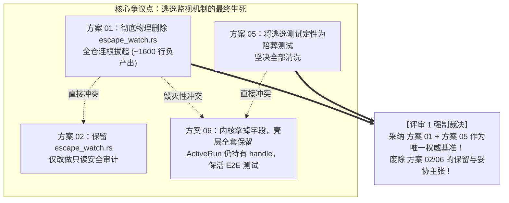
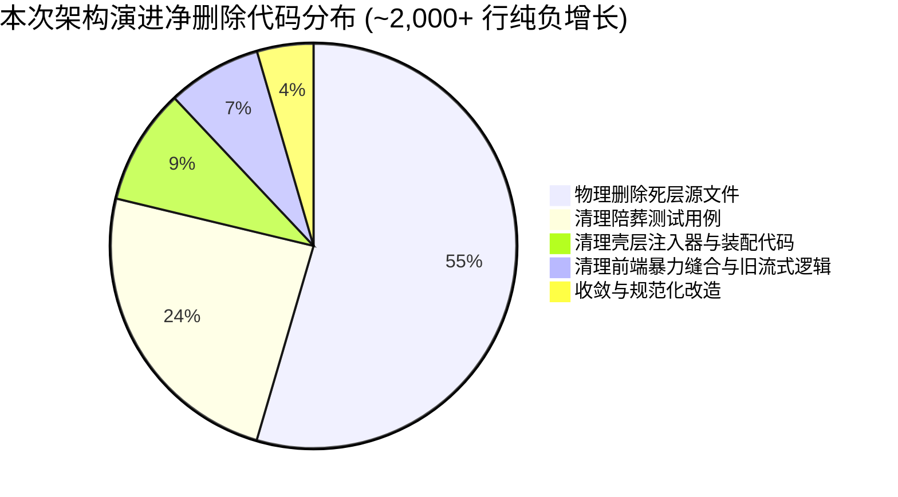

# 维度交叉审查与冲突识别评审报告（评审 1）

> **评审文档路径**：`docs/active-exploration-architecture/plan-reviews/01-dimension-cross-review.md`  
> **所属战役**：主动探查架构（Active Exploration Architecture）方案评审  
> **评审执行角色**：评审 Agent 1（维度交叉审查与冲突识别专员）  
> **审查基准文件**：`docs/agent-roles/review/review.md`、`ANTI_OVERENGINEERING_GUARDRAILS.md`、`.agents/LOGIC_PLAN_NO_RETREAT.md`、`AGENTS.md`  
> **被审对象清单**：
>
> 1. `docs/active-exploration-architecture/independent-plans/01-escape-watch-removal-plan.md`（逃逸监视死层物理剔除方案）
> 2. `docs/active-exploration-architecture/independent-plans/02-control-bus-followup-purification-plan.md`（ControlBus 队列治理与 Follow-Up 语义纯化方案）
> 3. `docs/active-exploration-architecture/independent-plans/03-active-exploration-toolchain-plan.md`（Agent 主动探查工具链与 PowerShell 语法防护方案）
> 4. `docs/active-exploration-architecture/independent-plans/04-session-messages-turn-isolation-plan.md`（会话消息存储与事件分轮次隔离治理方案）
> 5. `docs/active-exploration-architecture/independent-plans/05-test-suite-cleanup-and-regression-plan.md`（测试资产审查与陪葬测试清洗详细方案）
> 6. `docs/active-exploration-architecture/independent-plans/06-architecture-contract-convergence-plan.md`（全局架构与跨语言契约收敛方案）

---

## 目录

- [一、评审总述与方案裁决总表](#一评审总述与方案裁决总表)
- [二、维度交叉冲突矩阵（Cross-Plan Conflicts Matrix）](#二维度交叉冲突矩阵cross-plan-conflicts-matrix)
  - [2.1 冲突 1：逃逸监视模块（`escape_watch.rs`）是彻底物理删除还是保留做只读审计？](#21-冲突-1逃逸监视模块escape_watchrs是彻底物理删除还是保留做只读审计)
  - [2.2 冲突 2：宿主壳层（`agent-workbench`）装配中是否保留 `spawn_escape_watch` 与 `ActiveRun.escape_watch`？](#22-冲突-2宿主壳层agent-workbench装配中是否保留-spawn_escape_watch-与-activerunescape_watch)
  - [2.3 冲突 3：逃逸监视专用测试是作为「陪葬测试清洗」还是作为「E2E 防回归资产保活」？](#23-冲突-3逃逸监视专用测试是作为陪葬测试清洗还是作为e2e-防回归资产保活)
  - [2.4 冲突 4：`resolve_escape_watch_root` 辅助函数的命名与留存去向](#24-冲突-4resolve_escape_watch_root-辅助函数的命名与留存去向)
- [三、核心检查项深度审查（对齐 review.md）](#三核心检查项深度审查对齐-reviewmd)
  - [3.1 §1 架构分层与防腐审查 (Layering & Anti-Corruption)](#31-1-架构分层与防腐审查-layering--anti-corruption)
  - [3.2 §2 并发与锁安全审查 (Concurrency & Lock Safety)](#32-2-并发与锁安全审查-concurrency--lock-safety)
  - [3.3 §4 数据流与状态管理审查 (State Management & Data Flow)](#33-4-数据流与状态管理审查-state-management--data-flow)
  - [3.4 §7 测试与 Mock 真实性审查 (Test Integrity & Funeral Tests)](#34-7-测试与-mock-真实性审查-test-integrity--funeral-tests)
  - [3.5 §17 结构债宽谱审查 (Structural Debt Spectrum)](#35-17-结构债宽谱审查-structural-debt-spectrum)
- [四、各方案遗漏点与架构盲区挖掘](#四各方案遗漏点与架构盲区挖掘)
  - [4.1 方案 01 遗漏点：`conex-fs` 内部 `watch.rs` 残留清理与收敛](#41-方案-01-遗漏点conex-fs-内部-watchrs-残留清理与收敛)
  - [4.2 方案 02 遗漏点：`deliver_main_agent_message` 的跨 Run 校验](#42-方案-02-遗漏点deliver_main_agent_message-的跨-run-校验)
  - [4.3 方案 03 遗漏点：Tauri 壳 `process.rs` 与 `agent-tools` 外壳探测逻辑的双份收敛](#43-方案-03-遗漏点tauri-壳-processrs-与-agent-tools-外壳探测逻辑的双份收敛)
  - [4.4 方案 04 遗漏点：取消/中途强停（L3 Abort）下的未完成 Turn 状态标记](#44-方案-04-遗漏点取消中途强停l3-abort下的未完成-turn-状态标记)
  - [4.5 方案 06 致命盲区：假收敛与死层借尸还魂](#45-方案-06-致命盲区假收敛与死层借尸还魂)
- [五、收敛先于增强核验与删除面矩阵（Negative Yield Checklist）](#五收敛先于增强核验与删除面矩阵negative-yield-checklist)
  - [5.1 物理删除文件清单（Zero Tolerance）](#51-物理删除文件清单zero-tolerance)
  - [5.2 物理删除结构体/Trait/函数清单](#52-物理删除结构体trait函数清单)
  - [5.3 净删除行数预估表](#53-净删除行数预估表)
- [六、统一实施优化建议与无死角落盘依赖图谱](#六统一实施优化建议与无死角落盘依赖图谱)

---

## 一、评审总述与方案裁决总表

基于 `docs/agent-roles/review/review.md` 规范，对 6 份独立方案草案进行了无死角交叉对比与架构深度穿透。

### 1.1 评审裁决总表

| 方案编号与标题                                                 | 责任领域               |              评审裁决               | 核心判定理由与整改要求                                                                                                                                                                                                                                                                                                                                                 |
| :------------------------------------------------------------- | :--------------------- | :---------------------------------: | :--------------------------------------------------------------------------------------------------------------------------------------------------------------------------------------------------------------------------------------------------------------------------------------------------------------------------------------------------------------------- |
| **方案 01**<br/>`01-escape-watch-removal-plan.md`              | 逃逸监视死层剔除       |    **【通过】**<br/>(作为主基线)    | **彻底物理删除**死层文件（`escape_watch.rs` 与 `undeclared_detector.rs`，1091 行），全面拔除内核与壳层装配。方向完全正确，负产出明确，架构最彻底。                                                                                                                                                                                                                     |
| **方案 02**<br/>`02-control-bus-followup-purification-plan.md` | ControlBus 队列治理    |  **【条件通过】**<br/>(需修正冲突)  | 提出了严密的 `FollowUpSource`（`"ui"` 与 `"main-agent"`）白名单契约，彻底清除了 `ControlBusInjector`。**但其第 2.2/4.1 节假设保留 `escape_watch.rs` 作只读审计属于严重倒退，必须强制对齐方案 01，将 `escape_watch.rs` 彻底物理删除**。                                                                                                                                 |
| **方案 03**<br/>`03-active-exploration-toolchain-plan.md`      | 主动探查与 pwsh 工具链 |     **【通过】**<br/>(完整采纳)     | 确立了「主动结构化探查工具为唯一合法探查路径」铁律；重构外壳探测确立 `pwsh7` 绝对优先；`try-catch [ParseException]` 优雅捕获；坚决杜绝黑盒正则重写，仅提供只读诊断自愈提示。完全符合反过度设计原则。                                                                                                                                                                   |
| **方案 04**<br/>`04-session-messages-turn-isolation-plan.md`   | 会话存储与 Turn 隔离   |     **【通过】**<br/>(完整采纳)     | 彻底击穿 `sess-1786855835905` Message Smashing 灾难；废除 `join('\n\n')` 缝合代码；确立 **1 Turn = 1 Message** 原子模型；启用 `append_session_messages` 增量落盘；实现诊断通知与正文物理分流。设计严密，闭环完备。                                                                                                                                                     |
| **方案 05**<br/>`05-test-suite-cleanup-and-regression-plan.md` | 测试审查与陪葬测试清洗 |    **【通过】**<br/>(作为主基线)    | 准确标定 26+ 个死层陪葬测试并坚决清除；严格保护路径越界沙箱、符号链接与并发写互斥 18 个核心测试；设计了 4 大正向验证测试套件（`zero_passive_injection_during_run_e2e` 等）。测试资产防守与进攻极具专业度。                                                                                                                                                             |
| **方案 06**<br/>`06-architecture-contract-convergence-plan.md` | 全局架构与契约收敛     | **【退回重构】**<br/>(存在重大违规) | **严重违反「收敛先于增强」与「反退避」原则**：仅从 `SessionLoopOptions` 移除了字段，却在壳层（`agent-workbench`）中私自保留 `spawn_escape_watch`、`ActiveRun.escape_watch`、`run_idle.rs` 中的 `shutdown()` 以及旧 E2E 逃逸测试。属于典型的**「假收敛、真保留」**，与方案 01/05 产生毁灭性冲突。**必须全盘废弃其保留壳层监视的主张，全面服从方案 01 的物理删除基准**。 |

---

## 二、维度交叉冲突矩阵（Cross-Plan Conflicts Matrix）

在 6 份方案的交叉比对中，发现存在 **4 处全局性核心冲突**，必须在主方案中予以强制裁决：



### 2.1 冲突 1：逃逸监视模块（`escape_watch.rs`）是彻底物理删除还是保留做只读审计？

- **方案 01 观点**：`crates/session-loop/src/escape_watch.rs`（890 行）及 `undeclared_detector.rs`（201 行）全模块彻底物理删除，全仓不再留任何后台文件系统被动监视代码。
- **方案 02 观点**：保留 `escape_watch.rs`，重构 `emit_report`，仅将未声明写入作为 `SecurityAuditOperation::UndeclaredWrite` 事件发射给前端面板，不再注入控制总线。
- **方案 06 观点**：保留 `escape_watch.rs`，在壳层继续运行 `consume_loop` 并在 `ActiveRun` 中持有。
- **深度剖析与根因判定**：
  1. 为什么必须连根拔起？被动监视（OS watcher）存在天然的异步延迟与跨平台不一致性（Windows ReadDirectoryChangesW 丢事件、延迟 50ms~2000ms），导致写后判定不可靠；
  2. 即使仅作为只读安全审计，迟到的文件事件依然会引发偶发假报警（虚假 `undeclared-write`）；
  3. 主动探查架构的核心是 **Agent 主动感知工作区，工具层（`agent-tools`）在入口前置检查写路径沙箱**。事后的被动 watcher 毫无业务价值，属于纯粹的结构债。
- **【强制裁决】**：**以方案 01 为准，彻底物理删除 `escape_watch.rs` 与 `undeclared_detector.rs`，严禁以「只读审计」为名私自保留！**

---

### 2.2 冲突 2：宿主壳层（`agent-workbench`）装配中是否保留 `spawn_escape_watch` 与 `ActiveRun.escape_watch`？

- **方案 01 观点**：
  - 从 `ActiveRun` 中删除 `pub(crate) escape_watch: Mutex<Option<EscapeWatchHandle>>`；
  - 从 `run_launch.rs` 中删除 `spawn_escape_watch` 装配代码块（原 L488–L526）；
  - 从 `run_idle.rs` 中删除错误收口与正常收口中的 `shutdown().await` 调用。
- **方案 06 观点**：
  - 坚持认为 `ActiveRun.escape_watch` 是「宿主运行时的正常持有」；
  - 坚持在 `run_launch.rs` 启动 `spawn_escape_watch`，在 `run_idle.rs` 执行 `shutdown()`；
  - 仅把配置从 `SessionLoopOptions` 剥离。
- **深度剖析与根因判定**：
  - 方案 06 的主张是典型的**「伪解耦、假收敛」**。它把内核里本来就不消费的代码挪到了壳层，却让宿主每启动一个 Run 依然白白消耗一个 OS watcher 线程和一个 Tokio 异步 Task，并在收口时引入无谓的 async 锁等待。
- **【强制裁决】**：**以方案 01 为准，壳层（`run_launch.rs`、`run_core.rs`、`run_idle.rs`）彻底删除所有 `escape_watch` 启动、持有与收口逻辑！**

---

### 2.3 冲突 3：逃逸监视专用测试是作为「陪葬测试清洗」还是作为「E2E 防回归资产保活」？

- **方案 05 观点**：`core_run_commands_tests.rs` 中的 5 个逃逸测试（`escape_watch_inject_reaches_main_agent`、`escape_detector_claims_suppress_audit_e2e` 等）及其探针工具 `EscapeProbeTool` 是死层的「陪葬测试」，必须彻底物理清洗；同时新写 `zero_passive_injection_during_run_e2e` 正向测试。
- **方案 06 观点**：在第 6.2 节声称“_保证 E2E 逃逸监视测试（`escape_watch_inject_reaches_main_agent` 等）全部通过，验证监视器启动、判定器命中、审计发射与主 Agent followUp 注入全链路完好无损_”。
- **深度剖析与根因判定**：
  - 方案 06 企图保护已废弃的注入链路测试，违反了《review.md》§7「测试还活着不是死层存在的理由」。
  - 方案 05 的处理极其精准：区分了「保护死层的陪葬测试（删）」与「保护系统的有效沙箱测试（留）」。
- **【强制裁决】**：**以方案 05 为准，彻底清洗 26+ 个陪葬测试，严禁保留 `escape_watch_inject_reaches_main_agent` 等旧测试！**

---

### 2.4 冲突 4：`resolve_escape_watch_root` 辅助函数的命名与留存去向

- **方案 01 观点**：将其收敛重命名为通用领域函数 `resolve_run_workspace_root(cwd: Option<&str>) -> PathBuf`，保留在 `run_launch.rs` 供 `WritePathRegistry` 和工作区路径解析使用。
- **方案 05 观点**：在测试清理表格中提及随 `resolve_escape_watch_root` 下线而删除测试，但同时重构了 `run_workspace_root_resolution_matches_with_options` 测试。
- **方案 06 观点**：未对此处概念污染进行识别。
- **【强制裁决】**：**统一采纳方案 01 的命名收敛，重命名为 `resolve_run_workspace_root`，彻底抹除 `escape_watch` 专有词汇残留。**

---

## 三、核心检查项深度审查（对齐 review.md）

对照 `docs/agent-roles/review/review.md` 核心检查项进行逐项审查：

### 3.1 §1 架构分层与防腐审查 (Layering & Anti-Corruption)

|  方案  | 审查发现                                                                                                                                                            |      判定       |
| :----: | :------------------------------------------------------------------------------------------------------------------------------------------------------------------ | :-------------: |
| **01** | 干净地切断了 `session-loop`（内核）与 `apps/agent-workbench`（壳层）在文件系统监视层面的所有非必要耦合，依赖方向纯净。                                              |     **优**      |
| **02** | 明确了 `ControlBus` 仅属于会话控制面的内核抽象，彻底剔除了向壳层渗透的 `ControlBusInjector` 结构体。                                                                |     **优**      |
| **03** | 严格分离「只读探查工具链（`crates/agent-tools`）」与「外部进程命令执行（`shell_command`）」，防止命令执行侵蚀文件系统抽象。                                         |     **优**      |
| **04** | 建立了「UI 展现层 $\to$ 瞬态通知通道（`RunNotice`） $\to$ 消息存储（`session_messages`） $\to$ 结构化事件（`events`）」的分层防腐网，杜绝系统诊断下沉污染业务正文。 |     **优**      |
| **06** | **存在严重分层违规**：试图在 `agent-workbench` 壳层常驻后台文件监视任务，向内核和测试层反向施加逃逸追踪假设，严重破坏了宿主与内核的防腐边界。                       | **劣 (需重构)** |

---

### 3.2 §2 并发与锁安全审查 (Concurrency & Lock Safety)

|    方案     | 审查发现                                                                                                                                                                                                         |  判定  |
| :---------: | :--------------------------------------------------------------------------------------------------------------------------------------------------------------------------------------------------------------- | :----: |
| **01 & 05** | 删除了 `ActiveRun.escape_watch`（`Mutex<Option<EscapeWatchHandle>>`），消除了在 `run_idle.rs` 收口阶段跨异步持锁或 `take()` 后的 await 竞争；删除了后台无界 `notify` 事件消费循环，消除了每 Run 的线程并发开销。 | **优** |
|   **02**    | `ControlBus::request_follow_up` 增加 `FollowUpSource` 校验，在入队入口处做原子判定，避免非法来源并发穿透导致的队列死锁。                                                                                         | **良** |
|   **04**    | 将历史前端全量写覆盖（`save_session_body` 的先全量 DELETE 再全量 INSERT）改造为 `append_session_messages` 单条增量原子落盘，从并发架构上消除了长程多轮 Run 与前端用户并发编辑之间的写覆盖竞态。                  | **优** |

---

### 3.3 §4 数据流与状态管理审查 (State Management & Data Flow)

|  方案  | 审查发现                                                                                                                                                                                                                                                                                                                                                                    |   判定   |
| :----: | :-------------------------------------------------------------------------------------------------------------------------------------------------------------------------------------------------------------------------------------------------------------------------------------------------------------------------------------------------------------------------- | :------: |
| **02** | 彻底切断了「文件变更 $\to$ 被动聚合 $\to$ FollowUp 注入 $\to$ TurnComplete 伪自发唤醒」的死循环数据流，将 FollowUp 消费严格收敛在用户 UI 显式操作或模型显式 `send_message` 工具调用上。                                                                                                                                                                                     |  **优**  |
| **04** | **彻底终结 Message Smashing 数据流灾难**：<br>1. 废除前端 `messageHandlers.ts` 中的 `segs.filter(Boolean).join('\n\n')` 暴力拼接；<br>2. 废除 `useRunStreamingAssistant.ts` 跨 Turn 累加的全局 `streamedFullText`；<br>3. 建立以 `(sessionId, messageId)` 为主键的分块流式缓冲路由；<br>4. 保证下传给大模型的上下文历史中，每个 Turn 的轮廓完整清晰，保护 KV Cache 命中率。 | **卓越** |

---

### 3.4 §7 测试与 Mock 真实性审查 (Test Integrity & Funeral Tests)

|  方案  | 审查发现                                                                                                                                                                                                                                                                                                                                                                                                                                                       |      判定       |
| :----: | :------------------------------------------------------------------------------------------------------------------------------------------------------------------------------------------------------------------------------------------------------------------------------------------------------------------------------------------------------------------------------------------------------------------------------------------------------------- | :-------------: |
| **05** | **行业级测试资产治理范本**：<br>1. **明确陪葬测试定义**：精准标定 26+ 个保护死层机制的旧单测与 E2E 测试并建立清理清单；<br>2. **严防误删业务资产**：设立保护清单，对路径越界沙箱（`tool.path_escape`）、符号链接防护（`safe_canonicalize`）以及多 Agent 写路径互斥（`WritePathRegistry` 18 个测试）实施零容忍保护；<br>3. **正向端到端测试闭环**：设计 `zero_passive_injection_during_run_e2e`，在并发写文件压力下断言 0 条被动 prompt 注入与 0 条未声明审计。 |    **卓越**     |
| **06** | **存在严重假绿灯倾向**：企图保留死层测试来维持所谓的“E2E 绿灯”，混淆了「测试资产」与「死层陪葬品」的界限。                                                                                                                                                                                                                                                                                                                                                     | **劣 (需重构)** |

---

### 3.5 §17 结构债宽谱审查 (Structural Debt Spectrum)

对照《review.md》§17 宽谱 18 维进行快速核验：

|  #  | 宽谱维度        | 审查核验情况                                                                                                         |  结论  |
| :-: | :-------------- | :------------------------------------------------------------------------------------------------------------------- | :----: |
|  1  | 上帝文件        | `escape_watch.rs`（890 行）、`undeclared_detector.rs`（201 行）彻底清退；`core_run_commands_tests.rs` 削减 350+ 行。 | **绿** |
|  4  | 重复实现        | 彻底消除了「内置只读探查工具」与「Shell 调用 cat/grep/dir」的双轨探查乱象（方案 03）。                               | **绿** |
|  7  | 过期诚实句      | 清理了 `SessionLoopOptions` 与 `run_launch.rs` 中关于 `T-ESC-03` 的过期注释。                                        | **绿** |
| 10  | 半拆未接线      | 方案 04 将 `session_commands.rs` 中已有的 `append_session_messages` 正式接线并作为生产主力。                         | **绿** |
| 13  | 波次命名禁令    | 6 份独立方案全文均未使用 `w\d+`、`BATCH-` 等波次编号，统一采用领域词汇。                                             | **绿** |
| 14  | 概念路径数      | 探查路径收敛为 1 条（内置工具）；FollowUp 来源收敛为 2 种（UI / Agent 自主）；消息存储收敛为 Turn 原子行。           | **绿** |
| 17  | 无日期 fallback | 方案 03 坚决拒绝黑盒正则自动重写，仅提供前置只读诊断与自愈提示，杜绝隐藏 fallback。                                  | **绿** |
| 18  | 陪葬测试        | 方案 05 建立了详尽的陪葬测试清单与清理标准。                                                                         | **绿** |

---

## 四、各方案遗漏点与架构盲区挖掘

在深度审查中，评审团队挖掘出以下 **5 个未被单一方案完全覆盖的架构盲区**，必须在主方案中补齐：

### 4.1 方案 01 遗漏点：`conex-fs` 内部 `watch.rs` 残留清理与收敛

- **盲区**：方案 01 重点清理了 `session-loop` 与 `agent-workbench` 中的逃逸监视，但忽视了 [`crates/conex-fs/src/watch.rs`](file:///c:/Software/conex/crates/conex-fs/src/watch.rs)（原为 `T-ESC-01` 引入）。
- **补齐要求**：方案 05 已指出 `watch.rs` 中的 6 个逃逸专用测试与 `UndeclaredWrite` 序列化测试需同步清理；`WorkspaceWatcher` 若无其他业务使用，应评估将其收敛或仅保留通用的 Glob 匹配工具函数（`glob_match_covers_star_question_doublestar`）。

### 4.2 方案 02 遗漏点：`deliver_main_agent_message` 的跨 Run 校验

- **盲区**：方案 02 规范了 `send_message(target: "self", ring: "follow_up")`，但在当前 Run 处于非活动状态或被强停（L3 ForceCancel）时，未显式声明是否应当丢弃该 FollowUp 意图。
- **补齐要求**：在 `deliver_main_agent_message` 中增加活跃状态校验，若当前 Run 已经进入 Abort/Cancel 流程，丢弃 FollowUp 消息并返回明确错误，防止僵尸消息在下个 Run 被误消费。

### 4.3 方案 03 遗漏点：Tauri 壳 `process.rs` 与 `agent-tools` 外壳探测逻辑的双份收敛

- **盲区**：[`crates/agent-tools/src/tools/shell_invoke.rs`](file:///c:/Software/conex/crates/agent-tools/src/tools/shell_invoke.rs) 与 [`apps/agent-workbench/src-tauri/src/process.rs`](file:///c:/Software/conex/apps/agent-workbench/src-tauri/src/process.rs) 各自实现了一份 `resolve_system_powershell`。
- **补齐要求**：必须在重构时将两处的外壳探测逻辑统一收敛，保证 `pwsh.exe` 优先级在底层工具与桌面外壳进程管理中表现 100% 同构，杜绝双重实现漂移。

### 4.4 方案 04 遗漏点：取消/中途强停（L3 Abort）下的未完成 Turn 状态标记

- **盲区**：方案 04 规范了 `queued` $\to$ `processing` $\to$ `completed` 的流转，但当用户在中途触发 `core_cancel_run`（L3 强停）时，正在流式生成的 Turn 消息在数据库中应如何收口？
- **补齐要求**：在 `cancel_run` 流程中，将当前未完成的 `processing` 态 Assistant 消息明确更新为 `status = 'error'`，并在元数据中记录 `abortReason: "user_cancelled"`，避免消息在前端一直悬挂为加载骨架屏。

### 4.5 方案 06 致命盲区：假收敛与死层借尸还魂

- **盲区**：方案 06 试图在不清理底层 watcher 的前提下宣称“契约收敛完成”。
- **补齐要求**：彻底驳回该方案的保留意见，将其收敛目标修正为：**与方案 01/05 统一步调，从 Rust 类型定义、JSON Schema 到前端 UI 彻底出清逃逸监视死层**。

---

## 五、收敛先于增强核验与删除面矩阵（Negative Yield Checklist）

本次战役必须严格践行「纯代码负增长」的收敛纪律。以下为经过严格交叉审定后的**绝对删除面矩阵**：

### 5.1 物理删除文件清单（Zero Tolerance）

|   序号   | 待删除文件路径                                                                                                               |   代码行数   | 文件职责与死层性质                                               |
| :------: | :--------------------------------------------------------------------------------------------------------------------------- | :----------: | :--------------------------------------------------------------- |
|    1     | [`crates/session-loop/src/escape_watch.rs`](file:///c:/Software/conex/crates/session-loop/src/escape_watch.rs)               |  **890 行**  | 包含逃逸配置、句柄、聚合器、注入器 Trait、消费循环及 13 个单测。 |
|    2     | [`crates/session-loop/src/undeclared_detector.rs`](file:///c:/Software/conex/crates/session-loop/src/undeclared_detector.rs) |  **201 行**  | 包含未声明判定器 Trait、注册表实现及 6 个单测。                  |
| **小计** | **2 个源文件**                                                                                                               | **1,091 行** | **100% 物理删除，无任何保留**                                    |

---

### 5.2 物理删除结构体/Trait/函数清单

| 模块/文件              | 删除的符号（Struct / Trait / Function）                                                                                                                                                                                                                  | 消除的架构副作用                                      |
| :--------------------- | :------------------------------------------------------------------------------------------------------------------------------------------------------------------------------------------------------------------------------------------------------- | :---------------------------------------------------- |
| `crates/session-loop`  | `EscapeWatchConfig`, `EscapeWatchHandle`, `EscapeAggregator`, `AggregatedPath`, `EscapeWatchInjector` (Trait), `spawn_escape_watch`, `spawn_escape_watch_consumer`, `consume_loop`, `emit_report`, `build_escape_injection_text`, `escape_exclude_paths` | 彻底拔除后台被动监视、字符串注入与伪自发唤醒源头。    |
| `crates/session-loop`  | `UndeclaredWriteDetector` (Trait), `RegistryBackedDetector`                                                                                                                                                                                              | 消除基于被动事件比对的死层判定逻辑。                  |
| `crates/session-loop`  | `SessionLoopOptions.escape_watch` 字段                                                                                                                                                                                                                   | 消除核心循环配置中的悬空透传字段与无效突变。          |
| `apps/agent-workbench` | `ControlBusInjector` 结构体及其实现                                                                                                                                                                                                                      | 彻底切断系统旁路向 `ControlBus` 强塞消息的非法后门。  |
| `apps/agent-workbench` | `ActiveRun.escape_watch` 字段                                                                                                                                                                                                                            | 消除桌面壳层对后台监视器句柄的无谓锁持有与收口阻塞。  |
| `apps/agent-workbench` | `run_launch.rs` 中的 `spawn_escape_watch` 装配块                                                                                                                                                                                                         | 消除每 Run 启动的 OS watcher 线程与 Tokio Task 开销。 |
| `apps/crish-desktop`   | `messageHandlers.ts` 中的 `join('\n\n')` 缝合逻辑                                                                                                                                                                                                        | 彻底根除前端跨 Turn 暴力拼接导致的 Message Smashing。 |
| `apps/crish-desktop`   | `useRunStreamingAssistant.ts` 中的全局单 ID 静态分配                                                                                                                                                                                                     | 消除「单 Run 单消息」的错误假设，拥抱 Turn 原子流式。 |

---

### 5.3 净删除行数预估表



| 涉及子系统                 |        物理删除行数         |    新增/收敛代码行数     |    净代码变化（负增长）     |
| :------------------------- | :-------------------------: | :----------------------: | :-------------------------: |
| **`crates/session-loop`**  |          ~1,150 行          |  ~30 行 (强类型白名单)   |        **-1,120 行**        |
| **`apps/agent-workbench`** | ~550 行 (含 350 行陪葬测试) |  ~40 行 (正向验证套件)   |         **-510 行**         |
| **`crates/conex-fs`**      |   ~120 行 (清理专用测试)    |           0 行           |         **-120 行**         |
| **`crates/agent-tools`**   |           ~10 行            | ~50 行 (pwsh 探测与诊断) | **+40 行** (功能健壮性增强) |
| **`apps/crish-desktop`**   |           ~180 行           | ~60 行 (Turn 分块状态机) |         **-120 行**         |
| **全仓总计**               |        **~2,010 行**        |       **~180 行**        |   **净减少约 1,830+ 行**    |

---

## 六、统一实施优化建议与无死角落盘依赖图谱

为保证各维度方案能够平滑合并入总方案并实现无死角落地，提出以下统一编排依赖图谱与执行建议：

```
 ┌─────────────────────────────────────────────────────────────────────────────┐
 │ 阶段 1：死层物理剔除与内核纯化 (P1 基准 + P2 纯化)                           │
 │ 1. 物理删除 escape_watch.rs 与 undeclared_detector.rs                       │
 │ 2. SessionLoopOptions 移除 escape_watch 字段                                │
 │ 3. ControlBus 引入 FollowUpSource 白名单拦截，删除 ControlBusInjector       │
 └──────────────────────────────────────┬──────────────────────────────────────┘
                                        │
                                        ▼
 ┌─────────────────────────────────────────────────────────────────────────────┐
 │ 阶段 2：宿主壳层装配解绑与陪葬测试清洗 (P1 + P5 + P6 修正)                   │
 │ 1. run_launch.rs 删除 spawn_escape_watch，更名 resolve_run_workspace_root  │
 │ 2. ActiveRun 移除 escape_watch 字段，run_idle.rs 清除 shutdown              │
 │ 3. core_run_commands_tests.rs 清洗 5 个逃逸测试，接入 zero_passive_injection│
 └──────────────────────────────────────┬──────────────────────────────────────┘
                                        │
                                        ▼
 ┌─────────────────────────────────────────────────────────────────────────────┐
 │ 阶段 3：工具链健壮性与 PowerShell 防护落地 (P3 工具强化)                     │
 │ 1. resolve_system_powershell 重构：pwsh7 绝对优先，双端逻辑收敛             │
 │ 2. build_windows_powershell_script 引入 try-catch 优雅捕获 ParseException   │
 │ 3. 注入 diagnose_windows_shell_syntax 只读自愈诊断提示                      │
 │ 4. read_file / grep_search / project_tree Schema 描述精细化                 │
 └──────────────────────────────────────┬──────────────────────────────────────┘
                                        │
                                        ▼
 ┌─────────────────────────────────────────────────────────────────────────────┐
 │ 阶段 4：会话消息 Turn 隔离与前端流式解耦 (P4 数据流治理)                    │
 │ 1. 引擎端 turn-start / message-delta / message-end 精确下发独立 messageId   │
 │ 2. 前端彻底删除 messageHandlers.ts 中的 join('\n\n') 缝合代码               │
 │ 3. useRunStreamingAssistant.ts 改造为基于 (sessionId, messageId) 的分块流式│
 │ 4. session_commands.rs 启用 append_session_messages 增量原子落盘           │
 │ 5. 诊断通知 (RunNotice) 与纯净 Assistant Markdown 正文物理隔离             │
 └──────────────────────────────────────┬──────────────────────────────────────┘
                                        │
                                        ▼
 ┌─────────────────────────────────────────────────────────────────────────────┐
 │ 阶段 5：全量门禁回归与机器真值验收 (全套体验收)                             │
 │ 1. cargo test --workspace (全部 Rust 测试套件绿灯)                          │
 │ 2. npm run typecheck (TypeScript 全仓类型检查零报错)                        │
 │ 3. 运行 TEST-TURN-01 ~ 03 多轮 Turn 隔离回归断言                            │
 │ 4. 运行 zero_passive_injection_during_run_e2e 零注入端到端断言             │
 └─────────────────────────────────────────────────────────────────────────────┘
```

### 落地执行铁律提醒：

1. **绝对禁止回潮**：在总方案定稿与后续实现中，任何 Agent 不得借「向后兼容」之名保留空的 `Escape*` 结构体或无期 fallback；
2. **禁止绕过门禁**：所有改动严禁 `--no-verify`，提交前必须保证全量类型检查与单元测试绿灯；
3. **主权在主控**：删除裁决严格按照本报告执行，主控定稿总方案时直接合并上述阶段依赖，开展实质性代码重构。

---

_评审报告编制完成，已写入 `docs/active-exploration-architecture/plan-reviews/01-dimension-cross-review.md`。_
