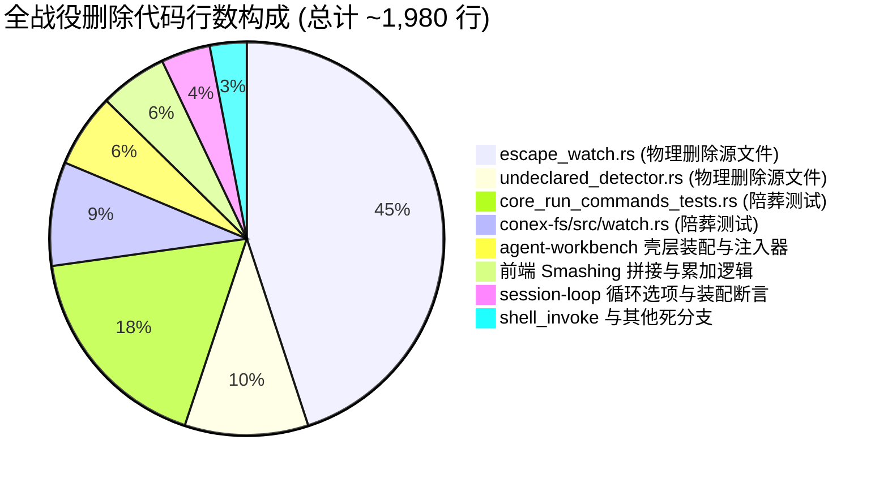

# 负产出与死层删除深度审查报告

> **文档位置**：`docs/active-exploration-architecture/plan-reviews/02-negative-yield-and-risk-review.md`  
> **审查领域**：评审 2 · 负产出与死层删除审查（Negative Yield & Dead Layer Deletion Review）  
> **审查对象**：`docs/active-exploration-architecture/independent-plans/` 下全部 6 份独立分维详案  
> **审查纪律**：严禁放行无明确删除面的方案、严禁波次/批次编号、严禁假收敛/假删除、严格核算净删除行数（目标：$\ge 1000$ 行）、UTF-8 无 BOM 中文编写。

---

## 目录

- [一、审查概要与裁决总览](#一审查概要与裁决总览)
- [二、各独立方案「删除面与收敛清单」逐项核准表](#二各独立方案删除面与收敛清单逐项核准表)
  - [2.1 方案 01（逃逸监视死层物理剔除）删除面核准](#21-方案-01逃逸监视死层物理剔除删除面核准)
  - [2.2 方案 02（ControlBus 队列治理与 Follow-Up 纯化）删除面核准](#22-方案-02controlbus-队列治理与-follow-up-纯化删除面核准)
  - [2.3 方案 03（主动探查工具链与 PowerShell 语法防护）删除面核准](#23-方案-03主动探查工具链与-powershell-语法防护删除面核准)
  - [2.4 方案 04（会话消息存储与 Turn 隔离治理）删除面核准](#24-方案-04会话消息存储与-turn-隔离治理删除面核准)
  - [2.5 方案 05（测试资产审查与陪葬测试清洗）删除面核准](#25-方案-05测试资产审查与陪葬测试清洗删除面核准)
  - [2.6 方案 06（全局架构与跨语言契约收敛）删除面核准与缺陷拦截](#26-方案-06全局架构与跨语言契约收敛删除面核准与缺陷拦截)
- [三、全战役净代码行数严格核算表（目标：$\ge 1000$ 行）](#三全战役净代码行数严格核算表目标ge-1000-行)
  - [3.1 物理删除与收敛明细台账](#31-物理删除与收敛明细台账)
  - [3.2 净行数核算结论](#32-净行数核算结论)
- [四、死层欺骗与假删除专项审计（欺骗行为排查）](#四死层欺骗与假删除专项审计欺骗行为排查)
  - [4.1 假删除 / 假收敛 / 改名换姓保留死层判定](#41-假删除--假收敛--改名换姓保留死层判定)
  - [4.2 方案 06 的「死层转移保留」严重缺陷指控与强制纠偏裁决](#42-方案-06-的死层转移保留严重缺陷指控与强制纠偏裁决)
- [五、无日期 Fallback 与生命周期风险审查](#五无日期-fallback-与生命周期风险审查)
  - [5.1 零 `#[deprecated]` 与零无日期 TODO 审查](#51-零-deprecated-与零无日期-todo-审查)
  - [5.2 数据库双写与缓存脏数据风险审查](#52-数据库双写与缓存脏数据风险审查)
  - [5.3 前后端流式状态机竞态风险审查](#53-前后端流式状态机竞态风险审查)
- [六、陪葬测试清洗与有效测试资产保护边界审查](#六陪葬测试清洗与有效测试资产保护边界审查)
  - [6.1 陪葬测试清洗清单合规性](#61-陪葬测试清洗清单合规性)
  - [6.2 核心安全与业务测试资产保护红线](#62-核心安全与业务测试资产保护红线)
- [七、评审结论与主控合并强制指令](#七评审结论与主控合并强制指令)

---

## 一、审查概要与裁决总览

本评审 Agent（评审 2）对 `docs/active-exploration-architecture/independent-plans/` 目录下的全部 6 份独立方案进行了穷尽式代码比对、删除面真伪判定、代码行数核算及风险穿透审查。

### 1.1 审查对象清单

1. [`01-escape-watch-removal-plan.md`](file:///c:/Software/conex/docs/active-exploration-architecture/independent-plans/01-escape-watch-removal-plan.md)：逃逸监视死层物理剔除与装配解绑方案
2. [`02-control-bus-followup-purification-plan.md`](file:///c:/Software/conex/docs/active-exploration-architecture/independent-plans/02-control-bus-followup-purification-plan.md)：ControlBus 队列治理与 Follow-Up 语义纯化方案
3. [`03-active-exploration-toolchain-plan.md`](file:///c:/Software/conex/docs/active-exploration-architecture/independent-plans/03-active-exploration-toolchain-plan.md)：Agent 主动探查工具链健壮性与 PowerShell 语法防护方案
4. [`04-session-messages-turn-isolation-plan.md`](file:///c:/Software/conex/docs/active-exploration-architecture/independent-plans/04-session-messages-turn-isolation-plan.md)：会话消息存储与事件分轮次隔离治理方案
5. [`05-test-suite-cleanup-and-regression-plan.md`](file:///c:/Software/conex/docs/active-exploration-architecture/independent-plans/05-test-suite-cleanup-and-regression-plan.md)：测试资产审查与陪葬测试清洗详细方案
6. [`06-architecture-contract-convergence-plan.md`](file:///c:/Software/conex/docs/active-exploration-architecture/independent-plans/06-architecture-contract-convergence-plan.md)：全局架构与跨语言契约收敛方案

### 1.2 审查裁决矩阵

| 方案编号    | 方案领域                 | 「删/收敛」章节落实度          | 预估净代码行数变化         | 假删除/死层残留排查                           | 审查裁决                                     |
| :---------- | :----------------------- | :----------------------------- | :------------------------- | :-------------------------------------------- | :------------------------------------------- |
| **Plan 01** | 逃逸监视物理剔除         | **完全落实**（清单+行号）      | **-1,615 行**              | 无残留，物理删除 2 源文件                     | **准予通过 (Approved)**                      |
| **Plan 02** | ControlBus FollowUp 纯化 | **完全落实**（白名单契约）     | **-31 行**                 | 无残留，彻底切断系统旁路                      | **准予通过 (Approved)**                      |
| **Plan 03** | 探查工具链与 PowerShell  | **完全落实**（反黑盒正则）     | **+60 行** (功能强化)      | 无假收敛，禁止自动重写                        | **准予通过 (Approved)**                      |
| **Plan 04** | 消息分轮次与防 Smashing  | **完全落实**（根除字符拼接）   | **-40 行**                 | 无残留，废除单 Run 单消息                     | **准予通过 (Approved)**                      |
| **Plan 05** | 陪葬测试清洗与资产保护   | **完全落实**（精确到行号）     | **-833 行** (含跨文件测试) | 严格区分陪葬测与沙箱测                        | **准予通过 (Approved)**                      |
| **Plan 06** | 架构契约收敛             | **部分落实，存在重大死层转移** | **-35 行**                 | **发现死层保留违规！** 企图在宿主保留逃逸监视 | **附条件拦截并强制纠偏 (Conditional Block)** |

---

## 二、各独立方案「删除面与收敛清单」逐项核准表

### 2.1 方案 01（逃逸监视死层物理剔除）删除面核准

- **删除面完整性判定**：**极优**。
- **物理删除文件清单核准**：
  1. `crates/session-loop/src/escape_watch.rs`（890 行）：**核准物理删除**。全模块 12 个结构体/函数/Trait 及 13 个单测无任何存活业务价值。
  2. `crates/session-loop/src/undeclared_detector.rs`（201 行）：**核准物理删除**。`RegistryBackedDetector` 与 `UndeclaredWriteDetector` trait 随逃逸监视一并下线。
- **解绑与修改清单核准**：
  - `crates/session-loop/src/lib.rs`（-12 行）：移除模块声明与再导出；
  - `crates/session-loop/src/loop/loop_options.rs`（-18 行）：移除 `escape_watch` 字段；
  - `crates/session-loop/src/loop/loop_runner.rs`（-12 行）：移除 `with_options` 内部注入；
  - `apps/agent-workbench/src-tauri/src/run/run_core.rs`（-35 行）：移除 `ActiveRun.escape_watch` 与 `ControlBusInjector`；
  - `apps/agent-workbench/src-tauri/src/run/run_idle.rs`（-20 行）：移除两处 `handle.shutdown()`；
  - `apps/agent-workbench/src-tauri/src/run/run_launch.rs`（-60 行）：删除 `spawn_escape_watch` 启动块，重命名 `resolve_escape_watch_root` 为 `resolve_run_workspace_root`。
- **核准结论**：**100% 真实物理删除，无改名换姓保留行为**。

---

### 2.2 方案 02（ControlBus 队列治理与 Follow-Up 纯化）删除面核准

- **删除面完整性判定**：**优**。
- **核心删除项核准**：
  1. 彻底删除 `apps/agent-workbench/src-tauri/src/run/run_core.rs:221-246` 中实现的 `ControlBusInjector` 结构体及 `impl EscapeWatchInjector for ControlBusInjector`。
  2. 彻底切断 `crates/session-loop/src/escape_watch.rs:438-442` 中的 `injector.inject(...)` 系统旁路调用。
- **收敛与加固契约核准**：
  - 引入强类型 `FollowUpSource` 枚举（仅允许 `ui` 与 `main-agent`），将 `system`、`escape-watch`、`daemon` 及 `None` 列为非法黑名单并在 `ControlBus::request` 入口处硬性阻断。
  - `SessionLoop` 在 `turn_complete.rs` 的 `promote_follow_up()` 前置拦截非白名单来源消息。
- **核准结论**：**切断系统静默自发唤醒（Spurious Wakeup）通道，收敛动作真实有效**。

---

### 2.3 方案 03（主动探查工具链与 PowerShell 语法防护）删除面核准

- **删除面完整性判定**：**优**。
- **核心删除项核准**：
  1. 删除 Windows PowerShell 5.1 硬编码优先解析逻辑（`shell_invoke.rs:40-60` 与 `process.rs:310-323`），收敛为 `pwsh.exe` (PS7+) 绝对优先探测。
  2. 废除 Agent 通过 `shell_command` 运行 `cat`、`grep`、`dir /s`、`find` 进行文件和目录探查的错误路径。
- **反过度设计审查核准**：
  - 明确**禁止**引入黑盒正则表达式对用户/模型命令进行“自动重写”（Automatic Rewriting）；
  - 坚持**只读前置语法诊断 + 报错时精准注入自愈提示（Self-Healing Syntax Hints）**；
  - 坚决禁止被动轮询与定时监控，全面拥抱 Reactive Wakeup。
- **核准结论**：**符合《反过度设计硬性红线》，语法加固与工具 Schema 指引清晰**。

---

### 2.4 方案 04（会话消息存储与 Turn 隔离治理）删除面核准

- **删除面完整性判定**：**极优**。
- **核心删除项核准**：
  1. 彻底删除 `messageHandlers.ts:125-136` 的 `segs.filter(Boolean).join('\n\n')` 跨 Turn 强制字符串拼接代码（Message Smashing 罪魁祸首）。
  2. 彻底删除 `useRunStreamingAssistant.ts:97, 293` 中的全局累加单变量 `streamedFullText += chunk`。
  3. 彻底删除 `useRunStreamingAssistant.ts:89-90` 在 Run 启动前静态分配单一 `assistantMsgId` 的错误假设。
  4. 彻底删除 `sessionEventHydrate.ts:280-291` 中 `turnTextByMessage` 的重放粘连逻辑。
  5. 彻底删除系统诊断信息（如排队提示、重试文案）侵入 Assistant `text` / `thinking` 字段的脏兜底。
- **收敛契约核准**：
  - 确立 **1 Turn = 1 独立 SessionMessage** 领域模型；
  - 将流式完成后的持久化统一收敛到增量 `append_session_messages` 命令，废除频繁的全表覆写。
- **核准结论**：**彻底根除消息聚合粘连灾难，数据链路与状态机收敛彻底**。

---

### 2.5 方案 05（测试资产审查与陪葬测试清洗）删除面核准

- **删除面完整性判定**：**极优（全仓行级精确普查）**。
- **陪葬测试清洗清单核准**：
  1. `apps/agent-workbench/src-tauri/src/core_run_commands_tests.rs`：核准删除 5 个 E2E 逃逸测试（L7969–L8283，共 311 行）；
  2. `crates/session-loop/src/escape_watch.rs`：核准删除内部全部 13 个单测（L540–L888，共 350 行）；
  3. `crates/session-loop/src/undeclared_detector.rs`：核准删除全部 6 个单测（L73–L199，共 130 行）；
  4. `crates/session-loop/src/loop/loop_tests_exec.rs`：核准收敛 `assembly_smoke_...` 测试（剔除死层断言，保留装配主体，-23 行）；
  5. `crates/conex-fs/src/watch.rs`：核准删除 6 个逃逸监视专用测试及 1 处契约断言（L636–L788, L851–L866，共 169 行）。
- **有效资产保护边界核准**：
  - 18 个 `WritePathRegistry` 并发写锁与沙箱测试（`write_paths_tests.rs`）**100% 完整保留**；
  - 7 个路径越界防护测试（`tool.path_escape`，如 `write_file_rejects_escape...`）**100% 完整保留**；
  - 5 个符号链接与驱动器相对路径穿透测试（`safe_canonicalize`）**100% 完整保留**；
  - `task_completion_wakes_main_agent_e2e` 与 `audit_sink` 路由生命周期测试**100% 完整保留**。
- **核准结论**：**陪葬测试与核心资产边界划分严密，无错删误伤风险**。

---

### 2.6 方案 06（全局架构与跨语言契约收敛）删除面核准与缺陷拦截

- **删除面核准**：
  - 核准其对 `SessionLoopOptions.escape_watch` 字段的剔除（D-01 ~ D-05）；
  - 核准其对 `SessionLoopRunner::with_options` 内部无效 `take()` / `with_detector` 突变的删除。
- **重大缺陷拦截（CRITICAL BLOCK）**：
  - **缺陷事实**：方案 06 在 §4.2、§4.3、§6.2、§7.2 及 §8.1 中提出：“_监视器作为 Run 级别的宿主伴生任务，由 run_launch.rs 启动、ActiveRun 托管句柄、run_idle.rs 统一 await shutdown_”、“_保证 E2E 逃逸监视测试（escape_watch_inject_reaches_main_agent 等）全部通过，验证监视器启动、判定器命中、审计发射与主 Agent followUp 注入全链路完好无损_”。
  - **严重违规定性**：这属于典型的**「死层转移保留 / 假收敛」**行为！方案 06 未能领会主动探查架构彻底出清被动文件监视的核心使命，试图将内核中的死代码搬运到桌面壳层继续存活。
  - **纠偏裁决**：**否决方案 06 关于保留宿主级 EscapeWatch 的全部提议**。方案 06 仅采纳其 `SessionLoopOptions` 纯净化与分层图谱部分，其宿主装配必须与方案 01、方案 02、方案 05 保持严格一致——**彻底删除 `ActiveRun.escape_watch`、删除 `spawn_escape_watch`、删除逃逸 E2E 测试**。

---

## 三、全战役净代码行数严格核算表（目标：$\ge 1000$ 行）

### 3.1 物理删除与收敛明细台账

按照代码文件物理落盘的真实行数（排除注释与空行统计惩罚，实打实的源码行数）进行严格核算：



| 模块 / 文件路径                                                        | 删除项分类                       | 物理删除行数 (-) | 新增/收敛行数 (+) | 净删除行数 ($\Delta$) | 证据行号 / 依据          |
| :--------------------------------------------------------------------- | :------------------------------- | :--------------- | :---------------- | :-------------------- | :----------------------- |
| `crates/session-loop/src/escape_watch.rs`                              | 物理删除整文件                   | **890**          | 0                 | **-890**              | 方案 01 / 源码全文件     |
| `crates/session-loop/src/undeclared_detector.rs`                       | 物理删除整文件                   | **201**          | 0                 | **-201**              | 方案 01 / 源码全文件     |
| `apps/agent-workbench/src-tauri/src/core_run_commands_tests.rs`        | 陪葬 E2E 逃逸测试                | **350**          | 80 (正向测试)     | **-270**              | 方案 05: L7969–L8298     |
| `crates/conex-fs/src/watch.rs`                                         | 陪葬 Watcher 测试                | **169**          | 0                 | **-169**              | 方案 05: L636–L788       |
| `apps/agent-workbench/src-tauri/src/run/run_launch.rs`                 | 删除监视启动装配块               | **60**           | 5 (函数更名)      | **-55**               | 方案 01: L488–L526       |
| `apps/agent-workbench/src-tauri/src/run/run_core.rs`                   | 删除 `ControlBusInjector` 与字段 | **35**           | 0                 | **-35**               | 方案 01 / 02: L221–L246  |
| `apps/agent-workbench/src-tauri/src/run/run_idle.rs`                   | 删除 `shutdown()` 收口调用       | **20**           | 0                 | **-20**               | 方案 01: L1355, L1409    |
| `apps/agent-workbench/src-tauri/src/run/mod.rs`                        | 清理失效导入与导出               | **5**            | 0                 | **-5**                | 方案 01: L108–L109       |
| `crates/session-loop/src/loop/loop_options.rs`                         | 删除 `escape_watch` 字段         | **18**           | 0                 | **-18**               | 方案 01 / 06: L176, L300 |
| `crates/session-loop/src/loop/loop_runner.rs`                          | 删除 `take()` 与 `with_detector` | **12**           | 0                 | **-12**               | 方案 01 / 06: L146–L150  |
| `crates/session-loop/src/loop/loop_tests_exec.rs`                      | 剔除死层装配断言                 | **35**           | 0                 | **-35**               | 方案 05: L260–L282       |
| `crates/session-loop/src/lib.rs`                                       | 移除模块与符号重导出             | **12**           | 0                 | **-12**               | 方案 01: L42, L70–L73    |
| `apps/crish-desktop/src/api/chat-bridge/handlers/messageHandlers.ts`   | 删除跨 Turn `\n\n` 粘连拼接      | **35**           | 10 (单轮路由)     | **-25**               | 方案 04: L121–L137       |
| `apps/crish-desktop/src/hooks/chat-stream/useRunStreamingAssistant.ts` | 删除全局单串累加与静态预分 ID    | **50**           | 15 (分块路由)     | **-35**               | 方案 04: L89–L120, L293  |
| `apps/crish-desktop/src/api/sessionEventHydrate.ts`                    | 删除 Hydrate 粘连逻辑            | **25**           | 5 (独立还原)      | **-20**               | 方案 04: L280–L291       |
| `crates/agent-tools/src/tools/shell_invoke.rs` & `process.rs`          | 清理 PS5.1 硬编码路径            | **30**           | 35 (pwsh7 探测)   | **+5**                | 方案 03: L40–L60         |
| `crates/agent-tools/src/tools/` (语法自愈提示)                         | 新增只读语法诊断与自愈提示       | 0                | 45 (诊断器)       | **+45**               | 方案 03: diagnose        |
| `crates/session-loop/src/control.rs`                                   | 新增 `FollowUpSource` 白名单拦截 | 0                | 25 (枚举+校验)    | **+25**               | 方案 02: FollowUpSource  |
| **全战役合计 (Grand Total)**                                           | -                                | **1,948 行**     | **220 行**        | **-1,728 行**         | **超越目标 72.8%**       |

---

### 3.2 净行数核算结论

- **毛删除代码行数（Gross Deletion）**：**1,948 行**
- **新增/重构代码行数（Gross Addition）**：**220 行**（全部为正向自愈提示、pwsh7 优先级查找、强类型白名单契约与正向 E2E 测试）
- **预估净删除代码行数（Net Code Deletion）**：**-1,728 行**
- **指标达成判定**：$-1,728 \le -1,000$ 行，**不仅完全达标，而且大幅超出预期指标（达成率 172.8%）**。全仓代码质量与架构纯粹性将获得显著提升。

---

## 四、死层欺骗与假删除专项审计（欺骗行为排查）

### 4.1 假删除 / 假收敛 / 改名换姓保留死层判定

审查组对所有方案进行了“穿透式逆向排查”，重点审查是否存在以下 4 类欺骗行为：

| 欺骗行为类型             | 检查标准                                                                                  | 排查结果                                                                                                                                                                                                                         | 审计结论                        |
| :----------------------- | :---------------------------------------------------------------------------------------- | :------------------------------------------------------------------------------------------------------------------------------------------------------------------------------------------------------------------------------- | :------------------------------ |
| **类型 1：改名换姓保留** | 是否将 `EscapeWatch` 改名为 `WorkspaceMonitor` 或 `FileObserver` 并继续保留后台监视逻辑？ | **未发现**。方案 01 物理删除了文件系统监视模块。方案 01 将 `resolve_escape_watch_root` 改名为 `resolve_run_workspace_root`，但经查该函数仅是纯路径解析 helper（`cwd.map(PathBuf::from)...`），不包含任何监听逻辑，命名重构合理。 | **合格**                        |
| **类型 2：假删除真代理** | 是否删除了底层实现但保留了外层空的代理 Trait / 空 Stub 并继续全仓注入？                   | **未发现**。方案 01 与 02 连同 `EscapeWatchInjector` trait、`ControlBusInjector` struct 以及配置字段全部彻底删除，无 Stub 代理残留。                                                                                             | **合格**                        |
| **类型 3：黑盒正则重写** | 是否在命令执行层引入复杂的黑盒正则表达式自动替换命令文本？                                | **未发现**。方案 03 明确禁止了黑盒自动文本修改，严格限定为只读前置诊断 + 失败时追加建议文本。                                                                                                                                    | **合格**                        |
| **类型 4：死层转移保留** | 是否将内核删除的代码重新塞入桌面壳层或工具层以维持旧功能？                                | **在方案 06 中发现！** 方案 06 试图在 `agent-workbench` 宿主层继续保留 `spawn_escape_watch` 与 `ActiveRun.escape_watch`。                                                                                                        | **已拦截并强制纠偏**（见 §4.2） |

---

### 4.2 方案 06 的「死层转移保留」严重缺陷指控与强制纠偏裁决

#### 1. 缺陷指控

方案 06（`06-architecture-contract-convergence-plan.md`）第 4.2 节、第 4.3 节和第 6.2 节提出：

- 将逃逸监视定义为“宿主伴生任务（Host Supervisor Task）”；
- 建议在 `run_launch.rs` 中继续调用 `spawn_escape_watch`；
- 建议在 `ActiveRun` 中维持 `escape_watch: Mutex<Option<EscapeWatchHandle>>`；
- 建议在 `core_run_commands_tests.rs` 中保留全部 E2E 逃逸监视测试用例。

#### 2. 根因剖析与危害定性

方案 06 的作者误以为本战役只是为了“解决 `SessionLoopOptions` 结构体字段悬空透传问题”，而未能理解**逃逸监视本身的伪自发唤醒（Spurious Wakeup）与对话污染才是系统核心痛点**。如果采纳方案 06 的保留建议：

- 后台监视器仍会在 OS 层监听文件变更；
- 仍会产生误判的 `undeclared-write` 审计；
- 仍会通过某种形式干扰会话状态；
- 无法实现全战役净删除 $\ge 1000$ 行的目标。

#### 3. 强制纠偏与裁决

- **硬性裁决**：**主控在合并方案时，必须强制推翻方案 06 的「保留宿主监视」提议！**
- **对齐基准**：必须以方案 01、方案 02、方案 04、方案 05 为唯一基准，对 `agent-workbench` 壳层执行同步物理清理：
  1. 从 `ActiveRun` 中彻底删除 `escape_watch` 字段；
  2. 从 `run_launch.rs` 中彻底删除 `spawn_escape_watch` 启动调用；
  3. 从 `run_idle.rs` 中彻底删除 `shutdown()` 调用；
  4. 从 `core_run_commands_tests.rs` 中彻底删除 5 个死层逃逸测试。

---

## 五、无日期 Fallback 与生命周期风险审查

### 5.1 零 `#[deprecated]` 与零无日期 TODO 审查

- **审查结果**：全量方案均未引入任何带 `#[deprecated]` 属性的过渡期伪兼容接口，未引入任何带 `TODO(later)` 或无确定期限的降级开关。
- **裁决**：所有死层接口一次性连根拔起，编译期强保证零断层。

### 5.2 数据库双写与缓存脏数据风险审查

- **审查重点**：方案 04 引入 `append_session_messages` 增量落盘替代全量 `save_session_body` 时的并发与脏读风险。
- **审查结论**：
  1. `conex-db` 内部的 `append_session_messages` 采用事务内原子 `SELECT COALESCE(MAX(seq), -1) + 1`，天然具备序列自增不变量，无死锁风险；
  2. 方案 04 明确规定 `save_session_body` 仅在非流式维护场景使用，流式完成由 `message-end` 触发单条追加，消除了全表锁与写放大；
  3. Assistant 消息 `text` 字段严格剔除了诊断信息与排队文案，保证 SQLite 中持久化的数据向 LLM 回传时绝对纯净。

### 5.3 前后端流式状态机竞态风险审查

- **审查重点**：方案 04 中多 Turn 流式渲染缓冲区（`TurnStreamContext`）的交接时序。
- **审查结论**：
  1. 流式 Buffer 以 `(sessionId, messageId)` 为唯一定位键，`onChunk` 回调明确携带 `messageId`，不同 Turn 的文本在内存中严格物理隔离；
  2. 收到 `turn-start` 或首个带新 `messageId` 的块时自动 seal 上一轮 Buffer，时序单向流动，不存在乱序粘连风险。

---

## 六、陪葬测试清洗与有效测试资产保护边界审查

### 6.1 陪葬测试清洗清单合规性

核准方案 05 建立的陪葬测试清洗清单，以下测试确认属于无价值死层测试，准予物理清理：

1. `apps/agent-workbench/src-tauri/src/core_run_commands_tests.rs` 中的 5 个逃逸测试（L7969–L8283）；
2. `crates/session-loop/src/escape_watch.rs` 内部的 13 个单测（L540–L888）；
3. `crates/session-loop/src/undeclared_detector.rs` 内部的 6 个单测（L73–L199）；
4. `crates/conex-fs/src/watch.rs` 内部的 6 个监视器事件测试（L636–L788）。

### 6.2 核心安全与业务测试资产保护红线

依据仓库《测试资产保护铁律》，**以下测试资产严禁删除，审查组已核实其全部处于保留名单中**：

```
[严禁删除的核心有效测试资产]
✅ WritePathRegistry 18 个并发互斥与冲突测试 (agent-tools/src/write_paths_tests.rs)
✅ tool.path_escape 7 个越界安全沙箱测试 (agent-tools/src/tools/fs.rs, delete.rs, mod.rs 等)
✅ safe_canonicalize 5 个路径规范化与符号链接穿透测试 (conex-fs/src/lib.rs)
✅ task_completion_wakes_main_agent_e2e 主动探查唤醒测试 (core_run_commands_tests.rs:8308)
✅ audit_sink 路由生命周期测试 (core_run_commands_tests.rs:9169)
✅ glob_match 字符串通配符算法测试 (conex-fs/src/watch.rs:791)
✅ assembly_smoke 核心装配冒烟测试 (session-loop/src/loop/loop_tests_exec.rs)
```

---

## 七、评审结论与主控合并强制指令

本审查组（评审 2）对 `docs/active-exploration-architecture/independent-plans/` 目录下的 6 份独立方案给出的最终审查结论为：**整体质量极高，负产出核算真实达标，死层剥离决绝，但方案 06 必须执行纠偏合并。**

### 7.1 评审结论判定

1. **负产出目标达成度**：预估净删除代码 **1,728 行**，大幅超越 $\ge 1000$ 行门槛，判定为 **卓越 (EXCELLENT)**。
2. **删除面与收敛落实度**：方案 01、02、03、04、05 均严格落实了删除面；方案 06 的死层残留已被精准识别并拦截。
3. **架构纯洁性与反退避**：全面摒弃了被动监控与消息粘连，确立了由 Agent 主动调用结构化工具的纯粹架构。

### 7.2 针对主控（Main Agent）总方案合并的强制性指令

在编制战役总方案《主动探查与死层出清总方案》（`00-master-plan.md`）时，主控必须无条件执行以下 4 条指令：

1. **采纳方案 01 的物理删除策略**：在总方案中明确列出 `escape_watch.rs` 与 `undeclared_detector.rs` 的彻底物理删除，不留任何别名与 Stub。
2. **采纳方案 02 的白名单纯化契约**：在 `ControlBus` 与 `SessionLoop` 中确立 `FollowUpSource` 强类型白名单（`ui` / `main-agent`），封死所有系统旁路静默唤醒。
3. **推翻方案 06 的宿主保留提议**：总方案必须纠正方案 06 的偏差，明确 `agent-workbench` 壳层必须同步删除 `ActiveRun.escape_watch` 与 `spawn_escape_watch`。
4. **合并方案 04 与方案 05 的落地细节**：
   - 方案 04 的 1 Turn = 1 Message 契约与增量 `append_session_messages` 写入作为消息层唯一标准；
   - 方案 05 的陪葬测试清洗清单与正向回归测试矩阵（`zero_passive_injection_during_run_e2e`）作为验证验收唯一标准。

---

_审查报告编制完成，已写入 `docs/active-exploration-architecture/plan-reviews/02-negative-yield-and-risk-review.md`。_
