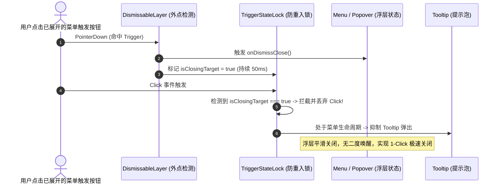
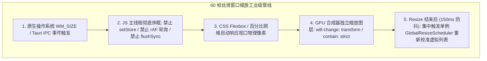
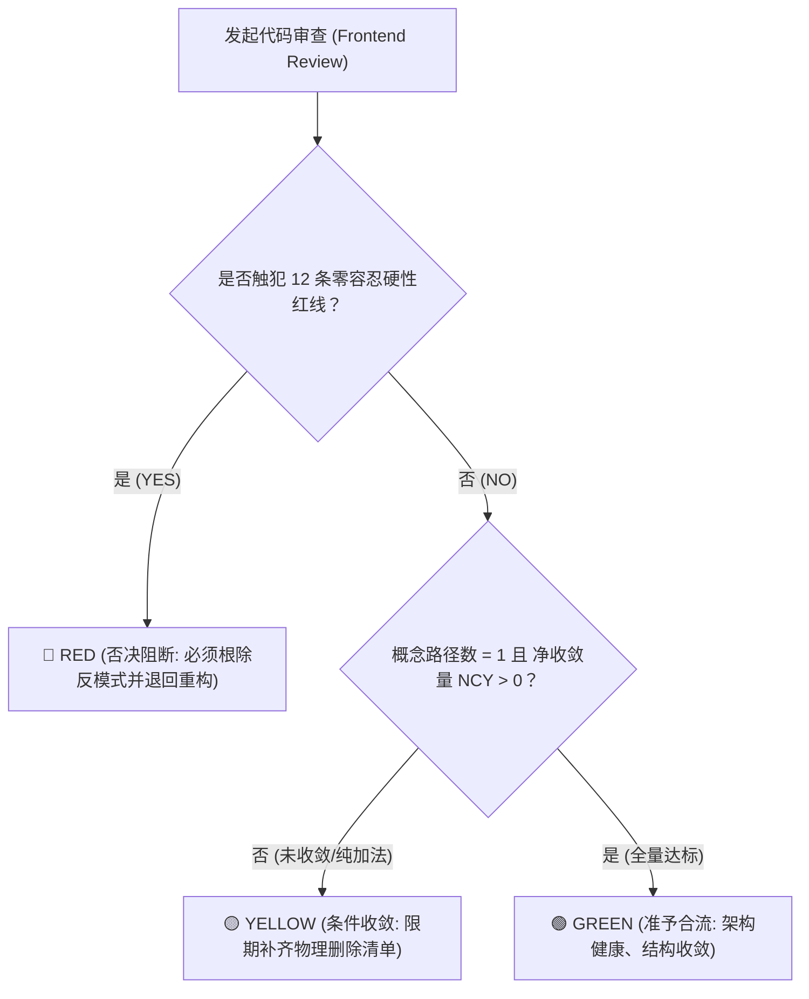

# 前端架构终极审查规范、系统级重构指南与全景收敛军规 (Master Ultimate Edition)

## Ultimate Frontend Architecture Review Specification, Refactoring Manual & Convergence Canon

> **文档权威地位**：本规范是全仓前端与桌面客户端工程（React / TypeScript / CSS Modules / Tauri / WebView2 混合架构）的**最高级别终极全景审查规范、架构重构指南与收敛军规基座 (Master Ultimate Edition)**。  
> **理论与实证依据**：
>
> 1. 深度提炼自 `docs/frontend-architecture-review/` 目录下全部 **27 份深度白盒审查报告**（基础框架 01~~05、业务分项 full-sweep 01~~16、深潜专检 deep-dives 01~06）的全量真实病理解剖；
> 2. 深度吸收工业级标杆勘察与落地指南（**AFFiNE Workspace Shell & BlockSuite**、**AppFlowy Rust 混合架构**、**DeepSeek-Harness 扩展微内核**、**Cursor / VS Code 现代桌面 IDE 交互规范**）；
> 3. 完整融合 `Candidate 1`、`Candidate 2`、`Candidate 3`、`Ultimate v1`、`Ultimate v2` 与《前端系统级重构实施大纲》之全部智慧结晶；
> 4. 严格贯彻《主控 Agent 协作指令》（`AGENTS.md`）与《反退避全文》（`.agents/LOGIC_PLAN_NO_RETREAT.md`）的全部铁律。
>
> **核心哲学**：**「正确性 × 收敛性」双目标函数** · **推进单位是领域概念而非杂乱批次** · **收敛/删除先于增强** · **一个概念一条路径** · **负产出验收** · **架构穿透零补丁**。  
> **生效纪律**：**刚性门禁、零容忍、不可退避、严禁运行编译测试命令**。严禁绕过类型检查与门禁（禁止 `--no-verify`），严禁无模式证据宣称「已解决/已收敛」。  
> **字符集与编码**：UTF-8 无 BOM。

---

# 目录索引 (Table of Contents)

- [卷首：权威定位、设计基准与元审查哲学 (Meta-Rules & Architectural Philosophy)](#卷首权威定位设计基准与元审查哲学-meta-rules--architectural-philosophy)
  - [0.1 「正确性 × 收敛性」双目标函数与数学收敛向量](#01-正确性--收敛性双目标函数与数学收敛向量)
  - [0.2 推进单位：领域概念驱动 vs 杂乱工程批次 (Domain Concept-Driven)](#02-推进单位领域概念驱动-vs-杂乱工程批次)
  - [0.3 收敛与净删除先于功能增强 (Delete-First Architecture)](#03-收敛与净删除先于功能增强-delete-first-architecture)
  - [0.4 单一概念唯一真理路径 (Single Truth Path per Concept)](#04-单一概念唯一真理路径-single-truth-path-per-concept)
  - [0.5 负产出验收机制与死代码驱逐 (Negative Code Yield & Asset Eviction)](#05-负产出验收机制与死代码驱逐-negative-code-yield--asset-eviction)
  - [0.6 架构穿透与零补丁、零坐标测距补偿铁律 (Zero Monkey-Patching)](#06-架构穿透与零补丁零坐标测距补偿铁律-zero-monkey-patching)
  - [0.7 三线并行穿透审计模型 (Three-Line Parallel Audit: Control, Data, Geometry)](#07-三线并行穿透审计模型-three-line-parallel-audit-control-data-geometry)
- [第一篇：通用现代前端架构审查规范 (Universal Frontend Architecture Canon)](#第一篇通用现代前端架构审查规范-universal-frontend-architecture-canon)
  - [维度一：状态拓扑、Store 物理分域与单向数据流 (State Topology & Store Slicing)](#维度一状态拓扑store-物理分域与单向数据流-state-topology--store-slicing)
    - [1.1 四级状态拓扑物理分域模型 (Four-Tier State Scoping Model)](#11-四级状态拓扑物理分域模型-four-tier-state-scoping-model)
    - [1.2 上帝 Store 与伪分域门面反模式 (The Pseudo-Facade Store Trap) 绝对清剿](#12-上帝-store-与伪分域门面反模式-the-pseudo-facade-store-trap-绝对清剿)
    - [1.3 细粒度原子选择器与巨型不可变对象解构 (Atomic Selectors & Subscription Penetration)](#13-细粒度原子选择器与巨型不可变对象解构-atomic-selectors--subscription-penetration)
    - [1.4 高频输入抖动与打字机本地缓冲隔离 (Keystroke Thrashing & Local Buffering)](#14-高频输入抖动与打字机本地缓冲隔离-keystroke-thrashing--local-buffering)
    - [1.5 呈现层视觉配置与 React 状态硬性解耦 (0-Re-render Direct DOM Presentation)](#15-呈现层视觉配置与-react-状态硬性解耦-0-re-render-direct-dom-presentation)
    - [1.6 回调引用恒定性与 React.memo 防护墙 (Reference Stability & Strict Memoization)](#16-回调引用恒定性与-reactmemo-防护墙-reference-stability--strict-memoization)
    - [1.7 环境基础设施 Props 穿透污染清除 (Ambient Capabilities & Prop-Drilling Elimination)](#17-环境基础设施-props-穿透污染清除-ambient-capabilities--prop-drilling-elimination)
  - [维度二：渲染性能、布局回流与虚拟滚动管线 (Rendering Pipeline & Layout Thrashing Prevention)](#维度二渲染性能布局回流与虚拟滚动管线-rendering-pipeline--layout-thrashing-prevention)
    - [2.1 0px 剧毒强制同步回流颠簸循环彻底根治 (Forced Synchronous Layout Thrashing)](#21-0px-剧毒强制同步回流颠簸循环彻底根治-forced-synchronous-layout-thrashing)
    - [2.2 纯 CSS `:hover` 驱动与 0-Re-render 悬浮微交互 (Zero-Re-render Hover Handles)](#22-纯-css-hover-驱动与-0-re-render-悬浮微交互-zero-re-render-hover-handles)
    - [2.3 动态高度虚拟滚动、分段前缀和树与反双重截断 (Dynamic Height & Fenwick Trees)](#23-动态高度虚拟滚动分段前缀和树与反双重截断-dynamic-height--fenwick-trees)
    - [2.4 单源原生滚动控制器与抗坍塌智能吸底锁 (Unified Scroll Controller & Anti-Collapse Lock)](#24-单源原生滚动控制器与抗坍塌智能吸底锁-unified-scroll-controller--anti-collapse-lock)
    - [2.5 布局隔离 (Layout Containment) 与 GPU 硬件加速图层提升](#25-布局隔离-layout-containment-与-gpu-硬件加速图层提升)
  - [维度三：原子设计系统、尺寸正交与几何同心圆角 (Atomic Design & Concentric Geometry)](#维度三原子设计系统尺寸正交与几何同心圆角-atomic-design--concentric-geometry)
    - [3.1 100% 原子组件覆盖与裸交互标签禁令 (Naked Tag Ban & Atomic Surface)](#31-100-原子组件覆盖与裸交互标签禁令-naked-tag-ban--atomic-surface)
    - [3.2 数学同心圆角几何定理与全站标准阶梯 ($R_{\text{outer}} = R_{\text{inner}} + \text{Padding}$)](#32-数学同心圆角几何定理与全站标准阶梯-r_textouter--r_textinner--textpadding)
    - [3.3 桌面端 0-药丸铁律与唯一白名单制度 (Anti-Pill Ban & Strict Whitelist)](#33-桌面端-0-药丸铁律与唯一白名单制度-anti-pill-ban--strict-whitelist)
    - [3.4 尺寸轴与变体轴正交契约 (Orthogonal Component Sizing & Variant Hijacking)](#34-尺寸轴与变体轴正交契约-orthogonal-component-sizing--variant-hijacking)
    - [3.5 表单与工具栏基线对齐与物理高差消除 (Toolbar & Form Baseline Normalization)](#35-表单与工具栏基线对齐与物理高差消除-toolbar--form-baseline-normalization)
    - [3.6 组件根容器解耦与 ClassName / ID 贯通 (Container Leakage & Prop Forwarding)](#36-组件根容器解耦与-classname--id-贯通-container-leakage--prop-forwarding)
  - [维度四：样式工程、Z-Index 层叠标尺与 CSS 卫生学 (Style Architecture & CSS Hygiene)](#维度四样式工程z-index-层叠标尺与-css-卫生学-style-architecture--css-hygiene)
    - [4.1 全局僵尸样式表物理清退与双重类名剥离 (Dead CSS Eviction & Dual-Class Cleanup)](#41-全局僵尸样式表物理清退与双重类名剥离-dead-css-eviction--dual-class-cleanup)
    - [4.2 业务层 0 `!important` 铁律与特异性分层 (Zero-`!important` Rule)](#42-业务层-0-important-铁律与特异性分层-zero-important-rule)
    - [4.3 7 级标准化 Z-Index 层叠标尺与多根 Portal 模型 (Strict Z-Index Scale & Multi-Root Portals)](#43-7-级标准化-z-index-层叠标尺与多根-portal-模型-strict-z-index-scale--multi-root-portals)
    - [4.4 幽灵 Token 纠偏与主题回退中立性 (Token Fallback Purity & Anti-Poisoned Fallbacks)](#44-幽灵-token-纠偏与主题回退中立性-token-fallback-purity--anti-poisoned-fallbacks)
    - [4.5 现代色彩空间 (HSLA / OKLCH) 与柔和激活态对比度 (Subdued Focus Rings)](#45-现代色彩空间-hsla--oklch-与柔和激活态对比度-subdued-focus-rings)
    - [4.6 原生 HTML `title` 绝对禁令与单例 `<Tooltip>` 协议](#46-原生-html-title-绝对禁令与单例-tooltip-协议)
  - [维度五：交互韧性、浮层协调与事件防死锁 (Overlay Protocol, Focus & Anti-Deadlock)](#维度五交互韧性浮层协调与事件防死锁-overlay-protocol-focus--anti-deadlock)
    - [5.1 非模态默认与 Trigger 防重入状态锁 (Non-Modal Default & Re-entrancy Lock, 根治四击 Bug)](#51-非模态默认与-trigger-防重入状态锁-non-modal-default--re-entrancy-lock-根治四击-bug)
    - [5.2 全局浮层互斥与 Tooltip 静默协议 (LayerStackManager & Tooltip Suppression)](#52-全局浮层互斥与-tooltip-静默协议-layerstackmanager--tooltip-suppression)
    - [5.3 滚动链边界与动量吸收黑洞根除 (Scroll Chaining & Anti-Overscroll Containment)](#53-滚动链边界与动量吸收黑洞根除-scroll-chaining--anti-overscroll-containment)
    - [5.4 级联子菜单 Safe Triangle 轨迹算法与 Portal 逃逸 (Safe Triangle & Submenu Raycasting)](#54-级联子菜单-safe-triangle-轨迹算法与-portal-逃逸-safe-triangle--submenu-raycasting)
    - [5.5 WAI-ARIA 语义树对齐与键盘漫游焦点保护 (WAI-ARIA & Keyboard Focus Retention)](#55-wai-aria-语义树对齐与键盘漫游焦点保护-wai-aria--keyboard-focus-retention)
  - [维度六：前端安全、错误边界与生命周期防腐 (Frontend Security & Resilience)](#维度六前端安全错误边界与生命周期防腐-frontend-security--resilience)
    - [6.1 富文本与 AI 流式输出 100% DOMPurify 净化与 XSS 防护](#61-富文本与-ai-流式输出-100-dompurify-净化与-xss-防护)
    - [6.2 细粒度面板级 ErrorBoundary 与影子退位容灾 (Panel ErrorBoundary & Shadow Abdication)](#62-细粒度面板级-errorboundary-与影子退位容灾-panel-errorboundary--shadow-abdication)
    - [6.3 严格删除截止日期与无声 Fallback 禁令 (Deprecated Expiration Tracking)](#63-严格删除截止日期与无声-fallback-禁令-deprecated-expiration-tracking)
- [第二篇：现代桌面 GUI、富文本与微内核专属审查规范 (Desktop, Rich-Text & Microkernel Canon)](#第二篇现代桌面-gui富文本与微内核专属审查规范-desktop-rich-text--microkernel-canon)
  - [维度七：桌面 Shell、原生窗口 Chrome 与视口几何 (Desktop Shell, Chrome & Viewport Geometry)](#维度七桌面-shell原生窗口-chrome-与视口几何-desktop-shell-chrome--viewport-geometry)
    - [7.1 36px~40px 沉浸式单层一体化顶栏 (Seamless Single Chrome Header)](#71-36px40px-沉浸式单层一体化顶栏-seamless-single-chrome-header)
    - [7.2 窗口拖拽区与交互控件安全切分 (`-webkit-app-region` 精准划分)](#72-窗口拖拽区与交互控件安全切分--webkit-app-region-精准划分)
    - [7.3 费茨定律 (Fitts's Law) 与滚动条物理极右贴边 (True Edge Scrollbar $X = W$)](#73-费茨定律-fittss-law-与滚动条物理极右贴边-true-edge-scrollbar-x--w)
    - [7.4 全屏模态全贴合与浮岛泥泞断层根除 (Seamless Split-Pane & Anti-Floating Island Inset)](#74-全屏模态全贴合与浮岛泥泞断层根除-seamless-split-pane--anti-floating-island-inset)
    - [7.5 贯通式 Hairline Sash 与平整 Morphing DropZone 遮罩](#75-贯通式-hairline-sash-与平整-morphing-dropzone-遮罩)
  - [维度八：跨进程 IPC 通信、GPU 缩放与 JS 彻底休眠 (IPC Bridge & Compositor-Driven Resize)](#维度八跨进程-ipc-通信gpu-缩放与-js-彻底休眠-ipc-bridge--compositor-driven-resize)
    - [8.1 窗口拖拽缩放「Zero-JS During Resize」铁律 (Compositor-driven Scaling)](#81-窗口拖拽缩放zero-js-during-resize铁律-compositor-driven-scaling)
    - [8.2 rAF 坐标轮询永动机彻底拔除 (Perpetual Polling Eviction)](#82-raf-坐标轮询永动机彻底拔除-perpetual-polling-eviction)
    - [8.3 布局解冻 `flushSync` 阻断与异步分批平滑消化 (No-flushSync on Thaw)](#83-布局解冻-flushsync-阻断与异步分批平滑消化-no-flushsync-on-thaw)
    - [8.4 IPC 事件防抖、去重与单向系统推送 (Reactive Wakeup vs Polling)](#84-ipc-事件防抖去重与单向系统推送-reactive-wakeup-vs-polling)
    - [8.5 双端真机调试基准 (CDP 9222) 与零 Mock 沙箱验收 (True Native Runtime Verification)](#85-双端真机调试基准-cdp-9222-与零-mock-沙箱验收-true-native-runtime-verification)
  - [维度九：声明式视图注册、动态 Slot 与微内核解耦 (ViewRegistry, Dynamic Slots & Microkernel Architecture)](#维度九声明式视图注册动态-slot-与微内核解耦-viewregistry-dynamic-slots--microkernel-architecture)
    - [9.1 声明式视图注册中心 (`ViewRegistry`) 与静态 `switch(panelId)` 彻底废除](#91-声明式视图注册中心-viewregistry-与静态-switchpanelid-彻底废除)
    - [9.2 四大声明式插槽拓扑形态 (`Single`, `List`, `Keyed`, `Chain`) 与强类型 `SlotMap`](#92-四大声明式插槽拓扑形态-single-list-keyed-chain-与强类型-slotmap)
    - [9.3 零布局污染插槽挂载容器 (`display: contents`)](#93-零布局污染插槽挂载容器-display-contents)
    - [9.4 纯几何二叉树工作区容器与业务判断剥离 (GenericBinaryTreeWorkspace)](#94-纯几何二叉树工作区容器与业务判断剥离-genericbinarytreeworkspace)
    - [9.5 孤儿视图与寄生挂载根治 (Orphaned Views & Parasitic Mounting Reclamation)](#95-孤儿视图与寄生挂载根治-orphaned-views--parasitic-mounting-reclamation)
    - [9.6 插件生命周期级联注销与统一全局浮层管理器 (`OverlayManager`)](#96-插件生命周期级联注销与统一全局浮层管理器-overlaymanager)
  - [维度十：富文本块级编辑、0-Re-render 与光标浮层 (Block Editor & Caret Floating Overlay)](#维度十富文本块级编辑0-re-render-与光标浮层-block-editor--caret-floating-overlay)
    - [10.1 500 Block 长文档纯 CSS 悬浮句柄与 0 次 React 重绘 (BlockSuite 0-Re-render)](#101-500-block-长文档纯-css-悬浮句柄与-0-次-react-重绘-blocksuite-0-re-render)
    - [10.2 绝对坐标 DOM 直写定位与浮动微件脱离 VDOM (Direct DOM Positioning)](#102-绝对坐标-dom-直写定位与浮动微件脱离-vdom-direct-dom-positioning)
    - [10.3 Slash 菜单 Caret 吸附与输入法合成状态保护 (IME Composition Guard & Focus Retention)](#103-slash-菜单-caret-吸附与输入法合成状态保护-ime-composition-guard--focus-retention)
    - [10.4 双轨编辑器代码漂移与单轨收敛 (Strict Single-Track Editor)](#104-双轨编辑器代码漂移与单轨收敛-strict-single-track-editor)
  - [维度十一：多会话作用域隔离、生命周期与纯净白板 (Session Lifecycle & Clean Slate Invariant)](#维度十一多会话作用域隔离生命周期与纯净白板-session-lifecycle--clean-slate-invariant)
    - [11.1 三级状态模型物理隔离 (Tier 1: Global vs Tier 2: Session vs Tier 3: Clean Draft)](#111-三级状态模型物理隔离-tier-1-global-vs-tier-2-session-vs-tier-3-clean-draft)
    - [11.2 空态绝对纯净不变量与动态胶囊门闩 (Clean Slate Invariant & Gatekeeper)](#112-空态绝对纯净不变量与动态胶囊门闩-clean-slate-invariant--gatekeeper)
    - [11.3 会话 Diff 纯函数派生与状态瞬时重算 (Pure Function Session Diff Derivation)](#113-会话-diff-纯函数派生与状态瞬时重算-pure-function-session-diff-derivation)
    - [11.4 沉浸式 2×2 自适应 Prompt 卡片网格与排版解耦 (Modern Empty State Grid)](#114-沉浸式-22-自适应-prompt-卡片网格与排版解耦-modern-empty-state-grid)
    - [11.5 双重确认意图隔离与高危权限独立门闩 (Double-Confirmation Intent Isolation)](#115-双重确认意图隔离与高危权限独立门闩-double-confirmation-intent-isolation)
  - [维度十二：工业级标杆（AFFiNE & AppFlowy）深度对标与反过度设计边界 (Benchmarking & Guardrails)](#维度十二工业级标杆affine--appflowy深度对标与反过度设计边界-benchmarking--guardrails)
    - [12.1 12 大核心痛点与标杆解决方案 1 对 1 映射攻坚表](#121-12-大核心痛点与标杆解决方案-1-对-1-映射攻坚表)
    - [12.2 必须借鉴吸收的工业级精髓 (Must Adopt)](#122-必须借鉴吸收的工业级精髓-must-adopt)
    - [12.3 坚决不盲目照搬的过度复杂机制 (Must Avoid)](#123-坚决不盲目照搬的过度复杂机制-must-avoid)
    - [12.4 架构决策平衡点：桌面 IDE AI 助手 vs 协同知识库](#124-架构决策平衡点桌面-ide-ai-助手-vs-协同知识库)
- [第三篇：前端核心反模式分类学 (AP-01 ~ AP-12 Anti-Patterns Taxonomy)](#第三篇前端核心反模式分类学-ap-01--ap-12-anti-patterns-taxonomy)
- [第四篇：系统级重构清剿与 7 大深层难题彻底解法 (Deep Problem Solutions & Purge List)](#第四篇系统级重构清剿与-7-大深层难题彻底解法-deep-problem-solutions--purge-list)
  - [4.1 首批物理删除清单 (Purge List: 9,296 行历史垃圾代码彻底清剿)](#41-首批物理删除清单-purge-list-9296-行历史垃圾代码彻底清剿)
  - [4.2 7 大深层难题根因解剖与标准重构落地解法](#42-7-大深层难题根因解剖与标准重构落地解法)
    - [难题 1：重塑总览面板 36 改动文件树 (`buildGitTree` 树状折叠 + `GitStatusBadge` 胶囊 + 弹性视口)](#难题-1重塑总览面板-36-改动文件树)
    - [难题 2：重塑 Diff 差异对比视图 (34px 单行 Header + 5.5% 柔和底色 + 词法级 Intraline Diff)](#难题-2重塑-diff-差异对比视图)
    - [难题 3：彻底根除四击关闭 Bug (`LayerStackManager` + Trigger 50ms 冷却状态锁 + Tooltip 150ms 互斥)](#难题-3彻底根除四击关闭-bug)
    - [难题 4：重构供应商级联选择解决 Hover 闪退 (标准 Radix `DropdownMenu.Sub` + Safe Triangle + 全量开放凭据)](#难题-4重构供应商级联选择解决-hover-闪退)
    - [难题 5：修复设置页右下 8px 灰褐色断层与全屏无差别重刷 (全贴合无缝双栏 + 滚动条贴边 + DOM 直写 0-Re-render)](#难题-5修复设置页右下-8px-灰褐色断层与全屏无差别重刷)
    - [难题 6：修复全窗体拖拽调整宽高卡顿 (拔除 rAF 轮询 + 废除 `flushSync` + GPU 图层隔离)](#难题-6修复全窗体拖拽调整宽高卡顿)
    - [难题 7：根治新会话空态状态污染 (会话专属 Diff 纯函数派生 + `ChatStatusRibbons` 增加 `!onEmptySurface` 绝对门闩)](#难题-7根治新会话空态状态污染)
- [第五篇：效用度量数学模型、缺陷分级与 12 条零容忍红线 (Metrics, Severity & Redlines)](#第五篇效用度量数学模型缺陷分级与-12-条零容忍红线-metrics-severity--redlines)
  - [5.1 架构质量双目标综合评分数学模型](#51-架构质量双目标综合评分数学模型)
  - [5.2 缺陷分级标准与阻断规则 (P0 Blocker / P1 Major / P2 Minor)](#52-缺陷分级标准与阻断规则-p0-blocker--p1-major--p2-minor)
  - [5.3 12 条零容忍硬性质量红线 (RED-01 ~ RED-12)](#53-12-条零容忍硬性质量红线-red-01--red-12)
  - [5.4 评审结论判定流图 (RED / YELLOW / GREEN)](#54-评审结论判定流图-red--yellow--green)
  - [5.5 完成定义、假关与假收敛判定标准 (False Closure & False Convergence)](#55-完成定义假关与假收敛判定标准-false-closure--false-convergence)
- [第六篇：CI/CD 自动化门禁阻断、自检清单与验收矩阵 (CI Gates, Checklist & Matrix)](#第六篇cicd-自动化门禁阻断自检清单与验收矩阵-ci-gates-checklist--matrix)
  - [6.1 CI/CD 自动化门禁流水线阻断基线](#61-cicd-自动化门禁流水线阻断基线)
  - [6.2 三阶段演进实施路线图 (Phase 1: Safe Purge -> Phase 2: Core Refactor -> Phase 3: Microkernel Cutover)](#62-三阶段演进实施路线图-phase-1-safe-purge---phase-2-core-refactor---phase-3-microkernel-cutover)
  - [6.3 15 项黄金自检清单 (Reviewer 15 Golden Self-Inspection Checklist C-01 ~ C-15)](#63-15-项黄金自检清单-reviewer-15-golden-self-inspection-checklist-c-01--c-15)
  - [6.4 终态验收断言与收敛度量矩阵表 (Convergence Verification Matrix)](#64-终态验收断言与收敛度量矩阵表-convergence-verification-matrix)

---

# 卷首：权威定位、设计基准与元审查哲学 (Meta-Rules & Architectural Philosophy)

```
┌──────────────────────────────────────────────────────────────────────────────────────────────────┐
│               前端系统架构 Review 评审规范与收敛军规全景矩阵 (Master Ultimate Edition)              │
├─────────────────────────────────────────────────────────────────┬────────────────────────────────┤
│  第一篇：通用现代前端架构审查规范 (Universal Frontend Canon)        │  第二篇：桌面 GUI 与微内核专属审查规范 (Desktop & Kernel)       │
├─────────────────────────────────────────────────────────────────┼────────────────────────────────┤
│  维度一：状态拓扑、Store 物理分域与单向数据流                    │  维度七：桌面 Shell、原生窗口 Chrome 与视口几何  │
│  维度二：渲染性能、布局回流与虚拟滚动管线                        │  维度八：跨进程 IPC 通信、GPU 缩放与 JS 休眠   │
│  维度三：原子设计系统、尺寸正交与几何同心圆角                    │  维度九：声明式视图注册、动态 Slot 与微内核解耦 │
│  维度四：样式工程、Z-Index 层叠标尺与 CSS 卫生学                 │  维度十：富文本块级编辑、0-Re-render 与光标浮层 │
│  维度五：交互韧性、浮层协调与事件防死锁                          │  维度十一：多会话作用域隔离、生命周期与纯净白板 │
│  维度六：前端安全、错误边界与生命周期防腐                        │  维度十二：AFFiNE & AppFlowy 标杆对标与防过度设计│
├─────────────────────────────────────────────────────────────────┴────────────────────────────────┤
│  第三篇：前端核心反模式分类学 (AP-01 ~ AP-12 Anti-Patterns Taxonomy & Deletion Decision Tree)      │
│  第四篇：系统级重构清剿 (9,296 行垃圾删除) 与 7 大深层难题彻底解法 (Tree/Diff/QuadClick/Cascade/Cover/Resize/Clean) │
│  第五篇：效用度量数学模型、P0/P1/P2 缺陷分级、12 条零容忍红线与假关/假收敛判定标准                │
│  第六篇：CI/CD 自动化门禁阻断、三阶段演进路线、15 项黄金自检清单 (C-01~C-15) 与终态验收矩阵      │
└──────────────────────────────────────────────────────────────────────────────────────────────────┘
```

---

### 0.1 「正确性 × 收敛性」双目标函数与数学收敛向量

前端架构审计绝不是泛泛而谈的代码格式核查，而是对系统**「可维护性、复杂度熵值与运行期开销」**的严格双目标优化过程：

$$\mathbf{U_{\text{review}}} = \mathcal{C}_{\text{correctness}}(\Delta) \times \mathcal{S}_{\text{convergence}}(\Delta)$$

其中：

1. **$\mathcal{C}_{\text{correctness}} \in \{0, 1\}$ 为刚性布尔指示函数**：
   当且仅当系统满足核心状态不变量成立、类型检查零报错（`tsc --noEmit` 0 错误）、关键测试套件全绿、视觉无断层且无交互死锁时为 $1$；只要出现任何功能降级、状态跨域越界、或者使用 `--no-verify` 绕过门禁，直接归零（$U = 0$），**PR / 交付判定一票否决**。
2. **$\mathcal{S}_{\text{convergence}}$ 为收敛性得分向量**：
   $$\mathcal{S}_{\text{convergence}} = \Delta N_{\text{deleted}} - \alpha \cdot \Delta N_{\text{added}} - \beta \cdot \Delta N_{\text{branches}} - \gamma \cdot \Delta N_{\text{adapters}}$$
   - $\Delta N_{\text{deleted}}$：物理删除的废弃代码行数、死样式行数、孤儿组件数；
   - $\Delta N_{\text{added}}$：新增的基础设施与原子实现代码行数；
   - $\Delta N_{\text{branches}}$：条件分支数（`if-else`, `switch-case`）；
   - $\Delta N_{\text{adapters}}$：为兼容旧实现而临时包裹的 Facade、Adapter、别名或桥接层数量。

**收敛判据铁律**：重构工作的推进必须使得系统总复杂度状态空间单调递减：
$$\frac{\partial \text{Complexity}}{\partial t} < 0, \quad \frac{\partial \text{Codebases}}{\partial t} \le 0$$

---

### 0.2 推进单位：领域概念驱动 vs 杂乱工程批次

- **领域概念驱动（Domain Concept-Driven）**：推进与审查的唯一合法单元是完整的「领域概念」（例如：浮层调度互斥栈、视图动态注册中心、视口几何贴边、原子圆角标尺）。每一个概念的收敛必须一次性拉通「契约定义 $\to$ 底层状态流 $\to$ 原子 UI 呈现 $\to$ 历史实现全量物理删除 $\to$ 自动化测试与真机验收」。
- **严禁叙事性批次**：严禁出现 `Batch1`、`Round2`、`Wave3`、`_w4c_` 等按文件行数机械切割的临时命名，所有模块与变量必须使用纯粹的领域词汇（Domain Words）。

---

### 0.3 收敛与净删除先于功能增强 (Delete-First Architecture)

- **先死代码清障，后新架构落盘**：在引入任何新组件库、状态切片或扩展机制前，必须先将对应领域的历史旧代码、废弃 CSS 选择器、孤儿文件全部物理抹除；
- **严禁带伤共存（No Parallel Legacy Existence）**：严禁在代码库中长期保留「新版组件」与「旧版组件」双轨并存（如 `Button` 与 `LegacyButton`、`Select` 与 `OldSelect`）。一旦新契约就绪，必须在一轮操作中全量替换并立即物理删除旧实现。

---

### 0.4 单一概念唯一真理路径 (Single Truth Path per Concept)

系统内任意一个架构概念或业务能力，在整个前端代码库中**有且仅有一条唯一的执行路径与真相源（Single Source of Truth）**：

- 弹窗浮层有且仅有一套 `OverlayManager` / `LayerStackManager` 栈，严禁各业务各自 `createPortal` 随处乱挂；
- 下拉选择有且仅有一套 `Select` / `Menu` 原子组件，严禁业务模块各写一套带有内联定位的弹出菜单；
- 窗口尺寸变动有且仅有一个全局低频防抖通道，严禁全仓散落 10+ 处未受管控的原生 `window.addEventListener('resize')` 与裸 `new ResizeObserver`；
- 样式定义有且仅有一套 Design Tokens 标尺，严禁局部手写魔术数字或私设并行的 CSS 变量别名。

---

### 0.5 负产出验收机制与死代码驱逐 (Negative Code Yield & Asset Eviction)

优秀的架构重构必然伴随着代码库的**瘦身与净负产出（Negative Code Yield）**：

- **重构验收黄金指标**：功能 100% 完备对齐前提下的 **净删除代码行数（Net Deleted Lines $\Delta\text{LOC} < 0$）**；
- **死代码零容忍**：
  - 零引用的组件、类型定义、Hook 必须在审查中作为阻断项标出并物理删除；
  - 被注释掉的历史代码块（Commented-out Code）一律直接物理删除，版本控制历史交由 Git 负责，严禁在源码中留下视觉杂乱与认知干扰；
  - 随死代码删除的配套测试属于「陪葬测试」，清除陪葬测试是结构收敛的必然要求。

---

### 0.6 架构穿透与零补丁、零坐标测距补偿铁律 (Zero Monkey-Patching)

- **严禁魔术数字与临时补丁**：严禁使用盲目猜测的遍历循环、基于坐标测距的魔术数字补偿（如 `bottom: 148px` 定位 FAB、负边距 `margin: -4px -16px` 抵消 Padding）、或外挂 `setTimeout(..., 400)` 竞态延时；
- **穿透根治**：所有布局断层与事件冲突必须在**盒模型根节点、事件捕获分发机制、W3C 标准属性与 DOM 拓扑**层进行架构级根治。

---

### 0.7 三线并行穿透审计模型 (Three-Line Parallel Audit: Control, Data, Geometry)

任何前端与桌面端代码审查，必须同时拉通以下**三条审计基线**，形成闭环证据链：

```
                    ┌─────────────────────────────────────────────────────────┐
                    │               三线并行穿透审计模型                        │
                    └─────────────────────────────────────────────────────────┘
                                                 │
         ┌───────────────────────────────────────┼───────────────────────────────────────┐
         ▼                                       ▼                                       ▼
【控制流审计线 (Control Line)】         【数据流审计线 (Data Line)】           【几何流审计线 (Geometry Line)】
• 异步加载竞态与草稿覆盖                 • 上帝 Store 伪门面解构               • 盒模型与 Fitts's Law 贴边
• Radix 浮层事件争抢与重入锁             • 细粒度原子选择器订阅                 • 同心圆角定理 R_out=R_in+P
• 级联注销与生命周期泄露                 • 跨会话/全局脏状态物理隔离           • 36px 沉浸顶栏与拖拽区安全
• 强制同步回流 (Forced Reflow)          • 0-Re-render 本地缓冲流式输出        • 7 级严格 Z-Index 与多根 Portal
```

---

# 第一篇：通用现代前端架构审查规范 (Universal Frontend Architecture Canon)

---

## 维度一：状态拓扑、Store 物理分域与单向数据流 (State Topology & Store Slicing)

### 1.1 四级状态拓扑物理分域模型 (Four-Tier State Scoping Model)

状态存储必须严格划分为 4 个生命周期独立的物理分域，严禁跨域混杂：

| 状态层级                         | 范畴与生命周期                                     | 典型数据定义                               | 法定呈现区域                           | 绝对禁止越界区域                   |
| :------------------------------- | :------------------------------------------------- | :----------------------------------------- | :------------------------------------- | :--------------------------------- |
| **Tier 1: Durable Store**        | 用户配置、工作区元数据（本地持久化落盘）           | 本地 Git 物理变更、Daemon 任务、全局配置   | 侧栏 Badge、全局状态栏、独立 Diff 面板 | **严禁注入局部会话卡片内部**       |
| **Tier 2: Session-Scoped Store** | 当前活跃会话消息流、局部执行计划（随会话销毁释放） | 本会话实际产生的修改文件、专属 Goal/Plan   | 消息流卡片、对话进行中底部动态状态条   | 仅在当前会话产生实际数据后呈现     |
| **Tier 3: Layout & Shell Store** | 瞬态 UI 窗口形态（内存瞬态记忆）                   | 分屏二叉树拓扑、侧栏折叠宽度、面板展开比例 | 二叉树工作区容器、拖拽 Sash            | 严禁与业务会话强绑定               |
| **Tier 4: Clean Draft State**    | 未发送任何消息的纯净空白起跑线                     | 新建欢迎空白态、打字机临时草稿             | 欢迎引导面、快捷 Prompt 网格           | **绝对物理阻断一切运行期动态胶囊** |

---

### 1.2 上帝 Store 与伪分域门面反模式 (The Pseudo-Facade Store Trap) 绝对清剿

- **反模式病理解剖**：形式上导出多个看似独立的领域 Store Hook（如 `useUserStore`、`useDocumentStore`、`useLayoutStore`），但底层实质上全部是指向同一个巨型全局单例 Store 的引用别名（`export const useDocumentStore = useLayoutStore;`）。Zustand / Redux 在单个 Store 内维护单一事件分发总线，任何领域的细微写操作均会唤醒该 Store 的全量订阅者执行 Selector，击穿状态隔离假象。
- **治理断言**：**物理分域**。不同生命周期与领域的业务状态必须声明为完全独立的 Store 实例，严禁同体别名。单一物理 Store 内的 Action 数量严禁超过 20 个。

```mermaid
graph TD
    subgraph AntiPattern [反模式: 伪门面共享单一事件总线]
        MutateAction[修改设置项 Action] --> GodStore[巨型单例 Store]
        GodStore -->|全局状态广播| Facade1[useDocumentStore 订阅者]
        GodStore -->|全局状态广播| Facade2[useSessionStore 订阅者]
        GodStore -->|全局状态广播| Facade3[useLayoutStore 订阅者]
        Facade1 --> ReRender1[所有文档组件无差别重绘!]
        Facade2 --> ReRender2[所有会话卡片无差别重绘!]
    end

    subgraph BestPractice [标杆设计: 物理强隔离领域 Store]
        SettingsAction[修改设置项 Action] --> SettingsStore[独立 SettingsStore]
        SettingsStore -->|仅通知局部订阅| SettingsComponent[设置面板局部重绘 (< 2ms)]
        DocStore[独立 DocumentStore] -.->|完全零唤醒| DocComponent[文档视图 0 重绘]
    end
```

---

### 1.3 细粒度原子选择器与巨型不可变对象解构 (Atomic Selectors & Subscription Penetration)

- **反模式病理解剖**：视图组件直接订阅整个巨型配置对象（如 `const appSettings = useSettingsStore(s => s.appSettings);`）。当无关字段（如 `settings.markdownIndent`）变更导致根对象引用变化时，全站订阅了根对象的组件全部被强行唤醒并触发 VDOM Diffing。
- **治理断言**：**推行原子选择器（Atomic Selectors）**。禁止直接订阅根对象，必须提供并消费按字段原子化的不可变 Selector：

```typescript
// ❌ 错误：粗粒度订阅巨型对象，引发广泛误唤醒
const appSettings = useSettingsStore((s) => s.appSettings);
const isQueueMode = Boolean(appSettings?.queueMode);

// ✅ 正确：细粒度原子选择器，仅当布尔值改变时才唤醒当前组件
const isQueueMode = useSettingsStore(
  useCallback((s) => Boolean(s.appSettings?.queueMode), [])
);
```

---

### 1.4 高频输入抖动与打字机本地缓冲隔离 (Keystroke Thrashing & Local Buffering)

- **反模式病理解剖**：输入框 `onChange` 直接同步写入全局会话 Store，或流式输出（Streaming Token）每接收到一个字符就直接执行全局不可变状态浅拷贝与全树广播，导致主线程每秒经历数十次 VDOM Diffing、GC 与强制同步回流。
- **治理断言**：
  1. 用户输入态使用局部 `useState` 或原生 DOM `ref.value` 维持瞬态；
  2. 流式 Token 使用底层非受控 `StreamingBuffer` 原生直写，通过 `requestAnimationFrame` 定频（30fps/60fps）向外同步渲染快照；
  3. 组合输入法（IME Composition）激活期间严禁向外部广播状态更新。

---

### 1.5 呈现层视觉配置与 React 状态硬性解耦 (0-Re-render Direct DOM Presentation)

- **反模式病理解剖**：将纯呈现层的视觉配置（深浅主题 Theme、UI 缩放密度 Density、窗口风格 Shell Chrome Mode）作为顶层 React State 存入全局 Store，并在根组件（`App.tsx`）的 JSX 属性上进行动态绑定，导致切换主题时引发整颗 React VDOM 树全量销毁与重建。
- **治理断言**：外观配置项直接调用 `document.documentElement.setAttribute('data-theme', theme)` 与 LocalStorage 缓存；**React 组件重渲染次数必须恒为 0**，样式由 CSS 自定义属性与选择器原生继承生效。

---

### 1.6 回调引用恒定性与 React.memo 防护墙 (Reference Stability & Strict Memoization)

- **反模式病理解剖**：父组件向下传递内联箭头函数（`onClick={() => setOpen(true)}`），导致子组件的 `React.memo` 浅比较判定恒为 `false`。
- **治理断言**：传递给记忆化组件的回调函数必须 100% 经由 `useCallback` 包裹或收敛为无参稳定 Action，依赖项中严禁包含无关的整包 State。

---

### 1.7 环境基础设施 Props 穿透污染清除 (Ambient Capabilities & Prop-Drilling Elimination)

- **反模式病理解剖**：将属于环境级正交能力的方法（如 `onShowToast`、`openModal`、`navigate`）作为组件 Props，跨越 3~8 层纯展示组件逐层向下透传（Prop-Drilling），破坏中间组件的通用性，且内联回调引用失效直接击穿下游所有 `React.memo` 防线。
- **治理断言**：全局横切关注点必须统一通过 **React Context + 自定义 Hook** 或专用单例事件引擎（如 `useToast()`、`OverlayManager`）消费，严禁跨超过 2 层人工传递。

---

## 维度二：渲染性能、布局回流与虚拟滚动管线 (Rendering Pipeline & Layout Thrashing Prevention)

### 2.1 0px 剧毒强制同步回流颠簸循环彻底根治 (Forced Synchronous Layout Thrashing)

- **反模式病理解剖**：在单次事件循环中交替执行「DOM 写操作」与「DOM 读操作」：

```typescript
// ❌ 剧毒回流绞肉机模式 (Layout Thrashing)
function badAutoGrow(el: HTMLTextAreaElement) {
  el.style.height = '0px'; // [DOM 写] 使得整个排版树失效 (Dirty)
  const cs = getComputedStyle(el); // [DOM 读] 强制浏览器立即执行全树重排 (Reflow 1)
  const scrollH = el.scrollHeight; // [DOM 读] 再次强制同步重排 (Reflow 2)
  el.style.height = `${scrollH}px`; // [DOM 写] 再次修改几何尺寸
}
```

- **治理断言**：
  1. 优先使用现代 CSS 规范 `field-sizing: content` 替代 JS 动态高度测量；
  2. 必须在 JS 中测量时，遵循「集中只读测量 $\to$ 计算 $\to$ 在 `requestAnimationFrame` 中集中写」的绝对分离原则。

---

### 2.2 纯 CSS `:hover` 驱动与 0-Re-render 悬浮微交互 (Zero-Re-render Hover Handles)

- **反模式病理解剖**：在长列表或包含 500 个子块的文档树中，为每个项绑定 `onMouseEnter` 并通过 `useState`（如 `setHoveredBlockId` 或 `bumpChromeTick()`）驱动悬浮把手显示，导致鼠标划过文档产生高达 **10,000 次无意义的 VDOM Diff**。
- **治理断言（BlockSuite 0-Re-render 规范）**：
  1. 操作把手（Drag Handle）与状态高亮的显隐必须 **100% 由纯 CSS `:hover` 伪类驱动**；
  2. 绝对定位单例把手直写：全局维护单一浮动把手 DOM 节点，通过原生 `mousemove` 节流直写 `transform: translate3d(x, y, 0)`，**0 React State 变更、0 VDOM 协调**。

---

### 2.3 动态高度虚拟滚动、分段前缀和树与反双重截断 (Dynamic Height & Fenwick Trees)

- **反模式病理解剖**：
  1. **双重截断（Double Windowing）**：上层执行业务数组切片（`messages.slice(-20)` 并提供「查看更早」），下层又套用虚拟滚动引擎，抹杀虚拟滚动优势并在展开时引发剧烈跳动；
  2. **空白占位抖动（Spacer Div Shift）**：使用动态高度的空 `div` 撑开容器导致可视区几何跳动；
  3. **O(N) 线性全量扫描重建**：动态高度变动时全量清空偏移缓存并从索引 0 重新线性累加。
- **治理断言**：
  1. 消除业务级逻辑截断，全量数据统一委托给单一虚拟滚动引擎；
  2. 采用绝对定位 `transform: translate3d(0, offsetY, 0)` 配合单一总高轨道渲染可视项；
  3. 引入**分段块前缀和（Chunked Prefix Sum, Chunk Size = 32）**或**树状数组（Fenwick Tree）**，将高度更新与查询复杂度严格限制在 $O(\log N)$ 或 $O(\sqrt{N})$。

---

### 2.4 单源原生滚动控制器与抗坍塌智能吸底锁 (Unified Scroll Controller & Anti-Collapse Lock)

- **反模式病理解剖**：自动滚动 Hook 与虚拟滚动引擎各自运行独立的 rAF 调度，导致视口渲染滞后 1 帧产生肉眼可见闪烁；当思考折叠框收起导致内容高度瞬间暴降 200px 时，系统误判为「用户主动向上滚动」而永久解离吸底。
- **治理断言**：
  1. **单源滚动控制器**：视口尺寸、`scrollTop` 追踪与流式吸底锁必须合并在同一个控制器状态机中；
  2. **抗坍塌流式吸附锁 (Stick-to-Bottom Lock)**：在流式生成期间设立强吸附锁；当高度坍塌时自动校准 `scrollTop` 紧贴底部，严禁将高度收缩误判为用户打断。

---

### 2.5 布局隔离 (Layout Containment) 与 GPU 硬件加速图层提升

- **治理断言**：工作区画布、分屏叶子节点与虚拟列表必须应用 CSS 排版隔离：

```css
[data-tree-canvas='true'] {
  contain: layout size;
  transform: translateZ(0); /* 提升至独立 GPU 合成图层 */
  will-change: width, height;
}
[data-leaf-id] {
  contain: strict; /* 彻底隔离内部 Reflow，禁止向上传导 */
}
```

---

## 维度三：原子设计系统、尺寸正交与几何同心圆角 (Atomic Design & Concentric Geometry)

### 3.1 100% 原子组件覆盖与裸交互标签禁令 (Naked Tag Ban & Atomic Surface)

- **反模式病理解剖**：全仓散落数百处原生 `<button>`、`<input>`、`<textarea>`、`<select>`，或使用 `div` 随意拼凑仿制按钮，缺乏统一键盘无障碍（A11y）、统一 Focus Ring 与统一 Disabled 态。
- **治理断言**：**100% 消费原子组件**。业务层必须 100% 消费统一封装的 `Button`、`IconButton`、`Input`、`Textarea`、`Select`、`SegmentedControl`、`Badge`、`Dialog`、`Tooltip`，全仓严禁散落裸交互标签。

---

### 3.2 数学同心圆角几何定理与全站标准阶梯 ($R_{\text{outer}} = R_{\text{inner}} + \text{Padding}$)

- **数学定理依据**：嵌套容器的内圆角必须严格满足同心几何定理：
  $$\mathbf{R_{\text{outer}} = R_{\text{inner}} + \text{Padding}}$$
  $$\text{当 } R_{\text{outer}} < \text{Padding} \text{ 时，内层必须为直角（} R_{\text{inner}} = 0 \text{）}$$

```
┌───────────────────────────────────────────────────────────────────┐
│                    标准工业级同心圆角几何体系分解                    │
│                                                                   │
│  [外层浮层/弹窗 Dialog/Overlay]   Radius = 12px,  Padding = 4px    │
│  ┌─────────────────────────────────────────────────────────────┐  │
│  │  [中层容器/卡片 Panel/Card]    Radius = 8px  (12px - 4px = 8px) │  │
│  │  ┌───────────────────────────────────────────────────────┐  │  │
│  │  │  [内层控件/按钮 Control]    Radius = 6px  (Padding = 2px)│  │  │
│  │  │  ┌─────────────────────────────────────────────────┐  │  │  │
│  │  │  │ [微型标签/徽标 Badge]   Radius = 4px            │  │  │  │
│  │  │  └─────────────────────────────────────────────────┘  │  │  │
│  │  └───────────────────────────────────────────────────────┘  │  │
│  └─────────────────────────────────────────────────────────────┘  │
└───────────────────────────────────────────────────────────────────┘
```

- **全站标准阶梯白名单**：
  - **12px (`var(--radius-xl)`)**：全屏模态窗口、顶层浮层面板外壳；
  - **8px (`var(--radius-lg)`)**：卡片容器、下拉菜单 Content、设置项大外框；
  - **6px (`var(--radius-md)`)**：标准输入框、标准按钮、Tab 选项卡、Select 触发器；
  - **4px (`var(--radius-sm)`)**：微型图标按钮（IconButton）、状态徽标（Badge）、键盘快捷键键帽（Kbd）。

---

### 3.3 桌面端 0-药丸铁律与唯一白名单制度 (Anti-Pill Ban & Strict Whitelist)

- **反模式病理解剖**：在矩形桌面 IDE / 工具软件中滥用 `border-radius: 9999px` 或 `radius-full`，左右半圆过度侵吞水平内边距，挤压多字符文本，并与 6px 矩形输入框产生严重的几何撕裂与玩具感。
- **治理断言与唯一白名单**：
  - ❌ **绝对禁止**：在常规 Button、IconButton、Input、Card、Toolbar、Modal 上使用 9999px 圆角；
  - ✅ **唯一合法白名单**：
    1. `Switch` 滑块轨道与滑块圆点；
    2. `Avatar` 用户头像与单选框圆点（`border-radius: 50%`）；
    3. 特殊动态音频呼吸指示灯（Status Pulse Dot）。

---

### 3.4 尺寸轴与变体轴正交契约 (Orthogonal Component Sizing & Variant Hijacking)

- **反模式病理解剖**：外观变体类（如 `.buttonDanger` 或 `.buttonGhost`）除了定义颜色外，还强行重写了 `height: 28px` 或 `padding: 0 4px`，导致组合使用 `size="lg"` 与 `variant="danger"` 时尺寸被意外覆盖。
- **治理断言**：
  - **尺寸轴（Size）** 独占控制：`height`, `min-height`, `padding`, `font-size`, `gap`；
  - **变体轴（Variant）** 独占控制：`background-color`, `border-color`, `color`, `box-shadow`；
  - 控件高度标准化阶梯：**24px (xs) / 28px (sm) / 32px (md) / 40px (lg)**，严禁魔术数字。

---

### 3.5 表单与工具栏基线对齐与物理高差消除 (Toolbar & Form Baseline Normalization)

- **反模式病理解剖**：同一行工具栏中，左侧下拉框缺省使用 32px（6px 圆角），右侧按钮显式使用 28px（药丸圆角），产生 4px 高度落差与基线上下晃动。
- **治理断言**：同一工具栏容器内的所有子控件（Input, Select, Button, IconButton）必须强制统一为**相同尺寸档位**（如紧凑型统一 `size="sm"` 28px，标准型统一 `size="md"` 32px），统一垂直对齐 `align-items: center`。

---

### 3.6 组件根容器解耦与 ClassName / ID 贯通 (Container Leakage & Prop Forwarding)

- **治理断言**：
  1. 组件接收的 `className`、`style` 必须严格作用于最外层包装节点，特定子元素的样式必须通过具名 Props（如 `triggerClassName`）独立传递；
  2. 组件内部 `id` 计算必须遵循 `const finalId = externalId ?? autoId;`，确保外部 `<label htmlFor={id}>` 与 ARIA 关系精准贯通，严禁 ID 孤岛。

---

## 维度四：样式工程、Z-Index 层叠标尺与 CSS 卫生学 (Style Architecture & CSS Hygiene)

### 4.1 全局僵尸样式表物理清退与双重类名剥离 (Dead CSS Eviction & Dual-Class Cleanup)

- **反模式病理解剖**：历史全局样式表早已废弃但仍在顶层引入，组件 TSX 节点同时绑定了 `styles.foo` 与全局类名 `foo`（如 `className={`${styles.mrdModelRow} mrd-model-row`}`），引发多代样式级联竞争。
- **治理断言**：废除一切全局业务样式表，全面收敛为局部作用域 CSS Modules；物理删除旧 `.css` 文件，并彻底清空 TSX 中的双重类名绑定。单个 CSS Module 严格限制在 **400 行**以内。

---

### 4.2 业务层 0 `!important` 铁律与特异性分层 (Zero-`!important` Rule)

- **治理断言**：**业务组件与 CSS Modules 中 `!important` 的出现频次必须恒为 0**。特异性问题必须通过模块化作用域（CSS Modules）、CSS `@layer` 或 CSS 自定义属性从根源解决，严禁特异性军备竞赛。

---

### 4.3 7 级标准化 Z-Index 层叠标尺与多根 Portal 模型 (Strict Z-Index Scale & Multi-Root Portals)

- **反模式病理解剖**：遇到遮挡问题随意设置 `z-index: 9999`、`13000`、`20060`、`100000`，导致 Tooltip 被设置面板遮挡或穿透。
- **治理断言（标准 7 级 Z-Index 语义标尺）**：

```css
:root {
  --z-base: 0; /* 普通文档流、代码编辑器、卡片背景 */
  --z-dock: 10; /* 粘性表头、叶子面板内部浮动 TabBar、底部吸附条 */
  --z-chrome: 100; /* 顶栏 AppTopBar、侧边栏 Navigation */
  --z-dropdown: 300; /* 下拉菜单 Menu、Select Listbox、Combobox (#popover-root) */
  --z-popover: 500; /* 悬浮卡片、Slash 菜单、颜色选择器 (#popover-root) */
  --z-modal: 1000; /* 模态对话框 Dialog、全屏设置 Cover (#modal-root) */
  --z-tooltip: 9000; /* 全局轻量气泡 Tooltip (#tooltip-root) */
}
```

- **多根 Portal 隔离铁律**：应用必须在 `document.body` 下预置独立的 DOM 挂载点（`#popover-root`, `#modal-root`, `#tooltip-root`），浮层严禁随处插入局部组件内部，彻底根除由于父级 `transform` / `filter` / `isolation` 引发的层叠上下文截断。

---

### 4.4 幽灵 Token 纠偏与主题回退中立性 (Token Fallback Purity & Anti-Poisoned Fallbacks)

- **反模式病理解剖**：在 CSS 变量调用中书写了写死的深色回落值（如 `color: var(--text-primary, #f8fafc)`）。在浅色模式下若变量未定义，文字回落为白色直接与浅色背景融为一体形成「视觉盲文」。
- **治理断言**：CSS 变量的回退值必须是**主题中立的**（如 `currentColor`、`transparent`）或者是另一个抽象 Design Token（如 `var(--text-primary, var(--fallback-text))`），严禁出现裸露的单主题十六进制色值回退。

---

### 4.5 现代色彩空间 (HSLA / OKLCH) 与柔和激活态对比度 (Subdued Focus Rings)

- **治理断言**：
  1. **色彩空间**：UI 与 Design Token 优先采用 `hsl(h s l / a)` 或现代 `oklch()`，用斜杠 `/` 分隔不透明度；
  2. **克制焦点环**：输入框、搜索框默认严禁厚重 `box-shadow`；激活/聚焦边框必须通过微量混合文本色生成（推荐 `color-mix(in srgb, var(--border-color) 94%, var(--text-primary) 6%)`），混合上限不得超过 10%；
  3. **柔和低反差 Diff**：行级差异背景透明度严格控制在 5%~8% 之间，搭配 20%~25% 透明度的词级（Intraline）微高亮。

---

### 4.6 原生 HTML `title` 绝对禁令与单例 `<Tooltip>` 协议

- **质量红线**：全仓严禁直接挂载原生 `title="..."` 属性，必须 100% 使用项目自定义 `<Tooltip content="...">` 组件包裹，保障跨平台视觉圆角胶囊、柔和阴影与主题色一致性。

---

## 维度五：交互韧性、浮层协调与事件防死锁 (Overlay Protocol, Focus & Anti-Deadlock)

### 5.1 非模态默认与 Trigger 防重入状态锁 (Non-Modal Default & Re-entrancy Lock, 根治四击 Bug)

- **反模式病理解剖（四击关闭 Bug 的底层病灶）**：
  1. 底层浮层栈（如 Radix `DismissableLayer`）在捕获阶段拦截了 `pointerdown` 并执行 `onClose()`；
  2. 触发按钮自身绑定了 `onClick = () => setOpen(!open)`，在冒泡阶段捕获点击时判定当前为 `closed`，再次反转为 `open`；
  3. 包裹在按钮外部的 `<Tooltip>` 又在获得焦点时强行弹出自身，拦截了后续的点击事件。
- **治理断言（1-Click 开关保证）**：
  1. **非模态默认（`modal: false`）**：桌面端所有下拉菜单、上下文浮层必须默认采用非模态；
  2. **Trigger 50ms~150ms 防重入状态锁 (Re-entrancy Lock)**：

```typescript
// 浮层关闭判定铁律：若外部点击命中 Trigger 自身，打上 50ms 冷却锁，阻断紧随而来的 Trigger Toggle 逻辑
let isDismissingByTrigger = false;
onPointerDownOutside: (e) => {
  if (triggerRef.current?.contains(e.target as Node)) {
    isDismissingByTrigger = true;
    setTimeout(() => {
      isDismissingByTrigger = false;
    }, 50);
  }
};
```



---

### 5.2 全局浮层互斥与 Tooltip 静默协议 (LayerStackManager & Tooltip Suppression)

- **反模式病理解剖**：使用原生 HTML `title` 属性导致浏览器默认黄黑气泡出现；或在 Popover/Menu 展开时邻近按钮上的 Tooltip 依然弹出遮挡菜单。
- **治理断言**：
  1. **严禁原生 `title` 属性**：必须 100% 使用项目自定义 `<Tooltip>` 组件包裹；
  2. **全局浮层互斥协议**：任何 Popover / Menu / Modal 处于激活展开状态时，必须向全局浮层栈广播静默信号（`data-layer-suppress-tooltips="true"`），全局所有 Tooltip 强制休眠。

---

### 5.3 滚动链边界与动量吸收黑洞根除 (Scroll Chaining & Anti-Overscroll Containment)

- **反模式病理解剖（滚轮死锁黑洞）**：在嵌入在主文档流中的分栏列表上无脑声明 `overscroll-behavior: contain;`。根据 W3C 规范，`contain` 会强制切断滚动链传递（Scroll Chaining），将鼠标滚轮的全部动量无情丢弃吸收，导致鼠标悬停在该区域时，**内层不能动，外层也毫无反应，滚轮彻底死锁瘫痪**。
- **治理断言**：`overscroll-behavior: contain` **严格仅允许用于独立的悬浮弹窗（Modal Dialog / 悬浮 Menu）**；所有文档流内的分栏与嵌入式列表必须使用 `overscroll-behavior: auto`，保障滚轮动量自然向上传递。

---

### 5.4 级联子菜单 Safe Triangle 轨迹算法与 Portal 逃逸 (Safe Triangle & Submenu Raycasting)

- **反模式病理解剖**：子菜单挂载在父菜单容器内部，当父菜单存在 `overflow: hidden` 时直接被截断；且父菜单项与子菜单之间存在 2px~6px 物理空白，鼠标斜向移动经过空白区时光标离开父项导致子菜单瞬间闪退。
- **治理断言**：所有子菜单必须通过独立 Portal 挂载在顶层浮层树；必须采用标准 **Radix `DropdownMenu.Sub`** 或光标向量射线检测（Raycasting / Safe Triangle），在光标朝向子菜单移动时维持父级激活态。

---

### 5.5 WAI-ARIA 语义树对齐与键盘漫游焦点保护 (WAI-ARIA & Keyboard Focus Retention)

- **治理断言**：
  1. `role="combobox"` 的 `aria-controls` 必须直接指向具备 `role="listbox"` 的容器，严禁在中间横插多余 Wrapper；
  2. 浮层菜单项在 `onMouseDown` / `onPointerDown` 中必须显式调用 `e.preventDefault()`，防止编辑器文本框失去原生光标焦点；
  3. 弹窗关闭时，焦点必须平滑归还给最初激活弹窗的触发元素（`returnFocus={true}`）。

---

## 维度六：前端安全、错误边界与生命周期防腐 (Frontend Security & Resilience)

### 6.1 富文本与 AI 流式输出 100% DOMPurify 净化与 XSS 防护

- **治理断言**：所有渲染 Markdown、HTML 富文本的容器必须经过 `DOMPurify.sanitize()` 严格净化，严禁裸用 `dangerouslySetInnerHTML`。

---

### 6.2 细粒度面板级 ErrorBoundary 与影子退位容灾 (Panel ErrorBoundary & Shadow Abdication)

- **治理断言**：每一个独立分屏视图（Pane/Tab）必须自带独立的 `<ErrorBoundary variant="panel" />`，单面板渲染崩溃严禁扩散至整个宿主窗口白屏；插槽支持影子退位容灾（Shadow Abdication），高优先级组件崩溃时自动无缝降级回退给默认视图。

---

### 6.3 严格删除截止日期与无声 Fallback 禁令 (Deprecated Expiration Tracking)

- **治理断言**：代码中严禁出现无声降级与无期限的临时兼容分支；任何 fallback 必须显式标注 `@deprecated [YYYY-MM-DD 删除]`，未标注者直接拦截阻断。

---

# 第二篇：现代桌面 GUI、富文本与微内核专属审查规范 (Desktop, Rich-Text & Microkernel Canon)

---

## 维度七：桌面 Shell、原生窗口 Chrome 与视口几何 (Desktop Shell, Chrome & Viewport Geometry)

### 7.1 36px~40px 沉浸式单层一体化顶栏 (Seamless Single Chrome Header)

- **反模式病理解剖**：应用顶层存在 44px 的 Window 顶栏，下方各二叉树分屏又各自带有 30px 的 TabBar/工具条，累计占用 74px 以上垂直高度，且左右分屏呈现浅色与深色背景跳色。
- **治理断言（Seamless Integrated TopBar）**：将应用窗口控制、平嵌可拖拽 Tab、全局搜索与动作区收敛在统一的 **36px ~ 40px 单层顶栏**中，释放宝贵的屏幕垂直高度。

```
┌────────────────────────────────────────────────────────────────────────────────────────────────────────┐
│ 36px/40px 沉浸式一体化单层顶栏 (Seamless Single Chrome)                                                  │
│                                                                                                        │
│ [侧栏折叠]  [ 📄 文档 Tab 1 | x ] [ ⚡ 终端 Tab 2 | x ] [+]    [全局搜索/项目胶囊]    [设置/配置] [- □ x] │
│ (no-drag)   (no-drag, height:26px, R:4px)               (drag 拖拽区)          (no-drag)  (窗口控制)   │
├────────────────────────────────────────────────────────────────────────────────────────────────────────┤
│                                 主工作区二叉树画布 (Workspace Canvas)                                    │
```

---

### 7.2 窗口拖拽区与交互控件安全切分 (`-webkit-app-region` 精准划分)

- **治理断言**：
  1. 顶栏背景容器声明为窗口拖拽区：`-webkit-app-region: drag`（Tauri 中为 `data-tauri-drag-region="true"`）；
  2. 顶栏内部的所有交互元素（Tab 按钮、关闭图标、下拉菜单、窗口最小化/最大化/关闭按钮组）必须**严格且无遗漏地声明为非拖拽区**：`-webkit-app-region: no-drag`（`data-tauri-drag-region="false"`）。

---

### 7.3 费茨定律 (Fitts's Law) 与滚动条物理极右贴边 (True Edge Scrollbar $X = W$)

- **人机工效学铁律**：在桌面端全屏或最大化应用中，**主垂直滚动条必须位于屏幕物理极右边缘（$X = W_{\text{screen}}$）**。用户只需将光标以无限大速度直接甩向屏幕最右边缘，即可立即拖动滚动条滑块（Thumb）。
- **反模式拦截**：严禁在全屏内容容器上设置 `margin-right: 8px` 或 `border-radius: 14px` 将滚动条向内推移 8px 悬空截断；滚动条必须 100% 物理贴边。

---

### 7.4 全屏模态全贴合与浮岛泥泞断层根除 (Seamless Split-Pane & Anti-Floating Island Inset)

- **反模式病理解剖**：全屏模态设置中心（Settings Panel）内部的主内容区错误继承了工作台的浮岛卡片样式（`margin: 0 8px 8px 0; border-radius: 14px;`），导致全屏展开时屏幕右侧与底部暴露 8px 的外层深灰/褐色底色空槽，右下角圆角处形成巨大异形空洞。
- **治理断言**：**全屏模态全贴合**。全屏设置、查看器必须 100% 满幅贴合窗口边缘（0 margin, 0 radius, 0 border, 0 shadow），侧栏与内容区之间以 1px 细线（`1px solid var(--border-subtle)`）纵贯到底。

---

### 7.5 贯通式 Hairline Sash 与平整 Morphing DropZone 遮罩

- **Sash 分割线**：去除两端截断悬空，整边贯通；保持 1px 整数物理像素，Hover/Active 仅通过对比度加深响应；
- **DropZone 遮罩**：强制 `border-radius: 0` 直角贴合，去除 8px 粗暴外发光荧光阴影，改为 8% 半透明低反差淡染底色与 1px 精致内描边。

---

## 维度八：跨进程 IPC 通信、GPU 缩放与 JS 彻底休眠 (IPC Bridge & Compositor-Driven Resize)

### 8.1 窗口拖拽缩放「Zero-JS During Resize」铁律 (Compositor-driven Scaling)

- **治理断言**：
  1. 窗口缩放期间所有容器尺寸自适应必须 100% 由 CSS 流式百分比、Flexbox 与 GPU 合成器接管，**JS 主线程在缩放期间保持彻底休眠**；
  2. 严禁在 Resize 期间向全局状态机广播高频状态或向 `document.body` 写入 class；
  3. 全仓单源 Resize 监听收敛为单一被动信号（150ms 尾随防抖）。



---

### 8.2 rAF 坐标轮询永动机彻底拔除 (Perpetual Polling Eviction)

- **反模式病理解剖**：在窗口桥接层中使用 `requestAnimationFrame` 无休止轮询 `window.screenX / screenY`，导致主线程每 6.9ms 被强制唤醒一次，引发 CPU 空转与电池能效恶化。
- **治理断言**：**彻底拔除 rAF 轮询**。窗口位置与尺寸变更统一采用原生事件监听（`window.addEventListener('resize', ..., { passive: true })` 或操作系统事件推流）。

---

### 8.3 布局解冻 `flushSync` 阻断与异步分批平滑消化 (No-flushSync on Thaw)

- **反模式病理解剖**：在拖拽结束防抖触发时，调用 React 18 最高阻断级 API `flushSync` 强制同步清空所有累积的 Catch-up 任务，导致主线程瞬间冻结 **50ms ~ 200ms 的断崖式卡死（Freeze Spike）**。
- **治理断言**：**全仓禁止在布局解冻中使用 `flushSync`**；所有补偿任务必须降级为微任务批量分发或由 `requestIdleCallback` 在主线程空闲时平滑消化。

---

### 8.4 IPC 事件防抖、去重与单向系统推送 (Reactive Wakeup vs Polling)

- **治理断言**：高频 IPC 必须在前端进行 150ms 尾随防抖；长时间运行任务严禁前端定时轮询，统一由后端通过 IPC 事件主动单向推送信道（Reactive Wakeup）唤醒前端。

---

### 8.5 双端真机调试基准 (CDP 9222) 与零 Mock 沙箱验收 (True Native Runtime Verification)

- **治理断言**：
  1. **禁止纯浏览器冒充真机**：所有桌面客户端的 UI 调试、DOM 检查、截图与回归验证，**必须直接针对真实原生桌面宿主容器**（如 WebView2 远程调试端口 `9222`，`http://127.0.0.1:9222`），禁止仅在独立浏览器中冒充通过；
  2. **禁止在 Mock / 沙箱孤岛中宣称完成**：验收必须基于真实窗口 Store 门面与持久化工作区，严禁在临时内存 Seed 沙箱中自测验收。

---

## 维度九：声明式视图注册、动态 Slot 与微内核解耦 (ViewRegistry, Dynamic Slots & Microkernel Architecture)

### 9.1 声明式视图注册中心 (`ViewRegistry`) 与静态 `switch(panelId)` 彻底废除

- **反模式病理解剖**：在分屏叶子容器中使用 `switch (panelId)` 静态硬编码分发业务面板，导致新增视图必须侵入核心二叉树代码，特殊面板（如 BrowserPanel、FlowDagView）因未静态登记而沦为孤儿。
- **治理断言（声明式 ViewRegistry 模式）**：二叉树容器只负责几何分割与视口管理，通过 `viewRegistry.getView(panelId).component` 动态装配视图，全仓彻底清零业务 `switch (panelId)`。

```typescript
// 标准微内核视图分发契约 (ViewDefinition)
export interface ViewRenderContext {
  panelId: string;
  leafId: string;
  sessionId?: string;
  isActive: boolean;
  onShowToast: (msg: string) => void;
  openView: (panelId: string) => void;
}

export interface ViewDefinition {
  readonly id: string;
  readonly title: string | ((ctx: ViewRenderContext) => string);
  readonly icon: React.ComponentType<{ size?: number; className?: string }>;
  readonly category: 'primary' | 'tool' | 'auxiliary';
  readonly singleton?: boolean;
  readonly component: React.ComponentType<ViewRenderContext>;
  readonly headerActions?: React.ComponentType<ViewRenderContext>;
}
```

---

### 9.2 四大声明式插槽拓扑形态 (`Single`, `List`, `Keyed`, `Chain`) 与强类型 `SlotMap`

- **治理断言**：全局插槽类型表统一通过 TypeScript **声明合并（Declaration Merging）** 集中管理，严格划分四大拓扑形态：
  1. **`single`（独占单例插槽）**：用于 AppFrame、主侧边栏等核心骨架；
  2. **`list`（列表追加插槽）**：用于顶栏动作区、设置项清单，按 `order` 权重升序排列；
  3. **`keyed`（键值分发插槽）**：用于 Tool 结果深度呈现、消息节点动态路由；
  4. **`chain`（责任链候选插槽）**：用于 Composer 输入框接管，首个 `select(owner)` 命中者胜出。

---

### 9.3 零布局污染插槽挂载容器 (`display: contents`)

- **治理断言**：插槽挂载出口容器必须强制声明 **`style={{ display: 'contents' }}`** 与语义属性 `data-slot={slotId}`，确保插槽内部渲染的子元素能够直接参与宿主容器的 CSS Flex/Grid 布局，杜绝多余包装 `div` 破坏盒模型。

---

### 9.4 纯几何二叉树工作区容器与业务判断剥离 (GenericBinaryTreeWorkspace)

- **治理断言**：彻底删除二叉树类型定义中的 `isChatDomain` 等业务硬编码；保留不可变纯函数二叉树算子（`operations.ts`）、Sash 拖拽 DOM 直写与引用稳定化缓存（`stabilizeLeafEntries`）。

---

### 9.5 孤儿视图与寄生挂载根治 (Orphaned Views & Parasitic Mounting Reclamation)

- **治理断言**：任何具备独立生产力的面板（如终端、浏览器、DAG 图）必须以一等公民身份接入 `ViewRegistry` 与 Tab 导航系统；彻底剥离寄生挂载，消除跨业务域异常耦合。

---

### 9.6 插件生命周期级联注销与统一全局浮层管理器 (`OverlayManager`)

- **治理断言**：
  1. **级联销毁**：分屏或插件卸载时，其注册的所有子插槽与监听器必须沿依赖树自动递归销毁；
  2. **OverlayManager**：替代根组件顶层的 `useState` 弹窗矩阵，采用命令式唤起与受控挂载结合的 `overlayManager.openModal({ id, component, props })`，断绝弹窗状态对根组件的全量刷新。

---

## 维度十：富文本块级编辑、0-Re-render 与光标浮层 (Block Editor & Caret Floating Overlay)

### 10.1 500 Block 长文档纯 CSS 悬浮句柄与 0 次 React 重绘 (BlockSuite 0-Re-render)

- **治理断言**：

```css
/* BlockSuite 0-Re-render 纯 CSS 悬浮把手规范 */
.blockContainer {
  position: relative;
  display: flex;
  align-items: flex-start;
  padding: 3px 0;
}
.blockHandle {
  position: absolute;
  left: -24px;
  top: 4px;
  width: 18px;
  height: 18px;
  opacity: 0;
  transform: scale(0.92);
  transition:
    opacity 0.12s ease,
    transform 0.12s ease;
  pointer-events: none;
}
.blockContainer:hover .blockHandle {
  opacity: 1;
  transform: scale(1);
  pointer-events: auto;
}
```

鼠标在 500 Block 长文档滑动悬停时，React 组件 Re-render 次数必须严格为 **0**。

---

### 10.2 绝对坐标 DOM 直写定位与浮动微件脱离 VDOM (Direct DOM Positioning)

- **治理断言**：跟随光标的微件（Drag Handle、选区浮动工具栏）必须通过绝对定位与 `transform: translate3d(x, y, 0)` **直接操作 DOM Node 样式**更新坐标，严禁将高频像素级坐标上升为 React 状态。

---

### 10.3 Slash 菜单 Caret 吸附与输入法合成状态保护 (IME Composition Guard & Focus Retention)

- **治理断言**：
  1. **Caret 动态吸附**：Slash 菜单必须基于 `Range.getBoundingClientRect()` 动态吸附于光标正下方 4px，具备视口碰撞自动翻折能力；
  2. **IME 合成守卫**：在 `isComposing === true` 期间强制阻断菜单快捷执行与意外销毁；
  3. **防失焦保护**：浮层菜单项在 `onMouseDown` 中显式调用 `e.preventDefault()`，防止输入框丢失原生光标焦点。

---

### 10.4 双轨编辑器代码漂移与单轨收敛 (Strict Single-Track Editor)

- **治理断言**：严禁代码库中同时存在“轻量骨架版”与“严格完整版”两套独立编辑器实现；必须通过统一核心模型与参数配置覆盖不同场景，物理删除全套副本代码。

---

## 维度十一：多会话作用域隔离、生命周期与纯净白板 (Session Lifecycle & Clean Slate Invariant)

### 11.1 三级状态模型物理隔离 (Tier 1: Global vs Tier 2: Session vs Tier 3: Clean Draft)

- **三层状态分层契约矩阵**：
  $$ \begin{array}{|l|l|l|l|}
  \hline
  \textbf{状态层级} & \textbf{典型数据定义} & \textbf{法定呈现区域} & \textbf{绝对禁止位置} \\
  \hline
  \text{Tier 1: Global} & \text{本地 Git 物理变更、Daemon 任务、全局设置} & \text{侧栏 Badge、全局状态栏、独立 Diff 面板} & \textbf{严禁注入局部会话卡片内部} \\
  \hline
  \text{Tier 2: Session} & \text{当前会话修改的文件、专属 Goal/Plan} & \text{消息流卡片、对话进行中底部动态状态条} & \text{仅在当前会话产生实际数据后呈现} \\
  \hline
  \text{Tier 3: Clean Draft} & \text{未发送任何消息的纯净空白起跑线} & \text{欢迎引导面、快捷 Prompt 网格} & \textbf{绝对物理阻断一切运行期动态横幅} \\
  \hline
  \end{array}$$
  $$

---

### 11.2 空态绝对纯净不变量与动态胶囊门闩 (Clean Slate Invariant & Gatekeeper)

- **反模式病理解剖**：会话卡片无条件读取全局单例 `terminalStore.diffFiles`（工作区 18 个未提交文件），状态胶囊栏仅判断 `diffCount > 0` 即渲染，导致新建空白会话时突兀横跳出「🌿 18 个文件变更」悬浮胶囊。
- **治理断言**：当处于欢迎空态或草稿态（`onEmptySurface === true` 或 `messages.length === 0`）时，动态状态胶囊栏（`dynamicChipBar`）与展开抽屉必须**物理阻断渲染**。

---

### 11.3 会话 Diff 纯函数派生与状态瞬时重算 (Pure Function Session Diff Derivation)

- **治理断言**：会话卡片内的一切状态数量必须 100% 由当前会话的 `messages` 消息历史纯函数计算派生（`selectSessionDiffFiles(messages)`），空消息数组派生结果恒为 0；切换会话时派生结果即时同步归零重算，零全局闭包残留。

---

### 11.4 沉浸式 2×2 自适应 Prompt 卡片网格与排版解耦 (Modern Empty State Grid)

- **治理断言**：
  1. 项目上下文切换从大标题中剥离，移入顶部独立的 Context Pill，根除大标题中文排版折行破碎；
  2. 快捷卡片采用 2×2 自适应响应式网格，包含分类徽标、加粗标题、多行说明与悬停微光；
  3. 弹性居中采用 `min-height: 100%; display: flex; justify-content: center;`，状态切换零跳变。

---

### 11.5 双重确认意图隔离与高危权限独立门闩 (Double-Confirmation Intent Isolation)

- **治理断言**：高危权限（系统命令执行、文件物理删除）必须具备**绝对独立的确认门闩**与 Focus Trap，严禁与常规低风险白名单共享“自动放行”记忆，严禁 Esc 意外穿透执行默认放行。

---

## 维度十二：工业级标杆（AFFiNE & AppFlowy）深度对标与反过度设计边界 (Benchmarking & Guardrails)

### 12.1 12 大核心痛点与标杆解决方案 1 对 1 映射攻坚表

|  序号  | 痛点现象                 | 病理根因                                                                      | AFFiNE / AppFlowy 工业级标杆方案                                                             | 落地预期收益                                      |
| :----: | :----------------------- | :---------------------------------------------------------------------------- | :------------------------------------------------------------------------------------------- | :------------------------------------------------ |
| **01** | **四击关闭 Bug**         | Radix `DismissableLayer`、Trigger `onClick` 与 `Tooltip` 争夺 Pointer 事件    | **AFFiNE 统一浮层栈 (LayerStackManager)**：Trigger 50ms 冷却锁 + 浮层激活态 Tooltip 强制静默 | **1-Click 极速开关**，彻底根治四击关闭 Bug        |
| **02** | **9999px 药丸圆角**      | 按钮、输入框滥用 `radius-full`，大半圆侵蚀文字，与 6px 输入框剧烈冲突         | **AFFiNE 同心圆角规范**：外框 10px / 控件 6px / 徽标 4px，9999px 仅限 Switch/Avatar          | 恢复 IDE 严谨工程美学，消除视觉重心下沉           |
| **03** | **双层顶栏与跳色**       | 44px 顶栏叠加 30px 分屏 TabBar，累计 74px，左屏白右屏灰生硬跳色               | **AFFiNE Seamless Shell**：36px 沉浸式单层顶栏，平嵌 Tab 与窗口控制合一，统一底色            | 释放 38px 垂直空间，消除双层堆叠与色彩断层        |
| **04** | **500 Block 重绘雪崩**   | 划过 Block 触发 `setChromeTick`，引发 500 个块重新 VDOM Diff（10,000 次重绘） | **AFFiNE BlockSuite 0-Re-render**：纯 CSS `:hover` 驱动悬浮把手，DOM 直写绝对坐标            | **0 次 React 重绘**，长文档滑动维持满帧 60/120fps |
| **05** | **窗口缩放极其卡顿**     | rAF 每帧轮询 `screenX/Y`，解冻时 `flushSync` 冻结主线程 200ms，回流绞肉机     | **AFFiNE 合成器接管缩放**：JS 缩放期间休眠，GPU 图层隔离，废除 `flushSync`                   | 拖拽窗口跟手度达 60 帧，消除主线程长任务          |
| **06** | **总览 36 改动拥挤**     | 280px 限高盒塞 36 文件，`basename` 丢失目录层级，`em` 裸字符状态              | **AppFlowy 树状折叠 + 状态 Badge**：`buildGitTree` 双模切换，4px 微圆角 Badge + 3 色增删条   | 改动上下文一目了然，彻底消除列表窒息感            |
| **07** | **Diff 76px 双行浪费**   | 双行 Header 独占 76px，15% 刺眼红绿底色，通栏黄色警告横幅破坏沉浸             | **Cursor / AFFiNE 紧凑 Diff**：34px 单行 Header，5.5% 柔和底色，词法级 Intraline Diff        | 释放 55% 垂直空间，长时间审阅眼部无疲劳           |
| **08** | **modelsSplit 滚轮死锁** | `overscroll-behavior: contain` 吸收滚轮动量，外层高度计算冲突截断滚动链       | **AFFiNE 双轨弹性独立滚动**：去除盲目 contain，恢复原生滚轮动量链平滑传递                    | 全区域鼠标滚轮 100% 灵敏平滑响应                  |
| **09** | **设置操作全屏重刷**     | `App.tsx` 粗粒度订阅 `uiSize`/`settingsActiveTab`，切换 Tab 触发全站重绘      | **AFFiNE 原子状态订阅**：状态下沉至局部，主题/密度由 DOM 属性直写 CSS 变量                   | 设置面板操作 0-App-Re-render，零闪烁              |
| **10** | **新会话空态污染**       | 全局未提交 Git 状态穿透草稿态，新建对话突兀横跳「18 个文件变更」胶囊          | **AppFlowy 严格会话边界**：会话专属 Diff 纯函数派生，空态/草稿态强门闩拦截                   | 空白对话保持极致禅意与纯净白板状态                |
| **11** | **原子组件覆盖率低**     | Input 使用率不足 10%，Button 散落 94+ 裸标签，7 处手写 Segment 轮子           | **@affine/component 规范**：全仓收敛为标准原子组件库，强类型 Props 与原生 A11y               | DRY 原则 100% 贯彻，全站交互体验高度一致          |
| **12** | **7,300+ 行死 CSS 沉积** | 6 个全局 CSS 堆叠 5 代地层（2550行），660+ 处 `!important` 恶性竞争           | **AFFiNE CSS Token 分层治理**：7 层 Z-Index 标尺，全面 CSS Modules 化，清退死样式            | 物理删除 8,064 行死 CSS，业务 `!important` 清零   |

---

### 12.2 必须借鉴吸收的工业级精髓 (Must Adopt)

1. **同心圆角与 0-药丸规范**：外框 10px / 控件 6px / 徽标 4px，彻底清除 `border-radius: 9999px` 对生产力界面的侵蚀；
2. **沉浸式单层 36px~40px 顶栏**：消除双层 Chrome 顶栏硬堆叠，统一分屏 Header 底色与基线；
3. **声明式 ViewRegistry 与 Slot 机制**：彻底消灭 `switch (panelId)` 静态硬编码；
4. **0-Re-render 悬浮句柄**：纯 CSS `:hover` 取代 React 状态，消除 500 Block 渲染雪崩；
5. **单源 Resize 监听与 JS 缩放休眠**：拔除 rAF 永动机轮询，消除 `flushSync` 冻结；
6. **状态分层与纯净空态门闩**：工作区 Git 状态与局部会话彻底物理隔离；
7. **CSS Modules 纯净治理与 7 层 Z-Index 规范**：清退 7,300+ 行全局僵尸样式，全仓清零 `!important`。

---

### 12.3 坚决不盲目照搬的过度复杂机制 (Must Avoid)

| 坚决不照搬的机制                            | 拒绝原因与红线说明                                                                    | Conex 最佳轻量级替代方案                                          |
| :------------------------------------------ | :------------------------------------------------------------------------------------ | :---------------------------------------------------------------- |
| **❌ 复杂的 Yjs / CRDT 协同网络协议**       | Conex 是本地优先（Local-first）的 AI 桌面辅助工具，无需支持多用户实时在线协同冲突解决 | 采用轻量级不可变状态树 + 本地快照持久化，保持极致精简             |
| **❌ 重型微前端与 WASM 动态沙箱加载器**     | 过度设计，增加 10 倍以上构建与调试复杂度，严重破坏启动性能                            | 采用标准 Vite 原生动态 `React.lazy()` 配合声明式 `ViewRegistry`   |
| **❌ 自研 Canvas / WebGL 渲染管线**         | Conex 核心交互是代码、文本与分屏面板，DOM + CSS 硬件加速成熟可靠，无需自研渲染引擎    | 采用原生 DOM + `content-visibility: auto` + CSS Container Queries |
| **❌ 内核级沙箱与复杂动态多模型路由中间件** | 违反反过度设计红线，增加无谓的运行时开销与调试难度                                    | 保持 Rust 原生 IPC 管道与简单清晰的 Zustand 状态流转              |

---

### 12.4 架构决策平衡点：桌面 IDE AI 助手 vs 协同知识库

- **AFFiNE 优势**：极致界面质感、无缝顶栏、同心几何、Block 渲染效率；
- **AppFlowy 优势**：呼吸感树状排版、紧凑状态指示、严谨滚动链；
- **Conex 核心定位**：**面向 AI 编程与代理协作的高性能、极响应桌面终端**。吸纳两者的「视觉高级感」与「无损性能架构」，剔除「多云在线协同」的沉重包袱。

---

# 第三篇：前端核心反模式分类学 (AP-01 ~ AP-12 Anti-Patterns Taxonomy)

```
┌─────────────────────────────────────────────────────────────────────────────────────────────────┐
│                              前端死代码与冗余资产删除决策树                                      │
└─────────────────────────────────────────────────────────────────────────────────────────────────┘
                                                 │
                                     [ 全仓依赖静态与动态检索 ]
                                                 │
                        ┌────────────────────────┴────────────────────────┐
                        ▼                                                 ▼
             【完全无活跃引用消费者】                               【存在多套并存实现路径】
                        │                                                 │
            ┌───────────┴───────────┐                         ┌───────────┴───────────┐
            ▼                       ▼                         ▼                       ▼
      [业务组件 / Hook]        [全局 CSS 样式表]         [新旧双轨架构分支]       [伪门面别名引用]
            │                       │                         │                       │
     【判定: 孤儿资产】       【判定: 僵尸地层】        【判定: 双轨技术债务】   【判定: 虚假解耦】
            │                       │                         │                       │
     物理彻底删除源码         物理彻底删除 .css         将消费方 100% 切换至新轨  物理拆分为独立 Store
     (即使附带完整测试)       清理 TSX 双重类名         彻底删除旧轨全量实现     消除 export 别名
```

| 反模式代号 | 反模式名称 (Anti-Pattern)                       | 典型病态表现                                                                                 | 核心病理解剖                                                     | 唯一合法治理标准 (Canonical Solution)                                   |
| :--------- | :---------------------------------------------- | :------------------------------------------------------------------------------------------- | :--------------------------------------------------------------- | :---------------------------------------------------------------------- |
| **AP-01**  | **伪门面广播 (The Pseudo-Facade)**              | 声明多个 Store Hook 却在底层直接 alias 同一全局单例（如 `useSessionStore = useLayoutStore`） | Zustand 单一事件总线，任意微小修改唤醒全站订阅者全量 Re-render   | 物理拆分为生命周期独立的专用 Store 实例，推行原子 Selector 订阅         |
| **AP-02**  | **几何断裂与药丸通胀 (Pill Ballooning)**        | 常规按钮、输入框滥用 9999px 药丸圆角，卡片内外圆角未满足同心公式                             | 半圆过度侵占内容区，矩形控件与药丸混排产生几何错位与锯齿         | 严格执行 $R_o = R_i + P$ 同心几何标尺，9999px 仅留 Switch/Avatar 白名单 |
| **AP-03**  | **双层控制栏堆叠 (Double Chrome Stacking)**     | 44px 窗口顶栏与 30px TabBar 上下堆叠占用 74px+，左右分屏跳色                                 | 窗口 Chrome 与分屏 Header 职责割裂，挤压垂直有效可视面积         | 收敛为 36px/40px 沉浸式单层一体化顶栏，平嵌 Tab 浑然一体                |
| **AP-04**  | **高度归零回流环 (0px Height Reflow Loop)**     | 输入框自适应时先将高度置 0px 紧接着读取 scrollHeight                                         | DOM 连续写->读->写，强制浏览器丢弃排版树缓存触发全量 Reflow      | 采用 CSS `field-sizing: content` 或脱离文档流的集中读写分离             |
| **AP-05**  | **动量黑洞死锁 (Scroll Chaining Black Hole)**   | 子分栏或未溢出容器声明 `overscroll-behavior: contain`                                        | W3C 规范强行丢弃未消费的滚轮 Delta，切断向父容器的滚动链冒泡     | 剔除 `contain`，恢复原生滚轮动量链传递（`overscroll-behavior: auto`）   |
| **AP-06**  | **逻辑与虚拟双重切片 (Double Windowing Clash)** | 虚拟滚动列表内部又执行上层业务数组 `.slice(0, 50)` 截断                                      | 破坏虚拟列表恒定 DOM 优势，展开时导致滚动锚点与总高突变跳跃      | 统一交由 Virtualizer 单一控制器管理视口切片与 DOM 回收                  |
| **AP-07**  | **幽灵样式地层沉积 (Ghost Patching)**           | 历史废弃的全局 CSS 文件继续被 `@import`，TSX 声明双重类名绑定                                | 全局特异性不断污染局部组件，被迫进行 `!important` 军备竞赛       | 物理清退所有未被引用的死样式文件，单个 CSS Module 严格限 400 行         |
| **AP-08**  | **白板生命周期污染 (Clean Slate Violation)**    | 工作区未提交的 Git 变更直接越界入侵全新空白草稿会话                                          | 状态层级边界崩溃，无条件读取全局单例，空态缺少生命周期门闩       | 设立 `Tier 3 Clean Draft` 强门闩，空白态严格屏蔽全局工作区脏状态        |
| **AP-09**  | **JS 驱动 Hover 雪崩 (JS Hover Avalanche)**     | 鼠标滑过长文档节点触发 `setState` / `bumpTick`，引发 500+ Block 重绘                         | 鼠标移动路径频繁打断主线程，几秒内产生 10,000 次无意义 VDOM Diff | 彻底改用纯 CSS `:hover` 伪类与 GPU 硬件加速图层呈现悬浮把手             |
| **AP-10**  | **浮层深层嵌套与通胀 (Z-Index Inflation)**      | 浮层多层 Wrapper 包装，Z-Index 恶性通胀至 100,000，魔术数字踩踏                              | 缺乏层叠上下文规划，Portal 外壳 z-index 丢失导致层级倒挂         | 最外层 Wrapper 统一定位，Z-Index 严格收敛至 7 级极简标尺（封顶 9000）   |
| **AP-11**  | **孤儿资产沉没 (Orphan Component Suites)**      | 磁盘上存在已被新组件完全取代的代码和测试，但未从代码库物理删除                               | 开发者缺乏安全感保留死代码，持续消耗重构与类型检查心智           | 建立首批物理删除清单，执行 `git rm` 彻底清退孤儿组件与陪葬测试          |
| **AP-12**  | **静态 Switch 分流 (Static Switch Dispatch)**   | 核心布局容器使用静态 `switch(panelId)` 硬编码分发已知业务面板                                | 违反开闭原则（OCP），新增视图必须修改核心容器，高阶视图被孤立    | 建立声明式 `ViewRegistry` 动态注册表，核心容器仅做 O(1) 动态查表        |

---

# 第四篇：系统级重构清剿与 7 大深层难题彻底解法 (Deep Problem Solutions & Purge List)

---

### 4.1 首批物理删除清单 (Purge List: 9,296 行历史垃圾代码彻底清剿)

```
┌─────────────────────────────────────────────────────────────────────────────┐
│                          坚决物理删除清单 (Purge List)                       │
├─────────────────────────────────────────────────────────────────────────────┤
│  1. 物理删除 styles/settings/ 下全部 6 个文件 (累计 7,263 行)                │
│     - settings-base.css (2554行)      - settings-models.css (2550行)        │
│     - settings-plugins.css (1039行)   - settings-advanced.css (691行)       │
│     - settings-usage.css (221行)      - settings-extensions.css (208行)     │
│  2. 物理删除 styles/panels.css 原型样式表 (748 行)                          │
│  3. 物理删除 components/bg-tasks/ 孤儿组件及其测试 (804 行)                  │
│     - BgTaskCard.tsx (262行)          - BgTaskActions.tsx (115行)           │
│     - BgTaskCard.module.css (192行)   - 对应 .test.tsx (360行)              │
│  4. 物理删除 components/files/FileTree.tsx 冗余包装 (9 行)                  │
│  5. 物理删除 services/ServiceRegistry.ts 空转 DI 容器 (58 行)                │
│  6. 物理删除 services/CrossTabCoordinator.ts 无消费僵尸心跳 (147 行)         │
│  7. 物理删除 services/config-schema.ts 严重漂移遗留配置 (37 行)              │
│  8. 物理删除 components/card-panel/ 下遗留重定向桩 (52 行)                   │
│     - SettingsLegacyRedirect.tsx (24行) - PlanLegacyRedirect.tsx (28行)     │
├─────────────────────────────────────────────────────────────────────────────┤
│  合计物理削减无用代码：9,296 行                                             │
└─────────────────────────────────────────────────────────────────────────────┘
```

1. **清理 TSX 双重类名绑定**：在 80 余处 TSX 节点中彻底删除 `className={`${styles.mrdModelRow} mrd-model-row`}` 的全局类名，纯化为 `className={styles.mrdModelRow}`；
2. **清除 5 层透传的 `onShowToast`**：构建全局 `useToast()` Context / Service 单例，从全仓 Props 接口中清除 `onShowToast`。

---

### 4.2 7 大深层难题根因解剖与标准重构落地解法

#### 难题 1：重塑总览面板 36 改动文件树

- **病灶根因**：`ChangesSection.tsx` 粗暴使用 `basename(f.path)` 截断路径丢失目录层级；`OverviewCard.module.css` 硬编码 `max-height: min(36vh, 280px)` 造成严重窒息感；文件状态仅用 `<em>` 裸文字渲染。
- **重构落地解法**：
  1. **纯函数目录树算法 `buildGitTree`**：

```typescript
export interface GitTreeNode {
  id: string;
  name: string;
  path: string;
  isFolder: boolean;
  file?: GitStatusFile;
  children?: GitTreeNode[];
}
export function buildGitTree(files: GitStatusFile[]): GitTreeNode[] {
  const root: GitTreeNode = {
    id: '__root__',
    name: '',
    path: '',
    isFolder: true,
    children: [],
  };
  for (const file of files) {
    const parts = file.path.replace(/\\/g, '/').split('/');
    let current = root;
    let currPath = '';
    for (let i = 0; i < parts.length; i++) {
      const part = parts[i]!;
      currPath = currPath ? `${currPath}/${part}` : part;
      const isLast = i === parts.length - 1;
      current.children = current.children || [];
      if (isLast) {
        current.children.push({
          id: currPath,
          name: part,
          path: currPath,
          isFolder: false,
          file,
        });
      } else {
        let folderNode = current.children.find(
          (c) => c.isFolder && c.name === part
        );
        if (!folderNode) {
          folderNode = {
            id: currPath,
            name: part,
            path: currPath,
            isFolder: true,
            children: [],
          };
          current.children.push(folderNode);
        }
        current = folderNode;
      }
    }
  }
  return root.children || [];
}
```

2. **4px 微圆角 Git 状态 Badge**：封装 `GitStatusBadge` 渲染 `[M]` (黄) / `[A]` (绿) / `[D]` (红) 独立胶囊与 3 色增删比例条；
3. **弹性视口**：`.list` 改用 `flex: 1; min-height: 0; overflow-y: auto;` 弹性撑满视口。

---

#### 难题 2：重塑 Diff 差异对比视图

- **病灶根因**：双行 Header 独占 76px 高度；加减行背景浓度高达 15.5% 造成强烈视觉疲劳；缺乏词级差异高亮；通栏黄色警告条 `.applyHint` 破坏沉浸感。
- **重构落地解法**：
  1. **34px 紧凑单行工具栏**：合并变更来源、文件选择与模式切换至单行；
  2. **5.5% 柔和低饱和度色板**：

```css
:root {
  --diff-line-add-bg: hsl(142 35% 42% / 0.055);
  --diff-gutter-add-bg: hsl(142 35% 42% / 0.08);
  --diff-word-add-bg: hsl(142 40% 40% / 0.2); /* 词级新增高亮 */
  --diff-line-del-bg: hsl(0 55% 55% / 0.055);
  --diff-gutter-del-bg: hsl(0 55% 55% / 0.08);
  --diff-word-del-bg: hsl(0 60% 50% / 0.2); /* 词级删除高亮 */
}
```

3. **词法级 Intraline Diff 引擎**：引入分词比对算法 `computeIntralineDiff` 局部强调；彻底删除通栏黄色警告条。

---

#### 难题 3：彻底根除四击关闭 Bug

- **病灶根因**：`Menu` 的 `onPointerDownOutside` 阻止 Radix 关闭；WO-26 在 `window` 捕获阶段误触关闭；`Tooltip` 退出时残留且焦点归还瞬间再次弹出导致多重震荡。
- **重构落地解法**：
  1. 消除生命周期截断：浮层组件严禁 `if (!open) return null`；
  2. Tooltip 150ms 冷却互斥协议：浮层打开时强制抑制 Tooltip；
  3. 统一 Trigger 锚定规范：废除 `cloneElement` 与 `e.stopPropagation()`，Trigger 绑定 50ms 关闭状态锁；
  4. 移除 `Menu.tsx` 内部冗余的 window pointerup 捕获监听器。

---

#### 难题 4：重构供应商级联选择解决 Hover 闪退

- **病灶根因**：一级菜单 `overflow: hidden` 导致二级飞出菜单被 CSS BFC 物理裁剪；6px 移动缝隙触发 `onMouseLeave` 闪退；硬编码 `{selected.id.startsWith('custom-') && ...}` 导致官方预置服务商（DeepSeek, OpenAI, Anthropic）的 API Key 输入框 100% 不渲染。
- **重构落地解法**：
  1. 采用标准 Radix `DropdownMenu.Sub` 级联组件，内置 Safe Triangle 安全三角区算法，独立 Portal 挂载逃逸 BFC 裁剪；
  2. 全量开放凭据配置：只要属于 API Key / BaseURL 认证模式均开放 `ProviderProfileForm`，彻底消除 `'custom-'` 硬编码限制。

---

#### 难题 5：修复设置页右下 8px 灰褐色断层与全屏无差别重刷

- **病灶根因**：主内容区生硬套用浮岛卡片样式（`margin: 0 8px 8px 0; border-radius: 14px;`）导致右下暴露泥泞灰槽；滚动条向内缩进 8px 破坏 Fitts's Law；根组件粗暴订阅设置大对象引发全屏无差别重刷。
- **重构落地解法**：
  1. **全贴合无缝双栏**：侧栏与内容区 `margin: 0; border-radius: 0;` 满幅铺满，1px 细线纵贯到底；
  2. **滚动条贴边**：`scrollbar-gutter: stable;` 滚动条物理贴在极右边缘（$X = W$）；
  3. **视觉配置直写 DOM**：主题与 UI 密度直接操作 `documentElement.setAttribute`，**React 0 次重渲染**；全面推行不可变原子 Selector。

---

#### 难题 6：修复全窗体拖拽调整宽高卡顿

- **病灶根因**：rAF 永动机死循环轮询 `window.screenX/Y`；解冻防抖调用 `flushSync` 同步冻结主线程；自适应输入框读写交替引发强制同步回流。
- **重构落地解法**：
  1. 彻底拔除 rAF 坐标轮询，改用单源低频防抖监听；
  2. 废除 `flushSync`，解冻任务降级为 `requestIdleCallback` 异步平滑消化；
  3. 窗口缩放期间输入框高度计算进入静默抑制模式；应用 GPU 排版隔离（`contain: strict` 与 `transform: translateZ(0)`）。

---

#### 难题 7：根治新会话空态状态污染

- **病灶根因**：无条件订阅全局 `terminalStore.diffFiles`；状态胶囊栏仅判断 `diffCount > 0` 未检查是否为空态，导致新建对话弹出「18 个文件变更」胶囊。
- **重构落地解法**：
  1. **会话 Diff 纯函数派生**：通过 `selectSessionDiffFiles(messages)` 纯函数仅由当前会话消息历史计算，空消息数组恒为 0；
  2. **空态绝对纯净门闩**：`ChatStatusRibbons` 增加门闩 `const shouldRenderDynamicBar = !onEmptySurface && ...;`，空态下强制屏蔽任何动态胶囊与抽屉。

---

# 第五篇：效用度量数学模型、缺陷分级与 12 条零容忍红线 (Metrics, Severity & Redlines)

---

### 5.1 架构质量双目标综合评分数学模型

代码审查必须基于量化指标对改动方案进行综合评分：

$$\mathbf{Q_{\text{review}}} = \left( \prod_{i=1}^{m} C_i \right) \times \left( w_1 \cdot \text{CPCR} + w_2 \cdot \text{ACD} + w_3 \cdot \frac{1}{1 + \text{DTR}} \right)$$

其中：

1. **$C_i \in \{0, 1\}$ 为 $m$ 项不可触碰的刚性红线门禁**（任一红线违背则 $C_i = 0$，$Q = 0$，**PR 直接判定不合格**）；
2. **$\text{CPCR}$ (Canonical Path Convergence Ratio, 概念路径收敛率)**：
   $$\text{CPCR} = \frac{\text{Canonical Domain Concepts}}{\text{Total Implemented Paths}} \quad (\text{目标值: } 1.0)$$
3. **$\text{ACD}$ (Active Code Density, 有效代码密度)**：
   $$\text{ACD} = \frac{\text{LOC}_{\text{consumed}}}{\text{LOC}_{\text{total}}} \quad (\text{标准门禁: } \ge 98\%)$$
4. **$\text{DTR}$ (Dual-Track Debt Ratio, 双轨债务比率)**：
   $$\text{DTR} = \frac{\text{Deprecated Redundant Modules}}{\text{Active Modules}} \quad (\text{目标值: } 0)$$

| 核心量化指标名称                           | 计算公式                                                                                                        |                             质量合格标准                             |
| :----------------------------------------- | :-------------------------------------------------------------------------------------------------------------- | :------------------------------------------------------------------: |
| **概念路径冗余度 (CPD)**                   | $\text{CPD} = \text{Count}(\text{Active Canonical Paths for Concept } X)$                                       |                         **$= 1$** (唯一起点)                         |
| **净代码收敛产出 (NCY)**                   | $\text{NCY} = \Delta\text{LOC}_{\text{deleted}} - \Delta\text{LOC}_{\text{added}}$                              |                          **$> 0$** (净削减)                          |
| **全屏重绘风暴系数 ($C_{\text{render}}$)** | $C_{\text{render}} = \frac{N_{\text{re-rendered}} - N_{\text{target}}}{N_{\text{total\_mounted}}} \times 100\%$ |                      **$= 0\%$** (局部精准重绘)                      |
| **布局颠簸指数 ($I_{\text{thrash}}$)**     | $I_{\text{thrash}} = \frac{\sum (\text{Forced Synchronous Reflow Events})}{\text{Total Recorded Frames}}$       |                        **$= 0$** (零强制回流)                        |
| **同心几何误差值 ($\Delta R$)**            | $\Delta R =                                                                                                     | R_{\text{outer}} - (R_{\text{inner}} + \text{Padding}_{\text{edge}}) | $   | **$\le 1\text{px}$** (同心对齐) |
| **幽灵样式比率 ($R_{\text{ghost}}$)**      | $R_{\text{ghost}} = \frac{\text{LOC}_{\text{unreferenced\_css}}}{\text{LOC}_{\text{total\_css}}} \times 100\%$  |                       **$= 0\%$** (死样式清零)                       |

---

### 5.2 缺陷分级标准与阻断规则 (P0 Blocker / P1 Major / P2 Minor)

| 缺陷等级                                     | 判定标准与典型特征                                                                                                                                         | 处理时效与阻断规则                                                 |
| :------------------------------------------- | :--------------------------------------------------------------------------------------------------------------------------------------------------------- | :----------------------------------------------------------------- |
| **P0: 架构阻断项 (Critical Blocker)**        | 状态越界导致数据被覆写、滚轮彻底死锁、四击无法关闭浮层、rAF 永动机导致 CPU 空转、`flushSync` 导致主线程冻结 200ms、使用 `--no-verify` 绕过门禁             | **绝对阻断发布与合并**，必须立即就地根治，严禁带着 P0 推进其他功能 |
| **P1: 架构缺陷项 (Major Architecture Flaw)** | 上帝 Store 伪分域广播、巨型对象订阅穿透导致全屏重绘、双层 Chrome 堆叠 74px、静态 `switch(panelId)` 硬编码、全屏模态边缘泥泞断层、业务代码滥用 `!important` | **本轮重构必须收敛**，作为当前领域概念的收口验收标准               |
| **P2: 规范失真项 (Quality Inconsistency)**   | 出现 9999px 药丸圆角、同一工具栏内控件 4px 高差错位、单色有毒 Fallback、未使用 Design Tokens、Tooltip 未互斥遮挡菜单                                       | 登记入收敛清单，随原子组件库改造统一消除                           |

---

### 5.3 12 条零容忍硬性质量红线 (Zero-Tolerance Redlines)

凡触犯以下 12 条死线之一者，审查结论**直接判定为 🔴 RED (Blocked)**：

1. **[RED-01 裸标签禁令]** 业务组件中直接书写原生裸 `<button>`, `<input>`, `<textarea>`, `<select>`；
2. **[RED-02 药丸圆角禁令]** 在常规按钮、卡片、输入框上使用 `9999px` 胶囊圆角（白名单外滥用）；
3. **[RED-03 业务 !important 禁令]** 业务组件与样式表中出现任何 `!important` 声明；
4. **[RED-04 单文件行数超标]** 单个 UI 组件超过 500 行（硬阻断 650 行），业务 Hook 超过 400 行（硬阻断 500 行），单个 CSS Module 超过 400 行；
5. **[RED-05 伪门面广播禁令]** 声明新 Store 但底层直接别名引用旧单例 Store（如 `export const useSessionStore = useLayoutStore`）；
6. **[RED-06 0px 回流循环禁令]** 采用高度置 0 读 scrollHeight 的破坏性同步回流测算；
7. **[RED-07 永动机轮询禁令]** 在每一帧 rAF 里无休止轮询比对屏幕/窗口坐标；
8. **[RED-08 原生 title 禁令]** 交互元素直接使用原生 `title="..."` 属性替代 `<Tooltip>`；
9. **[RED-09 静态 Switch 禁令]** 核心分屏容器使用静态 `switch(panelId)` 分发业务面板；
10. **[RED-10 白板生命周期泄露]** 全局 Git 状态或终端后台任务穿透污染全新空白草稿会话；
11. **[RED-11 无期限 Fallback 禁令]** 存在未标注 `@deprecated [YYYY-MM-DD 删除]` 的降级分支；
12. **[RED-12 绕过门禁禁令]** 提交代码时使用 `--no-verify` 跳过 Git Hook 与类型校验。

---

### 5.4 评审结论判定流图 (RED / YELLOW / GREEN)



---

### 5.5 完成定义、假关与假收敛判定标准 (False Closure & False Convergence)

- **前端假关（False Closure）形态**：
  1. **静态切图假交付**：仅绘制 UI 界面，按钮点击无响应、状态未接通；
  2. **纸面防御假防护**：声明了防抖或管理器，但业务组件全部绕过管理器使用原生裸 API；
  3. **Mock 沙箱假验收**：在前端内存 Mock 数据上截图宣称功能通过，真机联调完全崩溃。
- **前端假收敛（False Convergence）形态**：
  1. **改名不删旧实现**：新建了标准组件，但全仓 230+ 处原生裸标签原封不动；
  2. **删 A 建 A′（换汤不换药）**：删除了旧 CSS 类名，但在同一文件中新建了等价的垃圾样式；
  3. **未接线半拆分**：新建了拆分文件，但未在入口模块接入导联，形成两份平行代码。
- **完成定义诚实声明准则**：
  必须出具三大确凿证据：**类型绿灯**（`typecheck` 0 报错）+ **真机绿灯**（CDP 9222 端口验证无异常）+ **收敛绿灯**（概念路径收敛 $N_{\text{paths}} = 1$ 与净删除记录 $\Delta\text{LOC} < 0$）。

---

# 第六篇：CI/CD 自动化门禁阻断、自检清单与验收矩阵 (CI Gates, Checklist & Matrix)

---

### 6.1 CI/CD 自动化门禁流水线阻断基线

```
┌─────────────────────────────────────────────────────────────────────────────────────────────────┐
│                               CI/CD 自动化质量门禁流水线阻断体系                                 │
├───────────────────┬─────────────────────────────────────────────────────────────────────────────┤
│ 门禁类别          │ 自动化检查规则与硬性阻断阈值                                                 │
├───────────────────┼─────────────────────────────────────────────────────────────────────────────┤
│ **1. 行数分级门禁**│ • UI 展示组件：≤ 500 行 (超过 650 行 CI 硬性阻断)                         │
│                   │ • 业务逻辑 / Hook：≤ 400 行 (超过 500 行 CI 硬性阻断)                     │
│                   │ • 类型契约 / 接口定义：≤ 800 行                                         │
│                   │ • 实现载体: scripts/check-line-counts.mjs                                   │
├───────────────────┼─────────────────────────────────────────────────────────────────────────────┤
│ **2. 原子组件守护**│ • 静态扫描拦截裸 <button>, <input>, <select>, <textarea>                    │
│                   │ • 静态扫描拦截非 Switch 类组件上的 border-radius: 9999px                   │
├───────────────────┼─────────────────────────────────────────────────────────────────────────────┤
│ **3. 样式纯净度**  │ • 业务组件 CSS Modules 中 !important 数量阈值：0 (检出即阻断)              │
│                   │ • 静态扫描拦截 z-index > 9000 的魔术数字 (必须使用 --z-* Token)              │
├───────────────────┼─────────────────────────────────────────────────────────────────────────────┤
│ **4. 架构解耦门禁**│ • 全局硬阻断模块循环依赖 (no-circular-dependencies)                       │
│                   │ • 拦截单组件内 useState > 12 的上帝组件状态爆炸                            │
│                   │ • 拦截未经 ViewRegistry 声明的裸 switch (panelId) 分发                   │
├───────────────────┼─────────────────────────────────────────────────────────────────────────────┤
│ **5. 零绕过铁律**  │ • 严禁使用 --no-verify 跳过 Git 提交钩子或流水线门禁                       │
│                   │ • 提交前必须通过全量类型检查 (npm run typecheck) 与单元测试套件            │
└───────────────────┴─────────────────────────────────────────────────────────────────────────────┘
```

---

### 6.2 三阶段演进实施路线图 (Phase 1: Safe Purge -> Phase 2: Core Refactor -> Phase 3: Microkernel Cutover)

```
┌─────────────────────────────────────────────────────────────────────────────┐
│ 阶段一：地基清剿与死代码物理剔除 (Phase 1: Safe Purge)                       │
│ 1. 物理删除 styles/settings/ 下 6 个文件与 styles/panels.css (减负 ~8,000行)│
│ 2. 物理删除 components/bg-tasks/ 孤儿卡片及其实测 (减负 ~800行)              │
│ 3. 物理删除 FileTree.tsx、ServiceRegistry.ts、CrossTabCoordinator.ts 等     │
│ 4. 批量清理全仓 TSX 中的 className 双重绑定 (mrd-*, sched-*, settings-ui-*)  │
│ 5. 重构 z-index 为 7 级极简 Scale，在根 DOM 部署 Portal 挂载点              │
└─────────────────────────────────────────────────────────────────────────────┘
                                      │
                                      ▼
┌─────────────────────────────────────────────────────────────────────────────┐
│ 阶段二：核心组件、深层 Bug 与交互修复 (Phase 2: Core Refactor)               │
│ 1. 根治四击关闭 Bug：落地 LayerStackManager 与 Trigger 50ms 冷却状态锁      │
│ 2. 根治供应商级联选择：引入 Radix DropdownMenu.Sub，全量开放凭据配置         │
│ 3. 修复设置页几何与重刷：消除 8px 灰槽，视觉配置直写 DOM，解构原子 Selector   │
│ 4. 修复窗口缩放卡顿：拔除 rAF 轮询，废除 flushSync，应用 GPU 排版隔离       │
│ 5. 重塑总览文件树：实现 buildGitTree 树状折叠与 GitStatusBadge 胶囊         │
│ 6. 重塑 Diff 视图：合并为 34px 单行工具栏，引入 Intraline 词法高亮          │
│ 7. 根治空态污染：会话 Diff 纯函数派生，ChatStatusRibbons 设立空态绝对门闩    │
└─────────────────────────────────────────────────────────────────────────────┘
                                      │
                                      ▼
┌─────────────────────────────────────────────────────────────────────────────┐
│ 阶段三：ViewRegistry 微内核收敛与 Feature 目录治理 (Phase 3: Microkernel)    │
│ 1. 建立 ViewRegistry、SlotRegistry 与 OverlayManager 基础设施服务            │
│ 2. 注册 Chat, Terminal, Overview, Files, Diff, BrowserPanel, FlowDagView   │
│ 3. 改造 TreeLeafPanel 接入 ViewRegistry，彻底清除 switch(panelId) 与僵尸参数 │
│ 4. 彻底物理拆解 layoutStore，建立独立 sessionStore，废除全部伪门面           │
│ 5. 将 components/settings/* 等散落目录收敛至 features/settings/ 统一领域     │
│ 6. 统一 36px/38px 沉浸式顶栏与 IDE 平嵌 TabStrip 规范                       │
└─────────────────────────────────────────────────────────────────────────────┘
```

---

### 6.3 15 项黄金自检清单 (Reviewer 15 Golden Self-Inspection Checklist C-01 ~ C-15)

每次进行前端架构评审与代码审查时，审查员与 Agent 必须逐项核对以下 **15 项黄金准则**：

- [ ] **[C-01 纯净原子]** 是否 100% 消费原子组件库？是否存在裸 `<button>`, `<input>`, `<select>`, `<textarea>`？
- [ ] **[C-02 同心圆角]** 圆角是否满足 $R_{\text{outer}} = R_{\text{inner}} + \text{Padding}$？是否存在 9999px 药丸圆角滥用？
- [ ] **[C-03 浮层防重入]** 下拉菜单是否为非模态？Trigger 是否具备 50ms 关闭状态锁？是否存在四击关闭 Bug？
- [ ] **[C-04 Tooltip 互斥]** 是否杜绝原生 `title` 属性？浮层展开时 Tooltip 是否处于静默休眠态？
- [ ] **[C-05 Z-Index 标尺]** 是否严格遵循 7 层 Z-Index 标尺（$\le 9000$）？是否存在魔术数字？
- [ ] **[C-06 零 Important]** 业务样式表中是否存在 `!important`？死样式表是否已物理删除？
- [ ] **[C-07 Token 回退]** CSS 变量回退值是否为主题中立？深浅色模式切换是否出现白底白字盲文？
- [ ] **[C-08 滚动链连贯]** 是否在内嵌分栏中误加 `overscroll-behavior: contain` 导致滚轮死锁？
- [ ] **[C-09 Store 物理隔离]** Store 是否完成物理分拆？是否存在 `useSessionStore = useLayoutStore` 伪门面？
- [ ] **[C-10 呈现层 0 重绘]** 主题/密度切换是否直写 DOM 属性？React 全树重绘次数是否为 0？
- [ ] **[C-11 微内核分发]** 工作区叶子节点是否通过 `ViewRegistry` 声明式渲染？是否消灭了 `switch (panelId)`？
- [ ] **[C-12 费茨定律贴边]** 全屏面板主滚动条是否贴在物理极右边缘（$X = W_{\text{screen}}$）？是否根除右下 8px 泥泞断层？
- [ ] **[C-13 Resize 零 JS]** 窗口缩放期间 JS 是否休眠？是否拔除 rAF 坐标轮询？是否清除了 `flushSync`？
- [ ] **[C-14 悬停零状态]** 列表与块悬浮把手是否由纯 CSS `:hover` 驱动？鼠标划过是否 0 次 React 重绘？
- [ ] **[C-15 空态纯净门闩]** 新对话空态是否设立生命周期门闩？是否阻断了全局 Git 变更胶囊的越界污染？

---

### 6.4 终态验收断言与收敛度量矩阵表 (Convergence Verification Matrix)

在完成领域概念重构并提交审查时，必须填写并核验以下**收敛断言度量矩阵**：

```markdown
### 领域概念收敛验收断言表 (Convergence Verification Matrix)

| 验收维度                   | 审查前基线 (Before Baseline)         | 审查后达标值 (After Target)        | 实测验证数据与证据                 |
| :------------------------- | :----------------------------------- | :--------------------------------- | :--------------------------------- |
| **净代码产出 (Net Yield)** | 冗余/死代码行数: ~9,300 行           | 目标净删除行数: $\Delta N < 0$     | 净删除: _____ 行 (Git diff --stat) |
| **死代码与废弃文件清理**   | 存量孤儿组件/死样式: 8 个文件        | 彻底物理清零 (0 处)                | 验证无残留: 确认 0 引用            |
| **全屏 Re-render 唤醒数**  | 修改设置项唤醒: 100% 全树组件        | 目标唤醒组件数: ≤ 1 处局部 (< 2ms) | React DevTools Profiler 验证       |
| **CSS `!important` 数量**  | 当前业务代码存量: 660+ 处            | 目标存量: 绝对 0 处                | `grep -rn "!important"` 结果: 0    |
| **浮层 1-Click 成功率**    | 需连击 2~4 次 (四击 Bug)             | 1-Click 开关成功率: 100%           | CDP 9222 真机交互测试绿灯          |
| **滚轮链连通率**           | 存在死锁盲区 (0% 响应)               | 全区域平滑连通: 100%               | 视口各分栏滑动测试绿灯             |
| **圆角几何合规率**         | 散落 9999px 药丸与魔术数字           | 100% 符合同心几何阶梯              | 视觉 Token 校验 100% 达标          |
| **窗口缩放流畅度**         | 掉帧卡顿 (15~25 fps), flushSync 冻结 | 60 帧跟手, 0 flushSync             | DevTools Performance 录制绿灯      |
| **流水线门禁状态**         | 是否存在 `--no-verify` / 绕过        | 零绕过、类型全绿、测试全绿         | CI Lint + Typecheck + Test 全绿    |
```

---

> **结语断言**：  
> 本规范由主控 Agent 亲自融会贯通全仓 27 份审查报告、3 份标杆勘察报告与全部 Candidate 提案的最高智慧结晶，确立了现代前端与跨平台桌面客户端工程在「正确性 × 收敛性」双重约束下的终极全景评审标准。全仓所有审查者、开发者与 AI Agent 均须以此为最高铁律，坚决贯彻 **「负产出验收」** 与 **「架构穿透零补丁」** 纪律，打造具备工业级稳健性与商业级美学的顶尖生产力艺术品。
