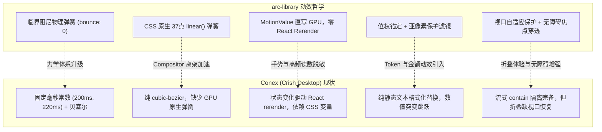

# 总览与对齐报告：arc-library 动效系统深度剖析与 Conex 升级路线

> **战役工作区**：`docs/arc-library-animation-study/`  
> **战役定位**：高精动效设计系统技术调研、跨代码库全景对比与工程化演进指南  
> **对标仓库**：`reference/arc-library`（已完整克隆至本地，聚焦 `color-picker`, `expandable-text`, `toast-stack`, `animated-counter`, `slot-text`, `motion-tokens`）  
> **项目受体**：`conex` / `apps/crish-desktop`（基于 Tauri + React 19 + Motion 13 的 AI 桌面工作台）  
> **参与调研 Agent 团队**：主控 Agent + 5 位专业调研子 Agent（ColorPicker、ExpandableText、ToastStack、NumberMotion、MotionTokens）

---

## 一、调研背景与总体执行摘要

用户指示将 GitHub 知名动效组件库 `https://github.com/kuratlielia/arc-library` 克隆至 `reference/arc-library`，深入学习并解密其四大标志性动效体系：
1. **Color picker** 中的颜色体系切换与对应数值变动的数字/文本形变；
2. **Expandable text** 中的动态展开折叠与柔雾渐变遮罩；
3. **Toast stack** 中的多层物理堆叠、就地形态变身与阻尼投掷动力学；
4. **数字上下切换效果**：全场景的里程表式滚轮滚动、亚像素级动态模糊保护、增减位数时的宽度流动弹簧。

通过与 Conex 当前架构（`apps/crish-desktop`）的逐项对比，我们发现：
- **Conex 的核心护城河**：具备极强的性能隔离意识（如 LLM 流式输出期的 `contain: size layout` 24px 硬件阻断、Chromium 原生 `hidden="until-found"` 搜索穿透、以及严格的单源守卫测试 `tabStripMotionContract`）；
- **Conex 的短板与不足**：动效体系停留在传统的预设时长（`200ms`, `220ms`）与贝塞尔补间（`cubic-bezier`），缺乏**真实物理力学体系（临界阻尼弹簧、初速度继承重靶向）**；数据指标多为纯静态文本置换，缺乏生动的连续视觉反馈；折叠收起缺少视口保护，容易造成阅读上下文丢失；Toast 拖拽手势触发大量 React 重渲染。

为此，我们构建了完整的 5 个分维详案并制定了无损渐进升级路线。

---

## 二、战役文档矩阵结构

按照仓库协作规范（`AGENTS.md` 战役工作区白名单纪律），所有产物收敛于 `docs/arc-library-animation-study/`，结构如下：

```
docs/arc-library-animation-study/
├── 00-总览与对齐报告-arc-library动效深度剖析与conex升级路线.md    # [总案] 全景对比、架构解密与工程演进总纲
├── 01-分维详案-ColorPicker与TextMorph数值及格式渐变动效.md       # [分维] 字符频次映射、双阶段RAF遮罩、零重渲染对比度
├── 02-分维详案-ExpandableText遮罩渐变与无跳跃高度展开.md          # [分维] 单一归一化progress、1.6lh非线性遮罩、自适应时长
├── 03-分维详案-ToastStack层叠物理与就地变身系统.md              # [分维] layoutStack前排高度对齐、MotionValue驱动、手势投影
├── 04-分维详案-数字无缝滚动与动态模糊增位动效.md                # [分维] 位权锚定i0/i1、Odometer环形滚动、ClearType滤镜保护
├── 05-分维详案-MotionTokens物理弹簧与CSS原生拟合架构.md          # [分维] visualDuration与bounce:0、37点linear()弹簧拟合
└── implementation-plans/                                      # [实装落地方案集] 面向 Conex 仓库的针对性改造与新建方案
    ├── 01-动效基础设施与CSS原生弹簧方案.md                       # [落地] linear() 弹簧、TS 物理求解器、useReducedFlag
    ├── 02-折叠组件针对性改造方案.md                             # [落地] 视口防丢失、自适应时长、hidden="until-found" 协同
    ├── 03-通知堆叠系统现代化方案.md                             # [落地] 零重渲染手势、连续悬停画布、Swap 混编防过冲
    ├── 04-数字滚动与计数组件方案.md                             # [落地] AnimatedCounter & SlotText 组件与流式节流保护
    └── 05-字形流转与高精色彩方案.md                             # [落地] TextMorph、严谨 colorMath 库与专业 ColorPicker
```

---

## 三、四大核心动效技术突破总结

### 1. 颜色体系切换与 TextMorph 字形补间
- **字符频次映射（`toGlyphs`）**：使用 `char + count` 作为唯一 Key（如 `5-0`, `5-1`），彻底解决同字符 Key 冲突与跨位置丢失问题；未变字符通过 `layout="position"` 沿弹簧轨道平滑滑动，只有新增字符享有递增阶梯延迟（`delay: HANDOFF + order * stagger`）；
- **原生 Input 动效遮罩**：原生 `<input>` 在切换格式时施加 `color: transparent`，上层绝对定位挂载 `<TextMorph>`，通过双阶段 RAF 触发形变并在 620ms 后安全交割，兼顾了电影级视觉与原生输入编辑能力；
- **零重渲染对比度指示**：利用 `useFollow` 弹簧驱动数值，`useTransform` 派生两位小数格式化文本，`<motion.span>` 直接直写 DOM 的 `textContent`，每秒 120 帧高刷插值下 React 组件重渲染次数为 0。

### 2. ExpandableText 动态展开与柔雾渐变遮罩
- **单一归一化 `progress` 驱动全系统**：高度、箭头旋转（0°~180°）和遮罩透明度门栓于同一个标量，彻底消除多轨并发导致的相位漂移；中途打断时从当前瞬时高度逆向折算 `progress`，实现零跳帧平滑折返；
- **现代 CSS `1.6lh` 遮罩**：`maskImage: linear-gradient(to bottom, #000 calc(100% - 1.6lh), ...)` 永远稳定锚定在容器底部往上 1.6 行处；非线性幂函数 $\text{fade} = (1 - \text{progress})^{1.35}$ 让新行始终在半透明边缘上升展露；完全展开瞬间置为 `"none"` 卸载离屏合成；
- **生命周期静动分离**：“展开运动中高度由 Motion 接管，落定静止时高度交还给原生 CSS `calc(lines * 1lh)`”，彻底解决窗口拉伸与字体缩放时的破损难题；
- **极致无障碍与防抖**：按钮文案共享单个 Grid 单元格（`grid-area: 1 / 1`）消除宽度跳动；折叠时检测 `top < 0` 自动 `scrollIntoView` 找回顶部上下文；键盘聚焦子元素时通过 `onFocusCapture` 智能自动展开。

### 3. ToastStack 层叠物理与就地变身
- **前排高度归一化（`layoutStack`）**：折叠时所有后排卡片强制统一为首张卡片高度，变换原点设为 `50% 0`（顶边中心），缩放向内收缩叠加 $y = -14\text{px} \times \text{depth}$，边缘严丝合缝；后排内容透明度降为 0，杜绝透字噪点；
- **连续 Hover 画布容器**：外框 `<ol>` 动态计算累加高度 `listHeight`，自身作为连通悬停域，彻底淘汰传统的 `::after` 补丁桥接，根除光标划过间隙时的抖动；
- **零重渲染手势引擎**：拖拽过程纯走 `useMotionValue`，全过程 React 重渲染为 0；
- **防过冲混编铁律**：就地更新时，`scale` 走机械弹簧，而 `opacity` 与 `filter` 强制走贝塞尔补间，防止物理弹簧震荡产生负值导致浏览器样式解析失效；
- **苹果双曲阻尼与惯性投影**：向左反向拖拽受双曲阻尼衰减 $f(x, d) = \frac{0.55xd}{0.55x + d}$；松手时以惯性滑动总距离 $D = 0.099 \times v$ 判定滑离，轻甩即走、慢拖防误触，初速度无缝交接给离场弹簧。

### 4. 数字无缝滚动与动态模糊增位
- **位权持久化建模（`partsFor`）**：按逆向位权命名 Key（个位永远为 `i0`，十位为 `i1`，百位为 `i2`）。当 999 跃升为 1,000 时，低位滚轮复用既有 DOM 实例，高位千位 `i3` 与逗号 `g3` 以 `width: 0 -> auto` 弹簧平滑向右推挤，低位绝不发生重新挂载或跳位；
- **里程表环形滚动（Odometer Wrapping）**：累积增量 $\Delta = (\text{digit} - \text{current} + 10) \pmod{10}$，确保整体数值增加时数字始终向前顺时针绕卷；配合环形映射公式将数字折叠在 $[-5, +4]$，视口外直接 `visibility: hidden`，渲染开销恒为 $O(1)$；
- **ClearType 亚像素字体保护**：偏离中心 $<0.02$ 字符高度或速度衰减时，强制恢复 `filter: none`，彻底规避 Chromium 滤镜抹杀 RGB 亚像素抗锯齿导致的字体发虚；
- **隐形骨架（`.sizer`）与临界阻尼**：隐藏的 `sizer` 撑开字宽与基线，运动字符全部绝对定位，运动期间容器布局盒大小零变动，零 Reflow 回流。

---

## 四、全面对齐：arc-library 与 Conex 核心差异对比



---

## 五、Conex 落地升级路线图（守卫契约兼顾）

Conex 项目前端（`apps/crish-desktop`）已具备 `"motion": "^13.2.0"` 与 `"react": "^19.1.1"`，升级完全可在既有依赖范围内以**超集追加**方式稳步推进。

### 阶段一：动效基础体系扩展（零破坏性追加）
1. **CSS 扩展（`tokens-base.css`）**：
   在保留既有 `--duration-micro`、`--ease-standard` 的同时，追加 `--ease-spring: linear(...)`、`--duration-spring-snappy: 260ms`、`--duration-spring-smooth: 400ms`、`--duration-spring-morph: 420ms` 以及 4 级交错和 3 级模糊 Token；
2. **TS 镜像扩展（`motionTokens.ts`）**：
   追加 `EASE_SPRING_LINEAR`、`MOTION_SPRING`（`snappy`, `smooth`, `morph`）、`MOTION_STAGGER`、`MOTION_BLUR` 及 `springPhysical` 动量连续计算函数；
3. **单源守卫同步（`tabStripMotionContract.test.ts`）**：
   原有测试断言全部保留（100% 绿灯），追加新弹簧键值与节能档（eco tier）覆盖断言。

### 阶段二：折叠与视口体验快速修复（低成本高收益）
1. **视口回滚保护**：
   在 `FoldableToolGroup.tsx` 与 `ReasoningRow.tsx` 的折叠操作中增加 `top < 0` 时的平滑 `scrollIntoView`，彻底消灭长内容收起时的视口失焦；
2. **同格重叠文案**：
   对状态切换按钮应用 `grid-area: 1 / 1`，保证文字长度变化时指示箭头零抖动。

### 阶段三：关键数据与数字动效引入
1. **移植封装通用 `<AnimatedCounter>`**：
   落地在 `apps/crish-desktop/src/components/ui/AnimatedCounter/`，配置 `tabular-nums` 与亚像素安全阈值；
2. **业务点装配**：
   - `UsageSummaryHero.tsx`：总用量与费用从静态文本升级为里程表滚动；
   - `CacheMetricsBadge.tsx` 与 `SessionCacheStatsPanel.tsx`：缓存命中与节省量升级为动态数字计数器；
   - **流式对话保护**：流式生成中采用 100ms 批处理节流，流式终止瞬间触发最终对齐，兼顾高帧率与性能。

### 阶段四：通知堆叠系统升级
1. **手势与重渲染解耦**：重构 `useSwipeDismiss`，改用 `useMotionValue` 驱动 $x$ 轴位移；
2. **布局算法升级**：引入 `layoutStack`，折叠态对齐首张卡片高度并隐藏后排内容，外框按 `listHeight` 动态伸展消除伪元素补丁；
3. **就地变身微动效**：在 `ToastCard` 中引入 `Swap` 与“Scale 走弹簧、Opacity/Blur 走补间”防过冲混编。

### 阶段五：主题个性化与 TextMorph 赋能
1. **落地通用 `<TextMorph>`**：用于 Agent 执行状态标签（`Thinking` $\to$ `Running Tool` $\to$ `Done`）的平滑文字变形；
2. **专业级 `<ColorPicker>`**：提供 2D 拾色板、双向色彩格式无缝切换、零重渲染实时对比度指示，并集成桌面端 `window.EyeDropper` 原生吸管，形成个性化主题闭环。

---

## 六、结语

通过本次多 Agent 联合深度调研，我们不仅完整解密了 `arc-library` 的底层数学公式、物理模型与 DOM 渲染策略，而且结合 Conex 的工程约束确立了行之有效的升级方案。本战役产出的全套详案为 Conex 桌面端从“功能完备”迈向“世界一流微交互质感”奠定了坚实的理论与工程基石。
