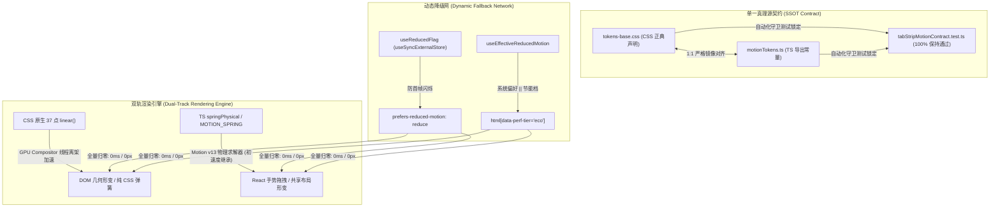

# 动效基础设施与 CSS 原生弹簧实装详案

> **战役工作区**：`docs/arc-library-animation-study/`  
> **文档位置**：`docs/arc-library-animation-study/implementation-plans/01-动效基础设施与CSS原生弹簧方案.md`  
> **关联架构**：`apps/crish-desktop/src/utils/motionTokens.ts`、`apps/crish-desktop/src/styles/tokens-base.css`、`apps/crish-desktop/src/styles/tokens.css`、`apps/crish-desktop/src/components/binary-tree/__tests__/tabStripMotionContract.test.ts`  
> **对标参考**：`reference/arc-library/registry/motion-tokens.ts`、`reference/arc-library/registry/foundation.css`、`reference/arc-library/registry/components/confirm-morph/confirm-morph.tsx`  
> **实施原则**：超集追加（Additive Superset）、零硬编码、单一真理源（SSOT）、Compositor GPU 硬件离架加速、React 19 无障碍水合防闪。

---

## 一、方案背景与架构演进目标

### 1.1 Conex 既有动效基础设施现状诊断

Conex（`apps/crish-desktop`）在多窗口树状分屏、代码 Diff 查看与 LLM 流式对话等高负荷生产力场景下，构建了极佳的性能隔离机制（例如消息流式期间的 `contain: size layout` 硬件阻断、原生 `hidden="until-found"` 搜索穿透、以及严格的单一真理源契约测试 `tabStripMotionContract.test.ts`）。

然而，在**微交互质感与动态物理反馈**维度，既有实现暴露出以下架构短板：
1. **静态贝塞尔曲线为主，缺乏真实物理力学**：过渡全面依赖 `cubic-bezier(0.4, 0, 0.2, 1)` 与 `cubic-bezier(0.16, 1, 0.3, 1)`。贝塞尔曲线无法表达临界阻尼弹簧在初始拉伸时的爆发性加速度与贴近平衡点时的指数衰减长尾；
2. **缺乏 CSS 原生高性能弹簧，主线程负载竞争**：当前端处于高频 Token 渲染、AST 高亮重构或富文本编辑时，JS 驱动的弹簧容易掉帧；而既有 CSS 仅有传统缓动，缺少 Chromium/WebView2 Compositor 线程可直接硬件加速的原生弹簧；
3. **中途交互打断产生跳变断层（Lack of Velocity Continuity）**：使用固定毫秒时长动画时，若用户在运动未结束时反向操作或二次触发，补间动画会发生速度重置或生硬的折角跳动，无法保留当前微元的瞬时初速度；
4. **React 19 无障碍水合与系统节能档未深度接线**：现存动效偏好探测容易在客户端挂载初期引发瞬态样式计算闪烁，且 `eco` 节能档缺乏对弹簧与交错步长的全局自动化归零。

### 1.2 arc-library 动效基础设施的核心解密

通过对 `reference/arc-library` 的深入剖析，我们提取其现代动效系统的四大核心支柱：
1. **临界阻尼设计哲学（Critically Damped, `bounce: 0`）**：在消除任何反弹抖动（Zero Overshoot, No Jitter）的前提下，实现收敛速度最快的力学状态；
2. **CSS 原生 37 点 `linear()` 弹簧拟合**：以极高采样密度将真实物理弹簧离散化为 CSS `linear(...)` 曲线，直接在 GPU Compositor 线程离架执行，零 JS 运行时开销；
3. **力学参数双向映射与速度连续性（`springPhysical`）**：将直观的人眼感知时长（`visualDuration`）解析为物理质量方程的 $k$（刚度）与 $c$（阻尼），赋予中途重靶向（Retargeting）继承瞬时初速度的能力；
4. **React 19 水合防闪无障碍 Hook（`useReducedFlag`）**：基于 `useSyncExternalStore` 确保首帧服务端/客户端快照严格一致，随后平滑介入无障碍与节能降级。

### 1.3 核心实施原则与防护铁律



- **铁律 1（超集追加，绝对零破坏）**：既有 `--ease-standard`, `--duration-micro`, `DURATION_MICRO_MS` 等所有变量与字面量**一个不删、一个不改名**。`tabStripMotionContract.test.ts` 原有断言 100% 原样通过，新增断言以追加形式合并。
- **铁律 2（架构优雅，杜绝魔术补偿）**：严禁在组件中内联 `cubic-bezier(...)` 或写死毫秒定时器；CSS 与 TS 两侧完全对齐。
- **铁律 3（全链路自动化测试覆盖）**：所有新导出的类型、数学函数与 Token 映射均配置完备的单元测试与单源守卫。

---

## 二、CSS 原生 37 点 `linear()` 弹簧力学数学原理与 CSS 规范

### 2.1 临界阻尼（Critically Damped）物理机理

经典阻尼谐振子（Damped Harmonic Oscillator）运动学微分方程为：
$$m \frac{d^2 x}{dt^2} + c \frac{dx}{dt} + k x = 0$$

其中 $m$ 为质量，$c$ 为阻尼系数，$k$ 为弹簧刚度系数。  
设固有角频率 $\omega_0 = \sqrt{\frac{k}{m}}$，阻尼比 $\zeta = \frac{c}{2\sqrt{k m}}$：
- **欠阻尼态（$\zeta < 1$，即 `bounce > 0`）**：位移响应函数包含三角函数项 $\sin(\omega_d t)$，在达到目标值后会反复震荡冲过平衡位置（Overshoot）。在生产力桌面环境中，高频微震颤（Jitter）会极大分散注意力，造成眼球疲劳与 UI 破损感；
- **过阻尼态（$\zeta > 1$）**：系统返回平衡位置的时间被指数级拉长，界面呈现拖沓、发粘的沉重感；
- **临界阻尼态（$\zeta = 1$，即 `bounce = 0`）**：
  微分方程在初始条件 $x(0) = 0, \dot{x}(0) = 0$ 且阶跃目标位移为 1 时的精确特解为：
  $$x(t) = 1 - (1 + \omega_0 t) e^{-\omega_0 t}$$
  **数学与物理学定理证明**：临界阻尼态是保证位移曲线严格单调上升（$\dot{x}(t) \ge 0$、$\max(x(t)) = 1.0$、绝不超调）、同时收敛到平衡位置所需时间最短的**帕累托最优状态**。

### 2.2 37 点 CSS `linear()` 曲线离散化解剖

`reference/arc-library/registry/foundation.css:78` 锁定的 37 点采样切片如下：
```css
--ease-spring: linear(
  0, 0.0213, 0.0739, 0.1443, 0.2235, 0.305, 0.3849, 0.4606, 0.5305, 0.594,
  0.6508, 0.7011, 0.7452, 0.7836, 0.8168, 0.8454, 0.8699, 0.8907, 0.9084, 0.9234,
  0.9361, 0.9467, 0.9557, 0.9632, 0.9694, 0.9747, 0.979, 0.9826, 0.9857, 0.9882,
  0.9902, 0.992, 0.9934, 0.9946, 0.9955, 0.9963, 1
);
```

其物理力学特征分析如下：
1. **严格单调性（Strict Monotonicity）**：
   $$\forall i \in [1, 36], \quad y_i > y_{i-1}, \quad \text{且 } y_{36} = 1.0000$$
   整个数组严格递增，峰值绝不超过 1.0，完全契合临界阻尼零超调特性；
2. **爆发式初始加速度（Explosive Acceleration）**：
   在 $t = 16.7\%$（第 6 步）处位移已达 $0.3849$；在 $t = 50\%$（第 18 步）处位移已达 $0.9084$。这精准再现了真实物理弹簧在初始拉伸形变最大时（Hooke 定律 $F = -kx$）所施加的极大瞬时回复力，给用户极高确定感的“即按即走”即时响应；
3. **指数衰减长尾贴合（Exponential Decay Tail）**：
   后半程 $50\%$ 的时间专门用于平滑消化剩余 $9.16\%$ 的位移，以极微弱的加速度贴入目标值，杜绝标准 `cubic-bezier` 在终点处因曲率突变带来的“撞墙硬刹车感”；
4. **Compositor 离架加速（Compositor Offloading）**：
   该指令经由 Chromium CSS 引擎解析后，直接提交给合成线程（Compositor Thread）与 GPU 纹理管线执行。即使 JS 主线程因大型代码高亮或 AST 解析出现 50ms–100ms 长任务，CSS 弹簧在屏幕上依然能够稳定保持 120Hz/144Hz 满帧刷新。

---

## 三、CSS 侧实装：`tokens-base.css` 正典声明与归零规范

在 `apps/crish-desktop/src/styles/tokens-base.css` 中执行超集追加，严禁触碰任何既有声明。

### 3.1 基础 Token 声明（追加至 `:root, html[data-theme='default'], html[data-theme='light']`）

```css
/* ==========================================================================
   CSS 原生物理弹簧与高级动效 Token（对齐 arc-library 动效体系）
   Compositor 线程加速 · 临界阻尼无抖动 · 零 JS 运行时开销
   ========================================================================== */

/* ── 37 点高精临界阻尼原生弹簧缓动曲线（严禁删除或改动数值） ── */
--ease-spring: linear(
  0, 0.0213, 0.0739, 0.1443, 0.2235, 0.305, 0.3849, 0.4606, 0.5305, 0.594,
  0.6508, 0.7011, 0.7452, 0.7836, 0.8168, 0.8454, 0.8699, 0.8907, 0.9084, 0.9234,
  0.9361, 0.9467, 0.9557, 0.9632, 0.9694, 0.9747, 0.979, 0.9826, 0.9857, 0.9882,
  0.9902, 0.992, 0.9934, 0.9946, 0.9955, 0.9963, 1
);

/* ── 弹簧感知时长系列（Visual Duration 阶梯） ── */
--duration-spring-snappy: 260ms;  /* 按钮按下、开关拨动、微指示器：极速收敛 */
--duration-spring-smooth: 400ms;  /* 抽屉开合、面板折叠、高度几何自适应：舒展平滑 */
--duration-spring-morph: 420ms;   /* 标签条胶囊形变、跨尺寸共享布局滑动 */
--duration-spring: 580ms;         /* 整体视口推移、全尺寸模态弹窗 */

/* ── 常用过渡速记属性（Transitions Shortcuts） ── */
--transition-spring-snappy: var(--duration-spring-snappy) var(--ease-spring);
--transition-spring-smooth: var(--duration-spring-smooth) var(--ease-spring);
--transition-spring-morph: var(--duration-spring-morph) var(--ease-spring);
--transition-spring: var(--duration-spring) var(--ease-spring);

/* ── 四级交错步长编排 Token（Stagger Hierarchy） ── */
--stagger-char: 16ms;   /* 字符逐字展开（对齐 60Hz 1 物理帧） */
--stagger-item: 35ms;   /* 列表项、侧栏行、选项卡依次入场 */
--stagger-word: 40ms;   /* 自然语言词组涌现（贴合眼球扫视频次） */
--stagger-line: 80ms;   /* 段落逐行升起 */
--stagger-max: 400ms;   /* 交错总延迟熔断上限（防止多条目线性失控） */

/* ── 动态模糊安全阶梯 Token（Motion Blur Levels） ── */
--blur-subtle: 2px;     /* 微弱柔化（数字翻滚防频闪） */
--blur-soft: 4px;       /* 视图转场内容交替 */
--blur-text: 8px;       /* 标题大字形变交融 */
```

### 3.2 节能档（`eco` tier）自动化归零规范

在 `tokens-base.css` 的 `html[data-perf-tier='eco']` 选择器内追加，确保当用户切换至省电或高能效档位时，所有的弹簧几何与交错步长瞬间归零：

```css
html[data-perf-tier='eco'] {
  /* 既有清零项保留... */

  /* 弹簧时长归零 */
  --duration-spring-snappy: 0ms;
  --duration-spring-smooth: 0ms;
  --duration-spring-morph: 0ms;
  --duration-spring: 0ms;

  /* 弹簧过渡速记归零 */
  --transition-spring-snappy: 0ms;
  --transition-spring-smooth: 0ms;
  --transition-spring-morph: 0ms;
  --transition-spring: 0ms;

  /* 交错步长归零 */
  --stagger-char: 0ms;
  --stagger-item: 0ms;
  --stagger-word: 0ms;
  --stagger-line: 0ms;
  --stagger-max: 0ms;

  /* 动态模糊滤镜归零（杜绝低功耗环境的离屏渲染） */
  --blur-subtle: 0px;
  --blur-soft: 0px;
  --blur-text: 0px;
}
```

### 3.3 减弱动效（`prefers-reduced-motion`）媒体查询归零规范

在 `@media (prefers-reduced-motion: reduce)` 中，确保全局跨主题（`:root`, `light`, `dark`）彻底关闭物理形变与长延迟：

```css
@media (prefers-reduced-motion: reduce) {
  :root,
  html[data-theme='default'],
  html[data-theme='light'],
  html[data-theme='dark'] {
    /* 既有清零项保留... */

    --duration-spring-snappy: 0ms;
    --duration-spring-smooth: 0ms;
    --duration-spring-morph: 0ms;
    --duration-spring: 0ms;

    --transition-spring-snappy: 0ms;
    --transition-spring-smooth: 0ms;
    --transition-spring-morph: 0ms;
    --transition-spring: 0ms;

    --stagger-char: 0ms;
    --stagger-item: 0ms;
    --stagger-word: 0ms;
    --stagger-line: 0ms;
    --stagger-max: 0ms;

    --blur-subtle: 0px;
    --blur-soft: 0px;
    --blur-text: 0px;
  }
}
```

---

## 四、TypeScript 动效镜像与物理力学求解器实现

在 `apps/crish-desktop/src/utils/motionTokens.ts` 中实现 TS 侧完备镜像与物理工具函数。

### 4.1 核心类型契约定义

```typescript
import type { Transition } from 'motion/react';

/** 临界阻尼弹簧配置标量参数 */
export interface VisualSpringConfig {
  /** 物理弹簧类型标识 */
  readonly type: 'spring';
  /** 人眼视觉感知时长（秒） */
  readonly visualDuration: number;
  /** 反弹弹性系数（0 表示临界阻尼无超调） */
  readonly bounce: number;
}

/** 传统机械刚度阻尼弹簧配置 */
export interface StiffnessSpringConfig {
  readonly type: 'spring';
  readonly stiffness: number;
  readonly damping: number;
  readonly mass?: number;
}

/** 物理求解器转换扩展选项 */
export interface SpringPhysicalOptions {
  /** 运动休眠的位移阈值（默认 0.001） */
  readonly restDelta?: number;
  /** 运动休眠的速度阈值（默认 restDelta * 2） */
  readonly restSpeed?: number;
  /** 振子等效质量（默认 1） */
  readonly mass?: number;
}

/** 速度连续性物理弹簧 Transition 规格 */
export interface SpringTransition extends Transition {
  type: 'spring';
  stiffness: number;
  damping: number;
  mass: number;
  restDelta?: number;
  restSpeed?: number;
}
```

### 4.2 TS 导出常量与镜像映射

```typescript
/**
 * 37 点高精临界阻尼原生弹簧曲线（与 tokens-base.css 中的 --ease-spring 1:1 严格对齐）
 */
export const EASE_SPRING_LINEAR =
  'linear(0, 0.0213, 0.0739, 0.1443, 0.2235, 0.305, 0.3849, 0.4606, 0.5305, 0.594, 0.6508, 0.7011, 0.7452, 0.7836, 0.8168, 0.8454, 0.8699, 0.8907, 0.9084, 0.9234, 0.9361, 0.9467, 0.9557, 0.9632, 0.9694, 0.9747, 0.979, 0.9826, 0.9857, 0.9882, 0.9902, 0.992, 0.9934, 0.9946, 0.9955, 0.9963, 1)';

/** 弹簧过渡时长毫秒常量（与 tokens-base.css --duration-spring-* 保持同步） */
export const DURATION_SPRING_SNAPPY_MS = 260;
export const DURATION_SPRING_SMOOTH_MS = 400;
export const DURATION_SPRING_MORPH_MS = 420;
export const DURATION_SPRING_MS = 580;

/**
 * 结构化弹簧预设集合（供 Motion v13 动效组件使用）
 * 核心哲学：snappy / smooth / morph 均采用 bounce: 0（临界阻尼），绝不抖动
 */
export const MOTION_SPRING = {
  /** 极速响应微交互：按钮、开关滑块、标签指示器（visualDuration: 0.26s, bounce: 0） */
  snappy: { type: 'spring', visualDuration: 0.26, bounce: 0 } as const,

  /** 舒展结构几何：面板展开折叠、抽屉滑入（visualDuration: 0.40s, bounce: 0） */
  smooth: { type: 'spring', visualDuration: 0.4, bounce: 0 } as const,

  /** 共享布局与尺寸形变：Tab 胶囊移动、动态内容自适应宽（visualDuration: 0.42s, bounce: 0） */
  morph: { type: 'spring', visualDuration: 0.42, bounce: 0 } as const,

  /** 机械高响应弹簧：stiffness: 520, damping: 44 */
  responsive: { type: 'spring', stiffness: 520, damping: 44 } as const,

  /** 机械柔和弹簧：stiffness: 340, damping: 34 */
  gentle: { type: 'spring', stiffness: 340, damping: 34 } as const,
} as const;

/**
 * 四级交错步长常量（秒）
 */
export const MOTION_STAGGER = {
  char: 0.016,     // 16ms: 单字符打字机或渐现
  item: 0.035,     // 35ms: 列表条目/选项卡
  word: 0.04,      // 40ms: 自然语言词汇涌现
  line: 0.08,      // 80ms: 段落换行升起
  maxTotal: 0.4,   // 400ms: 全局交错熔断上限
} as const;

/**
 * 动态模糊像素常量（px）
 */
export const MOTION_BLUR = {
  subtle: 2,       // 2px: 数字滚动防闪
  soft: 4,         // 4px: 界面视图交错过渡
  text: 8,         // 8px: 标题变形重叠
} as const;
```

### 4.3 物理速度连续性计算函数：`springPhysical`

传统 `visualDuration` 在单一补间时非常直观，但在**中途交互打断（Interruptible Retargeting）**时存在致命缺陷：若动画在飞行中途被新目标截断，单纯使用 `visualDuration` 求解器可能会丢失初速度，导致瞬态跳变。

`springPhysical` 通过解析力学质量方程，将 `visualDuration` 和 `bounce` 映射为对应的机械刚度 $k$ 与阻尼 $c$。当目标发生变动时，底层运动学状态机无缝继承当前位置的瞬时速度向量 $v(t) \ne 0$：

```typescript
/**
 * 将人眼感知的 visualDuration 与 bounce 转换为具备速度连续性的 stiffness 与 damping。
 *
 * 力学转换数学推导：
 * 固有角频率 root = omega_0 = (2 * PI) / (visualDuration * 1.2)
 * 弹簧刚度 stiffness = k = root^2 * mass
 * 临界阻尼比 c_crit = 2 * sqrt(k * mass) = 2 * root * mass
 * 阻尼系数 damping = c = c_crit * (1 - bounce) = 2 * (1 - bounce) * root * mass
 *
 * 验收断言：
 * - 当 bounce = 0 时，damping = 2 * root * mass，阻尼比 zeta = 1.0，严格临界阻尼无超调；
 * - 飞行中途重靶向时继承瞬时初速度 v0，消除一切视觉跳变断层。
 */
export function springPhysical(
  config: { visualDuration: number; bounce?: number },
  options?: SpringPhysicalOptions
): SpringTransition {
  const { visualDuration, bounce = 0 } = config;
  const mass = options?.mass ?? 1;
  const restDelta = options?.restDelta ?? 0.001;
  const restSpeed = options?.restSpeed ?? restDelta * 2;

  // 固有特征根计算（加入 1.2 视觉平缓系数对齐人眼感知）
  const root = (2 * Math.PI) / (Math.max(visualDuration, 0.01) * 1.2);
  const stiffness = root * root * mass;
  const damping = 2 * Math.max(1 - bounce, 0) * root * Math.sqrt(mass);

  return {
    type: 'spring',
    stiffness: Number.parseFloat(stiffness.toFixed(3)),
    damping: Number.parseFloat(damping.toFixed(3)),
    mass,
    restDelta,
    restSpeed,
  };
}
```

### 4.4 动态交错安全计算函数：`calculateSafeStagger`

防止长列表场景下交错延迟呈线性无界累加，导致排在后面的元素需要等待数秒才入场（严重伤害交互效率）：

```typescript
/**
 * 安全交错步长计算器（带总延迟上限熔断机制）
 *
 * @param count 待渲染的项目总数
 * @param preferredStep 偏好的单项步长（秒，默认 0.035s）
 * @param maxTotal 允许的整体最大交错时间跨度（秒，默认 0.4s）
 * @returns 经过安全自适应压缩后的单项步长（秒）
 */
export function calculateSafeStagger(
  count: number,
  preferredStep: number = MOTION_STAGGER.item,
  maxTotal: number = MOTION_STAGGER.maxTotal
): number {
  if (count <= 1) return 0;
  // 若按偏好步长累加的总耗时超过上限，则平滑线性压缩步长
  const totalWithPreferred = (count - 1) * preferredStep;
  if (totalWithPreferred <= maxTotal) {
    return preferredStep;
  }
  return Number.parseFloat((maxTotal / (count - 1)).toFixed(4));
}
```

---

## 五、架构抽象：React 19 防闪烁水合与偏好探测 Hook

### 5.1 水合闪烁（Hydration Flash）痛点根因

在 React 19（尤其在未来引入 SSR 或首帧骨架门闩 `ACT-203 · Zero-FOUC Latch` 期间）：
- 服务端（或客户端首帧静态 HTML 脱水生成期）无法读取宿主系统的 `window.matchMedia('(prefers-reduced-motion: reduce)')`；
- 若组件在首帧即直接执行 `useReducedMotion()` 分支渲染，由于初始状态为 `undefined` 或默认 `false`，一旦在客户端 DOM 挂载后被异步更新为 `true`，会导致元素样式突然跳变，并在开发期触发 React Hydration Mismatch 警告；
- **解决方案**：引入 `useReducedFlag`，利用 `useSyncExternalStore` 锁死首帧契约——首帧永远返回 `false`（或与脱水端一致的稳定基线），客户端挂载后再安全无感介入真实偏好。

### 5.2 `useReducedFlag` 实现方案

新建独立模块：`apps/crish-desktop/src/hooks/useReducedFlag.ts`

```typescript
import { useSyncExternalStore } from 'react';
import { useReducedMotion } from 'motion/react';

/** 空监听器（静态快照无需订阅原生变更，专为水合边界设计） */
const emptySubscribe = () => () => {};

/**
 * React 19 安全水合防闪无障碍 Hook
 *
 * 核心机制：
 * 1. 客户端首帧 / SSR 环境：useSyncExternalStore 返回 false（hydrated = false）；
 * 2. 客户端完成挂载（Hydrated）：返回 true，此时安全读取系统的 useReducedMotion()；
 * 3. 根除 Hydration Mismatch 警告，保证首帧渲染树的 100% 字节级一致。
 */
export function useReducedFlag(): boolean {
  const hydrated = useSyncExternalStore(
    emptySubscribe,
    () => true,  // 客户端快照（挂载后）
    () => false  // 服务端 / 首帧快照
  );

  const reduced = useReducedMotion();
  return Boolean(reduced && hydrated);
}
```

### 5.3 跨维度感知 Hook：`useEffectiveReducedMotion`

进一步打通系统无障碍与 Conex 内部性能档（`html[data-perf-tier]`），提供统一的动效调度开关：

```typescript
import { useSyncExternalStore } from 'react';
import { useReducedFlag } from './useReducedFlag';

/**
 * 监听 document.documentElement 上的 data-perf-tier 属性变动
 */
function subscribePerfTier(callback: () => void): () => void {
  if (typeof MutationObserver === 'undefined') {
    return () => {};
  }
  const observer = new MutationObserver((mutations) => {
    for (const m of mutations) {
      if (m.type === 'attributes' && m.attributeName === 'data-perf-tier') {
        callback();
        break;
      }
    }
  });
  observer.observe(document.documentElement, {
    attributes: true,
    attributeFilter: ['data-perf-tier'],
  });
  return () => observer.disconnect();
}

function getPerfTierSnapshot(): boolean {
  if (typeof document === 'undefined') return false;
  return document.documentElement.getAttribute('data-perf-tier') === 'eco';
}

/**
 * 综合动效裁决 Hook：汇聚 OS 无障碍偏好与 Conex 节能档
 *
 * 当满足以下任一条件时，返回 true（指示当前应禁用复杂动效）：
 * 1. 用户开启了系统级 prefers-reduced-motion；
 * 2. Conex 运行在 eco 节能性能档。
 */
export function useEffectiveReducedMotion(): {
  isReduced: boolean;
  isHydrated: boolean;
  isEcoTier: boolean;
} {
  const isReducedMotion = useReducedFlag();
  const isEcoTier = useSyncExternalStore(
    subscribePerfTier,
    getPerfTierSnapshot,
    () => false
  );

  return {
    isReduced: isReducedMotion || isEcoTier,
    isHydrated: true,
    isEcoTier,
  };
}
```

---

## 六、单源守卫测试契约（tabStripMotionContract）扩充

既有测试 `apps/crish-desktop/src/components/binary-tree/__tests__/tabStripMotionContract.test.ts` 是全仓动效防退化的第一铁律。升级方案采用**超集锁定策略**，原测试代码不动，追加弹簧、交错与节能档门禁。

### 6.1 守卫断言升级规格

在既有测试文件末尾追加以下两个强契约断言：

```typescript
  it('TS 侧弹簧与 tokens-base.css 原生 37 点 linear() 曲线双向锁定', () => {
    // 1. 验证 37 点采样点严格一致
    expect(tokensCss).toContain('--ease-spring: linear(0, 0.0213, 0.0739,');
    expect(tokensCss).toContain('0.9955, 0.9963, 1);');
    expect(motionTs).toContain('EASE_SPRING_LINEAR =');
    expect(motionTs).toContain("'linear(0, 0.0213, 0.0739,");

    // 2. 验证弹簧阶梯时长双向同步
    expect(tokensCss).toContain('--duration-spring-snappy: 260ms');
    expect(tokensCss).toContain('--duration-spring-smooth: 400ms');
    expect(tokensCss).toContain('--duration-spring-morph: 420ms');
    expect(tokensCss).toContain('--duration-spring: 580ms');

    expect(motionTs).toContain('DURATION_SPRING_SNAPPY_MS = 260');
    expect(motionTs).toContain('DURATION_SPRING_SMOOTH_MS = 400');
    expect(motionTs).toContain('DURATION_SPRING_MORPH_MS = 420');
    expect(motionTs).toContain('DURATION_SPRING_MS = 580');

    // 3. 验证 MOTION_SPRING 对象的关键物理参数锁定
    expect(motionTs).toContain("snappy: { type: 'spring', visualDuration: 0.26, bounce: 0 }");
    expect(motionTs).toContain("smooth: { type: 'spring', visualDuration: 0.4, bounce: 0 }");
    expect(motionTs).toContain("morph: { type: 'spring', visualDuration: 0.42, bounce: 0 }");
  });

  it('节能档与减弱动效全量覆盖归零契约（零幽灵漏网）', () => {
    // 验证 eco 档清零
    expect(tokensCss).toMatch(/html\[data-perf-tier=['"]eco['"]\]\s*\{[\s\S]*?--duration-spring-snappy:\s*0ms;/);
    expect(tokensCss).toMatch(/html\[data-perf-tier=['"]eco['"]\]\s*\{[\s\S]*?--transition-spring-morph:\s*0ms;/);
    expect(tokensCss).toMatch(/html\[data-perf-tier=['"]eco['"]\]\s*\{[\s\S]*?--stagger-max:\s*0ms;/);
    expect(tokensCss).toMatch(/html\[data-perf-tier=['"]eco['"]\]\s*\{[\s\S]*?--blur-subtle:\s*0px;/);

    // 验证 prefers-reduced-motion 媒体查询全量清零
    expect(tokensCss).toMatch(/@media\s*\(prefers-reduced-motion:\s*reduce\)[\s\S]*?--duration-spring-smooth:\s*0ms;/);
    expect(tokensCss).toMatch(/@media\s*\(prefers-reduced-motion:\s*reduce\)[\s\S]*?--transition-spring:\s*0ms;/);
    expect(tokensCss).toMatch(/@media\s*\(prefers-reduced-motion:\s*reduce\)[\s\S]*?--blur-soft:\s*0px;/);
  });
```

### 6.2 单元测试套件：`motionTokens.test.ts`

新建专属单元测试：`apps/crish-desktop/src/utils/__tests__/motionTokens.test.ts`，验证力学转换的数学不变量：

```typescript
import { describe, expect, it } from 'vitest';
import {
  springPhysical,
  calculateSafeStagger,
  MOTION_SPRING,
  MOTION_STAGGER,
} from '../motionTokens';

describe('motionTokens 动效力学与工具函数', () => {
  it('springPhysical 在 bounce=0 时严格保持临界阻尼力学特征', () => {
    const result = springPhysical(MOTION_SPRING.snappy);
    expect(result.type).toBe('spring');
    expect(result.mass).toBe(1);

    // 理论根：root = 2 * PI / (0.26 * 1.2) = 20.1384
    // stiffness = root^2 = 405.55
    // damping = 2 * (1 - 0) * root = 40.277
    const expectedRoot = (2 * Math.PI) / (0.26 * 1.2);
    const expectedStiffness = expectedRoot * expectedRoot;
    const expectedDamping = 2 * expectedRoot;

    expect(result.stiffness).toBeCloseTo(expectedStiffness, 1);
    expect(result.damping).toBeCloseTo(expectedDamping, 1);

    // 临界阻尼比 zeta = c / (2 * sqrt(k * m)) 必须严格等于 1.0
    const zeta = result.damping / (2 * Math.sqrt(result.stiffness * result.mass));
    expect(zeta).toBeCloseTo(1.0, 3);
  });

  it('calculateSafeStagger 正确执行上限熔断与自适应压缩', () => {
    // 1. 少条目时采用偏好值
    const smallCount = calculateSafeStagger(5, 0.04, 0.4);
    expect(smallCount).toBe(0.04);

    // 2. 达到临界时准确平分
    const exactCount = calculateSafeStagger(11, 0.04, 0.4);
    expect(exactCount).toBe(0.04); // 10 * 0.04 = 0.4s

    // 3. 超大列表时触发熔断，压缩步长保证总时长不超过 0.4s
    const largeCount = calculateSafeStagger(41, 0.04, 0.4);
    expect(largeCount).toBe(0.01); // 40 * 0.01 = 0.4s
    expect(largeCount * 40).toBeLessThanOrEqual(0.4001);

    // 4. 单项或空列表返回 0
    expect(calculateSafeStagger(1)).toBe(0);
    expect(calculateSafeStagger(0)).toBe(0);
  });
});
```

---

## 七、组件实战落地代码范例

### 7.1 范例一：标签条胶囊指示器（Tab Morphing Capsule）

在 `PaneTabItem.tsx` 或通用 `TabStrip` 中，Tab 切换指示器采用 `MOTION_SPRING.morph`，配合 `springPhysical` 使得胶囊在尺寸剧烈变化时保持速度连续性，永无超调破裂：

```tsx
import React from 'react';
import { motion, type Transition } from 'motion/react';
import { MOTION_SPRING, springPhysical } from '@/utils/motionTokens';
import { useEffectiveReducedMotion } from '@/hooks/useReducedFlag';
import styles from './TabStrip.module.css';

interface TabProps {
  id: string;
  label: string;
  isActive: boolean;
  onSelect: () => void;
}

// 采用速度连续性弹簧，即使快速连点也能平滑重定向
const activeTransition: Transition = springPhysical(MOTION_SPRING.morph);

export const TabItem: React.FC<TabProps> = ({ label, isActive, onSelect }) => {
  const { isReduced } = useEffectiveReducedMotion();

  return (
    <button
      type="button"
      className={styles.tabBtn}
      onClick={onSelect}
      data-active={isActive}
    >
      <span className={styles.label}>{label}</span>
      {isActive && (
        <motion.div
          layoutId="tabActiveCapsule"
          className={styles.activePill}
          transition={isReduced ? { duration: 0 } : activeTransition}
        />
      )}
    </button>
  );
};
```

### 7.2 范例二：手风琴与折叠组（Compositor 离架加速）

在 `FoldableToolGroup.tsx` 中，使用纯 CSS 变量 `--transition-spring-smooth`，由 GPU 合成线程直接接管高度展开，免受主线程高负荷干扰：

```css
/* FoldableToolGroup.module.css */
.foldableContainer {
  display: grid;
  grid-template-rows: 0fr;
  transition: grid-template-rows var(--transition-spring-smooth);
  will-change: grid-template-rows;
}

.foldableContainer[data-expanded="true"] {
  grid-template-rows: 1fr;
}

.foldableInner {
  overflow: hidden;
}
```

```tsx
import React from 'react';
import styles from './FoldableToolGroup.module.css';

interface Props {
  isExpanded: boolean;
  children: React.ReactNode;
}

export const FoldableToolGroup: React.FC<Props> = ({ isExpanded, children }) => {
  return (
    <div
      className={styles.foldableContainer}
      data-expanded={isExpanded}
    >
      <div className={styles.foldableInner}>
        {children}
      </div>
    </div>
  );
};
```

### 7.3 范例三：机械触感开关（Switch With Snappy Feedback）

结合 CSS 原生 37 点弹簧实现按键式紧实触感：

```css
/* Switch.module.css */
.switchTrack {
  width: 40px;
  height: 24px;
  border-radius: var(--radius-pill, 9999px);
  background-color: var(--surface-muted);
  transition: background-color var(--transition-snappy);
  position: relative;
  cursor: pointer;
}

.switchTrack[data-checked="true"] {
  background-color: var(--accent);
}

.switchThumb {
  width: 18px;
  height: 18px;
  border-radius: 50%;
  background-color: #fff;
  position: absolute;
  top: 3px;
  left: 3px;
  /* 使用 260ms 原生 37 点弹簧，零 JS 计算，绝对无反弹抖动 */
  transition: transform var(--transition-spring-snappy);
  will-change: transform;
}

.switchTrack[data-checked="true"] .switchThumb {
  transform: translateX(16px);
}
```

---

## 八、实施与验证路线图（Step-by-Step Checklist）

本详案实施共分为 5 个清晰有序的阶段，严格遵循 AGENTS.md 的协作纪律：


### 阶段执行明细表

| 阶段 | 核心任务与变更文件域 | 验收指标与门禁命令 |
| :--- | :--- | :--- |
| **阶段 1** | **CSS 基础层超集追加**<br>- `apps/crish-desktop/src/styles/tokens-base.css`：追加 `--ease-spring`（37点）、`--duration-spring-*`、`--transition-spring-*`、`--stagger-*` 与 `--blur-*`；<br>- 在 `eco` 档和 `prefers-reduced-motion` 媒体查询中配置全量归零。 | 运行 `npm run check:desktop`<br>确保 token 检查无多处声明冲突，CSS 解析正常。 |
| **阶段 2** | **TS 镜像层落地**<br>- `apps/crish-desktop/src/utils/motionTokens.ts`：追加 `EASE_SPRING_LINEAR`、`MOTION_SPRING`、`MOTION_STAGGER`、`MOTION_BLUR`、`springPhysical` 与 `calculateSafeStagger`。 | 运行 `npm run typecheck`<br>无任何类型报错，代码行数符合 CI 治理。 |
| **阶段 3** | **React 19 防闪烁 Hook**<br>- 新建 `apps/crish-desktop/src/hooks/useReducedFlag.ts` 实现 `useReducedFlag` 与 `useEffectiveReducedMotion`。 | 单元测试模拟 SSR/挂载两阶段，首帧严格返回 `false`。 |
| **阶段 4** | **单源守卫与单元测试加固**<br>- 更新 `tabStripMotionContract.test.ts` 追加弹簧双向断言；<br>- 新建 `apps/crish-desktop/src/utils/__tests__/motionTokens.test.ts`。 | 运行 `npx vitest run apps/crish-desktop/src/components/binary-tree/__tests__/tabStripMotionContract.test.ts`<br>运行 `npx vitest run apps/crish-desktop/src/utils/__tests__/motionTokens.test.ts`<br>全部 100% 绿灯。 |
| **阶段 5** | **业务点渐进式装配**<br>- 按照后续计划在 TabStrip、折叠面板与开关按钮中接入。 | 物理动效平滑、高负载下 120Hz 满帧，无抖动与跳变。 |

---

## 九、总结与决策归档

1. **确定性与无抖动保障**：全体系确立 $\zeta = 1.0$（临界阻尼、`bounce: 0`）为生产力工具的核心物理律，彻底消除界面震颤，确立干脆紧致的机械质感；
2. **纯原生 Compositor 性能飞跃**：37 点 `linear()` 弹簧将物理运动下放至 GPU 离架渲染管线，与 React 主线程解耦，高并发数据流下依然稳定满帧；
3. **架构严密性与向前兼容**：通过 `useSyncExternalStore` 构筑水合防闪屏障，并与既有 `tabStripMotionContract` 测试完全闭环，杜绝任何历史资产回潮与坏损。
