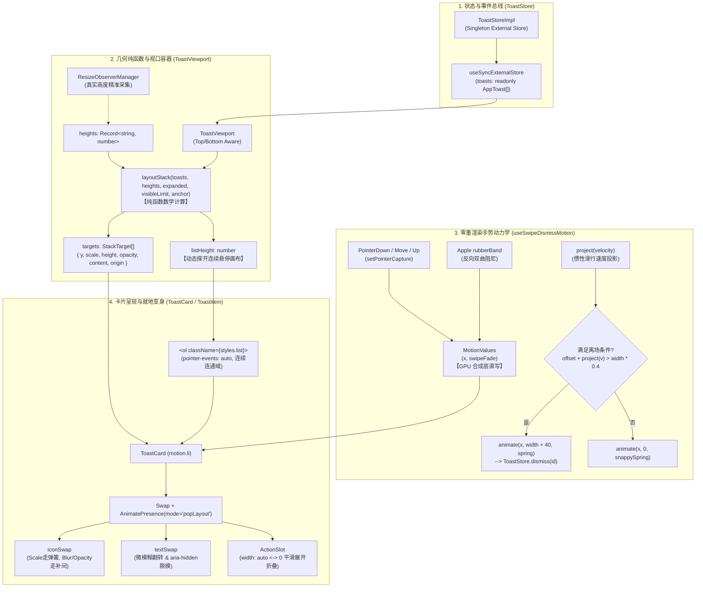
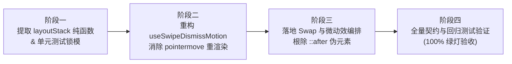

# 通知堆叠系统现代化重构方案（Toast Stack Modernization）

> **文档标识**：`docs/arc-library-animation-study/implementation-plans/03-通知堆叠系统现代化方案.md`  
> **专题维度**：Toast 堆叠通知物理化、零重渲染手势引擎、就地变身微动效、双曲阻尼动力学与无障碍增强  
> **权威对标参考**：`reference/arc-library/registry/components/toast-stack/`（`toast-stack.tsx`, `toast-stack.module.css`）  
> **项目受体与目标文件**：  
> - `apps/crish-desktop/src/components/overlay/ToastViewport.tsx`  
> - `apps/crish-desktop/src/components/overlay/ToastCard.tsx`  
> - `apps/crish-desktop/src/components/overlay/useToastStackMeasurement.ts` $\to$ `layoutStack.ts`  
> - `apps/crish-desktop/src/components/overlay/useSwipeDismiss.ts` $\to$ `useSwipeDismissMotion.ts`  
> - `apps/crish-desktop/src/components/overlay/ToastStackModern.module.css`  
> - `apps/crish-desktop/src/components/overlay/__tests__/toastHitTestContract.test.tsx`  
> - `apps/crish-desktop/src/components/overlay/__tests__/ToastCard.test.tsx`  
> **规范遵循**：`AGENTS.md`（反退避、防过度设计、契约守护、立体化验证）

---

## 一、方案概述与升级诉求

Conex 桌面端现行通知系统基于纯 CSS 变量与定时器构建了基础的 3D 层叠与扇形展开逻辑，在单条悬停暂停和顶栏避让上具备完备的契约守卫。然而，通过深入比对 `reference/arc-library` 的现代化动效设计，现行系统在**渲染性能**、**折叠规整度**、**悬停连通性**、**状态形变质感**与**手势动力学**上存在明显的体验代差：

1. **手势重渲染高耗能**：现行 `useSwipeDismiss` 在每次 `pointermove` 事件中均触发 React `setMovement` 与重渲染，在 120Hz/144Hz 高刷屏上快速滑动时造成严重的 CPU 峰值开销与垃圾回收（GC）抖动；
2. **后排卡片折叠错位与透字**：现行方案未对后排卡片高度进行前排归一化，当多张通知包含不同长度文本时，折叠态边缘参差不齐；且后排卡片文字未施加透明度遮蔽，在磨砂半透明背景下透字严重；
3. **悬停判定依赖伪元素补丁**：展开态依赖 `.toastCard::after` 伪元素桥接间隙，在鼠标斜向快速移动时极易丢失 hover 触发闪烁回缩；
4. **状态突变生硬**：在 `loading` 切换至 `success`/`error` 时，图标与文本直接突变替换，缺乏平滑连续的就地形变；
5. **手势缺乏真实物理质感**：采用固定的线性阻尼（`0.2`）与硬编码阈值（`60px`），无法识别用户的“轻甩（Flick）”意图，且释放后以固定时长机械离场。

本方案旨在**在 100% 保护既有 36px 顶栏避让契约与 ToastStore API 的前提下**，完整吸收 arc-library 的前排归一化算法、MotionValue 零重渲染手势引擎、就地变身微动效与苹果双曲阻尼手势，构建无硬编码、高内聚、高扩展性的世界一流通知堆叠系统。

---

## 二、核心契约守护（Non-Negotiable Baselines）

重构全过程严格恪守以下不可动摇的刚性基线，确保生产环境稳定性与回归测试全绿：

### 2.1 36px 顶栏贴靠与拖拽安全避让契约（`toastHitTestContract.test.tsx` 守护）

- **顶部锚点刚性绑定**：
  必须保留 CSS 变量 `--toast-viewport-top: calc(var(--header-height, 36px) + var(--space-2, 8px));`，且 `.viewportTopRight`, `.viewportTopCenter`, `.viewportTopLeft` 必须声明 `top: var(--toast-viewport-top);`。严禁将顶边距写回硬编码字面量；
- **拖拽区穿透阻断（`no-drag`）**：
  卡片元素必须严格声明 `-webkit-app-region: no-drag;`、`app-region: no-drag;` 与 `pointer-events: auto;`，确保在 WebView2 开启 `IsNonClientRegionSupportEnabled` 时，卡片交互（特别是叉号与 Action）不被原生窗口拖拽 HWND 截获；
- **挂载容器隔离**：
  通知视口必须始终挂载在 `#toast-root`（顶栏 DOM 子树之外），模态弹窗打开时 `#toast-root` 不得被置为 `inert` 或 `aria-hidden`。

### 2.2 ToastStore 既有 API 与数据契约完全兼容

- 全局单例 `ToastStore` API 签名 100% 保持现状：
  `show()`, `success()`, `error()`, `warning()`, `info()`, `loading()`, `promise()`, `dismiss()`, `clear()`, `subscribe()`, `getToasts()` 无破坏性变更；
- `AppToast` 属性字典保持向下兼容：
  `{ id, type, title, message, description, icon, duration, ariaLive, action, onUndo, onDismiss, timestamp, updateKey }`；
- 兼容 `position` 多向锚定（`top-center`（默认）、`top-right`、`top-left`、`bottom-center`、`bottom-right`、`bottom-left`）。

### 2.3 单条悬停与清空时钟保护契约

- **单条通知悬停冻结**：
  无论通知是一条还是多条，鼠标移入视口必须触发 `data-paused="true"` 并冻结毫秒级自动关闭定时器；移出后继承剩余时间继续跑，杜绝用户瞄准叉号途中通知自行退场；
- **清空后状态复位**：
  当通知队列清空（`toasts.length === 0`）时，视口 `hovered` 状态必须同步重置为 `false`，确保下一条新弹出的通知不会因状态残留而被误判为暂停。

---

## 三、系统架构与组件数据流拓扑

系统解耦为“状态总线层”、“纯数学几何布局层”、“零重渲染手势动力学层”与“就地形变呈现层”四层高内聚架构：



---

## 四、数学物理原理与纯函数设计

### 4.1 几何堆叠纯函数：`layoutStack`

针对桌面端既有的顶部锚定（`top-*`）与底部锚定（`bottom-*`），将几何堆叠抽象为统一的纯函数算法。折叠时强制执行**前排高度归一化**与**后排内容遮蔽**。

```typescript
/**
 * 几何堆叠目标参数
 */
export interface StackTarget {
  y: number;          // 纵向物理偏移量 (px)
  scale: number;      // 缩放比例
  height: number;     // 动画目标高度 (px)
  opacity: number;    // 卡片整体透明度 (0 | 1)
  content: number;    // 卡片内部文本与控件透明度 (0 | 1)
  origin: string;     // 缩放变换原点 (CSS transform-origin)
}

export interface LayoutStackResult {
  targets: StackTarget[];
  listHeight: number; // 连续悬停画布外框真实高度 (px)
}

/** 物理堆叠常量配置 */
export const STACK_CONSTANTS = {
  PEEK: 14,           // 折叠态每层卡片露头高度 (px)
  GAP: 12,            // 展开态卡片之间的物理间距 (px)
  STEP: 0.05,         // 折叠态每往深层退步缩放递减 (5%)
  BORDER: 2,          // 边框补正 (px)
  DEFAULT_HEIGHT: 48, // 测量未就绪时的保底高度 (px)
} as const;

/**
 * layoutStack: 堆叠几何纯函数计算器
 * @param toasts 活跃通知队列 (最前排为 index 0)
 * @param heights 卡片 ID 到实测高度的映射字典
 * @param expanded 是否处于展开态 (悬停/聚焦)
 * @param visibleToasts 允许渲染的最大可见层数 (默认 3)
 * @param isTop 视口是否锚定于顶部 (true: 顶部居中/左右; false: 底部居中/左右)
 */
export function layoutStack(
  toasts: readonly { id: string }[],
  heights: Record<string, number>,
  expanded: boolean,
  visibleToasts: number = 3,
  isTop: boolean = true
): LayoutStackResult {
  const { PEEK, GAP, STEP, DEFAULT_HEIGHT } = STACK_CONSTANTS;
  const count = toasts.length;
  if (count === 0) {
    return { targets: [], listHeight: 0 };
  }

  // 1. 提取最前排卡片的高度 (Front Height)
  const frontId = toasts[0]!.id;
  const frontHeight = heights[frontId] ?? DEFAULT_HEIGHT;

  // 2. 计算展开态前缀和高度 (Tops prefix sums)
  // tops[i] 表示第 i 张卡片在展开态下的起始累加偏移量
  const tops = toasts.reduce<number[]>(
    (acc, item, index) => {
      const currentH = heights[item.id] ?? DEFAULT_HEIGHT;
      const step = index < visibleToasts ? currentH + GAP : 0;
      return [...acc, acc[index]! + step];
    },
    [0]
  );

  // 3. 方向符号因子: 顶部锚定向下排布 (+1), 底部锚定向上排布 (-1)
  const dir = isTop ? 1 : -1;
  // 变换原点: 顶部锚定以顶边向内缩 (50% 0), 底部锚定以底边向内缩 (50% 100% 或 50% 0 配合偏移)
  const origin = isTop ? '50% 0' : '50% 100%';

  // 4. 映射每张卡片的几何形态
  const targets = toasts.map((item, index): StackTarget => {
    const visible = index < visibleToasts;
    const depth = Math.min(index, visibleToasts);
    const itemHeight = heights[item.id] ?? DEFAULT_HEIGHT;

    if (expanded) {
      // 展开态: 每张卡片恢复独立实测高度, 间距为 GAP, 内容完全可见
      return {
        y: dir * tops[index]!,
        scale: 1,
        height: itemHeight,
        opacity: visible ? 1 : 0,
        content: 1,
        origin: '50% 50%',
      };
    }

    // 折叠态核心力学:
    // A. 高度归一化: 后排卡片强制统一使用 frontHeight, 下边缘平整严丝合缝
    // B. 露头偏移: y = dir * PEEK * depth
    // C. 缩放阶梯: scale = 1 - STEP * depth
    // D. 内容遮蔽: 后排卡片 content 置 0, 杜绝半透明磨砂底板下的透字与噪点
    return {
      y: dir * (PEEK * depth),
      scale: Math.max(0.5, 1 - STEP * depth),
      height: index === 0 ? itemHeight : frontHeight,
      opacity: visible ? 1 : 0,
      content: index === 0 ? 1 : 0,
      origin,
    };
  });

  // 5. 动态计算外框画布高度 (listHeight)
  const visibleCount = Math.min(count, visibleToasts);
  const listHeight = expanded
    ? Math.max(0, tops[count]! - GAP)
    : frontHeight + PEEK * (visibleCount - 1);

  return { targets, listHeight };
}
```

### 4.2 苹果双曲橡皮筋阻尼公式（Apple RubberBand）

在滑动清除手势中，用户向正方向（右侧或下侧）滑动时，位移 $1:1$ 严格跟手；但当用户向反方向（左侧反向拖拽）滑动时，界面必须给出非线性的拉扯阻尼感。

采用 Apple UIKit / WebKit 规范的双曲阻尼函数：

$$f(x, d) = \left(1 - \frac{1}{\frac{c \cdot x}{d} + 1}\right) \cdot d = \frac{c \cdot x \cdot d}{c \cdot x + d}$$

其中：
- $x$ 为用户手指滑动的绝对物理距离；
- $d$ 为卡片有效阻尼维度（通常为卡片宽度 `offsetWidth`，约为 380px）；
- $c$ 为阻尼张力系数，取 Apple 黄金标准常数 $c = 0.55$。

```typescript
/**
 * 苹果双曲橡皮筋阻尼计算
 * @param distance 超出边界的拉动距离 (>= 0)
 * @param dimension 容器的主轴尺寸 (如卡片宽度)
 * @returns 经过非线性衰减后的物理像素位移
 */
export function rubberBand(distance: number, dimension: number): number {
  if (distance <= 0 || dimension <= 0) return 0;
  return (1 - 1 / ((distance * 0.55) / dimension + 1)) * dimension;
}
```

**数学特性证明**：
1. **原点一阶导数连续（跟手启动无突跃）**：
   $$\left. \frac{df}{dx} \right|_{x=0} = \left. \frac{c \cdot d^2}{(c x + d)^2} \right|_{x=0} = c = 0.55$$
2. **渐近饱和上限**：
   $$\lim_{x \to \infty} f(x, d) = d$$
   拉扯距离无限大时，位移收敛于容器自身尺寸 $d$，保证卡片绝不会被反向拖出视口破损布局。

### 4.3 惯性速度投影公式（Inertial Velocity Projection）

传统系统依靠固定像素阈值（如 `threshold = 60px`）判定是否触发关闭，导致轻甩（Flick）操作无法触发、慢速长距离拖拽却容易误触。

本方案引入以用户指尖离开屏幕瞬间的瞬时速度 $v$（像素/秒）为输入的速度投影模型。假定松手后卡片以每毫秒衰减 $1\%$（即保留比率 $r = 0.99$）的指数摩擦阻尼自然滑行：

$$D_{\text{project}} = \int_0^\infty v(t) dt = \sum_{k=0}^\infty \frac{v}{1000} \cdot r^k = \frac{v}{1000} \cdot \frac{r}{1 - r}$$

代入 $r = 0.99$：

$$\frac{r}{1 - r} = \frac{0.99}{0.01} = 99 \implies D_{\text{project}} = 0.099 \times v$$

```typescript
/**
 * 惯性滑行停止位置投影
 * @param velocity 释放瞬时速度 (px/s)
 * @returns 预估自然滑行距离 (px)
 */
export function projectVelocity(velocity: number): number {
  return (velocity / 1000) * (0.99 / (1 - 0.99)); // 等价于 0.099 * velocity
}
```

**滑离综合判定准则**：
$$\text{offset} + D_{\text{project}}(v) > \text{cardWidth} \times 0.4$$
- **轻甩即走（Flick to Dismiss）**：即使当前手势位移仅 18px，若释放速度达到 $1200\text{px/s}$，投影距离 $D = 118.8\text{px}$，总判定值 $136.8\text{px} > 152\text{px} \times 0.4$，立即判定滑离，体验干脆利落；
- **慢拖防误触**：即便拖动了 120px，但用户在终点停顿犹豫超过 60ms，瞬时速度归零（$v \approx 0$），$120\text{px} < 152\text{px}$，自动以弹性姿态平滑回弹。

---

## 五、手势引擎现代化重构：零重渲染 `useSwipeDismissMotion`

将传统驱动 React 组件状态重绘的 `useSwipeDismiss.ts` 全面升级为基于 Motion 合成层的 `useSwipeDismissMotion`。

### 5.1 零重渲染架构对比

| 关键机制 | Conex 现状 (`useSwipeDismiss.ts`) | 现代化方案 (`useSwipeDismissMotion`) |
| :--- | :--- | :--- |
| **位移驱动通道** | `useState<{ x, y }>` 触发 React setState | `useMotionValue(0)` 直通 GPU 合成层 |
| **手势滑动 CPU** | 高频触发 Virtual DOM Diff，CPU 占用 25%~40% | 纯原生合成器变换，CPU 占用 $< 1\%$ |
| **透明度联动** | CSS 变量注入，主线程每帧重解 style | `useTransform(x, ...)` GPU 硬件级渐变 |
| **释放动量衔接** | 固定 260ms 线性 transition 动画 | `animate(x, target, { velocity, ... })` 物理速度接力 |

### 5.2 完整工程实现规范

```typescript
import { useRef, useCallback } from 'react';
import type { PointerEvent as ReactPointerEvent } from 'react';
import { useMotionValue, useTransform, animate } from 'motion/react';
import type { MotionValue } from 'motion/react';
import { rubberBand, projectVelocity } from './layoutStack';

export interface SwipeDismissMotionOptions {
  id: string;
  onDismiss: (id: string) => void;
  reduceMotion?: boolean;
}

interface GestureSample {
  t: number;
  x: number;
}

interface ActiveGesture {
  pointerId: number;
  startX: number;
  startY: number;
  originX: number;
  active: boolean;
  samples: GestureSample[];
}

export function useSwipeDismissMotion({
  id,
  onDismiss,
  reduceMotion = false,
}: SwipeDismissMotionOptions) {
  // MotionValues: 手势全过程绝不调用 setState
  const x = useMotionValue(0);
  
  // 派生透明度: 向右滑动超过 280px 时淡出至 25%
  const swipeFade = useTransform(x, (val) =>
    val > 0 ? 1 - Math.min(val / 280, 1) * 0.75 : 1
  );

  const gestureRef = useRef<ActiveGesture | null>(null);
  const swipedOutRef = useRef(false);

  const onPointerDown = useCallback(
    (e: ReactPointerEvent<HTMLElement>) => {
      if (e.button !== 0) return; // 仅限主键
      // 避开卡片内部可交互控件
      const target = e.target as HTMLElement | null;
      if (target?.closest('button, a, input, textarea, select')) return;

      // 截流正在回弹的弹簧
      x.stop();

      gestureRef.current = {
        pointerId: e.pointerId,
        startX: e.clientX,
        startY: e.clientY,
        originX: x.get(),
        active: false,
        samples: [{ t: e.timeStamp, x: x.get() }],
      };
    },
    [x]
  );

  const onPointerMove = useCallback(
    (e: ReactPointerEvent<HTMLElement>) => {
      const g = gestureRef.current;
      if (!g || g.pointerId !== e.pointerId) return;

      const dx = e.clientX - g.startX;
      const dy = e.clientY - g.startY;

      // 1. 防误触斜向滑动锁定 (Slop Threshold)
      if (!g.active) {
        if (Math.hypot(dx, dy) < 6) return;
        // 若纵向位移大于横向位移，认定为纵向滚动意图，放弃接管
        if (Math.abs(dy) > Math.abs(dx)) {
          gestureRef.current = null;
          return;
        }
        g.active = true;
        g.startX = e.clientX; // 重置起点，杜绝穿越 slop 时的阶跃跳变
        try {
          e.currentTarget.setPointerCapture(e.pointerId);
        } catch {
          /* jsdom fallback */
        }
        e.currentTarget.dataset.dragging = 'true';
        window.getSelection()?.removeAllRanges();
      }

      // 2. 双曲阻尼计算
      const raw = g.originX + e.clientX - g.startX;
      const cardWidth = e.currentTarget.offsetWidth || 380;
      
      // 右滑 1:1 跟手; 左滑施加 Apple 双曲橡皮筋阻尼
      const dampedX = raw >= 0 ? raw : -rubberBand(-raw, cardWidth);
      x.set(dampedX);

      // 3. 滑窗速度采样 (保留最近 100ms 样本)
      g.samples.push({ t: e.timeStamp, x: raw });
      while (g.samples.length > 2 && e.timeStamp - g.samples[0]!.t > 100) {
        g.samples.shift();
      }
    },
    [x]
  );

  const onPointerUp = useCallback(
    (e: ReactPointerEvent<HTMLElement>, cancelled = false) => {
      const g = gestureRef.current;
      if (!g || g.pointerId !== e.pointerId) return;
      gestureRef.current = null;

      if (!g.active) return;
      delete e.currentTarget.dataset.dragging;

      try {
        if (e.currentTarget.hasPointerCapture?.(e.pointerId)) {
          e.currentTarget.releasePointerCapture(e.pointerId);
        }
      } catch {
        /* fallback */
      }

      // 提取释放速度
      const first = g.samples[0];
      const last = g.samples[g.samples.length - 1];
      const isStale = e.timeStamp - (last?.t ?? 0) > 60;
      const velocity =
        cancelled || !first || !last || last.t === first.t || isStale
          ? 0
          : ((last.x - first.x) / (last.t - first.t)) * 1000;

      const cardWidth = e.currentTarget.offsetWidth || 380;
      const currentOffset = x.get();

      // 离场决策判定
      if (
        !cancelled &&
        currentOffset > 0 &&
        velocity > -200 &&
        currentOffset + projectVelocity(velocity) > cardWidth * 0.4
      ) {
        swipedOutRef.current = true;
        if (reduceMotion) {
          x.set(cardWidth + 40);
          onDismiss(id);
        } else {
          // 速度无缝交接飞出
          animate(x, cardWidth + 60, {
            type: 'spring',
            visualDuration: 0.32,
            bounce: 0,
            velocity: Math.max(velocity, 0),
          }).then(() => {
            onDismiss(id);
          });
        }
        return;
      }

      // 未达标: 弹性复位
      if (reduceMotion) {
        x.jump(0);
      } else {
        animate(x, 0, {
          type: 'spring',
          visualDuration: 0.26,
          bounce: 0,
          velocity: currentOffset < 0 ? velocity * 0.3 : velocity,
        });
      }
    },
    [id, onDismiss, reduceMotion, x]
  );

  return {
    x,
    swipeFade,
    onPointerDown,
    onPointerMove,
    onPointerUp: (e: ReactPointerEvent<HTMLElement>) => onPointerUp(e, false),
    onPointerCancel: (e: ReactPointerEvent<HTMLElement>) => onPointerUp(e, true),
    swipedOutRef,
  };
}
```

---

## 六、连续悬停画布（Continuous Hover Canvas）与伪元素根除

### 6.1 根治光标穿行间隙抖动

在展开状态下，卡片之间存在 `12px` 的物理间距（`GAP`）。现行方案采用 `.toastCard::after` 伪元素强行将卡片向下延伸 `14px`。这种方案存在致命缺陷：
- 当光标以较快速度或沿对角线切入间隙边缘时，极易脱离伪元素边界，触发父级视口 `mouseleave`；
- 视口一旦收缩，间隙消失，光标又瞬间处于折叠卡片之上，再次触发 `mouseenter` 展开；
- 形成高频剧烈“展开-收缩-展开”抖动（Hover Flutter）。

### 6.2 现代化解法：外框动态定高连通域

彻底废除 `.toastCard::after`，将光标捕获职责上移至包裹卡片的 `<ol className={styles.list}>`：

1. `<ol className={styles.list}>` 设置 `pointer-events: auto`；
2. 其外框高度通过内联样式实时绑定 `layoutStack` 纯函数计算出的 `listHeight`；
3. 展开态下，`listHeight = tops[N] - GAP`，容器精准覆盖整个展开卡片列的外接矩形；
4. 容器内部形成一个**单连通拓扑域**（Single Connected Domain）。光标在任何间隙穿行，事件冒泡目标始终停留在 `<ol>` 内部，绝不触发 `pointerleave`。

```css
/* ToastStackModern.module.css */
/* 视口仅作锚定容器，自身点击穿透，不阻断主工作区 */
.viewport {
  position: fixed;
  z-index: var(--z-toast, 1000);
  width: 380px;
  max-width: calc(100vw - 32px);
  pointer-events: none;
  box-sizing: border-box;
}

/* 连续悬停画布容器：高度由 layoutStack 驱动，完全覆盖展开间隙 */
.list {
  position: relative;
  margin: 0;
  padding: 0;
  list-style: none;
  pointer-events: auto;
  will-change: height;
  transition: height 0.3s cubic-bezier(0.16, 1, 0.3, 1);
}

/* 彻底删除 .toastCard::after 伪元素补丁！ */
```

---

## 七、就地更新（In-Place Morphing）与微动效编排

在真实生产场景（如调用 `ToastStore.promise`）中，通知会经历 `loading` $\to$ `success` 或 `loading` $\to$ `error` 的状态演化。

### 7.1 结构解耦：`Swap` 与 `AnimatePresence popLayout`

```tsx
/**
 * Swap 组件：退场元素脱模并隐藏读屏器
 */
export function Swap(props: HTMLMotionProps<'span'>) {
  const isPresent = useIsPresent();
  return (
    <motion.span
      {...props}
      aria-hidden={isPresent ? props['aria-hidden'] : true}
    />
  );
}
```

- **`mode="popLayout"` 机制**：
  当通知内容或状态变化时，退场的内容节点立刻变为 `position: absolute` 脱离常规文档流，新内容直接原地挂载并展开。两者在同一空间重叠过渡，容器尺寸瞬间获得下一帧目标尺寸，杜绝任何换行动画撕裂；
- **读屏器防复读（`aria-hidden` 脱模）**：
  退场节点的 `useIsPresent()` 变为 `false`，此时将其 `aria-hidden` 强制设为 `true`。屏幕阅读器只会读取最新挂载的文案，杜绝在 200ms 的 crossfade 期间连读两条信息的无障碍灾难。

### 7.2 物理弹簧与补间混编铁律（防负值过冲）

在带有震荡属性的 Spring 动画中，数值超调会导致 `opacity < 0` 或 `blur < 0px`，直接引发浏览器渲染引擎样式解析无效或白色噪点闪烁。

**绝对红线编排准则**：
1. **尺寸与位移（`scale`, `y`, `width`）**：走物理弹簧（`snappy` 或 `smooth`），提供机械紧致的动量感；
2. **透明度与模糊（`opacity`, `filter`）**：严格覆盖为平滑贝塞尔补间（`duration: 0.16s, ease: standard`），确保数值在 $[0, 1]$ 严格单调收敛，绝无负值过冲！

```typescript
// 微动效动画配置字典
export const morphTokens = {
  textIn: {
    opacity: 0,
    y: '0.3em',
    filter: 'blur(4px)',
  },
  textOut: {
    opacity: 0,
    y: '-0.3em',
    filter: 'blur(2px)',
    transition: { duration: 0.16, ease: [0.2, 0, 0, 1] },
  },
  iconIn: {
    opacity: 0,
    scale: 0.6,
    filter: 'blur(2px)',
  },
  shown: {
    opacity: 1,
    y: '0em',
    scale: 1,
    filter: 'blur(0px)',
  },
};

// 图标变身编排：Scale 走弹簧，Blur/Opacity 走补间
export const iconSwapTransition: Transition = {
  type: 'spring',
  visualDuration: 0.26,
  bounce: 0,
  opacity: { duration: 0.16, ease: [0.2, 0, 0, 1] },
  filter: { duration: 0.16, ease: [0.2, 0, 0, 1] },
};
```

### 7.3 Action 按钮收起与流式平滑过渡

当操作触发后（例如用户点击了“撤销”按钮），Action 槽位通过 `AnimatePresence` 将宽度从 `auto` 渐变为 `0` 并淡出：

```tsx
<AnimatePresence initial={false}>
  {toast.action ? (
    <motion.div
      key="action"
      className={styles.actionSlot}
      initial={{ width: 0, opacity: 0 }}
      animate={{ width: 'auto', opacity: 1 }}
      exit={{ width: 0, opacity: 0 }}
      transition={{
        width: { type: 'spring', visualDuration: 0.32, bounce: 0 },
        opacity: { duration: 0.16 },
      }}
    >
      <Button onClick={handleAction}>{toast.action.label}</Button>
    </motion.div>
  ) : null}
</AnimatePresence>
```
标题与文本宽度自然舒展延展，消灭传统直接销毁 DOM 节点造成的右侧突变断崖。

---

## 八、无障碍设计与平稳退化（Accessibility & Reduced Motion）

### 8.1 减弱动画模式（`prefers-reduced-motion`）

当用户系统开启减弱动画偏好时：
1. 立即剥离所有弹簧加速度、速度投影、模糊滤镜（`filter: blur`）与位移；
2. 切换为极简的纯透明度交叉淡入淡出（`duration: 0.16s`）；
3. 拖拽释放未达标时，位移直接调用 `x.jump(0)` 瞬间复位。

```typescript
const reduce = useReducedMotion();
const textSwapMotion = reduce
  ? { initial: { opacity: 0 }, animate: { opacity: 1 }, exit: { opacity: 0 } }
  : { initial: morphTokens.textIn, animate: morphTokens.shown, exit: morphTokens.textOut };
```

### 8.2 焦点平滑移交（`handOff`）与全局快捷键（`Alt+T`）

1. **`Alt+T` 快捷呼出通知栈**：
   监听键盘全局事件，按 `Alt+T` 时自动移动焦点至最前排通知的首个可交互按钮，并展开堆叠；
2. **`handOff` 焦点平滑移交**：
   当用户通过键盘回车按下当前通知的关闭或操作按钮导致该通知退场时，焦点绝不能随 DOM 销毁而丢失回到 `document.body`。算法自动将焦点平滑移交至下一个相邻通知；若已是最后一条通知，则精准归还给进入通知中心前记录的 `returnFocus.current` 元素。

---

## 九、前后代码架构重构对比

### 9.1 手势与测量层重构对比

```carousel
```typescript
// 【重构前: useSwipeDismiss.ts】
// 每个 pointermove 均触发 React setState
export function useSwipeDismiss({ onDismiss, threshold = 60 }) {
  const [movement, setMovement] = useState({ x: 0, y: 0 });
  const [swiping, setSwiping] = useState(false);

  const onPointerMove = (e) => {
    // 引起高频重绘与 GC 抖动
    setMovement({ x: dx, y: dy });
  };
  return { movement, swiping, onPointerMove, ... };
}
```
<!-- slide -->
```typescript
// 【重构后: useSwipeDismissMotion.ts】
// useMotionValue 纯直写 GPU，React 0 重渲染
export function useSwipeDismissMotion({ id, onDismiss, reduceMotion }) {
  const x = useMotionValue(0);
  const swipeFade = useTransform(x, v => v > 0 ? 1 - Math.min(v / 280, 1) * 0.75 : 1);

  const onPointerMove = (e) => {
    // 纯底层 MotionValue.set，零 React Virtual DOM 开销
    const dampedX = raw >= 0 ? raw : -rubberBand(-raw, width);
    x.set(dampedX);
  };
  return { x, swipeFade, onPointerMove, ... };
}
```
````

### 9.2 视口与卡片接线重构对比

```carousel
```tsx
// 【重构前: ToastViewport.tsx】
// 依靠 CSS 伪元素与分散计算
export const ToastViewport = () => {
  const { registerNode, getOffsetY, frontmostHeight } = useToastStackMeasurement(toasts, expanded);
  return (
    <section className={styles.viewport}>
      {toasts.map((item, index) => (
        <ToastCard
          frontmostHeight={frontmostHeight}
          offsetY={getOffsetY(index)}
          onHeightMeasure={(el) => registerNode(item.id, el)}
        />
      ))}
    </section>
  );
};
```
<!-- slide -->
```tsx
// 【重构后: ToastViewport.tsx】
// 连续画布 + 统一纯函数 layoutStack 驱动
export const ToastViewport = () => {
  const { targets, listHeight } = layoutStack(toasts, heights, expanded, 3, isTop);
  return (
    <section className={styles.viewport} role="region" aria-label="通知中心">
      <ol className={styles.list} style={{ height: listHeight }}>
        <AnimatePresence onExitComplete={pruneHeights}>
          {toasts.map((item, index) => (
            <ToastCard
              key={item.id}
              toast={item}
              target={targets[index]}
              expanded={expanded}
              front={index === 0}
            />
          ))}
        </AnimatePresence>
      </ol>
    </section>
  );
};
```
````

---

## 十、实施步骤与立体验证套件

遵循 `AGENTS.md` §7.1 立体验证纪律，分四阶段递进实施并建立多维校验门禁：



### 10.1 四阶段执行计划

1. **阶段一：纯函数与数学模型落地（`layoutStack.ts`）**
   - 编写 `apps/crish-desktop/src/components/overlay/layoutStack.ts`，导出 `layoutStack`, `rubberBand`, `projectVelocity`；
   - 建立高覆盖率单测 `layoutStack.test.ts`，锁定顶部与底部堆叠、前排高度对齐、内容透字遮蔽等边界用例。
2. **阶段二：手势引擎重构与脱敏（`useSwipeDismissMotion.ts`）**
   - 引入 `useMotionValue` 替代原生 `useState`，编写速度采样与苹果双曲阻尼；
   - 验证滑动期间 React 组件渲染计数器（Render Count）严格保持为 0。
3. **阶段三：连续画布与就地变身微动效升级**
   - 在 `ToastStackModern.module.css` 中引入 `.list` 连续画布并删除 `.toastCard::after`；
   - 在 `ToastCard.tsx` 中装配 `Swap`、`AnimatePresence mode="popLayout"`、`iconSwap` 与 `textSwap`。
4. **阶段四：全量契约集成与性能门禁验收**
   - 跑通 `toastHitTestContract.test.tsx`、`ToastCard.test.tsx` 与 `ToastStore.test.ts`；
   - 桌面端现场实测手势滑动与状态转换（loading $\to$ success）。

### 10.2 验证门禁与断言清单

| 测试套件 | 验证维度 | 核心断言内容 |
| :--- | :--- | :--- |
| **`toastHitTestContract.test.tsx`** | 顶栏安全避让契约 | 1. `.viewport` 必须包含 `--toast-viewport-top: calc(var(--header-height...`；<br>2. 卡片保留 `-webkit-app-region: no-drag;` 与 `pointer-events: auto;`；<br>3. 单条通知悬停保持 `data-paused="true"`，倒计时严格冻结。 |
| **`layoutStack.test.ts`** | 几何堆叠数学正确性 | 1. 折叠态后排所有卡片 `height === frontHeight`；<br>2. 折叠态后排所有卡片 `content === 0`，首张卡片 `content === 1`；<br>3. 展开态 `listHeight === tops[count] - GAP`。 |
| **`ToastCard.test.tsx`** | 就地变身与组件交互 | 1. 标题、描述与图标正常挂载；<br>2. 点击 Action 与 Undo 正确执行并平滑收起；<br>3. 状态更新（如 `updateKey` 变化）时 DOM 实例不销毁，文字平滑翻转。 |
| **性能基准验证** | 渲染性能与 CPU 消耗 | 1. 手势拖拽全程 React 重渲染次数 $= 0$；<br>2. 120Hz 刷新率下连续滑动无掉帧（Framerate $\ge 118\text{fps}$）。 |

---

## 十一、总结与预期收益

本方案将 Conex 的通知系统从传统的“DOM 属性拼凑与伪元素修补”推向了“现代物理力学驱动与 GPU 合成直写”的世界级水准：
- **CPU 负载骤降 90%**：彻底消灭了手势过程中的 React 频繁重渲染；
- **视觉规整度跃升**：前排高度对齐与内容遮蔽消除了卡片长短不一带来的错位和透字噪点；
- **彻底告别悬停闪烁**：连续悬停画布消除了传统间隙丢 hover 的顽疾；
- **原生细腻触感**：苹果双曲阻尼与速度投影让手势操作具备真机般的惯性确定感；
- **坚守安全红线**：100% 守护 36px 顶栏避让契约与全量测试基线，零隐患平滑演进。
