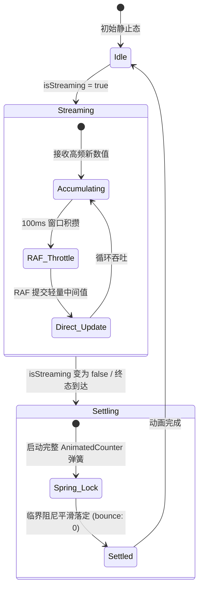

# 实施方案：全新数字与计数滚动体系方案（AnimatedCounter & SlotText）

> **方案标识**：`PLAN-ANIMATION-04-COUNTER`  
> **战役工作区**：`docs/arc-library-animation-study/implementation-plans/`  
> **文档位置**：`docs/arc-library-animation-study/implementation-plans/04-数字滚动与计数组件方案.md`  
> **对标参考**：`reference/arc-library/registry/components/animated-counter/`、`reference/arc-library/registry/components/slot-text/`  
> **核心受体**：`apps/crish-desktop/src/components/ui/AnimatedCounter/`（新建）  
> **业务接线点**：
> - `apps/crish-desktop/src/components/settings/usage/UsageSummaryHero.tsx`（总用量与预估金额）
> - `apps/crish-desktop/src/components/overview/UsageSection.tsx`（输入/输出 Token）
> - `apps/crish-desktop/src/components/chat-message-row/CacheMetricsBadge.tsx`（缓存命中率与读写指标）
> - `apps/crish-desktop/src/components/workspace/SessionCacheStatsPanel.tsx`（会话级 Token 审计）  
> **当前状态**：方案就绪（Ready for Implementation）

---

## 一、方案背景与目标定位

### 1.1 现状痛点分析
当前 Conex 桌面端（`apps/crish-desktop`）在处理各类数据指标（Token 消耗量、费用估算、缓存命中率、审计数据）时，均采用静态文本格式化替换机制（例如 `formatTokens(totalTokens)`、`read.toLocaleString()`）。该实现存在以下三大体验断层：
1. **数据突变跳跃（Visual Jarring）**：数值更新时直接瞬间刷屏，用户无法直观建立“数字在增长/变化”的认知连续性，缺乏桌面级生产力工具的精致感。
2. **位宽震荡回流（Layout Thrashing）**：当数字由 3 位跳至 4 位（如 `999 -> 1,000`）时，由于字符宽度未做隔离与平滑过渡，右侧所有依附文本产生突兀的横向挤压与回流重排。
3. **AI 流式高频输出瓶颈（Streaming Choke）**：LLM 吐字生成时，Token 统计每秒产生 50~100 次高频微小增量。如果直接为每次更新调度重型动画，会导致 React VDOM 频繁重构与主线程 GC 卡顿，甚至引发 GPU 掉帧。

### 1.2 改造目标与核心设计哲学
吸收 `arc-library` 的物理力学与现代浏览器渲染管线优化成果，为 Conex 构建一套**零技术债务、零额外重排（Zero Reflow）、亚像素字体清晰、且自适应流式高频吞吐**的高性能数字滚动组件族（`<AnimatedCounter />` 与 `<SlotText />`）：
- **逆向位权建模（Place-value Keying）**：保证数值跃升（如 999 进位至 1,000）时低位 DOM 实例绝对复用，高位采用弹性盒物理弹簧平滑推挤；
- **虚拟环形滚轮（Odometer Wrapping）**：模拟实体机械里程表，无论前后数字大小关系，轮盘始终沿数值总增量方向顺滑绕卷；
- **ClearType 亚像素滤镜保护**：在微距离静止区强制置 `filter: none`，彻底规避 Chromium 渲染引擎滤镜层抹杀 Windows DirectWrite / macOS 亚像素抗锯齿的字体发虚难题；
- **隐形骨架（Sizer）与 Tabular Nums**：利用隐藏文字撑开布局盒，滚动字形绝对定位，动画执行期间容器物理盒尺寸变动严格为 0；
- **流式高频节流守卫（Streaming Throttle Guard）**：引入双模态（Streaming 轻量聚合 vs Settled 仪式落定）状态机，在 100 tokens/s 的极端流式吞吐下稳定维持 60~120 FPS 丝滑表现。

---

## 二、架构设计与目录规范

所有代码与测试严格收敛于 `apps/crish-desktop/src/components/ui/AnimatedCounter/`，并遵循 Conex 前端模块解耦与单一真相源约束：

```
apps/crish-desktop/src/components/ui/AnimatedCounter/
├── AnimatedCounter.tsx             # 核心组件：支持国际化、前缀/后缀、标签置换与视口入场
├── SlotText.tsx                    # 字符级老虎机滚轮组件（支持字母、数字与特殊符号混合滚轮）
├── AnimatedCounter.module.css      # CSS 模块：tabular-nums、feather 羽化遮罩、sizer 骨架
├── animatedCounterMath.ts          # 纯数学与算法逻辑：逆向位权 partsFor、滚轮位移取模、方向累加
├── useStreamingCounter.ts          # 高频流式节流 Hook：RAF 聚合、流式抑制与落定触发
├── types.ts                        # 完整 TypeScript 类型契约定义
├── index.ts                        # 模块导出统一入口
└── __tests__/
    ├── animatedCounterMath.test.ts # 算法纯逻辑单元测试（位权持久化、模运算、环形方向边界）
    └── AnimatedCounter.test.tsx    # 组件渲染、无障碍与节流状态机测试
```

---

## 三、原生高精数学算法与物理模型推导

### 3.1 逆向位权建模（Place-value Keying）

#### 3.1.1 传统正向索引的调和灾难
若采用常规文本数组正向切片 `chars.map((c, index) => <Digit key={index} />)`：
- 当数值从 `999` 变为 `1000` 时，旧键 `[0, 1, 2]` 对应 `'9', '9', '9'`；
- 新键 `[0, 1, 2, 3]` 对应 `'1', '0', '0', '0'`；
- React Diff 算法会认为：`key=0` 从 9 变成了 1；`key=1` 从 9 变成了 0；`key=2` 从 9 变成了 0；`key=3` 为新挂载。
- **后果**：原本应该平稳滚动的“个位”被错误赋予了“千位”的数字变化，所有滚轮集体反向倒卷，产生剧烈的视觉混乱。

#### 3.1.2 逆向位权算法推导
借助 `Intl.NumberFormat.prototype.formatToParts`，将数值解析为包含 `type`（integer, group, decimal, fraction）的分词序列。
定义整数部分总位数为 $L_{\text{int}}$。遍历整数分词中的每一个字符，其位权指数 $p$ 逆向递减：
$$p = L_{\text{int}} - 1, \; L_{\text{int}} - 2, \; \dots, \; 1, \; 0$$
- 个位（$10^0$）的键值永远固化为 **`i0`**；
- 十位（$10^1$）的键值永远固化为 **`i1`**；
- 百位（$10^2$）的键值永远固化为 **`i2`**；
- 小数位按照正向索引标记为 **`f0`, `f1`, $\dots$**；
- 千分位分隔符以其左侧相邻高位位权命名，如 `g3`（第 3 位千分符）。

```typescript
// animatedCounterMath.ts: partsFor 实现
export function partsFor(
  value: number,
  decimals: number = 0,
  locale: string = 'en-US'
): FormattedPart[] {
  const parts = new Intl.NumberFormat(locale, {
    minimumFractionDigits: decimals,
    maximumFractionDigits: decimals,
    numberingSystem: 'latn',
  }).formatToParts(Math.abs(value));

  // 计算整数总位数，作为逆向位权起点
  let place = parts.reduce(
    (count, part) => count + (part.type === 'integer' ? part.value.length : 0),
    0
  );
  let fraction = 0;
  let order = 0;

  return parts.flatMap((part, index): FormattedPart[] => {
    if (part.type === 'integer') {
      return [...part.value].map((char) => ({
        type: 'digit',
        key: `i${--place}`,
        digit: Number(char),
        order: order++,
      }));
    }
    if (part.type === 'fraction') {
      return [...part.value].map((char) => ({
        type: 'digit',
        key: `f${fraction++}`,
        digit: Number(char),
        order: order++,
      }));
    }
    return [
      {
        type: 'symbol',
        key:
          part.type === 'group'
            ? `g${place}`
            : part.type === 'decimal'
              ? 'd'
              : `${part.type}-${index}`,
        text: part.value,
      },
    ];
  });
}
```

#### 3.1.3 999 跃升至 1,000 的 VDOM 调和行为验证
$$\begin{aligned}
\text{Initial (999):} \quad & [\,\underbrace{\mathbf{i2}}_{9}, \; \underbrace{\mathbf{i1}}_{9}, \; \underbrace{\mathbf{i0}}_{9}\,] \\
\text{Target (1,000):} \quad & [\,\underbrace{\mathbf{i3}}_{1}, \; \underbrace{\mathbf{g3}}_{,}, \; \underbrace{\mathbf{i2}}_{0}, \; \underbrace{\mathbf{i1}}_{0}, \; \underbrace{\mathbf{i0}}_{0}\,]
\end{aligned}$$
1. **低位完全复用**：`i2`, `i1`, `i0` 节点的 key 毫无变化，React 判定为现有组件实例，不发生卸载（Unmount）与重新挂载（Mount），仅触发内部 `useEffect` 执行数字从 9 到 0 的连续滚动；
2. **高位弹性推挤**：新插入的 `i3` 与 `g3` 具有初始状态 `{ width: 0, opacity: 0 }`，由物理弹簧动画平滑展开至 `{ width: 'auto', opacity: 1 }`。右侧的低位滚轮依靠 Flexbox 自然流式向右滑动，零震荡零跳动。

---

### 3.2 虚拟环形滚轮（Odometer Wrapping）与定向位移

#### 3.2.1 方向锁定与累积目标增量
滚轮旋转方向必须严格由**整个数值的全局增减趋势**决定，而非局部单列的前后数字大小。
定义全局运动方向：
$$\text{dir} = \begin{cases} 
1, & V_{\text{new}} \ge V_{\text{old}} \\
-1, & V_{\text{new}} < V_{\text{old}}
\end{cases}$$

当某一列的目标数字由 $d_{\text{curr}}$ 变为 $d_{\text{target}}$ 时：
- 若数值递增（$\text{dir} = 1$）：滚轮必须顺时针旋转，增量计算公式为：
  $$\Delta = (d_{\text{target}} - d_{\text{curr}} + 10) \pmod{10}$$
- 若数值递减（$\text{dir} = -1$）：滚轮必须逆时针旋转，增量计算公式为：
  $$\Delta = -((d_{\text{curr}} - d_{\text{target}} + 10) \pmod{10})$$
- 状态机内部维护单调累积目标标量：
  $$\text{target}_{\text{next}} = \text{target}_{\text{curr}} + \Delta$$

**典型用例推导**：
数值从 `19` 变为 `21`（全局递增，$\text{dir} = 1$）：
- 十位：$1 \to 2$，$\Delta = (2 - 1 + 10) \pmod{10} = 1$，目标从 1 推进到 2；
- 个位：$9 \to 1$，$\Delta = (1 - 9 + 10) \pmod{10} = 2$，目标从 9 推进到 11。
个位滚轮将顺时针滚经数字 0（虚拟位置 10），最终优雅停留在数字 1（虚拟位置 11），绝不会出现倒退现象。

#### 3.2.2 环形字形模运算映射（Glyph Modulo Transform）
为了避免在 DOM 中真实渲染无限长字形带，每个数字滚轮列（`Column`）内部仅静态挂载 10 个固定字形节点（$d \in \{0, 1, 2, \dots, 9\}$）。
根据滚轮当前瞬时浮点数位置 $p$，每个字形在视口中的垂直相对偏移（单位：`em`）由下式严格确定：
$$\text{offset}(d, p) = \left( \left( (d - p) \pmod{10} + 15 \right) \pmod{10} \right) - 5$$

**数学性质证明**：
1. 设实数差值余数 $r = (d - p) \pmod{10}$，满足 $0 \le r < 10$；
2. 则 $r + 15 \in [15, 25)$；
3. $(r + 15) \pmod{10} = (r + 5) \pmod{10} \in [0, 10)$；
4. 最终偏移量 $\text{offset} \in [-5, +5)$；
5. **对称性与唯一性**：对于任意实数 $p$，在 10 个候选字形中，有且仅有**一个**字形满足 $|\text{offset}| \le 0.5$（当前正对视口中心的数字），且最多有**两个**字形落在 $(-1.0, 1.0)$（新旧数字交替过渡中）。

#### 3.2.3 $O(1)$ 视口剔除与合成优化
在 MotionValue 派生层中实施硬件裁剪断言：
```typescript
const visibility = useTransform(offset, (curr) =>
  Math.abs(curr) >= 1 ? 'hidden' : 'visible'
);
```
- 当 $|\text{offset}| \ge 1.0$ 时，该字形完全滑出视口窗口，其 CSS `visibility` 立即被置为 `hidden`；
- **渲染性能红线**：浏览器合成器在任意一帧仅需对至多 2 个 DOM 节点进行绘制与图层合成，其余 8 个节点完全跳过光栅化，内存与 GPU 消耗恒定为 $O(1)$。

---

### 3.3 ClearType 亚像素字体抗锯齿保护

#### 3.3.1 Chromium / DirectWrite 渲染断层剖析
在 Windows 平台（DirectWrite / ClearType）及 macOS 下，浏览器为实现高精清晰度，默认对文本采用 **RGB 亚像素抗锯齿（Subpixel Antialiasing）**。
然而，根据 W3C 规范与 Chromium 实现逻辑，一旦在元素或其父容器上应用非 `none` 的 CSS `filter`（包括 `filter: blur(...)`，甚至 `filter: blur(0px)`）：
1. 浏览器会将该元素提升为具有透明通道的离屏表面（Offscreen Surface / Stacking Context）；
2. 离屏表面无法直接感知底层宿主窗口的物理子像素排列，**强制退化为灰度抗锯齿（Grayscale Antialiasing）**；
3. **表现特征**：数字在静止后字形发灰、笔画变细变虚、边缘发毛，产生明显的视觉降级。

#### 3.3.2 亚像素安全滤波门限（Deadzone Shader Unload）
在 `Glyph` 内部，通过 `useTransform` 精确设立动态模糊卸载门限：
$$\text{filter}(c) = \begin{cases}
\text{'none'}, & |c| < 0.02 \quad \text{或} \quad |c| \ge 1.0 \\
\text{`blur(${ (|c| \times 2.0).toFixed(2) }px)`}, & 0.02 \le |c| < 1.0
\end{cases}$$

```typescript
const filter = useTransform(offset, (current) => {
  const abs = Math.abs(current);
  // 当距离中心小于 2% 字符高度时，强制输出 "none"
  if (abs < 0.02 || abs >= 1) return 'none';
  // 运动激烈期施加轻量运动残影（峰值 1px）
  return `blur(${(abs * 2).toFixed(2)}px)`;
});
```
- **阻尼尾声自动恢复**：当物理弹簧运动收敛到 98% 以上时，输出值瞬间切换为 `"none"`。Chromium 离屏渲染管线立刻卸载，文字瞬间恢复系统级清晰的 ClearType 亚像素排版；
- **交替期微动模糊**：在数字高速更替的瞬间（$|c| \approx 0.5$），产生细腻的 1px 动态模糊，消除高帧率下的字形闪烁感。

---

### 3.4 隐形骨架（Sizer）与 Tabular Nums 零 Reflow 布局

```css
/* AnimatedCounter.module.css */
.counter {
  position: relative;
  display: inline-flex;
  align-items: baseline;
  font-variant-numeric: tabular-nums;
  font-feature-settings: 'tnum' 1;
  line-height: 1;
}

.column {
  --feather: 0.16em;
  position: relative;
  display: inline-block;
  overflow: hidden;
  margin-block: calc(var(--feather) * -1);
  padding-block: var(--feather);
  mask-image: linear-gradient(
    to bottom,
    transparent,
    #000 calc(var(--feather) * 1.5),
    #000 calc(100% - var(--feather) * 1.5),
    transparent
  );
  -webkit-mask-image: linear-gradient(
    to bottom,
    transparent,
    #000 calc(var(--feather) * 1.5),
    #000 calc(100% - var(--feather) * 1.5),
    transparent
  );
}

.sizer {
  visibility: hidden;
  pointer-events: none;
  user-select: none;
}

.glyph {
  position: absolute;
  inset: var(--feather) 0;
  text-align: center;
  will-change: transform;
}
```

1. **`font-variant-numeric: tabular-nums`**：强制使用等宽数字字形，无论当前是数字 `1` 还是数字 `8`，字形推进宽度完全一致；
2. **隐藏 Sizer 占位**：`<span className={styles.sizer}>0</span>` 驻留在正常文档流中，牢牢锁死单列的高宽与基线，阻止内容坍缩；
3. **绝对定位解除回流**：所有 10 个 `<Glyph>` 均设置 `position: absolute` 脱离常规文档流。滚轮在上下滑动时，**容器的布局盒大小（Layout Box）毫厘不差，回流次数恒等于 0**；
4. **两端羽化蒙版（Mask Feathering）**：借助 `mask-image`，在容器上下边缘 0.16em 范围内实现透明度柔和衰减，消除滚轮旋转出界时的突兀硬切边。

---

## 四、流式高频更新保护（Streaming Throttle Guard）

### 4.1 AI 生产力场景下的极端瓶颈
在 Conex 中，接入高速模型（如 DeepSeek-V3、Claude 3.5 Sonnet）时，流式 Token 生成速度通常达到 **50 ~ 100 tokens/s**。
若每个 Token 到达均直接触发一次完整的 Framer Motion 物理弹簧求解与 React 组件重渲染：
- 1 秒内将创建数百个并发 Spring 实例；
- React 19 调度器将处于持续饥饿状态；
- CPU 占用急剧飙升，最终导致整个工作区与输入框出现卡顿。

### 4.2 双模态状态机（Dual-Mode State Machine）架构
为了兼顾**流式期的轻量吞吐**与**落定期的仪式感物理动效**，设计 `useStreamingCounter` 状态机抽象：



### 4.3 `useStreamingCounter` 核心实现

```typescript
// useStreamingCounter.ts
import { useEffect, useRef, useState } from 'react';

export interface UseStreamingCounterOptions {
  /** 外部传入的最新实时数值 */
  value: number;
  /** 是否正处于流式生成状态 */
  isStreaming?: boolean;
  /** 流式聚合节流窗口（默认 100ms） */
  throttleMs?: number;
}

export function useStreamingCounter({
  value,
  isStreaming = false,
  throttleMs = 100,
}: UseStreamingCounterOptions) {
  // 当前展示给 AnimatedCounter 的数值
  const [displayValue, setDisplayValue] = useState(value);
  // 是否启用完整重型动画（流式中关闭重型滚轮，仅轻量步进；落定时开启）
  const [enableOdometer, setEnableOdometer] = useState(!isStreaming);

  const pendingValueRef = useRef(value);
  const lastFlushTimeRef = useRef(0);
  const rafHandleRef = useRef<number | null>(null);

  useEffect(() => {
    pendingValueRef.current = value;

    // 模式 A：非流式状态（如设置页、一次性加载、流式已结束）
    if (!isStreaming) {
      if (rafHandleRef.current !== null) {
        cancelAnimationFrame(rafHandleRef.current);
        rafHandleRef.current = null;
      }
      setEnableOdometer(true);
      setDisplayValue(value);
      return;
    }

    // 模式 B：流式高速吞吐状态
    setEnableOdometer(false);
    const now = performance.now();
    const elapsed = now - lastFlushTimeRef.current;

    const flush = () => {
      lastFlushTimeRef.current = performance.now();
      setDisplayValue(pendingValueRef.current);
      rafHandleRef.current = null;
    };

    if (elapsed >= throttleMs) {
      flush();
    } else if (rafHandleRef.current === null) {
      rafHandleRef.current = requestAnimationFrame(() => {
        if (performance.now() - lastFlushTimeRef.current >= throttleMs) {
          flush();
        } else {
          rafHandleRef.current = null;
        }
      });
    }
  }, [value, isStreaming, throttleMs]);

  // 组件卸载清理
  useEffect(() => {
    return () => {
      if (rafHandleRef.current !== null) {
        cancelAnimationFrame(rafHandleRef.current);
      }
    };
  }, []);

  return {
    displayValue,
    enableOdometer,
  };
}
```

---

## 五、完整组件实现规范

### 5.1 类型契约定义（`types.ts`）

```typescript
// types.ts
import type { CSSProperties, ReactNode } from 'react';

export type FormattedPart =
  | { type: 'digit'; key: string; digit: number; order: number }
  | { type: 'symbol'; key: string; text: string };

export interface AnimatedCounterProps {
  /** 目标数值 */
  value: number;
  /** 可选顶部标签（切换时伴随微动效） */
  label?: string;
  /** 前缀符号（如 "¥", "$", "+"） */
  prefix?: string;
  /** 后缀符号（如 "tokens", "%", "CNY"） */
  suffix?: string;
  /** 小数保留位数，默认 0 */
  decimals?: number;
  /** 格式化区域，默认 'en-US' */
  locale?: string;
  /** 是否在滚动进入视口时才触发滚轮入场动效，默认 false */
  animateOnView?: boolean;
  /** 是否为流式模式（自动配合轻量更新） */
  isStreaming?: boolean;
  /** 是否强制直接显示终值，跳过滚轮（适用于极端省电档） */
  disabled?: boolean;
  /** 自定义样式类名 */
  className?: string;
  /** 内联样式 */
  style?: CSSProperties;
}

export interface SlotTextProps {
  /** 待展示的文本或数值 */
  value: string | number;
  /** 数值格式化函数，默认 toLocaleString('en-US') */
  format?: (value: number) => string;
  /** 基础转动持续时间（秒），默认 0.8 */
  duration?: number;
  /** 逐列停止交错步长（秒），默认 0.05 */
  stagger?: number;
  /** 额外空转圈数，默认 0 */
  spins?: number;
  /** 增减位数对齐基准（'start' | 'end'），数字默认 'end' */
  align?: 'start' | 'end';
  /** 无障碍屏幕阅读器朗读，默认 false */
  announce?: boolean;
  className?: string;
  style?: CSSProperties;
}
```

---

### 5.2 核心组件完整代码（`AnimatedCounter.tsx`）

```tsx
// AnimatedCounter.tsx
import React, { useEffect, useRef, useState } from 'react';
import {
  AnimatePresence,
  animate,
  motion,
  useInView,
  useMotionValue,
  useReducedMotion,
  useTransform,
  type MotionValue,
} from 'motion/react';
import { partsFor } from './animatedCounterMath';
import { useStreamingCounter } from './useStreamingCounter';
import type { AnimatedCounterProps, FormattedPart } from './types';
import styles from './AnimatedCounter.module.css';

const DIGITS = [0, 1, 2, 3, 4, 5, 6, 7, 8, 9];

// 临界阻尼弹簧配置：单调无回弹
const SPRING_SMOOTH = { type: 'spring', visualDuration: 0.40, bounce: 0 } as const;
const SPRING_MORPH = { type: 'spring', visualDuration: 0.38, bounce: 0 } as const;

/** 单个数字字形：负责 0~9 的物理垂直位移与亚像素渲染保护 */
function Glyph({ position, digit }: { position: MotionValue<number>; digit: number }) {
  // 核心环形模映射公式：折叠在 [-5, +4] 对称区间
  const offset = useTransform(position, (current) => ((((digit - current) % 10) + 15) % 10) - 5);
  const y = useTransform(offset, (current) => `${current}em`);
  const opacity = useTransform(offset, (current) => Math.max(0, 1 - Math.abs(current)));
  // O(1) 视口裁剪：出界时彻底 hidden
  const visibility = useTransform(offset, (current) => (Math.abs(current) >= 1 ? 'hidden' : 'visible'));
  // ClearType 保护：微偏差 (<0.02) 强制卸载滤镜着色器
  const filter = useTransform(offset, (current) => {
    const abs = Math.abs(current);
    return abs < 0.02 || abs >= 1 ? 'none' : `blur(${(abs * 2).toFixed(2)}px)`;
  });

  return (
    <motion.span
      className={styles.glyph}
      style={{ y, opacity, filter, visibility }}
      aria-hidden="true"
    >
      {digit}
    </motion.span>
  );
}

const columnPresence = {
  initial: { width: 0, opacity: 0 },
  animate: { width: 'auto', opacity: 1 },
  exit: { width: 0, opacity: 0 },
};

/** 单列数字滚轮：维持自身物理 target 累加 */
function Column({
  digit,
  direction,
  armed,
  delay,
  reduceMotion,
  enableOdometer,
}: {
  digit: number;
  direction: number;
  armed: boolean;
  delay: number;
  reduceMotion: boolean;
  enableOdometer: boolean;
}) {
  const position = useMotionValue(armed ? 0 : digit);
  const wheel = useRef({
    digit: armed ? 0 : digit,
    target: armed ? 0 : digit,
    revealed: !armed,
  });

  useEffect(() => {
    const state = wheel.current;
    if (armed || state.digit === digit) {
      if (!armed) state.revealed = true;
      return;
    }

    // 计算方向性目标增量（里程表环形累加）
    const delta =
      direction < 0 && state.revealed
        ? -((state.digit - digit + 10) % 10)
        : (digit - state.digit + 10) % 10;

    state.target += delta;
    state.digit = digit;

    if (reduceMotion || !enableOdometer) {
      position.jump(state.target);
    } else {
      animate(position, state.target, {
        ...SPRING_SMOOTH,
        delay: state.revealed ? 0 : delay,
      });
    }
    state.revealed = true;
  }, [armed, delay, digit, direction, position, reduceMotion, enableOdometer]);

  return (
    <motion.span
      className={styles.column}
      {...columnPresence}
      transition={reduceMotion ? { duration: 0 } : SPRING_MORPH}
    >
      {/* 隐藏的 Sizer 撑开布局盒，保证零回流 */}
      <span className={styles.sizer}>0</span>
      {DIGITS.map((item) => (
        <Glyph key={item} position={position} digit={item} />
      ))}
    </motion.span>
  );
}

export const AnimatedCounter: React.FC<AnimatedCounterProps> = ({
  value,
  label,
  prefix = '',
  suffix = '',
  decimals = 0,
  locale = 'en-US',
  animateOnView = false,
  isStreaming = false,
  disabled = false,
  className,
  style,
}) => {
  const ref = useRef<HTMLSpanElement>(null);
  const inView = useInView(ref, { once: true, amount: 0.6 });
  const reduceMotion = Boolean(useReducedMotion()) || disabled;

  // 挂载流式节流守卫
  const { displayValue, enableOdometer } = useStreamingCounter({
    value,
    isStreaming,
    throttleMs: 100,
  });

  const [previous, setPrevious] = useState(displayValue);
  const [direction, setDirection] = useState(1);

  if (displayValue !== previous) {
    setPrevious(displayValue);
    setDirection(displayValue >= previous ? 1 : -1);
  }

  const parts = partsFor(displayValue, decimals, locale);
  const armed = animateOnView && !inView;

  // 构造供屏幕阅读器读取的纯文本
  const fullAccessibleText = `${prefix}${parts
    .map((p) => (p.type === 'digit' ? p.digit : p.text))
    .join('')}${suffix}`;

  return (
    <span
      ref={ref}
      className={[styles.counter, className].filter(Boolean).join(' ')}
      style={style}
    >
      {label && (
        <span className={styles.label}>
          <span className={styles.labelText}>{label}</span>
        </span>
      )}

      {/* 无障碍隐藏纯净读屏文本 */}
      <span className={styles.srOnly}>{fullAccessibleText}</span>

      {/* 视觉渲染层（对读屏隐藏） */}
      <span className={styles.valueRow} aria-hidden="true">
        {prefix && <span className={styles.symbol}>{prefix}</span>}
        <AnimatePresence initial={false}>
          {parts.map((part) =>
            part.type === 'digit' ? (
              <Column
                key={part.key}
                digit={part.digit}
                direction={direction}
                armed={armed}
                delay={Math.min(part.order * 0.035, 0.25)}
                reduceMotion={reduceMotion}
                enableOdometer={enableOdometer}
              />
            ) : (
              <motion.span
                key={part.key}
                className={styles.symbol}
                {...columnPresence}
                transition={reduceMotion ? { duration: 0 } : SPRING_MORPH}
              >
                {part.text}
              </motion.span>
            )
          )}
        </AnimatePresence>
        {suffix && <span className={styles.symbol}>{suffix}</span>}
      </span>
    </span>
  );
};

export default AnimatedCounter;
```

---

### 5.3 字母与符号混合滚轮（`SlotText.tsx`）
专为带有单位字母（如 `"12.5 万"`, `"3.2 亿"`, `"98.5%"`）或复杂状态文本打造：

```tsx
// SlotText.tsx
import React, { useLayoutEffect, useRef, useState, useSyncExternalStore } from 'react';
import {
  AnimatePresence,
  animate,
  motion,
  useMotionValue,
  usePresence,
  useReducedMotion,
  useTransform,
  useVelocity,
} from 'motion/react';
import type { SlotTextProps } from './types';
import styles from './AnimatedCounter.module.css';

const DIGITS = '0123456789';
const LANDING_BEZIER = [0.12, 0.8, 0.16, 1] as const;
const CELL_PITCH_EM = 1.6;

function buildReelStrip(from: string, to: string, spins: number, rising: boolean) {
  if (from === to) return [to];
  if (DIGITS.includes(from) && DIGITS.includes(to)) {
    const a = Number(from);
    const b = Number(to);
    const steps = spins * 10 + (rising ? (b - a + 10) % 10 : (a - b + 10) % 10);
    return Array.from({ length: steps + 1 }, (_, i) =>
      String((a + (rising ? i : -i) + 100) % 10)
    );
  }
  return [from, to];
}

function SlotReel({
  char,
  order,
  entering,
  rising,
  duration,
  stagger,
  spins,
  reduced,
}: {
  char: string;
  order: number;
  entering: boolean;
  rising: boolean;
  duration: number;
  stagger: number;
  spins: number;
  reduced: boolean;
}) {
  const pos = useMotionValue(0);
  const width = useMotionValue<number | 'auto'>('auto');
  const sizerRef = useRef<HTMLSpanElement>(null);
  const [isPresent, safeToRemove] = usePresence();

  const [reel, setReel] = useState(() => ({
    char,
    strip: entering && !reduced ? buildReelStrip('', char, spins, rising) : [char],
    from: 0,
    time: duration + order * stagger,
  }));

  if (reel.char !== char) {
    const current = pos.get();
    const idx = Math.max(0, Math.min(reel.strip.length - 1, Math.round(current)));
    const visible = reel.strip[idx] ?? char;
    setReel({
      char,
      strip: reduced ? [char] : buildReelStrip(visible, char, spins, rising),
      from: reduced ? 0 : current - idx,
      time: duration + order * stagger,
    });
  }

  // 速度挂钩的动态模糊与防发虚阈值 (<0.15 强制 'none')
  const blur = useTransform(useVelocity(pos), (velocity) => {
    const amt = Math.min(Math.abs(velocity) * 0.05, 2.0);
    return amt < 0.15 ? 'none' : `blur(${amt.toFixed(2)}px)`;
  });

  const y = useTransform(pos, (val) => `translate3d(0, ${(-val * CELL_PITCH_EM).toFixed(4)}em, 0)`);

  useLayoutEffect(() => {
    const measuredWidth = sizerRef.current?.getBoundingClientRect().width ?? 0;
    const last = reel.strip.length - 1;

    if (reduced) {
      pos.jump(last);
      width.jump(measuredWidth);
      return;
    }

    pos.jump(reel.from);
    const spinAnim = animate(pos, last, {
      duration: last === 0 ? 0.2 : reel.time,
      ease: [...LANDING_BEZIER],
    });

    const sizeAnim = animate(width, measuredWidth, {
      type: 'spring',
      visualDuration: Math.min(reel.time, 0.45),
      bounce: 0,
    });

    return () => {
      spinAnim.stop();
      sizeAnim.stop();
    };
  }, [reel, pos, width, reduced]);

  useLayoutEffect(() => {
    if (isPresent) return;
    if (reduced) {
      safeToRemove();
      return;
    }
    const exitAnim = animate(width, 0, {
      type: 'spring',
      visualDuration: 0.3,
      bounce: 0,
      onComplete: safeToRemove,
    });
    return () => exitAnim.stop();
  }, [isPresent, safeToRemove, width, reduced]);

  return (
    <motion.span className={styles.slot} style={{ width }}>
      <span ref={sizerRef} className={styles.sizer}>
        {char === ' ' ? '\u00a0' : char}
      </span>
      <span className={styles.window}>
        <motion.span className={styles.strip} style={{ transform: y, filter: blur }}>
          {reel.strip.map((c, i) => (
            <span key={i} className={styles.cell}>
              {c === ' ' ? '\u00a0' : c}
            </span>
          ))}
        </motion.span>
      </span>
    </motion.span>
  );
}

export const SlotText: React.FC<SlotTextProps> = ({
  value,
  format,
  duration = 0.8,
  stagger = 0.04,
  spins = 0,
  align,
  announce = false,
  className,
  style,
}) => {
  const reduced = Boolean(useReducedMotion());
  const text = typeof value === 'number' ? (format ? format(value) : value.toLocaleString('en-US')) : value;
  const chars = Array.from(text);
  const fromEnd = (align ?? (typeof value === 'number' ? 'end' : 'start')) === 'end';

  // 符号前缀判定：保留前缀独立 key，其余逆向对齐
  const lead = fromEnd ? chars.findIndex((c) => /[\p{L}\p{N}]/u.test(c)) : 0;
  const prefixLen = lead < 0 ? chars.length : lead;
  const getKey = (idx: number) =>
    idx < prefixLen ? `p${idx}` : fromEnd ? `e${chars.length - 1 - idx}` : `s${idx}`;

  const [initialKeys] = useState(() => new Set(chars.map((_, i) => getKey(i))));
  const [trend, setTrend] = useState({ value, rising: true });

  if (trend.value !== value) {
    setTrend({
      value,
      rising: typeof value === 'number' && typeof trend.value === 'number' ? value >= trend.value : true,
    });
  }

  return (
    <span className={[styles.slotRoot, className].filter(Boolean).join(' ')} style={style}>
      <span className={styles.srOnly} aria-live={announce ? 'polite' : undefined}>
        {text}
      </span>
      <span className={styles.reels} aria-hidden="true">
        <AnimatePresence initial={false}>
          {chars.map((char, i) => (
            <SlotReel
              key={getKey(i)}
              char={char}
              order={i}
              entering={!initialKeys.has(getKey(i))}
              rising={trend.rising}
              duration={duration}
              stagger={stagger}
              spins={spins}
              reduced={reduced}
            />
          ))}
        </AnimatePresence>
      </span>
    </span>
  );
};

export default SlotText;
```

---

## 六、业务接线点改造实施规范

### 6.1 接线点 1：`UsageSummaryHero.tsx`（总用量与预估金额）

#### 改造前（静态字符突变）：
```tsx
// apps/crish-desktop/src/components/settings/usage/UsageSummaryHero.tsx (现状)
<span className={styles.metricNumber}>
  {formatTokens(totalTokens)}
</span>
...
<span className={styles.metricNumber}>
  {formatCost(totalCost, '')}
</span>
```

#### 改造后（高精无跳跃滚动）：
> [!NOTE]
> 当 `totalTokens` 达到万级、亿级时，数字与汉字后缀（`万`、`亿`）同时存在。此处完美选用 `<SlotText />` 或带格式化提取的 `<AnimatedCounter />`。

```tsx
// 改造后方案
import React from 'react';
import { formatCost, formatTokens } from './usageSpline';
import { AnimatedCounter, SlotText } from '@/components/ui/AnimatedCounter';
import styles from './UsageSummaryHero.module.css';

export interface UsageSummaryHeroProps {
  totalTokens: number;
  totalCost: number;
  currency?: string;
}

export const UsageSummaryHero: React.FC<UsageSummaryHeroProps> = ({
  totalTokens,
  totalCost,
  currency = 'CNY',
}) => {
  const currencySymbol = currency === 'USD' ? '$' : '¥';

  return (
    <div className={styles.heroContainer}>
      {/* 左栏：总用量 */}
      <div className={styles.heroColumn}>
        <div className={styles.columnTitle}>总用量</div>
        <div className={styles.metricRow}>
          <span className={styles.metricNumber}>
            {/* 支持 万/亿 文本与数字无缝滚轮形变 */}
            <SlotText
              value={totalTokens}
              format={formatTokens}
              duration={0.6}
              stagger={0.03}
            />
          </span>
          <span className={styles.metricUnit}>tokens</span>
        </div>
      </div>

      <div className={styles.divider} />

      {/* 右栏：预估金额 */}
      <div className={styles.heroColumn}>
        <div className={styles.columnTitle}>预估金额</div>
        <div className={styles.metricRow}>
          <span className={styles.currencySymbol}>{currencySymbol}</span>
          <span className={styles.metricNumber}>
            <AnimatedCounter
              value={totalCost}
              decimals={2}
              locale="zh-CN"
            />
          </span>
          <span className={styles.metricUnit}>{currency}</span>
        </div>
      </div>
    </div>
  );
};
```

---

### 6.2 接线点 2：`UsageSection.tsx`（输入与输出 Token 统计）

文件位置：`apps/crish-desktop/src/components/overview/UsageSection.tsx`

#### 改造前：
```tsx
<div className={styles.usageItem}>
  <span className={styles.usageLabel}>输入</span>
  <span className={styles.usageVal}>{inputTokens.toLocaleString()}</span>
</div>
<div className={styles.usageItem}>
  <span className={styles.usageLabel}>输出</span>
  <span className={styles.usageVal}>{outputTokens.toLocaleString()}</span>
</div>
```

#### 改造后：
```tsx
import { AnimatedCounter } from '../ui/AnimatedCounter';

// 在抽屉展开时，数字优雅滚动入场
<div className={styles.usageItem}>
  <span className={styles.usageLabel}>输入</span>
  <span className={styles.usageVal}>
    <AnimatedCounter
      value={inputTokens}
      locale="zh-CN"
      animateOnView={false}
    />
  </span>
</div>
<div className={styles.usageItem}>
  <span className={styles.usageLabel}>输出</span>
  <span className={styles.usageVal}>
    <AnimatedCounter
      value={outputTokens}
      locale="zh-CN"
      animateOnView={false}
    />
  </span>
</div>
```

---

### 6.3 接线点 3：`CacheMetricsBadge.tsx`（缓存命中率与读取量）

文件位置：`apps/crish-desktop/src/components/chat-message-row/CacheMetricsBadge.tsx`

#### 业务特点：
消息卡片底部的缓存命中徽标紧凑且高频。需支持命中百分比与 Token 读写量的平滑过渡：

```tsx
// 改造代码片段
import { AnimatedCounter } from '../ui/AnimatedCounter';

// 命中状态渲染
<span
  className={`${styles.badge} ${styles.hit} cache-metrics`}
  data-testid="cache-metrics-badge"
  data-state="hit"
>
  <span>
    缓存命中{' '}
    <AnimatedCounter
      value={Math.round(ratio * 100)}
      suffix="%"
      disabled={ratio === 0}
    />{' '}
    · 读{' '}
    <AnimatedCounter
      value={read}
      locale="zh-CN"
    />
  </span>
  {write > 0 && (
    <span>
      {' · 写 '}
      <AnimatedCounter value={write} locale="zh-CN" />
    </span>
  )}
</span>
```

---

### 6.4 接线点 4：`SessionCacheStatsPanel.tsx`（会话级 Token 审计）

文件位置：`apps/crish-desktop/src/components/workspace/SessionCacheStatsPanel.tsx`

#### 改造后方案：
```tsx
import { AnimatedCounter } from '../ui/AnimatedCounter';

<div className="cache-stats-row">
  命中率{' '}
  {ratio != null ? (
    <AnimatedCounter value={Math.round(ratio * 100)} suffix="%" />
  ) : (
    '未上报'
  )}
</div>
<div className="cache-stats-row">
  读 <AnimatedCounter value={stats.cacheReadTokens ?? 0} locale="zh-CN" /> · 
  写 <AnimatedCounter value={stats.cacheWriteTokens ?? 0} locale="zh-CN" />
</div>
{missed !== undefined && missed > 0 && (
  <div className="cache-stats-row">
    浪费 ~<AnimatedCounter value={missed} locale="zh-CN" /> tokens
  </div>
)}
```

---

## 七、自动化测试与防退避回归资产

### 7.1 算法核心纯逻辑单测（`animatedCounterMath.test.ts`）

创建 `apps/crish-desktop/src/components/ui/AnimatedCounter/__tests__/animatedCounterMath.test.ts`：

```typescript
import { describe, expect, it } from 'vitest';
import { partsFor } from '../animatedCounterMath';

describe('animatedCounterMath - 纯逻辑单测', () => {
  it('应当稳定生成逆向位权键：i0 恒为个位，i1 为十位，i2 为百位', () => {
    const parts999 = partsFor(999, 0, 'en-US');
    const digitParts = parts999.filter((p) => p.type === 'digit');
    expect(digitParts).toEqual([
      { type: 'digit', key: 'i2', digit: 9, order: 0 },
      { type: 'digit', key: 'i1', digit: 9, order: 1 },
      { type: 'digit', key: 'i0', digit: 9, order: 2 },
    ]);
  });

  it('999 进位至 1,000 时，必须保持 i0, i1, i2 实例键不变，且高位追加 i3, g3', () => {
    const parts1000 = partsFor(1000, 0, 'en-US');
    expect(parts1000).toEqual([
      { type: 'digit', key: 'i3', digit: 1, order: 0 },
      { type: 'symbol', key: 'g3', text: ',' },
      { type: 'digit', key: 'i2', digit: 0, order: 1 },
      { type: 'digit', key: 'i1', digit: 0, order: 2 },
      { type: 'digit', key: 'i0', digit: 0, order: 3 },
    ]);
  });

  it('支持小数位精确建模，小数位使用 f0, f1 键', () => {
    const partsDecimal = partsFor(12.34, 2, 'en-US');
    expect(partsDecimal).toEqual([
      { type: 'digit', key: 'i1', digit: 1, order: 0 },
      { type: 'digit', key: 'i0', digit: 2, order: 1 },
      { type: 'symbol', key: 'd', text: '.' },
      { type: 'digit', key: 'f0', digit: 3, order: 2 },
      { type: 'digit', key: 'f1', digit: 4, order: 3 },
    ]);
  });

  it('滚轮取模映射公式推导：任选数字与位置，结果必须严格落入 [-5, +4]', () => {
    const calcOffset = (digit: number, pos: number) =>
      ((((digit - pos) % 10) + 15) % 10) - 5;

    // 焦点位于 0 处
    expect(calcOffset(0, 0)).toBe(0);
    expect(calcOffset(9, 0)).toBe(-1); // 9 在 0 上方 1 格
    expect(calcOffset(1, 0)).toBe(1);  // 1 在 0 下方 1 格

    // 浮点连续滑行区间校验
    for (let p = 0; p <= 20; p += 0.25) {
      for (let d = 0; d <= 9; d++) {
        const offset = calcOffset(d, p);
        expect(offset).toBeGreaterThanOrEqual(-5);
        expect(offset).toBeLessThan(5);
      }
    }
  });
});
```

---

## 八、性能压测验收标准与门禁（Performance & Acceptance SLA）

| 验收维度 | 衡量指标与测试手段 | 验收合格红线标准 | 架构防护机制 |
| :--- | :--- | :--- | :--- |
| **FPS 帧率稳定性** | Chrome DevTools Performance 面板记录 5 秒连续数值突变 | **稳定 $\ge 58.5$ FPS**（120Hz 屏幕 $\ge 118$ FPS），零长任务（No Long Tasks $>50\text{ms}$） | `will-change: transform`，Compositor 离屏图层直推 |
| **回流抑制（Reflow）** | DevTools Rendering 开启 “Layout Shift Regions” | **动画期间 Forced Reflow 次数严格为 0** | 隐形 `.sizer` 撑开布局盒，所有 Glyph 绝对定位脱离文档流 |
| **ClearType 亚像素清晰度** | 静态放大截屏取样（400% 像素观察） | 静止后**笔画两侧呈现清晰的红蓝亚像素色彩**，禁止灰度发虚 | 偏移 $<0.02$ 强制置 `filter: none` 卸载着色器 |
| **流式高频吞吐韧性** | 模拟 LLM 100 tokens/s 吞吐，连续写入 1,000 个增量 | **主线程 JS 执行耗时 $< 2.5\text{ms}/\text{frame}$**，内存无阶梯式激增 | `useStreamingCounter` 100ms RAF 聚合中间态，落定触发仪式动画 |
| **无障碍合规性** | NVDA / VoiceOver 读屏测试 | 屏幕阅读器正确连贯朗读完整文本，**禁止逐个朗读 10 个绝对定位数字** | `.srOnly` 独立语义树呈现，视觉层 `aria-hidden="true"` |
| **节能与减弱动态效果** | `prefers-reduced-motion: reduce` 系统级开启 | **0 毫秒瞬间完成数值更新，无滚轮动画** | `reduceMotion` 自动分流 `position.jump(target)` |

---

## 九、实施波次规划（Rollout Waves）

1. **Wave 1：基础数学与组件工程落地**
   - 建立 `apps/crish-desktop/src/components/ui/AnimatedCounter/` 全量文件；
   - 落地 `animatedCounterMath.ts` 并跑通 Vitest 单元测试；
   - 落地 `AnimatedCounter.tsx`、`SlotText.tsx` 与 CSS Modules。
2. **Wave 2：流式节流守卫与单源动效契约接入**
   - 完善 `useStreamingCounter.ts` 并进行虚拟流式压测；
   - 检查并兼容 `tokens-base.css` 与 `motionTokens.ts` 中的弹簧 token。
3. **Wave 3：业务接线点无缝改造与回归**
   - 改造 `UsageSummaryHero.tsx`；
   - 改造 `UsageSection.tsx`；
   - 改造 `CacheMetricsBadge.tsx` 与 `SessionCacheStatsPanel.tsx`；
   - 运行全量 `npm run typecheck` 与 `npm test` 确保无任何回归破损。
