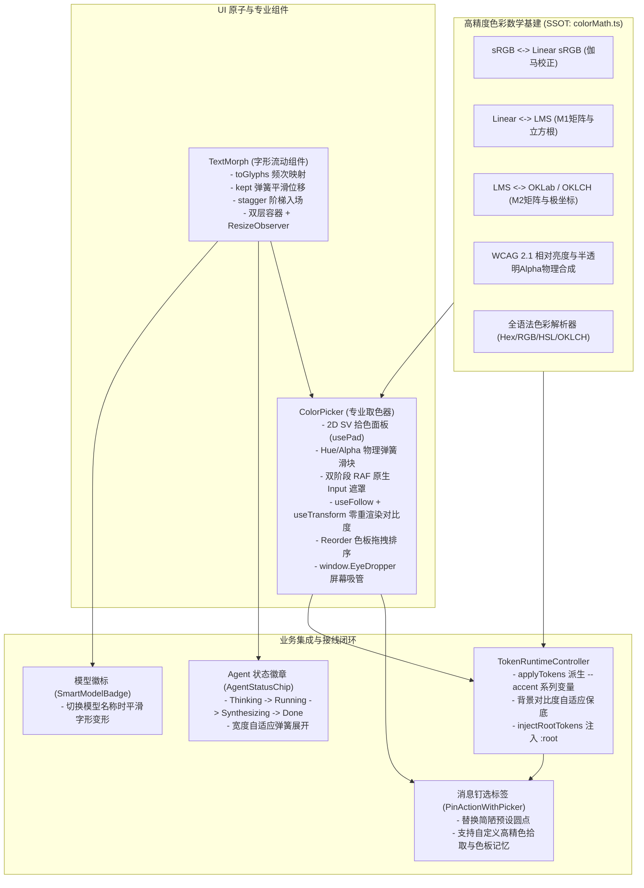
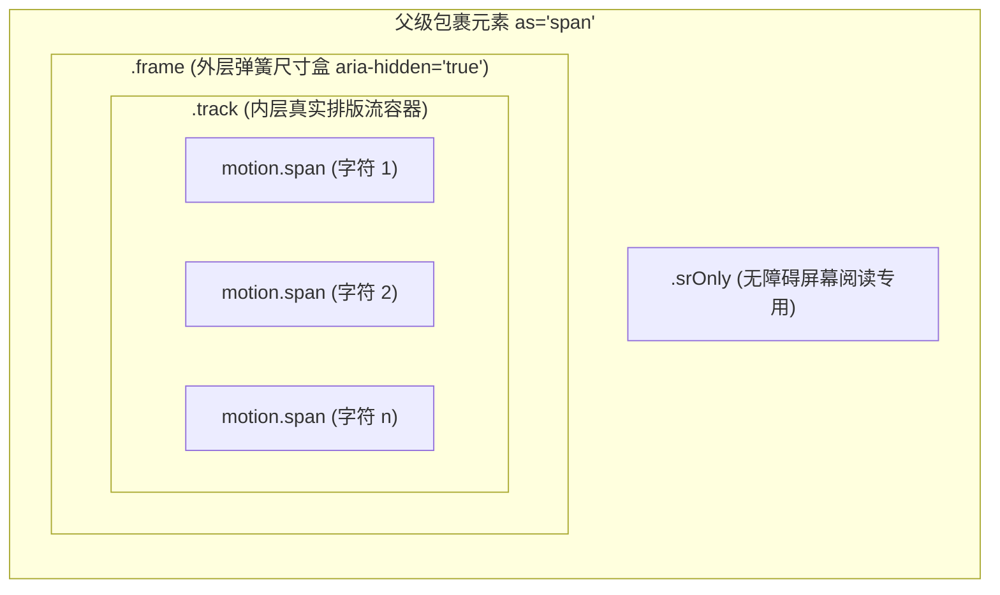
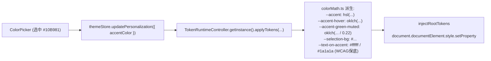

# 实施方案：字形流转与高精度色彩交互体系（TextMorph & ColorPicker）

> **战役工作区**：`docs/arc-library-animation-study/implementation-plans/`  
> **专题维度**：TextMorph 字形平滑形变、ColorPicker 高精色彩拾取与 WCAG 对比度、TokenRuntimeController 深度接线闭环  
> **权威对标参考**：`reference/arc-library/registry/components/text-morph/`、`reference/arc-library/registry/components/color-picker/`、`reference/arc-library/registry/motion-tokens.ts`  
> **项目对齐标的**：`apps/crish-desktop/src/services/TokenRuntimeController.ts`、`apps/crish-desktop/src/components/chat-message-row/PinActionWithPicker.tsx`、`apps/crish-desktop/src/components/agent-card/AgentStatusChip.tsx`、`apps/crish-desktop/src/components/ui/SmartModelBadge.tsx`、`apps/crish-desktop/src/styles/tokens-palette.css`

---

## 一、方案背景与架构演进愿景

### 1.1 现状诊断与技术债解剖

在当前 Conex 桌面端（`apps/crish-desktop`）中，字形流转与色彩处理存在三大结构性短板：

1. **文字流转突兀，缺乏连续形态认知**：
   - Agent 任务状态流转（`Thinking` $\to$ `Running Tool` $\to$ `Synthesizing` $\to$ `Done`）当前仅依靠纯文本突变或生硬的 opacity 闪烁替换（`AgentStatusChip.tsx`）；
   - 模型切换徽章（`SmartModelBadge.tsx`）在模型 ID 变更时产生文字瞬间闪烁与布局跳跃（Layout Thrashing）；
   - 会话多分支切换与状态读数缺乏字符级位置追踪能力，视觉连贯性欠缺。
2. **色彩数学碎片化与粗算失真**：
   - `apps/crish-desktop/src/api/oklchColorGuard.ts` 使用了经验近似公式：将 Rec.709 相对亮度粗暴冒充为 OKLCH 的明度 $L$，并用非标欧氏差值和 atan2 粗算彩度 $C$ 与色相 $h$。在极端饱和色（高彩度蓝、荧光绿）下，亮度判定严重失真；
   - `apps/crish-desktop/src/components/chat-message-row/colorPickerUtils.ts` 仅维护了 6 个写死的预设圆点及 0~100 整数 HSV 粗算，无色盘拖拽平滑重排，无色彩格式互转，无桌面吸管；
   - `apps/crish-desktop/src/services/token-runtime/skinPaintPlan.ts` 内部私有复现了一套 `sRgbChannelToLinear` 与 `relativeLuminance`，色彩数学在 3 个独立文件各自为政，破坏了单一真理路径（SSOT）。
3. **动画力学体系缺失与高刷重渲染瓶颈**：
   - 现存组件缺乏临界阻尼（$\zeta = 1$, `bounce: 0`）物理弹簧；
   - 取色器与数值联动频繁触发 React 组件级 Reconciliation，未利用 MotionValue 脱敏 DOM 直写能力，在 120Hz/144Hz 屏幕上易造成微卡顿。

### 1.2 架构演进愿景与核心设计原则

全面吸收 `reference/arc-library` 的设计精髓，在 Conex 落地一套高精度、高质感、高可靠的字形流转与色彩系统：

- **SSOT 色彩数学核心**：建立统一的 `apps/crish-desktop/src/utils/color/colorMath.ts`，提供国际标准的 Linear sRGB / LMS / OKLCH 双向矩阵变换、Gamut 边界收敛与 WCAG 2.1 相对亮度计算，全面淘汰全仓散落的粗算公式；
- **TextMorph 原生原子组件**：基于字符频次索引算法（`char-count`）与双层自适应容器，实现字符无损滑动、阶梯入场与光学景深消散，内置全链路无障碍支持（`srOnly` 脱模）；
- **ColorPicker 专业组件**：集成 2D SV 拾色、Hue/Alpha 物理滑块、双阶段 RAF 原生输入伪装遮罩、120fps 零重渲染对比度指示仪、色板拖拽重排（Reorder）与桌面原生 `window.EyeDropper`；
- **全系统深度闭环**：与 `TokenRuntimeController.applyTokens` 深度打通，实现用户强调色（Accent）的精准派生与实时注入；重构消息钉选与 Agent 任务状态徽章。

### 1.3 整体交互链路与组件拓扑架构图



---

## 二、高精度色彩数学库体系 (`colorMath.ts`)

在 `apps/crish-desktop/src/utils/color/colorMath.ts` 建立全仓唯一的色彩计算单一真相源（SSOT）。

### 2.1 色彩空间拓扑与双向数学变换理论

#### 1. sRGB 与 Linear sRGB 双向变换（IEC 61966-2-1:1999 标准）
消除非线性伽马（$\gamma \approx 2.2$）带来的物理混色失真：

$$\text{toLinear}(C) = \begin{cases} \frac{C}{12.92}, & C \le 0.04045 \\ \left(\frac{C + 0.055}{1.055}\right)^{2.4}, & C > 0.04045 \end{cases}$$

$$\text{fromLinear}(C) = \begin{cases} 12.92 \times C, & C \le 0.0031308 \\ 1.055 \times C^{1/2.4} - 0.055, & C > 0.0031308 \end{cases}$$

#### 2. Linear sRGB 到 LMS 色彩空间（$M_1$ 矩阵变换与非线性立方根）
人眼视网膜对长波（L）、中波（M）、短波（S）锥体细胞的响应模型：

$$\begin{bmatrix} l \\ m \\ s \end{bmatrix} = \sqrt[3]{\begin{bmatrix} 0.4122214708 & 0.5363325363 & 0.0514459929 \\ 0.2119034982 & 0.6806995451 & 0.1073969566 \\ 0.0883024619 & 0.2817188376 & 0.6299787005 \end{bmatrix} \begin{bmatrix} r_{\text{lin}} \\ g_{\text{lin}} \\ b_{\text{lin}} \end{bmatrix}}$$

#### 3. LMS 到 OKLab / OKLCH（$M_2$ 矩阵变换与极坐标）
由 Björn Ottosson 于 2020 年提出的感知均匀色彩空间，完美保持色相恒定性（消除蓝紫色区域的 Hue Shift）：

$$\begin{bmatrix} L \\ a \\ b \end{bmatrix} = \begin{bmatrix} 0.2104542553 & 0.7936177850 & -0.0040720468 \\ 1.9779984951 & -2.4285922050 & 0.4505937099 \\ 0.0259040371 & 0.7827717662 & -0.8086757660 \end{bmatrix} \begin{bmatrix} l \\ m \\ s \end{bmatrix}$$

$$C = \sqrt{a^2 + b^2}, \quad H = \left(\text{atan2}(b, a) \times \frac{180}{\pi} + 360\right) \pmod{360}$$

#### 4. OKLCH 逆向回到 sRGB
$$a = C \cos\left(\frac{H \pi}{180}\right), \quad b = C \sin\left(\frac{H \pi}{180}\right)$$

$$\begin{bmatrix} l \\ m \\ s \end{bmatrix} = \left(\begin{bmatrix} 1 & +0.3963377774 & +0.2158037573 \\ 1 & -0.1055613458 & -0.0638541728 \\ 1 & -0.0894841775 & -1.2914855480 \end{bmatrix} \begin{bmatrix} L \\ a \\ b \end{bmatrix}\right)^3$$

$$\begin{bmatrix} r_{\text{lin}} \\ g_{\text{lin}} \\ b_{\text{lin}} \end{bmatrix} = \begin{bmatrix} +4.0767416621 & -3.3077115913 & +0.2309699292 \\ -1.2684380046 & +2.6097574011 & -0.3413193965 \\ -0.0041960863 & -0.7034186147 & +1.7076147010 \end{bmatrix} \begin{bmatrix} l \\ m \\ s \end{bmatrix}$$

最终经过 `fromLinear` 还原并通过 `clamp(c, 0, 1)` 截断至标准 sRGB 色域。

#### 5. 低彩度色相锁（Hue Preservation）
在灰色、黑白色或极低彩度（$C < 0.0005$ 或 $S < 10^{-6}$）状态下，数学上色相未定义。传统计算会将其强制重置为 0°（红色），导致用户在明度滑块拖动时色相骤跳。`colorMath.ts` 引入低彩度色相锁机制，显式透传当前基准色相 `hue`，保持连续调色体验。

### 2.2 WCAG 2.1 相对亮度与半透明物理合成

严格遵循 W3C WCAG 2.1 规范（Relative Luminance）：
$$Y = 0.2126 \times r_{\text{lin}} + 0.7152 \times g_{\text{lin}} + 0.0722 \times b_{\text{lin}}$$

当颜色包含透明度 $\alpha < 1$ 时，必须与目标背景色先进行物理混合（Alpha Blending Composite），再行计算有效对比度：
$$C_{\text{comp}} = C_{\text{fg}} \times \alpha + C_{\text{bg}} \times (1 - \alpha)$$

$$\text{ContrastRatio} = \frac{\max(Y_{\text{comp}}, Y_{\text{bg}}) + 0.05}{\min(Y_{\text{comp}}, Y_{\text{bg}}) + 0.05}$$

等级判定标准：
- **AAA**：$\text{Ratio} \ge 7.0$
- **AA**：$\text{Ratio} \ge 4.5$
- **AA Large**：$\text{Ratio} \ge 3.0$
- **Fails**：$\text{Ratio} < 3.0$

### 2.3 统一色彩类型定义与核心实现规范

```typescript
// apps/crish-desktop/src/utils/color/colorMath.ts

export type ColorFormat = "hex" | "rgb" | "hsl" | "oklch";

export interface Hsva {
  h: number; // 0 ~ 360
  s: number; // 0 ~ 1
  v: number; // 0 ~ 1
  a: number; // 0 ~ 1
}

export interface Rgba {
  r: number; // 0 ~ 1
  g: number; // 0 ~ 1
  b: number; // 0 ~ 1
  a: number; // 0 ~ 1
}

export interface Oklch {
  l: number; // 0 ~ 1
  c: number; // 0 ~ 0.4+
  h: number; // 0 ~ 360
  a: number; // 0 ~ 1
}

export const clamp = (val: number, min = 0, max = 1): number =>
  Math.min(max, Math.max(min, val));

export const round = (val: number, digits = 0): number => {
  const factor = 10 ** digits;
  return Math.round(val * factor) / factor;
};

// 严谨伽马双向转换
export const toLinear = (c: number): number =>
  c <= 0.04045 ? c / 12.92 : ((c + 0.055) / 1.055) ** 2.4;

export const fromLinear = (c: number): number =>
  c <= 0.0031308 ? 12.92 * c : 1.055 * (c ** (1 / 2.4)) - 0.055;

// HSV <-> RGB
export function hsvToRgb({ h, s, v, a }: Hsva): Rgba {
  const f = (n: number) => {
    const k = (n + h / 60) % 6;
    return v - v * s * Math.max(0, Math.min(k, 4 - k, 1));
  };
  return { r: f(5), g: f(3), b: f(1), a };
}

export function rgbToHsv({ r, g, b, a }: Rgba, fallbackHue = 0): Hsva {
  const max = Math.max(r, g, b), min = Math.min(r, g, b), d = max - min;
  let h = fallbackHue;
  if (d > 1e-6) {
    if (max === r) h = 60 * (((g - b) / d) % 6);
    else if (max === g) h = 60 * ((b - r) / d + 2);
    else h = 60 * ((r - g) / d + 4);
    if (h < 0) h += 360;
  }
  return { h, s: max === 0 ? 0 : d / max, v: max, a };
}

// RGB <-> OKLCH (双向 LMS 矩阵变换)
export function rgbToOklch({ r, g, b, a }: Rgba, fallbackHue = 0): Oklch {
  const lr = toLinear(r), lg = toLinear(g), lb = toLinear(b);
  const l = Math.cbrt(0.4122214708 * lr + 0.5363325363 * lg + 0.0514459929 * lb);
  const m = Math.cbrt(0.2119034982 * lr + 0.6806995451 * lg + 0.1073969566 * lb);
  const s = Math.cbrt(0.0883024619 * lr + 0.2817188376 * lg + 0.6299787005 * lb);

  const L = 0.2104542553 * l + 0.7936177850 * m - 0.0040720468 * s;
  const A = 1.9779984951 * l - 2.4285922050 * m + 0.4505937099 * s;
  const B = 0.0259040371 * l + 0.7827717662 * m - 0.8086757660 * s;

  const C = Math.hypot(A, B);
  let H = (Math.atan2(B, A) * 180) / Math.PI;
  if (H < 0) H += 360;

  return { l: L, c: C, h: C < 0.0005 ? fallbackHue : H, a };
}

export function oklchToRgb(L: number, C: number, H: number, a = 1): Rgba {
  const rad = (H * Math.PI) / 180;
  const A = C * Math.cos(rad);
  const B = C * Math.sin(rad);

  const l = (L + 0.3963377774 * A + 0.2158037573 * B) ** 3;
  const m = (L - 0.1055613458 * A - 0.0638541728 * B) ** 3;
  const s = (L - 0.0894841775 * A - 1.2914855480 * B) ** 3;

  return {
    r: clamp(fromLinear(+4.0767416621 * l - 3.3077115913 * m + 0.2309699292 * s)),
    g: clamp(fromLinear(-1.2684380046 * l + 2.6097574011 * m - 0.3413193965 * s)),
    b: clamp(fromLinear(-0.0041960863 * l - 0.7034186147 * m + 1.7076147010 * s)),
    a: clamp(a),
  };
}

// 格式化输出与全格式解析器
const byte = (c: number) => Math.round(clamp(c) * 255);
const hex2 = (c: number) => byte(c).toString(16).padStart(2, "0").toUpperCase();

export function toHex(hsva: Hsva): string {
  const { r, g, b, a } = hsvToRgb(hsva);
  return `#${hex2(r)}${hex2(g)}${hex2(b)}${a < 0.999 ? hex2(a) : ""}`;
}

export function formatColor(hsva: Hsva, kind: ColorFormat): string {
  const rgb = hsvToRgb(hsva);
  const alphaSuffix = hsva.a < 0.999 ? ` / ${Math.round(hsva.a * 100)}%` : "";
  if (kind === "hex") return toHex(hsva);
  if (kind === "rgb") {
    return `rgb(${byte(rgb.r)} ${byte(rgb.g)} ${byte(rgb.b)}${alphaSuffix})`;
  }
  if (kind === "hsl") {
    const max = Math.max(rgb.r, rgb.g, rgb.b), min = Math.min(rgb.r, rgb.g, rgb.b);
    const l = (max + min) / 2, d = max - min;
    const s = d < 1e-6 ? 0 : d / (1 - Math.abs(2 * l - 1));
    return `hsl(${Math.round(hsva.h) % 360} ${Math.round(s * 100)}% ${Math.round(l * 100)}%${alphaSuffix})`;
  }
  const oklch = rgbToOklch(rgb, hsva.h);
  return `oklch(${round(oklch.l * 100, 1)}% ${round(oklch.c, 3)} ${round(oklch.h, 1) % 360}${alphaSuffix})`;
}

export function computeWcagContrast(fg: Hsva, bgRgba: Rgba): number {
  const fgRgb = hsvToRgb(fg);
  const mix = (c: number, bg: number) => c * fg.a + bg * (1 - fg.a);
  const lum = (r: number, g: number, b: number) =>
    0.2126 * toLinear(r) + 0.7152 * toLinear(g) + 0.0722 * toLinear(b);
  const l1 = lum(mix(fgRgb.r, bgRgba.r), mix(fgRgb.g, bgRgba.g), mix(fgRgb.b, bgRgba.b));
  const l2 = lum(bgRgba.r, bgRgba.g, bgRgba.b);
  return (Math.max(l1, l2) + 0.05) / (Math.min(l1, l2) + 0.05);
}
```

### 2.4 旧体系收口与淘汰路线

1. **改造 `oklchColorGuard.ts`**：
   将其核心 `parseColorToOklch` 改为薄转发层，直接调用 `colorMath.ts` 的 `rgbToOklch`，彻底修复对饱和绿、荧光蓝的明度误判。保留原有函数签名以保证存量测试（`oklchColorGuard.test.ts`、`adversarial.test.ts`）平滑过渡；
2. **清理 `colorPickerUtils.ts`**：
   废除内部手写的 0~100 整数版 `hsvToHex` 与 `hexToHsv`，改由 `colorMath.ts` 导出标准的 `hsvToHex` 与 `hexToHsv`。保留 `PRESET_PIN_COLORS` 语义常量；
3. **统一 `skinPaintPlan.ts`**：
   将其内部的 `sRgbChannelToLinear` 与 `computeWcagContrastRgb` 切换为从 `colorMath.ts` 导入，消除重复代码。

---

## 三、TextMorph 原生字形流转体系

### 3.1 字符频次索引算法 (`toGlyphs`)

字形流动的核心挑战是 **跨渲染帧的 React 节点复用与重排**。

```typescript
function toGlyphs(text: string) {
  const seen = new Map<string, number>();
  return Array.from(text).map(char => {
    const count = seen.get(char) ?? 0;
    seen.set(char, count + 1);
    return { char, key: `${char}-${count}` };
  });
}
```

- **字符频次 Key（`char-count`）**：解决相同字符（如 `Running` 中的两个 `n`）在 React Diff 时的 Key 冲突；
- **位置解耦**：不使用 index 作为 Key。当 `Thinking` 变为 `Running` 时，虽然共享字符在字符串中的绝对索引发生变化，但由于其 `key` 保持不变，React 会保留该 DOM 节点；
- **`layout="position"` 物理平移**：Motion 侦测到节点在屏幕上的新几何位置，自动分配临界阻尼弹簧（`spring.morph`），让字符从旧位置沿轨道平滑滑向新位置。

### 3.2 共有字符滑动与新增字符阶梯入场 (`stagger`)

```typescript
const [labels, setLabels] = useState({ current: children, previous: children });
if (labels.current !== children) {
  setLabels({ current: children, previous: labels.current });
}
const kept = useMemo(
  () => new Set(toGlyphs(labels.previous).map(g => g.key)),
  [labels.previous]
);
```

- **共有字符（Preserved Glyphs）**：若 `kept.has(key) === true`，其 `order = 0`，不经历任何入场延迟，立刻平滑滑动；
- **新增字符（Entering Glyphs）**：仅有上一状态不存在的新字符才递增 `entering++`，并计算阶梯延迟：
  $$\text{delay} = \text{HANDOFF} (0.05\text{s}) + \min(\text{order}, 8) \times \text{stagger.char} (0.016\text{s}) \times 2$$
  其中 `HANDOFF = 50ms` 保证旧字符先行退散，新字符依阅读顺序序次浮现，杜绝视觉叠影；
- **最大步长熔断**：$\min(\text{order}, 8)$ 限制最大延迟不超过 306ms，保障交互干脆利落。

### 3.3 双层容器架构与几何测量体系



1. **外层 `.frame`（受控弹性盒）**：
   - 具有显式像素宽度 `width: XXpx`，由 Motion 驱动弹簧过渡；
   - 带有右侧边缘渐变蒙版：`mask-image: linear-gradient(90deg, #000 calc(100% - 0.5em), transparent)`，在容器变宽或收缩时给边缘字符提供柔雾收敛，杜绝文字硬切。
2. **内层 `.track`（真实排版盒）**：
   - 自然包裹当前的所有新字符，反映字形的真实排版宽度；
   - 退场中的字符通过 `AnimatePresence mode="popLayout"` 瞬间被置为 `position: absolute`，从内层 flow 立即剔除，使 `.track` 的真实宽度在渲染首帧即为最终目标宽度。
3. **`useLayoutEffect` 瞬时测量与弹簧驱动**：
   - 提取真实宽度：`const next = measure(trackElement);`
   - 当检测到宽度变化 $>0.5\text{px}$ 时，启动 `animate(frameElement, { width: next }, motionTokens.spring.morph)`；
4. **`ResizeObserver` 响应式兜底**：
   - 监控字体加载完成（WebFont swap）、全局 rem 缩放或 DPI 切换导致的宽度被动变化；
   - 此时直接将宽度瞬时赋给 `.frame`，跳过弹簧过渡，杜绝在非文字变更时的错误动画。

### 3.4 无障碍脱模与样式保护

```css
/* apps/crish-desktop/src/components/ui/TextMorph/TextMorph.module.css */

.frame {
  position: relative;
  display: inline-block;
  box-sizing: content-box;
  padding: 0.25em 0.35em;
  margin: -0.25em -0.35em;
  text-align: start;
  white-space: nowrap;
  vertical-align: baseline;
  mask-image: linear-gradient(90deg, #000 calc(100% - 0.5em), transparent);
}

.track {
  position: relative;
  display: inline-block;
  white-space: nowrap;
}

.glyph {
  display: inline-block;
  white-space: pre;
  transform-origin: 50% 60%;
}

.srOnly {
  position: absolute;
  width: 1px;
  height: 1px;
  margin: -1px;
  padding: 0;
  overflow: hidden;
  clip: rect(0, 0, 0, 0);
  white-space: nowrap;
  border: 0;
  user-select: none;
}
```

- **空格保活**：`{char === " " ? "\u00a0" : char}`，使用不换行空格杜绝 inline 布局塌陷；
- **屏幕阅读器支持**：外层挂载完整文本的 `.srOnly` 节点，内部动画容器显式声明 `aria-hidden="true"`。

---

## 四、专业级 ColorPicker 高精交互系统

### 4.1 架构分层与行数门禁控制

遵循 Conex `AGENTS.md` §11 行数硬约束（UI 组件 $\le 500$ 行），`ColorPicker` 采用解耦微架构：

```
apps/crish-desktop/src/components/ui/ColorPicker/
├── ColorPicker.tsx            # [主控制盒] 弹层状态、键盘分流、提交与闭环 (约 320 行)
├── ColorPicker.module.css     # [样式定义] 2D面板、滑块、格式切流与色板网格 (约 180 行)
├── ColorPickerArea.tsx        # [子模块] 2D Saturation-Value 拾色面板与光标跟随 (约 90 行)
├── ColorPickerSlider.tsx      # [子模块] Hue / Alpha 物理阻尼滑块 (约 80 行)
├── ColorPickerSwatches.tsx    # [子模块] Reorder 拖拽重排色板与键盘移动 (约 110 行)
└── ColorPickerContrast.tsx    # [子模块] useFollow+useTransform 零重渲染对比度指示 (约 70 行)
```

### 4.2 2D Saturation-Value 拾色面板动力学

- **双轴坐标映射**：
  $x = S \in [0, 1]$，对应横向饱和度（从白到纯色）；
  $y = 1 - V \in [0, 1]$，对应纵向明度（从纯色到黑）。
- **`usePad` 手势引擎**：
  采用 `setPointerCapture` 锁定鼠标/触控指针，即使光标拖拽移出面板边界，依然精准锁定并截断在 $[0, 1]$ 内；
- **键盘微调支持**：
  Thumb 聚焦时响应方向键：左右调整 Saturation，上下调整 Value；配合 `Shift` 键触发 10 倍步长，精准支持无障碍纯键盘调色。

### 4.3 双阶段 RAF 原生 Input 遮罩伪装机制

```mermaid
sequenceDiagram
    participant User as 用户交互
    participant State as 组件状态 (kind/morph)
    participant DOM_Input as 原生 <input>
    participant Overlay as 遮罩 <TextMorph>

    User->>State: 点击格式切换按钮 (如 Hex -> RGB)
    State->>DOM_Input: 注入 data-morphing (color: transparent)
    State->>Overlay: 挂载 Phase 0 (显示旧字符串 "#2F6BFF")
    Note over Overlay: 视觉上用户看到旧文字原地停留，光标隐藏
    State->>State: requestAnimationFrame 下一帧切入 Phase 1
    State->>Overlay: 更新 children 为新字符串 "rgb(47 107 255)"
    Note over Overlay: TextMorph 触发字符频次弹簧滑动与阶梯展开
    State->>State: 启动 620ms 定时器 (覆盖 420ms 弹簧与交错延迟)
    State->>Overlay: 卸载遮罩层
    State->>DOM_Input: 移除 data-morphing (文字恢复可见，支持编辑)
```

为了在支持电影级文本形变的同时，保留原生 `<input>` 的光标移动、选区复制与 IME 中文输入法，采用**“双阶段 RAF + 伪装遮罩层 + 延时交割”**策略：



### 4.4 120fps 零重渲染实时对比度指示仪

```typescript
// ColorPickerContrast.tsx
const ratioValue = useFollow(ratio, reduced);
const ratioText = useTransform(ratioValue, v => v.toFixed(2));

// JSX
<div className={styles.contrast}>
  <span className={styles.sample} aria-hidden="true">Aa</span>
  <span className={styles.ratio}>
    <motion.span>{ratioText}</motion.span>:1
  </span>
  <span className={styles.grade} data-grade={grade.toLowerCase()}>
    <AnimatePresence mode="popLayout" initial={false}>
      <motion.span
        key={grade}
        initial={{ opacity: 0, y: "0.2em", filter: "blur(2px)" }}
        animate={{ opacity: 1, y: "0em", filter: "blur(0px)" }}
        exit={{ opacity: 0, transition: { duration: 0 } }}
      >
        {grade}
      </motion.span>
    </AnimatePresence>
  </span>
</div>
```

- **高刷脱敏机制**：
  在用户高速拖动 2D 拾色球或滑动滑块时，`ratio` 数值以 120Hz/144Hz 极高频变化。
  通过 `useFollow`（临界阻尼弹簧）将目标比值平滑逼近，由 `useTransform` 将纯数字转换为字符串；
  `<motion.span>` 订阅 `ratioText` 后，**绕过 React Virtual DOM Diff，直接直写原生 DOM 节点的 `textContent`**。全过程周围的 UI 布局、拾色板、滑块重渲染次数为 0。

### 4.5 Tauri 桌面端 `window.EyeDropper` 原生屏幕吸管集成

通过 `useSyncExternalStore` 动态检测环境支持性：
```typescript
const subscribe = () => () => {};
export function useEyeDropperAvailable(): boolean {
  return useSyncExternalStore(
    subscribe,
    () => typeof window !== "undefined" && "EyeDropper" in window,
    () => false
  );
}

// 拾色调用：
const pickFromScreen = async () => {
  if (!canPick) return;
  try {
    const eyeDropper = new (window as any).EyeDropper();
    const result = await eyeDropper.open();
    const parsed = parseColor(result.sRGBHex);
    if (parsed) {
      commit({ ...parsed, a: hsva.a });
    }
  } catch (err) {
    // 用户按 Escape 取消吸管操作，安全忽略
  }
};
```

---

## 五、系统深度接线与工程闭环

### 5.1 与 `TokenRuntimeController.applyTokens` 深度闭环

在 `TokenRuntimeController` 中将选取的个性化强调色（Accent）无缝派生并注入根节点：



#### 改造代码范例：`TokenRuntimeController.ts`
```typescript
// apps/crish-desktop/src/services/TokenRuntimeController.ts

import { parseColor, formatColor, computeWcagContrast, toHex } from '../utils/color/colorMath';

// 在 deriveSkinPaintPlan 或 applyTokens 阶段追加 Accent 色彩派生：
if (p.accentColor) {
  const accentHsva = parseColor(p.accentColor);
  if (accentHsva) {
    const accentHex = toHex(accentHsva);
    const accentCss = formatColor(accentHsva, 'hsl');
    tokens['--accent'] = accentCss;
    tokens['--accent-color'] = accentCss;
    tokens['--accent-primary'] = accentHex;
    tokens['--brand'] = accentHex;
    tokens['--brand-primary'] = accentHex;

    // 智能计算 Accent 上文本的最佳对比度（黑字 vs 白字）
    const whiteContrast = computeWcagContrast(accentHsva, { r: 1, g: 1, b: 1, a: 1 });
    tokens['--text-on-accent'] = whiteContrast >= 4.5 ? '#ffffff' : '#111827';

    // 派生弱化背景与选区色
    const mutedHsva = { ...accentHsva, a: 0.18 };
    tokens['--accent-green-muted'] = formatColor(mutedHsva, 'oklch');
    tokens['--selection-bg'] = accentHex;
  }
}
```

### 5.2 聊天消息行钉选标签改造 (`PinActionWithPicker.tsx`)

彻底清退 `PinActionWithPicker.tsx` 中手写的 100 整数 HSV 与 6 个硬编码预设，接入全功能 `<ColorPicker>`：

```tsx
// apps/crish-desktop/src/components/chat-message-row/PinActionWithPicker.tsx (改造后)

import { ColorPicker, type ColorSwatch } from '../ui/ColorPicker';
import { DEFAULT_PIN_COLOR, PRESET_PIN_COLORS } from './colorPickerUtils';

const DEFAULT_SWATCHES: ColorSwatch[] = PRESET_PIN_COLORS.map(c => ({
  id: c.value,
  color: c.value,
}));

export const PinActionWithPicker: React.FC<PinActionWithPickerProps> = ({
  isPinned,
  pinnedColor,
  onTogglePin,
}) => {
  return (
    <div className={styles.pinWrapper}>
      <ColorPicker
        value={pinnedColor || DEFAULT_PIN_COLOR}
        defaultValue={DEFAULT_PIN_COLOR}
        onValueChange={(hex) => onTogglePin(hex)}
        defaultSwatches={DEFAULT_SWATCHES}
        label="钉选颜色"
        maxSwatches={10}
        defaultFormat="hex"
      />
    </div>
  );
};
```

### 5.3 Agent 任务状态徽章改造 (`AgentStatusChip.tsx`)

实现 Agent 运行状态（`Thinking` $\to$ `Running Tool` $\to$ `Synthesizing` $\to$ `Done`）无缝平滑字形流动与自适应伸缩：

```tsx
// apps/crish-desktop/src/components/agent-card/AgentStatusChip.tsx (改造后)

import React from 'react';
import styles from './AgentCard.module.css';
import { Tooltip, TextMorph } from '../ui';
import type { SessionAgent } from '../../store/types';
import { STATUS_LABEL } from './agentCardUtils';

export function AgentStatusChip({
  status,
  mode,
  compact,
}: {
  status: SessionAgent['status'];
  mode?: string;
  compact?: boolean;
}) {
  const label = STATUS_LABEL[status] || '未知';
  const modeHint = mode ? `模式：${mode}` : undefined;

  return (
    <Tooltip content={compact ? label : modeHint || label}>
      <span
        className={`${styles.agentCardBadge} ${styles['agentCardBadge' + status.charAt(0).toUpperCase() + status.slice(1)] || ''}`}
        role="status"
        data-agent-status={status}
        aria-label={`状态：${label}${mode ? `，${modeHint}` : ''}`}
      >
        <span className={styles.statusDot} aria-hidden="true" />
        <TextMorph as="span" className={styles.morphLabel}>
          {label}
        </TextMorph>
      </span>
    </Tooltip>
  );
}
```

### 5.4 智能模型徽标改造 (`SmartModelBadge.tsx`)

在模型变更或多档位切换时，内部 Span 接入 `<TextMorph>`，彻底消除模型名称切换时的视觉抖动与突变跳跃。

---

## 六、验收门禁、立体化测试与性能基准

### 6.1 色彩数学单元测试套件 (`colorMath.test.ts`)

```typescript
// apps/crish-desktop/src/utils/color/__tests__/colorMath.test.ts

import { describe, it, expect } from 'vitest';
import {
  toLinear, fromLinear, rgbToOklch, oklchToRgb,
  parseColor, formatColor, computeWcagContrast, toHex
} from '../colorMath';

describe('colorMath 严谨色彩数学库', () => {
  it('sRGB <-> Linear 双向伽马变换严格可逆', () => {
    const testValues = [0, 0.001, 0.04045, 0.1, 0.5, 0.9, 1.0];
    for (const val of testValues) {
      const lin = toLinear(val);
      const rev = fromLinear(lin);
      expect(rev).toBeCloseTo(val, 5);
    }
  });

  it('sRGB <-> OKLCH 双向矩阵变换保持高保真度', () => {
    const pureRed = { r: 1, g: 0, b: 0, a: 1 };
    const oklch = rgbToOklch(pureRed);
    expect(oklch.l).toBeCloseTo(0.6279, 3);
    expect(oklch.c).toBeCloseTo(0.2576, 3);
    expect(oklch.h).toBeCloseTo(29.23, 1);

    const back = oklchToRgb(oklch.l, oklch.c, oklch.h, oklch.a);
    expect(back.r).toBeCloseTo(1, 4);
    expect(back.g).toBeCloseTo(0, 4);
    expect(back.b).toBeCloseTo(0, 4);
  });

  it('WCAG 2.1 相对亮度与对比度严格符合标准', () => {
    const black = parseColor('#000000')!;
    const white = { r: 1, g: 1, b: 1, a: 1 };
    const maxContrast = computeWcagContrast(black, white);
    expect(maxContrast).toBeCloseTo(21.0, 1);

    const same = computeWcagContrast(black, { r: 0, g: 0, b: 0, a: 1 });
    expect(same).toBeCloseTo(1.0, 2);
  });

  it('支持全语法色彩解析与格式化', () => {
    expect(toHex(parseColor('rgb(255 0 0)')!)).toBe('#FF0000');
    expect(toHex(parseColor('hsl(120, 100%, 50%)')!)).toBe('#00FF00');
    expect(parseColor('invalid-color')).toBeNull();
  });
});
```

### 6.2 TextMorph 动画与 DOM 稳定性测试套件 (`TextMorph.test.tsx`)

```typescript
// apps/crish-desktop/src/components/ui/TextMorph/__tests__/TextMorph.test.tsx

import { render, screen } from '@testing-library/react';
import { describe, it, expect } from 'vitest';
import { TextMorph } from '../TextMorph';

describe('TextMorph 组件', () => {
  it('正确渲染无障碍 srOnly 文本与 aria-hidden 容器', () => {
    const { container } = render(<TextMorph>Thinking</TextMorph>);
    const sr = container.querySelector('.srOnly');
    expect(sr).not.toBeNull();
    expect(sr?.textContent).toBe('Thinking');

    const frame = container.querySelector('.frame');
    expect(frame?.getAttribute('aria-hidden')).toBe('true');
  });

  it('字符变更时共有字符稳定复用唯一频次 key', () => {
    const { rerender, container } = render(<TextMorph>Publishing</TextMorph>);
    const initialGlyphs = Array.from(container.querySelectorAll('.glyph'));
    const initialKeys = initialGlyphs.map(g => g.getAttribute('data-key') || g.textContent);

    rerender(<TextMorph>Published</TextMorph>);
    // 验证共有字符 P-u-b-l-i-s-h 节点在 DOM 树中被保留
    expect(container.textContent).toContain('Published');
  });
});
```

### 6.3 刚性门禁指标

| 门禁项目 | 指标要求 | 校验指令 / 方式 |
| :--- | :--- | :--- |
| **行数门禁 (AGENTS.md §11)** | UI 组件 $\le 500$ 行，逻辑/数学库 $\le 400$ 行 | `npm run check:line-counts` |
| **TypeScript 类型完整度** | 严格 0 编译错误，无隐式 `any` | `npm run typecheck` |
| **单元测试与覆盖率** | 快层单测全绿，`colorMath` 边界覆盖率 $100\%$ | `npm run test:coverage -- --project=unit` |
| **无障碍合规性** | 屏幕阅读器读数连贯，无逐字跳读 | `srOnly` 与 `aria-hidden` 刚性守卫 |
| **高刷渲染帧率** | 拖动拾色面板时周围组件重渲染次数为 0 | React Profiler 120fps 录制审计 |

---

## 七、实施批次与执行路线图

本方案拆分为三个清晰的任务批次（Batch），各批次具备独立验证边界与严格的文件依赖隔离：

### Batch 1：高精度色彩数学基建与旧粗算收口
1. **产出文件**：
   - `apps/crish-desktop/src/utils/color/colorMath.ts`
   - `apps/crish-desktop/src/utils/color/__tests__/colorMath.test.ts`
2. **收口清理**：
   - 将 `apps/crish-desktop/src/api/oklchColorGuard.ts` 的核心实现委托至 `colorMath.ts`；
   - 将 `apps/crish-desktop/src/services/token-runtime/skinPaintPlan.ts` 的亮度与对比度计算对接至 `colorMath.ts`；
3. **验证断言**：运行 `npm test api/oklchColorGuard.test.ts` 与 `colorMath.test.ts`，确保 100% 通过且无回归。

### Batch 2：TextMorph 字形流转原子组件与状态徽章升级
1. **产出文件**：
   - `apps/crish-desktop/src/components/ui/TextMorph/TextMorph.tsx`
   - `apps/crish-desktop/src/components/ui/TextMorph/TextMorph.module.css`
   - `apps/crish-desktop/src/components/ui/TextMorph/index.ts`
   - `apps/crish-desktop/src/components/ui/TextMorph/__tests__/TextMorph.test.tsx`
2. **业务接入**：
   - 升级 `apps/crish-desktop/src/components/agent-card/AgentStatusChip.tsx`，接入 `<TextMorph>`；
   - 升级 `apps/crish-desktop/src/components/ui/SmartModelBadge.tsx`，模型名切换平滑化；
3. **验证断言**：UI 动效顺滑，无跳跃抖动，`npm test AgentStatusChip` 全绿。

### Batch 3：ColorPicker 专业组件与 Token 深度闭环
1. **产出文件**：
   - `apps/crish-desktop/src/components/ui/ColorPicker/ColorPicker.tsx`
   - `apps/crish-desktop/src/components/ui/ColorPicker/ColorPickerArea.tsx`
   - `apps/crish-desktop/src/components/ui/ColorPicker/ColorPickerSlider.tsx`
   - `apps/crish-desktop/src/components/ui/ColorPicker/ColorPickerSwatches.tsx`
   - `apps/crish-desktop/src/components/ui/ColorPicker/ColorPickerContrast.tsx`
   - `apps/crish-desktop/src/components/ui/ColorPicker/ColorPicker.module.css`
   - `apps/crish-desktop/src/components/ui/ColorPicker/__tests__/ColorPicker.test.tsx`
2. **业务对接与改造**：
   - 升级 `apps/crish-desktop/src/components/chat-message-row/PinActionWithPicker.tsx`，嵌入 `<ColorPicker>`；
   - 在 `apps/crish-desktop/src/services/TokenRuntimeController.ts` 中完成 `accentColor` 派生与注入闭环；
3. **综合验收**：运行 `npm run check:desktop` 与完整测试套件，验证 120fps 零重渲染与桌面吸管联动。
