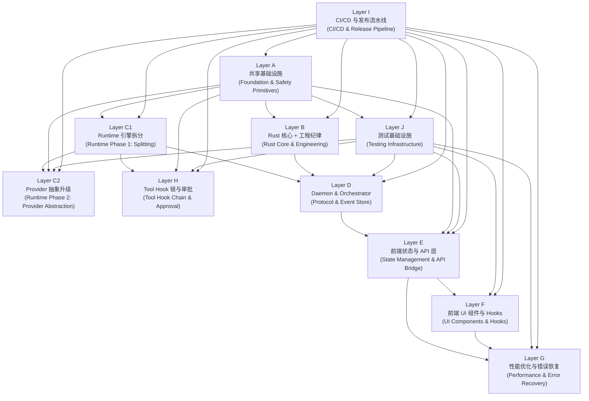

# 系统性代码修复方案总览

## 一、方案设计原则

1. **逻辑依赖驱动**：所有修复任务的执行顺序仅由代码层间的逻辑依赖关系决定——下游模块依赖上游模块的类型、契约或抽象，因此上游必须先稳固。
2. **所有问题平等优先级**：凡是列入方案的问题，无论来自哪个维度报告，一律视为同等重要，不做轻重缓急排序。发布流水线与安全审计类任务例外，它们的分级优先级在各子计划中独立标注。
3. **无时间与人员绑定**：方案只描述"做什么"和"先后顺序"，不指定完成时间或负责人。
4. **多轮次多 Agent 适配**：每个层级（Layer）对应一个或多个执行轮次（Round），每轮次可分配多个 Agent 并行执行互不依赖的子任务。Agent 严格按文件边界划分，不交叉修改同一文件。
5. **工程基础设施先行**：CI/CD 基础配置、测试环境隔离、Rust 工程 lint 配置等工程基础设施类任务虽然不直接修改业务代码，但它们是所有后续轮次质量验证的前提条件，因此在 Round 0 优先执行。

---

## 二、问题来源与维度覆盖

本方案基于以下 **12 个维度** 的深度代码分析（8 个内部分析维度 + 4 个工程基础设施维度），合计覆盖 **~350 个独立问题点**，涉及 **~160 个唯一源文件**：

| 维度 | 标题 | 问题数 | 核心关切 |
|------|------|--------|----------|
| D1 | 架构耦合与单一职责 | 105 | 上帝文件、UI/IPC/Store 强耦合 |
| D2 | 控制流与圈复杂度 | 35 | CC≥15 的方法、深层嵌套、参数爆炸 |
| D3 | 逻辑重复与指纹冗余 | 8 | AST 指纹相似度 ≥0.85 的重复实现 |
| D4 | 并发、线程安全与状态突变 | 14 | 阻塞 Mutex、盲突变、竞态条件 |
| D5 | IPC 边界与 API 契约脆弱性 | 15 | 无类型 invoke、Serde 命名不匹配 |
| D6 | 资源生命周期与内存管理 | 8 | 孤儿进程、监听器泄漏、双 Map 泄漏 |
| D7 | 错误恢复与流降级 | 15 | 空 catch、游标错位、Provider 降级链断裂 |
| D8 | 性能瓶颈与数据管道开销 | 15 | SSE 重渲染、正则 CPU 飙升、同步 I/O |
| D9 | CI/CD 流水线缺失 | ~20 | 无矩阵测试、无增量构建、安全审计静默吞错 |
| D10 | 测试基础设施不完善 | ~25 | 无 FauxProvider、测试隔离不足、覆盖率门禁失效 |
| D11 | Provider 抽象不统一 | ~18 | 两层事件类型并存、无程序化注册 API、无生命周期 |
| D12 | Tool Hook 链与审批流水线缺失 | ~15 | 无 beforeTool/afterTool、无 Preset 系统、审批逻辑内联 |
| D13 | 版本管理与发布流水线缺失 | ~22 | 全包锁 0.1.0、无 CHANGELOG、无 npm publish |
| D14 | Rust 工程纪律工具化缺失 | ~20 | 无 clippy.toml、无 deny.toml、unwrap 滥用 |

---

## 三、架构分层与逻辑依赖关系

系统修复被划分为 **11 个逻辑层级（Layer A–J，其中 C 分为 C1 + C2 两个阶段）**：

### 关键依赖路径说明

| 依赖关系 | 原因 |
|----------|------|
| I → 所有层 | CI/CD 在第 0 轮建立基础配置后，为所有后续轮次提供质量验证通道；最终配置在所有代码层完成后定型 |
| J → C2/D/E/F/G | FauxProvider 和测试隔离设施在 Provider 接口稳定和 Daemon/UI 完成集成测试时生效 |
| A → B/C1/E/J | 共享类型定义（shared-types, workbench-contract DTO）是所有下游层编译和类型检查的前置条件 |
| A → C2 | Provider 抽象依赖 `types.ts` 中的 `AgentProvider` 接口稳定化 |
| B → D | Daemon 的 sidecar 桥接依赖 Tauri 后端 commands.rs 拆分后的模块化接口 |
| C1 → D | Orchestrator 依赖 Runtime 的 session 状态机和 event 类型（Phase 1 拆分后的模块） |
| C1 → C2 | Provider 抽象重构需要 Runtime 引擎的 God 文件先完成物理拆分（文件级） |
| C1 → H | Tool Hook 链的 `MiddlewarePipeline` 接入需要 `tool-executor.ts` 先完成 CC 降低和 Options 模式提取 |
| C2 → H | Provider 统一的事件类型会影响 Tool Hook 链的 ExecutionContext |
| D → E | 前端 API 层（daemonClient.ts）依赖 Daemon 协议契约的稳定化 |
| A → E | Store 的 Immer 化需要 shared-utils/async-mutex.ts 的安全修复作为前置 |
| E → F | UI 组件依赖 Store 的不可变更新模式和稳定化的 API 层 |
| F → G | 性能优化（如 SSE 节流、正则预编译）在结构性拆分完成后才有意义 |
| E → G | 错误恢复链（stream-recovery）依赖 API 层和 IPC 契约的稳固 |

### 并行执行窗口

| 轮次 | 可并行层 | 理由 | 最大 Agent 数 |
|------|---------|------|-------------|
| Round 1 | A ∥ I-基础 ∥ J-基础 ∥ B-配置 | A 改业务代码，I 改 CI 配置，J 改测试配置，B 改 Cargo 配置——零文件重叠 | 12 |
| Round 2 | B ∥ C1 ∥ I-增量 ∥ J-核心 | B 改 Rust，C1 改 TS Runtime，跨语言无冲突 | 16 |
| Round 3 | C2 ∥ H ∥ I-全量 | C2 改 Provider 接口，H 改 Tool 执行——两者共享 `agent-session-loop.ts` 需互斥分配 | 14 |
| Round 4 | D ∥ E ∥ J-集成 | D 改 Daemon，E 改前端 Store，J 改测试工具包——跨包无冲突 | 10 |
| Round 5 | F ∥ G-部分 | F 拆 UI 组件，G 做性能优化——F→G 顺序依赖 | 12 |
| Round 6 | G-收尾 ∥ I-发布 ∥ J-覆盖率 | 全部代码层完成后最终集成 | 10 |

---

## 四、分层详细概要

### Layer A：共享基础设施（Foundation & Safety Primitives）

**目标**：建立全局类型安全基础，修复共享工具原语，为所有下游层提供标准化的类型、契约和工具函数。

**涉及维度**：D1（SRP）、D3（重复）、D4（并发安全）、D5（IPC 契约）

**核心任务清单**：

| 编号 | 任务 | 目标文件/模块 | 来源维度 |
|------|------|---------------|----------|
| A-1 | workbench-contract.ts 拆分为独立 DTO 模块 | `apps/agent-workbench/src/shared/workbench-contract.ts` | D1, D5 |
| A-2 | shared-types 类型去重与规范化 | `packages/shared-types/` | D1, D3 |
| A-3 | async-mutex.ts 修复 AbortSignal 泄漏 + 递归 release 栈溢出 | `packages/shared-utils/src/async-mutex.ts` | D4 |
| A-4 | QA 脚本 safeParseJsonObject 去重 | `scripts/qa/` | D3 |
| A-5 | Serde camelCase 命名规范统一 | 跨 Rust/TS 边界文件 | D5 |
| A-6 | IPC Zod 运行时校验层引入 | 新建 `packages/shared-types/src/validators/` | D5 |

**与其它层的交叉引用**：A-1 的输出被 Layer D 消费（D-1 标记为已由 A-1 完成）。A-3（async-mutex）修复后为 Layer C（C1-12 stream-recovery）和 Layer 测试（J-4/J-5 测试隔离）提供基础。

**建议 Agent 数量**：4–6

---

### Layer B：Rust 核心 Crate 与工程纪律（Rust Core & Engineering Discipline）

**目标**：修复 Rust 层的并发安全、进程生命周期、流解析器重复，拆分 Tauri 后端上帝文件，同时建立跨 crate 的工程规范。

**涉及维度**：D1（SRP）、D3（重复）、D4（并发）、D6（资源泄漏）、D7（错误恢复）、D14（Rust 工程纪律）

**核心任务清单**：

| 编号 | 任务 | 目标文件/模块 | 来源维度 |
|------|------|---------------|----------|
| B-1 | connection.rs 拆分为 5 个子模块 | `sidecar/connection.rs` | D1 |
| B-2 | commands.rs 拆分为按领域分组的命令模块 | `sidecar/commands.rs` | D1 |
| B-3 | `clear_sidecar_process` 中 `child.wait()` 阻塞导致 Mutex guard 跨阻塞调用持有。修复：将 `child` 从 guard 中 take 后先 drop guard，再执行 wait。 | `sidecar/types.rs` `sidecar/connection.rs` | D4 |
| B-4 | conex-stream Parser 重复模式提取 | `crates/conex-stream/src/parser/*.rs` | D3 |
| B-5 | anthropic.rs process_event CC=29 拆分为子方法 | `crates/conex-stream/src/parser/anthropic.rs` | D1, D8 |
| B-6 | process.rs 进程终止与孤儿进程防护 | `process.rs` | D7 |
| B-7 | fs_commands.rs 拆分为子模块 | `apps/agent-workbench/src-tauri/src/fs_commands.rs` | D1 |
| B-8 | host_openers.rs 拆分为子模块 | `apps/agent-workbench/src-tauri/src/host_openers.rs` | D1 |
| B-9 | config/mod.rs 拆分 | `apps/agent-workbench/src-tauri/src/config/mod.rs` | D1 |
| B-10 | oneshot channel sender 泄漏修复 | `sidecar/connection.rs` | D4 |
| B-11 | 跨 crate workspace lint 统一 | 根 `Cargo.toml` | D14 |
| B-12 | 创建 `clippy.toml` 配置文件 | 新建 `clippy.toml` | D14 |
| B-13 | 创建 `deny.toml` 依赖审计配置 | 新建 `deny.toml` | D14 |
| B-14 | 添加 `[profile.*]` 优化配置 | 根 `Cargo.toml` | D14 |
| B-15 | 审计并修复所有 `#[allow]` + 添加 SAFETY 注释 | 跨全部 `*.rs` | D14 |
| B-16 | 替换生产代码中的 `.unwrap()`/`.expect()` 为 Result 类型 | 跨全部 `*.rs` | D14 |
| B-17 | 替换 `eprintln!` 为 tracing 日志 | 跨全部 `*.rs` | D14 |
| B-18 | `version.workspace = true` 版本号继承 | 跨各 crate `Cargo.toml` | D14 |
| B-19 | 创建 `rustfmt.toml`（`imports_granularity = "Item"`） | 新建 `rustfmt.toml` | D14 |
| B-20 | `PendingToolCall` 共享结构体提取（anthropic.rs + openai_chat.rs 100% 重复） | `crates/conex-stream/src/parser/` | D3 |

**与其它层的交叉引用**：B-4/B-5 的 connection.rs/commands.rs 拆分是 Layer D（Daemon sidecar 桥接）的前置。B-11~B-20 的工程纪律任务需要 CI/CD 基础设施（Layer I）提供 clippy 自动化执行环境。

**建议 Agent 数量**：8–10

---

### Layer C1：Runtime 引擎拆分（Phase 1：文件级拆分）

**目标**：拆分 Runtime 核心上帝文件，降低控制流复杂度，修复异步竞态，强化状态机约束。本阶段不做 Provider 接口层面的变更——所有拆分保持行为不变，仅做文件级重组。

**涉及维度**：D1（SRP）、D2（CC）、D4（竞态）、D7（错误恢复）

**核心任务清单**：

| 编号 | 任务 | 目标文件/模块 | 来源维度 |
|------|------|---------------|----------|
| C1-1 | agent-session-loop.ts 提取 4 个 Delegate 类 | `packages/agent-runtime/src/agent-session-loop.ts` | D1 |
| C1-2 | runtime-metrics.ts 类型/收集/快照分离 | `packages/agent-runtime/src/runtime-metrics.ts` | D1 |
| C1-3 | model-routing.ts 类型定义与路由逻辑分离 | `packages/agent-runtime/src/model-routing.ts` | D1 |
| C1-4 | provider-gateway.ts 拆分为 5 个子模块（纯拆分，不改接口） | `packages/agent-runtime/src/provider-gateway.ts` | D1 |
| C1-5 | model-routing.ts 路由匹配逻辑拆分（不涉及 Provider 注册机制） | `packages/agent-runtime/src/model-routing.ts` | D1 |
| C1-6 | mcp-lifecycle.ts 拆分 | `packages/agent-runtime/src/mcp-lifecycle.ts` | D1 |
| C1-7 | plan-document.ts 拆分 | `packages/agent-runtime/src/plan-document.ts` | D1 |
| C1-8 | fs-edit-tools.ts 拆分 | `packages/agent-runtime/src/local-tools/fs-edit-tools.ts` | D1 |
| C1-9 | tool-executor.ts CC 降低 + Options 模式提取 | `packages/agent-runtime/src/runtime-components/tool-executor.ts` | D2, D5 |
| C1-10 | executePrompt 异步竞态修复 + AbortController 绑定 | `provider-openai-compatible.ts` | D4 |
| C1-11 | stream-recovery.ts AsyncMutex 修复（依赖 A-3） | `packages/agent-runtime/src/provider-transport/stream-recovery.ts` | D7, D4 |
| C1-12 | provider-call-gateway.ts 降级链修复 | `packages/agent-runtime/src/runtime-components/provider-call-gateway.ts` | D7 |
| C1-13 | state-machine/core.ts FSM 显式化 | `packages/agent-runtime/src/state-machine/core.ts` | D2 |
| C1-14 | conversation-engine.ts CC 降低 | `packages/agent-runtime/src/runtime-components/conversation-engine.ts` | D2 |
| C1-15 | context-compression.ts 瘦身 | `packages/agent-runtime/src/context-compression.ts` | D1 |
| C1-16 | 脚本空 catch{} 消除 | `scripts/run-mimo-*.ts` | D7 |

**注意**：`provider-openai-compatible.ts` 已被 `@deprecated`，本阶段暂缓其拆分（不执行原 C-2）。该文件的导出函数（`classifyProviderErrorMessage`）将在 Phase 2（Layer C2）的 Provider 错误分类统一任务中被最终替代后删除。

**与其它层的交叉引用**：C1-11 依赖 A-3 的 AsyncMutex 修复。C1-9 的 tool-executor 拆分是 Layer H（Tool Hook Chain）的前置条件。

**建议 Agent 数量**：6–8

---

### Layer C2：Provider 抽象升级（Phase 2：接口重构与 Registry 统一）

**目标**：消除两层流事件类型映射（`ProviderStreamEvent` → `ProviderStreamContractEvent`），建立统一的 Provider Registry 双轨注册机制（声明式 + 程序化），引入 Provider 生命周期管理，消除全局单例 `GatewayV2Bridge`，统一错误分类逻辑。

**涉及维度**：D11（Provider 抽象）

**核心任务清单**：

| 编号 | 任务 | 目标文件/模块 | 来源维度 |
|------|------|---------------|----------|
| C2-1 | 创建 `ProviderRegistryV2` 统一注册中心（双轨：声明式 + 程序化） | `packages/agent-runtime/src/provider/registry-v2.ts` | D11 |
| C2-2 | 提取 SPI 接口（`ProviderClass`/`ProviderFactory`/`EngineRegistration`） | `packages/agent-runtime/src/provider/spi/` | D11 |
| C2-3 | Provider 懒加载机制（延迟 Engine 实例化到首次使用） | `packages/agent-runtime/src/provider/factory.ts` | D11 |
| C2-4 | 统一流事件协议——所有 Engine 直接输出 `ProviderStreamContractEvent` | `packages/agent-runtime/src/provider/types.ts` | D11 |
| C2-5 | 废弃 `ProviderStreamEvent`，删除 `normalizeProviderStreamEvents` 映射层 | `packages/agent-runtime/src/provider-stream-contract.ts` | D11 |
| C2-6 | `ProviderStreamContractEvent` 字段增强（id/index 必选，添加自定义扩展变体） | `packages/agent-runtime/src/provider-stream-contract.ts` | D11 |
| C2-7 | 跨语言 JSON Schema 定义 + TS/Rust 类型代码生成 | 新建 `schemas/provider-stream-event.json` | D11 |
| C2-8 | 创建 `ProviderErrorClassifier` 统一错误分类器（消除 4 处独立分类逻辑） | `packages/agent-runtime/src/provider-error-classifier.ts` | D11 |
| C2-9 | `GatewayV2Bridge` 去单例化 | `packages/agent-runtime/src/provider-gateway.ts` | D11 |
| C2-10 | Provider 生命周期集成（init/dispose/healthCheck） | `packages/agent-runtime/src/types.ts` | D11 |
| C2-11 | `ProviderRouteOffer` 与 `ModelProfile` 类型统一 | `packages/agent-runtime/src/provider-gateway.ts` | D11 |
| C2-12 | `StaticProviderRouteCatalog` 与 `ProviderRegistry` 集成 | `packages/agent-runtime/src/provider-gateway.ts` | D11 |
| C2-13 | `StreamRecovery` 事件类型迁移到 `ProviderStreamContractEvent` | `packages/agent-runtime/src/provider-transport/stream-recovery.ts` | D11 |
| C2-14 | `DaemonProviderGatewayController` 精简——统一使用 `ProviderGateway.resolveProvider` | `packages/agent-daemon/src/daemon-provider-gateway.ts` | D11 |
| C2-15 | `AgentSessionLoop` 错误处理委托到 `ProviderRetryStrategy` | `packages/agent-runtime/src/agent-session-loop.ts` | D11 |
| C2-16 | 创建 `FauxProvider`（标准测试替身，与 Layer J 协作） | `packages/agent-runtime/src/provider/faux-provider.ts` | D11 |
| C2-17 | 内置 Provider 类（`AnthropicProviderClass`/`GeminiProviderClass`） | `packages/agent-runtime/src/provider/builtin/` | D11 |
| C2-18 | Provider 健康检查和预热机制 | `packages/agent-runtime/src/provider/health-checker.ts` | D11 |

**与其它层的交叉引用**：C2-15 修改 `agent-session-loop.ts` 的错误处理区域（~L790-L909），与 Layer H（Tool Hook 链）修改的审批区域（~L280-L420）不重叠。C2-4~C2-7 完成的事件类型统一后，`provider-openai-compatible.ts` 和 `provider-stream-contract.ts` 的物理文件拆分才可安全执行。

**建议 Agent 数量**：8–10

---

### Layer D：Daemon、Orchestrator 与协议（Daemon, Orchestrator & Protocol）

**目标**：拆分 Daemon/Orchestrator 上帝文件，统一协议验证器，消除验证器重复。

**涉及维度**：D1（SRP）、D2（CC）、D3（重复）、D4（并发）、D7（错误恢复）

**核心任务清单**：

| 编号 | 任务 | 目标文件/模块 | 来源维度 |
|------|------|---------------|----------|
| D-1 | types.ts（daemon）拆分为领域子类型 | `packages/agent-daemon/src/types.ts` | D1 |
| D-2 | server.ts DaemonServer 拆分为 Delegate 组件 | `packages/agent-daemon/src/server.ts` | D1 |
| D-3 | server-runtime-factory.ts 按子工厂拆分 | `packages/agent-daemon/src/server-runtime-factory.ts` | D1 |
| D-4 | daemon-provider-gateway.ts 按职责拆分 | `packages/agent-daemon/src/daemon-provider-gateway.ts` | D1 |
| D-5 | workflow-store.ts 提取存储引擎 | `packages/agent-daemon/src/workflow-store.ts` | D1 |
| D-6 | task-snapshot-projection.ts 巨型 switch 拆分为子处理器 | `packages/agent-daemon/src/task-snapshot-projection.ts` | D1, D8 |
| D-7 | workbench-config.ts 类型与解析分离 | `packages/agent-daemon/src/workbench-config.ts` | D1 |
| D-8 | WS 消息路由重构为注册式 handler map | `packages/agent-daemon/src/server.ts` | D8 |
| D-9 | 事件广播泄漏修复（client disconnect cleanup） | `packages/agent-daemon/src/server.ts` | D4 |

**注意**：A-1 已在 Layer A 中完成了 `workbench-contract.ts` 的拆分。Layer D 不再重复此任务。

**与其它层的交叉引用**：D-4（server.ts 拆分）依赖 C1-4（provider-gateway 拆分）完成后的模块化接口。

**建议 Agent 数量**：8–10

---

### Layer E：前端状态管理与 API 层（State Management & API Bridge）

**目标**：修复 Zustand 盲突变，拆分上帝 Store，修复 WebSocket/缓存生命周期泄漏，建立类型化 IPC 桥接。

**涉及维度**：D1（SRP）、D4（状态突变）、D5（IPC 契约）、D6（资源泄漏）

**核心任务清单**：

| 编号 | 任务 | 目标文件/模块 | 来源维度 |
|------|------|---------------|----------|
| E-1 | useChatStream.ts 上帝 Hook 拆分 | `apps/crish-desktop/src/hooks/useChatStream.ts` | D1 |
| E-2 | useTabDrag.ts 拆分 | `apps/crish-desktop/src/hooks/useTabDrag.ts` | D1 |
| E-3 | sessionActions.ts 按领域拆分 | `apps/crish-desktop/src/store/sessionActions.ts` | D1 |
| E-4 | layoutHelpers.ts 按领域拆分 | `apps/crish-desktop/src/store/layoutHelpers.ts` | D1 |
| E-5 | layoutStore.ts 上帝 Store 提取 slice | `apps/crish-desktop/src/store/layoutStore.ts` | D1 |
| E-6 | Zustand 状态突变审计修复 | 多文件 | D4 |
| E-7 | 流回调晚到覆盖竞态修复 | `apps/crish-desktop/src/hooks/useChatStream.ts` | D4 |
| E-8 | sessionIndex 增量更新优化 | `apps/crish-desktop/src/store/sessionIndex.ts` | D8 |

**建议 Agent 数量**：6–8

---

### Layer F：前端 UI 组件与 Hooks（UI Components & Hooks）

**目标**：拆分上帝组件，降低 Hooks 圈复杂度，消除 UI 层逻辑重复。

**涉及维度**：D1（SRP）、D2（CC）、D3（重复）

**核心任务清单**：

| 编号 | 任务 | 目标文件/模块 | 来源维度 |
|------|------|---------------|----------|
| F-1 | ChatCard.tsx 深度拆分（7 职责域） | `apps/crish-desktop/src/components/ChatCard.tsx` | D1 |
| F-2 | FilesCard.tsx 深度拆分（27 个 useState） | `apps/crish-desktop/src/components/FilesCard.tsx` | D1, D3 |
| F-3 | DiffCard.tsx 拆分 | `apps/crish-desktop/src/components/DiffCard.tsx` | D1 |
| F-4 | OverviewCard.tsx 拆分 + 重复消除 | `apps/crish-desktop/src/components/OverviewCard.tsx` | D1, D3 |
| F-5 | ChatMessageRow.tsx 拆分 | `apps/crish-desktop/src/components/ChatMessageRow.tsx` | D1 |
| F-6 | App.tsx 深度拆分（12 个 useEffect） | `apps/crish-desktop/src/App.tsx` | D1, D8 |
| F-7 | Sidebar.tsx 拆分 | `apps/crish-desktop/src/components/Sidebar.tsx` | D1 |
| F-8 | SkillsSettingsTab.tsx 拆分 | `apps/crish-desktop/src/components/SkillsSettingsTab.tsx` | D1 |
| F-9 | Settings 面板组拆分 | `apps/crish-desktop/src/components/settings/` | D1 |
| F-10 | ChatMessageList.tsx 深度拆分 | `apps/crish-desktop/src/components/ChatMessageList.tsx` | D1 |

**与其它层的交叉引用**：F-7（useChatStream 结构拆分）和 F-2（FilesCard 拆分）完成后，Layer G（G-1 虚拟滚动替换、G-2 onFrame 竞态修复、G-4 Pretext Worker 卸载）在其拆分子文件中执行性能优化。

**建议 Agent 数量**：10–12

---

### Layer G：性能优化与错误恢复（Performance & Error Recovery）

**目标**：消除性能瓶颈，建立流式渲染节流管道，预编译正则，异步化 I/O，修复错误吞没。

**涉及维度**：D7（错误恢复）、D8（性能）

**核心任务清单**：

| 编号 | 任务 | 目标文件/模块 | 来源维度 |
|------|------|---------------|----------|
| G-1 | FilesCard 内联重复 useVirtualScroll 消除 | `apps/crish-desktop/src/components/FilesCard.tsx` | D3 |
| G-2 | StreamRenderBuffer.onFrame sid 闭包竞态修复 | `apps/crish-desktop/src/hooks/useChatStream.ts` | D4 |
| G-3 | WorkerPool taskQueue.sort() 替换为优先级堆 | `apps/crish-desktop/src/workers/worker-pool.ts` | D8 |
| G-4 | Pretext 估算卸载到 Worker | `apps/crish-desktop/src/components/ChatMessageList.tsx` | D8 |
| G-5 | markdownRender.ts 主线程同步路径消除 | `apps/crish-desktop/src/api/markdownRender.ts` | D8 |
| G-6 | React.memo 覆盖不完整补充 | 多文件（FilesCard, ChatToolStack 等） | D8 |
| G-7 | Zustand selector 精细化（useShallow 补全） | 多文件 | D8 |
| G-8 | 内存泄漏系统性审计 | 全量 EventListener/Timer/ResizeObserver | D6 |

**与其它层的交叉引用**：G-1 操作 `useChatStream.ts` 的渲染逻辑区，该文件的结构拆分在 F-7 中完成。G-2 的 `IncrementalMarkdownParser` 优化后，其 Worker 集成通过 G-8 的 WorkerPool 调度。

**建议 Agent 数量**：6–8

---

### Layer H：Tool Hook 链与审批流水线（Tool Hook Chain & Approval Pipeline）

**目标**：建立统一的 Tool 生命周期 Hook 链，替代当前三套并行的拦截机制（`AgentHooks.beforeToolCall`、`resolvePermission`、`ToolMiddleware`）；将审批逻辑从内联 `resolvePermission` 方法提取为独立的 `ApprovalPipeline` 组件；引入 Tool Preset 系统实现按 mode 的工具可见性控制。

**涉及维度**：D12（Tool Hook 链与审批流水线）

**核心任务清单**：

| 编号 | 任务 | 目标文件/模块 | 来源维度 |
|------|------|---------------|----------|
| H-1 | 定义统一 `ToolHook` 接口（替代 3 套并行拦截机制） | `packages/agent-runtime/src/hooks/tool-hook-types.ts` | D12 |
| H-2 | 创建 `MiddlewarePipeline` 并接入 tool-executor | `packages/agent-runtime/src/hooks/middleware-pipeline.ts` | D12 |
| H-3 | 从 `resolvePermission` 提取独立 `ApprovalPipeline` 组件 | `packages/agent-runtime/src/approval/approval-pipeline.ts` | D12 |
| H-4 | 审批缓存机制（intentKey 防重复审批） | `packages/agent-runtime/src/approval/approval-cache.ts` | D12 |
| H-5 | 链式审批支持（子审批依赖父审批结果） | `packages/agent-runtime/src/approval/chain-approval.ts` | D12 |
| H-6 | 创建 `ToolPresetRegistry` + mode→preset 映射 | `packages/agent-runtime/src/tools/tool-preset-registry.ts` | D12 |
| H-7 | `AgentHooks` → `ToolHook` 适配器层（向后兼容） | `packages/agent-runtime/src/hooks/tool-hook-adapter.ts` | D12 |
| H-8 | `ToolExecutionContext` 增强（添加 traceId/runId/mode） | `packages/agent-runtime/src/runtime-components/tool-executor.ts` | D12 |
| H-9 | `ExecutionStrategy` 策略组合（超时/重试/并发/降级的可组合对象） | `packages/agent-runtime/src/runtime-components/execution-strategy.ts` | D12 |
| H-10 | 可观测性事件发射（tool-hook-* 结构化事件） | `packages/agent-runtime/src/hooks/tool-hook-observability.ts` | D12 |
| H-11 | `AgentHooks.deprecated` 标记 + 迁移指南 | `packages/agent-runtime/src/hooks/agent-hooks.ts` | D12 |
| H-12 | 审批流水线与 `@crish/decision-engine` 的 TrustZone 集成 | `packages/decision-engine/src/permissions.ts` | D12 |

**与其它层的交叉引用**：H-8 修改 `tool-executor.ts`，该文件的 Options 模式提取在 C1-9 中完成。H-12 的 TrustZone 集成需要 `@crish/decision-engine` 包接口稳定。

**建议 Agent 数量**：6–8

---

### Layer I：CI/CD 与发布流水线（CI/CD & Release Pipeline）

**目标**：建立完整的 CI/CD 流水线（增量验证 + 全量验证 + 发布前验证），修复现有 CI 中的静默吞错问题，建立版本管理与自动化发布流程。

**涉及维度**：D9（CI/CD）、D13（版本管理与发布）

**核心任务清单**：

| 编号 | 任务 | 目标文件/模块 | 来源维度 |
|------|------|---------------|----------|
| I-1 | 统一并发策略 + workflow 权限最小化 | `.github/workflows/ci.yml` 等 | D9 |
| I-2 | 路径过滤优化 | `.github/workflows/ci.yml` | D9 |
| I-3 | 变更检测（dorny/paths-filter 影响域分析） | `.github/workflows/ci.yml` | D9 |
| I-4 | CI 中启用 turbo 构建缓存 | `.github/workflows/ci.yml` + `turbo.json` | D9 |
| I-5 | 增量 TypeScript 类型检查（所有包全覆盖） | `.github/workflows/ci.yml` | D9 |
| I-6 | 增量 lint（`npm run lint:all` + `prettier --check`） | `.github/workflows/ci.yml` | D9 |
| I-7 | 增量单元测试 + 覆盖率验证硬性化 | `.github/workflows/ci.yml` | D9 |
| I-8 | 消除 `|| true` 和 `continue-on-error: true` 静默模式 | `.github/workflows/ci.yml` | D9 |
| I-9 | 全量构建 + 全量 Rust 验证（合并 rust-check + rust-stream-test） | `.github/workflows/ci.yml` | D9 |
| I-10 | 安全审计硬性化（npm audit + cargo audit 阻断） | `.github/workflows/ci.yml` | D9 |
| I-11 | 密钥扫描集成（trufflehog/gitleaks） | `.github/workflows/ci.yml` | D9 |
| I-12 | 依赖合规检查（dependency-cruiser 架构约束） | `.github/workflows/ci.yml` | D9 |
| I-13 | OS 矩阵扩展（windows-latest + macos-latest） | `.github/workflows/ci.yml` | D9 |
| I-14 | Playwright 视觉测试集成 | `.github/workflows/ci.yml` | D9 |
| I-15 | 基准测试持久化与趋势追踪 | `.github/workflows/perf-test.yml` | D9 |
| I-16 | Husky hooks 优化 | `.husky/pre-push` | D9 |
| I-17 | Dependabot 配置增强 | `.github/dependabot.yml` | D9 |
| I-18 | 发布干运行 pipeline | `.github/workflows/release.yml` | D13 |
| I-19 | daemon 二进制多架构构建 | `scripts/bundle-daemon.mjs` | D13 |
| I-20 | 发布清单验证 | `.github/workflows/release.yml` | D13 |
| I-21 | npm 包发布流水线（OIDC trusted publishing） | `.github/workflows/release.yml` | D13 |
| I-22 | 版本管理自动化（Lockstep + workspace 协议统一） | `scripts/sync-versions.mjs` | D13 |
| I-23 | CHANGELOG 自动化生成 | `scripts/generate-changelog.mjs` | D13 |
| I-24 | Docker 镜像多架构构建与推送 | `Dockerfile` + workflow | D13 |
| I-25 | GitHub Release 结构化发布 | `.github/workflows/release.yml` | D13 |
| I-26 | npm 发布前包内容验证 | `scripts/verify-publish.mjs` | D13 |
| I-27 | 度量与仪表盘（构建时间、测试失败率、覆盖率趋势） | `.github/workflows/ci.yml` | D9 |

**与其它层的交叉引用**：I-1~I-8（CI/CD 基础配置）可以在 Round 0 与其他所有层并行执行，因为只修改 `.github/` 目录。I-9~I-15（全量验证门禁）需要代码层（A-G）完成后才能设置精确的覆盖率阈值和 lint 严格模式。

**建议 Agent 数量**：6–8

---

### Layer J：测试基础设施标准化（Testing Infrastructure）

**目标**：建立标准化的测试替身体系（FauxProvider、MockTool、FixtureLoader），增强测试环境隔离，补充缺失的模块测试，建立覆盖率门禁。

**涉及维度**：D10（测试基础设施）

**核心任务清单**：

| 编号 | 任务 | 目标文件/模块 | 来源维度 |
|------|------|---------------|----------|
| J-1 | 创建 `FauxAgentProvider`（可控事件序列的假 Provider） | `packages/agent-runtime/src/testing/faux-provider.ts` | D10 |
| J-2 | 创建 `FauxProviderCallGateway`（记录路由决策的 Gateway 装饰器） | `packages/agent-runtime/src/testing/faux-call-gateway.ts` | D10 |
| J-3 | 创建统一 `createMockTool` 工厂 | `packages/agent-runtime/src/testing/mock-tool.ts` | D10 |
| J-4 | `vitest.globalSetup` 外层隔离（清除所有 Provider API key 环境变量） | `vitest.globalSetup.ts` | D10 |
| J-5 | `vitest.setup.ts` 内层隔离增强（默认 `vi.useFakeTimers()` + `onUnhandledRejection`） | `vitest.setup.ts` | D10 |
| J-6 | 创建 `FixtureLoader` + Provider 响应 JSON fixtures | `tests/fixtures/provider-responses/` | D10 |
| J-7 | ProviderGateway 测试完善（路由选择、凭证解析、健康检查的覆盖） | `packages/agent-runtime/src/provider-gateway.test.ts` | D10 |
| J-8 | ToolExecutor 测试增强（Options 模式、策略组合的测试覆盖） | `packages/agent-runtime/src/runtime-components/tool-executor.test.ts` | D10 |
| J-9 | AgentSessionLoop 集成测试（完整 Turn 循环验证） | `packages/agent-runtime/src/agent-session-loop.test.ts` | D10 |
| J-10 | ProviderCallGateway 集成测试（流恢复、降级链的覆盖） | `packages/agent-runtime/src/runtime-components/provider-call-gateway.test.ts` | D10 |
| J-11 | Tool+Provider 管线 E2E 测试 | `tests/integration/tool-provider-pipeline.test.ts` | D10 |
| J-12 | 创建 `@crish/test-utils` 测试工具包（统一导出 FauxProvider/MockTool/FixtureLoader） | `packages/test-utils/` | D10 |
| J-13 | 覆盖率门禁——在所有包的 vitest 配置中设置阈值 | 各包 `vitest.config.ts` | D10 |
| J-14 | Rust 测试增强——填补 conex-fs/conex-net/conex-db 缺失测试 | `crates/conex-fs/src/` 等 | D10 |
| J-15 | 测试分组（vitest workspace：unit/integration/e2e 分离） | `vitest.workspace.ts` | D10 |
| J-16 | CI 测试脚本统一（`ci-test.mjs` 聚合多种测试类型） | `scripts/ci-test.mjs` | D10 |
| J-17 | Stress 测试可重现重构（移除 `Math.random()` 路径） | `tests/stress/stress-runner.ts` | D10 |
| J-18 | Rust Mock LLM endpoint（为 Rust 侧集成测试提供 fake HTTP server） | `crates/conex-test-utils/` | D10 |
| J-19 | Retry/flaky 测试配置（vitest `retry` + `test-timeout`） | `vitest.config.ts` | D10 |
| J-20 | provider-gateway.ts 单例 `_gatewayBridge` 的测试内 reset 机制 | `packages/agent-runtime/src/provider-gateway.ts` | D10 |
| J-21 | 已有测试中手动 mock 逐步替换为 FauxProvider | 跨 `*.test.ts` | D10 |
| J-22 | Rust 覆盖率门禁（`tarpaulin` 或 `grcov` 集成） | `ci.yml` + `Cargo.toml` | D10 |
| J-23 | 缺失模块测试补充（cache/retry/wal/stream-recovery 等） | 多文件 | D10 |

**与其它层的交叉引用**：J-1 依赖 Layer A 的 `AgentProvider` 接口稳定。J-9 依赖 Layer C1 的 session-loop Delegate 提取。J-20 依赖 Layer C2 的 `GatewayV2Bridge` 去单例化。

**建议 Agent 数量**：8–10

---

## 五、轮次执行规划

```mermaid
gantt
    title 修复轮次逻辑依赖图（仅示意顺序，无时间刻度）
    dateFormat X
    axisFormat %s

    section Round 0 (基础设施先行)
    I-1~I-8 CI/CD 基础配置          :i0, 0, 1
    J-4~J-5 测试隔离基础设施         :j0, 0, 1
    B-11~B-14 Rust 工程纪律配置      :b0, 0, 1

    section Round 1
    Layer A - 共享基础设施 (4-6 Agents)         :a, 1, 2

    section Round 2 (并行)
    Layer B - Rust 核心+工程纪律 (8-10 Agents)   :b, 2, 3
    Layer C1 - Runtime 拆分 (6-8 Agents)        :c1, 2, 3
    I-增量验证 Layer-2                          :i2, 2, 3
    J-核心测试工具                                 :j2, 2, 3

    section Round 3 (并行)
    Layer C2 - Provider 抽象 (8-10 Agents)      :c2, 3, 4
    Layer H - Tool Hook 链 (6-8 Agents)         :h, 3, 4
    I-全量验证 Layer-3                           :i3, 3, 4

    section Round 4
    Layer D - Daemon & Orchestrator (8-10)      :d, 4, 5
    Layer E - 状态与 API 层 (6-8 Agents)        :e, 4, 5
    J-集成测试扩展                                 :j4, 4, 5

    section Round 5
    Layer F - UI 组件与 Hooks (10-12 Agents)    :f, 5, 6

    section Round 6
    Layer G - 性能优化 (6-8 Agents)             :g, 6, 7
    I-发布流水线 Layer-4/5                       :i5, 6, 7
    J-覆盖率门禁+缺失测试                         :j6, 6, 7
```

| 轮次 | 执行层级 | 可并行层级 | Agent 上限 | 前置依赖 |
|------|----------|-----------|-----------|---------|
| Round 0 | I-1~I-8 ∥ J-4~J-5 ∥ B-11~B-14 | 全部独立 | 8 | 无 |
| Round 1 | Layer A | — | 6 | Round 0 完成 |
| Round 2 | Layer B ∥ C1 ∥ I-增量 ∥ J-核心 | B ∥ C1 | 16 | Round 1 完成 |
| Round 3 | Layer C2 ∥ H ∥ I-全量 | C2 ∥ H | 14 | Round 2 完成 |
| Round 4 | Layer D ∥ E ∥ J-集成 | D ∥ E ∥ J | 10 | Round 3 完成 |
| Round 5 | Layer F | — | 12 | Round 4 完成 |
| Round 6 | Layer G ∥ I-发布 ∥ J-覆盖率 | G ∥ I ∥ J | 10 | Round 5 完成 |

**总 Agent-轮次**：7 轮（含 Round 0），累计分配 ~90 Agent 任务单元

---

## 六、子计划文档索引

| 子计划文档 | 对应层级 | 文件路径 |
|-----------|---------|---------|
| 00 - 方案总览 | 全部 | [00_master_overview.md](./00_master_overview.md) |
| 01 - 共享基础设施 | Layer A | [01_foundation_safety.md](./01_foundation_safety.md) |
| 02 - Rust & Tauri 后端 | Layer B | [02_rust_tauri_backend.md](./02_rust_tauri_backend.md) |
| 03 - Runtime 引擎（拆分+抽象） | Layer C1 + C2 | [03_runtime_engine.md](./03_runtime_engine.md) |
| 04 - Daemon & Orchestrator | Layer D | [04_daemon_orchestrator.md](./04_daemon_orchestrator.md) |
| 05 - 状态与 API 层 | Layer E | [05_state_api_layer.md](./05_state_api_layer.md) |
| 06 - UI 组件与 Hooks | Layer F | [06_ui_components.md](./06_ui_components.md) |
| 07 - 性能与错误恢复 | Layer G | [07_performance_recovery.md](./07_performance_recovery.md) |
| 08 - Tool Hook 链与审批流水线 | Layer H | [08_tool_hook_chain.md](./08_tool_hook_chain.md) |
| 09 - CI/CD 与发布流水线 | Layer I | [09_ci_cd_release.md](./09_ci_cd_release.md) |
| 10 - 测试基础设施 | Layer J | [10_testing_infrastructure.md](./10_testing_infrastructure.md) |

---

## 七、通用验证标准

每个 Layer 完成后，需通过以下验证门槛才能进入下一轮：

1. **编译通过**：`npm run build` + `cargo build --release` 零错误
2. **现有测试通过**：`npm run test` + `cargo test` 不引入新失败（Round 0 建立测试隔离后此标准才可靠）
3. **行数约束**：拆分后的每个文件不超过 500 行（测试文件例外，上限 800 行）
4. **圈复杂度约束**：拆分后的每个方法 CC ≤ 15
5. **参数约束**：每个函数参数数量 ≤ 7，布尔/可选标志参数 ≤ 3
6. **导出一致性**：拆分后的模块通过 barrel `index.ts` / `mod.rs` 重新导出，确保外部消费者零改动
7. **Lint 通过**：ESLint + Clippy 无新增 warning（Round 0 配置的 clippy 规则在此生效）
8. **CI 通过**：对应层级的 CI job 全部绿色（Round 0 建立的 CI 基础配置在此生效）

---

## 八、风险与缓解策略

| 风险 | 概率 | 影响 | 缓解策略 |
|------|------|------|---------|
| 拆分破坏循环依赖 | 中 | 高 | 每次拆分前用 `madge --circular` 检测 TS 循环引用，用 `cargo +nightly udeps` 检测 Rust 未使用依赖 |
| Serde 命名变更导致运行时数据丢失 | 低 | 高 | 在 Layer A 引入 Zod 运行时校验，任何 DTO 变更自动触发校验断言 |
| UI 组件拆分导致样式丢失 | 中 | 中 | 每个组件拆分后进行 Tauri 原生桌面端视觉回归验证（非浏览器） |
| 并行 Agent 产生合并冲突 | 高 | 高 | 同一轮次内的 Agent 严格按文件边界划分，不交叉修改同一文件；`agent-session-loop.ts` 等热点文件按代码区域分段分配 |
| 大规模重构引入性能回退 | 低 | 中 | Layer G 性能基线在 Layer E 完成后建立，作为最终验证门槛 |
| CI/CD 配置与代码结构漂移 | 高 | 中 | 每轮开始时由基础设施 Agent 更新 CI 路径过滤配置；全部层完成后做最终优化 |
| Provider 接口变更导致 FauxProvider 滞后 | 中 | 中 | FauxProvider 在接口定义通过审查后立即开发，不等实现完成——先有测试替身，再有接口重构 |
| C2 与 H 共享 agent-session-loop.ts 产生冲突 | 高 | 高 | C2 只改错误处理区（~L790-L909），H 只改审批区（~L280-L420 + resolvePermission），分配不同的 Agent 操作不同的代码段 |
| 测试环境泄露影响验收标准可靠性 | 高 | 高 | Round 0 必须优先完成测试隔离（J-4~J-5），后续轮次的 `npm test` 结果才可信 |
| 行数偏差导致拆分后文件超限 | 低 | 低 | 文档中的行数基于 `wc -l` 统计，精度约 ±8%，实际拆分时以实际行数为准 |
