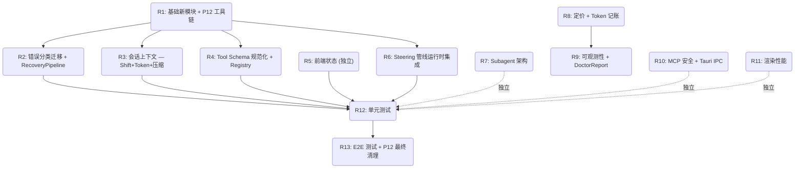

# 多轮次重构执行计划

> 基于 12 份审计报告（P1–P12）综合编排  
> 生成日期：2026-07-23  
> 总轮次：13 轮，每轮 3–6 个并行 Agent

---

## 依赖图概览

---

## 轮次详表

### Round 1 — 基础新模块 + P12 工具链

| 属性 | 值 |
|------|-----|
| **依赖** | 无（起始轮次） |
| **P12 贯穿** | ✅ `.dependency-cruiser.cjs`、`TECH_DEBT.md`、tsconfig 严格模式、`@deprecated` 标准化 |

| Agent | 模块 | 关键产出 | 涉及文件 |
|-------|------|---------|---------|
| 1.1 | P1 ErrorClassifier | `ErrorDomain` 枚举（11 值）、`ClassifiedError` 接口（含 subType/httpStatus/providerId/legacyKind）、`ErrorClassifier.classify()` 纯函数 | `packages/agent-runtime/src/error-classifier.ts`（新建） |
| 1.2 | P3 canonical-schema | `canonicalizeJsonSchema()` 递归实现（处理 properties/items/oneOf/$ref/definitions，深度限制 32，非标准字段剥离） | `packages/agent-runtime/src/canonical-schema.ts`（新建） |
| 1.3 | P2 context-slicer | `sliceContextAtValidBoundary()` 纯函数（Token 预算裁剪 + Turn 边界保护 + 孤立 tool_result 降级） | `packages/agent-runtime/src/context-slicer.ts`（新建） |
| 1.4 | P4 SteeringInputQueue | `SteeringInputQueue` 类 + `AgentInputQueue` 扩展接口（withdraw/replaceOrEnqueue/groupId/isSteering） | `packages/agent-runtime/src/steering/steering-input-queue.ts`（新建），`agent-input-queue.ts` |
| 1.5 | P12 dep-cruiser + TECH_DEBT | `.dependency-cruiser.cjs`（含 5 条层间禁止规则 + no-circular）、`TECH_DEBT.md` 种子清单、`tsconfig.base.json` 补充 `noUncheckedIndexedAccess` | `/.dependency-cruiser.cjs`（新建），`/TECH_DEBT.md`（新建），`tsconfig.base.json` |
| 1.6 | P12 @deprecated 标准化 | 全部 21 处 `@deprecated` 统一格式（原因 + 替代路径 + 删除条件） | `provider-factory.ts`、`provider-anthropic.ts`、`provider-gemini.ts`、`provider-openai-base.ts`、`provider-openai-compatible.ts`、`background-command.ts`、`index.ts`、`clientApi.ts`、`layoutAnimationStore.ts`、`VirtualScrollManager.ts`、`toolPresentation.ts`、`useAgentStream.ts` 等 |

---

### Round 2 — 错误分类迁移 + RecoveryPipeline

| 属性 | 值 |
|------|-----|
| **依赖** | R1（`ErrorClassifier` class、`ClassifiedError` 接口） |

| Agent | 模块 | 关键产出 | 涉及文件 |
|-------|------|---------|---------|
| 2.1 | P1 7 处路径迁移 | 将全部 7 处独立错误判定路径替换为 `ErrorClassifier.classify()` 调用；`base-engine.ts` 的 `classifyError` 改为委托方法 | `base-engine.ts`、`provider-openai-compatible.ts`（4 个 classify*）、`provider-openai-base.ts`、`fallback-chain/engine.ts`、`apps/crish-desktop/src/services/FailoverReason.ts` |
| 2.2 | P1 RecoveryPipeline | `RecoveryPipeline` 接口 + `executeWithFallback()` 编排函数（Tier1→Tier2→Tier3→Tier4 冒泡链） | `packages/agent-runtime/src/recovery-pipeline.ts`（新建） |
| 2.3 | P1 分类优先级修复 | HTTP 413 检查优先于 400/422；新增 402→QUOTA_EXHAUSTED、404/405/415→ENDPOINT_UNAVAILABLE、gateway-challenge→GATEWAY_CHALLENGE 分支；兜底改为 `UNKNOWN` retryable:false；补充 instanceof StreamInterruptedError/ConnectionError | `error-classifier.ts`（修正优先级表） |
| 2.4 | P1 DynamicModelRouter 集成契约 | 定义 `route().alternatives` → `FallbackConfig.fallbackList` 映射；`ProviderCallGateway.call()` 中 CircuitBreakerOpenError 改为冒泡而非直接 throw | `model-routing-dynamic/index.ts`、`fallback-chain/engine.ts`、`runtime-components/provider-call-gateway.ts` |

---

### Round 3 — 会话上下文：Shift 移除 + Token 硬限 + 压缩增强 + 文件追踪

| 属性 | 值 |
|------|-----|
| **依赖** | R1（Agent 3.4 依赖 `sliceContextAtValidBoundary`） |

| Agent | 模块 | 关键产出 | 涉及文件 |
|-------|------|---------|---------|
| 3.1 | P2 shift() 移除 | 移除 4 处 `messages.shift()` 物理截断；改为无限追加 + Zustand 内存上限保护（500 条 ~1MB）+ UI 虚拟滚动 | `apps/crish-desktop/src/store/actions/chat.ts:46`、`apps/crish-desktop/src/store/sessionActions.ts:437-438`、`apps/crish-desktop/src/store/actions/agent.ts:44`、`sessionActions.ts:840` |
| 3.2 | P2 session-store 修复 | `session-store/index.ts:169` 静默拒绝 → 改为创建新 shard 或触发 Archive 卸载 | `packages/agent-runtime/src/session-store/index.ts` |
| 3.3 | P2 enforceHardTokenLimit | `enforceHardTokenLimit()` 函数 + 在 `buildAnthropicMessagesBody` 发送前调用（预算 = maxTokens - reserved） | `packages/agent-runtime/src/anthropic-request-build.ts`、`context-slicer.ts` |
| 3.4 | P2 边界降解 + 压缩增强 | `findFirstKeptMessageIndexSafe()` 三级降解（L1 孤立 tool_result 移除 → L2 强制 user 边界 → L3 主动压缩）；`compressionHistory` 数组（上限 20）；压缩优先级改为「思考块 > 完整 Turn > 工具输出」；`thoughtSummarizer` 配置项 | `context-compression.ts`、`context-state.ts` |
| 3.5 | P2 FileOpTracking | `FileOpTrackingMiddleware` + `extractFileOpFromToolCall`（改用 inputSchema 属性路径模式匹配）+ `FileSnapshotHint` 扩展 `op` 字段 + `readFilesFromSnapshotHints` 改用 `hint.op` | `tool-middleware.ts`、`context-state.ts`、`context-compression.ts` |

---

### Round 4 — Tool Schema 规范化 + Registry

| 属性 | 值 |
|------|-----|
| **依赖** | R1（`canonical-schema.ts`） |

| Agent | 模块 | 关键产出 | 涉及文件 |
|-------|------|---------|---------|
| 4.1 | P3 canonicalizeTools | `canonicalizeTools()` + `computeToolsSchemaHash()`（SHA-256，native 排序优先于 MCP） | `packages/agent-runtime/src/tool-registry/canonicalize-tools.ts`（新建） |
| 4.2 | P3 ToolRegistry 排序 + ready | `ToolRegistry.list()` 改为排序输出；新增 `ready` Promise + `getAll({ awaitMcp })`；超时永远 resolve 不 reject | `packages/agent-runtime/src/tool-registry.ts` |
| 4.3 | P3 CacheProfile | `CacheProfile` 接口（toolsSchemaHash + systemPromptHash + prefixHash + toolsTokenEstimate）；工具变更 diff 告警 | `packages/agent-runtime/src/canonical-schema.ts` |
| 4.4 | P3 cache_control 修复 | `buildAnthropicMessagesBody` 内部调用 `canonicalizeTools` 后挂载 cache_control；`localeCompare` 改为 `a.name < b.name` 比较 | `anthropic-request-build.ts` |

---

### Round 5 — 前端状态质量（INDEPENDENT）

| 属性 | 值 |
|------|-----|
| **依赖** | 无（与后端完全独立） |

| Agent | 模块 | 关键产出 | 涉及文件 |
|-------|------|---------|---------|
| 5.1 | P5 僵尸代码清理 | 删除 `store/actions/chat.ts`、`agent.ts`、`composer.ts`、`settings.ts`、`terminal.ts`；删除后清理目录 | `apps/crish-desktop/src/store/actions/`（全部 5 文件） |
| 5.2 | P5 Object.assign 修复 | 修复 8 处 `sessionActions.ts` + 4 处 `providerStore.ts` 中 `Object.assign` 在 Immer 回调内的原位突变（改用 findIndex + 扩展运算符替换槽位） | `sessionActions.ts`（8 处：414/621/675/757/759/813/838）、`providerStore.ts`（4 处：61/75/86/94） |
| 5.3 | P5 ESLint 规则 | 新增 `no-object-assign-in-immer` 规则（使用 `@typescript-eslint/no-restricted-syntax` selector） | `apps/crish-desktop/eslint.config.js` |
| 5.4 | P5 streamTextOffset 解耦 | 新建 `StreamingMessageRenderState` 存放到 layoutStore Map；8 个文件适配：`types.ts`（删除字段）、`layoutStore.ts`（新增 Map）、`sessionActions.ts`（读写改道）、`sessionEventHydrate.ts`（局部 Map）、`subagentTimeline.ts`（局部变量）、`sessionPersistence.ts`（删除序列化） | 共 8 文件 |
| 5.5 | P5 blocks 增量更新 | 替换 `sessionActions.ts:578` 的 `filter` 破坏性重置为基于最后一个 tool_call 的 `ensureActiveTextBlock` 增量算法 | `sessionActions.ts` |
| 5.6 | P5 门面断言强化 | 在 `sessionStore.ts` 增加编译时断言：`_AssertKeysExist` + `_AssertAssignable`（双重保护） | `sessionStore.ts` |

---

### Round 6 — Steering 管线运行时集成

| 属性 | 值 |
|------|-----|
| **依赖** | R1（`SteeringInputQueue` class） |

| Agent | 模块 | 关键产出 | 涉及文件 |
|-------|------|---------|---------|
| 6.1 | P4 AgentInputQueue 扩展 | `withdraw(predicate)`、`replaceOrEnqueue()`、`AgentInputEntry.groupId/isSteering`；容量策略改为 steering 优先被覆盖 | `agent-input-queue.ts` |
| 6.2 | P4 状态机改造 | 移除 `preparing-turn` 中 `toolCallCount > 0` 限制；新增 `STEER_SIGNAL` 事件，streaming/executing-tools/steering-evaluation 状态均可响应 | `agent-session-loop.ts`（状态机 case） |
| 6.3 | P4 readPendingInputs 修复 | 修复 `types.ts:116` 定义但未调用的断契约；实现批量拉取 + seq 排序 + dispatch 标记 | `types.ts`、`orchestrator.ts`、`agent-session-loop.ts` |
| 6.4 | P4 Run 结束竞态处理 | `enqueuePendingInput()` 检测无活跃 Run 时标记 `migrated` + mode='after-current-run'；方案 A 迁移 | `orchestrator.ts` |
| 6.5 | P4 UI 三按钮改造 | `handleSendChat` 区分 steer/queue/stop 三种 AI 繁忙行为；新增 `steer-session` UI 事件；Composer 视觉区分（↩ 转向 / ⏳ 排队 / ■ 停止） | `useChatStream.ts`、`ChatComposer.tsx`、`uiEvents.ts` |

---

### Round 7 — Subagent 架构轻量化

| 属性 | 值 |
|------|-----|
| **依赖** | 无 |

| Agent | 模块 | 关键产出 | 涉及文件 |
|-------|------|---------|---------|
| 7.1 | P6 SubagentExecutionStrategy | `SubagentExecutionStrategy` 枚举（in-process/daemon-rpc/isolated）+ 策略分派 `executeSubagentByStrategy()` | `packages/agent-runtime/src/subagent-types.ts`（新建） |
| 7.2 | P6 agentLoop() 纯函数 | 从 `AgentRuntime.run()` 提取轻量 `agentLoop(prompt, config)` → `SubagentLoopResult`（跳过非必要组件） | `packages/agent-runtime/src/subagent-loop.ts`（新建），`runtime.ts` |
| 7.3 | P6 AgentContextBase COW | `AgentContextBase` + `AgentContextView` 分层接口；`deepFreeze` 运行时加固；懒渲染 + stablePrefix 跨子 Agent 共享缓存 | `packages/agent-runtime/src/agent-context.ts`（新建），`subagent-context-pack.ts` |
| 7.4 | P6 BubbledAgentEvent | `BubbledAgentEventMetadata` 类型（_bubbled/parentToolCallId/subagentRunId/depth/subagentPath）；Tauri IPC `subagent-event` 路径 | `packages/shared-types/src/events.ts`、`subagentTimeline.ts`、`useChatStream.ts` |
| 7.5 | P6 SubagentRegistry | `SubagentLifecycleState` 6 状态枚举 + `SubagentRegistry.transition()` 状态机 + orphaned 30s 超时回收 | `packages/agent-daemon/src/subagent-lifecycle.ts`（新建），`daemon-subagent-bridge.ts` |

---

### Round 8 — 定价引擎 + Token 记账

| 属性 | 值 |
|------|-----|
| **依赖** | 无 |

| Agent | 模块 | 关键产出 | 涉及文件 |
|-------|------|---------|---------|
| 8.1 | P10 PricingEngine | `PricingEngine` 服务（`calculateCost(modelId, usage)` → `TokenCostBreakdown`；`lookupPricing()`） | `packages/agent-runtime/src/pricing-engine.ts`（新建） |
| 8.2 | P10 TokenLedger | `TokenLedger` 类（per-turn 条目，含 cacheRead/cacheWrite/reasoning 明细；`recordPartial()` / `recordFinal()` 支持流式渐进累积；`getTotalCost()` / `getCacheHitRatio()` / `getLargestTurns()` / `getUsageByTool()`） | `packages/agent-runtime/src/token-ledger.ts`（新建） |
| 8.3 | P10 token 集成钩子 | 在 `agent-session-loop.ts` `message-end` 处插入 `ledger.recordFinal()`；账本快照附加到 `RuntimeMetricsSnapshot.ledger` | `agent-session-loop.ts`、`runtime-metrics.ts` |

---

### Round 9 — 可观测性 + DoctorReport

| 属性 | 值 |
|------|-----|
| **依赖** | R8（PricingEngine + TokenLedger） |

| Agent | 模块 | 关键产出 | 涉及文件 |
|-------|------|---------|---------|
| 9.1 | P10 CircuitBreaker API | `ProviderCallGateway.getCircuitBreakerStates()` → `{ providerId, state, failureCount, cooldownRemainingMs }` | `runtime-components/provider-call-gateway.ts` |
| 9.2 | P10 ToolExecutor 遥测 | `executeSingleWithEvents` 增加 `startedAt`（ISO）、`outputByteSize`（`Buffer.byteLength`）；采样率控制（默认 1.0）；`RuntimeToolNameMetricsSnapshot` 扩展 byteSizeTotal/byteSizeAvg | `runtime-components/tool-executor.ts`、`runtime-metrics.ts`、`@crish/shared-types` |
| 9.3 | P10 StreamRecovery 全局统计 | `StreamRecoveryGlobalRegistry` 单例（totalRecoveryAttempts/successfulRecoveries/orphanSyntheses/surfaceErrors） | `provider-transport/stream-recovery.ts` |
| 9.4 | P10 Subagent orphaned 跟踪 | `SubagentStatus` 增加 `orphaned`；`DoctorReport` 中检查 `globalActiveSubagentCount` ≠ 0 且最近 N 分钟无 agent-end | `subagents.ts` |
| 9.5 | P10 DoctorReport | `DoctorReportBuilder.build()` → 统一健康报告（providers/circuitBreakers/cachePerformance/toolSchema/streamRecovery/subagents/tokenBudget）；集成到 `AgentRuntime.run()` finally 块中 emit `runtime-doctor-report` | `packages/agent-runtime/src/doctor-report.ts`（新建），`runtime.ts` |

---

### Round 10 — MCP 安全加固 + Tauri IPC 稳定性

| 属性 | 值 |
|------|-----|
| **依赖** | 无 |

| Agent | 模块 | 关键产出 | 涉及文件 |
|-------|------|---------|---------|
| 10.1 | P8 MCP env 脱敏 | `DaemonMcpServerConfig.toJSON` + `SafeEnv Proxy`（敏感 key 正则: KEY/SECRET/TOKEN/PASSWORD/CREDENTIAL/AUTH/APIKEY） | `packages/agent-daemon/src/types.ts`、`mcp-config.ts`、`server-runtime-factory.ts` |
| 10.2 | P8 MCP env 白名单 | `mergeProcessEnv` → `buildMcpEnv`（白名单：PATH/TMPDIR/LANG/SystemRoot/COMSPEC 等 12 项）；PATH 只读验证 + `resolveMcpCommand()` 绝对路径安全解析 | `mcp-stdio-adapter.ts` |
| 10.3 | P8 Provider 配置校验 | 前端 `validateProviderConfig()`（baseUrl 格式 + apiKey 16 字符 + 前后空白修剪 + 格式启发式）；后端 `provider-validate.ts` 双重校验 | `ModelsSettingsTab.tsx`、`provider-validate.ts`、`DaemonProviderGateway` |
| 10.4 | P7 ConnectionId | `AtomicU64` → `ConnectionId(u64, u64)`（timestamp_ms + random）；`Ordering::Relaxed` → `SeqCst`；更新所有序列化/比较路径 | `crates/conex-stream/src/parser/sse.rs` 的 Rust 侧 `types.rs`、`connection.rs` |
| 10.5 | P7 SSE BufferOverflow | `SseOutput` 枚举（Frame/BufferOverflow）；`feed_bytes` 返回类型改为 `Result<Vec<SseOutput>>`；`StreamEvent::FrameSkipped` 变体；`ToolAccumulator::mark_incomplete` / `finish_incomplete` | `sse.rs`、`mod.rs`、`anthropic.rs`、`openai_chat.rs`、`gemini.rs`、`tool_accumulator.rs` |
| 10.6 | P7 chardetng LRU | LRU 缓存 2000 条（key: path + mtime_s）；二次校验 `mtime_ns`；显式 Invalidation API；低置信度（<0.7）不缓存 | `apps/agent-workbench/src-tauri/src/perf/encoding.rs` |

---

### Round 11 — 渲染性能与内存管理

| 属性 | 值 |
|------|-----|
| **依赖** | 无 |

| Agent | 模块 | 关键产出 | 涉及文件 |
|-------|------|---------|---------|
| 11.1 | P9 自适应帧预算 | 测量点改为 `parseMarkdownToHtmlAsync` 完整耗时；EMA（alpha=0.2） + 降频快速响应（fastAlpha=0.5, consecutiveOverrunThreshold=3）；钳位相对 rAF interval（35%–75%）；Battery API 监听；maxBytesPerFrame 按比例自适应 | `StreamRenderBuffer.ts`、`useChatStream.ts` |
| 11.2 | P9 混合缓存清除 | 频率 × 时效性 × 大小综合评分（w1=0.4/w2=0.3/w3=0.3）；isHot 热点保护（accessCount≥3，最高保护 5%）；MemoryManager debounce 改为升级立即执行 + 降级才延迟 | `markdownCache.ts`、`memory-manager.ts`、`LruCache`（`cache.ts`） |
| 11.3 | P9 优先级任务队列 | 四级优先级（P0–P3）+ `PriorityTaskQueue`；老化提升（5 轮 ↑1 级）+ WRR（P0:P1:P2:P3 = 1:3:4:2）+ 协作式任务分片（sessionSearch 每批 20 条 yield） | `compute-worker.ts` |

---

### Round 12 — 单元测试

| 属性 | 值 |
|------|-----|
| **依赖** | R1–R6（所有新模块实现完毕） |

| Agent | 模块 | 关键产出 | 涉及文件 |
|-------|------|---------|---------|
| 12.1 | P11 ErrorClassifier 测试 | ≥12 用例（401/403/429/500/402/413/AbortError/timeout/network/非 Error 对象/message 优先于 status/未知状态码） | `packages/agent-runtime/src/__tests__/error-classifier.test.ts`（新建） |
| 12.2 | P11 canonicalizeJsonSchema 测试 | ≥9 用例（嵌套递归排序/required 去重/非标准字段剥离/$defs/null 输入/keys 确定性/allOf 子项/items） | `packages/agent-runtime/src/__tests__/canonical-schema.test.ts`（新建） |
| 12.3 | P11 sliceContextAtValidBoundary 测试 | ≥8 用例（孤立 tool_result/不截断/系统 prompt 保留/空数组/嵌套链/tokenEstimate 抛错/冗余 assistant 链） | `packages/agent-runtime/src/__tests__/context-slicer.test.ts`（新建） |
| 12.4 | P11 canonicalizeTools 测试 | ≥7 用例（顺序确定性/hash 稳定性/native+MCP 混合/空数组/schema 相同 hash 相同/description 不同 hash 不同） | `packages/agent-runtime/src/__tests__/canonicalize-tools.test.ts`（新建） |
| 12.5 | P11 SteeringInputQueue 测试 | ≥8 用例（并发入队/dequeueAll 全部消费/空队列/消费后继续入队/transferTo/clear/50 条压测/跨 Run 唯一性） | `packages/agent-runtime/src/__tests__/steering-input-queue.test.ts`（新建） |
| 12.6 | P11 Immer 响应式测试 | ≥5 用例（toolCalls 更新重渲染/Agent 状态变更/相同值不重渲染/push 新元素渲染/splice 卸载） | `apps/crish-desktop/src/__tests__/immer-reactivity.test.tsx`（新建） |

---

### Round 13 — E2E 测试 + P12 最终清理

| 属性 | 值 |
|------|-----|
| **依赖** | R12（单元测试通过） |

| Agent | 模块 | 关键产出 | 涉及文件 |
|-------|------|---------|---------|
| 13.1 | P11 上下文超限自愈 E2E | Mock `contextLengthExceeded` + `contextLengthFollowedBySuccess` 多阶段场景；验证请求数=2、压缩后请求体缩短、UI diagnostic 事件 | `mock-server.ts`（扩展）、`e2e/` 下新测试文件 |
| 13.2 | P11 Steering 注入 E2E | Mock `steeringInjectionScenario`（delay=50ms）；验证 tool 执行期间 steering 注入 → 下一 Turn 感知、tool 不被中断、budget 限制 | `mock-server.ts`（扩展）、`e2e/` 下新测试文件 |
| 13.3 | P11 熔断器隔离 E2E | Mock `repeated401` 场景（连续 5 次）；验证熔断器打开后不再发送请求、冷却期后恢复 | `mock-server.ts`（扩展）、`e2e/` 下新测试文件 |
| 13.4 | P11 StreamRecovery 回归 | HTTP Range 重连、Retry-After 429 解析、ToolIdempotencyGuard 并发去重 | `stream-recovery.test.ts`、`mock-server.ts` |
| 13.5 | P12 IPC 协议版本化 | `DAEMON_PROTOCOL_VERSION` 常量；`welcome` 消息携带版本字段；`rejectUnknownFields` 增加 `mode: 'warn'`；`protocol.ts` switch 增加 `never` 穷举检查；消除 `common.ts`/`base.ts` validator 重复（`base.ts` 委派 → 删除） | `schema-groups.ts`、`protocol.ts`、`common.ts`、`base.ts`（标记 @deprecated 或删除） |
| 13.6 | P12 废弃 API 清理 | 删除高优先级：`chatApi.demo.ts`、`store/actions/chat.ts` 整文件、`layoutAnimationStore.ts:99,191`；中优先级：`clientApi.ts:808-832` 4 个桩、`provider-factory.ts`（确认调用方已迁移后删除） | 共 6–8 文件（删除或标记） |

---

## 附录：审计项-轮次映射矩阵

| 审计项 | 轮次 | 关键依赖 |
|--------|------|---------|
| P1 ErrorClassifier 实现 | R1 | — |
| P1 7 处路径迁移 | R2 | R1 ErrorClassifier |
| P1 RecoveryPipeline | R2 | R1 ErrorClassifier |
| P1 分类优先级修复 | R2 | R1 ErrorClassifier |
| P2 sliceContextAtValidBoundary | R1 | — |
| P2 shift() 移除 | R3 | — |
| P2 enforceHardTokenLimit | R3 | R1 context-slicer |
| P2 压缩增强 | R3 | — |
| P2 FileOpTracking | R3 | — |
| P3 canonical-schema.ts | R1 | — |
| P3 canonicalizeTools | R4 | R1 canonical-schema |
| P3 ToolRegistry ready | R4 | — |
| P3 CacheProfile | R4 | R4 canonicalizeTools |
| P4 SteeringInputQueue | R1 | — |
| P4 状态机 STEER_SIGNAL | R6 | R1 SteeringInputQueue |
| P4 readPendingInputs 修复 | R6 | — |
| P4 Run 结束竞态 | R6 | — |
| P4 UI 三按钮 | R6 | — |
| P5 僵尸代码清理 | R5 | — |
| P5 Object.assign 修复 | R5 | — |
| P5 ESLint 规则 | R5 | — |
| P5 streamTextOffset 解耦 | R5 | — |
| P5 blocks 增量更新 | R5 | — |
| P5 门面断言 | R5 | — |
| P6 SubagentExecutionStrategy | R7 | — |
| P6 agentLoop() | R7 | — |
| P6 AgentContextBase | R7 | — |
| P6 BubbledAgentEvent | R7 | — |
| P6 SubagentRegistry | R7 | — |
| P7 ConnectionId | R10 | — |
| P7 SseOutput + FrameSkipped | R10 | — |
| P7 chardetng LRU | R10 | — |
| P8 MCP env 脱敏 | R10 | — |
| P8 MCP env 白名单 | R10 | — |
| P8 Provider 校验 | R10 | — |
| P9 自适应帧预算 | R11 | — |
| P9 混合缓存清除 | R11 | — |
| P9 优先级任务队列 | R11 | — |
| P10 PricingEngine | R8 | — |
| P10 TokenLedger | R8 | — |
| P10 DoctorReport | R9 | R8 PricingEngine+TokenLedger |
| P10 CircuitBreaker API | R9 | — |
| P10 ToolExecutor 遥测 | R9 | — |
| P10 StreamRecovery 统计 | R9 | — |
| P11 单元测试 | R12 | R1–R6 |
| P11 E2E 测试 | R13 | R12 |
| P12 dep-cruiser + TECH_DEBT | R1 | — |
| P12 tsconfig 严格模式 | R1 | — |
| P12 @deprecated 标准化 | R1 | — |
| P12 IPC 协议版本化 | R13 | — |
| P12 废弃 API 清理 | R13 | R1 @deprecated 标准化 |
| P12 common.ts/base.ts dedup | R13 | — |
