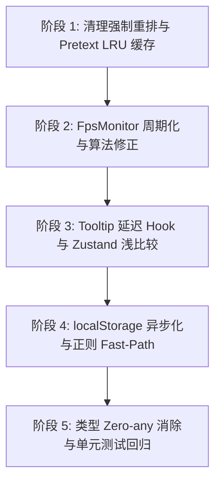

# 全局性能重构与问题治理总执行指导方案 (00-MASTER-REFACTOR-EXECUTION-GUIDE)

> **文档编号**: CX-GUIDE-000
> **版本**: v1.0 Final
> **更新日期**: 2026-07-21
> **适用对象**: 核心开发团队、AI 编程助手 (Claude / GPT / Antigravity)
> **核心目标**: 针对全局审查排查出的 14 大核心代码缺陷与性能死角，提供标准化、代码级、防踩坑的重构落地指导规范。确保任何开发者或 AI 模型在执行重构时均能 100% 准确落地，防止隐患残留。

---

## 1. 总体重构原则与防错铁律

### 铁律 1：严禁在视图层/回调中直接读取 DOM 布局属性
- **禁止语法**: 严禁在 `ResizeObserver` 回调、`useEffect` / `useLayoutEffect` 或组件渲染体中同步调用 `.clientWidth`、`.clientHeight`、`.getBoundingClientRect()`、`offsetWidth` 等引发 **Forced Synchronous Reflow** 的 API。
- **替代方案**: 必须统一使用全局单例 `ResizeObserverManager` 配合 `requestAnimationFrame` 批处理读写，或改用原生 CSS `fit-content` 弹性布局。

### 铁律 2：Pretext 必须遵循“1 条消息一生只 `prepare()` 一次”
- **源码契约**: `@chenglou/pretext` 的 `prepare(text, font)` 包含分词与 Canvas 测量，属于高昂前置计算。
- **替代方案**: 必须通过 `pretextCache` LRU 映射池缓存 `PreparedText` 句柄。在窗口 Resize 或动态更新时，热路径只允许调用 **0.0002ms 纯算术 `layout(prepared, width, lineHeight)`**。

### 3 铁律 3：禁止在未悬停状态下无条件挂载 Tooltip 动画 Hook
- **性能红线**: `<Tooltip>` 组件在未悬停 (`visible === false`) 时，禁止执行 `useAnimatedPresence` 或任何 Portal 挂载逻辑。默认状态下仅返回 `children` 原生 DOM 节点。

### 铁律 4：全局主线程彻底废除同步 `localStorage`
- **磁盘 I/O 隔离**: 聊天会话正文、配置数据与日志，严禁直接使用同步 `localStorage.getItem/setItem`。必须使用 `idb-keyval` (IndexedDB) 或 Rust 异步持久化层。

### 铁律 5：Zustand Store 订阅强制使用 `useShallow`
- **避免级联重绘**: 所有跨组件订阅 Zustand Store（如 `useLayoutStore`）时，禁止直接提取根 state 或大对象，必须使用 `useShallow` 仅订阅最小标量或使用精细 Selector。

---

## 2. 5 大维度改进指导文档结构映射

系统已拆分为 5 大专项重构指导文档，包含详细的代码修改前/修改后对比、测试用例与验收卡点：

```text
c:\Software\conex\docs\refactor-guides\
├── 00-MASTER-REFACTOR-EXECUTION-GUIDE.md        # [本文档] 重构总指导与 S.O.P
├── 01-CHAT-LIST-AND-PRETEXT-REFACTOR-GUIDE.md   # 维度一：消息列表、Pretext 缓存与 Re-render 隔离
├── 02-FPS-MONITOR-AND-RUNTIME-ADAPTATION-GUIDE.md # 维度二：FpsMonitor 采样、分值修正与降级防护
├── 03-TOOLTIP-LAZY-AND-ZUSTAND-SHALLOW-GUIDE.md # 维度三：Lazy Tooltip 延迟挂载与 Zustand 浅比较
├── 04-ASYNC-STORAGE-AND-REGEX-OPTIMIZATION-GUIDE.md # 维度四：异步 IDB 存储、零拷贝与正则短路
└── 05-TYPE-SAFETY-AND-SYSTEM-CLOSURE-GUIDE.md   # 维度五：类型安全 Zero-any、异常治理与测试门禁
```

---

## 3. 重构落地 5 阶段 SOP 执行顺序



1. **第一阶段（紧急）**：执行 `01-CHAT-LIST...` 指南，彻底清理 `useBubbleShrinkWidth`，引入 `pretextCache`，建立 `ChatMessageRow` 细粒度 memo，消灭 8.9s 点击卡顿。
2. **第二阶段（高优）**：执行 `02-FPS-MONITOR...` 指南，修改 `FpsMonitor` 为 1s 定时器周期采样，修复 `computeScore` 堆上限评估 Bug。
3. **第三阶段（高优）**：执行 `03-TOOLTIP-LAZY...` 指南，重构 `<Tooltip>` 为 Lazy 悬停加载模式，全面推行 Zustand `useShallow`。
4. **第四阶段（中优）**：执行 `04-ASYNC-STORAGE...` 指南，将会话正文与持久化下沉至 `idb-keyval`，优化 `toolFeedback.ts` 正则短路。
5. **第五阶段（中优）**：执行 `05-TYPE-SAFETY...` 指南，清理全库 `as any`，补齐单元测试，通过 CI/CD 合并校验。
