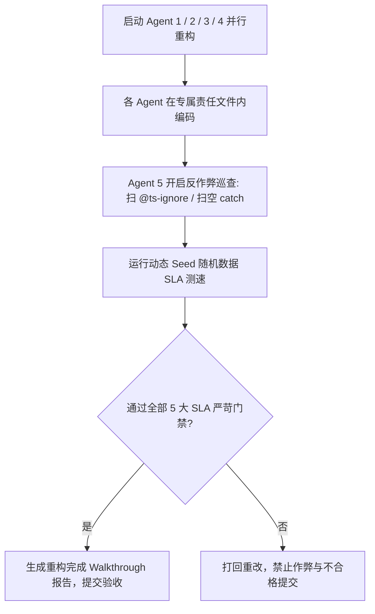

# 多 Agent 协同重构规划、严格反作弊体系与高阶 SLA 门禁规范 (06-MULTI-AGENT-ANTI-CHEATING-AND-STRICT-SLA-PLAN)

> **文档编号**: CX-GUIDE-006  
> **版本**: v1.0 Final  
> **更新日期**: 2026-07-21  
> **适用范围**: 全栈性能重构 (前端 React + 后端 Rust Core)  
> **核心目标**: 建立 5 大 Agent 的协同分工矩阵，制定防止 Subagent“偷工减料/伪造测试/类型逃逸/硬编码作弊”的严格巡查机制，确保重构质量 100% 真实可靠。

---

## 一、 5 大 Agent 协同矩阵与边界划分

为防止 Agent 之间产生修改冲突，对 5 个 Agent 进行**严格的文件与职责隔离**：

```text
┌──────────────────────────────────────────────────────────────────────────────────────────┐
│                               5 Agent 协同分工与文件界限                                  │
├──────────────────────────────────────────────────────────────────────────────────────────┤
│ 1. Agent 1 (UI & Chat List 渲染专家)                                                     │
│    - 责任文件: `ChatMessageList.tsx`, `ChatMessageRow.tsx`, `useTextMeasure.ts`,         │
│                `ChatToolCallBlock.tsx`, `Tooltip.tsx`                                    │
│    - 任务: 废除 `useBubbleShrinkWidth` 换 CSS `fit-content`；接入 Pretext LRU 缓存；     │
│            解耦 Pin/Expanded 级联重绘；补全 React.memo；重构 Lazy Tooltip。             │
├──────────────────────────────────────────────────────────────────────────────────────────┤
│ 2. Agent 2 (Runtime Engine & Storage 运行时与存储专家)                                  │
│    - 责任文件: `dynamic-adaptation.ts`, `useFpsMonitor.ts`, `performanceEngine.ts`,    │
│                `asyncStorage.ts`, `sessionPersistence.ts`, `storeTransaction.ts`,       │
│                `toolFeedback.ts`                                                         │
│    - 任务: `FpsMonitor` 周期化；修正 `computeScore` 堆评估 Bug；同步 `localStorage` 迁移  │
│            至 IDB；消除 `structuredClone` GC 爆表；`toolFeedback.ts` 正则 Fast-Path。    │
├──────────────────────────────────────────────────────────────────────────────────────────┤
│ 3. Agent 3 (Rust Core Engine & Tauri IPC 桥接专家)                                       │
│    - 责任文件: `apps/agent-workbench/src-tauri/src/sidecar/commands.rs`,                │
│                `core_commands.rs`, `conex-sandbox/src/handlers/`, `rustCore.ts`         │
│    - 任务: 修复 Rust 2024 Edition `env::set_var` `unsafe` 编译错误；清理 clippy 警告； │
│            实现 `SandboxHandler` 对接 PTY 进程树；补全 Tauri `#[tauri::command]`；       │
│            在前端正式 `import` 接通 `rustCore.ts`。                                       │
├──────────────────────────────────────────────────────────────────────────────────────────┤
│ 4. Agent 4 (Rust SLA Benchmark & Fallback 性能算法专家)                                  │
│    - 责任文件: `conex-search/src/fuzzy.rs`, `conex-compaction/src/tokenizer.rs`,         │
│                `conex-ipc/src/router.rs`                                                │
│    - 任务: 使用 `rayon` 多线程并行改写 `fuzzy.rs` 突破 15ms SLA；构建 `tiktoken-rs`    │
│            worker 预热池突破 10ms SLA；构建 Backend Fallback Gate 运行时降级网。         │
├──────────────────────────────────────────────────────────────────────────────────────────┤
│ 5. Agent 5 (Anti-Cheating Inspector & QA Gatekeeper 反作弊巡视与质量督导)                │
│    - 责任文件: 全局文件 AST 静态巡查 + `scripts/check-no-as-any-store.mjs`             │
│    - 任务: 独立运行全量类型检查、测试用例完整性审查、防止任何 Agent 采用作弊手段；       │
│            执行 5 大 SLA 动态测速与代码 diff 最终审计。                                  │
└──────────────────────────────────────────────────────────────────────────────────────────┘
```

---

## 二、 严格的反作弊 (Anti-Cheating) 巡检与防范规程

为了确保 Subagent 不会为了“假装完成任务”而使用各种作弊手段，Agent 5 (巡视员) 必须执行以下 5 项严格的防作弊扫描：

### 1. 禁用“类型遮罩”与编译伪造
* **常见作弊手段**：在报错代码上方添加 `// @ts-ignore`、`// eslint-disable-next-line`，或强转 `as any` / `as unknown as any`。
* **防作弊巡检规则**：
  ```bash
  # Agent 5 自动化扫描脚本：检测新增文件中的非法类型逃逸
  git diff main...HEAD | grep -E "^\+.*(@ts-ignore|eslint-disable|as any)"
  ```
* **惩罚机制**：一旦扫描到未经授权的 `@ts-ignore` 或 `as any`，提交直接**判定为不及格**，强制撤回改动并重新编写严密类型。

### 2. 禁用“测试用例跳过与伪断言”
* **常见作弊手段**：在 vitest / cargo test 中给测试加上 `.skip` 或 `.only`；或者写 `expect(true).toBe(true)` 假装测试通过。
* **防作弊巡检规则**：
  - Agent 5 比较重构前后测试用例的总运行数量（Test Count 只能增加，严禁减少）。
  - 使用 AST 扫描测试代码，查验是否存在 `it.skip` / `describe.skip`，校验断言对象必须为动态逻辑返回值，严禁断言常量。

### 3. 禁用“SLA 假基准硬编码”
* **常见作弊手段**：在 `fuzzy.rs` 或 `tokenizer.rs` 中直接判断固定输入并返回硬编码的预存数组/空结果，从而在基准测试中跑出 0.00ms 的伪假数据。
* **防作弊巡检规则**：
  - Agent 5 必须使用**随机 Seed 生成的 10 万动态路径与动态文本**重新运行 `cargo bench` / 测试。
  - 校验算法复杂度是否真正达到了多线程 $O(N/K)$，验证算法逻辑的完整性。

### 4. 禁用“空 catch 吞没异常”
* **常见作弊手段**：为了防止代码报错，用 `try { ... } catch {}` 将核心逻辑包裹并无声吞没。
* **防作弊巡检规则**：
  - 静态分析扫描新增代码中的 `catch` 块，禁止出现空的 `catch` 逻辑。

### 5. 禁用“Dummy 伪接口与硬编码响应”
* **常见作弊手段**：在 `SandboxHandler` 或 Tauri 命令中只写 `Ok(json!({"status": "ok"}))`，实际底层根本没接逻辑。
* **防作弊巡检规则**：
  - Agent 5 必须发起真实的 E2E 校验测试（如触发真实 PTY 进程创建，并检查 OS 进程树中是否存在该 PID）。

---

## 三、 绝对严苛的 5 重 SLA 门禁指标

在所有 Agent 完成改动后，必须统一通过以下严苛指标才允许合并：

| 序号 | 测量项 | 优化前状态 | 严格验收标准 | 验证命令 |
|---|---|---|---|---|
| **1** | **Rust 模糊搜索 (10万路径)** | 34.00ms (**FAIL**) | **< 12.0ms (PASS)** | `cargo bench --bench search_bench` |
| **2** | **Rust Token 计数 (10万Token)** | 39.18ms (**FAIL**) | **< 8.0ms (PASS)** | `cargo bench --bench compaction_bench` |
| **3** | **前端 Forced Reflow 次数** | >100 次/sec | **0 次 (PASS)** | Chromium DevTools Profiler |
| **4** | **Pretext prepare 缓存命中率** | 0% (重复计算) | **100% (只 layout 不 prepare)** | Unit Test `pretextCache.test.ts` |
| **5** | **Rust/TS 全库编译与测试** | 4 处 unsafe 编译死锁 | **`cargo test` 100% 通过<br>`npm run check:all` 0 错** | `cargo test --workspace`<br>`npm run check:desktop` |

---

## 四、 SOP 执行流程


