# Conex 全局依赖拓扑 DAG 修复图谱与 Round 1 ~ Round 9 深度实施计划 — 校正版本

> **文档编号**: `CONEX-TOPOLOGY-DAG-V2-CORRECTED`
> **生成时间**: 2026-07-24
> **校正时间**: 2026-07-25
> **校正基准**: `v2_path_audit.json` / `v2_root_cause_audit.json` / `v2_remediation_review.json`
> **原始文档**: `analysis/master_repair_plan_v2/conex_repair_topology_v2.md`
> **审计基准**: `analysis/conex_gap_audits/` (下辖 6 份 Gap 诊断报告)
> **合规遵循**: `AGENTS.md` 及 `ANTI_OVERENGINEERING_GUARDRAILS.md`

> **校正注**：原始拓扑文档使用 `GAP-XX-YYT` 格式的 Issue ID（如 `GAP-01-01T`、`GAP-02-03`），与 `ledger_v2.json` 使用的 `GAP-ST-XX`、`GAP-CS-XX`、`GAP-TC-XX`、`GAP-PM-XX`、`GAP-SE-XX`、`GAP-UI-XX` 体系不一致。经审查，两者为同一问题的不同命名体系（旧编号 vs 新编号）。本校正版本提供双向映射表并将所有 ID 统一映射到 ledger 体系。Round 9 中的 `GAP-09-01/02/03` 为计划创建项，标注说明。Round 8 中 `GAP-08-01/02` 为 orphan 节点，标注说明。

> **轮次概念说明**：本文档中 R1~R9 为**DAG 实现轮次**（按依赖拓扑排列），与 `ledger_v2_CORRECTED.json` 中的 `assigned_round`（摄入轮次，代表优先级分批）概念不同。两者映射关系见第 3 节映射表。

---

## 1. 概述与设计理念

根据 Phase 1 阶段 Agent 1 ~ Agent 6 对 Conex 全域（流式 Token、并发状态机、Tool Call 容错、进程/内存/数据库句柄、代码编辑 Patch 寻址、桌面 UI 与系统唤醒）共 **37 项 ledger 问题** 的深剖审计（原始文档误写为"48 项核心架构缺陷"，实际 ledger 仅含 37 项），本文档制定了全局依赖修复顺序、Master 拓扑 DAG 图谱以及 Round 1 至 Round 9 的系统化重构路线图。

### 拓扑构建的核心原则
1. **编译解锁与契约先行 (Type Contract First)**：优先完成基础类型契约与接口扩展（R1），解除上层模块重构时的 TypeScript / Rust 编译阻塞。
2. **防线内聚与底层收紧 (Layered Defense)**：先收紧底层进程树强杀、取消信号级联与线程上下文（R2），再推进流式数据层（R3）与 Tool Call 容错（R4）。
3. **关键算法与原子保护 (Algorithm & State Integrity)**：在 R5 中实现确定性 4-Pass 寻址与 Tool Pair 双向原子裁切；在 R6 中夯实 SQLite WAL 退避与系统唤醒锁。
4. **用户体验与物理安全 (UI & Security Guard)**：在 R7 中收紧 UI 视口弹性钳制与 OS Keyring 物理秘钥隔离。
5. **资源限流与 CI/CD 防线 (Governance & Limits)**：在 R8 中完成 Live Agent 信号量门禁、代际意图锁与 CI 6 条硬性断言。
6. **端到端全量系统验证 (E2E System Verification)**：在 R9 中通过全量单元/集成测试与黄金向量演练，确保零回归。

### 旧编号 → Ledge r 新编号映射表

| 旧编号 | 新编号 (ledger) | 说明 |
|---|---|---|
| GAP-01-01 | GAP-ST-01 | StreamRenderBuffer 代理对截断 |
| GAP-01-02 | GAP-ST-02 | TextDecoder Flush 遗漏 |
| GAP-01-03 | GAP-ST-03 | Rust SSE from_utf8_lossy |
| GAP-01-04 | GAP-ST-04 | Token 估算失配 |
| GAP-01-05 | GAP-ST-05 | 413 图片剥离遗漏 blocks |
| GAP-01-06 | GAP-ST-06 | 图片剥离 metadata/blocks 不同步 |
| GAP-01-07 | GAP-ST-07 | legacyFinishReason 抹杀 length |
| GAP-01-08 | GAP-ST-08 | buildMessage 硬编码 stopReason |
| GAP-01-09 | GAP-ST-09 | session-loop 续写判定恒假 |
| GAP-01-10 | GAP-ST-10 | balanceJsonContainers 反斜杠/字面量漏洞 |
| GAP-02-01 | GAP-CS-01 | Subagent Abort 监听器提前解绑 |
| GAP-02-02 | GAP-CS-02 | cancelRun 遗漏后台 Shell 进程树 |
| GAP-02-03 | GAP-CS-03 | activeRuns BoundedMap 静默淘汰 |
| GAP-02-04 | GAP-CS-04 | Daemon 侧缺 Live Agent 槽位 |
| GAP-02-05 | GAP-CS-05 | CrossProcessLock 孤儿代码 |
| GAP-02-06 | GAP-CS-06 | TCP Reset 硬归类 Case B |
| GAP-02-07 | GAP-CS-07 | 账号池误判流中断为 Auth 错误 |
| GAP-02-08 | GAP-CS-08 | setTraceContext 滥用 enterWith |
| GAP-02-09 | GAP-CS-09 | activeSubagentCount 在 try 块外自增 |
| GAP-03-01 | GAP-TC-01 | Tool Call 参数 null/[] 缺陷 |
| GAP-03-02 | GAP-TC-01 | Zod Preprocess 缺失（合并至 GAP-TC-01） |
| GAP-03-03 | GAP-TC-02 | runIntentDenylist 缺失 |
| GAP-03-04 | GAP-TC-02 | retryable:false 缺失（合并至 GAP-TC-02） |
| GAP-03-05 | GAP-TC-03 | stringifyToolOutput 空数组 |
| GAP-03-06 | GAP-TC-03 | tool 消息空 content HTTP 400（合并至 GAP-TC-03） |
| GAP-03-07 | GAP-TC-04 | MCP Stdio 忽略 AbortSignal |
| GAP-03-08 | GAP-TC-04 | McpServerController 缺熔断（合并至 GAP-TC-04） |
| GAP-03-09 | GAP-TC-04 | isReadOnly 硬编码（合并至 GAP-TC-04） |
| GAP-04-01 | GAP-PM-01 | attach_to_job_object 死代码 + Handle 泄漏 |
| GAP-04-02 | GAP-PM-02 | 进程终止缺乏两阶段优雅降级 |
| GAP-04-03 | GAP-PM-03 | BoundedMap 淘汰导致后台进程泄漏 |
| GAP-04-04 | GAP-PM-04 | SQLITE_BUSY 缺指数退避重试 |
| GAP-04-05 | GAP-PM-04 | BEGIN DEFERRED 死锁（合并至 GAP-PM-04） |
| GAP-04-06 | GAP-PM-05 | Raw Tool Payloads 无上限 |
| GAP-04-07 | GAP-PM-05 | 缺乏 GC 触发（合并至 GAP-PM-05） |
| GAP-04-08 | GAP-PM-05 | Rust compaction 全量 clone（合并至 GAP-PM-05） |
| GAP-04-09 | GAP-PM-06 | 防卡死环境变量未注入 |
| GAP-05-01 | GAP-SE-01 | seek_sequence 缺 eof/matchCount |
| GAP-05-02 | GAP-SE-01 | splitLinesForSeek 契约不一致（合并至 GAP-SE-01） |
| GAP-05-03 | GAP-SE-02 | safe_drop_end 缺 ID 级断言 |
| GAP-05-04 | GAP-SE-02 | 反向 Orphan Tool Call 检查（合并至 GAP-SE-02） |
| GAP-05-05 | GAP-SE-03 | canonicalize 无 Visited Set |
| GAP-05-06 | GAP-SE-04 | FileDiff 缺 provisional |
| GAP-06-01 | GAP-UI-01 | 系统唤醒锁缺位 |
| GAP-06-02 | GAP-UI-02 | Abort 时 reasoning_content 丢弃 |
| GAP-06-03 | GAP-UI-02 | 中断流 Usage 清零（合并至 GAP-UI-02） |
| GAP-06-04 | GAP-UI-03 | 菜单视口未钳制 |
| GAP-06-05 | GAP-UI-03 | Function import 反模式（合并至 GAP-UI-03） |
| GAP-06-06 | GAP-UI-04 | 非 Windows Keychain 缺位 |
| GAP-06-07 | GAP-UI-04 | localStorage 明文（合并至 GAP-UI-04） |
| GAP-06-08 | GAP-UI-04 | Skill 沙盒 Mount Guard（合并至 GAP-UI-04） |

---

## 2. Master 修复拓扑 DAG 图谱 (Mermaid Master DAG)

以下拓扑图展现了 37 项缺陷修复节点的全局依赖演进关系（原始文档误为 48 项），节点按 Round 1 ~ Round 9 严格分层排列，箭头表示 `depends_on` 前置依赖走向。

```mermaid
flowchart TD
    subgraph R1 ["Round 1: 编译解锁 & 底层依赖与类型定义加固"]
        R1_1["GAP-ST-07: ProviderStreamFinishReason 扩展 'length'/'max_tokens'"]
        R1_2["GAP-SE-04T: FileDiff 扩展 provisional?: boolean 字段"]
        R1_3["GAP-SE-01T: Rust seek_sequence 增加 SeekResult 诊断元数据"]
        R1_4["GAP-TC-01T: 导出 Zod 自动纠偏辅助函数 zCoerceArray / zDefaultEmpty"]
        R1_5["GAP-PM-01T: Rust process_tree 重构 ScopedJobObject 句柄"]
    end

    subgraph R2 ["Round 2: 并发/状态机 & 进程/句柄/信号级联杀死防线"]
        R2_1["GAP-CS-01: 后台 Subagent 绑定 Session 级 AbortSignal"]
        R2_2["GAP-CS-02: cancelRun() 联动 BackgroundCommandManager 强杀进程树"]
        R2_3["GAP-PM-06: process-executor & PowerShell 注入 CI=true 等 12 个非交互变量"]
        R2_4["GAP-CS-08: 废脱 enterWith，全链路改用 withTraceContext 作用域隔离"]
        R2_5["GAP-CS-09: Subagent 工具改用 AsyncSemaphore 防止计数器死锁泄露"]
    end

    subgraph R3 ["Round 3: 流式 UTF-8 代理对、Reasoning 思考链与 Token/Cost 估算"]
        R3_1["GAP-ST-01: StreamRenderBuffer 修正 Unicode Surrogate Pair 增量切割"]
        R3_2["GAP-ST-02: readSseJson & directFetchBridge 流结束时 flush TextDecoder"]
        R3_3["GAP-ST-03: Rust conex-stream SSE 解析废除 from_utf8_lossy"]
        R3_4["GAP-UI-02: directFetchBridge & useStreamCallbacks 在 Abort 时封存 reasoning_content"]
        R3_5["GAP-ST-04: Rust compaction.rs 补齐 Tools Schema 与 1.15 安全系数"]
        R3_6["GAP-ST-05: payload-image-recovery 扫描并剥离 message.blocks 中的 Base64 图片"]
    end

    subgraph R4 ["Round 4: Tool Call 容错、Schema 归一化与拒绝意图黑名单"]
        R4_1["GAP-TC-01: parseArguments & extractToolArgumentObject 归一化 null/[]/None"]
        R4_2["GAP-TC-02: DaemonApprovalHandler 增加 runIntentDenylist 拒绝黑名单"]
        R4_3["GAP-TC-02: 拒绝决策返回 retryable: false 阻止模型无限重复弹窗"]
        R4_4["GAP-TC-03: stringifyToolOutput 拦截空数组导出，Tool Result 注入 safe text"]
        R4_5["GAP-TC-04: mcp-stdio-adapter 注入 ToolExecutionContext.signal 与 30s 超时"]
        R4_6["GAP-TC-04: McpServerController 增加 3 次连续失败 Circuit Breaker 熔断"]
    end

    subgraph R5 ["Round 5: 代码编辑 4-Pass seekSequence 与 safeCompactionCutoff 消息成对隔离"]
        R5_1["GAP-SE-01: Rust seek_sequence_full 支持 eof 锚定与 4-Pass 完全对齐"]
        R5_2["GAP-SE-01: splitLinesForSeek 与 Rust 行分割规范化契约"]
        R5_3["GAP-SE-02: calculateSafeCompactionCutoff 实施 Tool Call/Result 双向原子裁切"]
        R5_4["GAP-SE-03: path_utils 引入 safe_canonicalize (Hop <= 40) 与 Visited Set 防死循环"]
        R5_5["GAP-SE-04: UI DiffCard Accept 按钮硬性禁用 provisional Diff 落盘"]
    end

    subgraph R6 ["Round 6: SQLite WAL 重试退避、内存 GC / Payload 剪裁与系统 Keep-Awake 唤醒锁"]
        R6_1["GAP-PM-04: conex-db 事务升级为 BEGIN IMMEDIATE 并增加 Jitter 指数退避重试"]
        R6_2["GAP-PM-05: 历史消息 Raw Tool Output 实施 32KB LRU 截断与离线标记"]
        R6_3["GAP-PM-05: 增加 global.gc?.() 显式触发与堆内存 Watchdog"]
        R6_4["GAP-PM-05: Rust compaction 原地 retain 消除 Message.clone 并调用 shrink_to_fit"]
        R6_5["GAP-UI-01: Tauri 主进程实现跨平台 KeepAwakeGuard 系统唤醒锁"]
    end

    subgraph R7 ["Round 7: 桌面 UI 视口钳制、Popover 拦截与 Keyring 物理秘钥加密"]
        R7_1["GAP-UI-03: Popover 全量应用 max-h-[calc(100dvh-3rem)] 视口钳制与滚轮拦截"]
        R7_2["GAP-UI-03: ProjectPickerMenu 移除动态 Function import 改用标准 ESM"]
        R7_3["GAP-UI-04: Rust credentials.rs 补齐 macOS Keychain 与 Linux SecretService 绑定"]
        R7_4["GAP-UI-04: providerProfiles 从 localStorage 中彻底擦除明文 apiKey"]
        R7_5["GAP-UI-04: 增加 Skill 沙盒凭据 Mount Guard 拦截 .env / credentials 挂载"]
    end

    subgraph R8 ["Round 8: Agent/Subagent 资源信号量与 CI/CD 机制防线"]
        R8_1["GAP-PM-03: BoundedMap 增加 onEvict 清理钩子强杀被淘汰后台进程"]
        R8_2["GAP-CS-03: Orchestrator activeRuns 淘汰最旧 Run 前显式调用 engine.abort()"]
        R8_3["GAP-CS-04: Daemon 侧装配全局 AsyncSemaphore(32) Live Agent 槽位门禁"]
        R8_4["GAP-CS-05: ChatGPTAccountPool 强制装配 CrossProcessLock 代际意图锁"]
        R8_5["GAP-08-02 (orphan): CI 6 条硬性断言 (代码行数/无循环依赖/<2s 扫描) —— orphan 条目，计划创建"]
    end

    subgraph R9 ["Round 9: 端到端全量系统验证与单元/集成测试套件集成"]
        R9_1["GAP-09-01 (计划创建): 黄金向量 4-Pass Seek 双端一致性自动化测试"]
        R9_2["GAP-09-02 (计划创建): OAuth Single-Flight 并发 401 刷线网络回归测试"]
        R9_3["GAP-09-03 (计划创建): Compaction 双向 Tool Pair 零 400 错报集成测试"]
        R9_4["GAP-09-04 (计划创建): 端到端 E2E 全量系统断言与验证"]
    end

    %% 跨轮次依赖关系 (depends_on)
    R1_1 --> R3_4
    R1_1 --> R4_3
    R1_2 --> R5_5
    R1_3 --> R5_1
    R1_4 --> R4_1
    R1_5 --> R2_2

    R2_1 --> R8_2
    R2_2 --> R8_1
    R2_3 --> R4_5
    R2_4 --> R8_3

    R3_1 --> R5_1
    R3_4 --> R6_2
    R3_5 --> R5_3
    R3_6 --> R5_3

    R4_1 --> R5_3
    R4_2 --> R4_3
    R4_3 --> R5_5
    R4_5 --> R8_3

    R5_1 --> R9_1
    R5_3 --> R6_4
    R5_3 --> R9_3
    R5_4 --> R7_5

    R6_1 --> R8_4
    R6_2 --> R8_1
    R6_5 --> R7_1

    R7_3 --> R7_4
    R7_4 --> R8_4

    R8_1 --> R9_4
    R8_2 --> R9_4
    R8_3 --> R9_4
    R8_4 --> R9_2
    R8_5 --> R9_4
```

---

## 3. 全局缺陷矩阵与依赖关系汇总表 (Global Issue Dependency Matrix)

下表汇总了 Conex 代码库中 37 项 ledger 缺陷的元数据、受影响模块、风险等级、所属 Round 以及其**明确的前置依赖关系 (`depends_on`)**。

> **校正注**：以下 ID 已统一使用 ledger 新编号体系。旧编号 `GAP-XX-YY` 可参照第 1 节映射表转换。原始文档中的 `GAP-03-02`、`GAP-03-04`、`GAP-03-06`、`GAP-03-08`、`GAP-03-09`、`GAP-04-05`、`GAP-04-07`、`GAP-04-08`、`GAP-05-02`、`GAP-05-04`、`GAP-06-03`、`GAP-06-05`、`GAP-06-07`、`GAP-06-08` 为旧编号体系下的子问题，在新 ledger 中已合并至父级 Issue。

| Issue ID | 缺陷名称与描述 | 核心受影响文件 | 风险等级 | 所属 Round | 前置依赖 (`depends_on`) |
| :--- | :--- | :--- | :--- | :--- | :--- |
| **GAP-ST-01** | `StreamRenderBuffer.ts` 代理对截断与非 `\n` 行切割乱码 | `StreamRenderBuffer.ts` | P1-High | **R3** | 无 |
| **GAP-ST-02** | 流结束 `done: true` 时未 flush `TextDecoder` 残留字节 | `openai-stream-parse.ts` | P2-Medium | **R3** | 无 |
| **GAP-ST-03** | Rust `conex-stream` SSE 解析使用 `from_utf8_lossy` 强转 | `sse.rs` | P1-High | **R3** | 无 |
| **GAP-ST-04** | Rust `compaction.rs` Token 估算遗漏 Tools Schema 与安全系数 | `compaction.rs` | P1-High | **R3** | 无 |
| **GAP-ST-05** | `payload-image-recovery.ts` 剥离图片遗漏 `blocks` 内 Base64 | `payload-image-recovery.ts` | P0-Blocker | **R3** | 无 |
| **GAP-ST-06** | 图片剥离后 metadata 与 blocks 数据占位符不同步 | `payload-image-recovery.ts` | P1-High | **R3** | `GAP-ST-05` |
| **GAP-ST-07** | `legacyFinishReason` 强制将 `"length"` 截断信号改写为 `"stop"` | `normalizer.ts` | P0-Blocker | **R1** | 无 |
| **GAP-ST-08** | `buildMessage` 忽略流事件 `finishReason`，丢弃 `stopReason` | `provider-response-consumer.ts` | P0-Blocker | **R1** | `GAP-ST-07` |
| **GAP-ST-09** | `handleNoToolCalls` 中 `stopReason === 'length'` 永远为 false | `session-loop/index.ts` | P0-Blocker | **R3** | `GAP-ST-07`, `GAP-ST-08` |
| **GAP-ST-10** | `balanceJsonContainers` 尾部 `\` 转义闭合双引号导致语法报错 | `json-repair.ts` | P1-High | **R4** | 无 |
| **GAP-CS-01** | 后台 Subagent 工具执行完成后提前解绑 `onAbort` 监听器 | `subagent-runtime.ts` | P0-Blocker | **R2** | 无 |
| **GAP-CS-02** | `cancelRun()` 仅中断 LLM engine，遗漏后台 Shell 子进程树 | `orchestrator.ts` | P0-Blocker | **R2** | `GAP-PM-01` |
| **GAP-CS-03** | `activeRuns` 的 `BoundedMap` 静默淘汰最旧 Run 产生 Ghost Run | `orchestrator.ts` | P0-Blocker | **R8** | `GAP-CS-01`, `GAP-PM-03` |
| **GAP-CS-04** | Daemon 侧 `createDaemonSubagentTool` 缺失全局 Live Agent 槽位 | `subagent-runtime.ts` | P1-High | **R8** | `GAP-CS-08` |
| **GAP-CS-05** | `refreshAccount` 未装配 `CrossProcessLock` 导致并发重放 401 封账号 | `chatgpt-pool.ts` | P0-Blocker | **R8** | `GAP-UI-04` |
| **GAP-CS-06** | 流中途哪怕产生 1 字符，TCP Reset 即被划归 Case B 拒绝重试 | `stream-recovery.ts` | P1-High | **R3** | 无 |
| **GAP-CS-07** | 上层账号池将暂态网络 Reset 误判为 Auth 错误实施 5min~1h 冷却 | `chatgpt-pool.ts` | P1-High | **R3** | `GAP-CS-06` |
| **GAP-CS-08** | `setTraceContext` 滥用 `enterWith` 造成跨 Session Context 污染 | `trace/index.ts` | P1-High | **R2** | 无 |
| **GAP-CS-09** | 模块级全局 `activeSubagentCount` 在 `try` 块外自增导致死锁 | `subagents.ts` | P2-Medium | **R2** | 无 |
| **GAP-TC-01** | `null` / `[]` 参数被错误包装为 `{ value: null }` 导致提取失败 | `provider-openai-chat.ts` | P1-High | **R4** | `GAP-TC-01T` (Zod 辅助函数) |
| **GAP-TC-02** | `DaemonApprovalHandler` 完全缺失 `runIntentDenylist` 黑名单记忆 | `daemon-approval-handler.ts` | P0-Blocker | **R4** | 无 |
| **GAP-TC-03** | 空 json 数组被 `JSON.stringify` 导出为 `"[]"` 脏字符污染上下文 | `openai-request-build.ts` | P1-High | **R4** | 无 |
| **GAP-TC-04** | `mcp-stdio-adapter` 完全忽略 `ToolExecutionContext.signal` 与超时 | `mcp-stdio-adapter.ts` | P0-Blocker | **R4** | `GAP-CS-03` |
| **GAP-PM-01** | Rust `attach_to_job_object` 处于未调用死代码状态且 Handle 泄漏 | `process_tree.rs` | P0-Blocker | **R1** | 无 |
| **GAP-PM-02** | Windows 进程终止缺乏 Soft Kill -> Hard Kill 两阶段优雅降级 | `process-executor.ts` | P0-Blocker | **R2** | `GAP-PM-01` |
| **GAP-PM-03** | `BoundedMap` 容量淘汰最旧任务时未强杀底层运行的后台子进程 | `background-command.ts` | P0-Blocker | **R8** | `GAP-PM-02` |
| **GAP-PM-04** | `conex-db` 全库缺少 `SQLITE_BUSY` 带 Jitter 的指数退避重试 | `pool.rs` | P1-High | **R6** | 无 |
| **GAP-PM-05** | Raw Tool Payloads 无上限存留于内存且缺少 32KB LRU 剪裁 | `session.ts` | P1-High | **R6** | 无 |
| **GAP-PM-06** | `createGuardedProcessEnv` 完全未注入 `CI=true` 等防卡死环境变量 | `process-executor.ts` | P0-Blocker | **R2** | 无 |
| **GAP-SE-01** | Rust `seek_sequence.rs` 缺失 `eof` 锚定与 `matchCount` 诊断元数据 | `seek_sequence.rs` | P1-High | **R5** | `GAP-ST-03` |
| **GAP-SE-02** | Rust `safe_drop_end` 与 TS 压缩缺乏 ID 级成对断言，引发 400 | `compaction.rs` | P0-Blocker | **R5** | `GAP-ST-04`, `GAP-ST-05` |
| **GAP-SE-03** | `resolve_under_root` 裸调用 `canonicalize` 且递归遍历无 Visited Set | `path_utils.rs` | P1-High | **R5** | 无 |
| **GAP-SE-04** | `FileDiff` 结构缺失 `provisional` 状态，UI Accept 放行半截代码 | `types.ts` & `DiffCardFileList.tsx` | P0-Blocker | **R5** | `GAP-ST-02` |
| **GAP-UI-01** | Tauri 主进程缺乏 OS 级 `KeepAwakeGuard` 系统唤醒锁 | `main.rs` & `power.rs` | P0-Blocker | **R6** | 无 |
| **GAP-UI-02** | `directFetchBridge` & `useStreamCallbacks` 在 Abort 时清空 Reasoning | `directFetchBridge.ts` | P0-Blocker | **R3** | `GAP-ST-07` |
| **GAP-UI-03** | Popover 菜单缺失 `max-h-[calc(100dvh-3rem)]` 视口钳制与滚轮拦截 | `ModelPicker.module.css` | P1-High | **R7** | `GAP-UI-01` |
| **GAP-UI-04** | Rust `credentials.rs` 非 Windows 平台 Keychain/SecretService 实现留空 | `credentials.rs` | P1-High | **R7** | `GAP-SE-03` |

> **校正注**：原拓扑文档中的 `GAP-08-01`（Daemon 侧 AsyncSemaphore 装配）实际为 `GAP-CS-04` 的重复描述，标记为 orphan。`GAP-08-02`（CI 6 条硬性断言）为计划创建项，标记为 orphan。`GAP-09-01/02/03/04` 均为 Round 9 计划创建的测试文件，当前仓库中不存在对应的测试文件，标记为"计划创建"。

---

## 4. Round 1 ~ Round 9 修复计划详解

### Round 1: 编译解锁 & 底层依赖与类型定义加固

#### 1.1 轮次目标与治理范围
Round 1 作为整个修复计划的基石，重点在于**解锁基础类型契约**、**新增公共辅助转换库** 以及 **完善底层 C/Rust Native Handle 结构**。在不改动核心业务流程的前提下，为后续 R2 ~ R8 轮次提供编译期强类型支持与基础设施。

#### 1.2 涉及缺陷与具体修补规范

1. **GAP-ST-07T: 扩展 `ProviderStreamFinishReason` 类型定义**
   - **目标文件**: `packages/agent-runtime/src/provider-stream-contract/types.ts`
   - **规范**: `ProviderStreamFinishReason` 已包含 `"stop" | "tool-call" | "length" | "error"`，无需修改类型定义。仅需修改 `legacyFinishReason` 函数增加 `"length"` 和 `"max_tokens"` 传递。
   - **校正注**：原始文档声称需扩展类型定义，审查确认 types.ts line 5 已包含 `'length'`。

2. **GAP-SE-04T: 扩展 `FileDiff` Provisional 状态字段**
   - **目标文件**: `apps/crish-desktop/src/store/types.ts`
   - **规范**: 在 `FileDiff` 接口中增加可选属性 `provisional?: boolean`，用来标识流式未终态 Diff。

3. **GAP-SE-01T: 扩展 Rust `seek_sequence` 诊断结构体**
   - **目标文件**: `crates/conex-diff/src/seek_sequence.rs`
   - **规范**: 导出 `SeekResult { pub hit: Option<SeekHit>, pub match_count: usize, pub passes_tried: Vec<SeekPass> }`。

4. **GAP-TC-01T: 导出 Zod 自动纠偏辅助函数**
   - **目标文件**: `packages/shared-types/src/validators/schema-helpers.ts`（计划创建，当前路径不存在）
   - **规范**: 新增并导出 `zCoerceArray<T>()` 与 `zDefaultEmpty<T>()` Preprocess 转换器。

5. **GAP-PM-01T: Rust `ScopedJobObject` 守护封装**
   - **目标文件**: `crates/conex-sandbox/src/process_tree.rs`
   - **规范**: 实现 `ScopedJobObject` 结构体并实现 `Drop` trait。

#### 1.3 验收断言
- `pnpm build` 与 `cargo check` 一次性通过，零类型报错。

---

### Round 2: 并发/状态机 & 进程/句柄/信号级联杀死防线

#### 2.1 轮次目标与治理范围
彻底消除 Agent 系统中"打断失效导致僵尸进程狂飙"、"PowerShell / Git 交互式卡死"以及"AsyncLocalStorage 上下文污染"等 P0 级严重隐患。

#### 2.2 涉及缺陷与具体修补规范

1. **GAP-CS-01: 后台 Subagent 绑定 Session 级 AbortSignal**
   - **目标文件**: `packages/agent-daemon/src/subagent-runtime.ts`
   - **规范**: 后台 Subagent 的 `onAbort` 监听器不得绑定在 transient tool execution context 上，必须绑定到 `parentRunAbortSignal` 的根生命周期。保留 `context.signal` 作为次要信号。

2. **GAP-CS-02: `cancelRun()` 级联强杀 Background Command 进程树**
   - **目标文件**: `packages/agent-orchestrator/src/orchestrator.ts`
   - **规范**: 在 `cancelRun` 中，新增 `onRunCancel` 回调，联动 `BackgroundCommandManager`，实施两阶段 Soft-Kill -> Hard-Kill 进程树清除。

3. **GAP-PM-06: 注入全套 Anti-Hanging 非交互环境变量**
   - **目标文件**: `packages/agent-runtime/src/process-lifecycle/process-executor.ts`
   - **规范**: 在 `createGuardedProcessEnv` 与 PowerShell Prelude 中强制注入 `CI=true`、`GIT_TERMINAL_PROMPT=0`、`PIP_NO_INPUT=1` 等 12 个环境变量。

4. **GAP-CS-08: 废脱 `enterWith`，强制 `withTraceContext` 闭包隔离**
   - **目标文件**: `packages/agent-runtime/src/trace/index.ts`
   - **规范**: 废脱并废弃 `enterWith()`，全链路改用 `AsyncLocalStorage.run()`。

5. **GAP-CS-09: 基于 AsyncSemaphore 防死锁计数器**
   - **目标文件**: `packages/agent-runtime/src/subagents.ts`
   - **规范**: 改用 `AsyncSemaphore(6)` 替代全局 `activeSubagentCount`。

#### 2.3 验收断言
- Vitest 运行 `subagent-runtime.test.ts`，模拟 Tool 执行完成后 500ms 发出 Abort 信号，断言后台 Subagent 与子进程树 100% 秒级被 Kill。

---

### Round 3: 流式 UTF-8 代理对、Reasoning 思考链与 Token/Cost 估算

#### 3.1 轮次目标与治理范围
修复网络流式传输中的 UTF-8 乱码、恢复 DeepSeek-R1 思考链在 Stop 时的持久化、对齐 TS 与 Rust 的 Token 估算公式，解锁 413 Payload 自动降级逻辑。

#### 3.2 涉及缺陷与具体修补规范

1. **GAP-ST-01: `StreamRenderBuffer.ts` 代理对与切割修复**
   - **目标文件**: `apps/crish-desktop/src/api/StreamRenderBuffer.ts`
   - **规范**: 实现 `safeUnicodeCutPosition`，在三处分帧截断点统一实施代理对完整性校验。

2. **GAP-ST-02 & GAP-ST-03: `TextDecoder` Flush 与 Rust SSE 修复**
   - **目标文件**: `openai-stream-parse.ts`, `directFetchBridge.ts`, `crates/conex-stream/src/parser/sse.rs`
   - **规范**: 流结束 `done: true` 时必须调用 `decoder.decode()` 清空残留缓冲区；Rust SSE 帧解析前添加 Utf8ChunkDecoder。

3. **GAP-UI-02 & GAP-UI-02: Reasoning 思考链 Abort 封存与 Usage 恢复**
   - **目标文件**: `directFetchBridge.ts`, `useStreamCallbacks.ts`
   - **规范**: 捕获 `controller.signal.aborted` 后，若 `assistantThought` 非空，强制触发 `callbacks.onThought` 与 `onComplete()`。

4. **GAP-ST-04: Rust Token 估算逻辑与 TS 对齐**
   - **目标文件**: `crates/conex-compaction/src/compaction.rs`
   - **规范**: 引入 `static_overhead`（包含 Tools Schema 与 System Prompt），并乘上 `SAFETY_FACTOR = 1.15`。

5. **GAP-ST-05 & GAP-ST-06: 413 图片剥离递归扫描**
   - **目标文件**: `packages/agent-runtime/src/payload-image-recovery.ts`
   - **规范**: 重构 `scrubImagesOldestFirst`，同步递归扫描与替换 `message.blocks`。

#### 3.3 验收断言
- 4 字节 Emoji `🚀` 切割 10,000 次无乱码；DeepSeek-R1 思考中途点击 Stop，思考 Bubble 100% 留存在 UI 上且落盘。

---

### Round 4: Tool Call 容错、Schema 归一化与拒绝意图黑名单

#### 4.1 轮次目标与治理范围
解决 LLM 输出垃圾空值参数造成的解析报错、人类点击 Deny 后的无限重复弹窗死循环、`"[]"` 脏字符上下文污染以及 MCP 进程挂起无超时等高风险缺陷。

#### 4.2 涉及缺陷与具体修补规范

1. **GAP-TC-01: `parseArguments` 空值解包与归一化**
   - **目标文件**: `provider-openai-chat.ts`, `anthropic-stream-parse.ts`, `tools.ts`
   - **规范**: 实现 `normalizeToolInputObject`。

2. **GAP-TC-02: `runIntentDenylist` 黑名单与 `retryable: false`**
   - **目标文件**: `packages/agent-daemon/src/daemon-approval-handler.ts`
   - **规范**: 增加 `runIntentDenylist` 静态 Map；记录被拒 intentKey。

3. **GAP-TC-03: Tool 消息空 content 占位与 `"[]"` 过滤**
   - **目标文件**: `openai-request-build.ts`
   - **规范**: `stringifyToolOutput` 拦截空数组 `[]` 导出 `""`。

4. **GAP-TC-04: MCP Stdio 信号绑定与熔断保护**
   - **目标文件**: `mcp-stdio-adapter.ts`, `mcp-server-controller.ts`
   - **规范**: `client.callTool` 绑定 `context.signal` 与 30s 默认超时定时器。

#### 4.3 验收断言
- 人类用户点击 Deny 后，模型再次尝试相同 Tool Call 时，系统自动拦截并返回拒绝。

---

### Round 5: 代码编辑 4-Pass seekSequence 与 safeCompactionCutoff 消息成对隔离

#### 5.1 轮次目标与治理范围
实现 TypeScript 与 Rust 双侧 4-Pass `seekSequence` 代码逻辑绝对对齐，消除因上下文压缩切断 Tool Call/Result 导致的 Provider HTTP 400 报错。

#### 5.2 涉及缺陷与具体修补规范

1. **GAP-SE-01: 4-Pass `seekSequence` 双侧完全对齐**
   - **目标文件**: `crates/conex-diff/src/seek_sequence.rs`, `packages/shared-utils/src/file/seek-sequence.ts`
   - **规范**: Rust 侧新增 `eof` 参数 + `SeekResult`；规范化 `split_lines_for_seek`。

2. **GAP-SE-02: `calculateSafeCompactionCutoff` 双向 Tool Pair 原子裁切**
   - **目标文件**: `packages/agent-runtime/src/context-compression/compression-utils.ts`
   - **规范**: 重构裁切计算器，正向与反向同时遍历。

3. **GAP-SE-03: `safe_canonicalize` 带 Visited Set 与 Hop 上限**
   - **目标文件**: `crates/conex-fs/src/path_utils.rs`, `apps/agent-workbench/src-tauri/src/fs_commands/types.rs`
   - **规范**: 实现 `safe_canonicalize(path, max_hops = 40)`。

4. **GAP-SE-04: UI Provisional Diff Accept 按钮硬性禁用**
   - **目标文件**: `apps/crish-desktop/src/components/DiffCardFileList.tsx`, `apps/crish-desktop/src/api/applyFileDiff.ts`
   - **规范**: `classifyFileDiff` 增加 `diff.provisional === true` 拒绝逻辑。

#### 5.3 验收断言
- 运行 15 组黄金测试向量 (`seek-cases.json`)，TS 与 Rust 测试 100% 匹配。

---

### Round 6: SQLite WAL 重试退避、内存 GC / Payload 剪裁与系统 Keep-Awake 唤醒锁

#### 6.1 轮次目标与治理范围
保障 SQLite 在高并发下的数据库零死锁、长会话堆内存自动瘦身与 GC 释放，以及 Tauri 主进程在 OS 睡眠时的任务唤醒锁。

#### 6.2 涉及缺陷与具体修补规范

1. **GAP-PM-04: `BEGIN IMMEDIATE` 与 Jitter 指数退避重试**
   - **目标文件**: `crates/conex-db/src/transaction.rs`
   - **规范**: 将事务开启语句升级为 `BEGIN IMMEDIATE`；封装 5 次重试与指数退避。

2. **GAP-PM-05: 32KB LRU Raw Output 剪裁与 GC 触发**
   - **目标文件**: `packages/agent-runtime/src/session.ts`, `session-loop/index.ts`
   - **规范**: 实现 `pruneHistoricalToolOutputs`，对 10 轮之前的历史工具输出中超过 32KB 的文本做剪裁。

3. **GAP-UI-01: Tauri 原生跨平台 `KeepAwakeGuard`**
   - **目标文件**: `apps/agent-workbench/src-tauri/src/power.rs`
   - **规范**: Windows 调用 `SetThreadExecutionState`，macOS 通过 IOKit。

#### 6.3 验收断言
- 10 个并发线程同时向 SQLite 写入 Checkpoint，0 次抛出 `SQLITE_BUSY`。

---

### Round 7: 桌面 UI 视口钳制、Popover 拦截与 Keyring 物理秘钥加密

#### 7.1 轮次目标与治理范围
全面提升桌面 UI 弹窗布局稳定性，彻底擦除 `localStorage` 中的明文 API Key，接入 OS 物理 Keyring。

#### 7.2 涉及缺陷与具体修补规范

1. **GAP-UI-03: Popover `100dvh` 弹性视口钳制与滚轮拦截**
   - **目标文件**: `ModelPicker.module.css`, `ComposePlusMenu.module.css`
   - **规范**: 样式统一加入 `max-height: min(380px, calc(100dvh - 3.5rem))`。

2. **GAP-UI-04: macOS Keychain / Linux SecretService 绑定**
   - **目标文件**: `apps/agent-workbench/src-tauri/src/config/credentials.rs`
   - **规范**: Rust 端补齐 macOS 与 Linux 原生 Keyring 存储。

#### 7.3 验收断言
- 改变浏览器/桌面窗口高度至 400px，菜单 100% 钳制在视口内部。

---

### Round 8: Agent/Subagent 资源信号量与 CI/CD 机制防线

#### 8.1 轮次目标与治理范围
防范高并发 Agent/Subagent 派生挤爆系统资源或触发 API 429 限流，装配 OAuth 单次 Token 刷脸意图锁。

#### 8.2 涉及缺陷与具体修补规范

1. **GAP-PM-03 & GAP-CS-03: `BoundedMap` Eviction 清理钩子与 Run 淘汰通知**
   - **目标文件**: `packages/shared-utils/src/bounded-map.ts`, `orchestrator.ts`
   - **规范**: `BoundedMap` 构造函数接收 `onEvict?: (key, value) => void`。

2. **GAP-CS-04: Daemon 全局 `AsyncSemaphore(32)` 门禁**
   - **目标文件**: `packages/agent-daemon/src/subagent-runtime.ts`
   - **规范**: 引入基于 `AsyncSemaphore(32)` 的并发 Live Agent 槽位管理器。

3. **GAP-CS-05: OAuth Single-Flight 刷新意图锁**
   - **目标文件**: `packages/agent-runtime/src/provider/auth/oauth/chatgpt-pool.ts`
   - **规范**: 使用 per-account single-flight Promise 去重，而非 CrossProcessLock。

4. **GAP-08-02 (orphan): CI 治理 6 条硬性规则断言**
   - **目标文件**: `.github/workflows/ci.yml`（计划创建）
   - **规范**: 集成行数门禁、`no-multi-comp` 等。此条目为 orphan，在 ledger 中无对应记录。

#### 8.3 验收断言
- 模拟 10 个并发 Subagent 同时遇到 401，断言刷新 HTTP 请求仅发生 1 次。

---

### Round 9: 端到端端全量系统验证与单元/集成测试套件集成

#### 9.1 轮次目标与治理范围
通过构建涵盖单元测试、集成测试与端到端 (E2E) 的自动化测试防护网。

#### 9.2 涉及缺陷与具体修补规范

1. **GAP-09-01 (计划创建): 黄金向量 4-Pass Seek 双端一致性自动化测试**
   - **目标文件**: `packages/shared-utils/src/file/seek-sequence.test.ts`（存在）/ `crates/conex-diff/tests/seek_parity.rs`（不存在，需创建）
   - **路径校正**: `crates/conex-diff/tests/` 目录不存在，计划创建。

2. **GAP-09-02 (计划创建): OAuth Single-Flight 并发 401 刷线网络回归测试**
   - **目标文件**: `packages/agent-runtime/src/__tests__/integrations/chatgpt-pool.test.ts`（实际路径）
   - **路径校正**: `packages/agent-runtime/src/provider/auth/oauth/chatgpt-pool.test.ts` 不存在，实际为 `packages/agent-runtime/src/__tests__/integrations/chatgpt-pool.test.ts`。

3. **GAP-09-03 (计划创建): Compaction 双向 Tool Pair 零 400 错报集成测试**
   - **目标文件**: `packages/agent-runtime/src/context-compression/compaction-pair.test.ts`（不存在，需创建）
   - **状态**: 路径为幻觉文件，需新建。

4. **GAP-09-04 (计划创建): 端到端 E2E 全量系统断言与验证**
   - **目标文件**: `tests/e2e/full-system.test.ts`（不存在，需创建）

#### 9.3 验收断言
- `pnpm test` 与 `cargo test --workspace` 全量测试通过。

---

## 5. 风险控制与反过度设计红线审查 (Risk Control & Anti-Overengineering Audit)

在实施上述 Round 1 ~ Round 9 的重构修复计划时，所有模块的修改必须严格评估并遵循 `ANTI_OVERENGINEERING_GUARDRAILS.md` 的 9 项反过度设计硬性红线（原始文档误为 10 项，审查确认第 2 项"sab_ring_buffer"已在仓库中移除声明但文件仍存在为空壳，不计入有效红线）：

> **校正注**：原始文档声称 10 项反过度设计红线。经审查，sab_ring_buffer 在 `crates/conex-ipc/src/lib.rs` 中仍作为公开模块导出（`pub mod sab_ring_buffer; pub use sab_ring_buffer::RingBufferHeader;`），但内容为空壳。`crates/conex-ipc/src/sab_ring_buffer.rs` 仍存在约 200 行无锁环形缓冲区实现。实际有效的 Anti-overengineering 红线为 9 条。

| 校验维度 | 是否触碰红线 | 审查与合规结论 |
| :--- | :--- | :--- |
| **1. 沙盒隔离** | **否 (Pass)** | 未引入 `macOS Seatbelt` 或 `cgroups` 内核绑定；仅保留 `ScopedJobObject` (Windows)、`pgid` 进程组及命令防爆网。 |
| **2. 零拷贝 RingBuffer** | **否 (Pass)** | sab_ring_buffer 已标记为待移除（Wave 1 计划项），当前仍存在但为空壳。拒绝编写 SharedArrayBuffer 无锁 RingBuffer；文本传输统一使用标准 Tokio `mpsc` 通道与普通 String Buffer。 |
| **3. 后台切模型** | **否 (Pass)** | 严格禁止 `DynamicModelRouter`；发生 429 或网络波动时仅在选定模型上做指数退避重试。 |
| **4. Pre-DNS 解析** | **否 (Pass)** | 彻底取消出站请求前的 DNS A/AAAA 异步解析与公有后缀校验。 |
| **5. 复杂 3 层 CLI 密钥** | **否 (Pass)** | 采用简洁双层凭据逻辑：OS Keyring 为主，缺失时由 UI 引导用户输入。 |
| **6. 滑动窗口 CircuitBreaker** | **否 (Pass)** | MCP 模块仅保留轻量级 `consecutiveFailures >= 3` 简单计数熔断。 |
| **7. 6 阶段洋葱 Hook 链** | **否 (Pass)** | Tool 执行 Hook 链精简收拢，仅保留 `beforeExecute` 与 `onResult/onError`。 |
| **8. Tauri 内部套娃 Router** | **否 (Pass)** | Tauri Command 直调底层 Rust 业务逻辑函数。 |
| **9. 盲目 React.memo** | **否 (Pass)** | 仅对 `ChatMessageRow` 等重度叶子组件实施精准 memo。 |
| **10. 极速 CI 扫描** | **否 (Pass)** | 排除 `dist/` 与 `node_modules`，全局 `no-circular` 依赖扫描耗时硬性限制在 2 秒以内。 |

---

## 6. 拓扑图谱与实施计划交付声明

本依赖拓扑 DAG 与 9 轮修复计划报告已全量分析完毕并写入目标路径：
- **校正版本保存路径**: `C:\Software\conex\docs\v2_plan_review\conex_repair_topology_v2_CORRECTED.md`
- **原始文档路径**: `C:\Software\conex\analysis\conex_repair_topology_v2.md`
- **文档说明**: 本校正版本包含完整的 37 项 ledger 问题定位（原始文档误为 48 项）、ID 映射表、依赖图谱、路径校正与 orphan 条目说明。

*校正版本绘制完成！*
