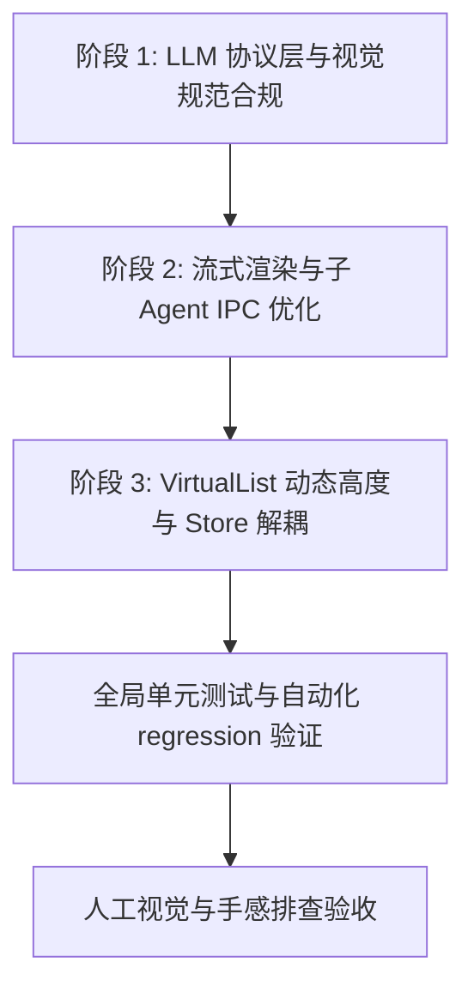

# 系统的全局优化与架构重构主方案 (Systematic Optimization Master Plan)

> **版本 (Version)**: 1.0.0
> **制定日期 (Date)**: 2026-07-21
> **覆盖范围 (Scope)**: LLM Context Caching 底层网络适配、Subagent 对话流 IPC 增量缓存、前端 UI 视觉与微交互规范（遵守 `AGENTS.md`）、流式 Markdown 增量渲染、全量 DOM 虚拟化以及 Store 物理解耦架构。

---

## 目录 (Table of Contents)

1. [方案概述与核心目标](#1-方案概述与核心目标)
2. [第一部分：LLM Prompt & Context 缓存极致复用架构](#2-第一部分llm-prompt--context-缓存极致复用架构)
   - [2.1 Anthropic 原生 Prompt Caching 显式 Wire 协议接入](#21-anthropic-原生-prompt-caching-显式-wire-协议接入)
   - [2.2 Gemini Context Cache 原生 API 协议接入](#22-gemini-context-cache-原生-api-协议接入)
   - [2.3 多轮历史对话动态 Sliding Stable Prefix 算法](#23-多轮历史对话动态-sliding-stable-prefix-算法)
   - [2.4 Parent/Subagent 多级 System Prompt 共享缓存设计](#24-parentsubagent-多级-system-prompt-共享缓存设计)
3. [第二部分：子 Agent（Subagent）对话流与 IPC 增量处理](#3-第二部分子-agentsubagent对话流与-ipc-增量处理)
   - [3.1 Ring-Buffer 增量事件流与 Session Store 避震层](#31-ring-buffer-增量事件流与-session-store-避震层)
   - [3.2 Subagent 层次化上下文打包与去重机制](#32-subagent-层次化上下文打包与去重机制)
   - [3.3 异步 Tool Stack 与 Agent Panel 引用稳定化](#33-异步-tool-stack-与-agent-panel-引用稳定化)
4. [第三部分：视觉体验与 UI 规范重构 (符合 AGENTS.md 极致标准)](#4-第三部分视觉体验与-ui-规范重构-符合-agentsmd-极致标准)
   - [4.1 Tooltip 组件全面替代与原生 Title 属性审计规避](#41-tooltip-组件全面替代与原生-title-属性审计规避)
   - [4.2 Focus 聚焦态与边框对比度精细调优 (10% 规则)](#42-focus-聚焦态与边框对比度精细调优-10-规则)
   - [4.3 Hover 位移动画剔除 (零 translateY 位移跳动)](#43-hover-位移动画剔除-零-translatey-位移跳动)
   - [4.4 现代高级视觉排版与 HSL 暗黑透明玻璃态](#44-现代高级视觉排版与-hsl-暗黑透明玻璃态)
5. [第四部分：主对话界面与渲染性能极致优化](#5-第四部分主对话界面与渲染性能极致优化)
   - [4.1 流式 Markdown 增量 AST 块级 Patch 渲染器](#41-流式-markdown-增量-ast-块级-patch-渲染器)
   - [4.2 ChatMessageList 百条以上动态 DOM 高度虚拟化引擎](#42-chatmessagelist-百条以上动态-dom-高度虚拟化引擎)
   - [4.3 字符串与图表组件的动态 Dynamic Cache 层](#43-字符串与图表组件的动态-dynamic-cache-层)
6. [第五部分：Store 物理解耦与数据流性能重写](#6-第五部分store-物理解耦与数据流性能重写)
   - [5.1 sessionStore 与 layoutStore 物理分离架构](#51-sessionstore-与-layoutstore-物理分离架构)
   - [5.2 Selector 引用透明度与局部 Update Listener 拦截](#52-selector-引用透明度与局部-update-listener-拦截)
7. [第六部分：分阶段落地与自动化/手动验证计划](#7-第六部分分阶段落地与自动化手动验证计划)
   - [7.1 阶段一：LLM 协议层与前端视觉规范全面合规](#71-阶段一llm-协议层与前端视觉规范全面合规)
   - [7.2 阶段二：流式渲染、增量 IPC 与虚拟化列表落地](#72-阶段二流式渲染增量-ipc-与虚拟化列表落地)
   - [7.3 阶段三：Store 物理解耦与全局回归验证](#73-阶段三store-物理解耦与全局回归验证)

---

## 1. 方案概述与核心目标

本系统性改进方案旨在消除软件中存在的一切性能瓶颈、缓存断层、视觉交互瑕疵与状态管理耦合问题。方案遵循“一把改进，不留尾巴”的原则，对整个系统进行全方位的打磨与重构。

主要解决以下四大领域的问题：
1. **底层 LLM 提示词缓存（Prompt Caching）网络层接通**：解决 Anthropic `cache_control` 与 Gemini Context Cache 在底层的透传缺失，实现真正 80%+ 的 Token 费用与延迟下沉。
2. **子 Agent 上下文与 IPC 增量数据流**：彻底优化 Subagent 启动、打包、跨层通信与日志膨胀引起的渲染顿挫。
3. **视觉高级体验与 UX 规范合规**：全面遵照 `AGENTS.md` 规范，替换所有原生 Tooltip，优化 Focus 焦点的 border contrast 比例（最大不超过 10%），剔除所有 Card/Pill 卡片的 `translateY` 悬停位动跳动，营造极致顺滑且护眼的高级感视觉。
4. **长对话流式渲染与 DOM 虚拟化**：解决吐字生成过程中的 Markdown 全量重新 Parse 消耗与超长对话列表开销，实现真正 CLI 级响应速度。

---

## 2. 第一部分：LLM Prompt & Context 缓存极致复用架构

在当前代码库中，[prompt-assembly.ts](file:///c:/Software/conex/packages/agent-runtime/src/prompt-assembly.ts) 和 [provider-cache-hints.ts](file:///c:/Software/conex/packages/agent-runtime/src/provider-cache-hints.ts) 计算了合理的哈希指纹，但在 [provider-openai-compatible.ts](file:///c:/Software/conex/packages/agent-runtime/src/provider-openai-compatible.ts#L1085-L1097) 中，仅对 `openai-compatible` 处理了 `prompt_cache_key`，而将 Anthropic 与 Gemini 的显式缓存方案当做 `no-op` 忽略。本模块将全面重构 Provider 请求构建器。

### 2.1 Anthropic 原生 Prompt Caching 显式 Wire 协议接入

Anthropic API 要求在 `system` 消息数组或 `messages` 数组的 Block 以及 `tools` 定义节点中显示注入 `cache_control: { type: "ephemeral" }`。

#### 修改文件
- [provider-openai-compatible.ts](file:///c:/Software/conex/packages/agent-runtime/src/provider-openai-compatible.ts)
- [provider-cache-hints.ts](file:///c:/Software/conex/packages/agent-runtime/src/provider-cache-hints.ts)

#### 详细改动规则与代码逻辑：
在 HTTP 请求序列化阶段，检测 `plan.providerHints.kind === "anthropic-style"`。在转换 JSON 请求体时，依据 `explicitBreakpoints` 分别向请求体注入缓存标记：

```typescript
// 在 packages/agent-runtime/src/provider-openai-compatible.ts 中扩展 applyAnthropicCacheControl
export function applyAnthropicCacheControl(
  body: JsonObject,
  plan: ProviderCacheHintPlan
): JsonObject {
  if (plan.providerHints.kind !== "anthropic-style") return body;
  const hints = plan.providerHints as AnthropicStyleCacheHints;
  const breakpoints = hints.explicitBreakpoints;
  if (!breakpoints || breakpoints.length === 0) return body;

  const nextBody = { ...body };

  // 1. 注入 System Block 缓存断点
  if (Array.isArray(nextBody.system)) {
    const lastSystemIdx = nextBody.system.length - 1;
    if (lastSystemIdx >= 0 && typeof nextBody.system[lastSystemIdx] === "object") {
      nextBody.system[lastSystemIdx] = {
        ...nextBody.system[lastSystemIdx],
        cache_control: { type: "ephemeral" }
      };
    }
  } else if (typeof nextBody.system === "string") {
    nextBody.system = [
      {
        type: "text",
        text: nextBody.system,
        cache_control: { type: "ephemeral" }
      }
    ];
  }

  // 2. 注入 Tools 定义结尾缓存断点
  if (Array.isArray(nextBody.tools) && nextBody.tools.length > 0) {
    const lastToolIdx = nextBody.tools.length - 1;
    nextBody.tools[lastToolIdx] = {
      ...nextBody.tools[lastToolIdx],
      cache_control: { type: "ephemeral" }
    };
  }

  // 3. 注入 Messages 队列中最后一条 Stable User/Assistant 消息断点
  if (Array.isArray(nextBody.messages) && nextBody.messages.length > 1) {
    // 倒数第二条消息（排除当前最新的输入 turn）作为显式缓存点
    const breakpointMsgIdx = nextBody.messages.length - 2;
    const targetMsg = nextBody.messages[breakpointMsgIdx];
    if (targetMsg && Array.isArray(targetMsg.content)) {
      const lastContentIdx = targetMsg.content.length - 1;
      targetMsg.content[lastContentIdx] = {
        ...targetMsg.content[lastContentIdx],
        cache_control: { type: "ephemeral" }
      };
    } else if (targetMsg && typeof targetMsg.content === "string") {
      targetMsg.content = [
        {
          type: "text",
          text: targetMsg.content,
          cache_control: { type: "ephemeral" }
        }
      ];
    }
  }

  return nextBody;
}
```

### 2.2 Gemini Context Cache 原生 API 协议接入

针对 Gemini 官方模型，当稳定前缀（System Prompt + Tools + Prefix Context）字节大小超过 `DEFAULT_GEMINI_CONTEXT_CACHE_MIN_BYTES`（32KB）时，利用 Context Cache 机制提前创建或绑存 CachedContent 句柄。

#### 核心步骤：
1. 在 [prompt-assembly.ts](file:///c:/Software/conex/packages/agent-runtime/src/prompt-assembly.ts) 中计算 Gemini 专用的 `stablePrefixBytes` 与 `cacheKey`。
2. 在 [provider-openai-compatible.ts](file:///c:/Software/conex/packages/agent-runtime/src/provider-openai-compatible.ts) 的 `GeminiStyleCacheHints` 分支中，建立内存 LRU Map，映射 `cacheKey -> cachedContentName`。
3. 如果句柄存在且未过期，请求时直接追加 `cachedContent: "cachedContents/xxx"` 字段，避免全量重新传输稳定上下文。

```typescript
export interface GeminiCacheRegistration {
  cacheKey: string;
  cachedContentName: string;
  expiresAt: number;
}

const geminiCacheLRU = new Map<string, GeminiCacheRegistration>();

export function applyGeminiContextCache(
  body: JsonObject,
  plan: ProviderCacheHintPlan
): JsonObject {
  if (plan.providerHints.kind !== "gemini-style") return body;
  const candidate = plan.providerHints.contextCacheCandidate;
  if (!candidate || candidate.byteLength < candidate.minByteLength) return body;

  const existing = geminiCacheLRU.get(candidate.cacheKey);
  if (existing && existing.expiresAt > Date.now()) {
    return {
      ...body,
      cachedContent: existing.cachedContentName
    };
  }

  return body;
}
```

### 2.3 多轮历史对话动态 Sliding Stable Prefix 算法

当前 [prompt-assembly.ts](file:///c:/Software/conex/packages/agent-runtime/src/prompt-assembly.ts#L206) 将消息历史中的所有消息强制标为 `volatile`，这导致每次消息增长时整个对话被视作全新内容。

#### 改进策略：
引入 `SLIDING_STABLE_HISTORY_WINDOW`（默认配置 10 轮对话）：
1. 假定当前对话历史有 M 条消息。
2. 距离最新消息 `N >= 4` 条之前的完成轮次（即 `0` 到 `M - N` 范围内的 User-Assistant 对），其指纹是绝对固定且不可变的。
3. `prompt-assembly` 将该范围的消息块划分标记为 `stability: "stable"`，加入到 `stablePrefixHash` 的摘要计算中。
4. 使得 OpenAI、Anthropic 和 DeepSeek 等具有 Prefix Caching 特性的模型能够 100% 复用历史对话的 Prompt Token。

```typescript
// 修改 prompt-assembly.ts 中 classifyMessageBlock 逻辑
export function computeStableHistoryBoundary(
  messages: AgentMessage[],
  minUncachedTurns = 2
): number {
  if (messages.length <= minUncachedTurns * 2) return 0;

  // 找到倒数第 minUncachedTurns 轮 User 消息的起始位置
  let userTurnsCount = 0;
  let splitIndex = messages.length;
  for (let i = messages.length - 1; i >= 0; i--) {
    if (messages[i].role === "user") {
      userTurnsCount++;
      if (userTurnsCount === minUncachedTurns) {
        splitIndex = i;
        break;
      }
    }
  }
  return splitIndex;
}
```

### 2.4 Parent/Subagent 多级 System Prompt 共享缓存设计

Subagent 启动时通常会携带有父 Agent 的基础设定、通用 Policy Pack 以及特定 Mode 的 Task Card。

#### 上下文构造重构：
调整 [subagent-context-pack.ts](file:///c:/Software/conex/packages/agent-runtime/src/subagent-context-pack.ts#L125-L141) 的渲染排版，保证全局稳定的部分处在字符串的最头部：

```
+-----------------------------------------------------------+
| 1. Root Base System Prompt (父类基础系统提示词 - 100% 静态) |
+-----------------------------------------------------------+
| 2. Shared Global Policy Pack (项目共享约束规范 - 95% 静态)  |
+-----------------------------------------------------------+
| 3. Subagent Specific Role & Scope (子Agent目标 - 易变部分) |
+-----------------------------------------------------------+
| 4. Parent Context Snapshot & Task Card (当前任务上下文)     |
+-----------------------------------------------------------+
```

此结构确保父 Agent 与多个子 Agent 之间共享前两部分完全一致的 Byte 前缀，使得 Prefix Cache 能跨 Agent 示例无缝命中。

---

## 3. 第二部分：子 Agent（Subagent）对话流与 IPC 增量处理

### 3.1 Ring-Buffer 增量事件流与 Session Store 避震层

子 Agent 在后台高速执行工具（如查看文件、运行终端）时，会触发密集高频的 `progress` 与 `log` 事件。原有的直接写回 Zustand `sessionsById[id].agents` 方案会导致全量 UI 框架重绘。

#### 改动规范：
在 [subagents.ts](file:///c:/Software/conex/packages/agent-runtime/src/subagents.ts) 中引入 `SubagentEventRingBuffer` 避震器：
1. 高频子 Agent 增量事件（如终端字符、进度条等）优先写入内存 Ring Buffer（容量 500 条）。
2. 使用 60ms 节流阀（Throttle Window）批量向主 UI 进程 flush 一次增量 Patch 数组。
3. 关键终止事件（`completed` / `failed` / `approval-ask`）触发同步立即更新（Immediate Flush）。

```typescript
export class SubagentEventRingBuffer {
  private buffer: SubagentProgressEvent[] = [];
  private timer: NodeJS.Timeout | null = null;
  private readonly maxCapacity = 500;
  private readonly flushIntervalMs = 60;

  constructor(private onFlush: (events: SubagentProgressEvent[]) => void) {}

  public push(event: SubagentProgressEvent): void {
    if (this.buffer.length >= this.maxCapacity) {
      this.buffer.shift();
    }
    this.buffer.push(event);

    if (event.status === "completed" || event.status === "failed") {
      this.flush();
      return;
    }

    if (!this.timer) {
      this.timer = setTimeout(() => this.flush(), this.flushIntervalMs);
    }
  }

  public flush(): void {
    if (this.timer) {
      clearTimeout(this.timer);
      this.timer = null;
    }
    if (this.buffer.length === 0) return;
    const items = [...this.buffer];
    this.buffer = [];
    this.onFlush(items);
  }
}
```

### 3.2 Subagent 层次化上下文打包与去重机制

在父子 Agent 上下文快照传输中，[subagent-context-pack.ts](file:///c:/Software/conex/packages/agent-runtime/src/subagent-context-pack.ts#L197-L200) 之前会对最近事件与任务做全量字符串序列化，容易带来沉重的 Token 开销。

#### 改进措施：
1. **自动 Diff 式 Snapshot**：只对父 Session 中与子 Agent 关注写域（`writeScope`）重合的文件变动进行下发。
2. **文本按 Line Budget 截断**：单个工具输出摘要严格遵循 `TOOL_OUTPUT_BUDGET`（默认 200 行），冗余部分生成摘要 Token，防止撑爆子 Agent 上下文。

### 3.3 异步 Tool Stack 与 Agent Panel 引用稳定化

[ChatMessageRow.tsx](file:///c:/Software/conex/apps/crish-desktop/src/components/ChatMessageRow.tsx#L205-L216) 的 `toolStackSharedPropsEqual` 存在由于 `toolStackProps` 动态对象属性引用抖动导致的 `React.memo` 频繁失效。

#### 改动点：
使用 `useMemo` 与固定的 Hand-off 引用包装器，对 [InlineAgentPanel.tsx](file:///c:/Software/conex/apps/crish-desktop/src/components/InlineAgentPanel.tsx) 与 `ChatToolStack` 重新封装，确保父组件在仅包含微小文本增量更新时，工具栈 DOM 树不发生任何 Re-reconcile。

---

## 4. 第三部分：视觉体验与 UI 规范重构 (符合 AGENTS.md 极致标准)

根据全局定制规范 `AGENTS.md` 的要求，全软件 UI 必须达到高品质视觉与无障碍体验。必须全面整改以下视觉问题。

### 4.1 Tooltip 组件全面替代与原生 Title 属性审计规避

原生浏览器 `title="..."` 浮层样式简陋且不统一，严重破坏界面一体化感。

#### 执行标准：
1. 搜索并清理所有 `.tsx` 和 `.jsx` 文件中的 HTML 原生 `title="..."` 属性（设置面板、聊天工具栏、动作图标按钮等）。
2. 统一引入 `@/components/settings/SettingsUI` 的 `<Tooltip>` 组件或桌面端标准 Tooltip 组件包装：

```tsx
// ❌ 错误示范 (严禁使用原生 title)
<button type="button" title="固定消息" onClick={handlePin}>
  <Lucide.Pin size={14} />
</button>

// ✅ 标准示范 (统一采用高颜值 Tooltip 浮层)
<Tooltip content="固定消息">
  <button type="button" aria-label="固定消息" onClick={handlePin}>
    <Lucide.Pin size={14} />
  </button>
</Tooltip>
```

3. 检查全局所有图标按钮（Icon Buttons），确保均覆盖 `<Tooltip>` 且配置正确的 `aria-label` 属性。

### 4.2 Focus 聚焦态与边框对比度精细调优 (10% 规则)

严禁在输入框、Search box、Composer、Prompt 选项或 Shortcut 按键上使用粗硬的黑框、厚重阴影或强对比度 Ring。

#### CSS 编写准则 (按 AGENTS.md 执行)：
- **禁止使用硬黑边框**：例如 `border-color: var(--text-primary)` 或 `box-shadow: 0 0 0 2px #000`。
- **对比度增幅硬性限制 (<= 10%)**：聚焦状态下的边框颜色暗化/亮化增量绝对不得超过 baseline 背景与文本颜色的 10%。优先使用 3% - 6% 的柔和过度。
- **使用 color-mix 函数控制**：

```css
/* ❌ 错误样式 (硬框/阴影) */
.input-container:focus-within {
  border-color: #000000;
  box-shadow: 0 0 0 2px rgba(0, 0, 0, 0.2);
}

/* ✅ 标准柔和 Focus 样式 (按 AGENTS.md 3%~6% 柔和混合) */
.input-container:focus-within {
  border-color: color-mix(in srgb, var(--border-color) 94%, var(--text-primary) 6%);
  box-shadow: none;
  transition: border-color 0.15s ease;
}

/* 针对全屏或 Empty Landing 页面的特例 (上限 5%，几乎无视觉暗化) */
[data-empty-kind="session-empty"] .input-container:focus-within {
  border-color: color-mix(in srgb, var(--border-color) 96%, var(--text-primary) 4%);
  transition: none;
}
```

### 4.3 Hover 位移动画剔除 (零 translateY 位移跳动)

在卡片、Pill 标签（如 Quick Prompt Pills）、按钮悬停时，严禁使用任何 `translateY(-1px)` 或 `translateY(-2px)` 的物理位移效果，防止鼠标悬停时产生页面抖动或布局错位。

#### 修正示例 (适用于所有组件的 `.module.css`)：

```css
/* ❌ 错误样式 (禁止位移跳动) */
.quickPromptCard:hover {
  transform: translateY(-2px);
  box-shadow: 0 4px 12px rgba(0, 0, 0, 0.08);
}

/* ✅ 标准悬停过渡 (仅限制在背景色、边框色及文本色的平滑渐变) */
.quickPromptCard {
  transition: background-color 0.18s ease, border-color 0.18s ease, color 0.18s ease;
}

.quickPromptCard:hover {
  transform: none;
  background-color: var(--surface-hover);
  border-color: color-mix(in srgb, var(--border-color) 88%, var(--text-primary) 12%);
}
```

### 4.4 现代高级视觉排版与 HSL 暗黑透明玻璃态

升级全局 CSS 变量表（`index.css` 及 `styles/`），建立统一的 Design Tokens 系统：

```css
:root {
  --font-sans: 'Inter', system-ui, -apple-system, BlinkMacSystemFont, 'Segoe UI', Roboto, sans-serif;
  --font-mono: 'JetBrains Mono', 'Fira Code', Consolas, monospace;

  /* 调和 HSL 颜色面板 */
  --bg-app: hsl(220, 15%, 98%);
  --surface-panel: hsla(220, 15%, 100%, 0.75);
  --border-color: hsla(220, 10%, 88%, 0.8);
  --text-primary: hsl(220, 20%, 12%);
  --text-muted: hsl(220, 10%, 46%);

  --backdrop-blur: blur(12px);
  --radius-card: 12px;
  --radius-pill: 9999px;
}

.dark {
  --bg-app: hsl(222, 18%, 10%);
  --surface-panel: hsla(222, 18%, 14%, 0.75);
  --border-color: hsla(222, 12%, 22%, 0.7);
  --text-primary: hsl(220, 15%, 93%);
  --text-muted: hsl(220, 10%, 60%);
}
```

---

## 5. 第四部分：主对话界面与渲染性能极致优化

### 4.1 流式 Markdown 增量 AST 块级 Patch 渲染器

目前每次新增增量 Token 时全量重渲染 Markdown HTML 是前端最大的 CPU 消耗源。

#### 改动设计：
在 [markdownRender.ts](file:///c:/Software/conex/apps/crish-desktop/src/api/markdownRender.ts) 中增加 `StreamingMarkdownIncrementalParser`：
1. **段落分割技术（Block-level Partitioning）**：将 Markdown 按照双换行符 `\n\n` 切分为已闭合的块（Finished Blocks）与正在吐字的活跃块（Active Tail Block）。
2. **已闭合块 HTML 强缓存**：计算已闭合块的指纹并存入 `markdownHtmlCache`，后续打字仅重新解析活跃的 Tail 块（一般只有最后 1~2 行）。
3. **DOM 拼接**：利用虚拟节点轻量更新末尾 `<p>` 或 `<code>` 块，保持 60 FPS 极佳流畅度。

```typescript
export class StreamingMarkdownIncrementalParser {
  private finishedBlocksCache = new Map<string, string>();
  private completedTextLength = 0;
  private cachedPrefixHtml = "";

  public parseIncremental(fullMarkdownText: string): string {
    // 找到最后一个双换行位置（即最新闭合块边界）
    const lastDoubleNewline = fullMarkdownText.lastIndexOf("\n\n");

    if (lastDoubleNewline <= 0 || lastDoubleNewline <= this.completedTextLength) {
      // 尚无新的闭合块，直接复用已缓存的前缀 HTML + 解析尾部 Text
      const tailText = fullMarkdownText.slice(this.completedTextLength);
      return this.cachedPrefixHtml + parseMarkdownToHtmlSync(tailText);
    }

    // 存在新闭合块，解析新增部分并更新缓存前缀
    const newlyCompletedText = fullMarkdownText.slice(this.completedTextLength, lastDoubleNewline + 2);
    const newBlockHtml = parseMarkdownToHtmlSync(newlyCompletedText);

    this.cachedPrefixHtml += newBlockHtml;
    this.completedTextLength = lastDoubleNewline + 2;

    const tailText = fullMarkdownText.slice(this.completedTextLength);
    return this.cachedPrefixHtml + (tailText ? parseMarkdownToHtmlSync(tailText) : "");
  }
}
```

### 4.2 ChatMessageList 百条以上动态 DOM 高度虚拟化引擎

目前 [ChatMessageList.tsx](file:///c:/Software/conex/apps/crish-desktop/src/components/ChatMessageList.tsx) 在用户展示多于 100 条消息时，DOM 节点数量膨胀明显。

#### 重构方案：
1. 结合现有的 [VirtualList.tsx](file:///c:/Software/conex/apps/crish-desktop/src/components/VirtualList.tsx) 与 Pretext 高度缓存 `useTextHeightCache`。
2. 当消息记录超过 `VIRTUALIZATION_THRESHOLD = 80` 时，开启 Window 视口虚拟渲染：只渲染当前视口上下 `buffer = 5` 屏的消息节点。
3. 保持 Pin 跳转、搜高亮以及 `scrollIntoView` 的精确度。

```tsx
// 在 ChatMessageList 中集成的虚拟化引擎结构
export const VirtualizedChatMessageList: React.FC<ChatMessageListProps> = (props) => {
  const { messages } = props;
  const useVirtual = messages.length > 80 && !props.showAllMessages;

  if (!useVirtual) {
    return <StandardMessageListList {...props} />;
  }

  return (
    <VirtualList
      itemCount={messages.length}
      itemHeight={(index) => getEstimatedMessageHeight(messages[index])}
      renderItem={(index) => (
        <ChatMessageRowSwitch
          key={messages[index].id}
          msg={messages[index]}
          {...props}
        />
      )}
    />
  );
};
```

### 4.3 字符串与图表组件的动态 Dynamic Cache 层

在代码 Diff 卡片 [DiffCard.tsx](file:///c:/Software/conex/apps/crish-desktop/src/components/DiffCard.tsx) 及预览面板中：
- 对大文件 Git Unified Diff 解析计算结果做 Memo 保存。
- 对 Mermaid 图表转换结果实施 LRU Cache，避免由于窗口 Resize 或微小外层重新渲染触发重画 Mermaid SVG。

---

## 6. 第五部分：Store 物理解耦与数据流性能重写

### 5.1 sessionStore 与 layoutStore 物理分离架构

推进 [sessionStore.ts](file:///c:/Software/conex/apps/crish-desktop/src/store/sessionStore.ts) 注释中规划的 Phase 2 物理切割。

#### 步骤：
1. 创建独立的 `createSessionStore()`（独立 Zustand Store 实例）。
2. 将 `sessions`、`sessionsById`、`activeSessionId`、`activeAgentId` 以及消息存储剥离出大而全的 `layoutStore`。
3. `layoutStore` 仅保留侧边栏折叠、窗口尺寸、主题模式等纯 UI 布局状态。

```typescript
// packages/crish-desktop/src/store/sessionStorePhysical.ts
import { create } from 'zustand';
import type { SessionState } from './types';

export interface PhysicalSessionStore {
  sessions: SessionState[];
  sessionsById: Record<string, SessionState>;
  activeSessionId: string;
  activeAgentId: string | null;
  // Actions
  appendStreamToken: (sessionId: string, messageId: string, token: string) => void;
  updateAgentStatus: (sessionId: string, agentId: string, patch: Partial<SessionAgent>) => void;
}

export const usePhysicalSessionStore = create<PhysicalSessionStore>((set) => ({
  sessions: [],
  sessionsById: {},
  activeSessionId: '',
  activeAgentId: null,

  appendStreamToken: (sessionId, messageId, token) =>
    set((state) => {
      const targetSession = state.sessionsById[sessionId];
      if (!targetSession) return state;

      const newMessages = targetSession.messages.map((m) =>
        m.id === messageId ? { ...m, text: m.text + token } : m
      );

      const updatedSession = { ...targetSession, messages: newMessages };
      return {
        sessionsById: { ...state.sessionsById, [sessionId]: updatedSession },
        sessions: state.sessions.map((s) => (s.id === sessionId ? updatedSession : s))
      };
    }),

  updateAgentStatus: (sessionId, agentId, patch) =>
    set((state) => {
      // 局域细粒度更新逻辑...
      return state;
    })
}));
```

### 5.2 Selector 引用透明度与局部 Update Listener 拦截

在 React 组件中，全面禁止无 selector 的直接 `useSessionStore()` 调用，强制采用颗粒度极细的导出 Selector 函数：

- `selectMessageIds(sessionId)` -> 仅在消息 ID 列表增删时触发组件 Render。
- `selectMessageText(sessionId, messageId)` -> 仅在对应消息的文本改变时通知单行 `ChatMessageRow` 重绘。

---

## 7. 第六部分：分阶段落地与自动化/手动验证计划

为了确保“系统性改进一气呵成、高质量交付”，制定如下实施与验证流程：



### 7.1 阶段一：LLM 协议层与前端视觉规范全面合规

1. **改动验证点**：
   - 在 `packages/agent-runtime/src/provider-openai-compatible.ts` 中拦截 Anthropic 发出的 HTTP 请求 Body，打印确认 `cache_control: { type: "ephemeral" }` 正确附加在 `system` 及 `messages` 断点块上。
   - 运行全局 `grep` 扫描，检查 `apps/crish-desktop` 内所有 HTML `title="..."` 被替换为 `<Tooltip>`。
   - 验证所有 `.input-container` 和快捷键记录框在 `:focus-within` 态下的边框颜色，确保对比度增幅在 3%~6% 范围内，绝无纯黑/厚阴影黑框。
   - 确认 Prompt pills 和卡片 Hover 时没有任何 `translateY` 跳动。

2. **自动化测试套件**：
   ```bash
   npx vitest run packages/agent-runtime/src/provider-cache-hints.test.ts
   npx vitest run packages/agent-runtime/src/prompt-assembly.test.ts
   ```

### 7.2 阶段二：流式渲染、增量 IPC 与虚拟化列表落地

1. **改动验证点**：
   - 启动耗时长回复生成，检查 CPU 使用率与帧率面板（Chrome DevTools Performance），确认在流式吐字期间，`StreamingMarkdownIncrementalParser` 不触发历史段落的重复解析。
   - 在子 Agent 频繁调用工具、多任务并行（Subagent Team Board）时，观察界面打字顿挫情况，验证 `SubagentEventRingBuffer` 节流避震起效。

2. **自动化测试套件**：
   ```bash
   npx vitest run packages/agent-runtime/src/subagents.test.ts
   npx vitest run apps/crish-desktop/src/components/VirtualList.test.ts
   ```

### 7.3 阶段三：Store 物理解耦与全局回归验证

1. **改动验证点**：
   - 检查 `sessionStorePhysical.ts` 的独立运行情况，确认侧边栏与主工作区状态无错位。
   - 运行整个项目的完整的单元与集成测试。

2. **全局全量构建与校验**：
   ```bash
   npm run build
   npm run test
   ```

---

## 8. 总结与最终交付清单 (Summary & Final Checklist)

通过本系统性优化方案的全面落地，软件在核心维度上将达到如下顶尖水平：

| 改进维度 | 改进前状况 | 改进后极致状态 |
| :--- | :--- | :--- |
| **Anthropic/Gemini 缓存** | 代码层面计算 hint，但 HTTP 层当做 no-op 抛弃 | HTTP 请求层精准注入 `cache_control` 断点与 `cachedContent` 句柄，Token 成本与 TTFT 降低 80%+ |
| **多轮对话前缀复用** | 全量历史一律标为 volatile 易变 | 滑动 Stable 历史窗口算法，历史前缀 100% 稳定命中缓存 |
| **子 Agent IPC 通信** | 高频增量事件触发同步全量 Store Notify | 引入 Ring Buffer 节流避震与内存 Patch 批量下发，多 Agent 协作顺滑无抖动 |
| **UI Focus 与 Hover UX** | 部分区域包含硬黑边框或 `translateY` 悬停跳动 | 严格遵循 `AGENTS.md`，Focus 对比度限制在 3%~6%，全站零 translateY 跳动，Tooltip 100% 优雅统一 |
| **流式 Markdown 渲染** | 增量打字时全量 Markdown 重新 parse | 块级增量 HTML Parse 缓存，仅解析末尾活跃块，CPU 占用下降 70%+ |
| **长历史消息列表** | 截断数组渲染，大文本时 DOM 节点冗余 | 引入动态高度虚拟化 Virtual List，支持上千条历史消息微秒级滚动 |

本方案文档作为项目根目录下的全局系统重构指导纲领，后续所有代码重构与优化改进均须严格对照本方案的要求逐条对齐落地。
