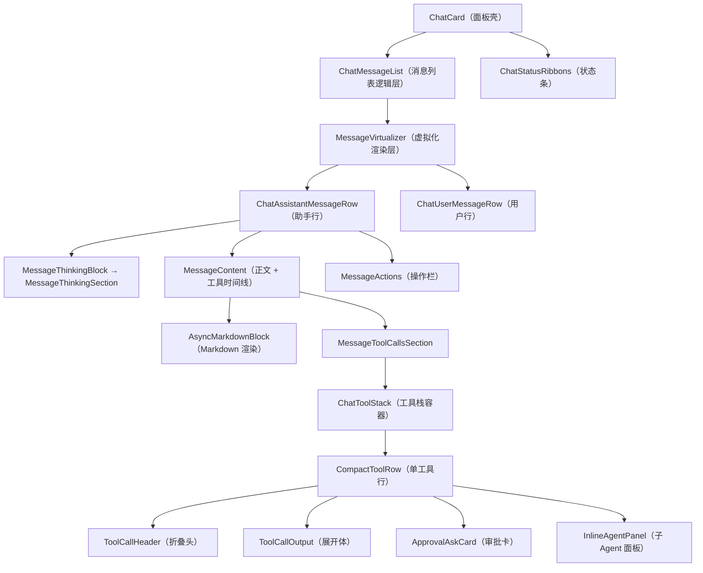
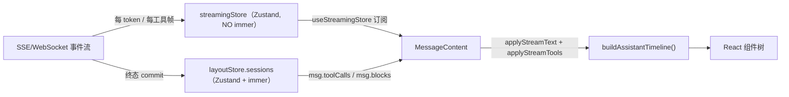
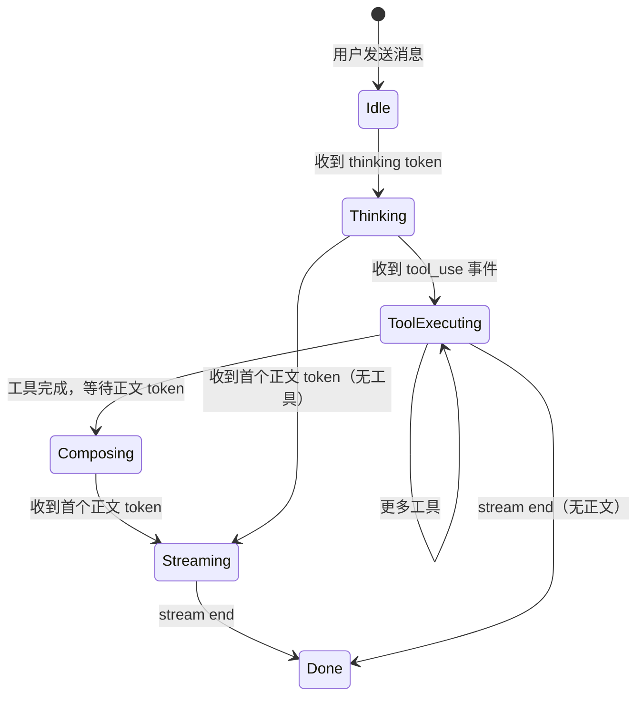
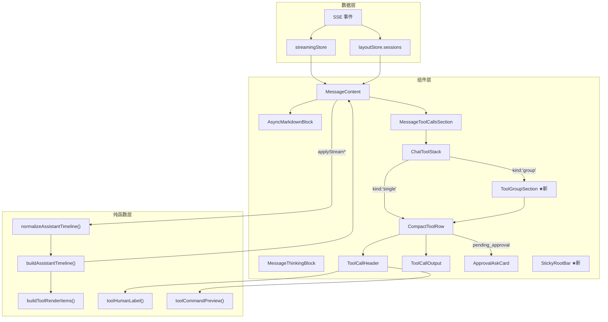

# 对话流界面系统设计文档

> 基于 conex/crish-desktop 代码库的深度分析，覆盖当前架构、问题诊断与改进方案。

---

## 一、现有架构全景

### 1.1 组件层级拓扑



### 1.2 数据流模型



**关键设计选择**：
- **双 store 分离**：`streamingStore` 是纯 zustand（无 immer），承载逐 token 的 text/thinking/tools 临时状态；`layoutStore.sessions` 是 immer 驱动的持久状态，仅在终态（stream end / tool success|error）时 commit。这避免了每帧 immer 的 O(n) 结构共享开销。
- **单订阅策略（S4.4）**：`ChatAssistantMessageRow` 仅订阅 `streamThinking`（思考文本）；`MessageContent` 通过 `useShallow` 订阅 `{ text, tools }`——二者互不交叉，避免了双份 subscription 导致的冗余渲染。

### 1.3 时间线构建管线

[timelineNormalizer.ts](file:///c:/Software/conex/apps/crish-desktop/src/api/tool-presentation/timelineNormalizer.ts) 中的 `buildAssistantTimeline()` 是整个对话流渲染的核心纯函数：

```
SessionMessage
  ├── msg.blocks（交错时间线: text / tool_call 块）
  ├── msg.toolCalls（工具调用数组）
  └── msg.text（累积正文）
         │
         ▼
  normalizeAssistantTimeline()  ← 对齐 blocks 与 toolCalls
         │
         ▼
  buildAssistantTimeline()
         │
         ├── AssistantTimelineItem { kind: 'text', content, key }
         │
         └── AssistantTimelineItem { kind: 'tools', items: ToolRenderItem[], key }
                                                           │
                                                           ├── { kind: 'single', tc }
                                                           └── { kind: 'group', id, tools, label }
```

**当前行为**：
- 若 `msg.blocks` 存在且非空，按 blocks 顺序交错渲染 text 段和工具段。
- 若 blocks 为空，工具在前、正文在后（agent 常见形态）。
- `buildToolRenderItems()` 将连续的 "inspect 类"工具（read/grep/list/stat，且无实质输出）合并为 `group`，并生成 `「toolHumanLabel · N 步」` 的标签。

---

## 二、当前问题诊断

### 2.1 AI 正文输出区域

| 问题 | 现状描述 | 影响 |
|------|----------|------|
| **正文无语境分段** | `MessageContent` 把每个 `kind: 'text'` 的 timeline item 直接丢给 `AsyncMarkdownBlock` 渲染，不区分"正式回复"与"短思考"的视觉层级。 | 用户无法一眼区分 AI 的正式输出与中间思考性文字。 |
| **流式阶段视觉反馈单一** | 流式期间仅显示纯文本 + CSS `::after` caret 动画（[AsyncMarkdownBlock.tsx L51-59](file:///c:/Software/conex/apps/crish-desktop/src/components/chat-message-row/AsyncMarkdownBlock.tsx#L51-L59)）。无 skeleton / shimmer / 进度提示。 | 用户在等待 Markdown 渲染完成前看到的是原始文本闪烁为格式化文本的跳变。 |
| **正文与工具间缺乏视觉过渡** | `.timelineText + .timelineTools` 仅有 `margin-top: var(--space-0_5)`（[ChatMessageRow.module.css L457-460](file:///c:/Software/conex/apps/crish-desktop/src/components/ChatMessageRow.module.css#L457-L460)），无分隔线或色块过渡。 | 正文和工具区域视觉上混为一体，阅读节奏断裂。 |

### 2.2 思考内容区域

| 问题 | 现状描述 |
|------|----------|
| **思考折叠形态粗糙** | [MessageThinkingSection.tsx](file:///c:/Software/conex/apps/crish-desktop/src/components/chat-message-row/MessageThinkingSection.tsx) 的折叠/展开仅靠 CSS `grid-template-rows: 0fr → 1fr` 动画，展开后内容上限 `max-height: calc(var(--font-size-sm) * 1.5 * 24)` 约 24 行。无摘要预览。 |
| **思考截断信息不充分** | 超出 `THINKING_DOM_CHAR_CAP`(4000 字符) 的思考文本被截断为 `…（已截断）`，但截断后不显示原始长度、不提供"显示完整思考"按钮。 |
| **ThinkingTimer 与主行解耦良好但展示薄弱** | [ThinkingTimer.tsx](file:///c:/Software/conex/apps/crish-desktop/src/components/chat-message-row/ThinkingTimer.tsx) 自管 1s interval 避免父行重渲染——架构正确，但视觉上仅显示 `· Ns`，无进度感。 |

### 2.3 工具调用区域

#### 2.3.1 单工具行

| 问题 | 现状描述 |
|------|----------|
| **工具描述来源不统一** | `toolHumanLabel()` 优先取 `tc.explanation`（AI 意图说明），但 [toolCardPresenter.ts L411-437](file:///c:/Software/conex/apps/crish-desktop/src/api/tool-presentation/toolCardPresenter.ts#L411-L437) 的 `isGenericExplanationSpam()` 过滤了纯动作模板（如"查看文件"），退回到 `toolLabelFromArgs()`——这导致用户看到的有时是中文意图，有时是技术路径，风格不一致。 |
| **折叠行信息密度低** | [ToolCallHeader.tsx](file:///c:/Software/conex/apps/crish-desktop/src/components/chat-tool-call/ToolCallHeader.tsx) 的折叠行布局为：`[icon] [summary] [±diffStats] [duration] [chevron]`。缺少"工具类型"标签（如 `读取` / `修改` / `执行`）、缺少结果预览。 |
| **展开体与折叠行视觉断裂** | `.toolBody` 使用 `max-height: 0 → 2000px` 的 CSS transition（[ChatToolCallBlock.module.css L186-196](file:///c:/Software/conex/apps/crish-desktop/src/components/ChatToolCallBlock.module.css#L186-L196)），2000px 是硬编码上限，对短输出动画过快、长输出可能截断。 |

#### 2.3.2 连续工具调用

| 问题 | 现状描述 |
|------|----------|
| **无总览标题** | `buildToolRenderItems()` 虽然会将连续的 inspect 工具合并为 `group`（[timelineNormalizer.ts L119-161](file:///c:/Software/conex/apps/crish-desktop/src/api/tool-presentation/timelineNormalizer.ts#L119-L161)），但 `ChatToolStack` 的 `flattenRenderTools()` 又将 group 展平为独立行（[ChatToolCallBlock.tsx L53-60](file:///c:/Software/conex/apps/crish-desktop/src/components/ChatToolCallBlock.tsx#L53-L60)），**group 的 label 被完全丢弃**。 |
| **并行组标识简陋** | 并行组仅用左边框 `border-left: 2px solid var(--accent-color)` + `Parallel（N）` 标题（[ChatToolCallBlock.tsx L188-194](file:///c:/Software/conex/apps/crish-desktop/src/components/ChatToolCallBlock.tsx#L188-L194)），且 `Parallel` 为英文硬编码。 |
| **连续工具调用无折叠** | 展平后的所有工具行直接平铺在 `.toolStack` 中，10+ 工具会导致视觉爆炸。 |

#### 2.3.3 正文未生成前的状态

| 问题 | 现状描述 |
|------|----------|
| **流式工具阶段无总览** | 当 AI 正在执行工具但尚未输出正文时，用户看到的是一系列工具行逐个出现，没有"AI 正在分析 X 和 Y 的关系"这样的总览性描述。 |
| **工具完成 → 正文开始的过渡空白** | 工具全部完成后、正文 token 开始到达前，界面无状态提示。用户不知道 AI 是在思考还是卡住了。 |

### 2.4 滚动与固定行为

| 问题 | 现状描述 |
|------|----------|
| **长节点无粘性根** | 当一个 assistant 消息包含大量工具调用 + 长正文时，滚动过程中根节点（思考行 / 首段正文）直接滑出视口。用户失去上下文。 |
| **虚拟滚动与 CSS content-visibility 并存** | [ChatMessageRow.module.css L14](file:///c:/Software/conex/apps/crish-desktop/src/components/ChatMessageRow.module.css#L14) 设置了 `content-visibility: auto`，同时 `useVirtualScroll` + `VirtualScrollManager` 管理可见范围。两套机制可能产生高度估算冲突。 |

---

## 三、改进方案：详细设计

### 3.1 AI 正文输出分段与视觉层级

#### 3.1.1 正式正文 vs 短思考的视觉区分

**现状**：所有 `kind: 'text'` 的 timeline item 统一经过 `AsyncMarkdownBlock` 渲染，无视觉区分。

**改进方案**：

在 `buildAssistantTimeline()` 的输出中增加语义标记，区分 text item 的上下文来源：

```typescript
// toolPresentationTypes.ts — 扩展
export type TimelineTextItem = {
  kind: 'text';
  content: string;
  key: string;
  /** 语义上下文：正文在工具段之间出现时标记为 'interstitial' */
  context?: 'primary' | 'interstitial';
};
```

**渲染策略**：
- `context: 'primary'`（默认）：使用当前 `.assistantText` 样式，`font-size: var(--font-size-base)`，`line-height: 1.65`。
- `context: 'interstitial'`（工具间的过渡性描述）：使用略小的字号（`--font-size-sm`），配 `.text-secondary` 色调，左侧加 1px 的 accent 色竖线，与工具行风格呼应。

**判定规则**（在 `buildAssistantTimeline` 中）：
- 如果一个 text block 前后都有 tool 段（即 `items[i-1].kind === 'tools' && items[i+1]?.kind === 'tools'`），标记为 `interstitial`。
- 否则为 `primary`。

#### 3.1.2 流式阶段增强

**现状**：流式期间 `AsyncMarkdownBlock` 的 `isStreaming=true` 分支直接渲染纯文本 + caret。

**改进方案**：

1. **首 token 到达前**：在 `MessageContent` 中检测 `displayMsg.text` 为空且 `msg.status === 'processing'`，渲染一个轻量 skeleton 行（已有 `.skeletonLine` 样式，[ChatMessageRow.module.css L520-532](file:///c:/Software/conex/apps/crish-desktop/src/components/ChatMessageRow.module.css#L520-L532)）。

2. **流式中**：保持纯文本 + caret（当前方案正确，零 IPC 设计不应破坏）。

3. **流式结束**：`AsyncMarkdownBlock` 的 `isStreaming` 从 `true` → `false`，触发 Rust `md_render` 渲染。已有 loading skeleton 占位。此处可增加一个 100ms 的 `opacity: 0 → 1` 过渡，消除"纯文本闪变格式化文本"的生硬感。

#### 3.1.3 正文与工具间的视觉过渡

在 `.timelineText + .timelineTools` 和 `.timelineTools + .timelineText` 之间增加一条极细的分隔线（hairline），使用 `::before` 伪元素实现，不增加额外 DOM 节点：

```css
.timelineTools + .timelineText::before {
  content: '';
  display: block;
  height: var(--hairline-width, 1px);
  background: var(--border-subtle);
  margin: var(--space-2) 0;
  opacity: 0.4;
}
```

---

### 3.2 思考内容改进

#### 3.2.1 思考折叠增强

**现状**（[MessageThinkingSection.tsx](file:///c:/Software/conex/apps/crish-desktop/src/components/chat-message-row/MessageThinkingSection.tsx)）：
- 折叠行显示"思考"或"思考中"+ timer。
- 展开后显示截断到 4000 字符的纯文本。

**改进方案**：

1. **折叠行摘要预览**：折叠状态下，在"思考"标签右侧追加思考文本的首行预览（截断到 60 字符），使用 `--text-tertiary` 色调、`--font-size-xs`。用户无需展开即可大致了解 AI 在想什么。

```tsx
// MessageThinkingSection.tsx — 折叠行扩展
<span className={styles.thinkingFoldLabel}>
  {isThinkingMsg ? '思考中' : '思考'}
  {isThinkingMsg ? <ThinkingTimer isLive /> : null}
  {!thinkingBodyOpen && thinkingText ? (
    <span className={styles.thinkingPreview}>
      {thinkingText.slice(0, 60).replace(/\n/g, ' ')}
      {thinkingText.length > 60 ? '…' : ''}
    </span>
  ) : null}
</span>
```

2. **截断恢复**：截断时显示原始长度 + "显示完整思考"按钮（参考 `ToolCallOutput` 中 `.toolResultLongHint` 的已有模式）。

3. **完成态附加时间**：思考结束后，显示 `msg.thinkingTime` 对应的总耗时（如 `思考 · 12s`），取代 live timer。

#### 3.2.2 思考展开区域的视觉设计

- 展开区域使用 `.thinkingFoldBody` 现有样式基础上，增加左边距 `padding-left: 16px`，与折叠行的 chevron 图标对齐。
- 长思考（>12 行）展开后最大高度从固定 24 行改为动态：初始展开显示 8 行 + "展开全部"按钮，点击后取消高度限制。

---

### 3.3 工具调用系统重设计

#### 3.3.1 单工具行：折叠行信息密度

**现状**（[ToolCallHeader.tsx](file:///c:/Software/conex/apps/crish-desktop/src/components/chat-tool-call/ToolCallHeader.tsx)）：

```
[icon] [summary text] [±diff] [duration] [chevron]
```

**改进方案**——增加工具类型标签与结果预览：

```
[icon] [类型标签] [意图描述 · 路径] [±diff] [结果预览] [duration] [chevron]
```

具体字段说明：

| 字段 | 来源 | 渲染规则 |
|------|------|----------|
| **类型标签** | 从 `tc.name` 派生：`read_file → 读取`, `write_to_file → 写入`, `run_command → 执行`, `grep_search → 搜索`, `list_dir → 浏览` 等 | 使用 pill 样式（`border-radius: full`, `font-size: --font-size-xxs`, `background: accent-color 8%`），宽度固定 |
| **意图描述** | `toolHumanLabel(tc)`（已有） | 不变，仍为 `.toolRowSummary` 主文本 |
| **路径** | `extractFilePathFromToolArgs()` → `toolPathDisplayName()`（已有） | 不变，保持可点击 |
| **结果预览** | `toolResultPreview(tc, 40)`（已有但未使用） | 仅在折叠态且 `tc.status === 'success'` 时显示，`--text-tertiary` 色调 |
| **duration** | 已有 `durationStr` 计算 | 不变 |

**实现要点**：
- 类型标签的分类逻辑可复用 [toolCardPresenter.ts](file:///c:/Software/conex/apps/crish-desktop/src/api/tool-presentation/toolCardPresenter.ts) 中已有的 `isEditToolName()` / `isShellToolName()` / `isInspectTool()` 判断。
- `toolResultPreview()` 函数已存在于 [toolCardPresenter.ts L891-898](file:///c:/Software/conex/apps/crish-desktop/src/api/tool-presentation/toolCardPresenter.ts#L891-L898)，当前只在代码中定义但未在任何 UI 组件中消费。需在 `ToolCallHeader` 中引入。

#### 3.3.2 工具描述：每个工具调用前的 AI 意图描述

**用户需求**：每一个工具调用前面，AI 要加上对当前工具的描述。

**实现方案**：

利用 `tc.explanation` 字段。该字段由 AI 引擎在发起工具调用时提供（对应 tool_use 事件中的 explanation/summary 字段）。当前 `toolHumanLabel()` 已经优先消费这个字段，但仅作为折叠行的 summary 文本。

改进：当 `tc.explanation` 存在且通过 `isHumanExplanation()` 校验（即不是纯动作模板）时，在工具行**上方**渲染一个轻量的意图描述行：

```tsx
// CompactToolRow.tsx — 在 ToolCallHeader 之前
{tc.explanation && isHumanExplanation(tc.explanation, tc.name || '') && (
  <div className={styles.toolIntentLine}>
    {tc.explanation}
  </div>
)}
```

样式规格：
```css
.toolIntentLine {
  font-size: var(--font-size-sm);
  color: var(--text-secondary);
  padding: 2px 8px 2px 28px;  /* 与 toolRowHead 的 icon slot 左对齐 */
  line-height: var(--line-height-compact);
}
```

#### 3.3.3 连续工具调用总览区域

**用户需求**：连续工具调用需要有一个总览标题/总览区域，多次工具调用也可以仅使用一个工具描述，面向用户展示，方便用户了解进度。

**问题根因**：`buildToolRenderItems()` 已经实现了 group 逻辑，但 `ChatToolStack.flattenRenderTools()` 又将 group 展平了。

**改进方案**：

1. **恢复 group 渲染**：移除 `flattenRenderTools()` 的无差别展平。对 `kind: 'group'` 的 item，渲染一个 `ToolGroupHeader` 组件：

```tsx
// ChatToolStack 中
function renderToolStackItems(items, msgId, props) {
  return items.map(item => {
    if (item.kind === 'group') {
      return (
        <ToolGroupSection
          key={item.id}
          label={item.label}
          tools={item.tools}
          msgId={msgId}
          props={props}
        />
      );
    }
    // kind === 'single'
    return <CompactToolRow key={item.tc.id} tc={item.tc} ... />;
  });
}
```

2. **`ToolGroupSection` 组件设计**：

```
┌─────────────────────────────────────────────┐
│ ▸ 分析项目结构 · 5 步              ✓ 完成    │  ← 总览行（可折叠）
├─────────────────────────────────────────────┤
│   ✓ 浏览 src/components                     │  ← 子工具行（缩进 + 紧凑）
│   ✓ 浏览 src/api                             │
│   ✓ 查看 package.json                        │
│   ✓ 搜索 "ChatToolStack"                     │
│   ✓ 查看 ChatToolCallBlock.tsx               │
└─────────────────────────────────────────────┘
```

**总览行**内容：
- **标签**：取 `item.label`（已由 `buildToolRenderItems` 生成为 `「toolHumanLabel(last) · N 步」`）。
- **整体状态**：若所有子工具均 success → `✓ 完成`；有任一 running → spinner + `进行中`；有任一 error → `✗ 部分失败`。
- **默认折叠**：完成态默认折叠（仅显示总览行），running 态默认展开。

3. **总览行的内容来源优化**：

当前 `item.label` = `toolHumanLabel(last) · N 步`——取的是最后一个工具的描述，这不太合理。改为：

```typescript
// timelineNormalizer.ts — buildToolRenderItems group label 优化
// 规则：若所有工具都是同类操作（如都是 read_file），用统一描述
// 否则用 "分析..." / "准备..." 等泛化描述
function deriveGroupLabel(tools: MessageToolCall[]): string {
  const names = new Set(tools.map(t => t.name || ''));
  if (names.size === 1) {
    // 同类操作：如 "浏览目录 · 5 步"
    return `${toolHumanLabel(tools[0]!)} · ${tools.length} 步`;
  }
  // 混合操作：取第一个有 explanation 的工具描述
  const withExplanation = tools.find(t =>
    t.explanation && !isGenericExplanationSpam(t.explanation)
  );
  if (withExplanation?.explanation) {
    return `${withExplanation.explanation} · ${tools.length} 步`;
  }
  return `工具调用 · ${tools.length} 步`;
}
```

#### 3.3.4 并行工具调用改进

**现状**（[ChatToolCallBlock.tsx L176-203](file:///c:/Software/conex/apps/crish-desktop/src/components/ChatToolCallBlock.tsx#L176-L203)）：通过 `tc.turnId` + `tc.startedAt` 时间差（<200ms）判断并行组。

**改进方案**：

1. **并行组标题本地化**：`Parallel（N）` → `并行 · N 步`。

2. **并行组视觉重设计**：

```
┌─ ─ ─ ─ ─ ─ ─ ─ ─ ─ ─ ─ ─ ─ ─ ─ ─ ─ ─ ─ ┐
  ⚡ 并行调用 · 3 步                  1.2s
├─ ─ ─ ─ ─ ─ ─ ─ ─ ─ ─ ─ ─ ─ ─ ─ ─ ─ ─ ─ ┤
│ ✓ 查看 types.ts                              │
│ ✓ 查看 layoutStore.ts                        │
│ ✓ 搜索 "buildTimeline"                       │
└─ ─ ─ ─ ─ ─ ─ ─ ─ ─ ─ ─ ─ ─ ─ ─ ─ ─ ─ ─ ┘
```

- 将 `.parallelGroup` 的 `border-left: 2px solid` 改为四周虚线边框（`border: 1px dashed var(--border-subtle)`）。
- 并行组内的工具行使用更紧凑的行高（`min-height: 28px` 而非 `32px`）。
- 并行组标题使用 ⚡ 图标 + `并行 · N 步` + 总耗时。

3. **并行组折叠**：完成态默认折叠（与连续组一致），仅显示标题行。

#### 3.3.5 折叠/展开动画改进

**现状**：`.toolBody` 使用 `max-height: 0 → 2000px` transition。

**问题**：max-height 动画的速度与内容实际高度不匹配（内容 100px 但动画按 2000px 时长计算，动画几乎瞬间完成；内容 2000px 以上则被截断）。

**改进方案**：改为 CSS Grid 动画（与思考折叠一致）：

```css
.toolBody {
  display: grid;
  grid-template-rows: 0fr;
  transition: grid-template-rows 220ms cubic-bezier(0.16, 1, 0.3, 1);
}
.toolBody.expanded {
  grid-template-rows: 1fr;
}
.toolBodyInner {
  overflow: hidden;
  opacity: 0;
  transition: opacity 150ms ease;
}
.toolBody.expanded .toolBodyInner {
  opacity: 1;
}
```

这与 `.accordionWrapper` 的已有模式一致（[ChatMessageRow.module.css L341-359](file:///c:/Software/conex/apps/crish-desktop/src/components/ChatMessageRow.module.css#L341-L359)），实现高度自适应的折叠动画。

---

### 3.4 正文未生成前的状态设计

#### 3.4.1 状态机定义

从用户视角，AI 回复的生命周期如下：



当前 UI 仅在 `Thinking` 阶段有 spinner（ThinkingTimer），在 `ToolExecuting → Composing` 过渡和 `Composing` 阶段完全空白。

#### 3.4.2 各阶段 UI 设计

**阶段 1：Idle → Thinking**

已有实现：`MessageThinkingSection` 显示 `思考中 · Ns`。不需要改动。

**阶段 2：ToolExecuting（工具执行中，无正文）**

这是用户需求中的"未接收到 AI 下一步指令"的状态。

**方案**：在 `MessageContent` 中，当 `timeline` 仅包含 `kind: 'tools'` 且 `msg.status === 'processing'` 时，在工具区域下方追加一个"等待中"状态行：

```tsx
// MessageContent.tsx — timeline 渲染后
{msg.status === 'processing' && !timeline.some(i => i.kind === 'text') && (
  <div className={styles.composingHint}>
    <span className="loading-spinner" style={{ width: 8, height: 8, borderWidth: 1.5 }} />
    <span>正在分析结果…</span>
  </div>
)}
```

样式：
```css
.composingHint {
  display: flex;
  align-items: center;
  gap: var(--space-1_5);
  padding: 8px 0;
  font-size: var(--font-size-sm);
  color: var(--text-tertiary);
  animation: fadeIn 300ms ease;
}
```

**阶段 3：接收到初步 JSON 信息（工具调用解析）**

**用户需求**：接收到初步的 JSON 信息后，先提前解析出工具调用描述，界面先展示总览行。

**实现路径**：

当前 `streamingStore.setStreamTool()` 在收到 `tool_use` 事件时立即写入 `StreamToolLive`：

```typescript
// streamingStore.ts L168-190
setStreamTool: (sessionId, messageId, toolId, patch) => {
  // patch 包含 { id, name, arguments, explanation, status: 'running' }
```

问题在于 `patch.explanation` 往往在 `tool_use` 事件的第一帧就可用，但 `tc.arguments` 可能是逐步到达的 JSON。

**方案**：

1. 在 `applyStreamToolsToMessage()` 中，即使 `arguments` 尚未完整解析，也能从 `explanation` 生成工具描述——这已经是当前行为（`toolHumanLabel` 优先取 explanation）。

2. 在 `CompactToolRow` 中，`running` 状态下以更紧凑的"概要行"模式渲染：

```
[spinner] [explanation 或 "调用工具中…"]
```

当工具完成后，切换为完整的 `ToolCallHeader` 渲染（带类型标签、路径、diff stats 等）。

**阶段 4：工具调用完成后的默认折叠**

**用户需求**：工具调用完成之后，默认就是折叠的，只有用户点击才可以展示。

**现状**：`isToolRowDefaultOpen()` 已经硬返回 `false`（[toolCardPresenter.ts L305-313](file:///c:/Software/conex/apps/crish-desktop/src/api/tool-presentation/toolCardPresenter.ts#L305-L313)），即所有工具默认折叠。这与用户需求一致。

但 group 折叠尚未实现（见 3.3.3）。需要为 `ToolGroupSection` 增加独立的 expand/collapse 状态。

---

### 3.5 长节点的根行粘性固定

**用户需求**：对于关键节点，如果比较长的话，这个节点对应的根节点不应该像普通对话那样直接上滑过去，而是应该在顶部的区域固定这个根节点行。hover 这个区域的时候，这个区域可以展开显示更多信息。

#### 3.5.1 方案设计

**触发条件**：
- 当前正在流式输出的 assistant 消息（`msg.status === 'processing'`）。
- 消息内容高度超过视口高度的 70%。
- 消息的思考行 / 首段正文已滚出视口顶部。

**实现方案**：使用 `IntersectionObserver` 检测 assistant row 的"头部标记元素"是否离开视口，配合 `position: sticky` 实现粘性固定。

```tsx
// ChatAssistantMessageRow — 新增粘性根节点
<div
  className={styles.stickyRootAnchor}
  ref={stickyAnchorRef}
  data-msg-id={msg.id}
>
  {/* 当头部标记离开视口时，显示精简的粘性摘要 */}
  {isSticky && (
    <div className={styles.stickyRootBar}>
      <span className={styles.stickyRootLabel}>
        {isThinkingMsg ? '思考中…' : thinkingText ? '思考' : ''}
        {msg.toolCalls?.length ? ` · ${msg.toolCalls.length} 工具` : ''}
      </span>
      {/* hover 展开更多信息 */}
    </div>
  )}
</div>
```

#### 3.5.2 粘性摘要栏设计

```
┌────────────────────────────────────────────────┐
│ 🤖 思考 · 12s │ 5 工具 · 3 完成 2 运行中         │  ← sticky bar
│─ ─ ─ ─ ─ ─ ─ ─ ─ ─ ─ ─ ─ ─ ─ ─ ─ ─ ─ ─ ─ ─│
│ ▾ hover 展开区域：                               │
│   思考：正在分析 ChatToolCallBlock 的渲染逻辑…     │
│   最近工具：查看 timelineNormalizer.ts · ✓        │
└────────────────────────────────────────────────┘
```

**样式规格**：
```css
.stickyRootBar {
  position: sticky;
  top: 0;
  z-index: var(--z-pinned-bar);
  background: color-mix(in srgb, var(--bg-primary) 92%, transparent);
  backdrop-filter: blur(8px);
  border-bottom: var(--hairline-width, 1px) solid var(--border-subtle);
  padding: 6px 12px;
  font-size: var(--font-size-xs);
  color: var(--text-secondary);
  border-radius: var(--radius-md) var(--radius-md) 0 0;
  transition: max-height 200ms ease;
  max-height: 32px;
  overflow: hidden;
}
.stickyRootBar:hover {
  max-height: 120px;
}
```

#### 3.5.3 与已有 pinnedBar 的关系

[ChatMessageList.module.css](file:///c:/Software/conex/apps/crish-desktop/src/components/ChatMessageList.module.css) 中已有 `.pinnedBar`（sticky 在列表顶部，用于"固定消息"快捷跳转）。新增的 `.stickyRootBar` 是**消息级**的粘性（sticky 在消息内容区顶部），与 `.pinnedBar`（列表级）不冲突：

- `.pinnedBar` 粘在 `.list`（滚动容器）顶部，`z-index: var(--z-pinned-bar)`。
- `.stickyRootBar` 粘在 `.row`（消息行）顶部，需要 `z-index: var(--z-pinned-bar) - 1`，确保 pinnedBar 在上层。

**注意**：CSS `position: sticky` 在 `overflow: auto` 的父容器中工作正常，但需要确保 `.row` 没有 `overflow: hidden`（当前 `.row` 无 overflow 设置，安全）。

---

### 3.6 展开体内容渲染改进

#### 3.6.1 工具输出渲染

**现状**（[ToolCallOutput.tsx](file:///c:/Software/conex/apps/crish-desktop/src/components/chat-tool-call/ToolCallOutput.tsx)）：

展开体内容用 `<pre>` 渲染纯文本输出，通过 `@chenglou/pretext` 做像素级截断（`TOOL_OUTPUT_PIXEL_CAP = 600px`）。

**改进点**：

1. **Shell 命令输出增加语法高亮**：对 `isShellToolName(tc.name)` 的工具，输出中的 ANSI 颜色码可转为 HTML span（或最低限度，对 error/warning 关键字加色标）。

2. **Diff 预览卡增强**：[ToolCallDiffPreview.tsx](file:///c:/Software/conex/apps/crish-desktop/src/components/chat-tool-call/ToolCallDiffPreview.tsx) 当前最多显示 8 行 diff changes。可增加"迷你 diff 热力图"（每行一个 1px 高的色块条：绿=addition，红=deletion），让用户不展开就能感知改动分布。

#### 3.6.2 审批卡优化

[ApprovalAskCard.tsx](file:///c:/Software/conex/apps/crish-desktop/src/components/ApprovalAskCard.tsx) 已经是一个成熟的组件（612 行），功能完备（风险标签、二次确认、超时倒计时、Focus trap、键盘快捷键）。

**可改进点**：
- 审批卡当前直接替换工具行（`CompactToolRow` 中 `status === 'pending_approval'` 分支），审批通过后工具行重新渲染为 `ToolCallHeader`。这个"类型切换"会导致 DOM 重建。可考虑将审批卡作为工具行的**展开体**，保留折叠行始终可见。

---

## 四、组件间协作关系图



---

## 五、CSS 变量与设计令牌清单

基于现有代码库中已使用的设计令牌，新增组件应复用以下变量：

| 令牌 | 用途 | 当前值参考 |
|------|------|-----------|
| `--font-size-xxs` | 工具类型标签、diff stats | 约 10px |
| `--font-size-xs` | 思考文本、工具行 summary | 约 12px |
| `--font-size-sm` | 工具意图描述行 | 约 13px |
| `--font-size-base` | 正文主文本 | 约 14px |
| `--text-primary` | 正文色 | |
| `--text-secondary` | 工具行 summary、思考折叠标签 | |
| `--text-tertiary` | 时间、duration、placeholder | |
| `--accent-color` | 并行组边框、类型标签背景 | |
| `--accent-green` | 成功图标、+diff | |
| `--accent-red` | 失败图标、-diff | |
| `--border-subtle` | 分隔线、展开体边框 | |
| `--bg-primary` | 展开体背景 | |
| `--bg-hover` | hover 态 | |
| `--radius-xl` | 工具行圆角 | |
| `--radius-full` | 类型标签 pill | |
| `--transition-micro` | 快速过渡 | |
| `--transition-fast` | 折叠/展开过渡 | |
| `--z-pinned-bar` | 粘性栏层级 | |

---

## 六、性能约束

### 6.1 流式渲染热路径

| 约束 | 说明 |
|------|------|
| **零 IPC** | 流式期间 `AsyncMarkdownBlock` 的 `isStreaming=true` 分支禁止调用 Rust `md_render`（每帧 IPC 代价高）。当前设计正确，不得更改。 |
| **streamingStore 无 immer** | `streamingStore` 使用纯 zustand，不经过 immer proxy。新增的 UI 状态（如 composingHint 可见性）不应写入此 store。 |
| **ResizeObserver 批量** | `useVirtualScroll` 的 `setActual` 已做 rAF 批量 flush（[useVirtualScroll.ts L133-152](file:///c:/Software/conex/apps/crish-desktop/src/hooks/useVirtualScroll.ts#L133-L152)）。新增组件的 ResizeObserver 应走同一路径。 |
| **content-visibility** | `.row` 设置了 `content-visibility: auto`（[ChatMessageRow.module.css L14](file:///c:/Software/conex/apps/crish-desktop/src/components/ChatMessageRow.module.css#L14)）。粘性根节点的 `position: sticky` 需确认与 `content-visibility` 不冲突（Chrome 在 `content-visibility: auto` 的元素内部支持 sticky）。 |

### 6.2 DOM 节点预算

| 场景 | 当前限制 | 改进后限制 |
|------|----------|-----------|
| 思考文本 | `THINKING_DOM_CHAR_CAP = 4000` 字符 | 不变 |
| 工具输出 | `TOOL_OUTPUT_PIXEL_CAP = 600px` | 不变 |
| 消息窗口 | `DEFAULT_RECENT_MESSAGE_COUNT = 80` | 不变 |
| 工具组折叠 | 无（全部展开） | **完成态默认折叠**，仅挂载 group header DOM |
| 并行组折叠 | 无（全部展开） | **完成态默认折叠**，仅挂载 parallel header DOM |

---

## 七、无障碍（A11y）合规

### 7.1 工具组折叠

```html
<div role="region" aria-label="分析项目结构 · 5 步 · 完成">
  <button
    role="button"
    aria-expanded="false"
    aria-controls="tool-group-body-xxx"
  >
    ▸ 分析项目结构 · 5 步 · ✓ 完成
  </button>
  <div id="tool-group-body-xxx" role="group" hidden>
    <!-- 子工具行 -->
  </div>
</div>
```

### 7.2 粘性根节点

```html
<div
  className="stickyRootBar"
  role="status"
  aria-live="polite"
  aria-label="AI 正在回复：思考中 12 秒，5 个工具调用中 3 个已完成"
>
```

### 7.3 状态提示

```html
<div className="composingHint" role="status" aria-live="polite">
  正在分析结果…
</div>
```

---

## 八、完整视觉参考：一条典型 AI 回复

以下展示一条完整的 AI 回复在改进后的视觉结构（自上而下）：

```
╔══════════════════════════════════════════════════════════╗
║ 🤖 AI Assistant                                         ║
╠══════════════════════════════════════════════════════════╣
║                                                          ║
║  ▸ 思考 · 12s · 先分析 ChatToolCallBlock 的渲染逻辑…       ║  ← 折叠的思考行
║                                                          ║
║  ┌─ ─ ─ ─ ─ ─ ─ ─ ─ ─ ─ ─ ─ ─ ─ ─ ─ ─ ─ ─ ─ ─ ─ ┐   ║
║  │ 📂 分析项目结构 · 5 步 · ✓ 完成           1.8s     │   ║  ← 连续工具组（折叠）
║  └─ ─ ─ ─ ─ ─ ─ ─ ─ ─ ─ ─ ─ ─ ─ ─ ─ ─ ─ ─ ─ ─ ─ ┘   ║
║                                                          ║
║  接下来我需要查看工具行的具体渲染逻辑。                      ║  ← interstitial 文本
║                                                          ║
║  ┌─ ─ ─ ─ ─ ─ ─ ─ ─ ─ ─ ─ ─ ─ ─ ─ ─ ─ ─ ─ ─ ─ ─ ┐   ║
║  │ ⚡ 并行调用 · 3 步 · ✓ 完成               0.9s     │   ║  ← 并行组（折叠）
║  └─ ─ ─ ─ ─ ─ ─ ─ ─ ─ ─ ─ ─ ─ ─ ─ ─ ─ ─ ─ ─ ─ ─ ┘   ║
║                                                          ║
║  ✓ 修改 [CompactToolRow.tsx] +12 −3    0.4s               ║  ← 单工具行（编辑类不分组）
║                                                          ║
║  ── ─ ─ ─ ─ ─ ─ ─ ─ ─ ─ ─ ─ ─ ─ ─ ─ ─ ─ ─ ─ ── ──   ║  ← 过渡 hairline
║                                                          ║
║  根据分析，当前的对话流界面存在以下几个主要问题：              ║  ← primary 正文
║                                                          ║
║  1. **工具调用缺乏总览**：连续的工具调用没有一个汇总…         ║
║  2. **折叠行信息密度不足**：用户需要展开才能看到结果…         ║
║  3. ...                                                  ║
║                                                          ║
║  [复制] [重新生成] [📌 固定]                               ║  ← 操作栏
║                                                          ║
║  💡 你想让我实现哪些改进？                                  ║  ← follow-up 建议
║  ┌──────────────┐ ┌────────────────┐                     ║
║  │ 工具组折叠     │ │ 粘性根节点       │                     ║
║  └──────────────┘ └────────────────┘                     ║
╚══════════════════════════════════════════════════════════╝
```

---

## 九、实现优先级与分期

### Phase 1（核心体验，影响最大）

| 任务 | 涉及文件 | 复杂度 |
|------|----------|--------|
| 恢复 group 渲染 + `ToolGroupSection` 组件 | `ChatToolCallBlock.tsx`, 新建 `ToolGroupSection.tsx` | 中 |
| 工具组 / 并行组默认折叠 | `ToolGroupSection.tsx`, `ChatToolCallBlock.tsx` | 低 |
| 并行组标题本地化 | `ChatToolCallBlock.tsx` | 低 |
| 正文未生成时的 composingHint | `MessageContent.tsx`, `ChatMessageRow.module.css` | 低 |

### Phase 2（信息密度提升）

| 任务 | 涉及文件 | 复杂度 |
|------|----------|--------|
| 折叠行增加类型标签 + 结果预览 | `ToolCallHeader.tsx`, `ChatToolCallBlock.module.css` | 中 |
| 工具意图描述行 | `CompactToolRow.tsx`, `ChatToolCallBlock.module.css` | 低 |
| 思考折叠行摘要预览 | `MessageThinkingSection.tsx`, `ChatMessageRow.module.css` | 低 |
| 正文与工具间 hairline 过渡 | `ChatMessageRow.module.css` | 低 |

### Phase 3（高级交互）

| 任务 | 涉及文件 | 复杂度 |
|------|----------|--------|
| 粘性根节点 `StickyRootBar` | `ChatAssistantMessageRow.tsx`, 新建 `StickyRootBar.tsx`, `ChatMessageRow.module.css` | 高 |
| 折叠动画改为 CSS Grid | `ChatToolCallBlock.module.css` | 低 |
| interstitial 文本的视觉区分 | `toolPresentationTypes.ts`, `MessageContent.tsx`, `ChatMessageRow.module.css` | 中 |

### Phase 4（打磨）

| 任务 | 涉及文件 | 复杂度 |
|------|----------|--------|
| 思考截断恢复（"显示完整思考"按钮） | `MessageThinkingSection.tsx` | 低 |
| Diff 迷你热力图 | `ToolCallDiffPreview.tsx` | 中 |
| 流式→格式化的 opacity 过渡 | `AsyncMarkdownBlock.tsx`, CSS | 低 |

---

## 十、与现有代码的兼容性

### 10.1 不破坏的约定

| 约定 | 说明 |
|------|------|
| `isToolRowDefaultOpen()` 返回 `false` | 所有工具行默认折叠——这是已有约定，新增的 group/parallel 折叠与之一致。 |
| `resolveToolRowOpen()` 逻辑不变 | 用户显式 expand 状态由 `expandedTools` 记录，仅用布尔值覆盖默认态。Group 折叠需要独立的 `expandedGroups` 状态。 |
| `streamingStore` 无 immer | 新增 UI 状态（composingHint、group expand）不进 streamingStore。 |
| `assistantRowPropsEqual()` 自定义 memo | 新增 props 需要在 [ChatAssistantMessageRow.tsx L57-94](file:///c:/Software/conex/apps/crish-desktop/src/components/chat-message-row/ChatAssistantMessageRow.tsx#L57-L94) 的比较函数中补充。 |
| `budgetDomText()` 预算 | 思考/工具输出的 DOM 字符上限不更改。 |

### 10.2 类型变更

```typescript
// toolPresentationTypes.ts — 新增/扩展
export type TimelineTextItem = {
  kind: 'text';
  content: string;
  key: string;
  context?: 'primary' | 'interstitial';  // ★ 新增
};

// 无其他类型破坏性变更。ToolRenderItem / AssistantTimelineItem 形状不变。
```

### 10.3 CI 行数约束

根据 [AGENTS.md](file:///c:/Software/conex/.agents/AGENTS.md) 规则 1：
- UI 组件限 500 行 → `ToolGroupSection` 应 < 200 行；`StickyRootBar` 应 < 150 行。
- 业务逻辑限 400 行 → `timelineNormalizer.ts` 当前 230 行，group label 优化后不会超限。
- 类型契约放宽至 800 行 → `toolPresentationTypes.ts` 当前 18 行，扩展后远未超限。

---

> **文档版本**：v1.0 — 2026-07-30
> **作者**：基于 conex/crish-desktop 代码库的深度分析
> **状态**：待用户审阅
