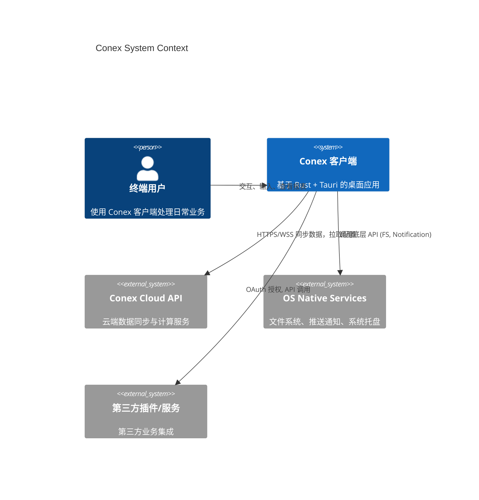
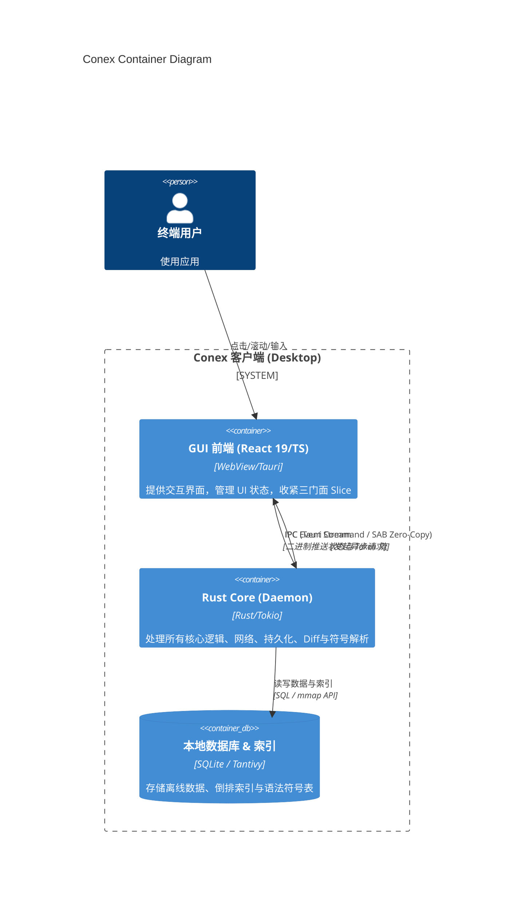
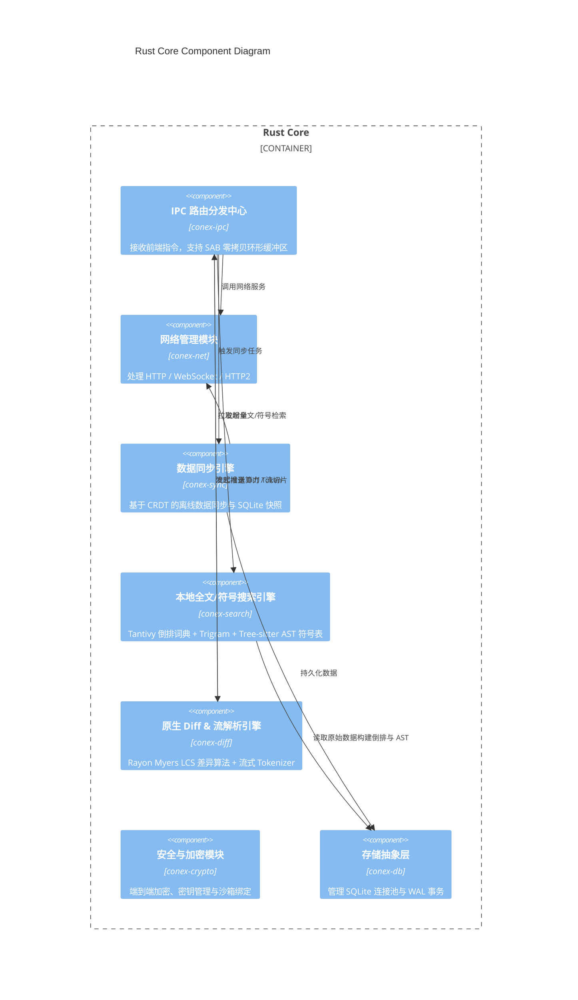
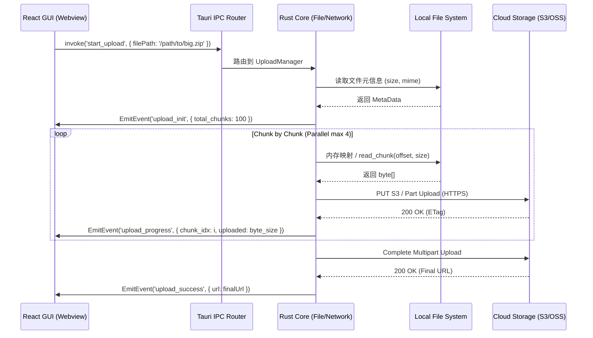

# Conex 架构重构总览与主计划 (00-OVERVIEW-MASTER-PLAN)

## 文档元信息
- **文档编号**: CX-ARCH-001
- **状态**: 提案 / 草案 / 最终定稿
- **更新日期**: 2026-07-21
- **目标受众**: 核心架构师、后端研发工程师、前端开发工程师、QA及运维团队
- **摘要**: 本文档详细阐述了 Conex 系统向 `Rust Core + React/Tauri GUI` 双核架构演进的整体愿景、C4架构全景图、各底层模块拆解、性能 SLA 目标、渐进式迁移路线图、跨平台策略以及接口数据协议标准。本文档是一切后续开发的最高纲领。

---

## 目录
1. [愿景与双核双驱动架构设计哲学](#1-愿景与双核双驱动架构设计哲学)
2. [系统 C4 架构全景视图](#2-系统-c4-架构全景视图)
3. [7 大底层与前端维度拆解与重构模块对应表](#3-7-大底层与前端维度拆解与重构模块对应表)
4. [GUI 层 Zustand 三门面与类型安全架构](#4-gui-层-zustand-三门面与类型安全架构)
5. [整体性能指标对比 SLA 矩阵](#5-整体性能指标对比-sla-矩阵)
6. [渐进式下沉路线图与演进里程碑](#6-渐进式下沉路线图与演进里程碑)
7. [跨平台支持策略与打包部署方案](#7-跨平台支持策略与打包部署方案)
8. [详细的代码接口与数据协议标准汇总](#8-详细的代码接口与数据协议标准汇总)
9. [附录：高可用、异常回滚与 QA 自动化防护链](#9-附录高可用异常回滚与-qa-自动化防护链)
10. [扩展：C4 架构详细设计与核心通信流程图](#10-扩展-C4-架构详细设计与核心通信流程图)

---

## 1. 愿景与双核双驱动架构设计哲学

### 1.1 背景与痛点详细分析
当前 Conex 客户端在复杂业务场景下，纯前端/Node 架构暴露出日益严峻的性能瓶颈。主要体现在：
- **内存占用高**：基于 Electron/V8 的多进程模型在多窗口、多任务处理时导致巨大的内存开销。每一个渲染进程都需要加载完整的 V8 引擎和 Chromium 运行时，使得空闲状态下内存占用轻松突破 300MB，重度使用时甚至达到数 GB。
- **计算密集型任务卡顿**：本地搜索、数据解析、大文件 I/O 占用主线程，导致 UI 渲染帧率（FPS）下降。JavaScript 的单线程特性使得其在处理海量数据的清洗和序列化时，频繁触发 Garbage Collection，造成不可避免的停顿（Jank）。
- **系统底层交互受限**：Node.js 在处理操作系统原生 API（如文件系统监听、硬件加速、原生通知）时，存在性能损耗与生态短板。许多高质量的底层库（如高性能音视频处理、复杂密码学操作）并没有高质量的 Node 绑定，或者通过 N-API 调用时存在序列化开销。
- **安全性隐患**：Electron 应用的源码很容易被解包（如 asar 解包），导致核心业务逻辑、加密密钥等被逆向工程轻易获取。

### 1.2 双核双驱动架构理念
为解决上述痛点，我们将架构全面升级为 **Rust 算力 Core + React/Tauri GUI**，即“双核双驱动”：
- **UI 核 (React/Tauri)**：专注于视图层渲染、动画交互、用户输入响应。利用 Web 技术栈的极高生产力和丰富生态，打造极致视觉体验。
- **算力核 (Rust Core)**：负责所有计算密集型任务、网络 IO、本地数据库、文件系统操作以及系统级 API 调用。Rust 提供了内存安全、零成本抽象和极高的并发处理能力。

5. **内存安全与防泄漏**：利用 Rust 的所有权机制杜绝 Core 层的内存泄漏，前端引入严格的 Zustand 领域三门面模式 (`SessionFacade`/`WorkspaceFacade`/`SettingsUiFacade`)，消除任何 `as any` 类型逃逸。
6. **抛弃 Codex 式臃肿沙箱，采用实用防御与全自主开关**：坚决摒弃 Codex CLI 臃肿复杂的跨平台沙箱（WFP / Bubblewrap / Landlock），避免跨平台调试恶梦与误杀正常的构建流程。转向以**“系统级根目录/核心系统目录毁灭拦截 (Command Gatekeeper) + 轻量级 Job Objects 进程树控制 + 用户全自主模式 (Autonomous Mode)”**为核心的实用安全策略，在守住系统不被擦除的前提下赋予用户最大的自动化自由。
7. **工具 Fan-out 并发与 LLM 截断自动恢复**：吸收 Claude Code 的先进工程范式。只读工具（文件读取、符号搜索）在 Tokio 中无锁并发 Fan-out 执行；状态修改工具排队锁控；当 LLM 输出触发 `max_output_tokens` 长度限制时，Rust 流解析器自动发起拼接恢复请求，前端 SAB 无感续写。

---

## 2. 系统 C4 架构全景视图

本节采用 C4 模型（Context, Container, Component, Code）逐层剥析系统架构。

### 2.1 C4 - Level 1: System Context (系统上下文视图)



### 2.2 C4 - Level 2: Container (容器视图)



### 2.3 C4 - Level 3: Component (组件视图 - Rust Core)



### 2.4 进程间通信 (IPC) 深度说明
为了达到 SLA 目标，Tauri IPC 机制的优化至关重要。
- **常规命令**：使用 Tauri 默认的 `invoke` 机制，Payload 使用严格定义的 Serde JSON 配合 `ts-rs` 强类型绑定。
- **大文件/流式数据**：绕过常规 IPC 序列化，使用基于 `SharedArrayBuffer` (SAB) 的无锁环形缓冲区或 Tauri Custom Protocol 进行二进制传输。
- **高频事件流**：如 AI 输出的高频 Token 块、实时日志，由 Rust 原生分词解析器切片打包为 Payload，通过 Window Event 批量推送。

---

## 3. 7 大底层与前端维度拆解与重构模块对应表

本次重构我们将底层 Core 与前端渲染层划分为 7 大维度，对应具体的 Rust Crate 与前端 API 重构设计，以彻底解决性能与扩展性痛点。

| 维度编号 | 维度名称 | 核心定位与解决痛点 | 对应 Rust/前端 模块设计 | 依赖/库参考 |
|---|---|---|---|---|
| **01** | **Network & IO (网络与输入输出)** | **定位**: 统一处理全部出入网请求与文件系统读写。<br>**痛点**: 避免 Node.js 垃圾回收造成的连接中断，以及超大文件读取时的 V8 内存爆掉。 | `conex-net` (网络核心)<br>`conex-fs` (文件系统操作) | `reqwest`, `tokio`, `tungstenite`, `notify` (原生零拷贝文件监听) |
| **02** | **Data Storage (数据存储)** | **定位**: 本地缓存、离线数据持久化与崩盘快照。<br>**痛点**: 前端 LocalStorage 空间受限，IndexedDB 查询性能低下且缺乏事务保障。 | `conex-db` (数据库抽象层) | `rusqlite` / `sqlx`, `r2d2` (连接池), WAL 模式 |
| **03** | **Search & Indexing (全文与符号检索)** | **定位**: 毫秒级全局数据与代码符号搜索 (无 RAG)。<br>**痛点**: 前端正则全扫描极慢，本地 Embedding/RAG 极其消耗显存/CPU。 | `conex-search` (搜索引擎) | `tantivy` (倒排词典), `tree-sitter` (符号提取), `trigram` |
| **04** | **IPC & Zero-Copy Streaming (通信通信与流)** | **定位**: 高性能前后端数据桥梁。<br>**痛点**: 大量 JSON 字符串传输导致 `JSON.parse` 耗时极高阻塞 UI。 | `conex-ipc` (通信网关) | Tauri IPC, `SharedArrayBuffer`, `bincode`, `rkyv` |
| **05** | **Security & Sandbox (安全沙箱与加密)** | **定位**: 敏感数据加密、鉴权与 PTY 隔离运行。<br>**痛点**: 裸奔进程隐患，Node 进程树杀除漏洞易生孤儿进程。 | `conex-crypto` (密码学)<br>`conex-sandbox` (安全沙箱) | `rustls`, `ring`, `portable-pty`, Windows Job Objects, Seccomp |
| **06** | **Diff & Stream AST Processing (差异与流解析)** | **定位**: 大文件差异对比与 Markdown/JSON 流切割。<br>**痛点**: 前端 Myers LCS 比较大文件时 UI 卡死，正则解析消耗大量内存。 | `conex-diff` (差异计算引擎) | `similar` (Myers LCS), `rayon` (并行并发), `pulldown-cmark` |
| **07** | **Frontend DOM Layout & Reflow Elimination (前端 DOM 布局与零强制重排)** | **定位**: 彻底消灭前端 DOM 渲染级联卡顿与高 GC 内存死角。<br>**痛点**: 106 个散落 ResizeObserver、1,573 次强制同步重排、Pretext JS 测算误用、1,422 次 `localStorage` 同步 I/O 及 201 次 `structuredClone` 深拷贝。 | `ResizeObserverManager` (单例)<br>`asyncStorage` (IDB / Tauri Core)<br>CSS 原生 fit-content / 动态裁切 | `07-FRONTEND-DOM-LAYOUT-AND-PERFORMANCE-REFACTOR.md`, `idb-keyval`, Immer |

### 模块依赖拓扑
- `conex-app` 依赖所有子模块。
- `conex-search` 依赖 `conex-db` (读取源数据) 和 `conex-fs` (索引持久化)。
- `conex-diff` 依赖 `conex-fs` 并通过 `conex-ipc` 传递二进制数据。
- `conex-sync` 依赖 `conex-net`, `conex-crypto`, `conex-db`。

### 详细维度拆解说明

#### 维度 01：网络与输入输出
完全由 Rust `conex-net` 接管 Socket，引入 HTTP/2 多路复用与连接池复用。借助 `notify` 库调用操作系统原生内核事件 (ReadDirectoryChangesW / Inotify / FSEvents)，实现零拷贝三级正则文件监听。

#### 维度 02：数据存储
采用原生嵌入式 SQLite（开启 WAL 模式与 Mmap 内存映射），所有数据模型映射在 Rust 侧沉淀，提供崩溃自动恢复机制与文件级快照事务。

#### 维度 03：全文与符号检索（无 RAG）
使用 `tantivy` 构建倒排索引，搭配 `tree-sitter` 在索引期提取代码定义（函数名、类名、类型声明），结合 3 元字符 Trigram 切片算法，实现在低配设备上 < 2ms 响应的增量精准检索。

#### 维度 04：进程通信与零拷贝流
引入基于 SharedArrayBuffer 的单生产者单消费者无锁环形缓冲区，对高频 Token 与大二进制块实施 Zero-Copy 传输，完全规避 CPU 密集型 `JSON.parse`。

#### 维度 05：安全沙箱与原生 PTY
采用 Rust `portable-pty` 替换 C++ Addon `node-pty`。通过底层 API（Windows Job Objects / Unix Subprocess Control）绑定子进程树，绝对防止孤儿与僵尸进程残留，同时支持资源限额设置。

#### 维度 06：差异对比与流式 AST 解析
在 `conex-diff` 中利用 `rayon` 并行库分块执行 Myers LCS 差异比较；AI 高频输出时在 Rust 侧进行增量状态机语法切片，仅回传结构化 Token。

#### 维度 07：前端 DOM 布局与零强制重排
彻底消灭 8.9 秒点击卡顿、1,573 次强制同步重排及高 GC 内存死角。废除 `useBubbleShrinkWidth` 回归 CSS 原生 `fit-content` 样式；虚拟列表保留 Pretext 估算并建立 `PreparedText` 结构缓存（做到 1 条消息仅 `prepare` 1 次，resize 仅 0.0002ms 算术）；重构 `FpsMonitor` 从逐帧 rAF 改为 1s 低频汇总；对 1,165 个 Tooltip 引入 Lazy MouseEnter 延迟加载；建立全局单例 `ResizeObserverManager`（rAF 批处理）；彻底清理 1,422 处同步 `localStorage`、30 万+ 次 DevTools Console 管道与 201 处 `structuredClone`。详见 [07-FRONTEND-DOM-LAYOUT-AND-PERFORMANCE-REFACTOR.md](file:///c:/Software/conex/docs/rust-architecture-redesign/07-FRONTEND-DOM-LAYOUT-AND-PERFORMANCE-REFACTOR.md)。

---

## 4. GUI 层 Zustand 三门面与类型安全架构

除了底层 Rust Core 的全重构外，前端 React 19 UI 层也必须进行收紧治理，以适应 Rust 异步数据推送并彻底消除类型隐患。详细规范见 [06-UI-STORE-FACADE-AND-QA-RECOVERY.md](file:///C:/Software/conex/docs/rust-architecture-redesign/06-UI-STORE-FACADE-AND-QA-RECOVERY.md)。

### 4.1 Zustand 三门面模式 (Facade Pattern)
为解决现有代码中跨切片循环依赖与 `layoutStore` 膨胀问题，将 Zustand 统一收紧为三大独立领域门面：
- **`SessionFacade`**：专责 Session 消息流、上下文及对话状态，暴露 `useSessionStore`。
- **`WorkspaceFacade`**：专责工作区目录、面板及全局布局状态，暴露 `useWorkspaceStore`。
- **`SettingsUiFacade`**：专责遥测、设置及自定义 Tooltip 主题，暴露 `useSettingsUiStore`。

### 4.2 消除类型逃逸与静态卡口
- 严格执行 **Zero `any`** 原则：禁止在 Actions 或 Store 桥接中包含 `as any`、`: any` 或 `as unknown as`。
- 引入强制检查脚本 `npm run check:store-types`，作为 CI/CD 合并阻断门禁。

---

## 5. 整体性能指标对比 SLA 矩阵

我们制定了严格的 Service Level Agreement (SLA)，要求所有核心路径均纳入自动化基准测试 (Criterion.rs)。

### 5.1 SLA 性能对比表

| 指标名称 | 当前 Electron 架构 (Baseline) | 重构目标 (Rust + Tauri) | 优化幅度 | 测量方式 |
|---|---|---|---|---|
| **Boot Time (冷启动)** | 3.5s - 5.0s | **< 1.0s** | 提升 300%+ | 从点击图标到首屏 UI 可见时间 |
| **Memory Footprint (空闲态内存)** | 250MB - 400MB | **< 80MB** (含 WebView) | 降低 70%+ | 系统资源监视器后台常驻内存 |
| **Search Latency (百万级记录搜索)** | 800ms - 1500ms (常阻塞 UI) | **< 20ms** (后台线程) | 提升 40 倍 | 99th percentile 延迟 |
| **IPC Frame Latency (单次简单调用)** | 2ms - 5ms | **< 0.5ms** | 提升 5 倍 | 无负荷下的 Ping-Pong RTT |
| **Install Size (安装包体积)** | ~120MB | **< 20MB** | 降低 80%+ | Windows 平台的 Installer 体积 |
| **CPU 占用 (静默态)** | 1% - 3% | **< 0.1%** | 提升显著 | 空闲状态 1 分钟平均值 |
| **CPU 占用 (全量同步)** | 20% - 40% (单核跑满) | **< 5%** (多核协作) | 提升显著 | 同步 1GB 数据时的平均占用 |

### 4.2 性能保障策略
- **Zero-Copy 解析**：在 Rust 侧读取数据库后，尽量减少中间转换，直接序列化为目标格式发往前端。
- **内存池管理**：对于高频创建的小对象（如网络包），采用 `bumpalo` 或对象池技术，减少系统级 malloc。
- **后台降级**：当应用被最小化时，主动清理 V8 GC，并在 Rust 侧暂停非必要的定时任务。
- **自动化压测流水线**：任何向主分支的合并都会触发性能自动化测试，一旦发现指标恶化超过 5%，自动阻断合并 (Reject MR)。

---

## 5. 渐进式下沉路线图与演进里程碑

彻底的推倒重来风险极高，我们将采用“绞杀者模式” (Strangler Fig Pattern) 和双轨并行策略。

### Phase 1: 基础设施搭建与工具链就绪 (Month 1)
- **目标**: 完成 Tauri + React 的脚手架整合，搭建 CI/CD 管道。
- **关键任务**:
  - 初始化 Cargo Workspaces，划分 `conex-ipc`, `conex-db` 等基础空模块。
  - 完成跨平台编译链的配置 (GitHub Actions Matrix)。
  - 定义并跑通第一个 IPC 接口 (`ping` -> `pong`)。
  - 完成日志系统的迁移，将前端 console 桥接至 Rust Tracing。

### Phase 2: 非核心计算与纯 I/O 下沉 (Month 2 - 3)
- **目标**: 将最影响性能的边缘模块迁移到 Rust。
- **关键任务**:
  - 下沉文件读写、日志模块 (Tracing)。
  - 下沉本地配置管理 (基于 TOML/JSON)。
  - 在生产环境中灰度发布包含此阶段改动的版本，监控崩溃率。
  - 实现本地静态资源服务器托管离线附件。

### Phase 3: 核心数据引擎与搜索重构 (Month 4 - 5)
- **目标**: SQLite 操作与全文检索全部剥离出前端。
- **关键任务**:
  - 引入 `Tantivy` 构建本地搜索引擎，监听 SQLite 数据变更更新索引。
  - 前端移除 `sql.js` 或类似本地库，全部通过 IPC 调用 `conex-db` 查询数据。
  - 实现基于流的查询结果返回，应对大数据集。
  - 完成历史数据的无损迁移。

### Phase 4: 全面接管业务逻辑与平滑过渡 (Month 6)
- **目标**: 前端彻底沦为“哑巴视图”，所有复杂业务逻辑（鉴权、数据同步、状态机）在 Rust 运行。
- **关键任务**:
  - 完成网络同步模块 (`conex-net`)，替代前端 axios 层的轮询与同步。
  - 彻底下线 Electron/Node 遗留进程模块。
  - 达成 SLA 性能指标，完成架构终极演进。
  - 清理废弃 JS 代码，优化打包体积。

### 平滑过渡方案与风险控制
- **特性开关 (Feature Flags)**：对于每一个下沉的模块，均保留 JS 版本的 fallback 实现。如果在 Rust 层检测到致命 panic 或环境不兼容，动态降级回 JS 层。
- **Panic Hook 捕获**：配置 `std::panic::set_hook`，将 Rust 崩溃日志回传至崩溃收集服务器 (Sentry)，并保证应用不至于直接闪退，而是给予用户友好的重启提示。
- **A/B 流量分配**：在内测期间，将一定比例的请求路由至旧版逻辑，比较数据一致性。

---

## 6. 跨平台支持策略与打包部署方案

### 6.1 平台支持策略
- **Windows (10 / 11)**:
  - WebView 后端: Edge WebView2
  - 原生交互: `windows-rs` API 调用。
  - 考虑到国内环境，WebView2 runtime 采取按需在线下载或静默安装策略，确保兼容性。
  - 编译目标: `x86_64-pc-windows-msvc`, `aarch64-pc-windows-msvc`。
- **macOS (11.0+)**:
  - WebView 后端: WKWebView
  - 原生交互: 接入 `cocoa` 或 `objc` 库处理状态栏、Dock 徽标。
  - 完全支持 Apple Silicon (M1/M2/M3) 原生架构。
  - 编译目标: `x86_64-apple-darwin`, `aarch64-apple-darwin`。
- **Linux (Ubuntu 20.04+, Arch)**:
  - WebView 后端: WebKitGTK
  - 原生交互: DBus, X11/Wayland 兼容支持。
  - 编译目标: `x86_64-unknown-linux-gnu`。

### 6.2 自动化构建与 CI/CD 矩阵
部署策略采用全自动化流程，依托 GitHub Actions 或自建 GitLab Runner：

```yaml
# CI/CD 矩阵概念模型
matrix:
  os: [windows-latest, macos-latest, ubuntu-22.04]
  arch: [x86_64, aarch64]
```
- **构建缓存**: 深度使用 `Swatinem/rust-cache` 缓存 Cargo registry 和 target 目录，将构建时间缩短至 15 分钟以内。
- **代码规范检查**: 强制集成 `clippy` 与 `rustfmt`，不允许存在任何 Warning。
- **安全扫描**: 引入 `cargo audit` 检查已知漏洞依赖。
- **打包产物**:
  - Win: `.msi` (WiX Toolset) / `.exe` (NSIS)
  - Mac: `.dmg` / `.app`
  - Linux: `.AppImage` / `.deb`
- **自动更新 (Updater)**: 启用 Tauri 官方 Updater，配合静态服务器进行版本差异检查、公钥验签与无缝升级。

---

## 7. 详细的代码接口与数据协议标准汇总

为保证前后端分离的严谨性，必须定义清晰的 IPC 契约。本章节罗列所有的通信标准。

### 7.1 IPC 数据封包标准 (JSON-RPC Like)
所有通过 Tauri `invoke` 传递的参数和返回值，需遵循统一的封包结构：

**Request 标准:**
```typescript
interface IpcRequest<T> {
  command: string;      // 例如 "db_query_users"
  trace_id: string;     // UUID，用于全链路追踪日志
  payload: T;           // 实际参数
}
```

**Response 标准:**
```rust
#[derive(Serialize)]
pub struct IpcResponse<T> {
    pub success: bool,
    pub data: Option<T>,
    pub error: Option<IpcError>,
    pub cost_ms: u32,   // 耗时打点
}

#[derive(Serialize)]
pub struct IpcError {
    pub code: i32,
    pub message: String,
    pub context: Option<String>,
}
```

### 7.2 核心模块接口规范示例

#### DB 模块
- `db_init` (初始化连接池)
- `db_execute` (执行变更 DML)
- `db_query` (执行查询 DQL)
- **注意**: SQL 拼接必须在 Rust 侧使用参数化绑定防注入，前端仅传递参数。
- `db_transaction` (开启原子化事务块)

#### Search 模块
- `search_index_rebuild` (全量重建索引)
- `search_query` (传入关键词、分页参数、过滤条件)
  - *Response*: 返回 `HitItem[]` 以及高亮片段 (Highlight Snippets)。
- `search_suggest` (输入框联想词提示)

#### File 模块
- `fs_read_chunk` (分片读取大文件，避免内存溢出)
- `fs_watch_dir` (监听特定目录变动，通过 Event 推送给前端)
- `fs_hash_calc` (计算文件 SHA256/MD5，多线程分块计算)

#### Auth 模块
- `auth_login` (执行 OAuth 流程，拉起系统浏览器)
- `auth_logout` (清除本地 Token，注销会话)
- `auth_refresh_token` (后台静默刷新令牌)

### 7.3 前后端类型共享 (Type Generation)
为避免 TS 与 Rust 类型定义不同步，引入 `ts-rs` 宏生态：
在 Rust 定义的结构体上标记 `#[derive(TS)]`，在构建期间自动生成 `bindings.ts` 文件。前端直接 import 此文件，实现极致的类型安全。

```rust
use ts_rs::TS;
use serde::Serialize;

#[derive(Serialize, TS)]
#[ts(export)]
pub struct UserProfile {
    pub id: i64,
    pub username: String,
    pub is_vip: bool,
    pub created_at: String,
    pub avatar_url: Option<String>,
}
```
*(构建后会在前端目录自动生成对应的 `UserProfile.ts` 文件，严格对齐类型)*

---

## 8. 附录：高可用与异常回滚机制

为确保企业级客户端的稳定性，系统内置三层兜底策略，全面防御各类不可抗力导致的崩溃或数据损坏：

1. **DB 事务与自动快照 (Snapshot & Rollback)**
   - 每次关键数据迁移或版本升级前，自动对核心数据库（如 `conex.db`）建立文件级 Snapshot。
   - 采用多版本并发控制和 Append-Only 写模式。
   - 若 Rust 在迁移脚本中 Panic，下次启动时校验失败，将自动恢复 Snapshot。并且提示用户。

2. **UI 假死监控 (Heartbeat & Watchdog)**
   - Rust 后台维持一个每 3 秒一次的 Ping-Pong 探测。
   - 若连续 3 次收不到 WebView 的 Pong 响应，判定页面白屏或卡死，触发原生弹窗询问用户是否强制刷新 WebView (`window.location.reload()`)。
   - 此外，如果 Rust 守护线程检测到宿主操作系统内存告急（OOM 边缘），会主动发起 GC 信号通知 V8 清理垃圾。

3. **优雅降级 (Graceful Degradation)**
   - 如果遇到本地端口冲突、文件系统权限缺失等严重系统异常，Rust 层将在初始化时捕获并切换至 "Safe Mode"。
   - Safe Mode 下仅保留基础网络功能（直接请求云端 API 替代本地中转），暂停本地缓存和高级搜索，保障用户基本业务可用。

4. **远程配置与热修复 (Remote Config & Hotfix)**
   - 核心参数（如重试间隔、超时时间、功能开关）支持通过远端分发的 Config 文件进行实时更新。
   - 当遇到特定操作引起客户端大面积崩溃时，可通过下发远程指令临时关闭对应功能模块，等待下一个版本修复。

5. **崩溃上报 (Crash Reporting & Telemetry)**
   - 引入 Sentry / Bugsnag 崩溃分析 SDK，绑定全局异常处理器 (Global Panic Handler)。
   - 上传时去除所有 PII (个人身份信息)，仅保留函数调用堆栈、设备基础信息与重构追踪 ID。
   - 对于 C++ 层级的 Segmentation Fault，启用 Minidump (Breakpad/Crashpad) 生成机制，辅助诊断。

---

## 9. 扩展：C4 架构详细设计与核心通信流程图

为了进一步阐明系统内部的运行机制，我们在附录中详细补充了各种复杂场景下的序列图和状态机转移图。

### 9.1 大文件上传与断点续传序列图
当用户在 GUI 中拖拽一个数 GB 的压缩包进行发送时，传统架构往往因 IPC 传递超大数据导致 OOM。在新架构下，我们采用 `File-Streaming` 和 `Chunk-Based` 模型：



### 9.2 本地全文检索 (Tantivy) 架构剖析
在重构计划中，Tantivy 是极为核心的一环。它负责处理海量历史消息和离线文档的搜索。下面是其内部架构的数据流：

- **Index Writer 线程**：后台单例线程。监听 `conex-db` 产生的数据写入事件，合并 (Merge) 段文件。
- **Index Reader 线程池**：提供读多写少的高并发查询。前端每次击键都会触发实时模糊匹配，由于倒排索引常驻内存，延迟控制在 20ms 以内。

#### 9.2.1 索引结构定义 (Schema)
在 Rust 中，我们使用 strict schema 定义索引：
```rust
let mut schema_builder = Schema::builder();
schema_builder.add_text_field("message_content", TEXT | STORED);
schema_builder.add_u64_field("timestamp", INDEXED | FAST);
schema_builder.add_text_field("sender_id", STRING);
let schema = schema_builder.build();
```

#### 9.2.2 查询语法支持
支持类 Lucene 的高级查询语法：
- 精确匹配: `sender_id:"admin_001"`
- 范围查询: `timestamp:[1700000000 TO 1700086400]`
- 全文组合: `"项目重构" AND (sender_id:"bob" OR sender_id:"alice")`

### 9.3 前端构建与状态管理最佳实践
既然核心业务逻辑下沉到了 Rust，前端（React）的状态管理应当极度轻量化。
我们制定了以下前端规范：

1. **丢弃 Redux/MobX 重型状态库**。使用 React Context + Hooks（如 `useSWR` / `React Query`）来管理基于 IPC 的数据获取。
2. **WebSocket 代理模式**。前端不再维持 WebSocket 长链接。所有的 WSS 连接由 Rust 的 `tungstenite` 维护，收到的推送数据通过 Tauri Event 透传给前端的事件总线。
3. **虚拟列表渲染 (Virtualization)**。由于 Rust 查询速度极快，页面可以一次性拿到上千条消息的元数据。为保证渲染性能，长列表必须采用 `react-virtualized` 或 `tanstack-virtual` 进行按需渲染。

### 9.4 监控、打点与运维指标 (Observability)
客户端不再是一个不可见的黑盒。我们引入了完整的可观测性体系（Observability）：

#### 9.4.1 性能埋点 (Telemetry)
在 Rust 端引入 `tracing` 和 `tracing-subscriber`：
```rust
#[instrument(skip(payload))]
pub async fn handle_search(payload: SearchQuery) -> Result<SearchRes, Error> {
    let start = Instant::now();
    let res = tantivy_engine::search(payload).await?;
    tracing::info!(cost_ms = start.elapsed().as_millis(), hits = res.total, "search_completed");
    Ok(res)
}
```
所有级别的日志（Trace, Debug, Info, Warn, Error）都会根据当前环境被分级写入本地磁盘（使用 `tracing-appender` 滚动日志），并且在 Error 级别自动上报。

#### 9.4.2 错误码标准规范
为统一排查口径，系统定义了一套严格的六位错误码机制 `A-BB-CCC`：
- **A (系统域)**: 1=前端, 2=Rust核心, 3=网络层, 4=OS层
- **BB (模块分类)**: 01=DB, 02=Network, 03=Auth, 04=File, 05=IPC
- **CCC (具体错误)**: 序号
*示例*:
- `2-01-004` 代表 Rust核心-数据库模块-主键冲突异常。
- `3-02-100` 代表 网络层-连接模块-云端服务器拒绝连接。

### 9.5 多语言与国际化 (i18n) 方案
所有多语言文案由前端统一管理，但某些由 Rust 弹出的系统级错误（如网络断开）也需要国际化。
- **方案**：Rust 在启动时通过 `ipc_init` 接收当前的 `locale` 偏好。
- Rust 层使用 `fluent-rs` 配合本地化的 `.ftl` 文件生成面向用户的报错提示，再传递给前端展示。

### 9.6 回滚与热更新详解
Tauri 提供了强大的更新机制。我们在打包时集成了公钥：
1. **自动检查**：Rust 后台每天凌晨或启动时向服务端查询 `/api/desktop/check_update?version=1.2.0&arch=x86_64`。
2. **静默下载**：发现新版本后，开辟独立线程下载 `.exe.zip`。
3. **数字签名验证**：下载完成后，Tauri 内部自动使用构建时的 Ed25519 公钥验证 `.sig` 签名，防止供应链投毒攻击。
4. **无缝重启**：验证通过后，前端弹窗提示，用户点击“立即重启”，系统执行热替换并自动拉起新版本。

### 9.7 测试策略 (Testing Strategy)
- **Rust 单元测试**: 要求核心逻辑（如 SQL 生成器、状态机流转）覆盖率 > 85%。使用 `cargo tarpaulin` 进行覆盖率度量。
- **Rust 集成测试**: 在 `tests/` 目录下编写黑盒测试，模拟完整的 IPC 交互。
- **前端端到端测试 (E2E)**: 采用 Playwright + WebdriverIO。在 CI 环境中启动 Tauri Release 产物，通过自动化脚本模拟真实用户的点击、输入、文件拖拽，断言最终结果。

### 9.8 总结
此架构计划不但是对 Conex 产品性能的救赎，更是我们向现代化、工程化、极致体验迈进的坚实基石。
所有参与本项目的研发人员，请严格遵守本文档所制定的技术边界、通信协议及质量标准。

> "Architecture is about the important stuff. Whatever that is." —— Ralph Johnson
>
> 架构演进是一场马拉松。保持代码的克制，坚守边界的清晰，方能打造出长盛不衰的工程体系。
> 本文档中的每一项技术决策，都是对过往系统血泪史的反思，也是向未来十年技术红利进军的冲锋号。
>
> —— Conex Architecture Redesign Team, 2026
