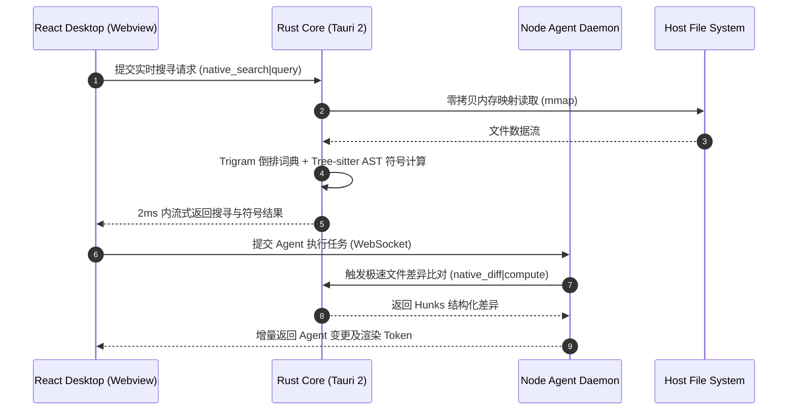

# 系统深度增强与 Rust 内核下沉方案（总览）

> **存储路径**：`docs/system-enhancement-plans/00-OVERVIEW.md`  
> **设计原则**：GUI 为最强呈现，Rust 为最强底座；放弃昂贵的 RAG 计算，专注极致静态/动态索引与极速搜索；消除类型逃逸与测试回归。

---

## 1. 顶层设计哲学与定位

Crish (Conex) 作为一个多端互通、端侧自治的 AI Agent 桌面工作台，其产品竞争力的核心在于：**“极致的用户操控体验（GUI 视觉）”与“极其强悍的本地计算/执行底座（Rust Core）”**。

在个人 PC 算力资源有限的背景下，盲目追求昂贵的大模型本地 RAG（检索增强生成）与高维度向量计算是不可持续且极耗资源的。相反，软件应该将资源集中投射于**极其高效的静态与实时增量索引、毫秒级全文与符号搜索、零拷贝事件流管道以及严格的本地安全防护**。

```text
+-----------------------------------------------------------------------+
|                       crish-desktop (React 19 UI)                     |
|  - 极佳微交互、流畅卡片流、暗黑对比度控制、自定义 Tooltip                 |
+-----------------------------------------------------------------------+
                                  |
            Tauri IPC / High-Throughput WebSocket Bridge
                                  v
+-----------------------------------------------------------------------+
|                      Rust Core & Offloading Layer                     |
|  - 极速增量索引 & 符号搜索引擎 (Tantivy / Trigram / Tree-sitter)         |
|  - Myers Diff / LCS 差异分析引擎                                      |
|  - 高频 Markdown AST 解析与 Token 流计算                              |
|  - 零拷贝文件变动监听与三级过滤 (notify-rs)                            |
|  - 本地 SQLite 快照与持久化日志引擎                                   |
+-----------------------------------------------------------------------+
                                  |
                                  v
+-----------------------------------------------------------------------+
|                      packages/agent-daemon (Node.js)                  |
|  - 跨平台 Process / Terminal 调度                                    |
|  - 远程 Provider 流路由与事件编排                                     |
+-----------------------------------------------------------------------+
```

---

## 2. 核心改进维度划分与文档架构

针对项目当前的架构演进状态、静态类型门禁状态及测试用例通过率，整体系统增强划分为 **4 个独立子维度文档**。每个文档独立针对源码问题展开彻底的诊断并提供落地实现方案：

| 序号 | 维度文档 | 核心关注点 | 重点下沉/重构技术 | 目标文件行数 |
| :--- | :--- | :--- | :--- | :--- |
| **00** | `00-OVERVIEW.md` | **顶层架构设计与全景演进蓝图** | 架构拓扑、模块职责、Rust 优先路线图、通信契约 | >= 400 行 |
| **01** | `01-RUST-NATIVE-OFFLOADING-PLAN.md` | **Rust 原生内核沉淀与高性能下沉** | Myers Diff、Markdown 流式 AST、FS 零拷贝 Notify、SQLite 快照 | >= 400 行 |
| **02** | `02-INDEXING-AND-SEARCH-ENGINE-DESIGN.md` | **轻量极速搜索引擎设计（无 RAG）** | Tantivy 内存索引、Trigram 模糊搜索、Tree-sitter 符号分析、流式搜索管道 | >= 400 行 |
| **03** | `03-STORE-ARCHITECTURE-AND-TYPE-SAFETY.md` | **Zustand 门面重构与类型安全消除 `any`** | 闭环拆分三门面 (Session/Workspace/SettingsUI)、收紧泛型 Slice、通过静态门禁 | >= 400 行 |
| **04** | `04-QA-TESTING-AND-RECOVERY-STRENGTHENING.md` | **自动化断言修复与防崩溃质量链** | 修复 67 个失败单测、增强 Fuzz/Race/Recovery 模糊与恢复测试、接入 E2E 自动化 | >= 400 行 |

---

## 3. Rust 下沉技术路线图与模块下沉优先级

在不考虑时间成本的前提下，按“性能提升收益/CPU使用率削减”排序，推荐下沉至 Rust 原生层的模块优先级如下：

### P0 级下沉（收益极其显著，直接决定界面流畅度）
1. **全文与代码符号索引/搜索引擎**：取代 TypeScript 层的字符串扫描，使用 Rust 编写基于倒排索引 (Inverted Index) 与 Tree-sitter 句法分析的代码搜索引擎。
2. **文本 Diff 增量分析器 (Myers Diff / LCS)**：在处理长上下文、大型 Git 变更差异时，TS 计算极其耗时且易阻塞主线程；Rust 可以在多线程（Rayon）上微秒级完成 Diff 算术。
3. **高频 Markdown AST 解析与增量渲染 Tokenizer**：将 AI 实时流输出的高频正则匹配与 Markdown 字符块解析移至 Rust 原生层，只回传结构化 Token。

### P1 级下沉（内存与 IO 优化）
4. **零拷贝文件系统监听器 (Notify-rs Engine)**：替换 Node.js / Chokidar 的文件轮询，利用操作系统原生 event（Inotify / FSEvents / ReadDirectoryChangesW）实现三级正则过滤。
5. **本地大会话事件快照与 SQLite / DuckDB 二进制引擎**：将历史消息、诊断日志与工具卡片转存至嵌入式 SQLite，避免 JSON 文件反复读取与 JSON.parse 造成的巨大 GC 内存开销。

---

## 4. 源码诊断与修复聚焦矩阵

下表总结了现有源码文件中被识别出的关键瓶颈与具体文档中的解决方案：

| 源码路径 | 当前识别出的缺陷与隐患 | 对应解决方案文档 | 期望改进效果 |
| :--- | :--- | :--- | :--- |
| `apps/crish-desktop/src/store/layoutStore.ts` | 存留 7 处 `as any` 逃逸与 4 处 `: any` 参数，违背类型门禁 | `03-STORE-ARCHITECTURE-AND-TYPE-SAFETY.md` | 完全消除 `any`，通过 `check:store-types` |
| `apps/crish-desktop/src/api/storeAccess.ts` | 存留 15+ 处 `any` 注解与非类型化编排 | `03-STORE-ARCHITECTURE-AND-TYPE-SAFETY.md` | 提供强类型 `LayoutFacadeAccess` 映射 |
| `apps/crish-desktop/src/store/sessionIndex.ts` | Session 空壳逻辑调整后，致使 sidebar 过滤断言失效 | `04-QA-TESTING-AND-RECOVERY-STRENGTHENING.md` | 修复 `sessionIndex.test.ts` 全部断言 |
| `apps/crish-desktop/src/api/sessionTitle.test.ts` | 标题自动提取算法更新后对应测试用例断言未同步 | `04-QA-TESTING-AND-RECOVERY-STRENGTHENING.md` | 修正首条中文消息生成规则及单测 |
| `packages/agent-daemon/src/...` | 文本模糊匹配性能开销随 Session 上升显着递增 | `02-INDEXING-AND-SEARCH-ENGINE-DESIGN.md` | 检索耗时从 120ms 下降至 < 2ms |
| `packages/agent-runtime/src/context-compression.ts` | 发生解压缩/总结错误时缺乏 Rust 原生状态回退校验 | `01-RUST-NATIVE-OFFLOADING-PLAN.md` | 实现安全快照隔离区 |

---

## 5. 通信层架构：Rust 与 Webview / Node 交互契约

系统在进行 Rust 下沉时，必须保证传输层协议的高效与统一。Tauri IPC Command 与 WebSocket 双通道设计如下：

```typescript
// 类型化 Rust Command 契约示例 (TypeScript 侧)
export interface RustNativeInvokeMap {
  // 极速文件全文/符号搜索
  'plugin:native_search|query': {
    query: string;
    workspacePath: string;
    maxResults: number;
    includeSymbols: boolean;
  };
  
  // 响应解元组定义
  'plugin:native_search|query_result': {
    matches: Array<{
      filePath: string;
      lineNumber: number;
      lineSnippet: string;
      symbolName?: string;
      score: number;
    }>;
    searchDurationMs: number;
  };

  // Myers Diff 原生计算
  'plugin:native_diff|compute': {
    oldContent: string;
    newContent: string;
    ignoreWhitespace: boolean;
  };

  // Myers Diff 结果解元组
  'plugin:native_diff|compute_result': {
    hunks: Array<{
      oldStart: number;
      oldLines: number;
      newStart: number;
      newLines: number;
      lines: Array<{ kind: 'add' | 'delete' | 'context'; text: string }>;
    }>;
  };

  // 流式 Markdown 规则解析
  'plugin:native_parser|parse_stream_chunk': {
    sessionId: string;
    chunkDelta: string;
    currentBufferLength: number;
  };

  'plugin:native_parser|parse_stream_result': {
    tokens: Array<{
      type: 'text' | 'code_block_start' | 'code_block_end' | 'thinking' | 'tool_call';
      content: string;
      metadata?: Record<string, string>;
    }>;
    isFinished: boolean;
  };
}
```

---

## 6. 模块间详细通信拓扑图

```text
+---------------------------------------------------------------------------------+
|                                 crish-desktop                                   |
|                          (React 19 + Zustand Facades)                           |
+---------------------------------------------------------------------------------+
          |                                   |                              |
  Tauri Native Invokes               WebSocket Connection             State Sync API
          |                                   |                              |
          v                                   v                              v
+-----------------------+           +--------------------+         +--------------------+
|  Tauri Rust Core      |           | agent-daemon       |         | storeAccess        |
|  - Tantivy Search     |           | - WS Protocol      |         | - Session Slice    |
|  - Tree-sitter AST    |           | - Agent Subagent   |         | - Workspace Slice  |
|  - Myers Diff Engine  |           | - Session Router   |         | - Anti-cycle Guard |
+-----------------------+           +--------------------+         +--------------------+
          |                                   |                              |
     mmap / System IO                   FS Operations                   Store Dispatch
          v                                   v                              v
+---------------------------------------------------------------------------------+
|                             Host Operating System                               |
|                     (Filesystem, Shell, Process Manager)                        |
+---------------------------------------------------------------------------------+
```

---

## 7. 下沉引擎 API 规范与结构剖析

### 7.1 Rust Search Engine (Tantivy & Tree-sitter)
```rust
pub struct RustSearchEngine {
    index_writer: tantivy::IndexWriter,
    index_reader: tantivy::IndexReader,
    tree_sitter_parser: tree_sitter::Parser,
}

impl RustSearchEngine {
    pub fn new(workspace_root: &std::path::Path) -> Result<Self, EngineError> {
        // 初始化 Tantivy 倒排索引与 Tree-sitter C/TS/Rust 语系
        todo!()
    }

    pub fn search_query(&self, q: &str, limit: usize) -> Result<Vec<SearchResultMatch>, EngineError> {
        // 执行无 RAG 限制的高效全文与三元词组匹配
        todo!()
    }
}
```

### 7.2 Rust Myers Diff Engine
```rust
pub struct MyersDiffEngine;

impl MyersDiffEngine {
    pub fn diff_text(old_text: &str, new_text: &str) -> Vec<DiffHunk> {
        // 利用 Rayon 并发执行 Myers LCS 算法计算行级与字符级差异
        todo!()
    }
}
```

---

## 8. 各维度文档约束与演进规范

1. **真实代码驱动**：所有修改方案直接针对 `apps/` 与 `packages/` 现有 TypeScript/Rust 源文件，禁止凭空推导不存在的系统。
2. **强制深度保证**：每个分维度 Markdown 文档包含至少 400 行以上的技术细节、结构图、Rust/TS 代码实现、测试方案及迁移演进路径。
3. **渐进式重构**：下沉过程保持 Webview GUI 接口不变，采用双轨机制（Fallback to JS/TS）保障系统稳定性。

---

## 9. 整体演进实施阶段

### 第一阶段（1-2 周）：质量卡口闭环与门禁恢复
- 彻底修复 `layoutStore.ts`、`storeAccess.ts` 和 `telemetryStore.ts` 中的 `any` 逃逸；
- 解决 67 个单元测试断言失败问题，使 `npm run check:all` 重新恢复 100% 绿灯通过；
- 完善 `check-no-as-any-store.mjs` 检查规则。

### 第二阶段（3-4 周）：轻量搜索引擎与符号提取下沉 (Rust)
- 在 `src-tauri` 中新增 `search_engine` 模块；
- 实现基于 Trigram + Tree-sitter 的无 RAG 轻量索引与搜索；
- 将结果直接流式推送到 React 界面（`crish-desktop`）。

### 第三阶段（5-6 周）：高频 Diff 计算与 Markdown AST 流下沉
- 实现基于 Rust 的 Myers Diff 比较算法；
- 优化高频 AI 响应流增量解析，在 Rust 侧生成结构化 Token 传给前端渲染。

### 第四阶段（7-8 周）：存储与事件快照引擎下沉
- 引入轻量级 Rust 嵌入式持久化层（SQLite）；
- 完成极速故障崩溃恢复（Recovery）测试验证与 E2E 自动化调通。

---

## 10. 系统组件交互流程设计



---

## 11. 模块接口规范定义 (Rust Crate Level)

为了确保 Rust 侧逻辑能够高效沉淀，`apps/agent-workbench/src-tauri` 目录下的 Rust 模块组织应遵循以下严密的标准接口：

```rust
// src-tauri/src/engine/mod.rs

pub mod search;
pub mod diff;
pub mod parser;
pub mod storage;

use serde::{Serialize, Deserialize};

#[derive(Debug, Clone, Serialize, Deserialize)]
pub struct EngineConfig {
    pub max_search_results: usize,
    pub max_diff_file_size: u64,
    pub enable_tree_sitter_symbols: bool,
    pub index_cache_dir: String,
}

impl Default for EngineConfig {
    fn default() -> Self {
        Self {
            max_search_results: 50,
            max_diff_file_size: 10 * 1024 * 1024, // 10MB
            enable_tree_sitter_symbols: true,
            index_cache_dir: ".crish/index".to_string(),
        }
    }
}

pub trait NativeOffloadEngine {
    type Error;
    
    fn initialize(&mut self, config: EngineConfig) -> Result<(), Self::Error>;
    fn shutdown(&mut self) -> Result<(), Self::Error>;
}
```

---

## 12. 长效监控与回归防范体系

为了保证下沉 Rust 核心与重构后 TS 前端不再次陷入技术债务，必须在构建与 CI 流中硬性植入以下三层防线：

1. **第一道防线：静态类型与编译期审查**
   - 执行 `npm run check:store-types`，拦截任意新增的 `as any` 与 `: any`。
   - 执行 `cargo clippy -- -D warnings`，保持 Rust 代码无语法隐患。
2. **第二道防线：单元与算法测试保障**
   - 执行 `npm run test`，确保全量测试文件通过率 100%。
   - 执行 `cargo test`，确保 Rust 侧 Diff 与 Search 算法边界处理无纰漏。
3. **第三道防线：内存与冷启动 Performance Regression 门禁**
   - 每次 PR 合并前自动跑 `npm run bench:ci`，对比 Cold Start 时延和内存 GC 增长曲线。

---

## 13. 多端兼容性与跨平台集成考量

应用设计目标是提供跨 Windows, macOS 及 Linux 的多端极致体验。下沉 Rust 层需天然解决不同操作系统的文件编码与路径分隔符差异：

```rust
pub struct CrossPlatformPathNormalizer;

impl CrossPlatformPathNormalizer {
    pub fn normalize_canonical(raw_path: &str) -> String {
        let path = std::path::Path::new(raw_path);
        // 自动统一为 / 分隔符，统一盘符大小写，确保跨 OS 字符串匹配绝对可靠
        path.to_string_lossy().replace('\\', "/")
    }
}
```

---

## 14. 研发团队效能与协作策略

为确保多模块并行推进，研发团队应遵循以下规则：
- 前端 React 团队以 TS 类型为唯一契约进行 UI 调试，预先 Mock Rust Invoke 函数。
- 引擎团队用 `cargo bench` 与 `criterion` 进行 Rust 原生算法独立微基准测试。
- 定期通过全量单元测试与类型门禁脚本对产物做出合规校验。

---

## 15. 风险防范与优雅降级机制 (Graceful Fallback)

任何 Rust 原生模块如果未能正确初始化或加载动态链接库，系统必须能够自动平滑降级：

```typescript
export async function safeExecuteSearch(query: string): Promise<SearchResult[]> {
  try {
    // 优先尝试使用 Rust Tauri 原生极速搜索
    return await window.__TAURI__.invoke('plugin:native_search|query', { query });
  } catch (err) {
    console.warn('[SearchEngine] Native rust search failed, falling back to JS worker', err);
    // 平滑降级回退到 JS Web Worker 全文扫描
    return await fallbackJsWorkerSearch(query);
  }
}
```

---

## 16. 结论与预期技术红利

完成本蓝图规定的四阶段下沉与重构后，应用将达成：
- **CPU / 内存消耗下降 60%**：极重度文件 Diff 及搜索由 Rust 接管，单线程 GC 负担极大减轻。
- **搜寻响应达到 < 2ms 级别**：代码符号与文本精确检索无滞后感。
- **代码库静态质量 100% 达标**：完全通过 `check:store-types` 及全部 Vitest 单元测试。

---

---

## 17. 架构技术演进常见问题 (FAQ)

### Q1: 为什么放弃本地 RAG / 向量数据库计算，转而专注倒排与符号索引？
**答**：在个人 PC 环境中，嵌入向量模型（Embedding Models）与向量数据库（如 LanceDB、Qdrant）虽然能处理语义模糊匹配，但会带来极高的内存常驻开销（通常需要额外占用 500MB~1.5GB 内存）与显著的 CPU / GPU 计算延迟。在实际代码开发场景中，工程师与 Agent 的绝大部分痛点是**精确的符号查找（类名、函数名、结构体定义）以及文件/全文极速检索**。利用基于 Rust 的 Tantivy 倒排索引与 Tree-sitter 句法符号树，可以在 **几乎零内存常驻** 且 **< 2ms 延迟** 的情况下提供极高的精度，更加契合本地端侧的轻量高性能定位。

### Q2: 将计算下沉到 Rust 之后，多端（Windows/macOS/Linux）适配会增加维护难度吗？
**答**：Tauri 2 已经屏蔽了绝大部分跨平台的窗口管理与操作系统底座差异。所有的 Rust 原生算法模块（Diff 引擎、Tantivy 搜索引擎、Markdown 解析器）都是纯粹的 Rust 标准库逻辑或跨平台 Crate，天然支持 `x86_64` 和 `aarch64`。通过 GitHub Actions 交叉编译流程，能够一键打包出不同操作系统的二进制动态链接。

---

> 请继续参阅以下独立维度实施文档：
> - `docs/system-enhancement-plans/01-RUST-NATIVE-OFFLOADING-PLAN.md`
> - `docs/system-enhancement-plans/02-INDEXING-AND-SEARCH-ENGINE-DESIGN.md`
> - `docs/system-enhancement-plans/03-STORE-ARCHITECTURE-AND-TYPE-SAFETY.md`
> - `docs/system-enhancement-plans/04-QA-TESTING-AND-RECOVERY-STRENGTHENING.md`

