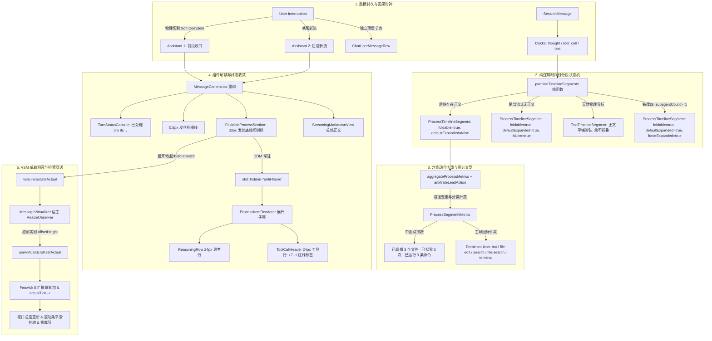

# 助手消息「正文驱动过程折叠与图一至图五对齐」端到端彻底重构总方案

> **战役工作区**：`docs/assistant-process-folding/`  
> **文档性质**：战役实现总方案（Master Plan，单一权威源 SSOT）  
> **依赖分维详案**：
> - `01-分段状态机与折叠判定详案.md`（时间线分段状态机与三大折叠铁律）
> - `02-折叠态聚合文案与度量算法详案.md`（六维动作去重统计、图五中圆点拼接与主导图标仲裁树）
> - `03-图一至图四展开态UI组件详案.md`（ToolCallHeader 补齐红绿标签与 Chevron、思考行统一收敛至 ReasoningRow）
> - `04-组件容器架构与终态收敛详案.md`（切除单体顶栏，落地 FoldableProcessSection + TurnStatusCapsule）
> - `05-用户插入节点时序组织详案.md`（跨消息物理分段、用户节点顶层外露神圣栅栏与软收口）
> - `06-动态测高自愈与检索集成详案.md`（单轨测高闭环根治双通道死锁、HTML5 until-found 与 beforematch 穿透唤醒）
> - `07-方案收敛审计与SSOT裁决.md`（**本战役 SSOT 裁决总表**：单一权威源、文件域互斥、负向断言清单）
>
> **收敛状态**：本文档已按 2026-09-11 收敛审计完成对齐；所有契约、路径、图标、门禁命令均已与 01–07 分维详案及真实代码事实一致。

---

## 一、战役总纲与核心效果锁定（Executive Summary & Invariants）

本方案针对用户提出的“正文驱动思考与工具折叠”、“样式对齐图一至图四、折叠态对齐图五”、“AI 总结输出后全折叠仅留时间/横线/总结”、以及“用户中途发送消息时按插入节点分开折叠绝不吞入用户消息”四大核心诉求，输出系统性、自上而下的端到端彻底重构方案。

### 核心效果锁（Five Invariants）

1. **展开态视觉 100% 对齐图一至图四**：
   - 细粒度单项展示：带有时钟 `timer` 图标的操作描述、高亮代码路径、红绿变更行数统计标签（`.diffStatsAdd` **已存在**于 `ChatToolCallBlock.module.css:407-410`，走 `--diff-add-fg`；`.diffStatsDel` 位于 `:412-414`，走 `--diff-del-fg`；真实差距是 `font-weight` 未设，**不是缺失**）；
   - 补全右侧旋转 Chevron 展开箭头：`.toolRowChevron` / `.rot` 样式**已存在**（`ChatToolCallBlock.module.css:322-340`）但**全仓零 JSX 引用**，属死样式；本次仅补 JSX 渲染，**不新增样式**。键盘无障碍（Enter/Space/Escape）已由 `ToolCallHeader.tsx:82-94` 现有实现承载；
   - 极简思考行全面收敛至 `ReasoningRow`（彻底淘汰历史分叉的 `TimelineThoughtSection`），24px 固定高度隔离回流，支持“深度思考”标签与耗时展示。
2. **折叠态视觉 100% 对齐图五**：
   - 六大动作正交分类度量：`编辑 (edits)`、`搜索 (searches)`、`读取 (reads)`、`运行 (runs)`、`协作 (subagents)`、`思考 (thoughts)`；
   - 路径自动去重（如 3 次编辑发生在 2 个文件，精准生成 `已编辑 2 个文件`）；
   - 严格遵循图五中圆点 ` · ` 拼接规范：
     * `Q 已搜索 2 次 · 已读取 3 个文件 ⌄`
     * `已编辑 3 个文件 · 已搜索 3 次 · 已读取 1 个文件 · 已运行 3 条命令 ›`
     * 纯思考：`已深度思考 · 思考耗时 3.5s`
   - 主导图标仲裁树收敛为 **subagent > edit > search > read > command > thought > mixed**（02 详案 §6 为唯一权威）；
   - **图标 SSOT**：全部经 `AppIcon` → `components/ui/icons/iconMap.ts` → **`@hugeicons/core-free-icons`** 渲染。**严禁 emoji（✏️/🔍/📄/⚡/🤖/🧠/🛠️）**——emoji 无法通过 `check:icon-ssot` 门禁、跨平台字形不一致、与 `ICON_STROKE` 线宽契约不兼容。
3. **终态全局收敛铁律（AI 总结后全收拢）**：
   - 当助手消息生成完毕（`completed` / `stopped`）且输出最终总结正文后，前面所有阶段的过程分段默认自动收起；
   - 整条助手消息的外露呈现严格收敛为：
     ① 顶层工作时间胶囊（进位制时间格式，如 `已处理 3m 9s ⌄` / 运行态 `正在处理 · 2.4秒`）；
     ② 0.5px 发丝细横分割线（`var(--hairline)`）；
     ③ 最终总结正文内容（Markdown）。
4. **用户中途插入节点独立性（神圣安全栅栏）**：
   - 用户发送的每一条消息（包括 AI 工作中途插入的提问、打断或追加指令）是最高优先级的认知与控制主体；
   - 坚决采纳**跨消息物理分段（Data-Level Splitting）**：前段助手在插入点软收口（Soft Complete），用户消息作为独立顶层节点外露展示（带完整独立操作栏与附件卡片），后段响应作为新助手消息承接后续执行；
   - **绝对禁止将用户消息吞入、嵌套或折叠进助手消息的过程块中**。
5. **子代理可见性特权（铁律四，本次新增）**：
   - 用户明确要求：**开启子代理的段落在折叠时也必须保留可见，不得被折叠隐藏**——子代理重要性高于一般过程段；
   - 数学表达：$\text{subagentCount} \ge 1 \implies \text{foldable} = \text{true} \land \text{defaultExpanded} = \text{true} \land \text{forceExpanded} = \text{true}$；
   - **优先级最高**：铁律四优先于铁律一（`hasNextText` 折叠）与铁律三（终态自收敛）；仅铁律二的 `isLive` 语义与其正交；
   - 落地面（四处缺一不可）：`timelineSegmenter` 输出 `forceExpanded` → `MessageContent` 终态收敛 `useEffect` 跳过 → `isAllExpanded` 计入 → `handleToggleAll` 的「全部收起」方向跳过；容器侧收起按钮 `disabled` + `aria-disabled="true"`。

6. **单轨动态测高（VSM）与 HTML5 `until-found` 原生穿透**：
   - 彻底切除旧架构中折叠时 `return null` 的暴力卸载行为（导致 DOM 脱落、搜索失效）；
   - 折叠槽位使用原生 `hidden="until-found"`，结合 `beforematch` 监听器，实现 Chromium 原生 Ctrl+F 页面搜索穿透折叠内容并局部精准展开命中分段；
   - 彻底根治图五“双通道测高死锁”：行内组件仅作废旧高度（`invalidateActual`），由宿主 `ResizeObserver` 独家实测外框 `offsetHeight` 并回写 `useVirtualScroll.setActual`，rAF 批量更新树状数组（BIT）并递增 `actualTick`，实现滚动条与内容严丝合缝、零裁剪、零跳变。

---

## 二、端到端系统架构与纯逻辑拓扑



---

## 三、分维详案设计成果与技术落地蓝图

### 1. 时间线分段状态机与三大折叠铁律（对应详案 01）

#### 契约定义（唯一权威源：`api/tool-presentation/toolPresentationTypes.ts`）

```typescript
// 【SSOT 收敛】契约类型唯一存放于 api/tool-presentation/toolPresentationTypes.ts
// 字段定义以 01 详案 §1 为准；本文档不再重复定义。
import type { ProcessSegmentMetrics, ProcessLeadAction } from '../../api/tool-presentation/toolPresentationTypes';
import { partitionTimelineSegments, type TimelineSegment } from '../../api/tool-presentation/timelineSegmenter';

export type TimelineSegment = ProcessTimelineSegment | TextTimelineSegment;

export interface ProcessTimelineSegment {
  kind: 'process_section';       // 收敛：原 'process' 已废除
  id: string;                    // 收敛：原 key，格式 `${msgId}-proc-${index}`
  items: AssistantTimelineItem[];
  metrics: ProcessSegmentMetrics;
  foldable: boolean;             // 由铁律一/二/三/四裁决（禁止调用方推导）
  defaultExpanded: boolean;
  forceExpanded: boolean;        // 【铁律四】subagent 段强制展开
  isLive: boolean;
}

export interface TextTimelineSegment {
  kind: 'text_narrative';        // 收敛：原 'text' 已废除
  id: string;                    // 收敛：原 key，格式 `${msgId}-text-${index}`
  item: AssistantTimelineItem;   // kind === 'text'
  isFinalAnswer: boolean;
  isStreaming: boolean;
}
```

**已物理废除的旧命名**（负向断言须覆盖）：`kind: 'process'`、`kind: 'text'`、`segmentIndex`、`dominantIcon: string`（改为由 `DOMINANT_ICON_MAP[leadAction]` 派生）、`summaryText`（改由容器内 `formatSegmentSummary` 派生）、`hasNextText`（降为内部中间量，不外露）。

#### 三大折叠铁律数学公式
1. **铁律一（中间过程必折叠）**：
   $$\text{hasNextText} \equiv \text{true} \implies \text{foldable} = \text{true} \land \text{defaultExpanded} = \text{false} \land \text{isLive} = \text{false}$$
   只要当前过程段后继存在 AI 正文（无论阶段性解释还是总结正文），该过程段履职完毕，必须收拢为 33px 发丝折叠栏；
2. **铁律二（尾部流式直出展开）**：
   $$\neg\text{hasNextText} \land \text{isTurnLive} \equiv \text{true} \implies \text{foldable} = \text{true} \land \text{defaultExpanded} = \text{true} \land \text{isLive} = \text{true}$$
   当且仅当处于流式生成中且无后继正文时，保持直出展开态（图一至图四细颗粒度动作呈现），缓解用户等待焦虑；
3. **铁律四（子代理可见性特权，新增 · 优先级最高）**：
   $$\text{subagentCount} \ge 1 \implies \text{foldable} = \text{true} \land \text{defaultExpanded} = \text{true} \land \text{forceExpanded} = \text{true}$$
   含子代理调用的过程段享有**强制可见特权**：无论 `hasNextText` 是否为真、无论是否已进入终态，该段都必须保持展开。用户在过程中开启子代理，其执行过程与结果是高价值认知对象，不得被折叠隐藏。
4. **铁律三（纯工具终态自收敛）**：
   $$\neg\text{hasNextText} \land \neg\text{isTurnLive} \implies \begin{cases} \text{toolCount} \ge 2: & \text{foldable} = \text{true} \land \text{defaultExpanded} = \text{false} \\ \text{toolCount} < 2: & \text{foldable} = \text{false} \land \text{defaultExpanded} = \text{true} \end{cases}$$
   无正文的纯工具终态轮次，在工具数 $\ge 2$ 时自动触发自收敛折叠，避免刷屏；单工具则直出展开。

**裁决优先级**（短路顺序，`partitionTimelineSegments` 内实现）：

```
铁律四（subagentCount >= 1）  ← 最高优先级，命中即返回
  └─ 否则 铁律一（hasNextText ≡ true）
        └─ 否则 铁律二（isTurnLive）
              └─ 否则 铁律三（toolCount >= 2）
```

**负向红线**：严禁在铁律四命中后仍被铁律一/三覆盖（即不得把 `subagentCount >= 1` 写成「与非」条件）。

#### 数据模型 5 大断层修复
1. `updateMessageThinking` 时刷新 `streamTextOffset = (msg.text || '').length`，防止跨思考正文段被错误合并；
2. `reconcileAssistantMessageBlocks` 槽位 Key 为正文分配序列化槽位（`${cleanTurn}:text:#seq_${n}`），根除 `"0:text:"` Key 碰撞；
3. `alignToolCallBlocks` 按照 `toolCall.startedAt` 时间戳因果就近插位，根除盲目插到最后一个正文之前的缺陷。

---

### 2. 折叠态聚合文案与度量算法（对应详案 02）

#### 六维动作分类与路径去重
- **编辑领域 (`edit`)**：经 `canonicalizeFsPath` 实施跨平台正反斜杠与 Windows 盘符大小写归一，按 Set 去重统计 `editFilesCount`；
- **搜索领域 (`search`)**：累加探查次数 `searchCount`（`grep_search`, `find_by_name`, `search_web` 等）；
- **读取领域 (`read`)**：按文件路径或 URL 规范化 Set 去重统计 `readFilesCount`（`view_file`, `read_file`, `read_url_content` 等）；
- **命令领域 (`command`)**：累加终端/Shell 执行命令条数 `commandCount`（收敛：原 `run` 枚举与 `shellCommandCount` 字段名已废除）；
- **协作领域 (`subagent`)**：累加子任务数 `subagentCount`（`invoke_subagent` 等）；
- **思考领域 (`thought`)**：统计思考段数量 `thoughtCount` 与累计耗时 `thoughtDurationMs`。

**`ProcessSegmentMetrics` 权威字段**（01 详案 §1，共 14 项）：

| 字段 | 类型 | 说明 |
| --- | --- | --- |
| `thoughtCount` | `number` | 思考段数 |
| `thoughtDurationMs` | `number` | 思考累计耗时（收敛：原 `durationMs`） |
| `toolCount` | `number` | 工具调用总数（含 subagent） |
| `subagentCount` | `number` | 子代理调用数（**⊆ toolCount**） |
| `searchCount` | `number` | 检索次数 |
| `commandCount` | `number` | 命令条数（收敛：原 `shellCommandCount`） |
| `readFilesCount` | `number` | 读取文件数（路径去重后；收敛：原 `readCount`） |
| `editFilesCount` | `number` | 编辑文件数（路径去重后；收敛：原 `editCount`） |
| `readPaths` | `string[]` | 去重后读取路径（收敛：原 `readFilePaths`） |
| `editPaths` | `string[]` | 去重后编辑路径（收敛：原 `editedFilePaths`） |
| `injectionCount` | `number` | 上下文注入数 |
| `totalDurationMs` | `number` | 段总耗时 |
| `hasRunning` / `hasError` / `isStreaming` | `boolean` | 段状态标印 |
| `leadAction` | `ProcessLeadAction` | 主导动作（收敛：原 `dominantCategory`） |

**注意**：`subagentCount` 是 `toolCount` 的**子集**（子代理调用本身也是工具调用），因此 `toolCount` 不等于各分类计数之和。02 详案 §9.1 的兼容映射必须为 `toolCount: m.toolCount`，**不得**写成 `editFilesCount + searchCount + readFilesCount + commandCount`。

#### 图五拼接契约与主导图标
- 严格遵循图五语序以中圆点 ` · `（`\u0020\u00b7\u0020`）连接：
  `已编辑 E 个文件 · 已搜索 S 次 · 已读取 R 个文件 · 已运行 C 条命令 · 已协作 A 个子任务`；
- 仲裁树优先级（02 详案 §6 唯一权威）：`subagent > edit > search > read > command > thought > mixed`；
- `DOMINANT_ICON_MAP`（IconName 取自 **`@hugeicons/core-free-icons`**，经 `components/ui/icons/iconMap.ts` 收口）：

  | leadAction | IconName |
  | --- | --- |
  | `subagent` | `'bot'` |
  | `edit` | `'file-edit'` |
  | `search` | `'search'` |
  | `read` | `'file-search'` |
  | `command` | `'terminal'` |
  | `thought` | `'brain-circuit'` |
  | `mixed` | `'wrench'` |

- 顶部时间胶囊：毫秒进位制格式化，`<60s` 格式化为 `Xs`（上取整钳位防 `0s`），`>=60s` 格式化为 `Xm Ys`（如 `已处理 3m 9s ⌄`）。

---

### 3. 图一至图四展开态视觉对齐与组件收敛（对应详案 03）

#### ToolCallHeader 24px 工具单行全面升级
1. **右侧 Chevron 补全**：装配由 `canToggle` 控制的 `toolRowChevron`，支持 150ms 顺滑旋转（`0deg` $\to$ `90deg`）；
2. **红绿变更标签（收敛修订）**：`.diffStatsAdd`（`css:407-410`，`var(--diff-add-fg)`）与 `.diffStatsDel`（`css:412-414`，`var(--diff-del-fg)`）**均已存在**，本次**只补 `font-weight: var(--font-weight-medium, 500)`**。**负向红线**：严禁改写为 `var(--color-success)` / `var(--color-error)`，严禁裸 Hex（`check:color-ssot` 硬拦截）；
3. **运行态状态标印（收敛撤销）**：原方案的 `.toolPulseRing` 外扩环与 `.toolKindIconRunning` 呼吸动画**予以撤销**（全仓零引用伪样式，违反「功能伪连通」红线）。**保持 `ToolCallHeader.tsx:97-105` 的三元互斥**（running→`.toolPulseDot` / error→`.toolErrorDot` / 其余→`AppIcon`）；唯一增量是 `.toolPulseDot` 的 `background` 由 `--text-tertiary` 提至 `--text-secondary`；
4. **路径超链接（收敛修订）**：`.toolPathLink` **已存在**（`css:989-1007`）且已正确重置原生按钮（`border: none` / `background: transparent` / `font: inherit`），**不存在原文档所述「默认点击框阴影、外边框」缺陷**。唯一增量：常驻色阶 `--text-tertiary` → `--text-secondary`；**严禁**另加 `:focus-visible` 伪软环（全局焦点契约已唯一收口，另起即双轨）。

#### 思考行全面收敛至 ReasoningRow
- `ProcessItemRenderer.tsx` 彻底切除分叉的 `TimelineThoughtSection`，全量统一接入 `ReasoningRow`；
- 锁定 24px `contain: size layout` 几何约束，采用 512B 首尾极速切片算法，支持图一至图四极简“深度思考”标签与时钟耗时展示。

---

### 4. 组件容器架构与终态收敛（对应详案 04）

#### 切除单体顶栏，落地两大正交组件
1. **`TurnStatusCapsule.tsx`（顶层轻量状态胶囊）**：
   - 运行态：脉冲小绿点 + `正在处理 · 2.4秒`（复用 `WorkingStatusIndicator`）；
   - 终态：极简胶囊 `已处理 3m 9s ⌄`，点击可联动一键切换全轮次折叠开合；
2. **`FoldableProcessSection.tsx`（正文间独立折叠容器）**：
   - 33px 发丝底线控制栏（主导图标 + 图五分类聚合摘要 + Chevron）；
   - 槽位通过 Callback Ref 挂载原生 HTML5 `hidden="until-found"`，**彻底废除 `return null`**，确保 DOM 节点常驻；
   - 监听原生 `beforematch` 事件，当浏览器 Ctrl+F 页面搜索命中折叠内容时精准展开对应分段；
   - 展开/收起时通过 `useCallback` 统一触发 `virtualScrollManager.invalidateActual(msgId)`。

#### 终态收敛渲染流
AI 输出总结后，整条助手消息的外露呈现严格收敛为：
`[TurnStatusCapsule: 已处理 3m 9s ⌄]` $\to$ `[0.5px 发丝细横分割线]` $\to$ `[最终总结正文 Markdown]`。所有前置中间过程段默认收拢，用户可点击任意分段控制栏独立展开。

---

### 5. 用户中途插入节点与时序组织（对应详案 05）

#### 跨消息物理分段（Data-Level Splitting）
- 当用户在 AI 流式生成中途发送消息时：
  1. **前段软收口（Assistant 1）**：正在运行的前段助手消息在用户插入点执行优雅软收口，固化耗时 $\text{durationMs} = T_{\text{insert}} - T_{\text{start}}$，自收敛切换为终态折叠工作胶囊；若前段无正文（纯工具），则收拢为极简工作时间胶囊；
  2. **用户节点顶层外露（User Interruption）**：用户消息以 `status: 'queued'` 经二分有序插入（`messageOrderKey` 保证单调递增），持有独立的 `SessionMessage.id` 与独立的 DOM 行槽位 `[data-vindex={userMsgId}]`，展示完整独立操作栏；
  3. **后段新流承接（Assistant 2）**：前段收尾后自动唤醒排队用户消息，开启独立的后段助手流，承接新思考、新工具与最终结论。
- **10 项刚性负向断言防线**：禁止用户块混入助手 `blocks`、禁止单消息内视图层缝合用户气泡、确保单轨虚拟滚动测高独立性、确保撤回（`applyTimelineTruncate`）遇到用户插入点时对称清除后序节点并保全前段。

---

### 6. VSM 单轨测高自愈与检索集成（对应详案 06）

#### 根除“双通道测高死锁”
- **行内绝对禁令**：行内组件及各分段槽位严禁直写内存树状数组（BIT），严禁调用 `manager.setActual`；
- **行内唯一合法行为**：折叠切换仅调用 `virtualScrollManager.invalidateActual(msgId)`，将实测高度置 `null`（保持 `estimated = lastKnownHeight` 防止阶跃暴跌），接触同值短路保护；
- **宿主独家回写**：`MessageVirtualizer.tsx` 的全局单轨 `ResizeObserver` 监听 `div[data-vindex]`，读取盒模型真实外框 `offsetHeight`，调用 `useVirtualScroll.setActual(msgId, h)`；
- **rAF 批量驱动**：在下一帧 rAF 批量写入 BIT 并递增 `actualTick`，驱动 React 重算 `totalHeight`，滚动条滑块与视口内容平滑自愈，杜绝底部内容裁剪；
- **视口上方绝对补偿**：位于视口上方的高度变化触发 `scrollTop += deltaAbove`，视口阅读内容零位移；
- **Design Tokens 遵从**：`:focus-visible` 焦点环对比度上限死锁在 10%（`box-shadow: 0 0 0 1.5px color-mix(in srgb, var(--border-color) 90%, var(--text-primary) 10%);`），严禁裸 Hex，样式中绝对禁止对 `[hidden]` 声明 `display: none !important`。

---

## 四、落地实施文件清单与修改拓扑

> **【收敛修订】** 原清单存在三类问题，已修正：
> ① 路径指向 `components/chat-message/`（**错误**，与 SSOT 冲突）→ 收敛至 `api/tool-presentation/`；
> ② `[MODIFY] TurnProcessNodeView.tsx (兼容转发)` → **无日落期兼容 Shim，违反红线 2**，改为**物理删除**；
> ③ 测试路径沿用了旧的 `components/chat-message/__tests__/` → 收敛至 SSOT 同目录 `__tests__/`。

> **依赖拓扑**（纯逻辑依赖，不含工期/优先级）：**契约 → 纯逻辑 → 容器 → 接线 → 门禁**。前一环是后一环的前置条件。

```
[节点 1] SSOT 契约层（无依赖，一切之首）
  └── [MODIFY] apps/crish-desktop/src/api/tool-presentation/toolPresentationTypes.ts
        （追加 ProcessSegmentMetrics / TimelineSegment / ProcessLeadAction / DOMINANT_ICON_MAP）

[节点 2] 纯逻辑层（前置：节点 1）
  ├── [NEW] apps/crish-desktop/src/api/tool-presentation/timelineSegmenter.ts
  ├── [NEW] apps/crish-desktop/src/api/tool-presentation/processMetricsEngine.ts
  ├── [NEW] apps/crish-desktop/src/api/tool-presentation/toolActionClassifier.ts
  └── [MODIFY] apps/crish-desktop/src/components/chat-message/turnProcessState.ts
        （保留 isSubagentToolName；删除 countProcessMetrics / deriveTurnProcessState）

[节点 3] 原子视觉组件层（前置：节点 1；与节点 2 文件域不重叠，可并行）
  ├── [MODIFY] apps/crish-desktop/src/components/chat-tool-call/ToolCallHeader.tsx
  ├── [MODIFY] apps/crish-desktop/src/components/chat-tool-call/ChatToolCallBlock.module.css
  ├── [MODIFY] apps/crish-desktop/src/components/chat-message/ProcessItemRenderer.tsx
  └── [DELETE] apps/crish-desktop/src/components/chat-message-row/TimelineThoughtSection.tsx

[节点 4] 容器层（前置：节点 1、2）
  ├── [NEW] apps/crish-desktop/src/components/chat-message/TurnStatusCapsule.tsx (+ .module.css)
  ├── [NEW] apps/crish-desktop/src/components/chat-message/FoldableProcessSection.tsx (+ .module.css)
  └── [MODIFY] apps/crish-desktop/src/components/chat-message/MessageContent.module.css

[节点 5] 接线层（前置：节点 3、4）
  ├── [MODIFY] apps/crish-desktop/src/components/chat-message/MessageContent.tsx
  │     （消灭早返回；接入 partitionTimelineSegments；四处落地 forceExpanded）
  ├── [MODIFY] apps/crish-desktop/src/components/chat-message-row/ChatAssistantMessageRow.tsx
  │     （装配 onInvalidateActual 透传）
  └── [DELETE] apps/crish-desktop/src/components/chat-message/TurnProcessNodeView.tsx
        （物理删除，同步删除全部 import 与测试引用）

[节点 6] 底层数据流与软收口（前置：无，与 1–5 文件域独立）
  ├── [MODIFY] apps/crish-desktop/src/store/sessionMessageActionsCore.ts
  ├── [MODIFY] apps/crish-desktop/src/api/tool-presentation/timelineReconciler.ts
  └── [MODIFY] apps/crish-desktop/src/hooks/chat-stream/streamExecutionHelper.ts

[节点 7] 测试与门禁（前置：节点 1–6 全部完成）
  ├── [NEW] apps/crish-desktop/src/api/tool-presentation/__tests__/timelineSegmenter.test.ts
  ├── [NEW] apps/crish-desktop/src/api/tool-presentation/__tests__/processMetricsEngine.test.ts
  ├── [NEW] apps/crish-desktop/src/api/tool-presentation/__tests__/FoldableProcessSection.test.tsx
  ├── [NEW] apps/crish-desktop/src/api/tool-presentation/__tests__/ssotConvergence.test.ts
  │     （负向断言：旧字段/旧类型/旧路径/emoji 零残留）
  └── [DELETE] apps/crish-desktop/src/components/chat-message/__tests__/TurnProcessNodeView.test.tsx
```

---

## 五、完整测试与闭环验收准则

> **【收敛修订】** 原验收准则存在两项违规：
> ① 门禁命令只有 `npm run typecheck` + `npm run check:line-counts`——**不完整**，遗漏了本战役最关键的 `check:color-ssot` / `check:line-width-ssot` / `check:token-consistency` / `check:icon-ssot`；
> ② 验收只列了 5 条「用户体验物证」，**缺少用户明确要求的五端客观物证**（触发端 / 传输端 / 介质端 / 消费端 / 负向断言端）。已按此补齐。

### 1. 自动化单元与门禁命令（四层，不可裁剪）

```bash
# ── 第一层：编译层 ──
npm --workspace @crish/crish-desktop run typecheck

# ── 第二层：单元层（SSOT 同目录）──
npm --workspace @crish/crish-desktop run test -- --run \
  src/api/tool-presentation/__tests__/timelineSegmenter.test.ts \
  src/api/tool-presentation/__tests__/processMetricsEngine.test.ts \
  src/api/tool-presentation/__tests__/FoldableProcessSection.test.tsx \
  src/api/tool-presentation/__tests__/ssotConvergence.test.ts \
  src/components/chat-message/MessageContent.test.tsx

# ── 第三层：门禁层（15 门俱全，任一失败即未通过）──
npm run check:desktop
#   其中本战役刚性守门项：
#   ├── check:color-ssot         （禁止裸 Hex / 伪默认值）
#   ├── check:line-width-ssot    （发丝线宽一致）
#   ├── check:token-consistency  （Design Tokens 一致性）
#   ├── check:icon-ssot          （图标必须来自 AppIcon / hugeicons）
#   └── check:line-counts        （单文件行数预算）

# ── 第四层：现场层（Tauri MCP :4000）──
# 在真实桌面端验收渲染、滚动自愈、Ctrl+F 穿透
```

### 2. 五端客观物证（用户明确要求的交付判据）

| 端 | 物证内容 | 验证方式（客观可复核） |
| --- | --- | --- |
| **触发端** | 用户在 UI 的交互能准确发起请求 | 真实桌面端点击分段控制栏 → 观察 `onToggle` 派发；DOM 上 `aria-expanded` 翻转 |
| **传输端** | 跨层契约在主注册表中真实存在并有效收发 | `partitionTimelineSegments` 在 `timelineSegmenter.ts` 中存在唯一实现；`MessageContent.tsx` 的 import 路径可解析（typecheck 通过为必要证据） |
| **介质端** | 数据完整、无损落盘；旧孤岛零写入且被物理清退 | `TurnProcessNodeView.tsx` / `TimelineThoughtSection.tsx` / `.toolRowChevronSlot` 系列样式**文件级消失**；`grep` 全仓零命中；`timelineSegmenter` 只存在唯一文件 |
| **消费端** | 内核实际业务调用处真实读取并应用了新配置 | `MessageContent.tsx` 真实调用 `partitionTimelineSegments` 并将 `seg.forceExpanded` 应用于 `isExpanded`；`ProcessItemRenderer` 真实渲染 `ReasoningRow`（而非 `TimelineThoughtSection`） |
| **负向断言端** | 自动化测试断言旧字段/方法/类名已被彻底根除 | `ssotConvergence.test.ts`：断言 `ProcessSectionMetrics` / `readCount` / `editCount` / `shellCommandCount` / `dominantCategory` / `toolPulseRing` / `toolKindIconRunning` / emoji 字面量 **全仓零残留** |

### 3. 真实产品端到端验收（Desktop Verification · 行为物证）

- **物证 A（多阶段交错折叠）**：发起复杂多步任务，验证前段思考+工具随正文输出自动收拢为图五摘要胶囊，各段独立开合，滚动条自愈顺滑；
- **物证 B（终态极简收敛）**：任务完成后，整轮仅保留顶层时间胶囊（`已处理 3m 9s ⌄`）、发丝横线与最终总结正文；
- **物证 C（展开态图一至图四视觉）**：展开任意折叠块，呈现 24px 单行排布、红绿增删行数标签、时钟语义图标与极简「深度思考」标签；
- **物证 D（用户中途插入神圣栅栏）**：在 AI 执行过程中插入用户提问，验证前段助手优雅软收口，用户消息独立顶层呈现，绝不被折叠进助手过程块；
- **物证 E（Ctrl+F 搜索穿透）**：在折叠状态下按下 Ctrl+F 搜索折叠块内的文件名或思考内容，验证浏览器原生穿透命中并精准展开该分段，视口滚动自动对齐；
- **物证 F（铁律四 · 子代理可见性）**：发起含子代理调用的任务，验证含 subagent 的分段**始终展开**、收起按钮 `disabled`、且「全部收起」操作跳过该段。

### 4. 交付判据（唯一依据）

**以上四层命令全部通过 + 五端物证齐备 + 行为物证 A–F 全部现场复核**，方可宣称交付。

**严禁**以「单元测试绿灯」「typecheck 无报错」「文档声明完成」中任意单项单独作为交付依据。
