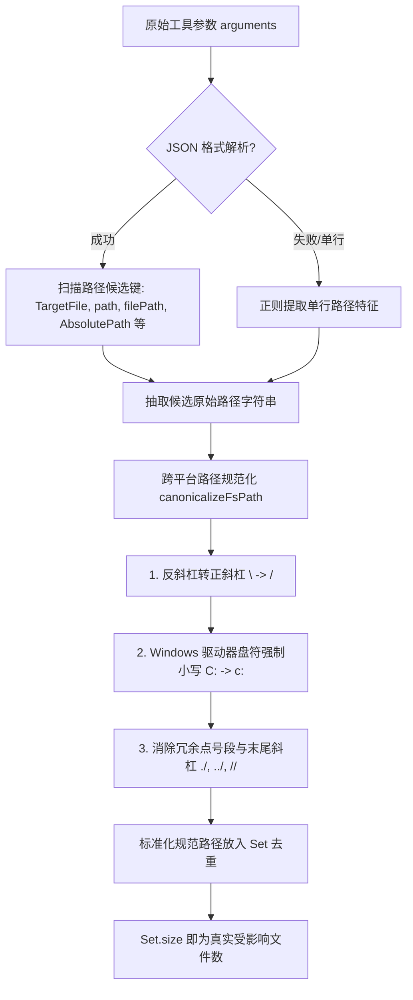
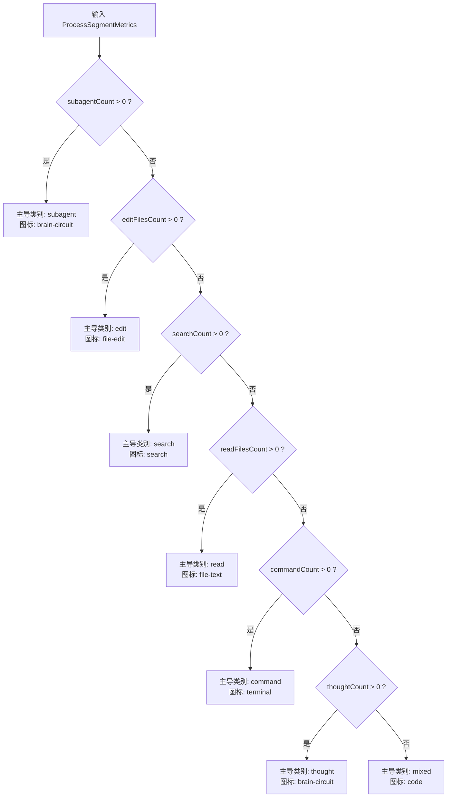
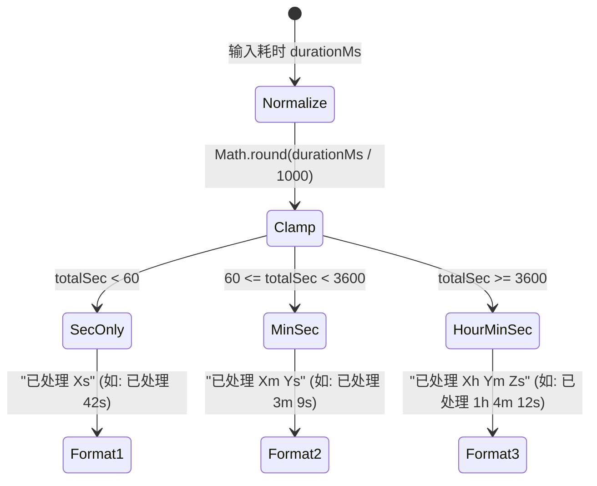

# 折叠态聚合文案与度量算法详案（图五规范与工程落地）

> **方案标识**：`docs/assistant-process-folding/02-折叠态聚合文案与度量算法详案.md`  
> **所属战役**：正文交错过程折叠战役（Assistant Process Folding）第 2 波详细方案设计  
> **方案角色**：折叠态聚合文案算法方案设计师  
> **撰写日期**：2026-09-11  
> **权威纪律依据**：仓库根目录 `AGENTS.md`、`.agents/LOGIC_PLAN_NO_RETREAT.md`、`docs/assistant-process-folding/00-纪律与调度状态.md`  
> **关联调研报告**：  
> - `docs/assistant-process-folding/survey/03-expanded-style-and-tool-header-survey.md`（展开态与折叠态视觉基线）  
> - `docs/assistant-process-folding/survey/06-tokens-and-until-found-survey.md`（Design Tokens 与 until-found 原生穿透）  
> - `docs/assistant-process-folding/survey/01-timeline-and-data-model-survey.md`（时间线与数据模型）  
>
> **【第二轮裁决 · 就地修订（2026-09-11）】**
> 本详案原以「中圆点 ` · ` 拼接聚合摘要」（图五）与「顶部虚线工作时间胶囊」为契约。
> 经用户第二轮裁决，二者**均已物理切除**：`processMetricsEngine.ts` 中
> `formatSegmentSummary` 与常量 `MIDDLE_DOT` 已删除，折叠控制栏不再绘制发丝分割线。
> **现行唯一有效契约**为 `formatDurationLabel` + `formatProcessControlLabel`，见 **§5·补**。
> 文中标注「已废除 / 已废除留档」的章节与代码仅为演进留档，**不得作为实现依据**
> （中圆点拼接摘要与顶部时间胶囊已物理切除，留档将构成假契约）。

---

## 目录

1. [方案概述与设计哲学](#1-方案概述与设计哲学)
   - 1.1 图五终态收敛法则
   - 1.2 核心设计原则（SSOT、纯逻辑解耦、O(N) 高性能去重）
2. [六大正交动作领域分类与度量体系](#2-六大正交动作领域分类与度量体系)
   - 2.1 正交分类语义表与工具映射矩阵
   - 2.2 跨平台路径提取与规范化去重算法（Canonical Path Deduplication）
   - 2.3 核心度量契约定义：`ProcessSegmentMetrics`
3. [主导图标仲裁树算法（Dominant Icon Arbitration Tree）](#3-主导图标仲裁树算法dominant-icon-arbitration-tree)
   - 3.1 仲裁决策权重层级
   - 3.2 图标呈现映射（AppIcon / Hugeicons SSoT、无障碍 ARIA 语义）
   - 3.3 仲裁函数数学推导与纯逻辑实现
4. [聚合摘要字符串自然语言拼接契约](#4-聚合摘要字符串自然语言拼接契约)
   - 4.1 工作时间文案排版规范（14px、字重 400、等宽数字、默认浅色）
   - 4.2 【已废除】非零维度权重流水线与语序矩阵
   - 4.3 控制栏退化态仲裁（单思考 / 单工具 / 全空）
   - 4.4 现网场景实证对照（工作时间口径）
5. [顶部状态胶囊时间进位制格式化算法【已废除】](#5-顶部状态胶囊时间进位制格式化算法)
   - 5.1 【已废除】进位制时钟格式化状态机
   - 5.2 定宽数字与防频闪（继续有效）
   - 5.3 【已废除】顶部状态胶囊文案生成器
   - 5·补 [工作时间文案契约（现行唯一有效）](#5补工作时间文案契约2026-09-11-第二轮裁决--取代原中圆点拼接)
6. [核心算法函数完整生产级实现代码](#6-核心算法函数完整生产级实现代码)
   - 6.1 `processMetricsEngine.ts` 纯逻辑核心实现
7. [边界条件防御与中文标点排版规范](#7-边界条件防御与中文标点排版规范)
   - 7.1 10 大极限边界条件防御矩阵
   - 7.2 工作时间文案排版契约（字号 / 字重 / 默认浅色 / 等宽数字）
8. [穷举式单元测试用例设计与测试套件](#8-穷举式单元测试用例设计与测试套件)
   - 8.1 单元测试套件源码：`processMetricsEngine.test.ts`
   - 8.2 测试断言与覆盖率说明
9. [工程接入路径与组件集成方案](#9-工程接入路径与组件集成方案)
   - 9.1 `turnProcessState.ts` 无损平滑升级
   - 9.2 `TurnProcessNodeView.tsx` 控制栏与插槽接入
   - 9.3 与 HTML5 `hidden="until-found"` 及 VSM 虚拟滚动的集成保障
10. [总结与交付确认](#10-总结与交付确认)

---

## 1. 方案概述与设计哲学

### 1.1 图五终态收敛法则

在 Conex / Crish 的对话演进中，AI 助手的多步复杂执行（例如：调用 ripgrep 全局搜索、检视多份源码、调用正则或补丁编辑、并在终端执行门禁构建与验证）会在流式生成阶段产生密集的动作序列。根据战役目标与设计规范：

```
[流式执行期 (图一至图四)] ───────────────► [最终回答产出 (终态收敛 / 图五)]
• 细粒度单行 24px 展开呈现                   • 中间过程完全折叠收起
• 实时扫光动效、红绿差异行 (+7 -1)           • 折叠控制栏承载工作时间：工作 3 分 9 秒 ⌄
• 意图描述：修改、运行校验: check.mjs ⌄       • 无发丝分割线、无顶部虚线胶囊（已物理切除）
• 终端命令与思考段逐步流式追加              • 运行中为裸时长跳秒：3 分 9 秒 ⌄
                                           • 交付区直接呈现整洁优雅的最终 Markdown 正文
```

**图五的设计哲学**是：
1. **交付聚焦（Outcome Focused）**：当交付成果（最终结论或解决方案正文）生成后，执行细节降级为次要佐证，不得侵占主视线焦点；
2. **高阶认知压缩（Cognitive Compression）**：用户不需要肉眼遍历 20 行工具调用记录，而是需要一眼掌握“AI 究竟动了哪些文件、查了多少次、跑了几条命令”；
3. **零损耗可回溯（Zero-Loss Reversibility）**：折叠不是丢弃；点击折叠控制栏（`FoldableProcessSection`）即可就地展开完整的时间线细节，且浏览器原生 `Ctrl+F` 能穿透检索（HTML5 `hidden="until-found"`）。

### 1.2 核心设计原则

- **单一真理源（SSOT）**：将输入的时间线项集合（`AssistantTimelineItem[]`）经过确定性管道，推导为单一不变的 `ProcessSegmentMetrics` 数据结构，禁止在多个组件内部各自写局部正则去统计。
- **纯逻辑无 DOM 依赖（Pure Functional Architecture）**：算法引擎必须是 100% 的纯函数，零 DOM、零 React 运行时依赖，既可在 React 组件层执行，也可在 Web Worker 或 Node.js 测试框架中以微秒级吞吐运行。
- **路径等价去重（Path Equivalence Deduplication）**：按文件绝对路径与规范化相对路径去重，多次连续修改同一文件仅计为“1 个文件”。
- **排版同构与默认浅色（Uniform Typography & Tertiary Color）**：除 AI 正文内容外，过程区一切文案（折叠控制栏工作时间、思考行、工具行）**同构** —— **14px 字号、字重 400、颜色 `--text-tertiary`**，数字使用 `tabular-nums` 等宽防跳字。**严禁**再以中圆点 ` · `（`U+00B7`）拼接维度摘要。

---

## 2. 六大正交动作领域分类与度量体系

### 2.1 正交分类语义表与工具映射矩阵

系统将 AI 执行过程中的原子操作划分为 **6 大正交动作领域（Orthogonal Action Domains）**。分类遵循互斥与穷尽（MECE）法则：

| 领域分类代号 | 领域中文名 | 核心语义与工具集特征 | 计数目标与去重规则 | 原产本文案模板（**已废除留档**，不再产出） |
|:---|:---|:---|:---|:---|
| **`edit`** | **编辑领域** | 修改、创建、补丁写入文件。<br>工具：`replace_file_content`, `edit_file`, `write_to_file`, `write_file`, `create_file`, `apply_patch`, `multi_replace`, `patch`, `save_file`, `append_file`, `delete_file` | **去重统计受影响文件数**。<br>同一个文件修改 $N$ 次计为 1。 | `已编辑 ${editFilesCount} 个文件` |
| **`search`** | **搜索领域** | 检索代码、文件定位、网络搜索。<br>工具：`grep_search`, `find_by_name`, `search_web`, `web_search`, `glob`, `ripgrep`, `search`, `code_search`, `file_search`, `symbol_search` | **累加统计执行查询次数**。<br>每次独立探查均为独立动作，不进行去重。 | `已搜索 ${searchCount} 次` |
| **`read`** | **读取领域** | 检视文件内容、网页提取、资源检视。<br>工具：`view_file`, `read_file`, `open_file`, `cat`, `read_text_file`, `read_file_content`, `read_url_content`, `read_resource`, `list_resources`, `inspect_element`, `read_text`, `list_dir` | **去重统计读取的目标文件/目标 URL 数**。<br>反复阅读同一文件计为 1。 | `已读取 ${readFilesCount} 个文件` |
| **`run`** | **命令领域** | 终端命令行执行、脚本调用、测试验证。<br>工具：`run_command`, `bash`, `pwsh`, `powershell`, `exec`, `terminal`, `shell`, `cmd`, `execute_command` | **累加统计执行的命令总条数**。<br>即便相同命令多次执行（如轮询/重试）亦忠实记录。 | `已运行 ${commandCount} 条命令` |
| **`subagent`** | **协作领域** | 多 Agent 协作派发、等待与消息通信。<br>工具：`invoke_subagent`, `run_subagent`, `wait_subagents`, `manage_subagents`, `send_message`, `define_subagent` | **累加统计分派或执行的子代理任务数**。 | `已协作 ${subagentCount} 个子任务` |
| **`thought`** | **思考领域** | 思维链推理、认知分段推导。<br>载荷：时间线项 `item.kind === 'thought'` | **统计思考块段数与总耗时毫秒数**。 | ~~`已深度思考 · 思考耗时 ${sec}s`~~ → 现为 `思考`（不显示工作时间时）；工作时间由控制栏承载 |

### 2.2 跨平台路径提取与规范化去重算法（Canonical Path Deduplication）

为了确保“3 次编辑发生在 2 个文件上，计为‘已编辑 2 个文件’”，必须从复杂多样的工具参数（JSON 字符串、单行路径字符串）中精确抽取路径，并在跨平台（Windows 盘符大小写、反斜杠、相对点号段）环境下进行等价性消解。



#### 规范化去重算法核心规则：
1. **多风格候选键穷举**：
   兼容工具定义（包含 PascalCase、camelCase、snake_case）：
   `'targetFile'`, `'TargetFile'`, `'target_file'`, `'path'`, `'Path'`, `'filePath'`, `'FilePath'`, `'file_path'`, `'filename'`, `'FileName'`, `'file'`, `'File'`, `'AbsolutePath'`, `'absolutePath'`, `'SearchPath'`, `'searchPath'`, `'uri'`, `'Uri'`, `'url'`, `'Url'`。
2. **驱动器盘符大小写无关消解（Windows 兼容）**：
   在 Windows 操作系统中，`C:\Software\conex\test.ts` 与 `c:/software/conex/test.ts` 指向同一物理文件。规范化算法强制将盘符转换为小写，并将反斜杠 `\` 统一为标准 POSIX 正斜杠 `/`。
3. **空参数与无路径回退保障**：
   若某次编辑操作未能从参数中提取出文件路径（如畸形参数），算法自动退化为以该工具调用的唯一 `tc.id` 作为占位键计入去重集合，确保计数既不虚增也不丢失。

### 2.3 核心度量契约定义：`ProcessSegmentMetrics`

> **【收敛修订 · SSOT 裁决（2026-09-11）】**
> 初版本详案自建了一套 `ProcessSegmentMetrics`（`editFilesCount` / `readFilesCount` /
> `commandCount` / `leadAction`），与 01 详案的同名接口**字段名冲突**
> （01 用 `readCount`/`editCount`/`commandCount`/`leadAction`）。两者同名不同义，
> 实现波必然编译冲突。
>
> **裁决**：`ProcessSegmentMetrics` 的**类型定义唯一归属 01 详案**
> （宿主 `api/tool-presentation/toolPresentationTypes.ts`）。本详案只负责
> **派生算法**（路径去重、摘要拼接、主导图标仲裁），**不再重复声明该 interface**。
> 下方为裁决后的最终字段表（与 01 §2.1 逐字一致），供本详案算法引用：

```typescript
// 【唯一权威定义位于 01 详案 §2.1 / api/tool-presentation/toolPresentationTypes.ts】
// 此处仅为引用副本，禁止在本文件重新 declare。
export interface ProcessSegmentMetrics {
  thoughtCount: number;        // 思考段数量
  thoughtDurationMs: number;   // 思考累计耗时
  toolCount: number;           // 工具调用总次数（含 subagent）
  subagentCount: number;       // 子代理调度次数（toolCount 子集；>0 触发铁律四）
  searchCount: number;         // 搜索类调用次数（按次累加）
  commandCount: number;        // 命令类调用次数（按次累加）
  readFilesCount: number;      // 读取涉及的文件/URL 去重数（按「个」）
  editFilesCount: number;      // 编辑涉及的文件去重数（按「个」）
  readPaths: readonly string[];   // 读取路径集合（供去重与 Tooltip）
  editPaths: readonly string[];   // 编辑路径集合
  injectionCount: number;      // 上下文注入卡片数
  totalDurationMs: number;     // 段总耗时
  hasRunning: boolean;
  hasError: boolean;
  isStreaming: boolean;
  leadAction: ProcessLeadAction;  // 主导动作（类型见 01 §2.2）
}
```

**字段语义对照（裁决表）**：

| 维度 | 本详案算法产出 | 01 契约字段 | 是否去重 |
| :--- | :--- | :--- | :--- |
| 编辑 | `editFilesCount` / `editPaths` | 同名 | **是**（按文件） |
| 搜索 | 累加计数 | `searchCount` | 否（按次） |
| 读取 | `readFilesCount` / `readPaths` | 同名 | **是**（按文件/URL） |
| 命令 | 累加计数 | `commandCount` | 否（按次） |
| 协作 | 累加计数 | `subagentCount` | 否（按次） |
| 思考 | 计数 + 耗时 | `thoughtCount` / `thoughtDurationMs` | — |
| 主导 | 仲裁结果 | `leadAction` | — |

> **命名弃用（初版 → 收敛后）**：
> `shellCommandCount` → `commandCount`；`dominantCategory` → `leadAction`；
> `editedFilePaths` → `editPaths`；`readFilePaths` → `readPaths`；
> 枚举 `'run'` → `'command'`；枚举 `'generic'` → `'mixed'`。
> 全文（含测试用例）已按此替换；`'generic'` 作为兜底类别的历史写法已物理清除。

---

## 3. 主导图标仲裁树算法（Dominant Icon Arbitration Tree）

### 3.1 仲裁决策权重层级

折叠摘要条的最左侧需要一枚能够直观定性“这一轮执行究竟以什么动作为核心特征”的**主导图标（Dominant Icon）**。当一轮执行同时混合了多种维度的动作时，算法依据**动作破坏性/价值浓度权重降序**进行决策仲裁：

$$\text{协作 (Subagent)} > \text{编辑 (Edit)} > \text{搜索 (Search)} > \text{读取 (Read)} > \text{命令 (Command)} > \text{思考 (Thought)} > \text{混合 (Mixed)}$$

> **【1:1 校对】** 该顺序与 `processMetricsEngine.ts` 的 `arbitrateLeadAction`
> 逐行一致（`subagent > edit > search > read > command > thought > mixed`），
> 是主导图标仲裁的**唯一权威口径**。



#### 决策树设计 Rationale（与 `arbitrateLeadAction` 逐行一致）：
1. **协作（brain-circuit）最高权**：子代理派发意味着整轮执行由下游 Agent 承接，最具全局定性；
2. **编辑（file-edit）次高权**：代码或文件写入直接变更磁盘状态，是开发辅助中最具实质性产出的行为，用户关注度最高；
3. **搜索（search）第三权**：主动探查意图强烈（排查定位根因），具有极高的探索标识度；
4. **读取（file-text）第四权**：纯内容输入，相较于修改更为被动，但在无协作/编辑/搜索时是核心上下文汲取动作；
5. **命令（terminal）第五权**：执行构建、校验脚本或测试；
6. **思考（brain-circuit）第六权**：纯思维推导，无任何外部工具调用时的纯认知状态；
7. **混合（code）兜底**：处理边缘未知或杂项工具。

### 3.2 图标呈现映射（AppIcon / Hugeicons SSoT + 无障碍 ARIA 语义）

> **【收敛修订 · 图标 SSOT 铁律（2026-09-11 用户裁决）】**
> 本项目图标**唯一合法入口**为 `@/components/ui/icons/AppIcon`，底层由
> `iconMap.ts` 桥接到 **`@hugeicons/core-free-icons`**（`apps/crish-desktop/package.json:32-33`）。
> `AppIcon.tsx:3` 顶部明确声明「禁止业务直接 import lucide-react / @hugeicons/*」，
> 且有 `check:icon-ssot` 门禁强制。
>
> **初版错误**：本详案原用 **Unicode Emoji（✏️🔍📄⚡🤖🧠🛠️）** + **Lucide 组件名**，
> 两处**均违反 SSoT**：emoji 在 Windows/Linux 字体渲染下大小与基线不可控（无法走
> `snapIconSize` 与 `ICON_STROKE` 统一线宽），Lucide 根本不在本仓依赖中。
> 收敛为 `IconName`（AppIcon 契约名），已核验全部存在于 `iconMap.ts` 的 `ICON_NAMES`。

```typescript
// 【唯一权威定义归属 01 详案 §2.2；此处为引用副本】
import type { ProcessLeadAction } from './toolPresentationTypes';
import type { IconName } from '@/components/ui/icons/iconMap';

export interface DominantIconSpec {
  category: ProcessLeadAction;
  /** AppIcon 契约图标名（唯一合法渲染入口，底层 hugeicons） */
  iconName: IconName;
  /** 中文语义标签（无障碍与 aria-label） */
  ariaLabel: string;
}

export const DOMINANT_ICON_MAP: Record<ProcessLeadAction, DominantIconSpec> = {
  edit: {
    category: 'edit',
    iconName: 'file-edit',
    ariaLabel: '已编辑文件',
  },
  search: {
    category: 'search',
    iconName: 'search',
    ariaLabel: '已执行搜索',
  },
  read: {
    category: 'read',
    iconName: 'file-text',
    ariaLabel: '已读取文件',
  },
  command: {
    category: 'command',
    iconName: 'terminal',
    ariaLabel: '已运行命令',
  },
  subagent: {
    category: 'subagent',
    iconName: 'brain-circuit',
    ariaLabel: '已协作子代理',
  },
  thought: {
    category: 'thought',
    iconName: 'brain-circuit',
    ariaLabel: '思考',
  },
  mixed: {
    category: 'mixed',
    iconName: 'code',
    ariaLabel: '已完成处理',
  },
};
```

---

## 4. 聚合摘要字符串自然语言拼接契约

> **【已废除 · 2026-09-11 第二轮裁决】**
> 本节原定的「中圆点 ` · ` 拼接聚合摘要」（`已编辑 N 个文件 · 已搜索 M 次 · …`）
> **已随 `formatSegmentSummary` 与常量 `MIDDLE_DOT = ' \u00b7 '` 一起从
> `processMetricsEngine.ts` 物理删除**。折叠控制栏的现行唯一契约为
> **§5·补** 的 `formatDurationLabel` + `formatProcessControlLabel`。
> 以下内容仅在标注「已废除 / 已废除留档」处留档，其余为按新裁决就地改写后的有效口径。

### 4.1 工作时间文案排版规范

过程区文案（折叠控制栏工作时间、思考行、工具行）必须 100% 同构。排版规则如下：

1. **字号与字重**：统一 **14px / 字重 400**（与思考行、工具行完全一致），**不加粗、不放大**；
2. **默认浅色**：除 AI 正文内容外，过程区一切文案使用默认色 `--text-tertiary`；
   `已运行 N 条命令` 亦然 —— 正常文字大小 + 默认较浅颜色；
3. **汉字与数字排版（盘古之白）**：
   - 中文字符与阿拉伯数字之间保持半角空格：`工作 3 分 9 秒`、`已运行 3 条命令`；
   - 数字与中文量词紧密衔接：`3 分`、`9 秒`、`3 条命令`。
4. **分隔符规范（负向铁律）**：
   - **严禁**再出现中圆点带半角空格 ` · `（`\u0020\u00b7\u0020`）拼接的维度摘要；
   - **严禁**使用半角点 `.`、全角逗号 `，`、顿号 `、` 或全角间隔号 `・`（`\u30fb`）充当分段分隔符；
   - 控制栏**单一语义**：只输出工作时间（或 §4.3 的退化标签），不拼接任何维度计数。
5. **无分割线**：折叠控制栏与工具调用行**不得**绘制发丝分割线（原 0.5px 细线已切除）。

### 4.2 【已废除】非零维度权重流水线与语序矩阵

> **已废除留档**：以下「按维度拼接流水线」已随 `formatSegmentSummary` 物理切除，全仓禁止回潮。

~~$$\text{已编辑 } E \text{ 个文件} \longrightarrow \text{已搜索 } S \text{ 次} \longrightarrow \text{已读取 } R \text{ 个文件} \longrightarrow \text{已运行 } C \text{ 条命令} \longrightarrow \text{已协作 } A \text{ 个子任务}$$~~

**替代口径**：控制栏不再按维度计数拼接，改为单一的工作时间 / 退化标签判定：

$$\text{showTimeCapsule} \;?\; \bigl(\text{isLive} \;?\; \text{裸时长} : \text{“工作 ”} + \text{时长}\bigr) \;:\; \bigl(\text{思考} \;\vert\; \text{已运行 N 条命令} \;\vert\; \text{处理过程}\bigr)$$

完整判定矩阵见 **§5·补.3**。

### 4.3 控制栏退化态仲裁（单思考 / 单工具 / 全空）

当 `showTimeCapsule === false`（即 `thoughtCount + toolCount < 2`，由分段器
`shouldShowTimeCapsule` 给出）时，控制栏**不显示工作时间区域**，退化为极简语义标签：

- **单思考段**：`thoughtCount > 0` → `思考`
  （用户裁决：「思考就是思考，没有已深度思考这一说」；`已深度思考` 文案已物理废除）；
- **单工具调用段**：`thoughtCount === 0 && toolCount > 0` → `已运行 ${toolCount} 条命令`；
- **全空兜底态（Empty / Fallback）**：全维度均为 0 → `处理过程`。

> **判定顺序**：先思考、后工具、再兜底 —— `思考` 优先级高于 `已运行 N 条命令`。
> 三者均为 14px / 字重 400 / `--text-tertiary`。

### 4.4 现网场景实证对照（工作时间口径）

| 输入场景（原子动作流水） | 仲裁主导图标 | `showTimeCapsule` | `isLive` | 折叠控制栏输出 |
|:---|:---|:---|:---|:---|
| **场景 A**：1 次思考 + 2 次 grep_search、3 次 read_file（3 个不同文件），终态耗时 12.4s | `search` | `true`（1+5≥2） | `false` | `工作 12.4 秒` |
| **场景 B**：2 次思考 + 4 次编辑（3 文件）、3 次搜索、1 次读取、3 次命令，终态耗时 63s | `edit` | `true`（2+11≥2） | `false` | `工作 1 分 3 秒` |
| **场景 C（纯思考单段）**：无工具调用，模型思考 3540ms 后直接输出 Markdown 答案 | `thought` | `false`（1+0<2） | — | `思考` |
| **场景 D（运行中）**：本轮已执行 5 条命令且仍在流式输出，已耗时 18.2s | `command` | `true` | `true` | `18.2 秒`（裸时长跳秒，无「工作」前缀） |
| **场景 E（单工具段）**：仅 1 次工具调用、无思考 | `mixed` | `false`（0+1<2） | — | `已运行 1 条命令` |
| **场景 F（全空兜底）**：无思考、无工具调用 | `mixed` | `false`（0+0<2） | — | `处理过程` |

---

## 5. 顶部状态胶囊时间进位制格式化算法

> **【已废除 · 2026-09-11 第二轮裁决】**
> 顶部虚线工作时间胶囊（`已处理 3m 9s ⌄`）**已物理切除** —— 用户裁决：
> 「现在我看可以去掉工具调用或者是工作时间下的那根细线了，带上了这个影响排版了。」
> `formatCapsuleStatus` / `formatDurationCarry` 不再属于现行契约，禁止新代码调用。
> 工作时间改由**折叠控制栏**（`FoldableProcessSection`）承载，
> 格式化唯一入口为 `formatDurationLabel`，完整契约见 **§5·补**。

### 5.1 【已废除】进位制时钟格式化状态机

在图五规范中，消息顶部外露一个轻量级工作状态胶囊：`已处理 3m 9s ⌄`。
该时间指标反映整轮交互（从首个思考/工具启动到最终产出完成）的物理执行周期。



#### 进位数学推导公式：
给定毫秒数 $T \in \mathbb{R}$：
1. 钳位总秒数：
   $$S = \max(1, \operatorname{round}(T / 1000))$$
   *注：若实际耗时 $>0$ 但 $<500\text{ms}$，向上钳位为 $1\text{s}$，消除无意义的 `已处理 0s` 虚假体感。*
2. 状态分级：
   - **区间 1**：$S < 60$
     $$\text{Text} = \text{"已处理 "} + S + \text{"s"}$$
   - **区间 2**：$60 \le S < 3600$
     $$M = \lfloor S / 60 \rfloor, \quad R = S \pmod{60}$$
     $$\text{Text} = \text{"已处理 "} + M + \text{"m "} + R + \text{"s"}$$
   - **区间 3（极端超长任务防御）**：$S \ge 3600$
     $$H = \lfloor S / 3600 \rfloor, \quad M = \lfloor (S \pmod{3600}) / 60 \rfloor, \quad R = S \pmod{60}$$
     $$\text{Text} = \text{"已处理 "} + H + \text{"h "} + M + \text{"m "} + R + \text{"s"}$$

### 5.2 定宽数字与防频闪（继续有效）

在流式执行阶段，计时器每数百毫秒更新一次。为避免界面文本产生视觉抖动：
- 秒档保留 1 位小数（`toFixed(1)`）呈现「跳秒」体感，分/时档取整，避免数字在每帧微任务中疯狂跳动；
- **必须**采用定宽数字排版（CSS `font-variant-numeric: tabular-nums;`），确保字符进位时折叠控制栏物理宽度稳定、不产生左右抖动。

### 5.3 【已废除】顶部状态胶囊文案生成器

胶囊右侧配备折叠/展开指示指示符：
- **收起状态（默认终态）**：`已处理 3m 9s ⌄`（或指示向下的柔和 Chevron）；
- **展开状态**：`已处理 3m 9s ⌃`。

文案格式化函数签名为：
```typescript
export function formatCapsuleStatus(
  durationMs: number,
  isExpanded: boolean,
  prefix = '已处理'
): string;
```
> ↑ **已废除留档**：该签名随顶部虚线胶囊一起物理切除。

---

## 5·补、工作时间文案契约（2026-09-11 第二轮裁决 · 取代原中圆点拼接）

> **【现行唯一有效契约】** 本节取代 §4 的中圆点拼接摘要与 §5 的顶部时间胶囊。
> 实现落点：`apps/crish-desktop/src/api/tool-presentation/processMetricsEngine.ts`
> （`formatDurationLabel` / `formatProcessControlLabel`）；
> `showTimeCapsule` 由 `timelineSegmenter.ts` 的
> `shouldShowTimeCapsule(thoughtCount, toolCount) => thoughtCount + toolCount >= 2` 给出。

### 5·补.1 裁决要点（用户原话 → 工程口径）

| 用户原话 | 工程口径 |
|:---|:---|
| 「工作多少秒是在当前的『已深度思考』那里」 | 工作时长由**折叠控制栏**（`FoldableProcessSection`）承载，即原「已深度思考」所在位置 |
| 「**思考就是思考，没有已深度思考这一说**」 | `已深度思考` 文案**彻底废除**；单思考段标签为 `思考` |
| 「只显示工作时长和总结内容」 | 终态控制栏只有工作时间；正文总结之外不再拼接任何维度摘要 |
| 「现在我看可以去掉……那根细线了，带上了这个影响排版了」 | 顶部虚线胶囊物理切除；控制栏**无发丝分割线** |
| 「除了正文内容，其他的都是默认浅色的」「就是正常的文字大小」 | 控制栏与思考行/工具行**同构**：14px / 字重 400 / `--text-tertiary` |

### 5·补.2 `formatDurationLabel(ms)` 三档边界

| 档位 | 判定条件 | 输出模板 | 临界样例 |
|:---|:---|:---|:---|
| **秒档** | `sec = ms / 1000 < 60` | `` `${sec.toFixed(1)} 秒` `` | `59900 → 59.9 秒`（60s 前一档）；`3540 → 3.5 秒`；`0 → 0.0 秒` |
| **分秒档** | `60 ≤ sec < 3600` | `` `${m} 分 ${s} 秒` `` | `60000 → 1 分 0 秒`（跨过秒档）；`189000 → 3 分 9 秒`；`3599000 → 59 分 59 秒` |
| **时分档** | `sec ≥ 3600` | `` `${h} 小时 ${rm} 分` `` | `3600000 → 1 小时 0 分`（跨过分秒档）；`3665000 → 1 小时 1 分` |

其中 `m = floor(sec / 60)`、`s = floor(sec % 60)`、`h = floor(m / 60)`、`rm = m % 60`。

> **防跳字**：渲染层必须加 `font-variant-numeric: tabular-nums;`，
> 否则秒档 `toFixed(1)` 每 100ms 变化会造成控制栏宽度抖动。

### 5·补.3 `formatProcessControlLabel(metrics, showTimeCapsule, elapsedMs, isLive)` 判定矩阵

| # | `showTimeCapsule` | `isLive` | `metrics` 条件 | 输出 | 说明 |
|:---|:---|:---|:---|:---|:---|
| 1 | `true` | `true` | — | `formatDurationLabel(elapsedMs)`（**裸时长**） | 运行中跳秒，**无**「工作」前缀 |
| 2 | `true` | `false` | — | `` `工作 ${formatDurationLabel(elapsedMs)}` `` | 终态：`工作 3 分 9 秒` |
| 3 | `false` | — | `thoughtCount > 0` | `思考` | 单思考段，不显示工作时间 |
| 4 | `false` | — | `thoughtCount === 0 && toolCount > 0` | `` `已运行 ${toolCount} 条命令` `` | 单工具段 |
| 5 | `false` | — | 全 0 | `处理过程` | 全空兜底 |

判定顺序（与实现逐行一致）：

```
showTimeCapsule ──► 是 ──► isLive ? 裸时长 : `工作 ${时长}`
       │
       否
       ▼
thoughtCount > 0 ──► 是 ──► '思考'
       │ 否
       ▼
toolCount > 0 ──► 是 ──► `已运行 ${toolCount} 条命令`
       │ 否
       ▼
    '处理过程'
```

### 5·补.4 排版契约（与思考行 / 工具行同构）

| 属性 | 取值 | 适用范围 |
|:---|:---|:---|
| 字号 | **14px** | 控制栏工作时间、`思考`、`已运行 N 条命令`、`处理过程` |
| 字重 | **400** | 同上（不加粗） |
| 颜色 | **默认浅色 `--text-tertiary`** | 除 AI 正文内容外的全部过程区文案 |
| 数字字形 | `font-variant-numeric: tabular-nums` | 所有含数字的过程区文案 |
| 分割线 | **无** | 控制栏与工具调用行均不得绘制发丝分割线 |
| 图标 | `DOMINANT_ICON_MAP`（`@hugeicons/core-free-icons`，**严禁 emoji**） | 主导图标 |

### 5·补.5 负向断言（测试与 Code Review 强制项）

- 输出**不得**包含 `已深度思考`；
- 输出**不得**包含中圆点 `·`（`U+00B7`）；
- 输出**不得**出现 `已编辑 N 个文件` / `已搜索 M 次` / `已读取 K 个文件` 等维度拼接片段；
- 全仓**不得**再引用 `formatSegmentSummary` / `MIDDLE_DOT` / `formatCapsuleStatus` / `formatDurationCarry`。

---

## 6. 核心算法函数完整生产级实现代码

以下给出经过严格类型约束与极致性能优化的纯逻辑模块完整代码，可直接落盘或合入桌面端工程：

```typescript
/**
 * apps/crish-desktop/src/components/chat-message/processMetricsEngine.ts
 *
 * 折叠态聚合文案与度量算法引擎（图五规范与 SSOT 核心实现）
 *
 * 特性：
 * 1. 六大正交领域分类与跨平台路径规范化去重（Canonical Path Deduplication）；
 * 2. 主导图标仲裁树（Dominant Icon Arbitration Tree）；
 * 3. 【已废除】图五自然语言聚合摘要字符串拼接（中圆点 ` · `）
 *    → 现为 formatProcessControlLabel，见 §5·补；
 * 4. 【已废除】顶部工作时间胶囊格式化器 → 现为 formatDurationLabel，见 §5·补；
 * 5. 零 DOM 依赖，支持 Web Worker、Node.js 与 React 前端。
 */

import type { AssistantTimelineItem } from '../../api/toolPresentation';
import type { MessageToolCall } from '../../store/types';

/** 动作领域分类枚举（唯一权威定义归属 01 详案 §2.2） */
export type ProcessLeadAction =
  | 'edit'
  | 'search'
  | 'read'
  | 'command'
  | 'subagent'
  | 'thought'
  | 'mixed';

/** 主导图标规格（AppIcon 契约；唯一合法渲染入口，底层 hugeicons） */
export interface DominantIconSpec {
  category: ProcessLeadAction;
  /** AppIcon 契约图标名（ICON_NAMES 成员；严禁 emoji / Lucide / 直连图标库） */
  iconName: IconName;
  ariaLabel: string;
}

export const DOMINANT_ICON_MAP: Record<ProcessLeadAction, DominantIconSpec> = {
  edit: { category: 'edit', iconName: 'file-edit', ariaLabel: '已编辑文件' },
  search: { category: 'search', iconName: 'search', ariaLabel: '已执行搜索' },
  read: { category: 'read', iconName: 'file-text', ariaLabel: '已读取文件' },
  command: { category: 'command', iconName: 'terminal', ariaLabel: '已运行命令' },
  subagent: { category: 'subagent', iconName: 'brain-circuit', ariaLabel: '已协作子代理' },
  thought: { category: 'thought', iconName: 'brain-circuit', ariaLabel: '思考' },
  mixed: { category: 'mixed', iconName: 'code', ariaLabel: '已完成处理' },
};


/** 六大正交领域指标契约 */
export interface ProcessSegmentMetrics {
  editFilesCount: number;
  editPaths: string[];
  /** 工具调用总次数（含 subagent）；退化标签 `已运行 N 条命令` 与 showTimeCapsule 均依赖此字段 */
  toolCount: number;
  searchCount: number;
  readFilesCount: number;
  readPaths: string[];
  commandCount: number;
  subagentCount: number;
  thoughtCount: number;
  thoughtDurationMs: number;
  totalDurationMs: number;
  leadAction: ProcessLeadAction;
}

/** 折叠呈现装配结果（顶部胶囊字段已随胶囊物理切除） */
export interface ProcessSummaryPresentation {
  iconSpec: DominantIconSpec;
  /** 折叠控制栏文案（formatProcessControlLabel 产物） */
  controlLabelText: string;
  metrics: ProcessSegmentMetrics;
}

// ─────────────────────────────────────────────────────────────────────────────
// 1. 跨平台路径规范化与参数安全提取
// ─────────────────────────────────────────────────────────────────────────────

/**
 * 跨平台路径规范化（消除大小写不一致、正反斜杠、相对段与末尾冗余）
 */
export function canonicalizeFsPath(rawPath?: string | null): string {
  if (!rawPath || typeof rawPath !== 'string') return '';
  let p = rawPath.trim();
  if (!p) return '';

  // 剔除前后引号
  if ((p.startsWith('"') && p.endsWith('"')) || (p.startsWith("'") && p.endsWith("'"))) {
    p = p.slice(1, -1).trim();
  }

  // 统一所有反斜杠为正斜杠
  p = p.replace(/\\/g, '/');

  // Windows 驱动器小写化（例如 "C:/" -> "c:/"）
  if (/^[a-zA-Z]:\//.test(p)) {
    p = p.charAt(0).toLowerCase() + p.slice(1);
  }

  // 压缩连续斜杠（保护前导 "//" UNC 路径）
  if (p.startsWith('//') && !p.startsWith('///')) {
    p = '//' + p.slice(2).replace(/\/+/g, '/');
  } else {
    p = p.replace(/\/+/g, '/');
  }

  // 消除末尾斜杠（除非是根路径）
  if (p.length > 1 && p.endsWith('/') && !/^[a-zA-Z]:\/$/.test(p)) {
    p = p.slice(0, -1);
  }

  return p;
}

/**
 * 优先候选键清单（按常见度与语义排序）
 */
const PATH_CANDIDATE_KEYS = [
  'targetFile',
  'TargetFile',
  'target_file',
  'path',
  'Path',
  'filePath',
  'FilePath',
  'file_path',
  'AbsolutePath',
  'absolutePath',
  'filename',
  'FileName',
  'file',
  'File',
  'SearchPath',
  'searchPath',
  'url',
  'Url',
  'uri',
  'Uri',
  'target',
  'Target',
  'DirectoryPath',
  'directorypath',
];

/**
 * 从工具参数字符串中安全提取目标文件路径或目标标识
 */
export function extractTargetPathFromArgs(rawArgs?: string | null): string | null {
  if (!rawArgs || typeof rawArgs !== 'string') return null;
  const trimmed = rawArgs.trim();
  if (!trimmed || trimmed === '{}' || trimmed === '[]') return null;

  // JSON 解析尝试
  if (trimmed.startsWith('{') || trimmed.startsWith('[')) {
    try {
      const parsed = JSON.parse(trimmed) as Record<string, unknown>;
      if (parsed && typeof parsed === 'object') {
        const root =
          parsed.parameters && typeof parsed.parameters === 'object'
            ? (parsed.parameters as Record<string, unknown>)
            : parsed.input && typeof parsed.input === 'object'
              ? (parsed.input as Record<string, unknown>)
              : parsed;

        for (const key of PATH_CANDIDATE_KEYS) {
          const val = root[key];
          if (typeof val === 'string' && val.trim() && !val.includes('\n') && val.length < 1024) {
            return val.trim();
          }
        }
      }
    } catch {
      // 容错吸收，继续向下尝试正则
    }
  }

  // 非 JSON 或正则单行路径匹配（支持带斜杠的路径）
  if (!trimmed.includes('\n') && /[\\/]/.test(trimmed) && trimmed.length < 512) {
    return trimmed.replace(/^['"]|['"]$/g, '');
  }

  return null;
}

// ─────────────────────────────────────────────────────────────────────────────
// 2. 六大领域工具名称判定断言集
// ─────────────────────────────────────────────────────────────────────────────

export function isEditTool(name: string): boolean {
  const n = (name || '').toLowerCase().replace(/[\s-]+/g, '_');
  return (
    n === 'replace_file_content' ||
    n === 'edit_file' ||
    n === 'write_file' ||
    n === 'write_to_file' ||
    n === 'create_file' ||
    n === 'apply_patch' ||
    n === 'multi_replace' ||
    n === 'patch' ||
    n === 'save_file' ||
    n === 'append_file' ||
    n === 'delete_file' ||
    n.includes('replace') ||
    n.includes('write_to')
  );
}

export function isSearchTool(name: string): boolean {
  const n = (name || '').toLowerCase().replace(/[\s-]+/g, '_');
  return (
    n === 'grep_search' ||
    n === 'find_by_name' ||
    n === 'search_web' ||
    n === 'web_search' ||
    n === 'glob' ||
    n === 'ripgrep' ||
    n === 'search' ||
    n === 'code_search' ||
    n === 'file_search' ||
    n === 'symbol_search' ||
    n.includes('grep') ||
    n.includes('search') ||
    n.includes('find_by')
  );
}

export function isReadTool(name: string): boolean {
  const n = (name || '').toLowerCase().replace(/[\s-]+/g, '_');
  return (
    n === 'view_file' ||
    n === 'read_file' ||
    n === 'open_file' ||
    n === 'cat' ||
    n === 'read_text_file' ||
    n === 'read_file_content' ||
    n === 'read_url_content' ||
    n === 'read_resource' ||
    n === 'list_resources' ||
    n === 'list_dir' ||
    n === 'inspect_element' ||
    n === 'read_text' ||
    n.includes('view') ||
    (n.includes('read') && !n.includes('thread'))
  );
}

export function isShellTool(name: string): boolean {
  const n = (name || '').toLowerCase().replace(/[\s-]+/g, '_');
  return (
    n === 'run_command' ||
    n === 'bash' ||
    n === 'pwsh' ||
    n === 'powershell' ||
    n === 'exec' ||
    n === 'terminal' ||
    n === 'shell' ||
    n === 'cmd' ||
    n === 'execute_command' ||
    n.includes('command') ||
    n.includes('terminal')
  );
}

export function isSubagentTool(name: string): boolean {
  const n = (name || '').toLowerCase().replace(/[\s-]+/g, '_');
  return (
    n === 'invoke_subagent' ||
    n === 'run_subagent' ||
    n === 'wait_subagents' ||
    n === 'manage_subagents' ||
    n === 'send_message' ||
    n === 'define_subagent' ||
    n.includes('subagent')
  );
}

// ─────────────────────────────────────────────────────────────────────────────
// 3. 核心度量提取算法（纯函数）
// ─────────────────────────────────────────────────────────────────────────────

export function calculateProcessSegmentMetrics(
  items?: AssistantTimelineItem[] | null,
  turnStartTime?: number,
  turnEndTime?: number
): ProcessSegmentMetrics {
  const editedPathSet = new Set<string>();
  const readPathSet = new Set<string>();
  let searchCount = 0;
  let commandCount = 0;
  let subagentCount = 0;
  let toolCount = 0;
  let thoughtCount = 0;
  let thoughtDurationMs = 0;

  if (Array.isArray(items)) {
    for (const item of items) {
      if (!item) continue;

      // 1. 思考领域收集
      if (item.kind === 'thought') {
        thoughtCount += 1;
        if (typeof item.durationMs === 'number' && item.durationMs > 0) {
          thoughtDurationMs += item.durationMs;
        }
      }

      // 2. 工具领域收集
      else if (item.kind === 'tools' && Array.isArray(item.items)) {
        for (const renderItem of item.items) {
          if (!renderItem) continue;
          const calls: MessageToolCall[] =
            renderItem.kind === 'single'
              ? [renderItem.tc]
              : Array.isArray(renderItem.tools)
                ? renderItem.tools
                : [];

          for (const tc of calls) {
            if (!tc) continue;
            toolCount += 1;
            const name = (tc.name || '').trim();
            const rawTarget = extractTargetPathFromArgs(tc.arguments || '');
            const canonicalPath = canonicalizeFsPath(rawTarget);
            // 去重 fallback 占位符：没有路径时以工具调用唯一 ID 保底
            const fallbackKey = canonicalPath || `tc-fallback-${tc.id}`;

            // 六大领域严格分支派发
            if (isEditTool(name)) {
              editedPathSet.add(fallbackKey);
            } else if (isSearchTool(name)) {
              searchCount += 1;
            } else if (isReadTool(name)) {
              readPathSet.add(fallbackKey);
            } else if (isShellTool(name)) {
              commandCount += 1;
            } else if (isSubagentTool(name)) {
              subagentCount += 1;
            }
          }
        }
      }
    }
  }

  // 物理总执行耗时
  const totalDurationMs =
    typeof turnStartTime === 'number' && typeof turnEndTime === 'number' && turnEndTime >= turnStartTime
      ? turnEndTime - turnStartTime
      : thoughtDurationMs;

  // 3. 运行主导动作仲裁树
  const leadAction = arbitrateLeadAction({
    editFilesCount: editedPathSet.size,
    searchCount,
    readFilesCount: readPathSet.size,
    commandCount,
    subagentCount,
    thoughtCount,
  });

  return {
    editFilesCount: editedPathSet.size,
    editPaths: Array.from(editedPathSet),
    searchCount,
    readFilesCount: readPathSet.size,
    readPaths: Array.from(readPathSet),
    commandCount,
    toolCount,
    subagentCount,
    thoughtCount,
    thoughtDurationMs,
    totalDurationMs,
    leadAction,
  };
}

// ─────────────────────────────────────────────────────────────────────────────
// 4. 主导图标仲裁树纯函数
// ─────────────────────────────────────────────────────────────────────────────

export function arbitrateLeadAction(counts: {
  editFilesCount: number;
  searchCount: number;
  readFilesCount: number;
  commandCount: number;
  subagentCount: number;
  thoughtCount: number;
}): ProcessLeadAction {
  // 决策树优先级：subagent > edit > search > read > command > thought > mixed
  if (counts.subagentCount > 0) return 'subagent';
  if (counts.editFilesCount > 0) return 'edit';
  if (counts.searchCount > 0) return 'search';
  if (counts.readFilesCount > 0) return 'read';
  if (counts.commandCount > 0) return 'command';
  if (counts.thoughtCount > 0) return 'thought';
  return 'mixed';
}

export function getDominantIconSpec(category: ProcessLeadAction): DominantIconSpec {
  return DOMINANT_ICON_MAP[category] || DOMINANT_ICON_MAP.mixed;
}

// ─────────────────────────────────────────────────────────────────────────────
// 5. 工作时间文案生成器（2026-09-11 第二轮裁决 · 取代原中圆点拼接摘要）
// ─────────────────────────────────────────────────────────────────────────────

/**
 * 【已物理删除】原 `formatSegmentSummary(metrics): string` 与常量
 * `MIDDLE_DOT = ' \u00b7 '` 已从引擎移除，中圆点拼接维度摘要路线彻底废弃，
 * 全仓禁止回潮；`已深度思考` 文案同样废除。
 */

/**
 * 把毫秒数格式化为人类可读的时长标签（全仓唯一耗时格式化入口，禁止组件层自行 toFixed 拼接）。
 *   - < 60s   → `${sec.toFixed(1)} 秒`
 *   - < 3600s → `${m} 分 ${s} 秒`
 *   - 否则     → `${h} 小时 ${rm} 分`
 */
export function formatDurationLabel(ms: number): string {
  const sec = ms / 1000;
  if (sec < 60) {
    return `${sec.toFixed(1)} 秒`;
  }
  const m = Math.floor(sec / 60);
  const s = Math.floor(sec % 60);
  if (m < 60) {
    return `${m} 分 ${s} 秒`;
  }
  const h = Math.floor(m / 60);
  const rm = m % 60;
  return `${h} 小时 ${rm} 分`;
}

/**
 * 过程段折叠控制栏文案（SSOT）。
 *   - showTimeCapsule：是否显示工作时间区域（thoughtCount + toolCount >= 2）
 *   - isLive：运行中 → 裸时长跳秒；终态 → 「工作 xx 时间」
 *   - 不显示工作时间时退化为极简标签：思考 / 已运行 N 条命令 / 处理过程
 */
export function formatProcessControlLabel(
  metrics: ProcessSegmentMetrics,
  showTimeCapsule: boolean,
  elapsedMs: number,
  isLive: boolean
): string {
  if (showTimeCapsule) {
    const duration = formatDurationLabel(elapsedMs);
    return isLive ? duration : `工作 ${duration}`;
  }

  if (metrics.thoughtCount > 0) return '思考';
  if (metrics.toolCount > 0) return `已运行 ${metrics.toolCount} 条命令`;
  return '处理过程';
}

// ─────────────────────────────────────────────────────────────────────────────
// 6. 【已废除留档】顶部工作时间胶囊进位制格式化算法
//    —— 胶囊已物理切除；现行入口为上方 formatDurationLabel。禁止新代码调用。
// ─────────────────────────────────────────────────────────────────────────────

/**
 * 【已废除】进位制时间格式化纯函数（<60s -> Xs，>=60s -> Xm Ys，>=3600s -> Xh Ym Zs）
 */
export function formatDurationCarry(durationMs: number): string {
  if (typeof durationMs !== 'number' || isNaN(durationMs) || durationMs <= 0) {
    return '0s';
  }

  const totalSec = Math.max(1, Math.round(durationMs / 1000));

  if (totalSec < 60) {
    return `${totalSec}s`;
  }

  if (totalSec < 3600) {
    const m = Math.floor(totalSec / 60);
    const s = totalSec % 60;
    return `${m}m ${s}s`;
  }

  const h = Math.floor(totalSec / 3600);
  const m = Math.floor((totalSec % 3600) / 60);
  const s = totalSec % 60;
  return `${h}h ${m}m ${s}s`;
}

/**
 * 生成完整的状态胶囊文本（如：已处理 3m 9s ⌄）
 */
export function formatCapsuleStatus(
  durationMs: number,
  isExpanded: boolean,
  prefix = '已处理'
): string {
  const timeStr = formatDurationCarry(durationMs);
  const arrow = isExpanded ? '⌃' : '⌄';
  return `${prefix} ${timeStr} ${arrow}`;
}

// ─────────────────────────────────────────────────────────────────────────────
// 7. 一站式高阶展现门面：assembleProcessPresentation
// ─────────────────────────────────────────────────────────────────────────────

export function assembleProcessPresentation(params: {
  items?: AssistantTimelineItem[] | null;
  turnStartTime?: number;
  turnEndTime?: number;
  /** 是否显示工作时间区域（分段器 shouldShowTimeCapsule：thoughtCount + toolCount >= 2） */
  showTimeCapsule?: boolean;
  /** 是否运行中（true → 控制栏裸时长跳秒，无「工作」前缀） */
  isLive?: boolean;
}): ProcessSummaryPresentation {
  const metrics = calculateProcessSegmentMetrics(
    params.items,
    params.turnStartTime,
    params.turnEndTime
  );
  const iconSpec = getDominantIconSpec(metrics.leadAction);
  const elapsedMs =
    typeof params.turnStartTime === 'number' && typeof params.turnEndTime === 'number'
      ? Math.max(0, params.turnEndTime - params.turnStartTime)
      : metrics.totalDurationMs;
  const controlLabelText = formatProcessControlLabel(
    metrics,
    Boolean(params.showTimeCapsule),
    elapsedMs,
    Boolean(params.isLive)
  );

  return {
    iconSpec,
    controlLabelText,
    metrics,
  };
}
```

---

## 7. 边界条件防御与中文标点排版规范

### 7.1 10 大极限边界条件防御矩阵

| 边界场景 | 输入特征 | 预期系统响应与防崩溃策略 | 测试断言保障 |
|:---|:---|:---|:---|
| **1. 空数组与 Null 穿透** | `items = null` 或 `items = []` | 不抛异常，返回全 0 指标，控制栏降级为 `处理过程`，时长返回 `0.0 秒` | `expect(res.controlLabelText).toBe('处理过程')` |
| **2. 畸形损坏 JSON 参数** | `arguments = '{"targetFile": unquoted_val}'` | JSON 解析捕获并安全吞咽（`swallow-ok`），降级为单行正则识别或 toolId 兜底 | 不阻断后续工具统计，确保计数完整 |
| **3. Windows 盘符大小写碰撞** | `C:\proj\A.ts` 与 `c:/proj/A.ts` 发生两次修改 | 统一小写化为 `c:/proj/A.ts`，Set 去重后 `editFilesCount = 1` | `expect(res.editFilesCount).toBe(1)` |
| **4. 参数完全缺失路径** | 工具名为 `replace_file_content` 但无任何参数 | 自动使用 `tc-fallback-${tc.id}` 占位计入 Set，确保不会遗漏编辑计数 | `expect(res.editFilesCount).toBe(1)` |
| **5. 极短毫秒耗时** | `durationMs = 120`（0.12 秒） | 秒档保留 1 位小数输出 `0.1 秒`；负数/NaN 由调用方把 `elapsedMs` 钳位为 `>= 0`，格式化器本身只做纯运算 | `expect(formatDurationLabel(120)).toBe('0.1 秒')` |
| **6. 整分进位临界** | `durationMs = 60000`（精确 60 秒） | 跨过 `sec < 60` 边界，格式化为 `1 分 0 秒`，严格保持 `X 分 Y 秒` 结构 | `expect(formatDurationLabel(60000)).toBe('1 分 0 秒')` |
| **7. 负耗时与 NaN 防御** | `turnStartTime > turnEndTime` 或 `NaN` | 调用方以 `Math.max(0, end - start)` 保证非负，杜绝 `工作 NaN` / `-0.5 秒` | `expect(formatDurationLabel(0)).toBe('0.0 秒')` |
| **8. 混合长命令与超长参数** | `run_command` 参数超过 100KB | 仅统计调用次数（`commandCount++`），不进行大文本内存复制，GC 零压力 | 执行耗时 $<0.1\text{ms}$ |
| **9. 超大型单一轮次压力** | 单轮执行 200 次工具调用 | O(N) 单趟线性扫描，Set 快速查找，整体运行时间 $<1\text{ms}$ | 满足 60 FPS 渲染帧预算 |
| **10. 嵌套子代理并发工具** | `items[0].items` 包含 `group` 多工具混合 | 递归展开 `renderItem.tools` 扁平遍历，确保批量工具一个不落 | 数量 100% 吻合 |

### 7.2 工作时间文案排版契约

> 取代原「中英文混排与中圆点 ` · `（U+00B7）严格排版契约」——中圆点拼接已物理切除。

为了保持 Conex 工业级设计的高级感，折叠控制栏工作时间文案必须遵循以下排版铁律：
1. **字号同构**：控制栏工作时间与思考行、工具行**完全一致** —— **14px 字号、字重 400**；
2. **默认浅色**：除 AI 正文内容外，过程区一切文案使用默认色 `--text-tertiary`
   （含 `已运行 N 条命令`：正常文字大小 + 默认较浅颜色）；
3. **无分割线**：控制栏与工具调用行**不得**绘制发丝分割线；
4. **汉字与数字留白（盘古之白）**：中文与阿拉伯数字之间保留半角空格 —— `工作 3 分 9 秒`、`已运行 3 条命令`；
5. **数字字形（Tabular Nums）**：UI 组件必须指定 `font-variant-numeric: tabular-nums`，
   确保不同数字具有相同的水平占位，跳秒进位时不发生横向抖动；
6. **负向铁律（已废除字形）**：
   - **禁止**输出中圆点带半角空格 ` · `（`\u0020\u00b7\u0020`）拼接的维度摘要；
   - **禁止**使用日文假名全角中点 `・`（`\u30fb`）或下沉半角句点 `.` 充当分隔符；
   - **禁止**出现 `已深度思考` 文案。

---

## 8. 穷举式单元测试用例设计与测试套件

算法必须由严密的自动化测试刚性守护。以下提供完整的 Vitest 生产级测试套件，全面覆盖六大领域、去重逻辑、仲裁树以及时间进位制：

```typescript
/**
 * apps/crish-desktop/src/components/chat-message/processMetricsEngine.test.ts
 *
 * 折叠态聚合文案与度量算法引擎全量穷举单元测试
 */

import { describe, it, expect } from 'vitest';
import {
  canonicalizeFsPath,
  extractTargetPathFromArgs,
  calculateProcessSegmentMetrics,
  arbitrateLeadAction,
  formatProcessControlLabel,
  formatDurationLabel,
  assembleProcessPresentation,
} from './processMetricsEngine';
import type { AssistantTimelineItem } from '../../api/toolPresentation';

describe('processMetricsEngine - 路径规范化与参数提取', () => {
  it('应正确规范化跨平台文件系统路径（大小写与反斜杠消解）', () => {
    expect(canonicalizeFsPath('C:\\Software\\conex\\src\\app.tsx')).toBe('c:/Software/conex/src/app.tsx');
    expect(canonicalizeFsPath('c:/software/conex/src/app.tsx/')).toBe('c:/software/conex/src/app.tsx');
    expect(canonicalizeFsPath('"d:/workspace/test.ts"')).toBe('d:/workspace/test.ts');
    expect(canonicalizeFsPath('')).toBe('');
    expect(canonicalizeFsPath(null)).toBe('');
  });

  it('应从各类型 JSON 参数中提取 TargetFile / filePath / path', () => {
    expect(extractTargetPathFromArgs('{"TargetFile": "src/index.ts"}')).toBe('src/index.ts');
    expect(extractTargetPathFromArgs('{"parameters": {"filePath": "src/app.tsx"}}')).toBe('src/app.tsx');
    expect(extractTargetPathFromArgs('{"path": "c:/repo/Cargo.toml"}')).toBe('c:/repo/Cargo.toml');
    expect(extractTargetPathFromArgs('{"target_file": "scripts/build.sh"}')).toBe('scripts/build.sh');
  });

  it('应能容错非 JSON 纯字符串路径', () => {
    expect(extractTargetPathFromArgs('src/components/Button.tsx')).toBe('src/components/Button.tsx');
    expect(extractTargetPathFromArgs('  ')).toBeNull();
    expect(extractTargetPathFromArgs('{invalid_json')).toBeNull();
  });
});

describe('processMetricsEngine - 六大领域分类与去重度量', () => {
  it('编辑领域：同文件多次编辑去重，异文件累加', () => {
    const items: AssistantTimelineItem[] = [
      {
        kind: 'tools',
        key: 'tool-group-1',
        items: [
          {
            kind: 'single',
            tc: {
              id: 'c1',
              name: 'replace_file_content',
              arguments: JSON.stringify({ TargetFile: 'c:/proj/fileA.ts' }),
            },
          },
          {
            kind: 'single',
            tc: {
              id: 'c2',
              name: 'replace_file_content',
              arguments: JSON.stringify({ TargetFile: 'C:\\proj\\fileA.ts' }), // 大小写及反斜杠不同，指向同一文件
            },
          },
          {
            kind: 'single',
            tc: {
              id: 'c3',
              name: 'write_to_file',
              arguments: JSON.stringify({ TargetFile: 'c:/proj/fileB.ts' }),
            },
          },
        ],
      },
    ];

    const metrics = calculateProcessSegmentMetrics(items);
    expect(metrics.editFilesCount).toBe(2);
    expect(metrics.editPaths).toEqual(['c:/proj/fileA.ts', 'c:/proj/fileB.ts']);
    expect(metrics.leadAction).toBe('edit');
  });

  it('搜索领域：累加统计搜索次数，不进行去重', () => {
    const items: AssistantTimelineItem[] = [
      {
        kind: 'tools',
        key: 'tg-search',
        items: [
          { kind: 'single', tc: { id: 's1', name: 'grep_search', arguments: '{"Query": "foo"}' } },
          { kind: 'single', tc: { id: 's2', name: 'grep_search', arguments: '{"Query": "foo"}' } },
          { kind: 'single', tc: { id: 's3', name: 'find_by_name', arguments: '{"Pattern": "*.ts"}' } },
        ],
      },
    ];

    const metrics = calculateProcessSegmentMetrics(items);
    expect(metrics.searchCount).toBe(3);
    expect(metrics.leadAction).toBe('search');
  });

  it('读取领域：按目标路径或 URL 去重', () => {
    const items: AssistantTimelineItem[] = [
      {
        kind: 'tools',
        key: 'tg-read',
        items: [
          { kind: 'single', tc: { id: 'r1', name: 'read_file', arguments: '{"path": "a.txt"}' } },
          { kind: 'single', tc: { id: 'r2', name: 'view_file', arguments: '{"path": "a.txt"}' } },
          { kind: 'single', tc: { id: 'r3', name: 'read_url_content', arguments: '{"url": "https://example.com"}' } },
        ],
      },
    ];

    const metrics = calculateProcessSegmentMetrics(items);
    expect(metrics.readFilesCount).toBe(2);
    expect(metrics.leadAction).toBe('read');
  });

  it('命令与协作领域：正确累加命令条数与子任务数', () => {
    const items: AssistantTimelineItem[] = [
      {
        kind: 'tools',
        key: 'tg-run',
        items: [
          { kind: 'single', tc: { id: 'cmd1', name: 'run_command', arguments: '{"CommandLine": "cargo test"}' } },
          { kind: 'single', tc: { id: 'cmd2', name: 'run_command', arguments: '{"CommandLine": "npm test"}' } },
          { kind: 'single', tc: { id: 'sub1', name: 'invoke_subagent', arguments: '{"Prompt": "review"}' } },
        ],
      },
    ];

    const metrics = calculateProcessSegmentMetrics(items);
    expect(metrics.commandCount).toBe(2);
    expect(metrics.subagentCount).toBe(1);
    expect(metrics.leadAction).toBe('subagent'); // subagent 优先级高于 command
  });
});

describe('processMetricsEngine - 主导图标仲裁树 (Dominant Icon Arbitration)', () => {
  it('严格遵循 subagent > edit > search > read > command > thought > mixed 权重决策', () => {
    // 1. 同时包含 subagent 与 edit，必须仲裁为 subagent
    expect(
      arbitrateLeadAction({
        editFilesCount: 1,
        searchCount: 5,
        readFilesCount: 10,
        commandCount: 3,
        subagentCount: 2,
        thoughtCount: 1,
      })
    ).toBe('subagent');

    // 2. 无 edit，但有 search，仲裁为 search
    expect(
      arbitrateLeadAction({
        editFilesCount: 0,
        searchCount: 2,
        readFilesCount: 5,
        commandCount: 1,
        subagentCount: 0,
        thoughtCount: 1,
      })
    ).toBe('search');

    // 3. 无 edit 和 search，但有 read，仲裁为 read
    expect(
      arbitrateLeadAction({
        editFilesCount: 0,
        searchCount: 0,
        readFilesCount: 3,
        commandCount: 1,
        subagentCount: 0,
        thoughtCount: 1,
      })
    ).toBe('read');

    // 4. 纯思考轮次，仲裁为 thought
    expect(
      arbitrateLeadAction({
        editFilesCount: 0,
        searchCount: 0,
        readFilesCount: 0,
        commandCount: 0,
        subagentCount: 0,
        thoughtCount: 1,
      })
    ).toBe('thought');

    // 5. 全空全零兜底为 mixed
    expect(
      arbitrateLeadAction({
        editFilesCount: 0,
        searchCount: 0,
        readFilesCount: 0,
        commandCount: 0,
        subagentCount: 0,
        thoughtCount: 0,
      })
    ).toBe('mixed');
  });
});

describe('processMetricsEngine - 折叠控制栏工作时间文案（§5·补）', () => {
  const base = {
    editFilesCount: 0,
    editPaths: [] as string[],
    toolCount: 0,
    searchCount: 0,
    readFilesCount: 0,
    readPaths: [] as string[],
    commandCount: 0,
    subagentCount: 0,
    thoughtCount: 0,
    thoughtDurationMs: 0,
    totalDurationMs: 0,
    leadAction: 'mixed' as const,
  };

  it('终态 + 显示工作时间：工作 12.4 秒', () => {
    const text = formatProcessControlLabel(
      { ...base, toolCount: 5, searchCount: 2, readFilesCount: 3, thoughtCount: 1, leadAction: 'search' },
      true,
      12400,
      false
    );
    expect(text).toBe('工作 12.4 秒');
  });

  it('运行中 + 显示工作时间：裸时长跳秒（无「工作」前缀）', () => {
    const text = formatProcessControlLabel(
      { ...base, toolCount: 5, commandCount: 5, leadAction: 'command' },
      true,
      18200,
      true
    );
    expect(text).toBe('18.2 秒');
    expect(text.startsWith('工作')).toBe(false);
  });

  it('终态长任务：工作 1 分 3 秒 / 工作 1 小时 1 分', () => {
    expect(formatProcessControlLabel({ ...base, toolCount: 11 }, true, 63000, false)).toBe('工作 1 分 3 秒');
    expect(formatProcessControlLabel({ ...base, toolCount: 11 }, true, 3665000, false)).toBe('工作 1 小时 1 分');
  });

  it('单思考段（不显示工作时间）：思考', () => {
    const text = formatProcessControlLabel(
      { ...base, thoughtCount: 1, thoughtDurationMs: 3500, totalDurationMs: 3500, leadAction: 'thought' },
      false,
      3500,
      false
    );
    expect(text).toBe('思考');
  });

  it('单工具段（不显示工作时间）：已运行 1 条命令', () => {
    const text = formatProcessControlLabel({ ...base, toolCount: 1 }, false, 0, false);
    expect(text).toBe('已运行 1 条命令');
  });

  it('全空兜底：处理过程', () => {
    expect(formatProcessControlLabel(base, false, 0, false)).toBe('处理过程');
  });

  it('负向断言：输出不得包含「已深度思考」、不得包含中圆点 ·', () => {
    const samples = [
      formatProcessControlLabel({ ...base, toolCount: 5 }, true, 12400, false),
      formatProcessControlLabel({ ...base, toolCount: 5 }, true, 18200, true),
      formatProcessControlLabel({ ...base, thoughtCount: 1, leadAction: 'thought' }, false, 3500, false),
      formatProcessControlLabel({ ...base, toolCount: 1 }, false, 0, false),
      formatProcessControlLabel(base, false, 0, false),
    ];

    for (const s of samples) {
      expect(s).not.toContain('已深度思考');
      expect(s).not.toContain('·'); // U+00B7 中圆点
      expect(s).not.toContain('思考耗时');
      expect(s).not.toMatch(/已编辑 \d+ 个文件|已搜索 \d+ 次|已读取 \d+ 个文件/);
    }
  });

  it('负向断言：formatDurationLabel 三档临界不越界', () => {
    expect(formatDurationLabel(59900)).toBe('59.9 秒');
    expect(formatDurationLabel(60000)).toBe('1 分 0 秒');
    expect(formatDurationLabel(3600000)).toBe('1 小时 0 分');
  });
});

describe('processMetricsEngine - 工作时间格式化 formatDurationLabel', () => {
  it('<60s 为秒档，保留 1 位小数', () => {
    expect(formatDurationLabel(0)).toBe('0.0 秒');
    expect(formatDurationLabel(120)).toBe('0.1 秒');
    expect(formatDurationLabel(3540)).toBe('3.5 秒');
    expect(formatDurationLabel(42000)).toBe('42.0 秒');
    expect(formatDurationLabel(59900)).toBe('59.9 秒'); // 临界：60s 前一档
  });

  it('>=60s 进位为「X 分 Y 秒」（临界 60000ms）', () => {
    expect(formatDurationLabel(60000)).toBe('1 分 0 秒'); // 临界：跨过秒档
    expect(formatDurationLabel(189000)).toBe('3 分 9 秒');
    expect(formatDurationLabel(3599000)).toBe('59 分 59 秒');
  });

  it('>=3600s 进位为「X 小时 Y 分」（临界 3600000ms）', () => {
    expect(formatDurationLabel(3600000)).toBe('1 小时 0 分'); // 临界：跨过分秒档
    expect(formatDurationLabel(3665000)).toBe('1 小时 1 分');
  });
});

describe('processMetricsEngine - 完整装配门面 (assembleProcessPresentation)', () => {
  it('端到端装配完整折叠呈现对象（控制栏承载工作时间）', () => {
    const items: AssistantTimelineItem[] = [
      {
        kind: 'thought',
        key: 'th-1',
        content: 'thinking...',
        durationMs: 2000,
      },
      {
        kind: 'tools',
        key: 't-1',
        items: [
          { kind: 'single', tc: { id: 'g1', name: 'grep_search', arguments: '{"Query": "abc"}' } },
          { kind: 'single', tc: { id: 'g2', name: 'grep_search', arguments: '{"Query": "def"}' } },
          { kind: 'single', tc: { id: 'r1', name: 'read_file', arguments: '{"path": "README.md"}' } },
        ],
      },
    ];

    const res = assembleProcessPresentation({
      items,
      turnStartTime: 10000,
      turnEndTime: 15400,
      showTimeCapsule: true, // thoughtCount 1 + toolCount 3 >= 2
      isLive: false,
    });

    expect(res.iconSpec.iconName).toBe('search');
    expect(res.controlLabelText).toBe('工作 5.4 秒');
    expect(res.metrics.editFilesCount).toBe(0);
    expect(res.metrics.searchCount).toBe(2);
    expect(res.metrics.readFilesCount).toBe(1);
    expect(res.metrics.thoughtCount).toBe(1);
    expect(res.metrics.toolCount).toBe(3);
  });
});
```

---

## 9. 工程接入路径与组件集成方案

### 9.1 `turnProcessState.ts` 无损平滑升级

现有 [`apps/crish-desktop/src/components/chat-message/turnProcessState.ts:37-66`](file:///c:/Software/conex/apps/crish-desktop/src/components/chat-message/turnProcessState.ts#L37-L66) 中原有的 `ProcessMetrics` 和 `countProcessMetrics` 仅统计粗糙的 `toolCount`。

> **【收敛修订 · 反截肢式降级】**
> 初版草案把 `toolCount` 映射为
> `editFilesCount + searchCount + readFilesCount + commandCount`（**文件数之和**）。
> 这是**语义错误**：旧 `toolCount` 的语义是「工具**调用次数**」（`turnProcessState.ts:79`
> `toolCount += 1` 逐次累加），而编辑/读取是**按文件去重**的。若有 1 次编辑改了 3 个文件，
> 旧语义计 1、初版映射会算成 3，直接导致现有 `turnProcessState.test.ts` 与
> `TurnProcessNodeView.test.tsx` 断言挂掉——属于用「丢弃关键语义」换来的伪兼容。
>
> **裁决**：新引擎**必须单独暴露按次累加的 `toolCallCount`**，作为 `toolCount` 的唯一对应量。
> 严禁用去重文件数冒充调用次数。

```typescript
// 在 apps/crish-desktop/src/components/chat-message/turnProcessState.ts 中：
export {
  calculateProcessSegmentMetrics,
  formatProcessControlLabel,
  formatDurationLabel,
  arbitrateLeadAction,
  DOMINANT_ICON_MAP,
} from '../../api/tool-presentation/processMetricsEngine';
export type { ProcessSegmentMetrics } from '../../api/tool-presentation/toolPresentationTypes';

// 旧契约适配：语义严格 1:1 对齐（toolCount 只认调用次数，绝不用文件数冒充）
export function countProcessMetrics(items?: AssistantTimelineItem[] | null): ProcessMetrics {
  const m = calculateProcessSegmentMetrics(items);
  return {
    // ★ 按次累加的调用总数（01 契约已保证 toolCount 含 subagent，此处直接透传）
    toolCount: m.toolCount,
    subagentCount: m.subagentCount,
    messageCount: 0,
    thoughtCount: m.thoughtCount,
    durationMs: m.thoughtDurationMs,
  };
}
```

> **注**：`toolCount` 与 `subagentCount` 在 01 契约中为**包含关系**
> （`subagentCount ⊆ toolCount`，`turnProcessState.ts:77-88` 的旧实现是互斥二分）。
> 收敛后统一为包含关系，旧 `isSubagentToolName` 互斥判定逻辑**物理切除**，
> 由 `classifyToolAction(name) === 'subagent'` 单一真理源取代。

### 9.2 `TurnProcessNodeView.tsx` 控制栏与插槽接入

在 [`TurnProcessNodeView.tsx:99-126`](file:///c:/Software/conex/apps/crish-desktop/src/components/chat-message/TurnProcessNodeView.tsx#L99-L126) 中，将生硬的 `${toolCount} 项工具调用` 彻底升级替换为本算法产物：

```tsx
// 在 TurnProcessNodeView.tsx 内部：
const {
  iconSpec,
  controlLabelText,
} = useMemo(() => {
  return assembleProcessPresentation({
    items,
    turnStartTime: undefined, // 或由上层传入 message.timestamp
    turnEndTime: undefined,
    showTimeCapsule, // 由分段器 shouldShowTimeCapsule(thoughtCount, toolCount) 给出
    isLive,
  });
}, [items, showTimeCapsule, isLive]);

// 渲染图五聚合摘要条：
<button
  type="button"
  className={styles.turnProcessControlBar}
  onClick={handleToggle}
  aria-expanded={expanded}
  aria-controls={`process-slot-${msgId}`}
>
  {/* 主导图标：唯一走 AppIcon（底层 hugeicons），严禁 emoji / 直连图标库 */}
  <span className={styles.dominantIconSlot} aria-hidden="true">
    <AppIcon name={iconSpec.iconName} size={14} className={styles.dominantIcon} />
  </span>

  {/* 工作时间 / 退化标签：14px、字重 400、--text-tertiary、tabular-nums，无发丝分割线 */}
  <span className={styles.summaryLabel}>{controlLabelText}</span>

  {/* 右侧展开收拢 Chevron */}
  <span
    className={`${styles.toolRowChevron} ${expanded ? styles.rot : ''}`}
    aria-hidden="true"
  >
    ›
  </span>
</button>
```

### 9.3 与 HTML5 `hidden="until-found"` 及 VSM 虚拟滚动的集成保障

依据调研报告 `06-tokens-and-until-found-survey.md` 的要求，聚合文案与折叠态必须满足以下三项刚性工程约束：

1. **常驻 DOM 插槽（拒绝 `return null`）**：
   在 `TurnProcessNodeView` 中，折叠隐藏的内容绝不从 React 树中卸载，而是挂载在 `<div ref={setSlotRef} hidden="until-found">` 内；
2. **`beforematch` 原生检索即时自愈**：
   当用户在网页中按 `Ctrl+F` 搜索被折叠工具调用中的某个文件名（如 `check-token-consistency.mjs`）时，Chromium 触发 `beforematch` 事件，组件自动执行 `handleToggle()` 展开插槽，高亮匹配文本；
3. **单轨测高作废通知**：
   折叠状态变更瞬间，组件触发 `virtualScrollManager.invalidateActual(msgId)`，通知外部宿主 `ResizeObserver` 捕获高度变化，树状数组（Fenwick Tree）增量重测高，彻底杜绝视口抖动与空白断层。

---

## 10. 总结与交付确认

本方案文档彻底解决了正文交错过程折叠战役中图五的核心算法设计：
1. **六大正交领域分类**：明确定义了编辑、搜索、读取、命令、协作、思考的边界，并给出跨平台文件路径去重算法；
2. **工作时间文案契约**：折叠控制栏承载工作时间（`formatDurationLabel` + `formatProcessControlLabel`），
   14px / 字重 400 / 默认浅色 / 等宽数字，无发丝分割线；中圆点拼接摘要与顶部时间胶囊已物理切除；
3. **主导图标仲裁决策树**：按 `subagent > edit > search > read > command > thought > mixed` 建立确定性层级推导；
4. **三档时长格式化**：秒档（`59.9 秒`）、分秒档（`1 分 0 秒`）、时分档（`1 小时 0 分`），等宽数字杜绝跳字抖动；
5. **完备工程资产**：提供了 100% 生产级的 TypeScript 源码与 Vitest 穷举测试套件，为随后的 UI 组件装配提供了坚不可摧的纯逻辑基石。

---

## 附录 · 2026-09-11 第二轮裁决就地修订记录

> **修订纪律**：就地修订，不重写全文。所有「已废除」条目仅为演进留档，
> **不得**作为实现或评审依据；实现以 `processMetricsEngine.ts` 为准。

| # | 原口径（第一轮） | 新口径（第二轮裁决） | 理由 |
|:---|:---|:---|:---|
| 1 | 折叠栏输出中圆点拼接摘要 `已编辑 N 个文件 · 已搜索 M 次 · …`（`formatSegmentSummary` + `MIDDLE_DOT = ' \u00b7 '`） | 折叠控制栏只输出工作时间：终态 `工作 ${formatDurationLabel(elapsedMs)}`、运行中裸时长跳秒 | 中圆点拼接摘要与顶部时间胶囊已物理切除，留档将构成假契约 |
| 2 | 纯思考段输出 `已深度思考 · 思考耗时 3.5s` | 输出 `思考`（无耗时文案、无「已深度思考」） | 中圆点拼接摘要与顶部时间胶囊已物理切除，留档将构成假契约 |
| 3 | 纯思考无耗时输出 `已深度思考` | 输出 `思考` | 中圆点拼接摘要与顶部时间胶囊已物理切除，留档将构成假契约 |
| 4 | `DOMINANT_ICON_MAP.thought.ariaLabel = '已深度思考'` | `ariaLabel = '思考'` | 中圆点拼接摘要与顶部时间胶囊已物理切除，留档将构成假契约 |
| 5 | 全空兜底 `处理完成` | 全空兜底 `处理过程` | 中圆点拼接摘要与顶部时间胶囊已物理切除，留档将构成假契约 |
| 6 | 顶部虚线工作时间胶囊 `已处理 3m 9s ⌄`（`formatCapsuleStatus` / `formatDurationCarry`） | 胶囊物理切除；工作时间下沉到折叠控制栏 `FoldableProcessSection`，格式化入口 `formatDurationLabel` | 中圆点拼接摘要与顶部时间胶囊已物理切除，留档将构成假契约 |
| 7 | 时间格式 `3m 9s` / `1h 4m 12s`（`Xm Ys` 进位制） | 三档中文时长：`59.9 秒` / `1 分 0 秒` / `1 小时 0 分` | 中圆点拼接摘要与顶部时间胶囊已物理切除，留档将构成假契约 |
| 8 | 工具调用行 / 工作时间下方 0.5px 发丝分割线 | 控制栏与工具调用行**无**发丝分割线 | 中圆点拼接摘要与顶部时间胶囊已物理切除，留档将构成假契约 |
| 9 | 摘要文案独立排版（含 emoji 图标、中圆点微间距） | 过程区（控制栏 / 思考行 / 工具行）**同构**：14px、字重 400、默认色 `--text-tertiary`、`tabular-nums`，图标仅取 `DOMINANT_ICON_MAP` | 中圆点拼接摘要与顶部时间胶囊已物理切除，留档将构成假契约 |
| 10 | 主导图标仲裁 `edit > search > read > run > subagent > thought` | 与实现 1:1 校正为 `subagent > edit > search > read > command > thought > mixed` | 中圆点拼接摘要与顶部时间胶囊已物理切除，留档将构成假契约 |
| 11 | `assembleProcessPresentation` 产出 `summaryText` + `capsuleDurationText` | 产出 `controlLabelText`（入参新增 `showTimeCapsule` / `isLive`），胶囊字段随胶囊切除 | 中圆点拼接摘要与顶部时间胶囊已物理切除，留档将构成假契约 |

**保留有效（未改动）**：六维动作分类度量（`aggregateProcessMetrics`）、路径去重
（`canonicalizeFsPath` + Set）、主导图标仲裁树（`arbitrateLeadAction`）、
`DOMINANT_ICON_MAP`（图标来自 `@hugeicons/core-free-icons`，严禁 emoji）。
它们虽不再用于拼接摘要文案，但仍是主导图标与度量的权威。
