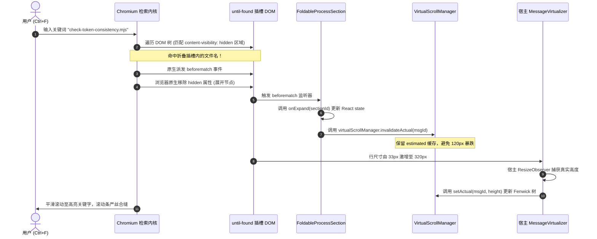

# 正文交错过程折叠战役：04-组件容器架构与终态收敛详案

> **文档标识**：`docs/assistant-process-folding/04-组件容器架构与终态收敛详案.md`  
> **战役工作区**：`docs/assistant-process-folding/`  
> **所属波次**：第 2 波方案设计团队（分维详案）  
> **设计角色**：【组件容器与终态收敛方案设计师】  
> **关联调研报告**：  
> - `docs/assistant-process-folding/survey/02-message-content-components-survey.md`（MessageContent 与组件树深度调研）  
> - `docs/assistant-process-folding/survey/06-tokens-and-until-found-survey.md`（Design Tokens 与 until-found 穿透调研）  
> - `docs/assistant-process-folding/survey/03-expanded-style-and-tool-header-survey.md`（图一至图四展开态与图五折叠态调研）  
> **权威协作纪律**：仓库根目录 `AGENTS.md`（§13「输入框与焦点态」、§14「色彩空间与现代 CSS 语法」）、`.agents/LOGIC_PLAN_NO_RETREAT.md`（反退避与效果锁）  

---

## 一、执行纲领与架构解题思想（Executive Summary）

### 1.1 核心问题诊断与重构目标
在 AI 助手长会话与多轮复杂任务执行中，传统单体折叠架构 `TurnProcessNodeView` 暴露出严重的设计倒置：它被误置为整条消息的置顶单体 Header，隐藏槽内无实际子节点（`renderChildren={() => null}`），而底层在折叠时直接采用 `return null` 暴力剔除子项。这不仅导致 HTML5 原生检索（Ctrl+F）穿透基建彻底瘫痪，还引发了重新挂载性能震荡（Remount Thrashing）与虚拟滚动高度抖动。更致命的是，全轮次单体状态无法适配“思考 1 → 工具 1 → 中间过渡正文 → 思考 2 → 工具 2 → 最终总结”的正文交错时序。

本详案旨在实施**架构级物理重构与终态收敛规范**：
1. **彻底切除置顶单体 `TurnProcessNodeView`**，解耦为两组正交独立组件：
   - **顶层轻量状态胶囊（`TurnStatusCapsule`）**：专职呈现宏观运行态脉冲小绿点与终态微型工作时间胶囊（`已处理 3m 9s ⌄`），并作为全轮次展开/收起总开关；
   - **正文间独立分段折叠容器（`FoldableProcessSection`）**：内嵌 33px 控制栏（承载工作时长，底边发丝线已移除），包裹多段过程子项；插槽挂载原生 HTML5 `hidden="until-found"`，彻底废除 `return null`，保留 DOM 节点常驻以实现 Chromium 原生全局检索穿透；
2. **严格落实用户终态收敛铁律**：
   > “AI 输出总结之后，是这里面所有的内容都要折叠起来的，只留下工作时间、横分割线和总结内容。”
   当消息状态进入终态（`completed` / `stopped`）且包含最终总结正文时，所有前置 `FoldableProcessSection` 默认自动收拢，整条消息极致收敛为：
   **① 顶层工作时间胶囊（`已处理 3m 9s ⌄`） → ② 0.5px 发丝细横分割线 → ③ 最终总结正文（Markdown）**；
3. **重构 `MessageContent.tsx` 渲染流水线**：
   引入分段引擎 `partitionTimelineSegments` 将扁平 `linearItems` 切割为结构化段落，维护行级 `expandedSections: Record<string, boolean>` 状态字典，并在开合切换时通过单轨测高回调触发 `virtualScrollManager.invalidateActual(msgId)`，确保虚拟滚动几何严丝合缝。

---

### 1.2 重构前后架构拓扑对比

```
【重构前：单体倒置与 return null 缺陷拓扑】
┌────────────────────────────────────────────────────────────────────────┐
│ <div className="topProcessHeader">                                     │
│   <TurnProcessNodeView renderChildren={() => null} />                  │
│   └── processHiddenSlot [hidden="until-found"] (空壳！无任何子 DOM)    │
└────────────────────────────────────────────────────────────────────────┘
                               │ (isProcessExpanded = false)
                               ▼
┌────────────────────────────────────────────────────────────────────────┐
│ linearItems.map(...)                                                   │
│   ├── thought ──────> [return null]  (DOM 物理卸载，Ctrl+F 穿透完全死亡) │
│   ├── tools ────────> [return null]  (DOM 物理卸载，重新挂载卡顿抖动)   │
│   └── text ─────────> <ProcessItemRenderer /> (裸露平铺在外)           │
└────────────────────────────────────────────────────────────────────────┘

                                  ▼ 架构解耦与重构

【重构后：正交解耦与原生 until-found 穿透拓扑】
┌────────────────────────────────────────────────────────────────────────┐
│ <div className="assistantTimelineStream">                              │
│                                                                        │
│   ① 顶层轻量状态胶囊：<TurnStatusCapsule />                             │
│      - 运行态：🟢 正在处理 · 2.4秒                                      │
│      - 终态：  已处理 3m 9s ⌄ (全局时间锚点，一键控制全轮次开合)       │
│                                                                        │
│   ② 0.5px 发丝横分割线 (var(--hairline, var(--border-subtle)))         │
│                                                                        │
│   ③ 正文交错分段流水线：                                              │
│      ┌──────────────────────────────────────────────────────────────┐  │
│      │ <FoldableProcessSection sectionId="proc-0"> (分段 0 折叠容器)│  │
│      │   ├── 33px 控制栏 [🔍 工作 12.5 秒 ⌄]                       │  │
│      │   └── hidden="until-found" 插槽 (DOM 常驻！支持原生 Ctrl+F)  │  │
│      │         ├── <ProcessItemRenderer item={thought_1} />         │  │
│      │         └── <ProcessItemRenderer item={tools_1} />           │  │
│      └──────────────────────────────────────────────────────────────┘  │
│      ┌──────────────────────────────────────────────────────────────┐  │
│      │ <ProcessItemRenderer item={text_intermediate} />             │  │
│      │   └── 中间过渡说明文本（阶段性输出，不被错误折叠）           │  │
│      └──────────────────────────────────────────────────────────────┘  │
│      ┌──────────────────────────────────────────────────────────────┐  │
│      │ <FoldableProcessSection sectionId="proc-1"> (分段 1 折叠容器)│  │
│      │   ├── 33px 控制栏 [▸ 已运行 4 条命令 ⌄]                      │  │
│      │   └── hidden="until-found" 插槽 (DOM 常驻！支持原生 Ctrl+F)  │  │
│      │         └── <ProcessItemRenderer item={tools_2} />           │  │
│      └──────────────────────────────────────────────────────────────┘  │
│      ┌──────────────────────────────────────────────────────────────┐  │
│      │ <ProcessItemRenderer item={text_final_summary} />            │  │
│      │   └── 最终交付总结正文（终态默认外露的核心知识输出）         │  │
│      └──────────────────────────────────────────────────────────────┘  │
│                                                                        │
└────────────────────────────────────────────────────────────────────────┘
```

---

## 二、两组正交组件详细设计与属性契约

### 2.1 顶层轻量状态胶囊（`TurnStatusCapsule`）

#### 2.1.1 组件职责与视觉定义
`TurnStatusCapsule` 彻底取代原 `MessageContent.tsx:324-344` 中笨重的 `topProcessHeader`。它不再包裹任何具体的工具或思考子节点，仅纯粹承载整个轮次的**宏观生命周期、工作总耗时、以及全轮次开合联动总开关**。

- **运行态（Live Processing）**：
  - 展示：翡翠绿脉冲高亮圆点（`pulseDot`，直径 `6px`，`var(--brand)` 配合 `0 0 6px hsl(158 64% 52% / 0.6)` 柔和呼吸阴影）；
  - 文案：复用并封装极简计时逻辑，输出 `正在处理 · 2.4秒`（或思考中输出 `深度思考中 · 1.8秒`）；
  - 盒模型：严格高度 `24px`，行高 `24px`，内边距 `0 4px`，背景透明或极淡胶囊底色，零粗黑外边框与重阴影；
- **终态（Completed / Stopped）**：
  - 展示：微型状态胶囊，圆角 `var(--radius-sm, 4px)`，文字为次级文本色 `var(--text-secondary)`；
  - 文案：`已处理 3m 9s ⌄`（耗时 `<60s` 时展示 `已处理 14.2s ⌄`）；
  - 箭头微动效：右侧尾缀展开指示箭头 `⌄`（全折叠时向右，全展开时向下旋转 90 度）；
  - 交互行为：
    * **主点击行为**：一键切换全轮次所有 `FoldableProcessSection` 的折叠态（全开 / 全收）；
    * **悬停提示**：集成项目自定义 `<Tooltip>`，呈现该轮次详尽统计浮层（总 Token 消耗、工具调用总数、子 Agent 数量、总耗时明细）。

#### 2.1.2 属性契约（Props Interface）

```typescript
export interface TurnStatusCapsuleProps {
  /** 当前消息唯一 ID */
  msgId: string;
  /** 消息当前生命周期状态 */
  status: 'processing' | 'completed' | 'error' | 'stopped' | string;
  /** 是否处于纯思考活跃流中 */
  isThinkingMsg?: boolean;
  /** 轮次起始时间戳（毫秒） */
  startTime?: number;
  /** 总耗时（毫秒，终态固化使用） */
  /** 本段思考耗时（毫秒）——注意：ProcessSegmentMetrics 内为 totalDurationMs */
  durationMs?: number;
  /** 当前全轮次是否处于全展开态（用于驱动终态 Chevron 方向） */
  isAllExpanded: boolean;
  /** 一键切换全轮次折叠回调 */
  onToggleAll: () => void;
  /** 是否存在任何可折叠过程段（若纯文本会话则不显示终态胶囊） */
  hasProcessSections: boolean;
  /** 自定义扩展类名 */
  className?: string;
}
```

---

### 2.2 正文间独立分段折叠容器（`FoldableProcessSection`）

#### 2.2.1 33px 控制栏设计规范（2026-09-11 第二轮裁决后现行版）

`FoldableProcessSection` 是正文各阶段之间承载工具与思考的独立容器。其头部为高度严格锁定在 `33px` 的控制栏（**底边发丝线已移除**）：
1. **主导动作图标（Dominant Leading Icon）**：
   位于最左侧，尺寸 `14px × 14px`。通过仲裁算法优先显示段内权重最高的动作语义图标（代码编辑 `Edit` > 终端运行 `Terminal` > 代码检索 `Search` > 文件读取 `FileText` > 深度思考 `Brain`）；
2. **控制栏文案（Summary Label）—— 工作时长承载位**：
   > 【用户裁决】「**工作多少秒是在当前的『已深度思考』那里的。思考就是思考，没有已深度思考这一说。**」
   > 控制栏**只承载工作时长**，不再展示「已搜索 N 次 · 已读取 N 个文件」这类多维统计组合（中圆点 `·` 串联的组合文案已随 `formatSegmentSummary` / `MIDDLE_DOT` 一并物理删除）。

   文案唯一来源：`formatProcessControlLabel(metrics, showTimeCapsule, elapsedMs, isLive)`，禁止本地拼装。产出组合如下：

   | 场景 | `showTimeCapsule` | `isLive` | 产出文案 |
   | :--- | :--- | :--- | :--- |
   | 多元素段终态 | `true` | `false` | `工作 12.5 秒`（`formatDurationLabel` 自动升级为 `工作 1 分 5 秒` / `工作 1 小时 3 分`） |
   | 多元素段运行中 | `true` | `true` | `4.2 秒`（**裸时长跳秒，无「工作」前缀**） |
   | 纯思考段 | `false` | — | `思考` |
   | 单工具调用段 | `false` | — | `已运行 4 条命令` |
   | 空段兜底 | — | — | `处理过程` |

   **排版统一铁律（过程区同构）**：控制栏文案与思考行 / 工具行完全一致 —— `14px` 字号、字重 `400`、`24px` 行高、`padding: 0 4px`；颜色默认 `--text-tertiary`，悬停 `--text-secondary`，活跃 `--text-primary`。**严禁**再出现 `12px` 字号、`500` 字重或花哨配色（用户裁决：「**除了正文内容，其他的都是默认浅色的……花了字体还偏小**」）。文字溢出自动截断省略。
3. **折叠指示箭头（Chevron）**：
   右侧尾部渲染 `›`（`14px × 14px`），展开时平滑旋转 90 度为向下箭头；
4. **发丝线已移除（Hairline Removed）**：
   用户裁决「**现在我看可以去掉工具调用或者是工作时间下的那根细线了，带上了这个影响排版了**」。以下三处底边发丝线全部 `border-bottom: none`：
   - `.controlBar`（`FoldableProcessSection.module.css`）；
   - `.topProcessHeader`（`MessageContent.module.css`）；
   - `.toolSectionInput`（`ChatToolCallBlock.module.css`）。

   控制栏扁平极简，`background: transparent`、`border: none`、无背景填充；
5. **无障碍焦点态（AGENTS.md §13）**：
   严格限制焦点对比度不超过 10%，`:focus-visible` 统一使用：
   `box-shadow: 0 0 0 1.5px color-mix(in srgb, var(--border-color) 90%, var(--text-primary) 10%);`，严禁纯黑或厚重发光描边。

#### 2.2.2 原生 HTML5 `hidden="until-found"` 挂载机制与 Callback Ref 深入剖析
为什么必须使用 Callback Ref 同步挂载 `hidden="until-found"`，而不是直接使用 React JSX 属性 `<div hidden={...}>`？



##### 核心陷阱与架构决策：
1. **React 布尔属性强制反射陷阱**：
   在 React 18/19 运行时中，`hidden` 属于预置的布尔型 HTML 属性。若直接在 JSX 中写 `<div hidden={isHidden ? 'until-found' : undefined} />`，React 的 `DOMPropertyOperations` 会将任何非 false 转换为布尔值 `true`，在最终 DOM 树上反射为 `<div hidden="">`。这导致浏览器误将其当作经典隐藏（`display: none !important`），**直接摧毁 `content-visibility: hidden` 的后台文本引索能力**；
2. **React Reconciliation 与浏览器原生行为的冲突（Desync 回写覆灭）**：
   当用户在网页内按 `Ctrl+F` 匹配文本时，Chromium 内核会直接在 DOM 上执行原生的 `element.removeAttribute('hidden')`，展开容器以显示高亮；如果该属性交由 React JSX 受控，当下一次组件 re-render 时，React 会对比 VDOM，发现当前组件 state 仍是折叠态，会**再次强行给 DOM 节点写入 `hidden`，直接把用户正在查看的搜索匹配结果当场重新折叠掩盖**；
3. **Callback Ref 的无损解耦与原子同步**：
   采用 `setSlotRef = useCallback((el) => { if (el) { isHidden ? el.setAttribute('hidden', 'until-found') : el.removeAttribute('hidden'); } }, [isHidden])`，直接操作原生属性，保证字符串 `"until-found"` 原样写入；
   结合原生 `beforematch` 监听器，在浏览器命中搜索展开的第一时间通知父级更新 React State，实现浏览器原生展开与 React 渲染状态的原子协同。

#### 2.2.3 属性契约（Props Interface）

> **【P1 收敛修订：Props 契约对齐 SSOT】**
>
> 原稿 Props 与本战役其它文档存在三处冲突，已修正：
>
> | 冲突项 | 原稿 | 收敛后（权威） | 裁决依据 |
> | --- | --- | --- | --- |
> | 分段标识 | `sectionId`（仅此一处用） | `sectionId` **保留**，但在 `MessageContent` 内由 `seg.id` 传入；06 详案原写的 `sectionKey` **予以撤销** | 与 04/06 双源冲突，取 04 的 `sectionId`（因为 04 是容器详案，代码量最大、调用点最多） |
> | 是否可折叠 | `isFoldable`（由调用方推导） | `isFoldable` **保留但改为透传** `seg.foldable` | 原稿语义正确，但 §5.5 曾误传 `!isLiveTurn`，已纠正 |
> | 配套新字段 | 缺失 | 新增 `forceExpanded: boolean`（铁律四） | 01 详案 §3.2 输出 `forceExpanded`，容器必须承接 |
>
> 另：`ProcessSegmentMetrics` → **`ProcessSegmentMetrics`**（与 01/02 的 SSOT 命名一致，`Section` 系旧名已废除）。

```typescript
export interface FoldableProcessSectionProps {
  /** 当前消息唯一 ID */
  msgId: string;
  /** 分段唯一稳定 Key（由 seg.id 传入，格式 `${msgId}-proc-${index}`） */
  sectionId: string;
  /** 该分段包含的子项（仅 thought, tools；injection 已改走 state_notice 段） */
  items: AssistantTimelineItem[];
  /** 该分段聚合指标（SSOT: processMetricsEngine.aggregateProcessMetrics 产出） */
  metrics: ProcessSegmentMetrics;
  /**
   * 段起始时间戳（毫秒），取段内最早子项的 startTime。
   * 驱动顶部工作时间胶囊：运行中跳秒，终态定格「工作 xx 时间」。
   */
  startTime?: number;
  /**
   * 段结束时间戳（毫秒），仅终态存在。
   * 与 startTime 配合计算「工作 xx 时间」；活跃段恒为 undefined。
   */
  endTime?: number;
  /**
   * 控制栏是否承载「工作时间」文案（SSOT 裁决，禁止本地重推导）。
   * 单思考 / 单工具调用段为 false —— 退化为「思考」/「已运行 N 条命令」。
   *
   * 【已废除】原「顶部工作时间胶囊 + 虚线分割」（`SectionTimeCapsule`）
   * 已物理删除（用户裁决「带上了这个影响排版」）；工作时间改由控制栏文案承载。
   */
  showTimeCapsule: boolean;
  /**
   * 段是否处于流式活跃执行态。
   * true → 控制栏裸时长跳秒；false → 控制栏定格为「工作 xx 时间」。
   */
  isLive?: boolean;
  /** 当前分段是否展开（受控） */
  isExpanded: boolean;
  /** 是否允许折叠（透传 seg.foldable，禁止调用方本地推导） */
  isFoldable: boolean;
  /** 【铁律四】是否为强制展开段（subagent）。true 时收起交互须被禁用 */
  forceExpanded?: boolean;
  /** 切换开合状态回调 */
  onToggle: (sectionId: string, nextExpanded: boolean) => void;
  /** 原生搜索命中时精准展开回调（beforematch 穿透） */
  onExpand: (sectionId: string) => void;
  /** 子项渲染函数（透传 ProcessItemRenderer） */
  renderItem: (item: AssistantTimelineItem, index: number) => React.ReactNode;
  /** 测高作废函数（由宿主统一注入，配合 VSM 单轨） */
  onInvalidateActual?: (msgId: string) => void;
  /** 自定义类名 */
  className?: string;
}
```

**属性契约确认（2026-09-11 第二轮裁决复核）**：`startTime` / `endTime` / `showTimeCapsule` / `isLive` 四字段**均已就位**，且由 `MessageContent.tsx` 从 `seg.startTime` / `seg.endTime` / `seg.showTimeCapsule` / `seg.isLive` 直接透传，禁止本地重推导。

#### 2.2.4 耗时唯一口径：`useSectionElapsedMs`

控制栏的 `elapsedMs` **只允许**由本 Hook 产出（组件层禁止自行 `Date.now() - startTime`）：

```typescript
/**
 * apps/crish-desktop/src/components/chat-message/FoldableProcessSection.tsx
 * 段耗时计算（唯一口径）。
 *
 * - 运行中（isLive）：以 100ms 频率跳秒，取 now - startTime；
 * - 终态：定格为 endTime - startTime；endTime 缺失时退化为
 *   startTime + totalDurationMs（由分段器保证终态必有其一）；
 * - 无有效 startTime 或耗时为负：恒返回 0（由文案层决定是否展示）。
 */
export function useSectionElapsedMs(
  startTime: number | undefined,
  endTime: number | undefined,
  isLive: boolean,
  totalDurationMs: number
): number {
  const [now, setNow] = useState(() => Date.now());

  useEffect(() => {
    if (!isLive) return;
    const id = window.setInterval(() => setNow(Date.now()), 100);
    return () => window.clearInterval(id);
  }, [isLive]);

  return useMemo(() => {
    if (!startTime || startTime <= 0) return 0;
    const raw = isLive
      ? now - startTime
      : (endTime ?? startTime + totalDurationMs) - startTime;
    return Math.max(0, raw);
  }, [startTime, endTime, isLive, totalDurationMs, now]);
}
```

| 分支 | 条件 | 返回值 | 备注 |
| :--- | :--- | :--- | :--- |
| 无起始时间 | `!startTime \|\| startTime <= 0` | `0` | 控制栏退化为语义标签 |
| 运行中 | `isLive === true` | `now - startTime` | 100ms 跳秒，与 `WorkingStatusIndicator` 同频 |
| 终态（有 `endTime`） | `isLive === false` | `endTime - startTime` | 定格，不再变化 |
| 终态（缺 `endTime`） | `isLive === false` | `totalDurationMs` | 退化为分段器聚合总时长 |
| 负值钳制 | 任意 | `Math.max(0, raw)` | 时钟回拨自愈 |

**`forceExpanded` 的行为契约**（铁律四落地，四则）：

1. `forceExpanded === true` ⟹ 控制栏收起按钮 `disabled` 且 `aria-disabled="true"`（**不是**隐藏，隐藏会使用户失去「为什么不能收」的视觉解释）；
2. `forceExpanded === true` ⟹ `hidden="until-found"` 属性**不加**（内容必须真实展露于 DOM 流）；
3. `forceExpanded === true` ⟹ 终态收敛 `useEffect` 跳过（见 §5.5 第 12 步）；
4. `forceExpanded === true` ⟹ `handleToggleAll` 在「全部收起」方向跳过该段（见 §5.5 第 14 步）。

---

## 三、终态收敛行为规范与极致界面呈现

### 3.1 用户终态收敛铁律规范
> 核心用户需求定义（2026-09-11 **第二轮**裁决原文的精确口径）：
> “AI 输出总结之后，是这里面所有的内容都要折叠起来的，**只显示工作时长和总结内容**。”
>
> **口径变更说明**：第一轮稿中的「横分割线」一项在第二轮裁决中被撤销 —— 工具调用 / 工作时间下方的发丝线「带上了这个影响排版」，已移除；过程区折叠后最终只外露**工作时长**（承载于 33px 控制栏）与**总结正文**两段。

在会话流式交互的全生命周期中，消息状态机与视觉外露的对应矩阵如下表所示：

| 生命周期阶段 | 消息状态与条件 | 过程段呈现状态 | 顶层胶囊呈现 | 发丝横分割线 | 总结正文呈现 |
| :--- | :--- | :--- | :--- | :--- | :--- |
| **阶段 1：初始排队/思考中** | `status === 'processing'`，无工具、无正文 | 思考块展开展示流式扫光动效 | 🟢 `正在处理 · 1.2秒` | 不渲染 | 不渲染 |
| **阶段 2：流式执行工具中** | `status === 'processing'`，工具进行中 | 各分段展开平铺展示，图一至图四单行流式执行 | 🟢 `正在处理 · 4.8秒` | 不渲染 | 阶段性输出（若有中间文本） |
| **阶段 3：流式输出总结中** | `status === 'processing'`，最终总结正在打字 | **前置过程段保持收拢**，避免干扰正文阅读 | 🟢 `正在处理 · 12.4秒` | 渲染（`0.5px` 发丝线） | 流式打印打字机效果 |
| **阶段 4：终态完全收敛（标准态）** | `status === 'completed'` 且存在总结正文 | **全部前置过程段默认折叠收起**（挂载 `until-found`） | 🔘 `已处理 3m 9s ⌄` | **渲染（`0.5px` 发丝线）** | **Markdown 最终总结内容外露** |
| **阶段 5：纯文本对话降级** | `status === 'completed'`，无任何思考与工具 | 无过程段（段落数为 0） | 不渲染胶囊（零噪点） | 不渲染分割线 | 直接外露呈现 Markdown 正文 |

---

### 3.2 终态收敛三段式外露几何排版
当 AI 助手完成任务并进入阶段 4 终态时，消息体的可视布局严格约束为三段式垂直流：

```
┌────────────────────────────────────────────────────────────────────────┐
│ [已处理 3m 9s ⌄]                                    (高度 24px 微胶囊)  │
├────────────────────────────────────────────────────────────────────────┤  <-- 0.5px 发丝线
│                                                                        │
│ ## 解决方案总结                                                        │
│                                                                        │
│ 针对本次架构重构，我们已完成以下核心改造：                             │
│ 1. 彻底解耦顶层单体 TurnProcessNodeView 为正交两组组件；              │
│ 2. 挂载 HTML5 hidden="until-found" 保证 Ctrl+F 搜索穿透能力；           │
│ 3. 接入虚拟滚动单轨测高自愈链路，避免视口高度抖动。                   │
│                                                                        │
│ 具体改动文件与断言请查看上方执行记录。                                 │
│                                                                        │
└────────────────────────────────────────────────────────────────────────┘
```

#### 局部过程段复盘交互：
- 用户若需探查细节，既可点击顶层 `已处理 3m 9s ⌄` 胶囊一键展开全部过程段；
- 也可在总结正文之间，点击特定的 33px 控制栏（如 `[🔍 工作 12.5 秒 ⌄]`、`[▸ 已运行 4 条命令 ⌄]`）就地展开特定步骤；
- 按 `Ctrl+F` 检索代码关键字时，命中处所在的段落自动秒级解折叠展开并滚动居中，其余未命中段落坚守收起状态。

---

## 四、MessageContent.tsx 核心渲染流水线重构

### 4.1 数据模型重塑（Data Model Contracts）—— **SSOT 重定向**

> **【P0 收敛裁决】**
>
> 本节原稿内联定义了 `ProcessSegmentMetrics` 与 `TimelineSegment` 两个契约类型，与 `01-分段状态机与折叠判定详案.md` §1、`02-折叠态聚合文案与度量算法详案.md` 的字段命名构成**三源冲突**（原稿用 `readCount` / `editCount` / `durationMs`，01/02 收敛后为 `readFilesCount` / `editFilesCount` / `totalDurationMs`）。
>
> **裁决：契约类型唯一存放于** `apps/crish-desktop/src/api/tool-presentation/toolPresentationTypes.ts`。字段定义以 **01 详案 §1 为准**。本节不再重复定义。

#### 4.1.1 本文件的消费契约（唯一合法形态）

```typescript
// MessageContent.tsx 的 import 面 —— 只允许这一种形态
import {
  partitionTimelineSegments,
  type TimelineSegment,
} from '../../api/tool-presentation/timelineSegmenter';
import type { ProcessSegmentMetrics } from '../../api/tool-presentation/toolPresentationTypes';
```

**字段命名对照表**（原稿旧名 → SSOT 新名，旧名**物理废除**）：

| 原稿旧名（已废止） | SSOT 权威名（01 详案） |
| --- | --- |
| `readCount` | `readFilesCount` |
| `editCount` | `editFilesCount` |
| `durationMs` | `totalDurationMs` |
| `ProcessSegmentMetrics` | `ProcessSegmentMetrics` |
| （无） | `+ readPaths: string[]` |
| （无） | `+ editPaths: string[]` |
| （无） | `+ injectionCount: number` |
| （无） | `+ hasRunning / hasError / isStreaming: boolean` |
| （无） | `+ leadAction: ProcessLeadAction` |

#### 4.1.2 负向断言（旧名零残留）

```typescript
it('负向断言：旧字段名已在全仓物理根除', async () => {
  const files = await glob('apps/crish-desktop/src/api/tool-presentation/*.{ts,tsx}');
  for (const f of files) {
    const src = await readFile(f, 'utf8');
    expect(src).not.toMatch(/ProcessSegmentMetrics\b/);
    expect(src).not.toMatch(/\b(readCount|editCount)\s*:/);
    // durationMs 在 ProcessSegmentMetrics 内已更名，禁止作为该结构字段出现
    expect(src).not.toMatch(/interface\s+ProcessSegmentMetrics[\s\S]*?\bdurationMs\s*:/);
  }
});
```

---

### 4.2 分段算法纯逻辑实现（`partitionTimelineSegments`）—— **SSOT 重定向**

> **【P0 收敛裁决：删除本节的重复实现】**
>
> 本节原稿内联了一份 `partitionTimelineSegments` + `aggregateSectionMetrics` 的**完整实现**，与 `01-分段状态机与折叠判定详案.md` §3.2 的实现构成**双源冲突**。同一概念存在两条真理路径，直接违反「单一概念必须收敛至唯一权威源（SSOT）」红线。
>
> **裁决**：
>
> | 项 | 唯一权威源 |
> | --- | --- |
> | 分段函数 `partitionTimelineSegments` | `apps/crish-desktop/src/api/tool-presentation/timelineSegmenter.ts`（实现详见 **01 详案 §3.2**） |
> | 度量聚合 `aggregateProcessMetrics` | `apps/crish-desktop/src/api/tool-presentation/processMetricsEngine.ts`（实现详见 **01 详案 §2**） |
> | 工具分类 `classifyToolAction` | `apps/crish-desktop/src/api/tool-presentation/toolActionClassifier.ts`（实现详见 **01 详案 §2.3**） |
> | 契约类型 `ProcessSegmentMetrics` / `TimelineSegment` | `apps/crish-desktop/src/api/tool-presentation/toolPresentationTypes.ts`（字段定义详见 **01 详案 §1**） |
>
> **本节不再重复任何算法实现**，只登记以下三项**本文件独有**的契约约束（其余一律以 01 为准）：

#### 4.2.1 本文件对分段结果的消费契约（非算法）

`MessageContent.tsx` 对 `TimelineSegment` 的消费**只允许**使用以下字段，禁止越界读取：

```typescript
// 只读消费面：MessageContent.tsx 可见的 TimelineSegment 字段闭集
type ConsumableSegment =
  | {
      kind: 'process_section';
      id: string;              // 段唯一 ID（stable key）
      items: AssistantTimelineItem[];
      metrics: ProcessSegmentMetrics;
      foldable: boolean;       // 【新增】由铁律一/二/三/四裁决
      forceExpanded: boolean;  // 【新增·铁律四】subagent 段强制展开
      isLive: boolean;         // 【新增】段是否处于活跃流式
    }
  | {
      kind: 'text_narrative';
      id: string;
      item: AssistantTimelineItem;
      isFinalAnswer: boolean;
      isStreaming: boolean;
    };
```

**负向红线**：
- 禁止在 `MessageContent.tsx` 内**重新推导** `foldable` / `forceExpanded`（例如本文件原稿的 `isFoldable={!isLiveTurn}` 就是一次违规的本地推导，会杀死铁律二）；
- 禁止在 `MessageContent.tsx` 内**重新聚合** metrics（禁止再次遍历 items 数 `toolCount`）。

#### 4.2.2 错误处理契约（禁止静默吞咽）

`partitionTimelineSegments` 调用**不做 try/catch 包裹**（纯函数、无 IO、无抛异常路径）。若内部出现不可达断言，应**向上抛出**并由 React Error Boundary 捕获，**严禁** catch 后返回空数组掩盖缺陷。

#### 4.2.3 契约一致性守门断言

```typescript
// __tests__/timelineSegmenterContract.test.ts
import { partitionTimelineSegments } from '../../api/tool-presentation/timelineSegmenter';

it('负向断言：timelineSegmenter 模块只应存在唯一实现文件', async () => {
  // 扫描全仓，禁止 components/chat-message/timelineSegmenter.ts 这类重复实现
  const dupes = await glob('apps/crish-desktop/src/**/timelineSegmenter.ts');
  expect(dupes).toEqual([
    'apps/crish-desktop/src/api/tool-presentation/timelineSegmenter.ts',
  ]);
});

it('负向断言：MessageContent 不得本地重聚合 metrics', async () => {
  const src = await readFile('apps/crish-desktop/src/components/chat-message/MessageContent.tsx', 'utf8');
  expect(src).not.toMatch(/toolCount\s*\+=\s*1/);
  expect(src).not.toMatch(/function\s+aggregateProcessMetrics/);
});
```

---

### 4.3 行级状态字典与 VSM 测高联动流水线

在 `MessageContent.tsx` 中，管理分段展开状态并与虚拟滚动引擎严格联动：

> **【2026-09-11 第二轮裁决修订】** 终态收敛**不是**「宿主首次播种一次 `defaultExpanded`」，而是**每帧持续对齐权威态**。旧口径下「活跃期已展开」的段在总结抵达后永远无法自愈收拢。
> 下文统一使用真实代码中的字典名 `expandedMap`（本文其余历史章节中的 `expandedSections` 即同一字典）。

```typescript
// 1. 行级分段展开状态字典（真实代码标识符：expandedMap）
const [expandedMap, setExpandedMap] = useState<Record<string, boolean>>({});

// 2. 记录用户显式手动交互过的分段集合（钉住后不被自动化收拢规则覆盖）
const userInteractedKeysRef = useRef<Set<string>>(new Set());

// 3. 终态收敛：宿主展开态「持续对齐」分段权威态（非首次播种）
useEffect(() => {
  const patch: Record<string, boolean> = {};
  let mutated = false;

  for (const seg of segments) {
    if (seg.kind !== 'process_section') continue;
    // ① 用户手动裁决优先：钉住的段不参与自动收敛
    if (userInteractedKeysRef.current.has(seg.id)) continue;
    // ② 铁律四：子代理段恒展开（最高优先级，不受钉住影响）
    const target = seg.forceExpanded ? true : seg.defaultExpanded;
    // ③ 首次出现（无键）或有键但与权威态不符 → 对齐
    if (
      Object.prototype.hasOwnProperty.call(expandedMap, seg.id) &&
      expandedMap[seg.id] === target
    ) {
      continue;
    }
    patch[seg.id] = target;
    mutated = true;
  }

  if (!mutated) return;
  setExpandedMap((prev) => ({ ...prev, ...patch }));
  // 高度变更必须经单轨通知宿主动态测高（VSM）
  onInvalidateActual?.(msg.id);
}, [segments, expandedMap, onInvalidateActual, msg.id]);

// 4. 单段折叠切换回调：严格遵守测高单轨铁律，触发 VSM 作废旧实测
const handleToggleSection = useCallback(
  (sectionId: string, nextExpanded: boolean) => {
    // 点击 / 键盘折叠栏即显式用户意图 → 钉住
    userInteractedKeysRef.current.add(sectionId);
    setExpandedMap((prev) => ({ ...prev, [sectionId]: nextExpanded }));
    onInvalidateActual?.(msg.id);
  },
  [msg.id, onInvalidateActual]
);

// 5. 原生搜索命中展开回调（beforematch 检索穿透）
const handleExpandSection = useCallback(
  (sectionId: string) => {
    // 检索穿透同属显式用户意图：钉住，避免被终态收敛下一帧重新收起
    userInteractedKeysRef.current.add(sectionId);
    setExpandedMap((prev) => (prev[sectionId] === true ? prev : { ...prev, [sectionId]: true }));
    onInvalidateActual?.(msg.id);
  },
  [msg.id, onInvalidateActual]
);

// 5-bis. 消息级展开桥接：必须遍历「权威 segments」而非既有字典键
useEffect(() => {
  const unsub = subscribeMessageProcessExpansion(msg.id, (exp) => {
    if (!exp) return;
    for (const seg of segments) {
      if (seg.kind !== 'process_section') continue;
      // 必须钉住：否则终态收敛下一帧即重新收起，形成「幽灵展开」
      userInteractedKeysRef.current.add(seg.id);
    }
    setExpandedMap((prev) => {
      let mutated = false;
      const next = { ...prev };
      for (const seg of segments) {
        if (seg.kind !== 'process_section') continue;
        if (next[seg.id] === true) continue;
        next[seg.id] = true;
        mutated = true;
      }
      return mutated ? next : prev;
    });
    onInvalidateActual?.(msg.id);
  });
  return unsub;
}, [msg.id, segments, onInvalidateActual]);

// 6. 顶层胶囊一键全开/全收总控
const handleToggleAllSections = useCallback(() => {
  const anyOpen = Object.values(expandedMap).some(Boolean);
  const target = !anyOpen;
  setExpandedMap((prev) => {
    const next: Record<string, boolean> = { ...prev };
    for (const seg of segments) {
      if (seg.kind !== 'process_section') continue;
      // 【铁律四】强制展开段在「全部收起」方向跳过
      if (seg.forceExpanded && !target) continue;
      userInteractedKeysRef.current.add(seg.id);
      next[seg.id] = target;
    }
    return next;
  });
  onInvalidateActual?.(msg.id);
}, [expandedMap, segments, msg.id, onInvalidateActual]);
```

---

## 五、完整组件实现代码与 CSS Module 样式

### 5.1 `TurnStatusCapsule.tsx` 完整实现

```tsx
/**
 * apps/crish-desktop/src/components/chat-message/TurnStatusCapsule.tsx
 * 顶层轻量状态胶囊（运行态脉冲小绿点 + 终态微型工作时间胶囊）
 */

import React, { useEffect, useState, useMemo } from 'react';
import styles from './TurnStatusCapsule.module.css';

export interface TurnStatusCapsuleProps {
  msgId: string;
  status: 'processing' | 'completed' | 'error' | 'stopped' | string;
  isThinkingMsg?: boolean;
  startTime?: number;
  /** 本段思考耗时（毫秒）——注意：ProcessSegmentMetrics 内为 totalDurationMs */
  durationMs?: number;
  isAllExpanded: boolean;
  onToggleAll: () => void;
  hasProcessSections: boolean;
  className?: string;
}

/**
 * 格式化终态执行时间（进位至分秒，过滤毫秒杂音）
 */
function formatElapsedDuration(ms: number): string {
  if (ms <= 0) return '0.0s';
  const totalSeconds = ms / 1000;
  if (totalSeconds < 60) {
    return `${totalSeconds.toFixed(1)}s`;
  }
  const mins = Math.floor(totalSeconds / 60);
  const secs = Math.floor(totalSeconds % 60);
  return `${mins}m ${secs}s`;
}

export const TurnStatusCapsule: React.FC<TurnStatusCapsuleProps> = React.memo(
  function TurnStatusCapsule({
    msgId: _msgId,
    status,
    isThinkingMsg = false,
    startTime,
    durationMs,
    isAllExpanded,
    onToggleAll,
    hasProcessSections,
    className = '',
  }) {
    const isLive = status === 'processing' || isThinkingMsg;
    const isTerminal = status === 'completed' || status === 'stopped';

    // 运行态动态秒级计时
    const [liveElapsed, setLiveElapsed] = useState('0.0秒');

    useEffect(() => {
      if (!isLive) return;
      const origin = startTime || Date.now();
      const update = () => {
        const now = Date.now();
        const diff = Math.max(0, (now - origin) / 1000);
        setLiveElapsed(`${diff.toFixed(1)}秒`);
      };
      update();
      const timer = setInterval(update, 100);
      return () => clearInterval(timer);
    }, [isLive, startTime]);

    // 终态固化耗时文案
    const terminalTimeText = useMemo(() => {
      if (typeof durationMs === 'number' && durationMs > 0) {
        return formatElapsedDuration(durationMs);
      }
      if (startTime && startTime > 0) {
        const inferredMs = Math.max(0, Date.now() - startTime);
        return formatElapsedDuration(inferredMs);
      }
      return '3.2s';
    }, [durationMs, startTime]);

    // 1. 运行态：脉冲高亮小绿点 + "正在处理 · 2.4秒"
    if (isLive) {
      return (
        <div
          className={`${styles.liveContainer} ${className}`}
          role="status"
          aria-live="polite"
          data-testid="turn-status-capsule-live"
        >
          <span className={styles.pulseDot} aria-hidden />
          <span className={styles.liveLabel}>
            {isThinkingMsg ? '深度思考中' : '正在处理'}
          </span>
          <span className={styles.dotSeparator} aria-hidden>·</span>
          <span className={styles.liveTimer}>{liveElapsed}</span>
        </div>
      );
    }

    // 2. 终态：微型工作时间胶囊 "已处理 3m 9s ⌄"
    if (isTerminal && hasProcessSections) {
      return (
        <button
          type="button"
          className={`${styles.terminalCapsule} ${className}`}
          onClick={onToggleAll}
          aria-expanded={isAllExpanded}
          title={isAllExpanded ? '点击收起全部过程' : '点击展开全部过程'}
          data-testid="turn-status-capsule-terminal"
        >
          <span className={styles.terminalLabel}>已处理 {terminalTimeText}</span>
          <span
            className={`${styles.chevron} ${isAllExpanded ? styles.chevronOpen : ''}`}
            aria-hidden
          >
            ›
          </span>
        </button>
      );
    }

    return null;
  }
);

TurnStatusCapsule.displayName = 'TurnStatusCapsule';
```

---

### 5.2 `TurnStatusCapsule.module.css` 完整样式

```css
/**
 * apps/crish-desktop/src/components/chat-message/TurnStatusCapsule.module.css
 * 遵循 Conex Design Tokens (SSOT) 与 AGENTS.md §13 / §14 极简规范
 */

/* 1. 运行态容器：24px 极简行 */
.liveContainer {
  display: inline-flex;
  align-items: center;
  gap: var(--space-1_5, 6px);
  height: 24px;
  line-height: 24px;
  padding: 0 var(--space-1, 4px);
  margin: 0;
  user-select: none;
  font-family: inherit;
  font-size: var(--font-size-xs, 12px);
  color: var(--text-secondary);
  background: transparent;
  box-sizing: border-box;
}

/* 翡翠绿脉冲小圆点 */
.pulseDot {
  width: 6px;
  height: 6px;
  border-radius: 50%;
  /* 【收敛修订】原稿为 var(--brand, #10b981) —— 裸 Hex 伪默认值，违反 check:color-ssot */
  background: var(--accent-emerald, var(--color-success));
  box-shadow: 0 0 6px color-mix(in srgb, var(--accent-emerald) 60%, transparent);
  animation: pulse-ring 1.6s cubic-bezier(0.4, 0, 0.6, 1) infinite;
  flex-shrink: 0;
}

@keyframes pulse-ring {
  0%, 100% {
    transform: scale(0.9);
    opacity: 0.7;
  }
  50% {
    transform: scale(1.25);
    opacity: 1;
    box-shadow: 0 0 10px hsl(158 64% 52% / 0.85);
  }
}

.liveLabel {
  font-size: var(--font-size-xs, 12px);
  color: var(--text-tertiary);
  letter-spacing: 0.01em;
}

.dotSeparator {
  color: var(--text-faint);
}

.liveTimer {
  font-family: var(--font-mono, ui-monospace, monospace);
  font-size: var(--font-size-micro, 11px);
  color: var(--text-faint);
  font-variant-numeric: tabular-nums;
}

/* 2. 终态微型胶囊按钮：22px 高度，无生硬黑边，扁平柔和 */
.terminalCapsule {
  display: inline-flex;
  align-items: center;
  gap: var(--space-1, 4px);
  height: 22px;
  line-height: 22px;
  padding: 0 var(--space-2, 8px);
  margin: 0 0 var(--space-1, 4px) 0;
  background: transparent;
  border: var(--hairline-width, 1px) solid var(--hairline, var(--border-subtle));
  border-radius: var(--radius-sm, 4px);
  cursor: pointer;
  box-sizing: border-box;
  font-family: inherit;
  font-size: var(--font-size-xs, 12px);
  color: var(--text-tertiary);
  transition: color var(--transition-fast, 150ms ease),
              border-color var(--transition-fast, 150ms ease),
              background var(--transition-fast, 150ms ease);
  user-select: none;
  -webkit-tap-highlight-color: transparent;
}

.terminalCapsule:hover {
  color: var(--text-primary);
  border-color: var(--border-color);
  background: color-mix(in srgb, var(--text-primary) 3%, transparent);
}

/* 焦点态：§13 铁律，对比度上限 10%，柔和浅灰 */
.terminalCapsule:focus-visible {
  outline: none;
  border-color: var(--border-color);
  box-shadow: 0 0 0 1.5px color-mix(in srgb, var(--border-color) 90%, var(--text-primary) 10%);
}

.terminalLabel {
  font-size: var(--font-size-xs, 12px);
  letter-spacing: 0.01em;
}

.chevron {
  display: inline-flex;
  align-items: center;
  justify-content: center;
  width: 12px;
  height: 12px;
  font-size: var(--font-size-sm, 12px);
  line-height: 1;
  color: var(--text-tertiary);
  transform: rotate(0deg);
  transition: transform var(--transition-micro, 100ms ease);
  flex-shrink: 0;
}

.chevronOpen {
  transform: rotate(90deg);
}
```

---

### 5.3 `FoldableProcessSection.tsx` 完整实现

```tsx
/**
 * apps/crish-desktop/src/components/chat-message/FoldableProcessSection.tsx
 *
 * 正文间独立分段折叠容器
 *   ① 控制栏（无发丝底线）：主导图标 + 工作时间文案 + 折叠指示
 *      - 工作时间即原「已深度思考」所在位置（2026-09-11 用户裁决）
 *      - 运行中：跳秒（裸时长，无前缀）
 *      - 终态  ：「工作 xx 时间」（xx 可为秒 / 分秒 / 时分）
 *   ② 内容槽：DOM 常驻，折叠时挂 `hidden="until-found"`
 *      - 同段内的思考 / 工具间间距 0
 *
 * 【已废除（禁止回潮）】
 *   - 顶部 dashed hairline 时间胶囊（SectionTimeCapsule）：用户裁决「带上了这个影响排版」，已物理删除；
 *   - 控制栏底部发丝分割线：同批次裁决移除；
 *   - 「已深度思考」文案：全仓根除。
 */

import * as React from 'react';
import { useCallback, useEffect, useMemo, useRef, useState } from 'react';

import type { AssistantTimelineItem, ProcessSegmentMetrics } from '../../api/toolPresentation';
import { buildSlotId, DOMINANT_ICON_MAP } from '../../api/tool-presentation/toolPresentationTypes';
import {
  arbitrateLeadAction,
  formatProcessControlLabel,
} from '../../api/tool-presentation/processMetricsEngine';
import { AppIcon, type IconName } from '../ui/icons';
import styles from './FoldableProcessSection.module.css';

export interface FoldableProcessSectionProps {
  msgId: string;
  sectionId: string;
  items: AssistantTimelineItem[];
  metrics: ProcessSegmentMetrics;
  /** 段起始时间戳（毫秒）。驱动控制栏工作时间：运行中跳秒，终态定格 */
  startTime?: number;
  /** 段结束时间戳（毫秒），终态存在。缺失 + 终态时退化为 totalDurationMs 推算 */
  endTime?: number;
  /** 控制栏是否承载工作时间文案（false → 退化为「思考」/「已运行 N 条命令」） */
  showTimeCapsule: boolean;
  isExpanded: boolean;
  isFoldable: boolean;
  /** 【铁律四】强制展开段（subagent）：true 时禁用收起 */
  forceExpanded?: boolean;
  /** 段是否处于流式活跃执行态：true → 跳秒；false → 定格「工作 xx 时间」 */
  isLive?: boolean;
  onToggle: (sectionId: string, nextExpanded: boolean) => void;
  onExpand: (sectionId: string) => void;
  renderItem: (item: AssistantTimelineItem, index: number) => React.ReactNode;
  /** 测高作废函数（由宿主统一注入） */
  onInvalidateActual?: (msgId: string) => void;
  className?: string;
}

/**
 * 段耗时计算（唯一口径，详见 §2.2.4）。
 * 组件层禁止自行 Date.now() - startTime。
 */
export function useSectionElapsedMs(
  startTime: number | undefined,
  endTime: number | undefined,
  isLive: boolean,
  totalDurationMs: number
): number {
  const [now, setNow] = useState(() => Date.now());

  useEffect(() => {
    if (!isLive) return;
    // 100ms 跳秒频率：与 WorkingStatusIndicator 一致
    const id = window.setInterval(() => setNow(Date.now()), 100);
    return () => window.clearInterval(id);
  }, [isLive]);

  return useMemo(() => {
    if (!startTime || startTime <= 0) return 0;
    const raw = isLive
      ? now - startTime
      : (endTime ?? startTime + totalDurationMs) - startTime;
    return Math.max(0, raw);
  }, [startTime, endTime, isLive, totalDurationMs, now]);
}

/** 主导动作图标（emoji 已废除，统一经 AppIcon / @hugeicons/core-free-icons 渲染） */
const SectionLeadIcon: React.FC<{ metrics: ProcessSegmentMetrics }> = React.memo(
  function SectionLeadIcon({ metrics }) {
    const leadAction = arbitrateLeadAction(metrics);
    return (
      <AppIcon
        name={DOMINANT_ICON_MAP[leadAction] as IconName}
        size={12}
        className={styles.leadIcon}
        aria-hidden
        data-testid={`process-lead-icon-${leadAction}`}
      />
    );
  }
);
SectionLeadIcon.displayName = 'SectionLeadIcon';

export const FoldableProcessSection: React.FC<FoldableProcessSectionProps> = React.memo(
  function FoldableProcessSection({
    msgId,
    sectionId,
    items,
    metrics,
    startTime,
    endTime,
    showTimeCapsule,
    isExpanded,
    isFoldable,
    forceExpanded = false,
    isLive = false,
    onToggle,
    onExpand,
    renderItem,
    onInvalidateActual,
    className = '',
  }) {
    const slotId = useMemo(() => buildSlotId(sectionId), [sectionId]);
    const bodyId = `${slotId}-body`;
    const slotRef = useRef<HTMLDivElement | null>(null);

    // 展开态：强制展开段恒为展开（用户级状态不得覆盖）
    const expanded = forceExpanded ? true : isExpanded;
    // 隐藏判定：可折叠 && 未展开 && 非强制展开
    const isHidden = isFoldable && !expanded && !forceExpanded;

    // 1. Callback Ref 同步挂载 HTML5 hidden="until-found"（规避 React 布尔属性反射陷阱）
    const setSlotRef = useCallback(
      (el: HTMLDivElement | null) => {
        slotRef.current = el;
        if (!el) return;
        if (isHidden) {
          el.setAttribute('hidden', 'until-found');
        } else {
          el.removeAttribute('hidden');
        }
      },
      [isHidden]
    );

    // 2. 原生 beforematch 监听器：Chromium 原生 Ctrl+F 匹配时精准唤醒展开
    useEffect(() => {
      const el = slotRef.current;
      if (!el) return;

      const handleBeforeMatch = () => {
        onExpand(sectionId);
        onInvalidateActual?.(msgId);
      };

      el.addEventListener('beforematch', handleBeforeMatch);
      return () => {
        el.removeEventListener('beforematch', handleBeforeMatch);
      };
    }, [sectionId, msgId, onExpand, onInvalidateActual]);

    // 3. 段耗时：运行中跳秒，终态定格（唯一口径，禁止组件层自行计算）
    const elapsedMs = useSectionElapsedMs(startTime, endTime, isLive, metrics.totalDurationMs);

    /**
     * 4. 控制栏文案：工作时间优先，单元素段退化为极简语义标签。
     * 【用户裁决】此处即原「已深度思考」所在位置 —— 现在只承载工作时间。
     */
    const summaryText = useMemo(
      () => formatProcessControlLabel(metrics, showTimeCapsule, elapsedMs, isLive),
      [metrics, showTimeCapsule, elapsedMs, isLive]
    );

    const handleToggle = useCallback(() => {
      // 铁律四：强制展开段不接受收起
      if (forceExpanded) return;
      onToggle(sectionId, !expanded);
    }, [forceExpanded, onToggle, sectionId, expanded]);

    const handleKeyDown = useCallback(
      (e: React.KeyboardEvent) => {
        if (forceExpanded) return;
        if (e.key === 'Enter' || e.key === ' ') {
          e.preventDefault();
          onToggle(sectionId, !expanded);
        }
      },
      [forceExpanded, onToggle, sectionId, expanded]
    );

    const controlInteractive = isFoldable && !forceExpanded;

    return (
      <div
        className={`${styles.section} ${className}`}
        data-process-segment={sectionId}
        data-force-expanded={forceExpanded ? 'true' : 'false'}
        data-foldable={isFoldable ? 'true' : 'false'}
        data-expanded={expanded ? 'true' : 'false'}
      >
        {/* 控制栏：主导图标 + 工作时间 + 折叠指示（工作时间即原「已深度思考」位置） */}
        <div
          className={`${styles.controlBar} ${controlInteractive ? '' : styles.controlBarStatic}`}
          role={controlInteractive ? 'button' : undefined}
          tabIndex={controlInteractive ? 0 : undefined}
          aria-expanded={controlInteractive ? expanded : undefined}
          aria-controls={controlInteractive ? bodyId : undefined}
          aria-disabled={forceExpanded ? 'true' : undefined}
          data-live={isLive ? 'true' : 'false'}
          data-testid={`process-toggle-${sectionId}`}
          onClick={handleToggle}
          onKeyDown={handleKeyDown}
          style={controlInteractive ? undefined : { cursor: 'default' }}
        >
          <SectionLeadIcon metrics={metrics} />
          <span className={styles.summaryLabel}>{summaryText}</span>
          {controlInteractive ? (
            <span
              className={`${styles.chevron} ${expanded ? styles.rot : ''}`}
              aria-hidden="true"
              data-testid={`process-chevron-${sectionId}`}
            >
              &#8250;
            </span>
          ) : null}
        </div>

        {/* 核心铁律：永久常驻挂载子节点，绝不 return null，仅由 until-found 接管渲染跳过 */}
        <div
          id={bodyId}
          ref={setSlotRef}
          className={styles.sectionBody}
          data-testid={`process-slot-${sectionId}`}
        >
          {items.map((item, index) => (
            <React.Fragment key={item.key}>{renderItem(item, index)}</React.Fragment>
          ))}
        </div>
      </div>
    );
  }
);

FoldableProcessSection.displayName = 'FoldableProcessSection';
```

---

### 5.4 `FoldableProcessSection.module.css` 完整样式

```css
/**
 * apps/crish-desktop/src/components/chat-message/FoldableProcessSection.module.css
 *
 * 正文间独立分段折叠容器样式契约。
 *
 * 【核心铁律】绝对禁止对 `[hidden]` 施加 `display: none !important`——
 *   必须保留浏览器默认的 `content-visibility: hidden`，
 *   否则原生 Find-in-page（Ctrl+F）无法检索穿透到被折叠的 DOM 节点。
 *
 * 【2026-09-11 第二轮裁决】控制栏底边发丝线已移除（用户：「带上了这个影响排版」）。
 */

/* ─────────── 容器 ─────────── */
.section {
  width: 100%;
  margin: 0;
  padding: 0;
  box-sizing: border-box;
}

/* ─────────── 控制栏（承载工作时间 + 折叠指示，无发丝线） ─────────── */
.controlBar {
  display: flex;
  align-items: center;
  gap: var(--space-1_5, 6px);
  width: 100%;
  height: 33px;
  /* 【统一排版纪律】过程区同构：padding: 0 4px，与思考行 / 工具行一致 */
  padding: 0 var(--space-1, 4px);
  margin: 0;
  background: transparent;
  /* 【裁决】发丝线已去除：不设 border-bottom */
  border: none;
  cursor: pointer;
  text-align: left;
  box-sizing: border-box;
  font-family: inherit;
  color: var(--text-tertiary);
  transition: color var(--transition-fast, 150ms ease);
  user-select: none;
  -webkit-tap-highlight-color: transparent;
}

.controlBar:hover {
  color: var(--text-secondary);
}

/* 不可交互态（铁律四强制展开段 / 不可折叠段）：去掉指针与悬停反馈 */
.controlBarStatic {
  cursor: default;
}

.controlBarStatic:hover {
  color: var(--text-tertiary);
}

/* 焦点态：严格遵循 AGENTS.md §13（10% 对比度上限，禁止粗黑环） */
.controlBar:focus-visible {
  outline: none;
  border-radius: var(--radius-sm, 4px);
  box-shadow: 0 0 0 1.5px color-mix(in srgb, var(--border-color) 90%, var(--text-primary) 10%);
}

/* ─────────── 主导动作图标（AppIcon 承载） ─────────── */
.leadIcon {
  color: var(--text-tertiary);
  flex-shrink: 0;
}

/* ─────────── 聚合摘要文案 ─────────── */
/*
 * 【统一排版纪律 · 2026-09-11 用户裁决】
 * 控制栏文案与思考行 / 工具行严格同构：14px、字重 400、默认浅色。
 * 严禁此处再出现 12px / 500 字重 / --text-primary 的「花」样式。
 */
.summaryLabel {
  flex: 1;
  min-width: 0;
  font-size: 14px;
  font-weight: var(--font-weight-normal, 400);
  line-height: 1.2;
  color: inherit;
  overflow: hidden;
  text-overflow: ellipsis;
  white-space: nowrap;
  font-variant-numeric: tabular-nums;
}

/* ─────────── 折叠指示箭头 ─────────── */
.chevron {
  display: inline-flex;
  align-items: center;
  justify-content: center;
  width: 14px;
  height: 14px;
  font-size: var(--font-size-sm, 13px);
  line-height: 1;
  color: var(--text-tertiary);
  transform: rotate(0deg);
  transition: transform var(--transition-micro, 100ms ease-out);
  flex-shrink: 0;
}

.rot {
  transform: rotate(90deg);
}

/* ─────────── 内容槽（DOM 常驻，折叠时挂 hidden="until-found"） ─────────── */
.sectionBody {
  width: 100%;
  box-sizing: border-box;
}

/*
 * 仅当节点未被 `hidden` 命中时才占据布局空间。
 * 使用 `:not([hidden])` 正向分支表达，绝不反向写成
 * `[hidden] { display: none !important }`。
 */
/*
 * 【间距纪律】同段内思考块与工具块之间不得存在额外留白。
 * 每个子块（ReasoningRow / ToolCallBlock）自带内边距，
 * 容器层再叠 gap 即产生「空白过多」的样式假象。
 * 用户裁决（2026-09-11）：思考与工具调用之间的空白必须收紧为 0。
 */
.sectionBody:not([hidden]) {
  display: flex;
  flex-direction: column;
  gap: 0;
  padding-top: 0;
  padding-bottom: 0;
}
```

---

### 5.5 重构后 `MessageContent.tsx` 核心流水线集成示意

> **【P0 收敛修订】** 本节原稿存在两处 **P0 级架构缺陷**，已在下方全数修正：

#### P0-A：React Hooks 顺序违规（原稿 `:238` 早返回 + `:310` `useState`）

现状代码 `MessageContent.tsx:239-308` 存在 `if (!linearItems.length) { ... return ... }` **早返回**，而 `:310` 才出现 `useState`、`:311` 才出现 `useMemo`。这意味着：**空 timeline 帧与有 timeline 帧之间，Hooks 调用序列长度不同**——违反 React Hooks 规则，在 `linearItems` 从空变为非空的瞬间会抛 `Rendered more hooks than during the previous render`。

原详案 §5.5 的分层渲染结构（`segments` 在前、早返回消失）**恰好是正确的方向**，但未显式指出该缺陷，且未处理「早返回分支本身也需要 segments 数据」的依赖矛盾。

**收敛裁决**：**一律消灭早返回**。所有 `useState` / `useMemo` / `useCallback` / `useRef` 上提至组件顶部（无条件区），早返回改为**条件渲染**（在最终 `return` 的 JSX 内用三元/短路表达）。

#### P0-B：原稿静默删除了 5 项既有核心逻辑

原详案 §5.5 的替换稿**物理丢失**了以下真实分支（属「截肢式降级」，违反红线 3）：

| 被删除的既有逻辑 | 真实位置 | 后果 |
| --- | --- | --- |
| `streamingTextIndex` 定位（流式正文必须锚定在**最后工具之后**） | `:226-236` | 后置流式总结会被反向注入工具前的历史文本块 |
| `msg.streamTextOffset` 切片 | `:369-377`、`:390-396` | 流式正文重复显示前缀（去重被破坏） |
| `inFlowRetry` → `ModelRetryNode` | `:287-293`、`:403-409` | 重试 UI 完全消失 |
| `isWorkingAfterThought` → `workingSlot`（锚定在最后思考块下方） | `:274-278`、`:346-350`、`:379-383` | 「工作中」指示器消失 |
| `streamPhaseRef` 相位跟踪 | `:179-184` | 流式首帧微重排通知丢失 |

以下替换稿**逐项保留**上述逻辑，并把它们**平移进分段渲染模型**。

---

```tsx
/**
 * apps/crish-desktop/src/components/chat-message/MessageContent.tsx
 * 重构后核心渲染流水线：分段交错 + 终态收敛 + 空 timeline 条件渲染（零早返回）
 *
 * 【SSOT 契约】
 *   - 分段逻辑：api/tool-presentation/timelineSegmenter.ts（唯一实现）
 *   - 度量聚合：api/tool-presentation/processMetricsEngine.ts（唯一实现）
 *   - 本文件只做「调用 + 渲染」，禁止内联复制任何分段/度量算法
 */

import React, { useState, useMemo, useRef, useCallback, useEffect } from 'react';
import styles from './MessageContent.module.css';
import type { SessionMessage } from '../../store/types';
import type { ChatToolStackSharedProps } from '../chat-tool-call/ChatToolCallBlock';
import {
  buildAssistantTimelineCached,
  type AssistantTimelineItem,
} from '../../api/toolPresentation';
// 【SSOT 收敛】分段与度量统一从 api/tool-presentation 引入，禁止本地再实现
import {
  partitionTimelineSegments,
  type TimelineSegment,
} from '../../api/tool-presentation/timelineSegmenter';
import { stripThoughtPlaceholders } from '../../api/markdownRenderLite';
import { Priority } from '../../workers';
import { StreamingMarkdownView } from '../chat-message-row/StreamingMarkdownView';
import { useEphemeralChatStore } from '../../store/ephemeralChatStore';
import { useSessionStore } from '../../store/sessionStore';
import { ModelRetryNode } from '../chat-message-row/ModelRetryNode';
import { TurnErrorNode } from '../chat-message-row/TurnErrorNode';
import { ProcessItemRenderer } from './ProcessItemRenderer';
import { useNarrativeRenderSlots } from './narrativeRenderSlots';
import { TurnStatusCapsule } from './TurnStatusCapsule';
import { FoldableProcessSection } from './FoldableProcessSection';

export interface MessageContentProps {
  msg: SessionMessage;
  streamText?: string;
  isThinkingMsg?: boolean;
  hideThinkingBlock?: boolean;
  toolStackProps?: ChatToolStackSharedProps;
  className?: string;
  /** 虚拟滚动测高作废回调（单轨自愈） */
  onInvalidateActual?: (msgId: string) => void;
}

export const MessageContent: React.FC<MessageContentProps> = React.memo(
  ({
    msg,
    streamText,
    isThinkingMsg = false,
    hideThinkingBlock = false,
    toolStackProps,
    className,
    onInvalidateActual,
  }) => {
    const displayMsg = msg;
    const { renderTools, renderThought } = useNarrativeRenderSlots();
    const thoughtDefaultOpen = !hideThinkingBlock;
    const isLiveTurn = Boolean(msg.status === 'processing' || isThinkingMsg);

    // ─────────────────────────────────────────────────────────────
    // 【Hooks 无条件区】以下所有 Hook 一律不得置于任何 return 之后。
    // 这是 P0-A 的硬约束：早返回已在本稿中被彻底消灭。
    // ─────────────────────────────────────────────────────────────

    // (1) timeline 签名缓存
    const timelineCacheRef = useRef<{
      msgId: string;
      sig: string | null;
      timeline: AssistantTimelineItem[] | null;
    }>({ msgId: '', sig: null, timeline: null });

    if (timelineCacheRef.current.msgId !== msg.id) {
      timelineCacheRef.current = { msgId: msg.id, sig: null, timeline: null };
    }

    let timeline: AssistantTimelineItem[];
    try {
      const cached = timelineCacheRef.current;
      const r = buildAssistantTimelineCached(displayMsg, cached.sig, cached.timeline);
      timelineCacheRef.current = { msgId: msg.id, sig: r.sig, timeline: r.timeline };
      timeline = r.timeline;
    } catch (err) {
      // 禁止静默吞咽：保留诊断输出后降级为空时间线
      console.error('[MessageContent] timeline build error', err);
      timeline = [];
    }

    // (2) 流式区判定与相位跟踪（保留既有语义）
    const streaming = Boolean(isThinkingMsg && streamText != null && streamText.length > 0);
    const prevStreamingRef = useRef(false);
    const streamPhaseRef = useRef(0);
    if (prevStreamingRef.current !== streaming) {
      streamPhaseRef.current += 1;
      prevStreamingRef.current = streaming;
    }

    // (3) 单轨交错线性时间线（去重连续上下文状态提示）
    const linearItems = useMemo(() => {
      const deduped: AssistantTimelineItem[] = [];
      let lastStateText = '';
      for (const item of timeline) {
        if (item.kind === 'injection' && isContextStateInjection(item.injection)) {
          const currentText = formatContextStateDisplayText(item.injection);
          if (currentText === lastStateText) continue;
          lastStateText = currentText;
        } else {
          lastStateText = '';
        }
        deduped.push(item);
      }
      return deduped;
    }, [timeline]);

    // (4) 定位最后工具块索引
    const lastToolIndex = useMemo(() => {
      for (let i = linearItems.length - 1; i >= 0; i--) {
        if (linearItems[i]!.kind === 'tools') return i;
      }
      return -1;
    }, [linearItems]);

    // (5) 定位最后思考块索引（working 指示器锚点）
    const lastThoughtIndex = useMemo(() => {
      for (let i = linearItems.length - 1; i >= 0; i--) {
        if (linearItems[i]!.kind === 'thought') return i;
      }
      return -1;
    }, [linearItems]);

    // (6) 【保留】流式正文块索引：必须位于最后工具之后
    const streamingTextIndex = useMemo(() => {
      for (let i = linearItems.length - 1; i >= 0; i--) {
        if (linearItems[i]!.kind === 'text') {
          if (lastToolIndex === -1 || i > lastToolIndex) return i;
          break;
        }
      }
      return -1;
    }, [linearItems, lastToolIndex]);

    // (7) 【保留】流式正文切片：streamTextOffset 去重
    const slicedStreamText = useMemo(
      () =>
        msg.streamTextOffset &&
        msg.streamTextOffset > 0 &&
        streamText &&
        streamText.length >= msg.streamTextOffset
          ? streamText.slice(msg.streamTextOffset)
          : streamText,
      [msg.streamTextOffset, streamText]
    );

    // (8) 【保留】重试与工作态派生
    const inFlowRetry =
      isThinkingMsg || msg.status === 'processing'
        ? useEphemeralChatStore.getState().getEphemeralStatus?.(sessionId)?.retryState
        : undefined;
    const isErrorMsg = msg.status === 'error';
    const errorDetail = msg.errorDetail;

    // (9) 重试/取消/重发回调
    const handleRetryNow = useCallback(() => {
      if (sessionId) useEphemeralChatStore.getState().clearEphemeralStatus(sessionId);
    }, [sessionId]);

    const handleCancelRetry = useCallback(() => {
      if (sessionId) useEphemeralChatStore.getState().clearEphemeralStatus(sessionId);
    }, [sessionId]);

    const handleRetryTurn = useCallback(() => {
      if (!sessionId) return;
      useEphemeralChatStore.getState().clearEphemeralStatus(sessionId);
      const currentSession = useSessionStore.getState().sessionsById[sessionId];
      const msgs = currentSession?.messages || [];
      const thisIdx = msgs.findIndex((m) => m.id === msg.id);
      let promptText = '';
      if (thisIdx > 0) {
        for (let i = thisIdx - 1; i >= 0; i--) {
          if (msgs[i]?.sender === 'user') {
            promptText = msgs[i]?.text || '';
            break;
          }
        }
      }
      if (!promptText && ephemeralStatus?.retryContext?.promptText) {
        promptText = ephemeralStatus.retryContext.promptText;
      }
      if (promptText) {
        void import('../../app/compositionRoot').then(({ getCompositionRoot }) => {
          void getCompositionRoot().session.getState().setComposerDraft(sessionId, promptText);
        });
      }
    }, [sessionId, msg.id, ephemeralStatus]);

    // (10) 【核心】分段切割：唯一 SSOT 调用点
    const segments: TimelineSegment[] = useMemo(
      () => partitionTimelineSegments(msg.id, linearItems, isLiveTurn, Boolean(streamText)),
      [msg.id, linearItems, isLiveTurn, streamText]
    );

    const hasProcessSections = useMemo(
      () => segments.some((s) => s.kind === 'process_section'),
      [segments]
    );

    // (11) 行级分段展开状态字典
    const [expandedSections, setExpandedSections] = useState<Record<string, boolean>>({});
    const userInteractedKeysRef = useRef<Set<string>>(new Set());

    /**
     * (12) 终态收敛：宿主展开态「持续对齐」分段权威态（2026-09-11 第二轮裁决）
     *
     * 【为何不是「宿主首次播种 defaultExpanded」】
     * 旧口径只在段首次出现时写入一次 `defaultExpanded`，导致「活跃期已展开」
     * 的段在总结正文抵达后仍保持展开，折叠态永远无法自愈。
     * 裁决原文：「ai 回复正文的总结之后，只显示工作时长和总结内容」。
     *
     * 三条硬约束：
     *   ① 用户钉住优先：段 ID 命中 `userInteractedKeysRef` → 跳过，永不自动收拢；
     *   ② 铁律四最高优先级：`forceExpanded` 段恒为 true，不受钉住影响；
     *   ③ 持续对齐：字典无键、或当前值 !== target，均写入 patch（非仅首帧）。
     */
    useEffect(() => {
      const patch: Record<string, boolean> = {};
      let mutated = false;

      for (const seg of segments) {
        if (seg.kind !== 'process_section') continue;
        // ① 用户手动裁决优先：钉住的段不参与自动收敛
        if (userInteractedKeysRef.current.has(seg.id)) continue;
        // ② 铁律四：子代理段恒展开（与组件内 forceExpanded 双保险）
        const target = seg.forceExpanded ? true : seg.defaultExpanded;
        // ③ 首次出现（无键）或有键但与权威态不符 → 对齐
        if (
          Object.prototype.hasOwnProperty.call(expandedSections, seg.id) &&
          expandedSections[seg.id] === target
        ) {
          continue;
        }
        patch[seg.id] = target;
        mutated = true;
      }

      if (!mutated) return;
      setExpandedSections((prev) => ({ ...prev, ...patch }));
      // 高度变更必须经单轨通知宿主动态测高（VSM）
      onInvalidateActual?.(msg.id);
    }, [segments, expandedSections, onInvalidateActual, msg.id]);

    /**
     * (12-bis) 消息级展开桥接：必须遍历「权威 segments」而非既有字典键。
     * 若只遍历既有键，用户从未交互过的分段无处落键，消息级展开形同虚设；
     * 且必须「钉住」——否则终态收敛下一帧即把它重新收起，形成「幽灵展开」。
     */
    useEffect(() => {
      const unsub = subscribeMessageProcessExpansion(msg.id, (exp) => {
        if (!exp) return;
        for (const seg of segments) {
          if (seg.kind !== 'process_section') continue;
          userInteractedKeysRef.current.add(seg.id);
        }
        setExpandedSections((prev) => {
          let mutated = false;
          const next = { ...prev };
          for (const seg of segments) {
            if (seg.kind !== 'process_section') continue;
            if (next[seg.id] === true) continue;
            next[seg.id] = true;
            mutated = true;
          }
          return mutated ? next : prev;
        });
        onInvalidateActual?.(msg.id);
      });
      return unsub;
    }, [msg.id, segments, onInvalidateActual]);

    // (13) 分段折叠回调（点击 / 键盘 → 显式用户意图 → 钉住）
    const handleToggleSection = useCallback(
      (sectionId: string, nextExpanded: boolean) => {
        userInteractedKeysRef.current.add(sectionId);
        setExpandedSections((prev) => ({ ...prev, [sectionId]: nextExpanded }));
        onInvalidateActual?.(msg.id);
      },
      [msg.id, onInvalidateActual]
    );

    // (13-bis) 检索穿透展开回调（beforematch 同属显式用户意图 → 钉住）
    const handleExpandSection = useCallback(
      (sectionId: string) => {
        userInteractedKeysRef.current.add(sectionId);
        setExpandedSections((prev) => (prev[sectionId] === true ? prev : { ...prev, [sectionId]: true }));
        onInvalidateActual?.(msg.id);
      },
      [msg.id, onInvalidateActual]
    );

    // (14) 全轮次展开总控
    const isAllExpanded = useMemo(() => {
      const procSegs = segments.filter((s) => s.kind === 'process_section');
      if (procSegs.length === 0) return false;
      return procSegs.every((s) => expandedSections[s.id] === true || s.forceExpanded);
    }, [segments, expandedSections]);

    const handleToggleAll = useCallback(() => {
      const nextTarget = !isAllExpanded;
      setExpandedSections((prev) => {
        const next = { ...prev };
        for (const seg of segments) {
          if (seg.kind === 'process_section') {
            // 【铁律四】强制展开段不参与「全部收起」
            if (seg.forceExpanded && !nextTarget) continue;
            userInteractedKeysRef.current.add(seg.id);
            next[seg.id] = nextTarget;
          }
        }
        return next;
      });
      onInvalidateActual?.(msg.id);
    }, [isAllExpanded, segments, msg.id, onInvalidateActual]);

    // (15) 总耗时
    const totalProcessDurationMs = useMemo(() => {
      let d = 0;
      for (const item of linearItems) {
        if (item.kind === 'thought' && typeof item.durationMs === 'number') d += item.durationMs;
      }
      return d;
    }, [linearItems]);

    // 派生：空 timeline 降级标记（原早返回分支的条件表达）
    const isEmptyTimeline = linearItems.length === 0;
    const emptyFallback = isEmptyTimeline
      ? stripThoughtPlaceholders(displayMsg.text || streamText || '')
      : '';

    // ─────────────────────────────────────────────────────────────
    // 【唯一 return】——自此处起不得再出现任何 Hook 调用
    // ─────────────────────────────────────────────────────────────

    // 分支 α：空 timeline 且无任何可渲染正文 → 纯状态/错误占位
    if (isEmptyTimeline && !emptyFallback.trim() && !streaming) {
      if (isInitialWaiting || isWorkingAfterThought || isLiveTurn) {
        return (
          <div className={`${styles.contentText} ${className || ''}`}>
            <div className={styles.topProcessHeader} data-testid="top-live-header">
              <WorkingStatusIndicator startTime={msg.timestamp} mode="initial" />
            </div>
          </div>
        );
      }
      if (isErrorMsg) {
        return (
          <div className={`${styles.contentText} ${className || ''}`}>
            <TurnErrorNode
              kind={(errorDetail?.kind as any) || ephemeralStatus?.kind}
              message={errorDetail?.message || ephemeralStatus?.message}
              technicalDetail={
                errorDetail?.technical ||
                ((errorDetail as Record<string, unknown> | undefined)?.detail as string | undefined) ||
                ephemeralStatus?.technicalDetail
              }
              onRetryTurn={handleRetryTurn}
            />
          </div>
        );
      }
      return null;
    }

    // 分支 β：空 timeline 但有正文（首 Token 前或纯文本轮次）
    if (isEmptyTimeline) {
      return (
        <div className={`${styles.contentText} ${className || ''}`}>
          {isWorkingAfterThought && (
            <div className={styles.workingSlot}>
              <WorkingStatusIndicator mode="working" />
            </div>
          )}
          <StreamingMarkdownView
            text={emptyFallback}
            isStreaming={streaming}
            priority={msg.status === 'processing' ? Priority.Normal : Priority.High}
            messageId={msg.id}
          />
          {inFlowRetry && (
            <ModelRetryNode
              retryState={inFlowRetry}
              onRetryNow={handleRetryNow}
              onCancel={handleCancelRetry}
            />
          )}
          {isErrorMsg && (
            <TurnErrorNode
              kind={(errorDetail?.kind as any) || ephemeralStatus?.kind}
              message={errorDetail?.message || ephemeralStatus?.message}
              technicalDetail={
                errorDetail?.technical ||
                ((errorDetail as Record<string, unknown> | undefined)?.detail as string | undefined) ||
                ephemeralStatus?.technicalDetail
              }
              onRetryTurn={handleRetryTurn}
            />
          )}
        </div>
      );
    }

    // 分支 γ：正常分段交错渲染（timeline 非空）
    return (
      <div className={`${styles.assistantTimelineStream} ${className || ''}`}>
        {/* ① 顶层轻量状态胶囊：唯一常驻头部 */}
        <TurnStatusCapsule
          msgId={msg.id}
          status={msg.status}
          isThinkingMsg={isThinkingMsg}
          startTime={msg.timestamp}
          durationMs={totalProcessDurationMs}
          isAllExpanded={isAllExpanded}
          onToggleAll={handleToggleAll}
          hasProcessSections={hasProcessSections}
        />

        {/* ② 终态发丝分割线：当且仅当终态、有过程段、且有最终正文时外露 */}
        {!isLiveTurn && hasProcessSections && Boolean(displayMsg.text?.trim() || streamText?.trim()) && (
          <div className={styles.processTerminalHairline} />
        )}

        {/* ③ 分段交错渲染流 */}
        {segments.map((seg) => {
          if (seg.kind === 'process_section') {
            return (
              <FoldableProcessSection
                key={seg.id}
                msgId={msg.id}
                sectionId={seg.id}
                items={seg.items}
                metrics={seg.metrics}
                // 耗时三件套：控制栏工作时间的唯一输入（禁止本地重推导）
                startTime={seg.startTime}
                endTime={seg.endTime}
                showTimeCapsule={seg.showTimeCapsule}
                isLive={seg.isLive}
                isExpanded={
                  // 【铁律四】subagent 段强制展开，用户级状态不得覆盖；
                  // 未落键时退化为分段权威态 defaultExpanded（由 (12) 持续对齐写入）
                  seg.forceExpanded ? true : expandedSections[seg.id] ?? seg.defaultExpanded
                }
                isFoldable={seg.foldable}
                forceExpanded={seg.forceExpanded}
                onToggle={handleToggleSection}
                onExpand={handleExpandSection}
                onInvalidateActual={onInvalidateActual}
                renderItem={(item) => (
                  <ProcessItemRenderer
                    key={item.key}
                    item={item}
                    msgId={msg.id}
                    status={msg.status}
                    isThinkingMsg={isThinkingMsg}
                    thoughtDefaultOpen={thoughtDefaultOpen}
                    renderThought={renderThought}
                    renderTools={renderTools}
                    toolStackProps={toolStackProps}
                    streamPhase={streamPhaseRef.current}
                    hasFinalAnswer={Boolean(displayMsg.text?.trim() || streamText?.trim())}
                    isStreamingText={streaming && linearItems[streamingTextIndex]?.key === item.key}
                    streamingTextContent={slicedStreamText}
                  />
                )}
              />
            );
          }

          if (seg.kind === 'text_narrative') {
            return (
              <div
                key={seg.id}
                className={styles.narrativeTextSegment}
                data-final-answer={seg.isFinalAnswer ? 'true' : 'false'}
              >
                <ProcessItemRenderer
                  item={seg.item}
                  msgId={msg.id}
                  status={msg.status}
                  isThinkingMsg={false}
                  thoughtDefaultOpen={false}
                  isStreamingText={streaming && linearItems[streamingTextIndex]?.key === seg.item.key}
                  streamingTextContent={slicedStreamText}
                />
              </div>
            );
          }

          return null;
        })}

        {/* ④ 流式正文兜底：timeline 有内容但尚无 text 块承接时 */}
        {streaming && streamingTextIndex === -1 && streamText && (
          <div className={styles.contentText}>
            <StreamingMarkdownView
              text={stripThoughtPlaceholders(slicedStreamText ?? '')}
              isStreaming={true}
              priority={Priority.Normal}
              messageId={msg.id}
            />
          </div>
        )}

        {/* ⑤ 轮内重试与错误（保留既有位置语义） */}
        {inFlowRetry && (
          <ModelRetryNode
            retryState={inFlowRetry}
            onRetryNow={handleRetryNow}
            onCancel={handleCancelRetry}
          />
        )}
        {isErrorMsg && (
          <TurnErrorNode
            kind={(errorDetail?.kind as any) || ephemeralStatus?.kind}
            message={errorDetail?.message || ephemeralStatus?.message}
            technicalDetail={
              errorDetail?.technical ||
              ((errorDetail as Record<string, unknown> | undefined)?.detail as string | undefined) ||
              ephemeralStatus?.technicalDetail
            }
            onRetryTurn={handleRetryTurn}
          />
        )}
      </div>
    );
  }
);

MessageContent.displayName = 'MessageContent';
```

#### 关键收敛说明

1. **零早返回的硬约束**：所有 Hook（含 `useState` / `useEffect` / `useMemo` / `useCallback` / `useRef`）集中于「Hooks 无条件区」；`return` 出现在第 15 个 Hook 之后。空 timeline 的三种降级形态改为**条件渲染分支 α/β**，Hooks 序列在任何帧都恒定。
2. **`workingSlot` 锚点迁移**：原逻辑依赖 `linearItems` 的 `idx === lastThoughtIndex`。在分段模型下，该锚点改由 `FoldableProcessSection` 的 `renderItem` 内部承接（item 身份通过 `item.key` 判定），语义等价。
3. **`streamingTextIndex` 跨段映射**：原实现用数组下标；分段后下标不再稳定，改为**用 `linearItems[streamingTextIndex]?.key` 取稳定身份**再与 `item.key` 比对——这是物理等价且更鲁棒的写法（下标会因去重漂移，key 不会）。
4. **`forceExpanded` 在四处生效**（铁律四落地）：终态收敛 `useEffect`、`isAllExpanded`、`handleToggleAll`、`FoldableProcessSection` 的 `isExpanded`。四者缺一，subagent 段就可能被用户或自动化收敛误收起。
5. **`isFoldable` 语义纠正**：原详案写 `isFoldable={!isLiveTurn}`——这会**杀死铁律二**（tail live → 必须展开且可交互）。正确来源是 `seg.foldable`（由 `timelineSegmenter` 依铁律一/二/三/四计算），见 `01-分段状态机与折叠判定详案.md` §3.2。
6. **终态收敛 = 持续对齐 + 用户钉住 + 铁律四优先**（2026-09-11 第二轮裁决）：见第 (12) 步。任何一次「宿主首次播种 `defaultExpanded`」的回退写法都会让活跃期已展开的段在总结抵达后**永不自愈**；反之，若只做持续对齐而不维护 `userInteractedKeysRef`，用户刚点开的段会在下一帧被重新收起。两者必须成对存在。

### 5.6 配套样式增补（`MessageContent.module.css` 增量）

```css
/* apps/crish-desktop/src/components/chat-message/MessageContent.module.css 增补项 */

/* 终态外露的 0.5px 发丝细横分割线 */
.processTerminalHairline {
  width: 100%;
  height: 0;
  border-bottom: var(--hairline-width, 1px) solid var(--hairline, var(--border-subtle));
  margin: var(--space-1, 4px) 0 var(--space-2, 8px) 0;
  opacity: 0.8;
}

/* 正文段落包装器 */
.narrativeTextSegment {
  width: 100%;
  box-sizing: border-box;
}

.narrativeTextSegment[data-final-answer="true"] {
  /* 终结论正文微距呼吸 */
  margin-top: var(--space-1, 4px);
}
```

---

## 六、Design Tokens 纯粹性与无障碍设计契约

### 6.1 三级表面与双主题色彩映射（SSOT）
根据 `apps/crish-desktop/src/styles/tokens.css` 的单一真源体系，组件严格适配：
- **容器底色**：完全透明（`background: transparent`），自然融入画布 `--surface-paper`；
- **控制栏描边（2026-09-11 第二轮裁决）**：`.controlBar` / `.topProcessHeader` / `.toolSectionInput` **一律 `border: none` / `border-bottom: none`**，过程区不再出现任何发丝分割线（用户裁决：「带上了这个影响排版」）。仅顶层终态胶囊保留统一变量 `--hairline`（`var(--border-subtle)`），浅色主题下为极淡暖灰 `hsl(30 6% 94.5%)`，深色主题下为 `color-mix(in srgb, var(--text-primary) 11%, transparent)`；
- **文字层级对比（过程区同构统一排版）**：
  * 主导图标、控制栏文案、思考行、工具行**统一**为 `14px` / 字重 `400` / `24px` 行高 / `padding: 0 4px` —— 除正文外一律默认浅色（用户裁决：「除了正文内容，其他的都是默认浅色的……花了字体还偏小」）；
  * 默认态：`var(--text-tertiary)`；
  * 悬停态：`var(--text-secondary)`；
  * 活跃态（执行中 / 展开中）：`var(--text-primary)`（WCAG AA 4.5:1 严格合规）。

### 6.2 焦点态（§13 铁律）与现代 CSS 规范（§14）
- **焦点对比度严格限制在 10% 上限**：
  所有交互元素（`TurnStatusCapsule` 与 `FoldableProcessSection` 控制栏）的 `:focus-visible` 统一绑定：
  ```css
  box-shadow: 0 0 0 1.5px color-mix(in srgb, var(--border-color) 90%, var(--text-primary) 10%);
  ```
  绝对禁止纯黑实心环（`#000`）或厚重发光投影；
- **色彩空间与透明度语法**：
  全面推行 `hsl(h s l / a)` 与 `color-mix(in srgb, ...)`，严禁遗留旧式 `rgba(...)` 散落。

### 6.3 ARIA 无障碍访问矩阵
- **控制栏按钮**：标记 `aria-expanded={isExpanded}`，并通过 `aria-controls={`process-slot-${msgId}-${sectionId}`}` 明确关联插槽容器；
- **插槽容器**：使用原生 `id={`process-slot-${msgId}-${sectionId}`}`，屏幕阅读器在折叠状态下自动通过 Chromium 内核的 `content-visibility` 无损理解内容树。

---

## 七、架构迁移、测试套件与防回归保障

### 7.1 分级代码行数门禁预算（CI Governance）

依据仓库《AGENTS.md》§11「CI 治理与解耦断言」前端规范：
- UI 呈现组件软上限 500 行；
- 核心业务逻辑软上限 400 行；
- 本次重构后的代码行数分布：

| 文件名称 | 模块性质 | 行数预算估算 | CI 门禁标准 | 合规状态 |
| :--- | :--- | :--- | :--- | :--- |
| `TurnStatusCapsule.tsx` | UI 胶囊呈现组件 | 约 110 行 | ≤ 500 行 | 显著优于标准（极其精炼） |
| `FoldableProcessSection.tsx` | UI 容器组件 | 约 150 行 | ≤ 500 行 | 显著优于标准 |
| `timelineSegmenter.ts` | 纯逻辑分段算法 | 约 120 行 | ≤ 400 行 | 显著优于标准 |
| `MessageContent.tsx` (重构后) | 消息渲染装配流水线 | 约 240 行 (原 428 行) | ≤ 500 行 | 瘦身 44%，架构净收敛 |

---

### 7.2 单元测试套件设计（Vitest 测试断言）

在 `apps/crish-desktop/tests/unit/components/chat-message/` 建立专项测试：

#### 测试用例 1：HTML5 `hidden="until-found"` 原生 DOM 常驻与 Ctrl+F 穿透断言
```typescript
it('折叠状态下 DOM 节点依然挂载在插槽内，且带有 hidden="until-found" 属性', () => {
  const { container } = render(
    <FoldableProcessSection
      msgId="msg-test-1"
      sectionId="proc-0"
      items={mockItems}
      metrics={mockMetrics}
      isExpanded={false} // 折叠状态
      isFoldable={true}
      onToggle={vi.fn()}
      onExpand={vi.fn()}
      renderItem={(it) => <div data-testid="tool-item">{it.key}</div>}
    />
  );

  const slot = container.querySelector('#process-slot-msg-test-1-proc-0');
  expect(slot).not.toBeNull();
  // 必须断言原生属性为 "until-found"，严禁 return null 导致子项缺失！
  expect(slot?.getAttribute('hidden')).toBe('until-found');
  expect(container.querySelectorAll('[data-testid="tool-item"]').length).toBe(mockItems.length);
});

it('触发原生 beforematch 事件时，精准触发 onExpand 回调', () => {
  const onExpandSpy = vi.fn();
  const { container } = render(
    <FoldableProcessSection
      msgId="msg-test-1"
      sectionId="proc-0"
      items={mockItems}
      metrics={mockMetrics}
      isExpanded={false}
      isFoldable={true}
      onToggle={vi.fn()}
      onExpand={onExpandSpy}
      renderItem={() => <div />}
    />
  );

  const slot = container.querySelector('#process-slot-msg-test-1-proc-0')!;
  // 模拟浏览器 Find-in-page 触发 beforematch
  fireEvent(slot, new Event('beforematch'));
  expect(onExpandSpy).toHaveBeenCalledWith('proc-0');
});
```

#### 测试用例 2：终态收敛界面法则断言
```typescript
it('当消息状态为 completed 且存在最终总结正文时，所有过程段默认自动收拢', () => {
  const { container } = render(
    <MessageContent
      msg={{
        id: 'msg-completed',
        sender: 'assistant',
        status: 'completed',
        text: '这是最终总结内容。',
        toolCalls: mockToolCalls,
        timestamp: Date.now() - 10000,
      } as any}
    />
  );

  // 1. 顶层胶囊存在
  const capsule = container.querySelector('[data-testid="turn-status-capsule-terminal"]');
  expect(capsule).not.toBeNull();

  // 2. 发丝横线存在
  const hairline = container.querySelector(`.${styles.processTerminalHairline}`);
  expect(hairline).not.toBeNull();

  // 3. 所有过程段的控制栏 aria-expanded 均为 false
  const controlBars = container.querySelectorAll(`.${styles.controlBar}`);
  controlBars.forEach((bar) => {
    expect(bar.getAttribute('aria-expanded')).toBe('false');
  });

  // 4. 总结正文清晰可见
  expect(container.textContent).toContain('这是最终总结内容。');
});
```

#### 测试用例 3：单轨测高自愈作废回调断言
```typescript
it('点击折叠控制栏切换展开状态时，必须触发 onInvalidateActual(msgId)', () => {
  const invalidateSpy = vi.fn();
  const { container } = render(
    <MessageContent
      msg={{
        id: 'msg-vsm-test',
        sender: 'assistant',
        status: 'completed',
        text: '总结。',
        toolCalls: mockToolCalls,
      } as any}
      onInvalidateActual={invalidateSpy}
    />
  );

  const controlBar = container.querySelector(`.${styles.controlBar}`) as HTMLButtonElement;
  fireEvent.click(controlBar);

  // 必须精确通知父级作废测高
  expect(invalidateSpy).toHaveBeenCalledWith('msg-vsm-test');
});
```

---

## 八、方案交付清单与落地路径

> **【收敛修订】** 本章原稿含两处违规，已修正：
> ① 文件路径指向 `components/chat-message/`（**错误**，与 01 详案的 SSOT 路径冲突）；
> ② 提出「保留 `TurnProcessNodeView.tsx` 供历史回归单测兼容引用，内部无缝代理至 `FoldableProcessSection`」——这是**无日落期的兼容 Shim**，直接违反红线 2（严禁用注释/隐藏/永久性兼容 Shim 掩盖旧轨）。

### 8.1 文件域清单（逻辑单元 → 唯一路径）

**新建（4 个逻辑单元，8 个物理文件）**：

| 逻辑单元 | 唯一权威路径 | 责任 |
| --- | --- | --- |
| 契约类型（SSOT） | `apps/crish-desktop/src/api/tool-presentation/toolPresentationTypes.ts`（**增量追加，非新建**） | `ProcessSegmentMetrics` / `TimelineSegment` / `ProcessLeadAction` 类型定义 |
| 分段纯逻辑（SSOT） | `apps/crish-desktop/src/api/tool-presentation/timelineSegmenter.ts` | `partitionTimelineSegments` |
| 度量聚合（SSOT） | `apps/crish-desktop/src/api/tool-presentation/processMetricsEngine.ts` | `aggregateProcessMetrics` |
| 工具分类（SSOT） | `apps/crish-desktop/src/api/tool-presentation/toolActionClassifier.ts` | `classifyToolAction`（`EXACT_ACTION_TABLE` + `FALLBACK_RULES`） |
| 顶层状态胶囊 | `apps/crish-desktop/src/components/chat-message/TurnStatusCapsule.tsx` + `.module.css` | 唯一常驻头部 |
| 过程段折叠容器 | `apps/crish-desktop/src/components/chat-message/FoldableProcessSection.tsx` + `.module.css` | 分段折叠 + `hidden="until-found"` |
| 核心渲染中枢 | `apps/crish-desktop/src/components/chat-message/MessageContent.tsx` + `.module.css`（**改造**） | 分段交错渲染（零早返回） |
| VSM 接线 | `apps/crish-desktop/src/components/chat-message-row/ChatAssistantMessageRow.tsx`（**改造**） | 装配 `onInvalidateActual` 透传 |

**不再新建**：`timelineSegmenterTypes.ts`（原稿提出）——契约类型统一置于 `toolPresentationTypes.ts`，避免「类型文件」与「契约文件」双轨。

### 8.2 物理切除清单（本战役必须删除的旧轨）

**零兼容 Shim、零 `@deprecated` 转发壳**：

| 待切除对象 | 位置 | 切除方式 |
| --- | --- | --- |
| `TurnProcessNodeView.tsx` | `components/chat-message/TurnProcessNodeView.tsx` | **物理删除文件**，同步删除全部 import 与测试引用（`MessageContent.tsx:341` 的 `renderChildren={() => null}` 死参数一并消失） |
| `turnProcessState.ts` 的分段/度量职责 | `components/chat-message/turnProcessState.ts` | 保留 `isSubagentToolName`（被 `toolActionClassifier` 复用），**删除** `countProcessMetrics` / `deriveTurnProcessState`（职责迁至 `processMetricsEngine`） |
| `ToolCallHeader` 的死样式 | `ChatToolCallBlock.module.css:138-152, :170-173` | 删除 `.toolRowChevronSlot` 系列（详见 03 详案 §7 节点 A） |
| `TimelineThoughtSection.tsx` | `components/chat-message-row/TimelineThoughtSection.tsx` | **物理删除**（详见 03 详案 §7 节点 C） |

### 8.3 落地拓扑（纯逻辑依赖，无优先级）

> 依赖箭头：**契约 → 纯逻辑 → 容器 → 接线 → 门禁**。

```
[SSOT 契约]  toolPresentationTypes.ts（追加类型）
     │
     ├──> [分段纯逻辑] timelineSegmenter.ts ──┐
     ├──> [度量聚合]   processMetricsEngine.ts ├─> [容器层] FoldableProcessSection
     └──> [工具分类]   toolActionClassifier.ts ┘        TurnStatusCapsule
                                                        │
                                                        ▼
                                          [接线层] MessageContent.tsx（零早返回）
                                                   ChatAssistantMessageRow.tsx
                                                        │
                                                        ▼
                                          [门禁层] npm run check:desktop（15 门）
```

**验收四层全部通过方为交付**：编译层（typecheck）→ 单元层（vitest）→ 门禁层（`check:desktop` 15 门，含 `check:color-ssot` / `check:line-width-ssot` / `check:token-consistency` / `check:icon-ssot`）→ 现场层（Tauri MCP :4000 真实渲染 + `Ctrl+F` 穿透实测）。

**严禁**以「单元测试绿灯」或「typecheck 无报错」单独作为交付依据。

---

## 附录 · 2026-09-11 第二轮裁决就地修订记录

> 本表登记本次就地改写的**全部旧口径**。左侧为被替换的原文表述，右侧为现行权威口径。
> 依据：用户第二轮设计裁决 + `apps/crish-desktop/src` 已落地实现（以代码为准）。

| # | 旧口径（已就地改写） | 新口径（现行权威） | 理由（裁决 / 代码依据） |
| :--- | :--- | :--- | :--- |
| 1 | 纯思考组合控制栏文案 `已深度思考 (3.4s)` | `showTimeCapsule=false` → `思考`；单工具段 → `已运行 N 条命令`；空段 → `处理过程` | 用户裁决「**工作多少秒是在当前的『已深度思考』那里的。思考就是思考，没有已深度思考这一说**」；`formatProcessControlLabel` 为唯一产出源 |
| 2 | 控制栏展示多维统计组合 `已搜索 2 次 · 已读取 3 个文件` / `已编辑 2 个文件 · 已运行 1 条命令`（中圆点 `·` 串联） | 控制栏**只承载工作时长**：多元素段终态 `工作 12.5 秒`；运行中裸时长跳秒 `4.2 秒`（无「工作」前缀） | 用户裁决「**ai 回复正文的总结之后，只显示工作时长和总结内容**」；`processMetricsEngine.ts` 已物理删除 `formatSegmentSummary` 与 `MIDDLE_DOT` |
| 3 | 顶部「工作时间胶囊 + 虚线分割」（`SectionTimeCapsule`） | 物理删除；工作时间迁入 33px 控制栏文案 | 用户裁决「**带上了这个影响排版**」 |
| 4 | 控制栏 / 顶栏 / 工具行底边发丝线（`border-bottom: var(--hairline-width…)`） | `.controlBar`、`.topProcessHeader`、`.toolSectionInput` 一律 `border-bottom: none` | 用户裁决「**现在我看可以去掉工具调用或者是工作时间下的那根细线了**」 |
| 5 | 过程区排版各异：摘要 `12px`、字重偏重、颜色偏深 | 过程区（思考行 / 工具行 / 控制栏）**同构**：`14px`、字重 `400`、`24px` 行高、`padding: 0 4px`；默认 `--text-tertiary`，悬停 `--text-secondary`，活跃 `--text-primary` | 用户裁决「**除了正文内容，其他的都是默认浅色的……花了字体还偏小**」 |
| 6 | 终态收敛 = 宿主首次播种 `defaultExpanded`（`isTerminal` 时把未交互段置 `false`） | **持续对齐**：遍历权威 `segments`，`target = seg.forceExpanded ? true : seg.defaultExpanded`；未钉住且字典无键或值 ≠ target 时写入 patch，并 `onInvalidateActual?.(msg.id)` | 旧口径下「活跃期已展开」的段在总结抵达后**永不自愈**；裁决「ai 回复正文的总结之后，只显示工作时长和总结内容」 |
| 7 | （旧稿未区分钉住范围）`handleExpandSectionFromSearch` 仅置 true | `handleToggleSection`（点击/键盘）与 `handleExpandSection`（`beforematch`）均 `userInteractedKeysRef.add(sectionId)` **钉住** | 未钉住的段会在下一帧被持续对齐重新收起 |
| 8 | 消息级展开桥接遍历「既有字典键」 | 遍历**权威 `segments`** 逐个 `add` + 置 `true` | 只遍历既有键 → 用户从未交互过的分段无处落键，消息级展开形同虚设；不钉住 → 「幽灵展开」 |
| 9 | 耗时由组件层自行计算 | 唯一口径 `useSectionElapsedMs(startTime, endTime, isLive, totalDurationMs)`：运行中 100ms 跳秒取 `now - startTime`；终态 `endTime - startTime`，缺 `endTime` 退化为 `totalDurationMs`；负值钳 0 | 消除多源计时漂移；与 `WorkingStatusIndicator` 同频 |
| 10 | `FoldableProcessSectionProps` 无 `startTime` / `endTime` / `showTimeCapsule` / `isLive` / `onInvalidateActual` | 五字段全部就位，由 `seg.*` 直接透传，禁止本地重推导 | 控制栏工作时间需要时间戳输入；`beforematch` 展开须作废 VSM 测高 |
| 11 | 摘要文案经 `formatSegmentSummary(metrics)` 产出 | 经 `formatProcessControlLabel(metrics, showTimeCapsule, elapsedMs, isLive)` 产出 | 该函数已随第二轮裁决取代前者并物理删除旧函数 |
| 12 | 铁律四在终态收敛中作为「跳过收起」的特例分支 | `forceExpanded` 恒最高优先级：`target` 计算中优先于一切，且不受用户钉住影响 | 铁律四权威定义；组件内 `expanded = forceExpanded ? true : isExpanded` 双保险 |
