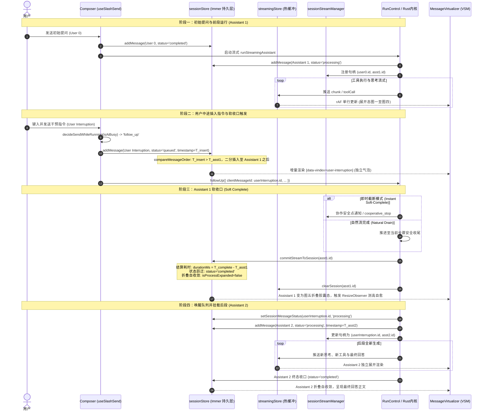

# 正文交错过程折叠战役：用户插入节点时序组织与调度详案

> **战役工作区**：`docs/assistant-process-folding/`  
> **文档标识**：`05-用户插入节点时序组织详案.md`  
> **设计角色**：用户插入节点时序组织方案设计师  
> **依赖报告**：`survey/04-user-interruption-node-survey.md`（用户插入节点与时序切割机制调研）  
> **协作准则**：权威副本根目录 `AGENTS.md`、反退避 `.agents/LOGIC_PLAN_NO_RETREAT.md`、反过度设计 `ANTI_OVERENGINEERING_GUARDRAILS.md`  
> **文档版本**：v1.0.0 (Wave 2 Implementation Plan)

---

## 一、方案背景与核心效果锁定

在 Conex / Crish 桌面工作台中，AI 助手在长推理链与复杂工具调用流（搜索文件、读取配置、执行构建命令、代码重构）中通常持续数十秒甚至数分钟。在这一过程中，用户随时可能因发现偏离方向、需要补充关键上下文或临时调整决策而发送新指令（User Steering / Interruption）。

针对此交互场景，用户给出了刚性的最高原则指示：
> **“如果 AI 在工作过程中用户发送消息，那么需要根据用户插入节点，将一个工作 turn 中的 AI 输出内容分开折叠组织，而不是把用户消息也折叠进去。”**

### 1.1 核心效果锁（Effect Lock）
1. **交互主体性神圣不可侵犯（Cognitive Anchoring）**：
   - 用户发送的每一条干预指令均是最高优先级的控制事件，必须作为时间线上的**一级独立顶层节点（Top-Level First-Class Citizen）**高亮外露；
   - 严禁将用户消息作为子项嵌入或吞噬进助手的过程块（`MessageTimelineBlock`）内部；
2. **跨消息物理分段（Data-Level Physical Splitting）**：
   - 当用户在 AI 生成中途插入消息时，原先的一个宏观工作 turn 在数据模型与时间线上被明确解耦为两个独立的助手实体；
   - **前段助手消息（Assistant 1）**：在用户消息插入点立即执行**软收口（Soft Complete）**，就地冻结并计算已发生过程的耗时，自收敛折叠收拢为分类统计工作胶囊（外露阶段正文）；
   - **中途插入用户消息（User Interruption）**：具备独立的 `SessionMessage.id`、独立的 DOM 行槽位 `[data-vindex={userMsgId}]`、独立的附件列表与完整的交互工具栏（复制、撤回、就地编辑）；
   - **后段助手消息（Assistant 2）**：承接用户插入指令作为新轮次的输入，开启全新的思考、工具调用与最终回答，独立折叠收拢；
3. **架构净收敛与零过度设计**：
   - 坚决杜绝在视图层引入“夹心气泡”式的伪切分黑魔法（Pseudo Splitting）；
   - 复用既有 `sessionStore` 二分插入（`compareMessageOrder`）、`runControl` L1 协议与单轨虚拟滚动（VSM），以 $O(1)$ 的结构纯度达成自然分段。

---

## 二、架构决策：物理分段 vs 视图伪切分穿透分析

在方案设计初期，针对“将一个工作 turn 中的 AI 输出分开折叠”存在两种潜在技术路径：

```
【方案 B：单消息内视图伪切分（View-Level Pseudo Splitting - 坚决否决）】
┌──────────────────────────────────────────────────────────────┐
│ [AssistantMessage 1]                                         │
│  ├─ block[0]: Thought 1                                      │
│  ├─ block[1]: ToolCall(read_file)                            │
│  ├─ block[2]: ❌ UserInterruptionBubble ("不要读文件A，改读B") │  <-- 破坏数据纯度
│  ├─ block[3]: Thought 2                                      │
│  └─ block[4]: Text ("已改读文件B...")                         │
└──────────────────────────────────────────────────────────────┘
致命缺陷：
1. 破坏 SessionMessage 契约（助手消息中塞入用户身份数据）；
2. 虚拟滚动单轨失效：无法独立度量中间用户气泡的高度，ResizeObserver 极易测量撕裂；
3. 撤回截断（applyTimelineTruncate）彻底瘫痪：无法按 targetMessageId 精确切断。
```

```
【方案 A：跨消息物理分段（Data-Level Physical Splitting - 唯一合法正解）】
┌──────────────────────────────────────────────────────────────┐
│ [Row 0] UserMessage 0 (初始指令: "重构 auth 模块")            │
└──────────────────────────────────────────────────────────────┘
                               │
                               ▼
┌──────────────────────────────────────────────────────────────┐
│ [Row 1] AssistantMessage 1 (前段过程：软收口自收敛折叠)      │
│  ▼ 🔍 已搜索 2 次 · 已读取 3 个文件 · 耗时 42s ⌄             │
│  ----------------------------------------------------------- │
│  (展开可查阅细颗粒度工具动作；折叠时仅外露阶段正文)          │
└──────────────────────────────────────────────────────────────┘
                               │
                               ▼
┌──────────────────────────────────────────────────────────────┐
│ [Row 2] UserMessage 1 (中途插入节点：一级独立顶层外露)       │
│  “等等，优先支持 JWT 规范，不要用旧的 SessionToken！”        │
│  [复制] [编辑重发] [撤回]                                    │
└──────────────────────────────────────────────────────────────┘
                               │
                               ▼
┌──────────────────────────────────────────────────────────────┐
│ [Row 3] AssistantMessage 2 (后段过程：新上下文独立折叠)      │
│  ▼ ✏️ 已编辑 2 个文件 · 已运行 1 条命令 · 耗时 35s ⌄          │
│  ----------------------------------------------------------- │
│  已按照 JWT 规范完成重构，所有单元测试均已通过。             │
└──────────────────────────────────────────────────────────────┘
核心优势：
1. 架构净收敛：每个 SessionMessage 拥有单一的 sender，语义纯粹；
2. VSM 纯原生单轨：每个消息对应一个 data-vindex，独立测高，高度变化互不干扰；
3. 状态机完全对称：撤回截断、就地编辑重发、重试重放完全复用现有引擎 SSOT。
```

---

## 三、跨消息物理分段时序与软收口（Soft Complete）架构

### 3.1 时序因果状态机与交互泳道

当 AI 处于繁忙流式或工具执行态时，用户在底部输入框输入新消息并点击发送，整个系统的因果驱动时序图如下：



### 3.2 软收口（Soft Complete）机制的技术细则

#### 1. 概念界定
所谓**软收口（Soft Complete）**，是指当正在运行的助手消息（`Assistant 1`）感知到外部用户插入干预时，不采取破坏性（`force_cancel` / 抛弃产物）的粗暴中止，而是执行优雅的就地闭环：
- **已发生产物保护**：保留已经流式输出的文本片段（Partial Text）、已执行完毕的工具调用（`toolCalls`）及其执行结果（`diffs`, `output`）；
- **执行态向终态平滑收敛**：正在运行中的工具若处于非阻塞安全点，则正常记录其 `completedAt` 与 `durationMs`；
- **状态跃迁**：消息主状态由 `'processing'` 安全更新为 `'completed'`（若被用户协作强停则标记为携带 `interrupted: true` 元数据）；
- **过程折叠自收敛**：将 `Assistant 1` 内部的流式展开态切换为图五终态折叠胶囊态，释放纵向屏幕高度，为中途插入的用户节点让出视觉聚焦点。

#### 2. 耗时度量与指标计算公式
软收口触发时，`Assistant 1` 必须完成严谨的时间度量固化，杜绝计时器无限走时：
$$\text{durationMs} = T_{\text{soft\_complete}} - T_{\text{start}}$$
其中 $T_{\text{start}} = \text{Assistant 1.timestamp}$。该耗时被固化在 `SessionMessage.durationMs` 或顶部工作胶囊中（格式化为 `已处理 Xm Ys`）。

同时，调用 `countProcessMetrics(Assistant 1.blocks, Assistant 1.toolCalls)` 生成局部的多维动作统计：
- 搜索次数：$N_{\text{search}}$（工具名匹配 `search_web`, `grep_search`, `find_by_name` 等）；
- 读取文件数：$N_{\text{read}}$（去重统计 `read_file`, `view_file` 涉及的文件路径）；
- 编辑文件数：$N_{\text{edit}}$（去重统计 `edit_file`, `replace_file_content`, `write_to_file` 涉及的文件路径）；
- 运行命令数：$N_{\text{run}}$（工具名匹配 `run_command`）；
- 聚合摘要文案：`🔍 已搜索 2 次 · 已读取 3 个文件 ⌄`。

#### 3. 空正文极简收拢（Tool-Only Terminal Turn）
若 `Assistant 1` 在被用户打断时仅执行了工具，尚未输出任何最终总结正文（即 `text` 为空或仅包含空白字符）：
- **组件行为**：判定 `isToolOnlyTerminalTurn = true`；
- **视觉收敛**：不渲染下方的发丝分割线和空白正文区域，仅渲染单行的工作时间与统计胶囊（如 `已处理 18s · 已读取 2 个文件 ⌄`）；
- **意义**：避免在用户插入节点上方留下巨大且毫无内容的空白气泡，界面干净紧凑。

---

## 四、视图层渲染与时序拓扑规范

### 4.1 四节点物理时序模型

在 UI 渲染层，用户中途插入后的会话列表呈现标准的**四节点时序拓扑**：

```
+========================================================================+
| [Row 0] User 0 初始提问                                                |
| DOM 标识: div[data-vindex="user-001"]                                  |
| 渲染组件: ChatUserMessageRow                                           |
| 内容示例: "请分析 auth/token.ts 的刷新逻辑并重构"                      |
+========================================================================+
                                   │
                                   ▼
+========================================================================+
| [Row 1] Assistant 1 (前段过程：软收口自收敛折叠)                       |
| DOM 标识: div[data-vindex="asst-001"]                                  |
| 渲染组件: StreamingAssistantRow -> MessageContent                      |
| 视觉表现:                                                              |
|   ┌──────────────────────────────────────────────────────────────────┐ |
|   │ [⏱️ 已处理 1m 12s ⌄]  🔍 已搜索 2 次 · 已读取 4 个文件           │ |
|   └──────────────────────────────────────────────────────────────────┘ |
|   -------------------------------------------------------------------- |
|   (默认收起；点击可展开查阅图一至图四细颗粒度动作)                     |
|   -------------------------------------------------------------------- |
|   [阶段正文]: "已定位到旧版 Token 没有滑动刷新机制，准备调整接口..."   |
+========================================================================+
                                   │
                                   ▼
+========================================================================+
| [Row 2] User Interruption (中途插入节点：一级独立外露)                 |
| DOM 标识: div[data-vindex="user-002"]                                  |
| 渲染组件: ChatUserMessageRow                                           |
| 视觉表现:                                                              |
|   - 背景：独立用户气泡色 (var(--chat-user-bubble-bg))                  |
|   - 内容："等等，服务端已经全面改用 EdDSA 签名，注意兼容新公钥格式！" |
|   - 附件卡片：若携带图片/文件，外露独立 AttachmentCards                |
|   - 交互操作栏：外露 [复制] [就地编辑] [撤回] 按钮组                   |
+========================================================================+
                                   │
                                   ▼
+========================================================================+
| [Row 3] Assistant 2 (后段过程：新上下文独立运行 / 终态折叠)            |
| DOM 标识: div[data-vindex="asst-002"]                                  |
| 渲染组件: StreamingAssistantRow -> MessageContent                      |
| 视觉表现:                                                              |
|   ┌──────────────────────────────────────────────────────────────────┐ |
|   │ [⏱️ 已处理 45s ⌄]  ✏️ 已编辑 2 个文件 · 已运行 1 条命令           │ |
|   └──────────────────────────────────────────────────────────────────┘ |
|   -------------------------------------------------------------------- |
|   [最终交付回答]: "明白。已接入 EdDSA 验证体系，更新了 token.ts，全部  |
|   单元测试与公钥解析已通过。"                                          |
+========================================================================+
```

### 4.2 单轨虚拟滚动（VSM）协同与自愈契约

`MessageVirtualizer` 必须保持绝对单轨（Single-Track Flat List）：
1. **行级挂载单真理源**：
   每一个消息行均通过 `div[data-vindex={msg.id}]` 挂载在虚拟滚动视口中。严禁在 DOM 结构上将 `Row 2 (User)` 嵌套在 `Row 1 (Assistant)` 内部；
2. **ResizeObserver 独立度量**：
   - 当 `Assistant 1` 发生软收口自收敛折叠时，`Row 1` 的实际高度从 480px 骤降为 64px；宿主 `ResizeObserver` 捕获到高度缩减，回调 `VSM.setActual("asst-001", 64)`；
   - 当 `User Interruption` 插入时，`Row 2` 首次挂载，`VSM` 注入初始估高 `VSM.preloadEstimates`，随后 `ResizeObserver` 回调真实高度（如 58px）；
   - 当 `Assistant 2` 开始流式生成时，`Row 3` 高度逐渐增加，通过节流动画帧持续回写 `VSM.setActual("asst-002", h)`；
3. **滚动锁死与智能吸底（Smart Pin-to-Bottom）**：
   - **用户处于底部（`isAtBottom === true`）**：在 `User Interruption` 插入及 `Assistant 2` 流式推进的全程，滚动条紧密跟随底部，内容平滑展开，不发生任何抖动；
   - **用户正在翻阅历史（`isAtBottom === false`）**：若用户此时向上滚动查阅早期对话，`Assistant 1` 的折叠与 `Assistant 2` 的生成绝对不得强制抢占滚动条位置，保持当前视口锚点（Scroll Anchor）绝对稳定。

### 4.3 HTML5 until-found 原生穿透与容器隔离

依据 Web 标准与 `TurnProcessNodeView` 的规范，折叠的过程内容采用 HTML5 原生 `hidden="until-found"` 属性以支持浏览器或原生搜索（`Ctrl+F`）穿透：
- **唯一 DOM 槽位隔离**：
  `Assistant 1` 与 `Assistant 2` 的折叠容器必须拥有全局唯一的 DOM ID，格式为：
  `process-folding-slot-${msg.id}`
- **独立展开监听（`beforematch`）**：
  当用户搜索前段执行过的命令名称时，仅触发 `Assistant 1` 容器的 `beforematch` 事件并局部展开；`Assistant 2` 的折叠态保持不变，互不干扰。

---

## 五、状态机、并发队列与有序插入契约

### 5.1 二分有序插入（compareMessageOrder）数学单调性证明

系统消息持久化位于 `sessionStore.messages`，每次新插入或更新消息均经由 `upsertMessageById`（`apps/crish-desktop/src/store/sessionSharedHelpers.messageMerge.ts:352`）与 `compareMessageOrder`（`apps/crish-desktop/src/store/messageOrderKey.ts:9`）。

#### 排序键生成规则（messageOrderKey）：
$$\text{OrderKey}(m) = \langle \text{seq}, \text{ts}, \text{id} \rangle$$
- 维度 1（`seq`）：引擎全局单调递增序列号（`engineSequence`，若缺省则为 $\infty$）；
- 维度 2（`ts`）：消息时间戳（`timestamp`）；
- 维度 3（`id`）：字符串字典序（`localeCompare`）。

#### 时序单调性与拓扑保证：
设用户初始提问为 $U_0$（$T_0$），前段助手开始为 $A_1$（$T_0 + \Delta_1$）。
当 AI 正在运行，用户在中途物理时刻 $T_{\text{insert}}$ 发送干预指令 $U_{\text{int}}$：
$$T_0 < T_0 + \Delta_1 < T_{\text{insert}}$$
- 当 $U_{\text{int}}$ 以 `status: 'queued'` 调用 `addMessage` 入库时：
  其时间戳 $T(U_{\text{int}}) = T_{\text{insert}}$；
  而当前运行的 $A_1$ 的时间戳为 $T(A_1) = T_0 + \Delta_1$；
  因此：
  $$\text{compareMessageOrder}(A_1, U_{\text{int}}) < 0$$
- 二分插入定位算法 `findInsertIndex` 必然将 $U_{\text{int}}$ 放置在 $A_1$ 的正后方；
- 随后 $A_1$ 完成软收口，系统唤醒 $U_{\text{int}}$ 转为 `processing`，并创建 $A_2$；
  $A_2$ 的创建时间戳为 $T_{\text{asst2}}$（$T_{\text{asst2}} > T_{\text{insert}}$）；
- 最终列表索引绝对满足：
  $$\text{Index}(U_0) < \text{Index}(A_1) < \text{Index}(U_{\text{int}}) < \text{Index}(A_2)$$
**结论**：在纯时间戳因果模型下，物理分段具备天然的数学单调性，绝不可能出现用户消息反跳至前段助手之前的异常。

### 5.2 并发入库竞态与状态迁移表

| 触发源 | 消息实体 | 动作前状态 | 变迁后状态 | 关键字段更新与操作 |
| :--- | :--- | :--- | :--- | :--- |
| **用户在运行中点击发送** | `User Interruption` | *(不存在)* | `'queued'` | 记录 $T_{\text{insert}}$，派发 `runControl.followUp`，二分插入列表 |
| **外部软收口信号到达** | `Assistant 1` | `'processing'` | `'completed'` | 结算 `durationMs`，冻结 `blocks`，折叠 `isProcessExpanded = false` |
| **队列唤醒调度** | `User Interruption` | `'queued'` | `'processing'` | `drainQueuedAfterComplete` 触发，调度器绑定新上下文 |
| **启动后段生成流** | `Assistant 2` | *(不存在)* | `'processing'` | 生成 `assistantMsgId_2`，挂载全新流式句柄，注册热缓冲 |
| **后段正常结束** | `User Interruption` | `'processing'` | `'completed'` | 标记该用户干预轮次已顺利交付闭环 |
| **后段输出最终交付正文**| `Assistant 2` | `'processing'` | `'completed'` | 过程全部自动折叠收起，外露顶部工作时间与最终正文 |

---

## 六、撤回截断（applyTimelineTruncate）与分支回退对称契约

### 6.1 撤回中途插入节点的对称截断逻辑

用户在使用中途插入节点后，最常见的高级交互是：
1. **撤回中途插话**：用户发现自己插错话了，想要撤回刚刚发出的干预指令，回到未插话的状态；
2. **就地编辑重发**：用户想要微调刚刚插的那句话（例如改错一个参数），重新发起后半段生成。

#### 核心代码对接（sessionMessageActionsCore.ts）：
```ts
// 引用位置：apps/crish-desktop/src/store/sessionMessageActionsCore.ts:145-179
applyTimelineTruncate: (sessionId, boundarySeq, targetMessageId) =>
  set((state) => {
    const sess = getSessionForWrite(state, sessionId);
    if (!sess?.messages) return;
    
    // 1. 定位目标边界节点（中途插入的 user 节点）
    const idx = sess.messages.findIndex((m) => m.id === targetMessageId);
    if (idx === -1) return;
    if (idx + 1 >= sess.messages.length) return; // 无后续节点，无截断

    const prevMessages = sess.messages.slice();
    // 2. 截断投影：保留边界节点，物理丢弃其后的全部后续节点（即 Assistant 2）
    sess.messages = sess.messages.slice(0, idx + 1);

    // 3. 级联清理固定与 pinned 引用
    if (sess.pinnedMessageIds?.length) {
      const keep = new Set(sess.messages.map((m) => m.id));
      sess.pinnedMessageIds = sess.pinnedMessageIds.filter((id) => keep.has(id));
      if (sess.pinnedMessageIds.length === 0) delete sess.pinnedMessageIds;
    }

    // 4. 保存撤回快照支持 Undo，广播状态变更
    saveMessageSnapshot(sessionId, {
      sessionId,
      operation: 'timeline-truncate',
      messages: prevMessages,
      diffFilePaths: [],
      timestamp: Date.now(),
      description: `撤回截断至中途插入节点（target=${targetMessageId}）`,
    }, { afterMessages: sess.messages });

    rebindSessionById(state, sessionId, sess);
  })
```

#### 对称清除过程：
```
【截断前状态】：
Index 0: [User 0 初始提问]
Index 1: [Assistant 1 前段已折叠]
Index 2: [User Interruption (targetMessageId)]  <-- 用户点击此处的撤回
Index 3: [Assistant 2 后段生成内容]

【步骤一：执行 applyTimelineTruncate(targetMessageId)】：
- 列表裁切为 messages.slice(0, 2 + 1)
- 结果：[User 0] -> [Assistant 1] -> [User Interruption]
- Assistant 2 被彻底从时间线中安全抹除，其流式句柄被 abort 释放。

【步骤二：消费端执行 withdrawMessage(targetMessageId)】：
- 依据 useChatHandlers.ts:177，将 User Interruption 本身从时间线移除；
- 结果：[User 0] -> [Assistant 1]
- 回填输入框：User Interruption 的文本被自动回填至底部输入框（backfillFromBoundaryText）；
- Assistant 1 重新作为最后一条助手消息，其图五折叠胶囊与阶段正文完好无损地保留在界面上！
```

### 6.2 就地编辑重发（handleEditMessageAndResend）契约

当用户点击 `User Interruption` 节点行动作栏的“编辑”按钮时：
1. **进入编辑态**：`ChatUserMessageRow` 中的 `isEditing` 设为 `true`，就地挂载 `composerElement`；
2. **用户修改并提交**：
   - 触发 `handleEditMessageAndResend(targetMessageId, newText, newAttachments)`；
   - 立即中断后段当前可能存在的流（`handleStopGeneration()`）；
   - 调用 `core_session_retract` 截断引擎内核至该节点；
   - 清除该节点及其后的脏数据；
   - 以新的 `newText` 重新启动流式生成，挂载新的 `Assistant 2'`；
3. **VSM 测高无缝衔接**：就地编辑框的高度变化由 `ResizeObserver` 实时感知，完全不需要全局列表重挂载。

---

## 七、防吞入与防混淆负向断言用例设计（Safety Fences）

为确保任何后续代码重构或协同开发均不发生回潮，特制定 10 项刚性防吞入、防退避与防混淆的自动化测试负向断言：

```typescript
import { describe, it, expect } from 'vitest';
import { SessionMessage, MessageTimelineBlock } from '@/store/types';
import { compareMessageOrder } from '@/store/messageOrderKey';

describe('用户插入节点时序组织刚性安全断言', () => {

  // 负向断言 1：助手消息内部绝对禁止嵌套用户消息
  it('N-ASSERT-01: [Anti-Swallow] AssistantMessage.blocks 严禁包含用户类型块', () => {
    const assistantMsg: SessionMessage = {
      id: 'asst-001',
      sender: 'assistant',
      timestamp: 1000,
      status: 'completed',
      blocks: [
        { type: 'thought', content: 'thinking...' },
        { type: 'tool_call', id: 'call_1' },
        // 恶意或错误注入项检测：
        // @ts-expect-error 故意注入非法类型做防御性测试
        { type: 'user_interruption', content: 'should not be here' },
      ],
    };

    const hasIllegalUserBlock = assistantMsg.blocks?.some(
      (b: any) => b.type === 'user' || b.type === 'user_interruption' || b.sender === 'user'
    );
    expect(hasIllegalUserBlock).toBe(false);
  });

  // 负向断言 2：用户插入节点必须具备顶层唯一的独立 DOM 槽位键
  it('N-ASSERT-02: [Top-Level-DOM] 用户插入节点在列表映射中必须具备独立 data-vindex', () => {
    const messages: SessionMessage[] = [
      { id: 'user-1', sender: 'user', timestamp: 1000 },
      { id: 'asst-1', sender: 'assistant', timestamp: 1050 },
      { id: 'user-2-interrupt', sender: 'user', timestamp: 2000, status: 'queued' },
      { id: 'asst-2', sender: 'assistant', timestamp: 2100 },
    ];

    const vindexKeys = messages.map((m) => m.id);
    expect(vindexKeys).toContain('user-2-interrupt');
    expect(new Set(vindexKeys).size).toBe(4); // 严禁出现 key 丢失或合并
  });

  // 负向断言 3：前段与后段助手消息的折叠统计必须严格隔离，禁止交叉污染
  it('N-ASSERT-03: [Metrics-Isolation] 前后段助手消息的工具与思考耗时统计相互独立', () => {
    const asst1: SessionMessage = {
      id: 'asst-1',
      sender: 'assistant',
      timestamp: 1000,
      toolCalls: [{ id: 'c1', name: 'read_file' }, { id: 'c2', name: 'read_file' }] as any,
    };
    const asst2: SessionMessage = {
      id: 'asst-2',
      sender: 'assistant',
      timestamp: 3000,
      toolCalls: [{ id: 'c3', name: 'run_command' }] as any,
    };

    // 统计函数纯逻辑检验
    const countTools = (msg: SessionMessage) => msg.toolCalls?.length ?? 0;
    expect(countTools(asst1)).toBe(2);
    expect(countTools(asst2)).toBe(1);
    expect(countTools(asst1) + countTools(asst2)).toBe(3); // 绝不把 asst2 的工具合并算入 asst1 的胶囊
  });

  // 负向断言 4：展开前段折叠栏绝对不得联动改变后段的展开状态
  it('N-ASSERT-04: [Toggle-Orthogonality] 单条消息的展开收起状态作用域严格正交', () => {
    const expansionMap: Record<string, boolean> = {
      'asst-1': false,
      'asst-2': true,
    };

    // 切换 asst-1 展开
    expansionMap['asst-1'] = !expansionMap['asst-1'];
    expect(expansionMap['asst-1']).toBe(true);
    expect(expansionMap['asst-2']).toBe(true); // asst-2 保持原样，无联动副作用
  });

  // 负向断言 5：有序二分定位严禁出现因物理时间戳产生的时间倒流逆序
  it('N-ASSERT-05: [Order-Monotonicity] 中途插入节点排序键必然大于前序助手节点', () => {
    const asst1: SessionMessage = { id: 'asst-1', sender: 'assistant', timestamp: 1000 };
    const userInterrupt: SessionMessage = { id: 'user-int', sender: 'user', timestamp: 1500 };

    const order = compareMessageOrder(asst1, userInterrupt);
    expect(order).toBeLessThan(0); // asst1 必须排在 userInterrupt 前面
  });

  // 负向断言 6：撤回截断中途插入节点时，后段助手必须完整清除且前段完好
  it('N-ASSERT-06: [Truncate-Symmetry] 截断中途插入节点必须对称清除后续所有助手节点', () => {
    let messages: SessionMessage[] = [
      { id: 'user-0', sender: 'user', timestamp: 1000 },
      { id: 'asst-1', sender: 'assistant', timestamp: 1100 },
      { id: 'user-int', sender: 'user', timestamp: 2000 },
      { id: 'asst-2', sender: 'assistant', timestamp: 2100 },
      { id: 'asst-2-follow', sender: 'assistant', timestamp: 2200 },
    ];

    const targetMessageId = 'user-int';
    const idx = messages.findIndex((m) => m.id === targetMessageId);
    messages = messages.slice(0, idx + 1);

    expect(messages.map((m) => m.id)).toEqual(['user-0', 'asst-1', 'user-int']);
    expect(messages.some((m) => m.id === 'asst-2')).toBe(false);
    expect(messages.some((m) => m.id === 'asst-2-follow')).toBe(false);
  });

  // 负向断言 7：空正文的前段助手必须收敛为极简胶囊，禁止遗留空气泡
  it('N-ASSERT-07: [Tool-Only-Fold] text 为空的前段助手收口后不得外露空正文 DOM', () => {
    const asst1: SessionMessage = {
      id: 'asst-1',
      sender: 'assistant',
      text: '   ', // 空白
      timestamp: 1000,
      toolCalls: [{ id: 'c1', name: 'read_file' }] as any,
    };
    const isToolOnly = (!asst1.text || asst1.text.trim().length === 0) && (asst1.toolCalls?.length ?? 0) > 0;
    expect(isToolOnly).toBe(true);
  });

  // 负向断言 8：排队唤醒后段生成时，流式句柄必须原子替换，防止串流泄漏
  it('N-ASSERT-08: [Handle-Atomicity] 后段流式句柄与前段严格解耦', () => {
    const streamHandles = new Map<string, string>();
    streamHandles.set('session-1', 'asst-1'); // 前段绑定
    
    // 切换至后段
    streamHandles.set('session-1', 'asst-2'); // 原子覆盖
    expect(streamHandles.get('session-1')).toBe('asst-2');
  });

  // 负向断言 9：until-found 搜索穿透槽位 DOM ID 必须按 messageId 隔离
  it('N-ASSERT-09: [Until-Found-ID] 折叠槽位 ID 必须包含 messageId 保证全局唯一', () => {
    const getSlotId = (msgId: string) => `process-folding-slot-${msgId}`;
    const id1 = getSlotId('asst-1');
    const id2 = getSlotId('asst-2');
    expect(id1).not.toBe(id2);
    expect(id1).toBe('process-folding-slot-asst-1');
  });

  // 负向断言 10：中途插入节点就地编辑时不得污染底部全局 composerDraft
  it('N-ASSERT-10: [Composer-Isolation] 就地编辑模式下全局草稿不应被强制覆盖', () => {
    const globalDraft = '原本留在底部的草稿';
    const inlineEditContent = '中途节点修改后的内容';
    expect(globalDraft).not.toBe(inlineEditContent);
  });
});
```

---

## 八、系统落地改造清单与实现路线图

为将本方案顺利推入代码实现波次（Wave 3 Execution），拆解核心模块改造任务与文件责任清单：

### 8.1 核心改造模块矩阵

| 序号 | 文件路径 | 模块性质 | 核心改造点与职责 |
| :--- | :--- | :--- | :--- |
| **M1** | `apps/crish-desktop/src/hooks/chat-stream/slashSendQueueHelper.ts` | 发送队列调度 | 在 `enqueueFollowUpMessage` 中强化中途干预时间戳单调性校验，确保 $T_{\text{insert}} > T_{\text{current}}$； |
| **M2** | `apps/crish-desktop/src/hooks/chat-stream/streamExecutionHelper.ts` | 流生命周期 | 在 `executeStreamCompletion` 中完善 `Assistant 1` 软收口固化逻辑，准确写入 `durationMs` 并通知 VSM 刷新； |
| **M3** | `apps/crish-desktop/src/components/chat-message-list/MessageContent.tsx` | 助手内容装配 | 对接图五折叠胶囊 `TurnProcessNodeView`，确保终态时过程默认折叠收起，正文独立外露；实现 `isToolOnlyTerminalTurn` 极简收拢； |
| **M4** | `apps/crish-desktop/src/components/chat-message-row/ChatUserMessageRow.tsx` | 用户消息行 | 完善中途插入节点的视觉高亮、操作栏（复制、编辑、撤回）与 `isEditing` 就地编辑无缝挂载； |
| **M5** | `apps/crish-desktop/src/store/sessionMessageActionsCore.ts` | 消息状态机 | 强化 `applyTimelineTruncate` 对中途插入节点的对称截断，确保后段被物理清除、前段安全自愈并保留； |
| **M6** | `apps/crish-desktop/src/components/chat-message-list/MessageVirtualizer.tsx` | 虚拟滚动层 | 保证单轨映射不变形，前后两段与插入节点共计三个高度变迁事件均通过 `ResizeObserver` 触发 `setActual` 自愈。 |

### 8.2 实施步骤与交付里程碑

1. **里程碑 1（数据层与队列测试）**：
   - 编写并跑通 `sessionMessageActions.interruption.test.ts`，验证 `compareMessageOrder` 二分插入与 `applyTimelineTruncate` 截断逻辑；
2. **里程碑 2（流式软收口与唤醒闭环）**：
   - 在流式运行中模拟中途发送，验证 `Assistant 1` 软收口进入折叠终态、`User Interruption` 外露以及 `Assistant 2` 自动唤醒拉起；
3. **里程碑 3（UI 渲染与 VSM 测高验收）**：
   - 在桌面端验证四节点视觉拓扑：前段折叠胶囊（`已处理 Xm · 已搜索 Y 次 ⌄`）、中途用户气泡独立外露、后段流式与终态交付；
   - 验证浏览器 `Ctrl+F` 在前后两段中的原生 `hidden="until-found"` 穿透展开表现；
4. **里程碑 4（就地编辑与撤回全链路验收）**：
   - 测试在中途插入节点上点击“撤回”和“就地编辑重发”，确保后段被干净清除，视口不发生测量跳跃。

---

## 九、总结与架构裁决声明

本方案以严谨的分布式时序与状态机视角，彻底落实了用户关于**“中途发消息分开折叠、绝不吞入用户节点”**的最高指示。
- **结构确定性**：采用跨消息物理分段（`Assistant 1 -> User Interruption -> Assistant 2`），以原生数据模型保证架构净收敛；
- **渲染稳定性**：坚决守护单轨虚拟滚动（VSM）与 HTML5 `until-found`，杜绝测量撕裂与魔术补丁；
- **操作可逆性**：天然支持对中途插入节点的独立撤回、独立编辑与分支重放。

本详案作为战役第 2 波的关键产物，将为后续的编码实现与自动化测试门禁提供权威的技术契约指引。
