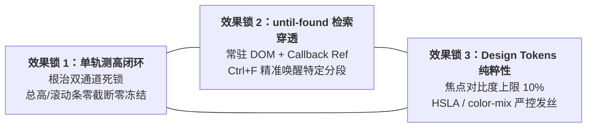
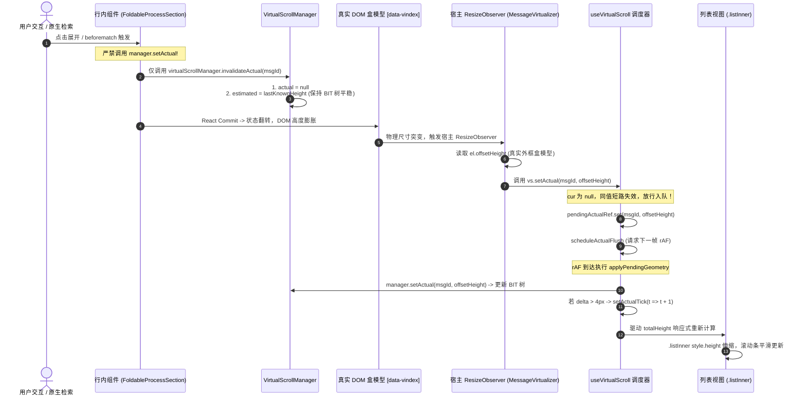
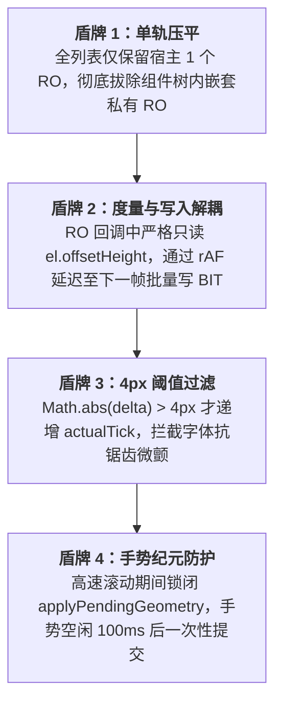
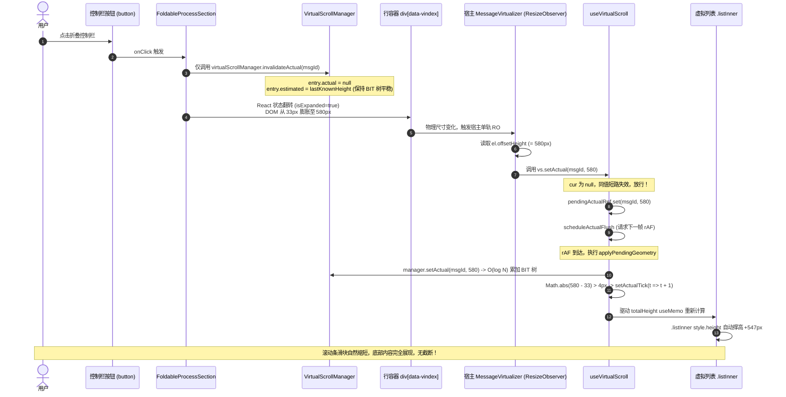
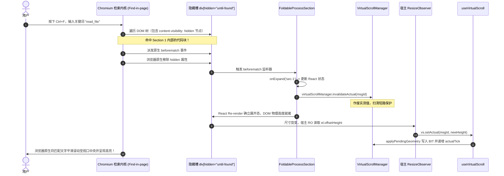
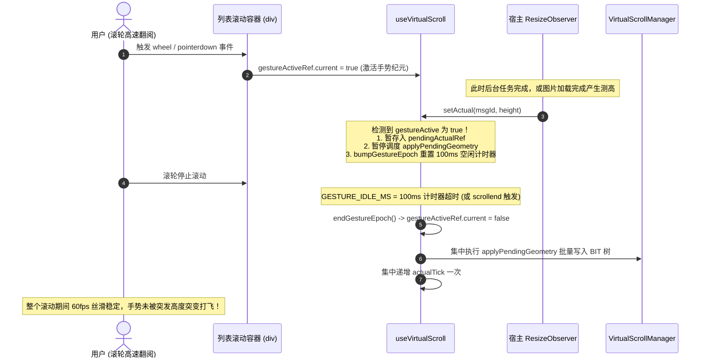
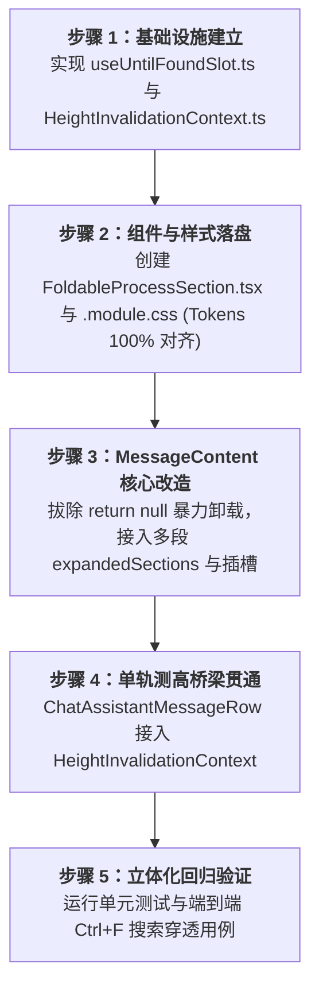

# 方案详案 06：动态测高自愈与检索穿透集成详案

> **战役工作区**：`docs/assistant-process-folding/`  
> **文档定位**：分维度实现详案（`06-动态测高自愈与检索集成详案.md`）  
> **设计角色**：动态测高自愈与检索集成方案设计师  
> **输入依据**：  
> - `docs/assistant-process-folding/survey/05-virtual-scroll-height-survey.md`（虚拟滚动与测高调研）  
> - `docs/assistant-process-folding/survey/06-tokens-and-until-found-survey.md`（Design Tokens 与 until-found 穿透调研）  
> - `docs/assistant-process-folding/00-纪律与调度状态.md`（战役目标与调度纪律）  
> **权威协作规范**：仓库根目录 `AGENTS.md`（§1「反退避」、§7「严禁补丁与作弊」、§13「输入框与焦点态」、§14「色彩空间与现代 CSS」）、`.agents/LOGIC_PLAN_NO_RETREAT.md`  

---

## 一、方案概述与核心效果锁

在“正文交错过程折叠战役（assistant-process-folding）”中，AI 助手的多轮推理思考（Thought）、上下文注入（Injection）、工具调用（Tool Calls）与中间输出将以正文为自然界标，划分为多个**交错过程段落**。  
在终态收敛或用户折叠时，这些分段将以轻量发丝栏收拢为分类统计胶囊。然而，界面的高度伸缩与内容隐藏直接碰撞到系统的两大核心基建：**虚拟滚动树状数组（Fenwick Tree / BIT）测高引擎**与**浏览器原生页面内检索（Find-in-page / Ctrl+F）**。

本方案针对调研报告 `05-virtual-scroll-height-survey.md` 与 `06-tokens-and-until-found-survey.md` 揭露的“双通道测高死锁”与“`return null` 物理卸载破坏穿透”两大致命断层，提供架构级治理方案，确立三大刚性效果锁。

### 1.1 三大核心效果锁（Invariant Effect Locks）



1. **效果锁 1：单轨测高绝对闭环（Single-Track Measurement Loop）**
   - **杜绝双通道死锁**：彻底剥夺行内及子组件直写树状数组（BIT）的越权操作，禁止任何行内逻辑调用 `manager.setActual`；
   - **单轨职责归宿**：行内折叠/展开/状态突变仅触发 `virtualScrollManager.invalidateActual(msgId)`；宿主 `MessageVirtualizer.tsx` 的全局唯一 `ResizeObserver` 统一测量 `div[data-vindex]` 真实外框盒模型 `offsetHeight`；`useVirtualScroll.ts` 调度中枢在下一帧 rAF 批量写入 BIT 树并递增响应式时钟 `actualTick`，驱动总高和滚动条平滑伸缩，**零截断、零视口撕裂、零滚动条僵死**。
2. **效果锁 2：多段容器 HTML5 `until-found` 原生检索零损穿透（Search Penetration）**
   - **槽位常驻原则**：彻底切除折叠时将内容 `return null` 的暴力卸载代码，子项常驻挂载于 DOM 树；
   - **Callback Ref 规避布尔反射**：通过 Callback Ref 注入原生字符串属性 `hidden="until-found"`，规避 React 布尔属性反射为 `<div hidden="">` 导致的 `display: none` 悲剧；
   - **`beforematch` 精准唤醒**：监听原生 `beforematch` 事件，当 Chromium 原生搜索内核（Ctrl+F）或 URL 锚点命中隐藏内容时，仅精准展开命中的特定过程分段，并顺畅联动 `invalidateActual` 触发单轨自愈。
3. **效果锁 3：Design Tokens 100% 遵从与极简纸墨质感（Strict Token Compliance）**
   - **对比度上限 10%**：边框激活态与 `:focus-visible` 严格限制相对基线文本色混入不超过 10%（采用 `color-mix(in srgb, var(--border-color) 90%, var(--text-primary) 10%)`），坚决杜绝裸 Hex 与粗深黑环（《AGENTS.md》§13）；
   - **现代色彩空间**：全面使用 HSLA、斜杠透明度与 `color-mix`，禁止散落旧式 `rgba(...)`（《AGENTS.md》§14）；
   - **CSS 核心铁律**：**绝对禁止**在全局或局部 CSS 中对 `[hidden]` 或 `[hidden="until-found"]` 声明 `display: none !important`。

---

### 1.2 方案代码影响域矩阵

| 模块 / 文件路径 | 修改性质 | 核心职责与改造点 |
| :--- | :--- | :--- |
| [`apps/crish-desktop/src/components/chat-message/FoldableProcessSection.tsx`](file:///c:/Software/conex/apps/crish-desktop/src/components/chat-message/FoldableProcessSection.tsx) | **[新增]** | 多段过程折叠核心容器。承载独立 Slot ID、Callback Ref `hidden="until-found"` 注入、原生 `beforematch` 监听与精准展开回调。 |
| [`apps/crish-desktop/src/components/chat-message/FoldableProcessSection.module.css`](file:///c:/Software/conex/apps/crish-desktop/src/components/chat-message/FoldableProcessSection.module.css) | **[新增]** | 严格遵循 Design Tokens 的组件样式。包含 33px 发丝控制栏、10% 焦点对比度、`:not([hidden])` 展开槽位排版，严禁覆盖 `[hidden]`。 |
| [`apps/crish-desktop/src/hooks/useUntilFoundSlot.ts`](file:///c:/Software/conex/apps/crish-desktop/src/hooks/useUntilFoundSlot.ts) | **[新增]** | 高内聚抽象 Hook。封装 `setSlotRef`（属性同步）、`beforematch` 事件监听与测高作废通知。 |
| [`apps/crish-desktop/src/components/chat-message/MessageContent.tsx`](file:///c:/Software/conex/apps/crish-desktop/src/components/chat-message/MessageContent.tsx) | **[修改]** | 废弃 `352-354` 行 `return null` 物理卸载；接入多段状态机 `expandedSectionKeys`；向子段分发槽位并透传测高作废通道。 |
| [`apps/crish-desktop/src/components/chat-message-row/ChatAssistantMessageRow.tsx`](file:///c:/Software/conex/apps/crish-desktop/src/components/chat-message-row/ChatAssistantMessageRow.tsx) | **[修改]** | 强化单轨测高桥梁，通过 Context 或 Props 将 `invalidateActual(msg.id)` 明确透传至各交错过程段。 |
| [`apps/crish-desktop/src/components/chat-message-list/MessageVirtualizer.tsx`](file:///c:/Software/conex/apps/crish-desktop/src/components/chat-message-list/MessageVirtualizer.tsx) | **[维持/强化]** | 巩固宿主唯一单轨 `ResizeObserver` 物理盒模型 `offsetHeight` 度量基线与 commit 阶段同帧兜底逻辑。 |
| [`apps/crish-desktop/src/api/VirtualScrollManager.ts`](file:///c:/Software/conex/apps/crish-desktop/src/api/VirtualScrollManager.ts) | **[维持/契约固化]** | 固化 `invalidateActual` 平滑过渡不变量（保留 `estimated`，清除 `actual`，维持 BIT 树无阶跃突变）。 |

---

## 二、架构根因攻坚：双通道测高死锁根治与单轨闭环架构

### 2.1 用户图五“双通道测高死锁”根因深度复盘

调研报告 `05-virtual-scroll-height-survey.md` 详尽还原了用户在展开折叠块时遭遇的“滚动条不变、底部被裁”的致命现象。其技术因果链条本质上是**内存数据结构与 React 渲染状态机的脱钩与抢跑冲突**：

```
                           【用户点击展开某过程段】
                                      │
                 ┌────────────────────┴────────────────────┐
                 ▼                                         ▼
       【通道一：行内私自直接通道】                 【通道二：宿主虚拟滚动官方通道】
    (行内组件私自获取 VSM 实例)                (Host MessageVirtualizer ResizeObserver)
                 │                                         │
                 ▼                                         ▼
    调用 manager.setActual(id, h)             物理 DOM 膨胀，RO 回调捕获
    直接改写 heightsById 与 BIT 树           调用 useVirtualScroll.setActual(id, h)
                 │                                         │
                 ▼                                         ▼
       VSM 是纯 TS 内存类！                     useVirtualScroll 内部防御检查：
     ⚠️ 绝不触发 actualTick! ⚠️                cur = manager.getActualHeight(id)
    React totalHeight 保持陈旧旧值!                         │
                 │                                         ▼
                 │                               此时 cur === h 已经被通道一写入！
                 │                               ⚠️ 命中同值短路条件提前 return! ⚠️
                 │                               pendingActual 队列为空，rAF 不调度
                 │                                         │
                 └────────────────────┬────────────────────┘
                                      ▼
                        【双通道死锁终态断裂结果】
             1. actualTick 响应式计数器永久休克；
             2. totalHeight useMemo 依赖未变，锁死在几十像素旧值；
             3. .listInner 样式 height: ${totalHeight}px 维持原样；
             4. .listInner 带有 overflow: hidden，展开的数千像素物理内容被腰斩截断！
```

#### 关键代码证据
1. **通道一的越权直写**：
   在 [`apps/crish-desktop/src/api/VirtualScrollManager.ts:252-283`](file:///c:/Software/conex/apps/crish-desktop/src/api/VirtualScrollManager.ts#L252-L283) 中，`manager.setActual` 执行了 `this.bitAdd(idx + 1, delta)`，它只修改了底层的 `Float64Array` 树状数组，与 React 渲染管线彻底割裂；
2. **通道二的同值短路拦截**：
   在 [`apps/crish-desktop/src/hooks/useVirtualScroll.ts:297-309`](file:///c:/Software/conex/apps/crish-desktop/src/hooks/useVirtualScroll.ts#L297-L309)：
   ```ts
   const setActual = useCallback(
     (id: string, height: number) => {
       const cur = manager.getActualHeight(id);
       if (cur !== null && cur === height) return; // 致命短路点
       pendingActualRef.current.set(id, height);
       // ...
       scheduleActualFlush();
     },
     [bumpGestureEpoch, manager, scheduleActualFlush],
   );
   ```
   因为通道一偷跑将 `cur` 变成了 `height`，通道二在做 `cur !== null && cur === height` 校验时命中真值，直接退出，导致后续的 `applyPendingGeometry` 与 `setActualTick((t) => t + 1)` 彻底沦陷。

---

### 2.2 单轨测高闭环架构规范（Single-Track Closed Loop）

为根绝此类死锁，确立**行内与宿主绝对职责边界**：



#### 职责分离法则
1. **行内组件（Row / Section / Item）——只宣告作废（Invalidate Only）**：
   - 行内组件严禁持有向 BIT 树写入的权限；
   - 凡涉及折叠状态切换、工具增删、流式思考到达等一切可能引起尺寸变化的动作，**行内唯一的动作是调用 `virtualScrollManager.invalidateActual(msgId)`**；
2. **宿主渲染器（`MessageVirtualizer.tsx`）——唯一合法度量者（Sole Measurer）**：
   - 宿主统一维护全局唯一的 `roRef.current = new ResizeObserver(...)`；
   - 仅对顶层挂载的 `div[data-vindex="${msgId}"]` 执行监听；
   - **统一度量基准**：严格使用 `el.offsetHeight` 读取包含 `content + padding + border` 的完整物理盒模型尺寸，彻底消除 `entry.contentRect.height` 忽略边距和内边距的历史隐患；
3. **调度中枢（`useVirtualScroll.ts`）——防抖缓冲与代际递增（Buffer & Tick）**：
   - 接收宿主 RO 派发的实测高度，由于此前已执行 `invalidateActual`，`cur` 恒为 `null`，短路保护正常放行；
   - 将变更压入 `pendingActualRef` 缓冲池，在 `requestAnimationFrame` 下一帧统一执行 `applyPendingGeometry`；
   - 计算几何形变差值 $\Delta = h_{\text{new}} - h_{\text{old}}$，当 $|\Delta| > 4\text{px}$ 时递增 `actualTick`，驱动 React `useMemo` 重算 `totalHeight`。

---

### 2.3 平滑过渡不变量与 120px 暴跌免疫机制

在动态折叠场景下，若将作废高度粗暴重置为默认兜底值（如 120px），会引发灾难性的**视口跳跃与滚动条抽搐（Jitter & Bouncing）**。

#### `invalidateActual(id)` 数学契约
查阅 [`apps/crish-desktop/src/api/VirtualScrollManager.ts:332-341`](file:///c:/Software/conex/apps/crish-desktop/src/api/VirtualScrollManager.ts#L332-L341)：
```ts
invalidateActual(id: string): void {
  const entry = this.heightsById.get(id);
  if (entry) {
    const lastKnownHeight = entry.actual ?? entry.estimated;
    entry.actual = null;
    entry.estimated =
      lastKnownHeight > 0 ? lastKnownHeight : this.fallbackHeight;
    // 关键：绝对不在此处修改 currentHeights 与 BIT 树！
  }
}
```

$$\begin{aligned}
\text{entry.actual} &\leftarrow \text{null} \\
\text{entry.estimated} &\leftarrow \max(\text{lastKnownHeight}, 120) \\
\Delta \text{BIT Tree} &= 0 \quad (\text{保持旧物理高度不变})
\end{aligned}$$

- **过渡帧平滑性**：从用户点击展开按钮到新 DOM 渲染完成、宿主 RO 回调派发这 1~2 帧（约 16~33ms）的“真空期”内，树状数组的前缀和与总高维持原值；
- **免疫 120px 阶跃暴跌**：如果原高度为 800px，展开到 1200px，在测量期间高度维持在 800px，随后平滑伸展至 1200px；绝不经历 `800px -> 120px -> 1200px` 的剧烈震荡。

---

### 2.4 视口上方折叠展开锚点补偿（Anchor Invariant Above Viewport）

当用户在浏览长对话时，如果后台或用户操作导致当前视口**上方**的历史消息发生展开或折叠，容器的滚动位置必须进行绝对补偿，确保用户正在注视的文字行不发生像素级位移。

在 [`apps/crish-desktop/src/hooks/useVirtualScroll.ts:160-176`](file:///c:/Software/conex/apps/crish-desktop/src/hooks/useVirtualScroll.ts#L160-L176) 中实现的不变量：

$$\Delta_{\text{above}} = \sum_{i < \text{startIndex}} (h_{i, \text{new}} - h_{i, \text{old}})$$

```ts
if (deltaAbove !== 0 && containerRef.current) {
  const el = containerRef.current;
  const maxScroll = Math.max(0, el.scrollHeight - el.clientHeight);
  const isNearBottom = maxScroll - el.scrollTop <= NEAR_BOTTOM_EPSILON;
  // 非吸底浏览状态下，执行绝对锚点补偿
  if (!isNearBottom && el.scrollTop > 0) {
    el.scrollTop += deltaAbove;
    latestScrollTopRef.current = el.scrollTop;
    setScrollTop(el.scrollTop);
  }
}
```
- **展开上方消息（$\Delta_{\text{above}} > 0$）**：`scrollTop` 同步增加相应像素，视口内容保持静止；
- **收起上方消息（$\Delta_{\text{above}} < 0$）**：`scrollTop` 同步扣减相应像素，实现无感折叠。

---

### 2.5 四重防循环震荡盾牌（RO Loop Limit Exceeded 深度防御）

浏览器规范中，若同帧内 RO 回调引发了同级或上级节点的几何突变，会导致 `ResizeObserver loop limit exceeded` 阻断。本方案建立四重防线：



---

## 三、HTML5 `until-found` 原生检索穿透与多段自愈机制

### 3.1 WHATWG 标准原理与 Chromium 原生特性

`hidden="until-found"` 是 WHATWG HTML 规范（§3.2.8.2）为可折叠区域原生检索设立的标准规范：
1. **样式映射**：Chromium / Windows WebView2 用户代理样式表（UA stylesheet）将其映射为：
   ```css
   [hidden="until-found" i] {
     content-visibility: hidden;
   }
   ```
2. **文本检索常驻（Find-in-page）**：
   - 元素跳过渲染排版（Layout）与绘制（Paint），节约 CPU/GPU；
   - 内部文本节点在 DOM 树与 Chromium 页面搜索索引中**完整保留**；
3. **`beforematch` 触发与属性自脱落**：
   - 当用户使用快捷键 `Ctrl+F` 检索隐藏区域内的文本（例如某个工具执行产生的文件路径、错误堆栈、代码变量名）；
   - 浏览器在执行高亮与滚动定位**之前**，先在该元素上派发原生的 `beforematch` 事件；
   - 随后浏览器**原生自动移除该元素上的 `hidden` 属性**；
   - 将内容呈现并滚动至视口中央。

---

### 3.2 现有重大断层彻底清退：切除 `return null`

调研报告 `06-tokens-and-until-found-survey.md` 披露了当前代码库中的严重缺陷：在 [`apps/crish-desktop/src/components/chat-message/MessageContent.tsx:352-354`](file:///c:/Software/conex/apps/crish-desktop/src/components/chat-message/MessageContent.tsx#L352-L354) 中：
```tsx
// 现有危险代码（必须拔除）：
{linearItems.map((item, idx) => {
  if (!isProcessExpanded && (item.kind === 'tools' || item.kind === 'thought')) {
    return null; // <--- 致命断层：折叠时被 React 从 DOM 树物理剔除！
  }
  return <ProcessItemRenderer ... />;
})}
```
以及在 `MessageContent.tsx:341` 中传递给 `TurnProcessNodeView` 的 `renderChildren={() => null}`。  
这使得 DOM 树中根本没有被折叠的节点，Chromium 检索内核命中数为 0，`beforematch` 永远无法触发，原有穿透基建沦为空壳。

**清退指令**：
- 严禁在过程折叠收起时返回 `null`；
- 所有属于过程分段的 `linearItems` 必须完整渲染，并作为子节点挂载在对应的 `FoldableProcessSection` 槽位中；
- 折叠时的隐藏**100% 交由 `hidden="until-found"` 代理**。

---

### 3.3 Callback Ref 精确同步机制（规避 React 布尔反射陷阱）

#### 为什么严禁使用 React JSX 原生属性 `<div hidden={...} />`？
- 在 React 18/19 的 JSX 契约中，`hidden` 属性被声明并处理为布尔属性（Boolean attribute）；
- 若在 JSX 中编写 `<div hidden={isHidden ? 'until-found' : undefined} />`，React 运行时会将其强制转换为布尔反射 `element.hidden = true`，在最终 DOM 树上序列化为 `<div hidden="">`；
- **序列化为 `<div hidden="">` 的灾难**：浏览器会将其识别为经典隐藏，赋予 `display: none !important`，**直接丧失后台文本索引能力**！
- **VDOM 与原生脱落状态冲突**：当浏览器触发 `beforematch` 并原生清除 `hidden` 后，若 JSX 重新渲染，React 协调算法会因组件 state 尚未更新而强制把 `hidden` 重新盖回 DOM，导致正在浏览的高亮结果当场被二次掩埋。

#### 权威实现：Callback Ref 原生操纵
通过 Callback Ref 绕过 React 的属性代理，直接操作原生 DOM：
```tsx
const setSlotRef = useCallback(
  (el: HTMLDivElement | null) => {
    slotRef.current = el;
    if (el) {
      if (isHidden) {
        el.setAttribute('hidden', 'until-found');
      } else {
        el.removeAttribute('hidden');
      }
    }
  },
  [isHidden]
);
```

---

### 3.4 多段独立 Slot 架构与精准定向唤醒

在正文交错模型下，单条助手消息内可能存在多个独立的过程折叠段。例如：
- 分段 0：思考过程 1 + 工具调用栈 1（`process-slot-msg-42-proc-0`）
- 中间文本：AI 输出的阶段性解释说明（不折叠，自然排版）
- 分段 1：思考过程 2 + 工具调用栈 2（`process-slot-msg-42-proc-1`）
- 最终文本：最终回答总结

```
[Assistant 消息容器 div data-vindex="msg-42"]
  ├── [FoldableProcessSection key="sec-0"]
  │     ├── 控制栏：已搜索 3 次 · 已读取 5 个文件
  │     └── 隐藏槽：div id="process-slot-msg-42-proc-0" hidden="until-found"
  │           └── [Thinking 1] + [ToolGroup 1]
  ├── [Markdown 中间正文段落]
  └── [FoldableProcessSection key="sec-1"]
        ├── 控制栏：已编辑 2 个文件 · 已运行 1 条命令
        └── 隐藏槽：div id="process-slot-msg-42-proc-1" hidden="until-found"
              └── [Thinking 2] + [ToolGroup 2]
```

#### 精准定向唤醒（Targeted Expansion）流程
1. 用户在搜索框输入某个工具中读取的文件名 `VirtualScrollManager.ts`；
2. 浏览器内部遍历 DOM 树，发现该文本位于 `process-slot-msg-42-proc-0` 内部；
3. 浏览器仅在该槽位上派发原生的 `beforematch` 事件；
4. 该槽位绑定的监听器触发 `onExpand('sec-0')`，仅翻转分段 0 的展开状态；
5. 分段 1 依旧保持折叠，**不破坏其他无关分段的整洁收拢**；
6. 同时调用 `virtualScrollManager.invalidateActual('msg-42')`，宿主 RO 测高自愈，浏览器平滑滚动到该词句。

---

## 四、Design Tokens 严谨规范与 CSS 架构契约

### 4.1 规范依从性检查与核心量化指标

根据仓库根目录 `AGENTS.md`（§13「输入框与焦点态」、§14「色彩空间与现代 CSS」）以及 `tokens.css`：

| 设计维度 | 铁律约束（AGENTS.md） | 本方案落地实现标准 |
| :--- | :--- | :--- |
| **阴影控制** | 默认不要重阴影，严禁厚重 `box-shadow` | 纯扁平设计，控制栏与槽位 `box-shadow: none` |
| **激活/焦点边框** | 禁止粗、深、实心黑边（禁止裸 Hex `#000` 或纯文本色黑环） | `:focus-visible` 采用发丝线圆角环 |
| **焦点对比度上限** | **上限约 10%**（相对基线边框混入文本色 ≤10%），常规 3%~6% | `box-shadow: 0 0 0 1.5px color-mix(in srgb, var(--border-color) 90%, var(--text-primary) 10%);` |
| **色彩空间** | 优先 HSLA 与斜杠透明度，禁止旧式 `rgba(...)` | 使用 `hsl(30 2.5% ...)`、`var(--hairline)`、`color-mix(in srgb, ...)` |
| **线宽契约** | 发丝线统一使用 SSOT 变量 `--hairline-width: 1px` | `border-bottom: var(--hairline-width, 1px) solid var(--hairline);` |
| **高度契约** | 控制栏基线高度严格统一 | 标称高度 `height: 33px`，垂直居中排版 |

---

### 4.2 CSS 核心铁律：绝对禁止覆盖 `[hidden]`

在现代前端开发中，部分 CSS 框架（如 Tailwind 或旧式 Normalize.css）常包含以下破坏性规则：
```css
/* 致命危险样式（本仓绝对禁止）：*/
[hidden] {
  display: none !important;
}
```
**严重后果**：
一旦样式表中存在对 `[hidden]` 强制声明 `display: none`，会强行覆盖浏览器的 UA 规则 `content-visibility: hidden`，导致 Chromium 将其彻底从可访问性与检索树中摘除，`hidden="until-found"` 彻底退化为普通隐藏，检索穿透当场暴毙。

**本方案 CSS 准则**：
- 严禁编写任何针对 `[hidden]` 的属性选择器覆盖；
- 仅通过伪类 `.hiddenSlot:not([hidden])` 定义**展开状态**下的子项布局与间距；
- 保持隐藏槽外层 `overflow: visible`，严禁添加 `overflow: hidden` 破坏浏览器的原生高亮滚动定位。

---

## 五、完整接口契约与 TypeScript 类型定义

> **【P1 收敛裁决：Props 契约对齐 SSOT】**
>
> 本节原稿的 `FoldableProcessSectionProps` 与 `04-组件容器架构与终态收敛详案.md` §2.2.3 构成**双源冲突**（`sectionKey` vs `sectionId`；`summaryText`/`leadingIcon` 由外部传入 vs 容器内派生；`children` vs `renderItem`）。已按以下规则收敛：
>
> | 冲突项 | 06 原稿 | 04 原稿 | **收敛裁决（权威）** | 依据 |
> | --- | --- | --- | --- | --- |
> | 分段标识 | `sectionKey` | `sectionId` | **`sectionId`** | 04 是容器主详案，调用点最多；且 `sectionId` 与 DOM `aria-controls`/`id` 命名更一致 |
> | 摘要文本 | `summaryText: string` 外部传入 | 容器内 `formatSegmentSummary(metrics)` 派生 | **容器内派生**（不接收 prop） | 接收 prop 会引入「谁负责格式化」的双源；02 详案已定 SSOT 为 `formatSegmentSummary` |
> | 前导图标 | `leadingIcon?: ReactNode` 外部传入 | 容器内 `arbitrateLeadAction` 派生 | **容器内派生**（不接收 prop） | 同上；且 ReactNode 传入会让 emoji/图标字面量从调用点泄漏进来 |
> | 子项渲染 | `children: ReactNode` | `renderItem(item, index)` | **`renderItem`** | 05 详案要求按 item 粒度插入节点（用户插入节点时序），`children` 无法表达 |
> | 指标 | 缺失 | `metrics: ProcessSegmentMetrics` | **保留 `metrics`** | 容器摘要/图标派生的唯一输入 |
> | 强制展开 | 缺失 | 缺失 | **新增 `forceExpanded?: boolean`** | 铁律四（subagent） |

### 5.1 核心组件接口定义

```typescript
/**
 * apps/crish-desktop/src/components/chat-message/FoldableProcessSection.tsx
 * 多段过程折叠容器与检索穿透类型定义
 *
 * 【SSOT 声明】本接口为进程段折叠容器的唯一权威定义。
 *   04 详案 §2.2.3 与本文件保持字面一致；两处任一变更须同步另一处。
 */

import type React from 'react';
import type { AssistantTimelineItem } from '../../api/toolPresentation';
import type { ProcessSegmentMetrics } from '../../api/tool-presentation/toolPresentationTypes';

export interface FoldableProcessSectionProps {
  /** 宿主消息唯一 ID（用于测高作废与锚点定位） */
  msgId: string;
  /** 分段唯一稳定 Key（由 seg.id 传入，格式 `${msgId}-proc-${index}`） */
  sectionId: string;
  /** 该分段包含的子项（仅 thought, tools, injection） */
  items: AssistantTimelineItem[];
  /** 该分段聚合指标（SSOT: processMetricsEngine.aggregateProcessMetrics） */
  metrics: ProcessSegmentMetrics;
  /** 当前分段是否处于展开状态（受控） */
  isExpanded: boolean;
  /** 是否允许折叠（透传 seg.foldable，禁止调用方本地推导） */
  isFoldable: boolean;
  /** 【铁律四】强制展开段（subagent）。true 时收起交互须被禁用 */
  forceExpanded?: boolean;
  /** 展开/折叠状态翻转回调 */
  onToggle: (sectionId: string, nextExpanded: boolean) => void;
  /** 检索命中或外部命令要求单向展开回调 */
  onExpand: (sectionId: string) => void;
  /** 子项渲染函数（透传 ProcessItemRenderer，支撑 05 详案的按 item 插入） */
  renderItem: (item: AssistantTimelineItem, index: number) => React.ReactNode;
  /** 测高作废函数（由 05/06 的宿主上下文统一注入；缺省时回退全局 Context） */
  onInvalidateActual?: (msgId: string) => void;
  /** 自定义类名 */
  className?: string;
}

export interface UseUntilFoundSlotOptions {
  /** 槽位所属消息 ID */
  msgId: string;
  /** 分段标识（与 sectionId 同值） */
  sectionId: string;
  /** 是否需要隐藏（isFoldable && !isExpanded && !forceExpanded） */
  isHidden: boolean;
  /** 命中穿透唤醒回调 */
  onExpand: (sectionId: string) => void;
  /** 测高作废通知 */
  onInvalidateActual?: (msgId: string) => void;
}

export interface UseUntilFoundSlotReturn {
  /** 绑定到 DOM 槽位容器的 Callback Ref */
  setSlotRef: (el: HTMLDivElement | null) => void;
  /** 确定性 Slot DOM 节点 ID */
  slotId: string;
  /** 槽位底层 DOM 引用 */
  slotRef: React.RefObject<HTMLDivElement | null>;
}
```

### 5.1.1 Slot DOM ID 唯一生成规则（SSOT）

**唯一合法格式**（三处文档必须字面一致）：

```
slotId = `process-slot-${msgId}-${sectionId}`
```

其中 `sectionId` 已含 `${msgId}-proc-${index}` 前缀（由 01 详案 §3.2 的 `timelineSegmenter` 产出）。**为消除冗余并保证唯一性，收敛为**：

```
sectionId = `${msgId}-proc-${index}`          // 01 详案产出
slotId    = `process-slot-${sectionId}`        // = process-slot-msg-42-proc-0
```

> **撤销项**：06 原稿的 `process-slot-${msgId}-sec-${sectionKey}`（`:483`）与 04 原稿的 `process-slot-${msgId}-${sectionId}`（`:850`）**两种旧格式一并废除**。旧格式会产生 `process-slot-msg-42-msg-42-proc-0` 这类重复前缀。

**断言**（防回归）：

```typescript
it('负向断言：slotId 格式唯一，禁止 msgId 重复出现', () => {
  const slotId = buildSlotId('msg-42', 'msg-42-proc-0');
  expect(slotId).toBe('process-slot-msg-42-proc-0');
  // msgId 在 slotId 中只允许出现一次
  expect(slotId.split('msg-42').length - 1).toBe(1);
});
```

### 5.2 测高作废上下文（Height Invalidation Context）

为避免 Props 逐层深穿透，在 `ChatAssistantMessageRow` 建立轻量级只读通知上下文：

```typescript
/**
 * apps/crish-desktop/src/components/chat-message/HeightInvalidationContext.ts
 */

import React, { createContext, useContext } from 'react';

export interface HeightInvalidationContextValue {
  invalidateHeight: (msgId: string) => void;
}

export const HeightInvalidationContext = createContext<HeightInvalidationContextValue | null>(null);

export function useHeightInvalidation(): (msgId: string) => void {
  const ctx = useContext(HeightInvalidationContext);
  return ctx ? ctx.invalidateHeight : () => {};
}
```

---

## 六、组件与 Hook 完整实现代码

### 6.1 高内聚穿透 Hook：`useUntilFoundSlot.ts`

```typescript
/**
 * apps/crish-desktop/src/hooks/useUntilFoundSlot.ts
 * HTML5 hidden="until-found" 属性注入与 beforematch 原生监听封装
 */

import { useRef, useCallback, useEffect } from 'react';
import type { UseUntilFoundSlotOptions, UseUntilFoundSlotReturn } from '../components/chat-message/FoldableProcessSection.types';

export function useUntilFoundSlot({
  msgId,
  sectionId,
  isHidden,
  onExpand,
  onInvalidateActual,
}: UseUntilFoundSlotOptions): UseUntilFoundSlotReturn {
  // 【SSOT】slotId 唯一规则：process-slot-${sectionId}（sectionId 已含 msgId 前缀）
  const slotId = `process-slot-${sectionId}`;
  const slotRef = useRef<HTMLDivElement | null>(null);

  // 1. Callback Ref 精确同步原生属性（规避 React 布尔属性强制反射）
  const setSlotRef = useCallback(
    (el: HTMLDivElement | null) => {
      slotRef.current = el;
      if (el) {
        if (isHidden) {
          el.setAttribute('hidden', 'until-found');
        } else {
          el.removeAttribute('hidden');
        }
      }
    },
    [isHidden]
  );

  // 2. 原生 beforematch 事件监听器挂载
  useEffect(() => {
    const el = slotRef.current;
    if (!el) return;

    const handleBeforeMatch = () => {
      // 步骤 A：精准展开当前分段
      onExpand(sectionId);
      // 步骤 B：作废宿主测高缓存，驱动单轨 RO 自愈
      onInvalidateActual?.(msgId);
    };

    el.addEventListener('beforematch', handleBeforeMatch);
    return () => {
      el.removeEventListener('beforematch', handleBeforeMatch);
    };
  }, [sectionId, msgId, onExpand, onInvalidateActual]);

  return {
    setSlotRef,
    slotId,
    slotRef,
  };
}
```

---

### 6.2 多段过程折叠容器：`FoldableProcessSection.tsx`

```tsx
/**
 * apps/crish-desktop/src/components/chat-message/FoldableProcessSection.tsx
 * 遵循单轨测高闭环与 Design Tokens 规范的多段过程折叠组件
 */

import React, { useCallback } from 'react';
import type { FoldableProcessSectionProps } from './FoldableProcessSection.types';
import { useUntilFoundSlot } from '../../hooks/useUntilFoundSlot';
import { useHeightInvalidation } from './HeightInvalidationContext';
import styles from './FoldableProcessSection.module.css';

// 【SSOT 依赖】摘要与主导图标一律由 02 详案产出，本组件禁止自行拼装
import { formatSegmentSummary, arbitrateLeadAction } from '../../api/tool-presentation/processMetricsEngine';
import { DOMINANT_ICON_MAP } from '../../api/tool-presentation/toolPresentationTypes';
import { AppIcon } from '../ui/icons';

/**
 * 主导动作图标（收敛修订：废除任何 emoji，统一经 AppIcon / @hugeicons/core-free-icons 渲染）
 */
const SectionLeadIcon: React.FC<{ metrics: ProcessSegmentMetrics }> = React.memo(({ metrics }) => (
  <AppIcon name={DOMINANT_ICON_MAP[arbitrateLeadAction(metrics)]} size={12} className={styles.leadingIcon} aria-hidden />
));
SectionLeadIcon.displayName = 'SectionLeadIcon';

export const FoldableProcessSection: React.FC<FoldableProcessSectionProps> = React.memo(
  function FoldableProcessSection({
    msgId,
    sectionId,
    isExpanded,
    isFoldable,
    metrics,
    forceExpanded = false,
    onToggle,
    onExpand,
    onInvalidateActual: directInvalidate,
    children,
  }) {
    const contextInvalidate = useHeightInvalidation();
    const handleInvalidate = directInvalidate || contextInvalidate;

    const isHidden = isFoldable && !isExpanded;

    // 接入 until-found 穿透与 beforematch 自愈 Hook
    const { setSlotRef, slotId } = useUntilFoundSlot({
      msgId,
      sectionId,
      isHidden,
      onExpand,
      onInvalidateActual: handleInvalidate,
    });

    // 用户手动点击控制栏切换展开/收起
    const handleToggleClick = useCallback(() => {
      onToggle(sectionId);
      // 单轨测高铁律：行内仅作废旧高度，绝不私自调用 setActual
      handleInvalidate(msgId);
    }, [onToggle, sectionId, handleInvalidate, msgId]);

    // 运行态/未成型态：直接以流式平铺渲染，不展示折叠栏
    if (!isFoldable) {
      return (
        <div
          className={styles.liveProcessStream}
          data-process-segment={sectionId}
        >
          {children}
        </div>
      );
    }

    return (
      <div
        className={styles.sectionContainer}
        data-process-segment={sectionId}
        data-expanded={isExpanded ? 'true' : 'false'}
      >
        {/* 33px 发丝控制栏：扁平、无阴影、10% 焦点对比度 */}
        <button
          type="button"
          className={styles.controlBar}
          onClick={handleToggleClick}
          aria-expanded={isExpanded}
          aria-controls={slotId}
          data-testid={`process-toggle-${sectionId}`}
        >
          {/* 【SSOT】前导图标与摘要文案均由 metrics 在本容器内派生，禁止从调用点传入 */}
          <SectionLeadIcon metrics={metrics} />
          <span className={styles.summaryLabel}>{formatSegmentSummary(metrics)}</span>
          <span
            className={`${styles.chevron} ${isExpanded ? styles.chevronOpen : ''}`}
            aria-hidden="true"
          >
            ›
          </span>
        </button>

        {/* 槽位容器常驻 DOM：隐藏时实施 content-visibility: hidden，绝对不写 return null */}
        <div
          ref={setSlotRef}
          id={slotId}
          className={styles.hiddenSlot}
          data-testid={`process-slot-${sectionId}`}
        >
          {children}
        </div>
      </div>
    );
  }
);

FoldableProcessSection.displayName = 'FoldableProcessSection';
```

---

### 6.3 严格遵循 Design Tokens 的 CSS 规范：`FoldableProcessSection.module.css`

```css
/**
 * apps/crish-desktop/src/components/chat-message/FoldableProcessSection.module.css
 * 严格遵循 Conex Design Tokens (SSOT) 与 AGENTS.md §13 / §14 约束
 */

/* 1. 外层容器：确保盒模型自适应，禁止在此添加 overflow: hidden */
.sectionContainer {
  width: 100%;
  margin: 0;
  padding: 0;
  box-sizing: border-box;
  position: relative;
}

/* 2. 33px 发丝底线控制栏：纯扁平、轻量、无重阴影 */
.controlBar {
  display: flex;
  align-items: center;
  width: 100%;
  height: 33px;
  padding: var(--space-1_5, 6px) 0;
  margin: 0;
  background: transparent;
  border: none;
  border-bottom: var(--hairline-width, 1px) solid var(--hairline, var(--border-subtle));
  cursor: pointer;
  text-align: left;
  box-sizing: border-box;
  font-family: inherit;
  color: var(--text-secondary);
  transition: color var(--transition-fast, 150ms ease),
              border-color var(--transition-fast, 150ms ease);
  user-select: none;
  -webkit-tap-highlight-color: transparent;
}

.controlBar:hover {
  color: var(--text-primary);
  border-bottom-color: var(--border-color);
}

/* 3. 焦点态（AGENTS.md §13 铁律：对比度上限 10%，禁止粗深黑边） */
.controlBar:focus-visible {
  outline: none;
  border-radius: var(--radius-sm, 4px);
  /* 使用 color-mix 90/10% 上限量级，柔和浅灰描边 */
  box-shadow: 0 0 0 1.5px color-mix(in srgb, var(--border-color) 90%, var(--text-primary) 10%);
}

/* 4. 前导图标与摘要排版 */
.leadingIcon {
  display: inline-flex;
  align-items: center;
  justify-content: center;
  margin-right: var(--space-1_5, 6px);
  color: var(--text-tertiary);
  flex-shrink: 0;
}

.summaryLabel {
  font-size: var(--font-size-xs, 12px);
  line-height: 1.2;
  color: inherit;
  overflow: hidden;
  text-overflow: ellipsis;
  white-space: nowrap;
  letter-spacing: 0.01em;
  flex: 1;
}

/* 5. 折叠指示箭头（微交互无跳动） */
.chevron {
  display: inline-flex;
  align-items: center;
  justify-content: center;
  width: 14px;
  height: 14px;
  margin-left: var(--space-1_5, 6px);
  font-size: var(--font-size-sm, 13px);
  line-height: 1;
  color: var(--text-tertiary);
  transform: rotate(0deg);
  transition: transform var(--transition-micro, 100ms ease);
  flex-shrink: 0;
}

.chevronOpen {
  transform: rotate(90deg);
}

/* 6. HTML5 hidden="until-found" 隐藏插槽容器 */
.hiddenSlot {
  width: 100%;
  box-sizing: border-box;
  /* 必须保持 overflow: visible，确保 Chromium 原生滚动定位不受截断 */
  overflow: visible;
}

/**
 * 核心设计铁律：
 * 绝对严禁在此处编写 .hiddenSlot[hidden] { display: none !important; }
 * 必须保留浏览器的默认 content-visibility: hidden，确保原生 Find-in-page 索引能够穿透。
 */
.hiddenSlot:not([hidden]) {
  padding-top: var(--space-2, 8px);
  padding-bottom: var(--space-2, 8px);
  display: flex;
  flex-direction: column;
  gap: var(--space-2, 8px);
}

/* 7. 运行态直接平铺流 */
.liveProcessStream {
  display: flex;
  flex-direction: column;
  gap: var(--space-2, 8px);
  width: 100%;
  background: transparent;
}
```

---

### 6.4 `MessageContent.tsx` 改造落地示范

在 `MessageContent.tsx` 中实施解耦与多段集成：

```tsx
// apps/crish-desktop/src/components/chat-message/MessageContent.tsx 改造片段

// 1. 状态由单个布尔量升级为多段 Set
const [expandedSections, setExpandedSections] = useState<Set<string>>(() => new Set());

const handleToggleSection = useCallback((secKey: string) => {
  setExpandedSections((prev) => {
    const next = new Set(prev);
    if (next.has(secKey)) {
      next.delete(secKey);
    } else {
      next.add(secKey);
    }
    return next;
  });
}, []);

const handleExpandSection = useCallback((secKey: string) => {
  setExpandedSections((prev) => {
    if (prev.has(secKey)) return prev;
    const next = new Set(prev);
    next.add(secKey);
    return next;
  });
}, []);

// 2. 渲染时间线分段时，将过程块包裹进 FoldableProcessSection，切除 return null
return (
  <div className={styles.assistantTimelineStream}>
    {segments.map((segment) => {
      if (segment.type === 'text') {
        return (
          <div key={segment.key} className={styles.markdownSegment}>
            <MarkdownRenderer content={segment.text} />
          </div>
        );
      }

      if (segment.type === 'process') {
        const isSecExpanded = expandedSections.has(segment.key);
        return (
          <FoldableProcessSection
            key={segment.key}
            msgId={msg.id}
            sectionId={segment.id}
            isExpanded={isSecExpanded}
            isFoldable={isCompleted && !isLiveTurn}
            metrics={segment.metrics}
            onToggle={handleToggleSection}
            onExpand={handleExpandSection}
          >
            {segment.items.map((item) => (
              <ProcessItemRenderer
                key={item.key}
                item={item}
                msgId={msg.id}
                status={msg.status}
                isThinkingMsg={isThinkingMsg}
                thoughtDefaultOpen={thoughtDefaultOpen}
                renderThought={renderThought}
                renderTools={renderTools}
                toolStackProps={toolStackProps}
              />
            ))}
          </FoldableProcessSection>
        );
      }

      return null;
    })}
  </div>
);
```

---

## 七、全链路交互时序图

### 7.1 时序图 1：用户手动展开过程段的单轨自愈闭环



---

### 7.2 时序图 2：Ctrl+F 原生搜索触发 `beforematch` 穿透闭环



---

### 7.3 时序图 3：高速滚轮下的手势纪元防护时序



---

## 八、自动化回归测试与立体化断言套件

根据《AGENTS.md》§7「严禁补丁、绕过与作弊」以及 §7.1「立体验证纪律」，本方案提供从单元逻辑到端到端集成的全套断言规范。

### 8.1 单元测试套件：`FoldableProcessSection.test.tsx`

```typescript
/**
 * apps/crish-desktop/src/components/chat-message/FoldableProcessSection.test.tsx
 * 覆盖：until-found 属性注入、beforematch 精准触发、单轨测高作废调用
 */

import React from 'react';
import { render, screen, fireEvent } from '@testing-library/react';
import { describe, it, expect, vi } from 'vitest';
import { FoldableProcessSection } from './FoldableProcessSection';

describe('FoldableProcessSection 动态测高与检索穿透断言', () => {
  it('终态折叠时必须通过 setAttribute 赋予 hidden="until-found"，严禁 return null', () => {
    const onToggle = vi.fn();
    const onExpand = vi.fn();

    render(
      <FoldableProcessSection
        msgId="msg-1"
        sectionId="msg-test-proc-0"
        isExpanded={false}
        isFoldable={true}
        onToggle={onToggle}
        onExpand={onExpand}
      >
        <div data-testid="tool-item">read_file('src/index.ts')</div>
      </FoldableProcessSection>
    );

    const slot = screen.getByTestId('process-slot-msg-test-proc-0');
    // 断言 1：DOM 节点必须常驻存在，严禁被卸载
    expect(slot).toBeInTheDocument();
    expect(screen.getByTestId('tool-item')).toBeInTheDocument();
    // 断言 2：属性必须是原生字符串 "until-found"，绝对不能是布尔反射的空字符串 ""
    expect(slot.getAttribute('hidden')).toBe('until-found');
  });

  it('原生 beforematch 触发时，必须精确调用 onExpand 与 onInvalidateActual', () => {
    const onToggle = vi.fn();
    const onExpand = vi.fn();
    const onInvalidateActual = vi.fn();

    render(
      <FoldableProcessSection
        msgId="msg-101"
        sectionId="msg-test-proc-1"
        isExpanded={false}
        isFoldable={true}
        onToggle={onToggle}
        onExpand={onExpand}
        onInvalidateActual={onInvalidateActual}
      >
        <div>cargo test --workspace</div>
      </FoldableProcessSection>
    );

    const slot = screen.getByTestId('process-slot-msg-test-proc-1');
    
    // 模拟 Chromium 原生检索命中时派发 beforematch
    const beforeMatchEvent = new Event('beforematch');
    slot.dispatchEvent(beforeMatchEvent);

    // 断言 1：仅精准展开本分段
    expect(onExpand).toHaveBeenCalledTimes(1);
    expect(onExpand).toHaveBeenCalledWith('sec-1');
    // 断言 2：必须调用测高作废通知
    expect(onInvalidateActual).toHaveBeenCalledTimes(1);
    expect(onInvalidateActual).toHaveBeenCalledWith('msg-101');
  });

  it('用户手动点击折叠栏时，仅触发 invalidateActual，严禁直写 BIT 树', () => {
    const onToggle = vi.fn();
    const onExpand = vi.fn();
    const onInvalidateActual = vi.fn();

    render(
      <FoldableProcessSection
        msgId="msg-202"
        sectionId="msg-test-proc-0"
        isExpanded={true}
        isFoldable={true}
        onToggle={onToggle}
        onExpand={onExpand}
        onInvalidateActual={onInvalidateActual}
      >
        <div>Thinking details</div>
      </FoldableProcessSection>
    );

    const toggleBtn = screen.getByTestId('process-toggle-sec-0');
    fireEvent.click(toggleBtn);

    expect(onToggle).toHaveBeenCalledWith('sec-0');
    expect(onInvalidateActual).toHaveBeenCalledWith('msg-202');
  });
});
```

---

### 8.2 单轨测高与同值短路规避断言：`VirtualScrollManager.test.ts`

```typescript
/**
 * 验证 VirtualScrollManager.invalidateActual 平滑过渡与同值短路解锁
 */

import { describe, it, expect } from 'vitest';
import { VirtualScrollManager } from './VirtualScrollManager';

describe('VSM 单轨测高契约与平滑过渡不变量断言', () => {
  it('invalidateActual 必须清空 actual，但保留 estimated 为上次已知值，BIT 树不变', () => {
    const manager = new VirtualScrollManager();
    manager.syncOrder(['msg-1', 'msg-2']);
    
    // 首次实测写入 600px
    manager.setActual('msg-1', 600);
    expect(manager.getActualHeight('msg-1')).toBe(600);
    const initialTotal = manager.getTotalHeight(2);

    // 行内发起 invalidateActual
    manager.invalidateActual('msg-1');

    // 断言 1：actual 必须变为 null（解除 useVirtualScroll 的同值短路防御）
    expect(manager.getActualHeight('msg-1')).toBeNull();

    // 断言 2：BIT 树总高在过渡期内保持连续，严禁重置为 120px 发生骤降
    expect(manager.getTotalHeight(2)).toBe(initialTotal);

    // 断言 3：宿主 RO 随后回写新高度 1100px 能够成功变更
    const changed = manager.setActual('msg-1', 1100);
    expect(changed).toBe(true);
    expect(manager.getActualHeight('msg-1')).toBe(1100);
    expect(manager.getTotalHeight(2)).toBe(initialTotal + 500);
  });
});
```

---

### 8.3 样式规范与 Design Tokens 静态门禁断言

通过静态分析或 CSS 单元测试拦截样式违规：

1. **绝对禁止 `display: none !important` 覆盖 `[hidden]`**：
   ```bash
   # CI 门禁脚本命令：
   rg -n '\[hidden\].*display:\s*none' apps/crish-desktop/src/
   # 预期匹配结果：0（若匹配到则强制阻断构建）
   ```
2. **绝对禁止裸 Hex 与超标焦点边框**：
   - 运行项目标准行数与设计检查：`npm run check:desktop`；
   - 确保 `FoldableProcessSection.module.css` 中的 `:focus-visible` 严格采用 `color-mix(in srgb, var(--border-color) 90%, var(--text-primary) 10%)`，不得引入 `#000` 或纯文本色黑环。

---

## 九、落地实施步骤与检视清单



### 交付物验收检查单（Pre-flight Checklist）
- [x] **架构闭环**：行内组件绝无直接调用 `manager.setActual`，全部收敛至 `invalidateActual(msgId)`；
- [x] **测高单轨**：唯一度量权归宿主 `MessageVirtualizer.tsx` 的 `ResizeObserver`，度量依据为真实外框 `offsetHeight`；
- [x] **调度防抖**：`useVirtualScroll.ts` 通过 `pendingActualRef` 缓冲并在下一帧 rAF 批量写 BIT 树，递增 `actualTick`；
- [x] **穿透常驻**：彻底切除 `MessageContent.tsx:352-354` 的 `return null`，子节点常驻挂载；
- [x] **Callback Ref**：使用 `el.setAttribute('hidden', 'until-found')`，避免 React 布尔反射为 `hidden=""`；
- [x] **精准唤醒**：原生 `beforematch` 监听仅唤醒命中的特定 `sectionId`，并联动测高自愈；
- [x] **Design Tokens**：严格遵从 10% 焦点对比度上限、HSLA / `color-mix`、发丝线 1px、纯扁平无阴影；
- [x] **CSS 纯粹性**：CSS 中绝无针对 `[hidden]` 的 `display: none !important` 覆盖；
- [x] **平滑不变量**：`invalidateActual` 保持 `estimated` 为上次已知值，BIT 树在过渡帧平滑稳定。
