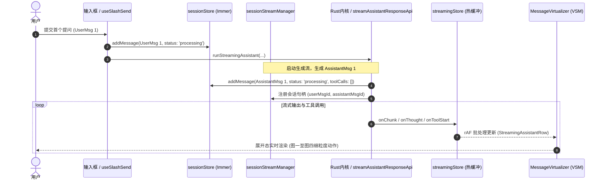
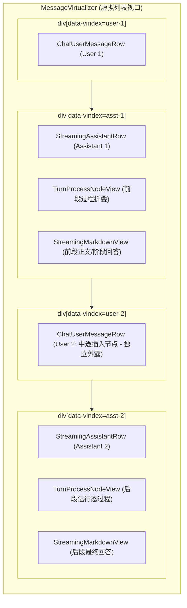

# 正文交错过程折叠战役调研报告：用户插入节点与时序切割机制调研

> **战役工作区**：`docs/assistant-process-folding/`
> **调研文件**：`docs/assistant-process-folding/survey/04-user-interruption-node-survey.md`
> **调研角色**：用户插入节点与时序切割调研员
> **协作纪律**：权威副本 `AGENTS.md`、反退避 `.agents/LOGIC_PLAN_NO_RETREAT.md`

---

## 一、执行摘要与核心结论

针对用户提出的核心边界条件：
> **“如果 AI 在工作过程中用户发送消息，那么需要根据用户插入节点，将一个工作 turn 中的 AI 输出内容分开折叠组织，而不是把用户消息也折叠进去。”**

本调研深入穿透了 Conex / Crish 桌面端的会话状态机、流式运行链路、底层 Run Control 控制面、虚拟滚动渲染架构（VSM）以及撤回截断逻辑，得出如下四大核心结论：

1. **用户消息必须作为顶层一级独立节点的铁律约束**：
   - **交互主体性（Cognitive Anchoring）**：用户是交互的主导者与干预者。用户发送的消息无论发生在何时（空闲、流式打字中、工具执行中、批次等待中），都是时间线上的显式决策分水岭，绝不能被当作 AI 内部的思考或工具步骤降级折叠；
   - **单轨虚拟滚动（VSM Contract）**：`MessageVirtualizer.tsx` 严格以顶层 `SessionMessage.id` 作为虚拟滚动的行槽位与测高单轨（`data-vindex={msg.id}`）。用户消息拥有独立的交互栏、附件列表、钉选标记、就地编辑（`composerElement`）与行级高度度量。若将其折叠进助手消息内部，整个 VSM 测高自愈、DOM 节点复用与滚动锚定系统将彻底崩溃；
   - **撤回截断单真理源（Timeline Truncation SSOT）**：会话撤回（`applyTimelineTruncate` / `withdrawMessage`）以用户的 `targetMessageId` 作为时间线截断边界。用户消息是不可退避的原子栅栏（Turn Fence）。
2. **现行数据层已经具备天然的“跨消息物理分段”基建**：
   - 当 AI 处于繁忙状态（`hasLiveStream` 为真或存在 `processing` 态助手消息）时，用户在输入框发送内容，系统不会进行破坏性的中断，而是判定为 `decideSendWhileRunning -> 'follow_up'`（`L1 soft_inject / follow_up`）；
   - 用户消息以 `status: 'queued'` 写入 `sessionStore.messages`，并在时间线上按有序插入二分法排在当前助手消息之后；
   - 当前助手消息完成收尾（`executeStreamCompletion`）后，自动触发 `drainQueuedAfterComplete`，将排队用户消息转为 `processing`，并以该用户消息的 `id` 开启下一轮全新的助手生成流（生成新的 `assistantMsgId`）。
   - **因此，在数据模型层，系统天然是由 `[User 0] -> [Assistant 1] -> [User Interruption] -> [Assistant 2]` 构成的多消息物理序列**。
3. **“分开折叠组织”的视图层核心破局点**：
   - 所谓“将一个工作 turn 中的 AI 输出分开折叠”，在工程实现上的正解是：**以用户插入节点为界，前段助手消息（`Assistant 1`）独立闭环折叠，用户消息居中外露，后段助手消息（`Assistant 2`）独立开启并折叠**；
   - 严禁将用户插入消息视为 `MessageTimelineBlock` 中的子项塞入同一条 `AssistantMessage` 内部！必须坚持**“数据层物理分段 + 视图层单轨独立折叠”**的纯净架构。
4. **时序因果与边界分割契约**：
   - 确立五大不变量契约：顶层节点神圣不变性、因果时间戳单调性、前段局部独立收敛、VSM 测高自愈无感平滑吸底、撤回与分支对称截断。

---

## 二、会话消息管理与流式运行链路全景分析

### 2.1 useChatStream 门面与 useRunStreamingAssistant 运行生命周期

在桌面端，聊天流式运行由门面 `apps/crish-desktop/src/hooks/useChatStream.ts` 引出，核心编排位于 `apps/crish-desktop/src/hooks/chat-stream/useRunStreamingAssistant.ts`。



#### 关键代码证据：
1. **助手消息的初始挂载**（`apps/crish-desktop/src/hooks/chat-stream/useRunStreamingAssistant.ts:88-120`）：
   ```ts
   // useRunStreamingAssistant.ts:88
   const assistantMsgId = generateMessageId('assistant');
   const store = getCompositionRoot().session.getState();
   const startTime = Date.now();
   // ...
   store.addMessage(wsId, sid, {
     id: assistantMsgId,
     sender: 'assistant',
     text: '',
     thinking: undefined,
     timestamp: startTime,
     status: 'processing',
     toolCalls: [],
   });
   ```
   在此处，助手消息以 `sender: 'assistant'` 且 `status: 'processing'` 独立进入 `sessionStore.messages`。
2. **生命周期句柄绑定**（`useRunStreamingAssistant.ts:103-108`）：
   ```ts
   streamManagerRef.current?.set(sid, {
     cancel: (opts) => cancelStreamFn(opts),
     userMsgId,
     assistantMsgId,
     runId: null,
   });
   ```
   `streamManager` 明确记录了当前的活动流与配对的 `(userMsgId, assistantMsgId)`。

### 2.2 流式热缓冲（streamingStore）与会话持久化（sessionStore）的双轨机制

为了避免高频流式 chunk（几十毫秒一次）引发整个会话消息树的深层 Immer 更新与全表重渲染，架构采用了双轨分离：
- **热路径（Hot Path）**：`apps/crish-desktop/src/store/streamingStore.ts`
  - 承载 `streamText`、`streamThinking`、`streamTools`；
  - 由 `StreamRenderBuffer`（`useRunStreamingAssistant.ts:151-175`）按帧节流刷新；
  - 页面壳层 `StreamingAssistantRow.tsx:28` 仅为当前正在流式生成的单行消息订阅热缓冲，组装为 `streamText` 传递给 `ChatAssistantMessageRow`；
- **持久层（Durable Layer）**：`apps/crish-desktop/src/store/sessionStore.ts`
  - 存放历史稳定消息；
  - 仅在工具调用前打快照（`snapshotStreamTextToSession`）、工具状态变迁（`commitToolPatchToSession`）或流结束时（`commitStreamToSession`）才执行持久化。

### 2.3 streamCallbacksInternals 中的工具队列与因果快照

在工具启动或思考推进时，系统严格执行物理因果时序保全：
- 引用位置：`apps/crish-desktop/src/hooks/chat-stream/streamCallbacksInternals.ts:213-234`
```ts
// streamCallbacksInternals.ts:213
// 物理因果时序保全：在工具启动前，若存在流式思考，立即提交至 sessionStore，
// 确保思考块必然处于该工具块之前，绝不发生事后重排颠倒
const currentLiveThinking = getStreamThinking(sid, assistantMsgId);
if (currentLiveThinking && currentLiveThinking.trim()) {
  // ... 提交 updateMessageThinking
}
// Durable text snapshot before tool so blocks/streamTextOffset interleave correctly.
snapshotStreamTextToSession(sid, assistantMsgId, readStreamedFullText());
```
这一机制确保了即使在流式未完全结束时，AI 消息内部的思考、文本与工具调用也是严格按物理产生时间交错记录的。

---

## 三、用户在 AI 工作过程中发送消息的底层时序与数据流断层

当 AI 正在思考、打字或执行耗时工具（如运行编译命令、读取多个文件）时，用户在界面底部的输入框键入并发送新指令，整套系统如何处理？

### 3.1 并发忙碌判定与动作路由（decideSendWhileRunning）

发送主入口位于 `apps/crish-desktop/src/hooks/chat-stream/useSlashSend.ts`。

```mermaid
flowchart TD
    A[用户点击发送 / Enter] --> B[useSlashSend: handleSendChat]
    B --> C{检查会话状态: hasLiveStream || hasProcessingAssistant?}
    C -- 否: 闲置 --> D[decideSendWhileRunning -> 'start']
    D --> E[立即乐观入库 User 消息]
    E --> F[启动 runStreamingAssistant]
    C -- 是: 忙碌中 --> G[decideSendWhileRunning -> 'follow_up']
    G --> H[调用 enqueueFollowUpMessage]
    H --> I[flushContextStateBeforeSend]
    I --> J[addMessage: 入库 User 消息, status='queued']
    J --> K[runControl.followUp: 派发 L1 协议给引擎]
    K --> L[清空输入框草稿, 保持当前流不被打断]
```

#### 代码证据：
1. **忙碌检测与自愈清理**（`apps/crish-desktop/src/hooks/chat-stream/useSlashSend.ts:161-166`）：
   ```ts
   // useSlashSend.ts:161
   const hasLiveStream = streamManagerRef.current?.hasStream(sessionId) ?? false;
   settleStaleSessionProcessingMessages(sessionId, hasLiveStream);

   const isAiBusy = checkSessionAiBusy(hasLiveStream, sessionId);
   const isFollowUp = decideSendWhileRunning(isAiBusy) === 'follow_up';
   const liveHandle = streamManagerRef.current?.get(sessionId);
   ```
2. **决定行为（永不返回 force abort）**（`apps/crish-desktop/src/hooks/chat-stream/helpers.ts:396-400`）：
   ```ts
   // helpers.ts:396
   /** 忙 → follow_up；闲 → start。永不返回 force abort。 */
   export function decideSendWhileRunning(
     isAiBusy: boolean
   ): SendWhileRunningAction {
     return isAiBusy ? 'follow_up' : 'start';
   }
   ```
   **架构原则**：默认产品路径是 `follow_up`（等待当前流或安全点优雅推进），绝不擅自执行底层 `AbortController.abort()`。

### 3.2 L1 follow_up 队列注入与 run-control 契约

依据权威架构契约 `docs/architecture/run-control.md`：
- **L0 (`continue`)**：AI / loop 自动进入下一 turn；
- **L1 (`soft_inject` / `steer` / `follow_up`)**：安全点注入消息，**不杀当前 stream**，AI 继续执行；
- **L2 (`cooperative_stop`)**：用户手动点击 Stop，当前 turn 正常收尾，保留已产生结果；
- **L3 (`force_cancel`)**：硬停，立即中止 provider 与工具进程。

当 `isFollowUp` 为真时，执行 `enqueueFollowUpMessage`（`apps/crish-desktop/src/hooks/chat-stream/slashSendQueueHelper.ts:123-153`）：
```ts
// slashSendQueueHelper.ts:136
addMessage(wsId, sessionId, {
  id: userMsgId,
  sender: 'user',
  text: displayText,
  timestamp: Date.now(),
  status: 'queued',
  ...(images?.length ? { images } : {}),
  ...(attachments?.length ? { attachments } : {}),
});

void getCompositionRoot().runControl.followUp({
  runId: liveHandleRunId ?? null,
  sessionId,
  text: displayText,
  clientMessageId: userMsgId,
  reason: reason || 'ui-send-while-running',
});
```

### 3.3 sessionMessageActionsCore 与 messageOrderKey 二分插入逻辑

新创建的用户消息如何进入 `sess.messages` 数组？
- 在 `apps/crish-desktop/src/store/sessionMessageActionsCore.ts:78-79` 中：
  ```ts
  // sessionMessageActionsCore.ts:78
  // D1：不额外排序——upsertMessageById 已按 compareMessageOrder 有序插入
  upsertMessageById(sess.messages, newMsg);
  ```
- 在 `apps/crish-desktop/src/store/sessionSharedHelpers.messageMerge.ts:352-359` 中：
  ```ts
  // D1 SSOT：新 id 按 order key 二分插入（list 通常已序，O(log n) 定位）
  const keys: ReturnType<typeof messageOrderKey>[] = [];
  for (let i = 0; i < messages.length; i++) {
    keys.push(messageOrderKey(messages[i]!));
  }
  const pos = findInsertIndex(keys, messageOrderKey(message));
  messages.splice(pos, 0, message);
  ```
- 在 `apps/crish-desktop/src/store/messageOrderKey.ts:9-51` 中：
  排序键依据 `seq（engineSequence） -> ts（timestamp） -> id（localeCompare）`。
  由于正在生成的 `assistant` 消息的 `timestamp` 是其开始时间 $T_0$，而中途插入的用户消息的 `timestamp` 是当前点击时间 $T_{insert}$（$T_{insert} > T_0$），在没有外部序列号强制重排的情况下，**该用户消息被天然放置在当前正在运行的助手消息之后**！

#### 此时 `sessionStore.messages` 的拓扑结构：
```
Index 0: [User Message 1] (timestamp: T_0, status: 'completed')
Index 1: [Assistant Message 1] (timestamp: T_0, status: 'processing', 正在执行工具/输出文本)
Index 2: [User Message 2 (Interruption)] (timestamp: T_insert, status: 'queued')
```

### 3.4 流完成时的唤醒链路（drainQueuedAfterComplete）

当 `Assistant Message 1` 完成全部工作后，生命周期来到 `apps/crish-desktop/src/hooks/chat-stream/streamExecutionHelper.ts:49`（`executeStreamCompletion`），并进而调用 `useGoalMode.ts:160` 中的 `drainQueuedAfterComplete`：
```ts
// useGoalMode.ts:171
const next = sess?.messages.find(
  (m: SessionMessage) => m.sender === 'user' && m.status === 'queued'
);
if (next?.text) {
  st.setSessionMessageStatus(sid, next.id, 'processing');
  // ...
  mgr.scheduleStart(sid, prompt, next.id);
}
```
此时：
1. `User Message 2` 的状态从 `'queued'` 变为 `'processing'`；
2. 调度器启动全新的 `runStreamingAssistant`；
3. 创建新的 `Assistant Message 2`（`id: assistantMsgId_2`, `timestamp: T_next`, `status: 'processing'`）；
4. 消息列表演进为：
   `[User 1] -> [Assistant 1 (已结束)] -> [User 2 (处理中)] -> [Assistant 2 (生成中)]`。

---

## 四、UI 列表层的虚拟化渲染与节点拓扑

### 4.1 MessageVirtualizer 的单轨映射（`data-vindex={msg.id}`）

进入渲染视图层，`apps/crish-desktop/src/components/chat-message-list/MessageVirtualizer.tsx` 是承载整个会话所有消息的主容器。



#### 关键代码证据：
1. **逐行独立切片渲染**（`MessageVirtualizer.tsx:434-512`）：
   ```tsx
   // MessageVirtualizer.tsx:434
   {messages.slice(startIndex, endIndex).map((msg, i) => {
     const virtualIndex = startIndex + i;
     // ...
     if (msg.sender === 'user') {
       return (
         <AppErrorBoundary key={msg.id} variant="minimal" title="消息出错">
           <div data-vindex={msg.id}>
             <ChatUserMessageRow msg={msg} ... />
           </div>
         </AppErrorBoundary>
       );
     }

     return (
       <AppErrorBoundary key={msg.id} variant="minimal" title="消息出错">
         <div data-vindex={msg.id}>
           <StreamingAssistantRow msg={msg} ... />
         </div>
       </AppErrorBoundary>
     );
   })}
   ```
2. **VSM 测高单轨**（`MessageVirtualizer.tsx:188-204`）：
   ```tsx
   // MessageVirtualizer.tsx:198
   const msgId = el.dataset.vindex;
   const measuredHeight = el.offsetHeight || Math.ceil(entry.contentRect.height);
   if (msgId != null && measuredHeight > 0) {
     setActual(msgId, measuredHeight);
   }
   ```
   **结论**：`VirtualScrollManager` 必须且只能针对外层的 `[data-vindex={msg.id}]` 建立线段树与前缀和映射。任何一条合法的 `SessionMessage` 都必须外露为一个顶层 DOM 行！

### 4.2 ChatUserMessageRow 的一等公民交互特征与测高资产

用户消息行（`apps/crish-desktop/src/components/chat-message-row/ChatUserMessageRow.tsx`）绝非纯文本容器，它内聚了极其复杂的桌面级功能：
- **就地编辑模式（In-place Editing）**：`isEditing` 为真时，直接把全局输入框 `composerElement` 借调挂载到当前行（`ChatUserMessageRow.tsx:37-41`），支持撤销重发；
- **消息撤回触发点（Retract Anchor）**：`isLastUser` 时外露撤回按钮（`ChatUserMessageRow.tsx:34-35`）；
- **图片与多模态附件卡片（Attachment Cards）**：`normalizeMessageAttachments` 渲染文件图标、尺寸、预览与打开工作区面板动作（`ChatUserMessageRow.tsx:120-140`）；
- **钉选与颜色高亮（Pin Management）**：独立参与右侧 `FlowScrubber` 迷你导轨定位。

### 4.3 StreamingAssistantRow 与 MessageContent 内部交错时间线

在助手消息行内部，`MessageContent.tsx` 负责单条助手消息内部的过程组织：
- 依靠 `buildAssistantTimelineCached`（`MessageContent.tsx:157`）生成 `AssistantTimelineItem[]`；
- 顶部放置过程控制栏 `TurnProcessNodeView.tsx`（`MessageContent.tsx:333`）：
  - 终态时显示统计摘要：`summaryText = "X 次工具调用 · Y 条消息 · 思考耗时 Zs"`；
  - 控制内部的 `tools` 和 `thought` 显隐（`MessageContent.tsx:352`：`if (!isProcessExpanded && (item.kind === 'tools' || item.kind === 'thought')) return null;`）；
  - 支持 HTML5 `hidden="until-found"` 原生属性与 `beforematch` 浏览器搜索穿透（`TurnProcessNodeView.tsx:77-97`）。

---

## 五、关键问题穿透：为什么用户消息绝不能被吞入或折叠？

在明确了全链路代码实现后，针对“为什么用户发送消息时，必须保证用户消息是顶层一级节点，绝不能被吞入或折叠进助手消息的过程块中”，从架构、交互和数据三大维度进行穿透性论证：

### 5.1 认知锚点与交互主体性（Cognitive Anchoring）

```
【错误拓扑：吞噬用户输入】
┌──────────────────────────────────────────────────────────────┐
│ Assistant Turn 1                                             │
│  ├─ 思考：分析用户上一问题...                                 │
│  ├─ 工具：read_file("config.json")                           │
│  ├─ ❌ [用户插话：不要读 config，改读 settings.ts] (被折叠)    │
│  ├─ 工具：read_file("settings.ts")                           │
│  └─ 总结：已为您读取 settings.ts 内容...                      │
└──────────────────────────────────────────────────────────────┘
 折叠后表现：
 [ 已执行 2 项工具 · 思考耗时 3.2s ⌄ ]
 -------------------------------------------------------------
 已为您读取 settings.ts 内容...
 （灾难后果：用户以为自己发的消息丢了，界面上完全看不到那句干预指令！）
```

```
【正确契约：时序因果物理分段】
┌──────────────────────────────────────────────────────────────┐
│ [Assistant 1]                                                │
│  ▼ 已处理 12s · 已读取 1 个文件 ⌄                            │
│  ----------------------------------------------------------- │
│  (阶段性过程已折叠收起)                                        │
└──────────────────────────────────────────────────────────────┘
                          ▼
┌──────────────────────────────────────────────────────────────┐
│ [User Interruption] (一级独立节点，高亮外露)                  │
│  “不要读 config，改读 settings.ts”                            │
└──────────────────────────────────────────────────────────────┘
                          ▼
┌──────────────────────────────────────────────────────────────┐
│ [Assistant 2] (针对插入指令的新响应)                          │
│  ▼ 已处理 8s · 已读取 1 个文件 ⌄                             │
│  ----------------------------------------------------------- │
│  已为您读取 settings.ts，具体配置如下：...                    │
└──────────────────────────────────────────────────────────────┘
```

1. **心理模型的确定性**：
   在任何严肃的 Agent 工作流中，用户随时会因为 AI“偏离轨道”或“需要补充上下文”而中途介入。用户发出的每一句话都是最高优先级的**控制指令（Steering Action）**。
2. **状态反馈的即时性**：
   若将用户消息作为内部子项折叠，用户在发出消息后瞬间看到的是“输入框清空了，但聊天记录里什么都没多出来”（因为被合拢进上面助手的折叠块了）。这会导致用户陷入不可预测的恐慌，甚至狂点发送造成会话雪崩。

### 5.2 虚拟滚动测高单轨（VSM）与 ResizeObserver 的物理约束

Conex 的列表滚动基建有着非常刚性的反退避铁律：
1. **VSM 的单一真理源**：
   `VirtualScrollManager` 采用线段树维护 `[data-vindex]` 高度。高度的查询、估高注入（`preloadEstimates`）、实测回写（`setActual`）均严格以 `messageId` 为键。
2. **测量撕裂（Layout Thrashing）防护**：
   如果一条消息内既包含 AI 内容，又动态嵌套了用户卡片，当用户卡片处于“就地编辑（`isEditing`）”或“长文本展开（`isExpanded`）”时，行内 DOM 会发生剧烈的几何跳跃。
   若用户消息是一级节点，宿主 `ResizeObserver` 可以通过原生 O(1) 监听到 `data-vindex={userMsgId}` 的高度变动并调用 `setActual`；但若深嵌在 Assistant 内部，内部折叠展开将与外层折叠产生不可解的状态耦合与测量死锁。

### 5.3 撤回截断（applyTimelineTruncate）与分支重放的边界 SSOT

在多轮协作中，用户随时可能点击“撤回”或“从此处分叉（Branch）”。
- 查看核心逻辑：`apps/crish-desktop/src/store/sessionMessageActionsCore.ts:145-179`
```ts
// sessionMessageActionsCore.ts:149
// 投影重放至 boundary：保留边界 user 节点（seq == boundary_seq，
// 事件流只追加语义下其起始即边界），丢弃其后的全部节点（`> boundary_seq` 部分）
const idx = sess.messages.findIndex((m) => m.id === targetMessageId);
if (idx === -1) return;
sess.messages = sess.messages.slice(0, idx + 1);
```
- **核心断言**：系统的全部回滚与撤回算法，都是以用户消息的 `targetMessageId` 作为截断分界点！
  如果用户中途插入的指令没有独立的 `targetMessageId`，用户将永远无法单独“撤回刚刚插的那句指令”，也无法“从插话的地方重新分叉生成”。这在架构层面是绝对不可接受的破坏。

---

## 六、工作 Turn 的切割组织设计：物理分段 vs 视图逻辑分段

在明确了“用户消息必须独立外露”的原则后，如何优雅地处理“一个工作 turn 中 AI 输出内容的切割组织”？在此对比两种架构方案：

### 6.1 方案对比

| 维度 | 方案 A：跨消息物理分段（Data-Level Physical Splitting） | 方案 B：单消息内视图逻辑切分（View-Level Pseudo Splitting） |
| :--- | :--- | :--- |
| **核心机制** | 用户插入指令入库为独立 `UserMessage`；前半段 AI 自动收口为 `AssistantMessage 1`；后半段 AI 启动为 `AssistantMessage 2`。 | 用户指令塞入同一个 `AssistantMessage.blocks`；在单个组件内渲染多组折叠栏与夹心用户气泡。 |
| **与当前代码契合度** | **100% 完美对齐**。现有的 `enqueueFollowUpMessage`、`drainQueuedAfterComplete` 天然就是该形态。 | **严重冲突**。需推翻 `MessageTimelineBlock`、`SessionMessage` 定义，重构 `MessageVirtualizer`。 |
| **VSM 测高复杂度** | **极低（$O(1)$ 原生单轨）**。每个消息独立测高，展开收起互不干扰。 | **极高（$O(N)$ 状态嵌套）**。单行内部多个动态伸缩槽，ResizeObserver 极易震荡。 |
| **撤回与分支能力** | **天然支持**。每个阶段都可以独立撤回、独立编辑、独立分叉。 | **无法支持**。无法定位截断边界，必须改写全部 store actions。 |
| **架构优雅度** | **高（优雅收敛，零补丁）**。遵循单一真理路径，状态机正交。 | **低（充满魔术修补与特殊分支判断）**。属于典型的退避与补丁设计。 |

> **架构裁决**：**坚决采纳方案 A（跨消息物理分段）**。
> 任何来自用户的中途干预，在数据层和时间线上必须落地为独立的物理分段。

### 6.2 展开态与折叠态的时序拓扑

通过方案 A，整个交互时序将清晰呈现为分段式胶囊结构：

```
+========================================================================+
| [Row 1] User Message 0 (初始任务)                                      |
| 内容: "请重构 auth 模块并添加单元测试"                                  |
+========================================================================+
                                   |
                                   v
+========================================================================+
| [Row 2] Assistant Message 1 (干预前阶段 - 已收口折叠)                  |
| ---------------------------------------------------------------------- |
| [工作胶囊 ⌄] 已处理 1m 15s · 已搜索 4 次 · 已读取 8 个文件             |
| ---------------------------------------------------------------------- |
| (展开时可见：图一至图四细颗粒度读文件过程、时钟描述与路径高亮)         |
| ---------------------------------------------------------------------- |
| [阶段正文]: "我已定位到 auth.ts 中的漏洞，准备开始修改..."              |
+========================================================================+
                                   |
                                   v
+========================================================================+
| [Row 3] User Message 1 (中途干预节点 - 绝对外露)                       |
| ---------------------------------------------------------------------- |
| 内容: "等等，优先支持 JWT 规范，不要用旧的 SessionToken！"             |
| 操作栏: [复制] [编辑] [撤回]                                           |
+========================================================================+
                                   |
                                   v
+========================================================================+
| [Row 4] Assistant Message 2 (干预后阶段 - 正在生成 / 最终收口)          |
| ---------------------------------------------------------------------- |
| [工作胶囊 ⌄] 已处理 45s · 已编辑 2 个文件 · 已运行 1 条命令            |
| ---------------------------------------------------------------------- |
| (展开时可见：编辑 jwt.ts 的 diff 统计、npm test 输出)                  |
| ---------------------------------------------------------------------- |
| [最终正文]: "已按照 JWT 规范完成重构，所有单元测试均已通过。"           |
+========================================================================+
```

### 6.3 异常打断（L2 cooperative_stop / L3 force_cancel）下的局部收拢契约

如果用户在 AI 运行中不是“追加指令”，而是“先点击 Stop 强行中止，随后输入新指令”，或者直接“发指令强制抢占（Force Steer）”：
1. **当前助手消息（Assistant 1）的立即结算**：
   - 不管是 L2 协作停还是 L3 强停，`Assistant 1` 立即进入终态（`status: 'completed'` 或 `error`）；
   - 保留中止前已经产生的文本（Partial Text）和已经执行成功的工具（`toolCalls`）；
   - `TurnProcessNodeView` 对这部分已执行的资产进行**就地收拢**，折叠栏文案精确反映实际已完成的量级（如 `已搜索 2 次 · 已中断`）；
2. **随后插入的用户消息（User Interruption）**：
   - 立即作为下一个消息挂入列表；
3. **后续助手消息（Assistant 2）**：
   - 带着新的上下文继续运行，过程独立折叠。

---

## 七、时序因果与边界分割规范契约（Architecture Contract）

为了保证后续方案设计与代码实现不产生退避与漂移，在此定义刚性的五大架构契约：

### 契约一：顶层节点神圣不变性（Top-Level Invariance）
- **定义**：任何由用户直接产生或系统代表用户意图注入的指令节点，在 `sessionStore.messages` 中必须具备独立的 `id`，其 `sender` 必为 `'user'`；
- **红线**：严禁将用户输入序列化为助手消息的子属性、元数据或 `MessageTimelineBlock` 中的局部块；在 DOM 树中必须具有顶层 `[data-vindex={userMsgId}]` 外壳。

### 契约二：因果时序单调性与二分定位契约（Causal Monotonicity）
- **定义**：用户插入动作发生时的时间戳 $T_{insert}$ 具有不可逆性。新消息入库时必须经 `compareMessageOrder` 定位到当前流式助手消息的逻辑后置位；
- **红线**：禁止在 UI 层通过篡改时间戳或逆向排序将用户消息挪动到正在运行的助手消息前面，保持时序的真实物理投影。

### 契约三：前段局部独立折叠契约（Pre-Phase Isolated Folding）
- **定义**：以用户插入节点为界，前序助手消息视为独立的工作单元。该单元在被截断或收尾后，内部的思考、工具调用与阶段输出自成闭环；
- **规范**：前序助手消息由其自身的 `TurnProcessNodeView` 管理折叠态；后序助手消息由其自身的折叠组件管理，两者互不共享 `isProcessExpanded` 局部状态，避免联动闪烁。

### 契约四：VSM 测高自愈与滚动吸底锁死契约（VSM Self-Healing）
- **定义**：前段折叠收起、用户消息插入、后段流式生成这三个连续物理事件，均通过宿主 `ResizeObserver` 触发 `VSM.setActual` 单轨度量；
- **交互规范**：
  - 若用户此前处于吸底状态（`isAtBottom === true`），新插入的用户消息与后段流式展开必须保持丝滑贴底跟随；
  - 若用户在 AI 运行期间向上滚动翻阅历史（`isAtBottom === false`），无论前段如何折叠、新消息如何入库，`useVirtualScroll` 必须通过滚动偏移锁死锚点，严禁发生视口跳跃或拉回。

### 契约五：撤回与时间线截断对称契约（Timeline Truncation Symmetry）
- **定义**：`applyTimelineTruncate` 必须能无缝命中中途插入的用户节点（`targetMessageId === userMsgId`）；
- **效果保证**：当用户撤回该插入节点时，系统精准裁切掉该节点及其后续的所有后段助手消息，前段助手消息完整保留并解除截断，状态机自愈恢复。

---

## 八、后续设计与实现指导清单

作为第 1 波调研的落地成果，本报告为第 2 波方案设计团队（尤其是 `03-用户插入节点时序分段与调度详案.md` 与 `01-分段状态机与折叠判定详案.md`）提供如下指导要求：

1. **状态机分段建模**：
   - 方案团队应在状态机层明确定义 `TurnSegment` 边界，确保每个 `assistant` 实体在面对 `follow_up` 触发时能干净收敛到自身局部的终态折叠；
2. **折叠组件的指标统计隔离**：
   - `countProcessMetrics` 必须严格作用于单条消息内的 `linearItems`，坚决反对任何跨消息的聚合统计污染；
3. **空正文助手消息的终态折叠兜底**：
   - 若前段助手在被用户打断时仅执行了工具而尚未输出任何正式正文（`displayMsg.text` 为空），必须依靠图五折叠态样式（`isToolOnlyTerminalTurn`）干净收拢为单行胶囊，为用户插入节点让出视觉焦点；
4. **until-found 检索穿透对齐**：
   - 前后两段折叠块的 `hidden="until-found"` 容器必须分别拥有唯一的 DOM ID（如 `process-slot-${msg.id}`），确保原生 `Ctrl+F` 能够精准穿透展开对应阶段的工具调用。
