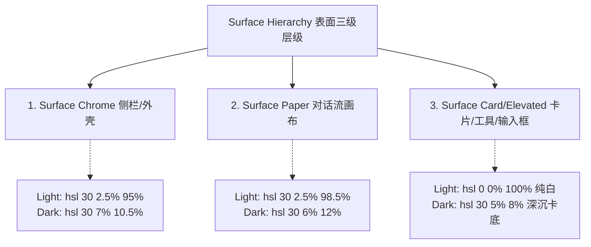
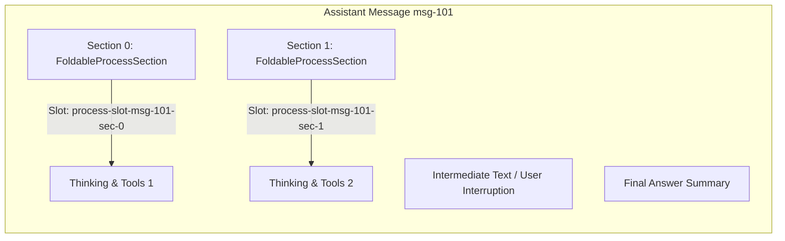
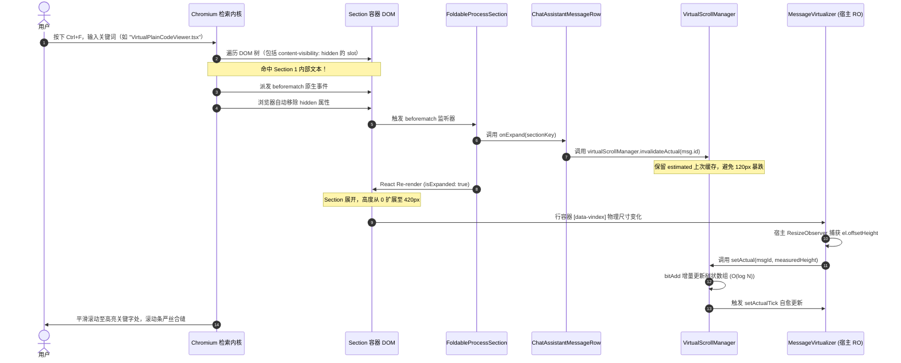

# 调研报告 06：Design Tokens 遵从性、HTML5 hidden="until-found" 穿透与无障碍能力深度调研

> **战役工作区**：`docs/assistant-process-folding/`  
> **调研专题**：`06-tokens-and-until-found-survey.md`  
> **调研角色**：设计规范与无障碍穿透调研员  
> **关联规范**：仓库根目录 `AGENTS.md`（§13「输入框与焦点态」、§14「色彩空间与现代 CSS 语法」）、`.agents/LOGIC_PLAN_NO_RETREAT.md`  
> **核心代码域**：  
> - `apps/crish-desktop/src/styles/tokens.css`  
> - `apps/crish-desktop/src/components/chat-message/MessageContent.module.css`  
> - `apps/crish-desktop/src/components/chat-message/TurnProcessNodeView.tsx`  
> - `apps/crish-desktop/src/components/chat-message/MessageContent.tsx`  
> - `apps/crish-desktop/src/components/chat-message-row/ChatAssistantMessageRow.tsx`  
> - `apps/crish-desktop/src/components/chat-message-list/MessageVirtualizer.tsx`  
> - `apps/crish-desktop/src/api/VirtualScrollManager.ts`  

---

## 一、执行摘要（Executive Summary）

在“正文交错过程折叠战役”中，AI 助手在长会话中的多轮执行过程（深度思考、工具调用、终端交互）需要进行优雅折叠收起，同时满足三大严苛技术诉求：
1. **Design Tokens 纯粹性与极简质感**：严格杜绝硬编码裸 Hex 颜色、杜绝生硬粗黑边框、杜绝厚重阴影，遵从克制的色彩混合对比度上限（AGENTS.md §13 / §14）；
2. **HTML5 原生检索穿透能力（Search Penetration）**：折叠态内容在视觉上虽收起，但在用户使用桌面端 / 浏览器 `Ctrl+F`（或 Chromium Find-in-page）搜索关键字（如折叠在内部的文件名、代码块、思考词句）时，必须能够被搜索内核即时索引，并**自动精准展开命中处所在的特定过程分段**；
3. **VSM 虚拟滚动与动态测高单轨自愈**：折叠块展开/收起时，高度变化必须精确同步至虚拟滚动树状数组（BIT），杜绝视口抖动、空白与滚动条错位。

### 核心发现与问题定性
1. **现有组件中的穿透原理成立但集成出现致命断层**：
   - `TurnProcessNodeView.tsx` 确实实现了基于 `el.setAttribute('hidden', 'until-found')` 与 `beforematch` 事件监听的完整闭环；
   - **重大断层暴露**：在当前 `MessageContent.tsx`（333-355行）的集成中，当过程折叠时，内部的 `tools` 和 `thought` 节点被 React 直接执行 `return null` 从 DOM 树中**物理卸载**！这直接导致 DOM 树中根本不存在对应文本节点，Chromium 原生搜索内核无法穿透，原有 `until-found` 设计在实际运行中沦为**无效空壳**。
2. **多段交错结构（Multi-Segment）亟需独立槽位控制**：
   - 现存逻辑将整个 Assistant 轮次收归于单个 `process-slot-${msgId}`；
   - 在用户中途插入引导（User Steering/Interruption）或图一至图五的分段要求下，必须支持多个独立的 `FoldableProcessSection`，各自持有独立的 slot id、`until-found` 属性与 `beforematch` 监听器，实现“命中了哪一段，就仅展开哪一段”的局部精确响应。
3. **Design Tokens 体系完善，但需制定严格的 CSS 契约**：
   - 项目在 `tokens.css` 中已具备成熟的三级表面体系（Chrome/Paper/Card）与 10% 焦点对比度规则；
   - 针对多段折叠栏，必须建立无硬编码的 CSS Module 规范，严禁对 `[hidden]` 错误覆盖 `display: none !important`。

---

## 二、Design Tokens 与全局样式规范深入剖析

### 2.1 三级表面层级与双主题色彩映射体系（SSOT）

根据 `apps/crish-desktop/src/styles/tokens.css` 的权威单一真源定义，应用遵循三级表面层级架构，杜绝蓝紫色偏光：



- **浅色主题（Light Theme）**（[tokens.css:43-50](file:///c:/Software/conex/apps/crish-desktop/src/styles/tokens.css#L43-L50)）：
  * `--surface-chrome: hsl(30 2.5% 95%);`（≈7% 暖灰外壳）
  * `--surface-paper: hsl(30 2.5% 98.5%);`（对话流画布，极淡暖灰）
  * `--surface-card: hsl(0 0% 100%);`（工具调用、输入框、浮层均置于白卡之上）
  * `--surface-elevated: hsl(0 0% 100%);`
  * `--surface-sunken: hsl(30 2.5% 90%);`
- **深色主题（Dark Theme）**（[tokens.css:763-770](file:///c:/Software/conex/apps/crish-desktop/src/styles/tokens.css#L763-L770)）：
  * `--surface-chrome: hsl(30 7% 10.5%);`
  * `--surface-paper: hsl(30 6% 12%);`
  * `--surface-card: hsl(30 5% 8%);`（暗色反转：卡片较画布更深或略抬）
  * `--surface-elevated: hsl(30 6% 10%);`
  * `--surface-sunken: hsl(30 6% 9%);`

### 2.2 文本层级与 WCAG AA 达标体系

文本色彩严格按信息层级收敛，避免裸写 Hex（[tokens.css:70-76](file:///c:/Software/conex/apps/crish-desktop/src/styles/tokens.css#L70-L76)，[tokens.css:786-792](file:///c:/Software/conex/apps/crish-desktop/src/styles/tokens.css#L786-L792)）：
- **浅色环境**：
  * 主文本：`--text-primary: #1a1a1a;`
  * 次级文本：`--text-secondary: #555555;`
  * 三级弱文本：`--text-tertiary: #696969;`（严格满足 WCAG AA 4.5:1 对比度）
  * 第四级弱化文字：`--text-faint: color-mix(in srgb, var(--text-tertiary) 72%, var(--bg-primary));`（自适应派生，无裸 Hex）
- **深色环境**：
  * 主文本：`--text-primary: #cccccc;`
  * 次级文本：`--text-secondary: #aaaaaa;`
  * 三级弱文本：`--text-tertiary: #8f8f8f;`
  * 第四级弱化文字：`--text-faint: color-mix(in srgb, var(--text-tertiary) 68%, var(--bg-primary));`

### 2.3 边框、发丝线与降调裁决

2026-09-11 仓库执行了描边降调裁决，避免发光或生硬描边（[tokens.css:157-176](file:///c:/Software/conex/apps/crish-desktop/src/styles/tokens.css#L157-L176)，[tokens.css:861-881](file:///c:/Software/conex/apps/crish-desktop/src/styles/tokens.css#L861-L881)）：
- **浅色**：`--border-color: hsl(30 2.5% 88%);`（对白卡对比度 1.32:1，克制不抢戏），`--border-subtle: hsl(30 6% 94.5%);`
- **深色**：`--border-color: color-mix(in srgb, var(--text-primary) 20%, transparent);`，`--border-subtle: color-mix(in srgb, var(--text-primary) 11%, transparent);`
- **线宽契约（Line Width SSOT）**：
  * 常规发丝线与卡片描边：`--hairline-width: 1px;`（对应 `--hairline: var(--border-subtle);`）
  * 强调描边：`--border-width-emphasis: 2px;`

### 2.4 输入框、控制栏与焦点态纪律（AGENTS.md §13）

《AGENTS.md》§13 明确给出了输入框与焦点态的硬性红线：
1. **默认不要重阴影**：严禁随意添加厚重的 `box-shadow`；
2. **克制的激活边框**：禁止使用深黑色实心边框（如直接用 `var(--text-primary)` 或纯黑环）；
3. **焦点对比度上限约 10%**：
   - 相对基线，灰色加深混入文本色不超过约 10%（例如 `color-mix(in srgb, var(--border-color) 90%, var(--text-primary) 10%)` 为上限量级）；
   - 常规元素优先采用 3%–6% 混入以保持柔和；
4. **现有代码审查**：
   在 [MessageContent.module.css:34-38](file:///c:/Software/conex/apps/crish-desktop/src/components/chat-message/MessageContent.module.css#L34-L38) 中：
   ```css
   .turnProcessControlBar:focus-visible {
     outline: none;
     border-radius: var(--radius-sm, 4px);
     box-shadow: 0 0 0 1px color-mix(in srgb, var(--border-color) 90%, var(--text-primary) 10%);
   }
   ```
   这一行严格遵循了 §13 的 10% 上限量级，且圆角采用 `var(--radius-sm, 4px)`。新多段组件必须继承并贯彻此契约。

### 2.5 色彩空间与现代 CSS 语法（AGENTS.md §14）

1. **优先 HSLA / 斜杠透明度**：杜绝散落旧式 `rgba(...)`，统一使用 `hsl(h s l / a)` 或 `hsla(...)`；
2. **现代颜色函数**：充分利用 `color-mix(in srgb, ...)` 进行动态派生与透明度微调；渐变优先 OKLCH（如 `--accent-green: oklch(0.65 0.15 155)`）；
3. **品牌活态翡翠绿**：`--brand: #10b981;`（[tokens.css:205](file:///c:/Software/conex/apps/crish-desktop/src/styles/tokens.css#L205)），在工作态呼吸灯与重要状态点使用。

---

## 三、HTML5 `hidden="until-found"` 与原生检索穿透机制

### 3.1 WHATWG 标准语义与 Chromium / WebView2 原生特性

`hidden="until-found"` 是 WHATWG HTML Living Standard (§3.2.8.2) 为“可折叠但保留原生检索能力（Searchable Collapsible Sections）”设立的标准枚举状态。

#### 底层工作原理
1. **UA 样式表映射**：
   当元素具有属性 `hidden="until-found"` 时，Chromium（包括 Windows WebView2，Chrome 102+）用户代理样式表对其施加：
   ```css
   [hidden="until-found" i] {
     content-visibility: hidden;
   }
   ```
2. **`content-visibility: hidden` 优势**：
   - 相比于经典 `hidden`（`display: none !important;`）完全将 DOM 节点剔除出布局树与可访问性树，`content-visibility: hidden` 允许浏览器跳过该子树的布局排版（layout）和绘制（paint），渲染开销极低；
   - **关键特性**：浏览器内部的文本索引引擎（Find-in-page）依然保留对该子树文本的遍历与匹配！
3. **`beforematch` 触发与自愈流程**：
   - 当用户在窗口按 `Ctrl+F` 检索隐藏区域内部的文本（如代码片段、文件名），或者通过 URL `#hash` 锚点定位到内部元素时；
   - 浏览器在滚动视口之前，**同步在带有 `hidden="until-found"` 的祖先元素上派发 `beforematch` 事件**；
   - 随后浏览器**自动将该元素上的 `hidden` 属性移除**，使其恢复为 `content-visibility: visible`；
   - 浏览器执行平滑滚动，使命中文字滚动至视口中央并呈现高亮选中效果。

### 3.2 现有实现审查：`TurnProcessNodeView.tsx`

在 [TurnProcessNodeView.tsx:71-97](file:///c:/Software/conex/apps/crish-desktop/src/components/chat-message/TurnProcessNodeView.tsx#L71-L97) 中：

```tsx
// HTML5 hidden="until-found" 原生属性同步（通过 callback ref 同步挂载，避免 React 布尔属性覆写）
const setSlotRef = React.useCallback(
  (el: HTMLDivElement | null) => {
    (slotRef as React.MutableRefObject<HTMLDivElement | null>).current = el;
    if (el) {
      if (isHidden) {
        el.setAttribute('hidden', 'until-found');
      } else {
        el.removeAttribute('hidden');
      }
    }
  },
  [isHidden]
);

// 视口内穿透第一轨：精确原生挂载 beforematch 监听器，零 React 未知属性告警
useEffect(() => {
  const el = slotRef.current;
  if (!el) return;
  const handleBeforeMatch = () => {
    handleToggle();
  };
  el.addEventListener('beforematch', handleBeforeMatch);
  return () => {
    el.removeEventListener('beforematch', handleBeforeMatch);
  };
}, [handleToggle]);
```

并在 JSX 中挂载（[TurnProcessNodeView.tsx:157-164](file:///c:/Software/conex/apps/crish-desktop/src/components/chat-message/TurnProcessNodeView.tsx#L157-L164)）：
```tsx
{/* 双轨穿透第一轨：HTML5 hidden="until-found" 挂载点 */}
<div
  ref={setSlotRef}
  id={`process-slot-${msgId}`}
  className={styles.processHiddenSlot}
>
  {renderChildren()}
</div>
```

#### 疑难解答：为什么通过 Callback Ref 挂载而不是 React 布尔属性 `hidden={...}`？

这是本调研的核心难点之一。必须明确以下三项深层架构原因：

1. **React 属性序列化与布尔类型强制反射陷阱**：
   - 在 React 18/19 的 JSX 类型声明及内部属性配置（`DOMPropertyOperations`）中，`hidden` 属于已知的布尔型属性（Boolean attribute）。
   - 如果开发者写成 `<div hidden={isHidden ? "until-found" : undefined} />` 或 `<div hidden={isHidden} />`：
     * TypeScript 会警告字符串与布尔类型不兼容；
     * 更致命的是，React 运行时会将任何非 false 的真值转换为布尔属性反射 `element.hidden = true`，在最终 DOM 树上序列化为 `<div hidden="">`。
     * **一旦序列化为 `<div hidden="">`，浏览器会立即将其视为经典隐藏，走 `display: none`，从而彻底丧失 `content-visibility: hidden` 的后台文本引索能力！**
2. **React VDOM 与浏览器原生自动清除行为的状态冲突（Desync 回写覆盖）**：
   - 当浏览器在 Ctrl+F 匹配时，Chromium 内核会直接执行原生 DOM 操作：`element.removeAttribute('hidden')`，将容器瞬间展开以显示高亮；
   - 如果此属性交由 React JSX 受控管理（如受控绑定于某个 state），在下一次组件 re-render（例如会话流式刷新、定时器等）时，React 的 Reconciliation（协调算法）会对比 VDOM，发现当前组件的 state 还是未展开状态，**会再次强行给 DOM 节点写入 `hidden` 属性，直接把用户正在浏览的搜索匹配结果当场重新折叠掩盖！**
3. **Callback Ref 的优雅解耦优势**：
   - 通过 `setSlotRef = useCallback((el) => { ... })`，既能在 DOM 节点挂载和更新时精确执行 `el.setAttribute('hidden', 'until-found')`，又能保证原生字符串的无损传递；
   - 结合原生 `beforematch` 监听器中的 `handleToggle()`，使浏览器在触发检索穿透的同一瞬间，主动通知 React 应用层更新 state（`isExpanded = true`），从而保证 **Browser DOM 真实状态与 React VDOM 状态的原子同步**。

### 3.3 现状重大架构断层曝光：`MessageContent.tsx` 现有逻辑的假穿透

调研团队对 `MessageContent.tsx` 进行深入白盒审计，发现了一个**导致现有穿透能力完全失效的重大断层**！

请看 [MessageContent.tsx:331-355](file:///c:/Software/conex/apps/crish-desktop/src/components/chat-message/MessageContent.tsx#L331-L355)：

```tsx
// 1. 顶层渲染 TurnProcessNodeView，但 children 传入空函数返回 null：
<TurnProcessNodeView
  msgId={msg.id}
  items={linearItems}
  isTurnLive={false}
  hasFinalAnswer={Boolean(displayMsg.text?.trim() || streamText?.trim())}
  turnStatus={msg.status}
  isExpanded={isProcessExpanded}
  onToggleExpand={() => setIsProcessExpanded((prev) => !prev)}
  renderChildren={() => null}  // <--- 致命断层 1：隐藏槽内部空无一物！
/>

// 2. 下方的实际时间线 items 渲染：
{linearItems.map((item, idx) => {
  if (!isProcessExpanded && (item.kind === 'tools' || item.kind === 'thought')) {
    return null;  // <--- 致命断层 2：折叠时被 React 物理从 DOM 中卸载！
  }
  return (
    <React.Fragment key={item.key}>
      <ProcessItemRenderer ... />
    </React.Fragment>
  );
})}
```

#### 断层根因剖析
- `TurnProcessNodeView` 的内部插槽 `processHiddenSlot` 里是空的（`renderChildren={() => null}`）；
- 当 `isProcessExpanded === false` 时，所有的工具调用（`item.kind === 'tools'`）和思考过程（`item.kind === 'thought'`）直接在外部被 `return null`，**物理上从 DOM 树完全卸载了**！
- **后果**：既然 DOM 树上根本没有这些工具调用、代码变更、文件路径的 DOM 节点，Chromium 的搜索内核就根本无从索引！用户在页面按下 Ctrl+F 搜索折叠内容时，搜索结果恒为 0，`beforematch` 事件永远不会被触发！
- **整改铁律**：在新设计的 `FoldableProcessSection` 中，**折叠内容必须常驻挂载在 DOM 树中（保留在插槽内），仅通过 `hidden="until-found"` 进行排版跳过，严禁在收折态对子项 return null！**

---

## 四、多段 FoldableProcessSection 架构设计与核心问题攻关

### 4.1 核心问题 1：多段容器的独立 Slot ID、`hidden="until-found"` 与 `beforematch` 赋予机制

在 AI 对话交错执行模式中，单轮消息可能被分割为多个逻辑段落（例如：过程段1 -> 中途输出 -> 过程段2 -> 最终回答）。每个过程段都应成为一个独立的 `FoldableProcessSection`。



#### 1. 唯一 Slot ID 确定性命名规范
每个分段的 slot ID 必须全文档唯一且具有确定性，格式规范为：
```
process-slot-${msgId}-sec-${sectionKey}
```
其中 `sectionKey` 可以是段落在轮次中的稳定索引（`sec-0`, `sec-1`）或段内首个 item 的唯一 key（如 `tl-1`, `th-1`）。
控制栏 `<button>` 的 WAI-ARIA 属性精准对应：
- `aria-controls={`process-slot-${msgId}-sec-${sectionKey}`}`
- `aria-expanded={isSectionExpanded}`

#### 2. 多段状态机解耦
在父组件（`MessageContent`）中，不再使用单一的 `isProcessExpanded: boolean`，而是维护分段展开集合：
```typescript
// 记录当前消息展开的分段 key 集合
const [expandedSectionKeys, setExpandedSectionKeys] = useState<Set<string>>(() => new Set());

const handleToggleSection = useCallback((sectionKey: string) => {
  setExpandedSectionKeys((prev) => {
    const next = new Set(prev);
    if (next.has(sectionKey)) {
      next.delete(sectionKey);
    } else {
      next.add(sectionKey);
    }
    return next;
  });
}, []);

const handleExpandSection = useCallback((sectionKey: string) => {
  setExpandedSectionKeys((prev) => {
    if (prev.has(sectionKey)) return prev;
    const next = new Set(prev);
    next.add(sectionKey);
    return next;
  });
}, []);
```

#### 3. 封装高内聚的 `FoldableProcessSection` 组件
每个分段容器自身维护其 DOM 挂载、`hidden="until-found"` 同步及 `beforematch` 事件监听：

```tsx
export interface FoldableProcessSectionProps {
  msgId: string;
  sectionKey: string;
  isExpanded: boolean;
  isFoldable: boolean; // 是否处于终态可折叠状态
  summaryText: string;
  onToggle: (sectionKey: string) => void;
  onExpand: (sectionKey: string) => void;
  children: React.ReactNode;
}

export const FoldableProcessSection: React.FC<FoldableProcessSectionProps> = React.memo(
  function FoldableProcessSection({
    msgId,
    sectionKey,
    isExpanded,
    isFoldable,
    summaryText,
    onToggle,
    onExpand,
    children,
  }) {
    const slotId = `process-slot-${msgId}-sec-${sectionKey}`;
    const slotRef = useRef<HTMLDivElement | null>(null);
    const isHidden = isFoldable && !isExpanded;

    // 1. 同步 hidden="until-found"
    const setSlotRef = useCallback(
      (el: HTMLDivElement | null) => {
        slotRef.current = el;
        if (el) {
          if (isHidden) {
            el.setAttribute('hidden', 'until-found');
          } else {
            el.removeAttribute('hidden');
          }
        }
      },
      [isHidden]
    );

    // 2. 挂载原生 beforematch 监听器
    useEffect(() => {
      const el = slotRef.current;
      if (!el) return;

      const onBeforeMatch = () => {
        // 浏览器命中本段，精准通知父组件展开当前 section
        onExpand(sectionKey);
      };

      el.addEventListener('beforematch', onBeforeMatch);
      return () => {
        el.removeEventListener('beforematch', onBeforeMatch);
      };
    }, [sectionKey, onExpand]);

    if (!isFoldable) {
      // 运行态平铺，不折叠
      return <div className={styles.liveProcessStream}>{children}</div>;
    }

    return (
      <div
        className={styles.turnProcessContainer}
        data-section-key={sectionKey}
        data-expanded={isExpanded ? 'true' : 'false'}
      >
        <button
          type="button"
          className={styles.turnProcessControlBar}
          onClick={() => onToggle(sectionKey)}
          aria-expanded={isExpanded}
          aria-controls={slotId}
        >
          <span className={styles.summaryLabel}>{summaryText}</span>
          <span
            className={`${styles.chevron} ${isExpanded ? styles.chevronOpen : ''}`}
            aria-hidden="true"
          >
            ›
          </span>
        </button>

        {/* 关键：必须常驻挂载 children，通过 until-found 实施排版跳过，切勿 return null */}
        <div
          ref={setSlotRef}
          id={slotId}
          className={styles.processHiddenSlot}
        >
          {children}
        </div>
      </div>
    );
  }
);
```

---

### 4.2 核心问题 2：Ctrl+F 原生搜索精准展开与 VSM 测高自愈联动全链路

当用户使用 Ctrl+F 搜索特定折叠内容时，整个系统从浏览器内核到虚拟滚动树状数组的完整时钟时序如下：



#### 联动链路关键技术点解析

1. **精准局部展开（Targeted Expansion）**：
   - 如果一条消息包含 3 个折叠段，关键词位于第 2 段；
   - 浏览器仅在包含命中文本的第 2 段槽位 `process-slot-${msgId}-sec-1` 上派发 `beforematch`；
   - 只有该槽位绑定的监听器会触发 `onExpand('sec-1')`；
   - 第 0 段和第 2 段依然保持折叠状态，**完全不破坏其他不相关过程块的折叠美感**。
2. **测高单轨铁律（Single-Track RO Invariant）**：
   - 严禁在 `FoldableProcessSection` 内部私自创建 `ResizeObserver` 并直写 `manager.setActual`（见 [ChatAssistantMessageRow.tsx:81-83](file:///c:/Software/conex/apps/crish-desktop/src/components/chat-message-row/ChatAssistantMessageRow.tsx#L81-L83) 注释：“测高单轨：禁止行级私有 RO 直写 manager.setActual，会绕过 actualTick → 总高/滚动条不更新”）；
   - 正确路径：展开瞬间，调用 `virtualScrollManager?.invalidateActual(msg.id)`（[ChatAssistantMessageRow.tsx:87](file:///c:/Software/conex/apps/crish-desktop/src/components/chat-message-row/ChatAssistantMessageRow.tsx#L87)）；
   - 在 [VirtualScrollManager.ts:332-341](file:///c:/Software/conex/apps/crish-desktop/src/api/VirtualScrollManager.ts#L332-L341) 中，`invalidateActual` 将 `entry.actual` 置空，但会安全保留 `entry.estimated = lastKnownHeight`，**坚决杜绝粗暴重置为 120px 导致视口剧烈抖动与回弹**；
   - [MessageVirtualizer.tsx:192-205](file:///c:/Software/conex/apps/crish-desktop/src/components/chat-message-list/MessageVirtualizer.tsx#L192-L205) 中全局统一的宿主 `ResizeObserver` 捕获到行节点高度变化，读取 `el.offsetHeight`，通过 `setActual` 写入 Fenwick 树，触发 `actualTick` 完成完美的几何闭环。

---

## 五、符合 Design Tokens 的完整 CSS 样式契约

为彻底杜绝硬编码颜色、生硬黑边与过度阴影，以下给出针对 `FoldableProcessSection` 及其控制栏、隐藏槽的完整 CSS Module 规范。

### 5.1 CSS 规范文件：`FoldableProcessSection.module.css`

```css
/**
 * apps/crish-desktop/src/components/chat-message/FoldableProcessSection.module.css
 * 遵循 Conex Design Tokens (SSOT) 与 AGENTS.md §13 / §14 设计铁律
 */

/* 1. 外层容器 */
.sectionContainer {
  width: 100%;
  margin: 0;
  padding: 0;
  box-sizing: border-box;
}

/* 2. 33px 发丝控制栏：纯扁平、轻量、无重阴影 */
.controlBar {
  display: flex;
  align-items: center;
  width: 100%;
  height: 33px;
  padding: 6px 0;
  margin: 0;
  background: transparent;
  border: none;
  border-bottom: var(--hairline-width, 1px) solid var(--hairline, var(--border-subtle));
  cursor: pointer;
  text-align: left;
  box-sizing: border-box;
  font-family: inherit;
  color: var(--text-secondary);
  transition: color var(--transition-fast, 150ms ease),
              border-color var(--transition-fast, 150ms ease);
  user-select: none;
  -webkit-tap-highlight-color: transparent;
}

.controlBar:hover {
  color: var(--text-primary);
  border-bottom-color: var(--border-color);
}

/* 3. 焦点态（§13 铁律：对比度上限 10%，禁止粗深黑边） */
.controlBar:focus-visible {
  outline: none;
  border-radius: var(--radius-sm, 4px);
  /* 使用 color-mix 90/10% 上限量级，柔和浅灰 */
  box-shadow: 0 0 0 1.5px color-mix(in srgb, var(--border-color) 90%, var(--text-primary) 10%);
}

/* 4. 折叠指示箭头 */
.chevron {
  display: inline-flex;
  align-items: center;
  justify-content: center;
  width: 14px;
  height: 14px;
  margin-left: var(--space-1_5, 6px);
  font-size: var(--font-size-sm, 13px);
  line-height: 1;
  color: var(--text-tertiary);
  transform: rotate(0deg);
  transition: transform var(--transition-micro, 100ms ease);
  flex-shrink: 0;
}

.chevronOpen {
  transform: rotate(90deg);
}

/* 5. 摘要文字排版（支持多分类统计胶囊） */
.summaryLabel {
  font-size: var(--font-size-xs, 12px);
  line-height: 1.2;
  color: inherit;
  overflow: hidden;
  text-overflow: ellipsis;
  white-space: nowrap;
  letter-spacing: 0.01em;
}

/* 6. HTML5 hidden="until-found" 隐藏插槽 */
.hiddenSlot {
  width: 100%;
  box-sizing: border-box;
}

/**
 * 核心警告：绝不能在此处对 [hidden] 或 [hidden="until-found"] 写 display: none !important！
 * 必须保留浏览器的默认 content-visibility: hidden，确保原生 Find-in-page 能够穿透检索。
 */
.hiddenSlot:not([hidden]) {
  padding-top: var(--space-2, 8px);
  padding-bottom: var(--space-2, 8px);
  display: flex;
  flex-direction: column;
  gap: var(--space-2, 8px);
}

/* 7. 运行态直接平铺流 */
.liveProcessStream {
  display: flex;
  flex-direction: column;
  gap: var(--space-2, 8px);
  width: 100%;
  background: transparent;
}
```

### 5.2 样式避坑与红线清单

| 规则项 | 错误做法（严禁） | 正确做法（强制） | 规范依据 |
| :--- | :--- | :--- | :--- |
| **插槽隐藏样式** | `.hiddenSlot[hidden] { display: none !important; }` | 仅使用 `:not([hidden])` 装饰展开态，不碰 `[hidden]` | HTML5 Until-Found 规范；`display:none` 会导致 Chromium 停止检索 |
| **外层溢出裁切** | 在外层容器加 `overflow: hidden;` | 保持外层 `overflow: visible;`（容器只控制盒模型） | 避免阻断浏览器的滚动定位和焦点计算 |
| **焦点环颜色** | `box-shadow: 0 0 0 2px #000;` 或 `outline: 2px solid var(--text-primary);` | `box-shadow: 0 0 0 1.5px color-mix(in srgb, var(--border-color) 90%, var(--text-primary) 10%);` | 《AGENTS.md》§13「输入框与焦点态」对比度上限 10% |
| **描边颜色** | 裸写 Hex 如 `#e0e0e0` 或 `#333` | 使用 `var(--hairline, var(--border-subtle))` 或 `var(--border-color)` | 《AGENTS.md》§14 与 Design Tokens 统一规范 |
| **阴影厚度** | 添加 `box-shadow: 0 4px 12px rgba(0,0,0,0.15);` | 扁平化无阴影设计，或使用微量 `color-mix` 轻阴影 | 《AGENTS.md》§13「默认不要重阴影」 |

---

## 六、调研结论与第二波方案设计落地建议

1. **解决现有穿透断层是第一优先级**：
   在第二波方案设计（`01-分段状态机与折叠判定详案.md` 与 `04-VSM测高与HTML5穿透集成详案.md`）中，必须彻底废弃在 `MessageContent.tsx` 中对收折 items 施加的 `return null` 物理卸载，改为全部挂载至 `FoldableProcessSection` 对应的 `hiddenSlot` 内。
2. **抽象通用 Slot Hook 或组件**：
   推荐封装 `useUntilFoundSlot` Hook 或 `FoldableProcessSection` 组件，将 `setSlotRef`（Callback ref）、`beforematch` 事件订阅、以及 `onExpand` 回调标准化，杜绝多处重复编写底层 DOM 操作。
3. **保持测高单轨一致性**：
   展开与折叠时，各组件只负责调用 `virtualScrollManager.invalidateActual(msgId)`，统一由 `MessageVirtualizer` 的宿主 `ResizeObserver` 采集高度并回写 `setActual`，确保Fenwick 树状数组、视口滚动与滚动条严丝合缝。
4. **严格遵循 Design Tokens**：
   样式完全基于 `--hairline`、`--border-color`、`--text-secondary` 等系统变量，`:focus-visible` 锁定在 10% 混色对比度内，实现纸墨极简的高品质质感。
