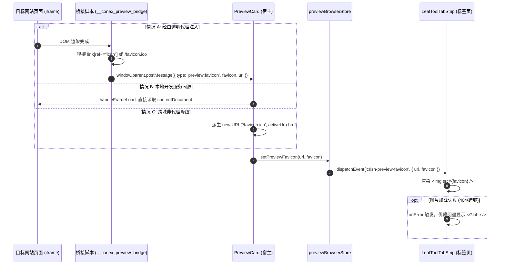

# 浏览器体验重塑与右侧 Resizer 几何与状态机根治技术方案（方案 A）

## 概述与设计目标

本方案针对用户反馈的内置浏览器组件（`PreviewCard`）及二叉树叶内坞分割线（`LeafDockResizer`）的 4 项核心交互与视觉缺陷，基于当前源码仓库（`apps/crish-desktop`、`packages/*`）开展深入一手排查，从 **CSS 盒模型排版几何学**、**W3C Pointer Event 捕获与 iframe 事件黑洞劫持机理**、**跨域 Favicon 嗅探提取与单向数据流**、以及 **极简无扰空状态（Empty State）架构** 四大维度，提供彻底根除问题的一体化高可靠实现方案。

---

## 目录

- [一、 浏览器地址栏样式与交互重塑方案](#一-浏览器地址栏样式与交互重塑方案)
  - [1.1 涉及文件与代码锚点](#11-涉及文件与代码锚点)
  - [1.2 现有问题与底层机理根因分析](#12-现有问题与底层机理根因分析)
  - [1.3 架构重塑与像素级设计规格](#13-架构重塑与像素级设计规格)
  - [1.4 具体代码级修改方案](#14-具体代码级修改方案)
- [二、 浏览器标签页动态网站图标（Favicon）提取与回落链路](#二-浏览器标签页动态网站图标favicon提取与回落链路)
  - [2.1 涉及文件与代码锚点](#21-涉及文件与代码锚点)
  - [2.2 现有缺陷与链路断裂分析](#22-现有缺陷与链路断裂分析)
  - [2.3 多源 Favicon 提取、通信与缓存架构设计](#23-多源-favicon-提取通信与缓存架构设计)
  - [2.4 具体代码级修改方案](#24-具体代码级修改方案)
- [三、 右侧拖拽分割线 4px 视觉偏移与“粘手”严重问题根治](#三-右侧拖拽分割线-4px-视觉偏移与粘手严重问题根治)
  - [3.1 涉及文件与代码锚点](#31-涉及文件与代码锚点)
  - [3.2 4px 视觉错位的几何盒模型根因排查（数学推导与 ASCII 剖面）](#32-4px-视觉错位的几何盒模型根因排查数学推导与-ascii-剖面)
  - [3.3 “粘手”（Stuck Drag）的底层事件劫持与状态机死锁剖析](#33-粘手stuck-drag的底层事件劫持与状态机死锁剖析)
  - [3.4 像素级重合对齐与防劫持指针捕获根治设计](#34-像素级重合对齐与防劫持指针捕获根治设计)
  - [3.5 具体代码级修改方案](#35-具体代码级修改方案)
- [四、 浏览器默认打开与极简空状态（Empty State）设计](#四-浏览器默认打开与极简空状态empty-state设计)
  - [4.1 涉及文件与代码锚点](#41-涉及文件与代码锚点)
  - [4.2 现有空白态繁杂视觉排查](#42-现有空白态繁杂视觉排查)
  - [4.3 纯净无扰设计规格与信息架构](#43-纯净无扰设计规格与信息架构)
  - [4.4 具体代码级修改方案](#44-具体代码级修改方案)
- [五、 验收标准与立体化测试验证矩阵](#五-验收标准与立体化测试验证矩阵)
  - [5.1 自动化测试断言集（Unit / Scoped Tests）](#51-自动化测试断言集unit--scoped-tests)
  - [5.2 真实环境现场验收用例（Checklist）](#52-真实环境现场验收用例checklist)

---

## 一、 浏览器地址栏样式与交互重塑方案

### 1.1 涉及文件与代码锚点

1. **`apps/crish-desktop/src/components/workspace/PreviewToolbar.tsx`**
   - 行号：L142–L169（`<form className={styles.urlForm}>` 与 `<Input>` 装配）
   - 行号：L28–L37（`PreviewToolbarNavigationProps` 接口与 `onClearUrl` 冗余回调）
2. **`apps/crish-desktop/src/components/workspace/PreviewCard.module.css`**
   - 行号：L38–L77（`.urlForm`、`.urlInput`、`.bar:hover .urlInput`、`.urlInput:focus`）
3. **`apps/crish-desktop/src/components/ui/Input/Input.tsx`**
   - 行号：L214–L276（`<Input>` 组件 DOM 结构：`inputWrap` → `inputShell` → `input` / `clearable` button）
4. **对照参考实现：侧边栏搜索框**
   - `apps/crish-desktop/src/components/sidebar/SidebarNav.tsx`（L58–L72）
   - `apps/crish-desktop/src/components/sidebar/SidebarNav.module.css`（L10–L38，L80–L122）

---

### 1.2 现有问题与底层机理根因分析

1. **圆角生硬不协调（4px 机械折角 vs 侧边栏连续平滑圆角）**：
   - 当前在 `PreviewCard.module.css:56` 处设置了：
     ```css
     .urlInput {
       border-radius: var(--radius-sm, 4px) !important;
     }
     ```
   - 在高度仅为 24px/28px 的工具栏输入容器中，4px 圆角产生非常机械生硬的边缘，而侧边栏全局搜索框（`SidebarNav.module.css`）使用 `var(--radius-lg)`（8px）或胶囊级圆角（6~8px）。地址栏未遵循系统的同心圆角与胶囊律，与侧栏风格严重脱节。
2. **Hover 作用域严重污染（全栏 Hover 污染地址栏）**：
   - 当前在 `PreviewCard.module.css:64-68` 处写道：
     ```css
     .bar:hover .urlInput,
     .urlInput:hover:not(:disabled) {
       background: color-mix(in srgb, var(--bg-primary) 20%, var(--bg-card)) !important;
       border: 1px solid var(--border-subtle) !important;
     }
     ```
   - **机理缺陷**：选择器包含 `.bar:hover .urlInput`！当鼠标移动到工具栏的任何地方（例如前进、后退、主页、刷新按钮，甚至工具栏空白边距）时，整个地址栏都会立刻变成灰色！这种将父级 `.bar` 的 hover 绑定到子输入框的做法完全违反了交互局域化原则，导致界面闪烁并给用户造成地址栏“被激活”的错觉。
3. **点击缺少正常文本输入光标（I-Beam Caret）**：
   - `<Input>` 原子组件的结构为外层包装器 `div.inputWrap`，内含 `div.inputShell` 与原生 `<input>`。`.urlForm` 占满可用空间，但外层容器没有显式声明 `cursor: text`；同时由于 `.urlInput` 原生 `border` 与 `background` 设置为 `transparent !important`，点击容器空白间隙时不能自然聚焦，且缺少主题色插入点光标（`caret-color`）。
4. **描边主题绿（--brand）缺失与焦点死板**：
   - 当前 focus 态使用的是死板的淡灰描边：
     ```css
     border-color: color-mix(in srgb, var(--border-color) 92%, var(--text-primary) 8%) !important;
     ```
   - 既没有呼吸感，也缺少产品主题标识度；用户期望聚焦时呈现精致、细线宽、高透明度的主题绿描边（`--brand`），并在非聚焦 hover 时仅表现为背景微深、不抢视线。
5. **冗余的叉号清除按钮（clearable 多此一举）**：
   - `PreviewToolbar.tsx:161` 配置了 `clearable` 属性。在网页浏览器地址栏中，用户点击地址栏的标准期望是全选现有网址（Select All）进行覆盖输入，或者通过 Backspace 修改；叉号按钮不仅占据地址栏右侧 24px 的显示空间导致长网址被截断，而且在窄屏下经常被误触导致已输入 URL 瞬间清空。
6. **占位文案不克制**：
   - 原文案为 `"localhost:5173 或 https://…"`，长度过长且技术开发色彩偏浓；需改为克制优雅的 `"请输入网址"`，文字设为低饱和浅灰 `--text-tertiary`。

---

### 1.3 架构重塑与像素级设计规格

对齐侧边栏“搜索会话与消息”的核心设计哲学：**“无边框透明纯净底色 + 局部 Hover 柔和微加深 + 聚焦高透明主题绿细描边 + 胶囊级顺滑圆角”**。

| 交互状态 | 背景（Background） | 描边（Border） | 圆角（Radius） | 光标与阴影 |
| :--- | :--- | :--- | :--- | :--- |
| **默认态 (Default)** | `transparent` | `1px solid transparent` | `var(--radius-md, 6px)` | `cursor: text`，无阴影 |
| **悬停态 (Hover)** | `color-mix(in srgb, var(--text-primary) 4%, var(--bg-card))`（微加深 4%） | `1px solid color-mix(in srgb, var(--brand, hsl(160 84% 39%)) 15%, transparent)` | `var(--radius-md, 6px)` | 光标为 I-beam，平滑过渡 120ms |
| **聚焦态 (Focus/Active)** | `var(--bg-card)` | `1px solid color-mix(in srgb, var(--brand, hsl(160 84% 39%)) 38%, transparent)` | `var(--radius-md, 6px)` | `caret-color: var(--brand)`，无粗重 ring |
| **占位符 (Placeholder)**| - | - | - | `color: var(--text-tertiary); opacity: 0.85;` |

---

### 1.4 具体代码级修改方案

#### 1.4.1 `PreviewToolbar.tsx` 代码修改

去除 `clearable` 与 `onClear` 传参，更新 `placeholder` 文案为 `"请输入网址"`：

```tsx
// apps/crish-desktop/src/components/workspace/PreviewToolbar.tsx

// 1. 修改 navigation props 接口定义（使 onClearUrl 变为可选兼容）：
export interface PreviewToolbarNavigationProps {
  onBack: () => void;
  onForward: () => void;
  onHome: () => void;
  onReload: () => void;
  onUrlSubmit: (raw: string) => void;
  onUrlChange: (v: string) => void;
  onClearUrl?: () => void; // 标记为可选
}

// 2. 改造表单内部 <Input> 调用：
<form
  className={styles.urlForm}
  aria-label="预览地址栏"
  onSubmit={(e) => {
    e.preventDefault();
    onUrlSubmit(urlInput.trim() ? urlInput : 'about:blank');
  }}
>
  <Input
    variant="search"
    size="xs"
    className={styles.urlInput}
    value={urlInput}
    placeholder="请输入网址"
    onChange={(e) => onUrlChange(e.target.value)}
    prefixIcon={
      <Lucide.Globe size={13} strokeWidth={1.5} aria-hidden />
    }
    // 彻底移除 clearable 与 onClear
    spellCheck={false}
    aria-label="预览地址"
    autoComplete="off"
    inputMode="url"
    enterKeyHint="go"
    onFocus={(e) => {
      // 遵循主流浏览器地址栏习惯：获得焦点时全选网址，便于直接键入替换
      e.currentTarget.select();
    }}
  />
</form>
```

#### 1.4.2 `PreviewCard.module.css` 样式修改

重构 `.urlForm` 与 `.urlInput`，删除 `.bar:hover .urlInput` 污染规则，引入高透明度 `--brand` 细线描边：

```css
/* apps/crish-desktop/src/components/workspace/PreviewCard.module.css */

.urlForm {
  flex: 1;
  min-width: 0;
  margin: 0 4px;
  display: flex;
  align-items: center;
  cursor: text;
}

.urlForm > div {
  width: 100%;
}

.urlInput {
  height: 26px !important;
  min-height: 26px !important;
  font-size: var(--font-size-xs, 12px) !important;
  font-family: var(--font-sans, inherit);
  background: transparent !important;
  border: 1px solid transparent !important;
  /* 深度对齐侧栏：采用 6px/8px 优雅软圆角，杜绝生硬 4px */
  border-radius: var(--radius-md, 6px) !important;
  box-shadow: none !important;
  color: var(--text-primary);
  caret-color: var(--brand, hsl(160 84% 39%));
  cursor: text;
  transition:
    background var(--transition-micro, 120ms) ease,
    border-color var(--transition-micro, 120ms) ease,
    color var(--transition-micro, 120ms) ease;
}

/* 占位符提示词：浅灰色、克制不抢眼 */
.urlInput::placeholder {
  color: var(--text-tertiary) !important;
  opacity: 0.85;
  font-size: var(--font-size-xs, 12px);
  user-select: none;
}

/* 仅在地址栏自身处于 hover 态时生效，严禁 .bar:hover 全局污染！
   背景略微变深（混入 4% text-primary），并伴随极高透明度的翠绿细描边 */
.urlForm:hover .urlInput:not(:focus):not(:disabled),
.urlInput:hover:not(:focus):not(:disabled) {
  background: color-mix(in srgb, var(--text-primary) 4%, var(--bg-card)) !important;
  border-color: color-mix(in srgb, var(--brand, hsl(160 84% 39%)) 18%, transparent) !important;
}

/* 聚焦点击态：正常显示光标、背景清晰、呈现细线高透明度主题绿描边 */
.urlInput:focus,
.urlInput:focus-visible,
.urlForm:focus-within .urlInput {
  outline: none !important;
  background: var(--bg-card) !important;
  /* 细线 1px，高透主题绿（~38%），通透且具高级质感 */
  border-color: color-mix(in srgb, var(--brand, hsl(160 84% 39%)) 38%, transparent) !important;
  box-shadow: none !important;
}

/* 彻底隐去任何浏览器内置清除或搜索装饰按钮 */
.urlInput::-webkit-search-cancel-button,
.urlInput::-webkit-search-decoration,
.urlInput::-webkit-search-results-button,
.urlInput::-webkit-search-results-decoration {
  -webkit-appearance: none;
  appearance: none;
  display: none !important;
}
```

---

## 二、 浏览器标签页动态网站图标（Favicon）提取与回落链路

### 2.1 涉及文件与代码锚点

1. **`apps/crish-desktop/src/components/binary-tree/LeafToolTabStrip.tsx`**
   - 行号：L406–L450（标签页列表渲染：`Icon = viewRegistry.getIcon(tabId)` 与 `<span className={styles.tabIcon}>`）
2. **`apps/crish-desktop/src/components/workspace/PreviewCard.tsx`**
   - 行号：L164–L188（宿主 `window.addEventListener('message')` 消息监听）
   - 行号：L190–L205（`handleFrameLoad` 加载生命周期）
3. **`apps/crish-desktop/src/components/workspace/previewCardLib.ts`**
   - 行号：L71–L126（`injectPreviewBridgeHtml` 透明代理桥接注入）
4. **`apps/crish-desktop/src/api/previewBrowserStore.ts`**
   - 行号：L180–L228（`dispatchPreviewUrl` 全局事件广播基建）

---

### 2.2 现有缺陷与链路断裂分析

1. **静态视图注册无法承载动态 Favicon**：
   - 视图注册中心 `registerBuiltInViews.tsx:81-89` 静态注册了 `preview` 视图的固定图标为 Lucide `Globe`。
   - `LeafToolTabStrip.tsx` 仅通过 `viewRegistry.getIcon(tabId)` 读取静态组件，完全没有基于当前浏览会话（`activeUrl`）动态解析网站图标的挂钩点。
2. **iframe 跨域安全沙箱阻隔**：
   - 当浏览器加载外部网站（如 `https://example.com`）时，受到浏览器同源策略（SOP）限制，外部宿主页面无法直接调用 `iframe.contentDocument` 读取 DOM。直接访问会抛出 `DOMException: Blocked a frame with origin from accessing a cross-origin frame`。
3. **缺少 Favicon 提取与分发总线**：
   - 现有的 `injectPreviewBridgeHtml` 仅拦截了 `<a>` 标签点击，没有收集 `<link rel="icon">` 信息；
   - 现有的 `previewBrowserStore` 维护了 `url`、`history` 和 `bookmarks`，唯独缺少 `favicon` 状态存储与事件广播。

---

### 2.3 多源 Favicon 提取、通信与缓存架构设计

采用 **“三级递进探测 + 单向状态广播 + 优雅异步图片回落”** 架构：



#### 探测三级策略：
1. **第一级（精确 DOM 探测）**：
   - 在 `previewCardLib.ts:injectPreviewBridgeHtml` 注入的桥接脚本中，直接查询：
     `document.querySelector('link[rel="icon"], link[rel="shortcut icon"], link[rel="apple-touch-icon"]')`。
   - 若存在则取绝对路径 `link.href`；若不存在，构造同源的 `/favicon.ico`。
2. **第二级（本地同源直接访问）**：
   - 在 `PreviewCard.tsx:handleFrameLoad` 中，针对本地服务（`localhost:5173` 等），通过 `try { iframeRef.current.contentDocument... }` 直接获取。
3. **第三级（默认推导与回落）**：
   - 宿主从当前 `activeUrl`（若非 `about:blank`）派生 `https://${host}/favicon.ico`。
   - 若加载失败或网址为 `about:blank`，无条件渲染 Lucide `Globe`。

---

### 2.4 具体代码级修改方案

#### 2.4.1 `previewBrowserStore.ts` 新增 Favicon 状态与广播支持

```typescript
// apps/crish-desktop/src/api/previewBrowserStore.ts

const FAVICON_MAP = new Map<string, string>();

/** 获取指定 URL 的 Favicon，若未缓存则返回 null */
export function getPreviewFavicon(url?: string): string | null {
  if (!url || isAboutBlank(url)) return null;
  return FAVICON_MAP.get(url) ?? null;
}

/** 写入 Favicon 并广播更新事件 */
export function setPreviewFavicon(url: string, favicon: string): void {
  if (!url || isAboutBlank(url) || !favicon) return;
  if (FAVICON_MAP.get(url) === favicon) return;
  FAVICON_MAP.set(url, favicon);
  if (typeof window !== 'undefined') {
    window.dispatchEvent(
      new CustomEvent('crish-preview-favicon', {
        detail: { url, favicon },
      })
    );
  }
}
```

#### 2.4.2 `previewCardLib.ts` 桥接脚本注入 Favicon 探测上报

```typescript
// apps/crish-desktop/src/components/workspace/previewCardLib.ts

// 在 injectPreviewBridgeHtml 的 bridgeScript 内部追加 Favicon 嗅探逻辑：
const bridgeScript = `<script id="__conex_preview_bridge">
(function() {
  if (window.__CONEX_PREVIEW_BRIDGE__) return;
  window.__CONEX_PREVIEW_BRIDGE__ = true;

  // 1. 嗅探并向宿主上报 Favicon
  function reportFavicon() {
    try {
      var icon = document.querySelector('link[rel="icon"], link[rel="shortcut icon"], link[rel="apple-touch-icon"]');
      var faviconUrl = icon && icon.href ? icon.href : (window.location.origin + '/favicon.ico');
      if (window.parent && window.parent !== window) {
        window.parent.postMessage({
          type: 'preview:favicon',
          favicon: faviconUrl,
          url: window.location.href
        }, '*');
      }
    } catch (_) {}
  }

  if (document.readyState === 'complete') {
    reportFavicon();
  } else {
    window.addEventListener('load', reportFavicon);
  }

  // 2. 原有 <a> 点击拦截与导航代理保持不变...
  document.addEventListener('click', function(e) {
    // ...
  }, true);
})();
</script>`;
```

#### 2.4.3 `PreviewCard.tsx` 处理 Favicon 消息与同源探测

```tsx
// apps/crish-desktop/src/components/workspace/PreviewCard.tsx

// 在 handleMessage 监听中拦截 preview:favicon：
React.useEffect(() => {
  const handleMessage = (event: MessageEvent) => {
    // ... 原有安全判定
    if (event.data?.type === 'preview:favicon' && typeof event.data.favicon === 'string') {
      const { favicon, url } = event.data;
      setPreviewFavicon(url || activeUrl, favicon);
      return;
    }
    // ...
  };
  window.addEventListener('message', handleMessage);
  return () => window.removeEventListener('message', handleMessage);
}, [activeUrl]);

// 在 handleFrameLoad 针对同源 dev-server 快速提取：
const handleFrameLoad = () => {
  nav.onFrameLoad();
  try {
    const doc = iframeRef.current?.contentDocument;
    if (doc) {
      const icon = doc.querySelector<HTMLLinkElement>(
        'link[rel="icon"], link[rel="shortcut icon"], link[rel="apple-touch-icon"]'
      );
      const faviconUrl = icon?.href || (activeUrl ? new URL('/favicon.ico', activeUrl).href : null);
      if (faviconUrl) {
        setPreviewFavicon(activeUrl, faviconUrl);
      }
    }
  } catch {
    // 跨域受限由 bridgeScript postMessage 处理，忽略异常
  }
  // ... 其余逻辑
};
```

#### 2.4.4 `LeafToolTabStrip.tsx` 动态 Favicon 渲染与错误回退组件

封装可自愈的 `TabFaviconIcon` 组件：

```tsx
// apps/crish-desktop/src/components/binary-tree/LeafToolTabStrip.tsx

interface TabFaviconIconProps {
  tabId: string;
  fallbackIcon?: React.ComponentType<{ size?: number; className?: string; ariaHidden?: boolean }>;
}

const TabFaviconIcon: React.FC<TabFaviconIconProps> = React.memo(({ tabId, fallbackIcon: FallbackIcon }) => {
  const isPreview = tabId === 'preview' || tabId.startsWith('preview:') || tabId.startsWith('browser:');
  const [faviconUrl, setFaviconUrl] = useState<string | null>(() => {
    if (!isPreview) return null;
    return getPreviewFavicon(getPreviewUrl());
  });
  const [loadFailed, setLoadFailed] = useState(false);

  useEffect(() => {
    if (!isPreview) return;
    const onFaviconUpdate = (ev: Event) => {
      const detail = (ev as CustomEvent<{ url?: string; favicon?: string }>).detail;
      if (detail?.favicon) {
        setFaviconUrl(detail.favicon);
        setLoadFailed(false);
      }
    };
    const onUrlUpdate = (ev: Event) => {
      const detail = (ev as CustomEvent<{ url?: string }>).detail;
      if (detail?.url && isAboutBlank(detail.url)) {
        setFaviconUrl(null);
        setLoadFailed(false);
      }
    };
    window.addEventListener('crish-preview-favicon', onFaviconUpdate);
    window.addEventListener('crish-preview-url', onUrlUpdate);
    return () => {
      window.removeEventListener('crish-preview-favicon', onFaviconUpdate);
      window.removeEventListener('crish-preview-url', onUrlUpdate);
    };
  }, [isPreview]);

  // 若存在有效 Favicon 且未加载失败，展示 13x13 网站小图标
  if (isPreview && faviconUrl && !loadFailed) {
    return (
       {
          // 加载异常（如 404）时平滑回退至默认 Globe 图标
          setLoadFailed(true);
        }}
      />
    );
  }

  // 默认 fallback 图标（Globe 或 viewRegistry 默认图标）
  return FallbackIcon ? <FallbackIcon size={13} aria-hidden /> : null;
});
TabFaviconIcon.displayName = 'TabFaviconIcon';

// 在 tabs.map 中替换图标渲染位：
<span className={`${styles.tabIcon} side-panel-tab-icon`}>
  <TabFaviconIcon tabId={tabId} fallbackIcon={Icon} />
</span>
```

---

## 三、 右侧拖拽分割线 4px 视觉偏移与“粘手”严重问题根治

### 3.1 涉及文件与代码锚点

1. **`apps/crish-desktop/src/components/binary-tree/LeafDockResizer.tsx`**
   - 行号：L25–L66（`handlePointerDown`，缺失 `setPointerCapture` 与 iframe 屏蔽）
   - 行号：L69–L77（`<div className={styles.leafDockResizer}>` DOM 声明）
2. **`apps/crish-desktop/src/components/binary-tree/BinaryTreeWorkspace.module.css`**
   - 行号：L351–L378（`.leafDockResizer` 与 `.leafDockResizer::after` 排版样式）
   - 行号：L380–L390（`.leafDockDrawer` 的 `border-left` 与 flex 声明）
3. **对照参考实现（无粘手正常运行模块）**：
   - `apps/crish-desktop/src/components/sidebar/useSidebarResize.ts`（L138–L211）
   - `apps/crish-desktop/src/components/sidebar/Sidebar.module.css`（L236–L265）
   - `apps/crish-desktop/src/utils/dragOverlay.ts`（L46–L56，`disableIframePointerEvents`）

---

### 3.2 4px 视觉错位的几何盒模型根因排查（数学推导与 ASCII 剖面）

#### 3.2.1 源码排版现场还原
在 `TreeLeafPanel.tsx:430-480` 中，当右侧工具抽屉开启时，DOM 结构与样式呈现如下：

```html
<div class="leafBody" data-dock-open="true"> <!-- display: flex; flex-direction: row; -->
  <div class="leafChatColumn">...</div>      <!-- flex: 1 1 0%; -->
  <div class="leafDockResizer"></div>        <!-- flex: 0 0 6px; width: 6px; -->
  <div class="leafDockDrawer">...</div>      <!-- flex: 0 0 var(--leaf-dock-width); border-left: 1px solid var(--border-subtle); -->
</div>
```

在 `BinaryTreeWorkspace.module.css` 中：
```css
.leafDockResizer {
  flex: 0 0 6px;
  width: 6px;
  position: relative;
  /* ... */
}
.leafDockResizer::after {
  content: '';
  position: absolute;
  top: 0; bottom: 0;
  left: 2.5px;
  width: 1px;
}
.leafDockResizer:hover::after,
.leafDockResizer[data-dragging='true']::after {
  background: var(--accent-green, #10b981);
  width: 2px;
  left: 2px; /* 激活线居中在 6px 宽度的中间 (6-2)/2 = 2px */
}
.leafDockDrawer {
  /* ... */
  border-left: 1px solid var(--border-subtle);
}
```

#### 3.2.2 4px 错位的数学推导与几何示意图

因为 `.leafDockResizer` 是一个**占据 6px 实际布局宽度的在流 Flex 子元素**：
1. 左侧面板 `.leafChatColumn` 结束于坐标 $X_0$。
2. 分割线 `.leafDockResizer` 占据区间 $[X_0, X_0 + 6\text{px}]$。
3. 高亮指示线 `.leafDockResizer::after` 的坐标计算：
   $$\text{Line}_X = X_0 + \text{left} = X_0 + 2\text{px}$$
4. 右侧面板 `.leafDockDrawer` 在 Flex 布局中紧随 Resizer 之后，排布于区间 $[X_0 + 6\text{px}, \dots]$。
   其面板实际左边框 `border-left` 的物理坐标为：
   $$\text{Border}_X = X_0 + 6\text{px}$$
5. **视觉偏移量（Visual Offset）精确计算**：
   $$\Delta = \text{Border}_X - \text{Line}_X = (X_0 + 6\text{px}) - (X_0 + 2\text{px}) = 4\text{px}$$

```
【当前错误排版剖面示意图】：
X 轴物理像素:  X0          X0+2px        X0+6px
               |             |             |
DOM 元素:      [ ChatColumn ][ Resizer     ][ Drawer (右侧面板) ...]
                             |             |
实际视觉呈现:                ▲             ▲
                             |             |
                       高亮指示线      面板实际边框 (border-left)
                             └──────┬──────┘
                                错位 4px！ (悬浮在半空中)
```

**结论**：用户拖拽右侧分割线时，高亮指示线位于面板真实边框左侧 **整整 4 个像素**，造成极其明显的撕裂感与错位。

---

### 3.3 “粘手”（Stuck Drag）的底层事件劫持与状态机死锁剖析

为什么左侧侧边栏（Sidebar）拖拽如丝般顺滑，而右侧叶内坞 Resizer 拖拽到右侧面板或其内部 iframe 时会严重“粘手”？

对比两者的底层逻辑实现，暴露出 4 处关键架构断层：

| 关键防御维度 | 左侧侧边栏 (`useSidebarResize.ts`) | 右侧叶内坞 Resizer (`LeafDockResizer.tsx`) | 造成后果 |
| :--- | :--- | :--- | :--- |
| **Pointer Capture** | `handleEl.setPointerCapture(e.pointerId)` | **完全缺失**（未调用） | 指针移出元素即失去目标，直接丢失 Move/Up 事件 |
| **iframe 事件黑洞拦截** | 依赖全局遮罩与坐标连续捕获 | **完全缺失** | 光标一旦进入 `<iframe>`，所有事件被 iframe 文档吞噬 |
| **全局 Body 状态机** | `document.body.classList.add('is-resizing')` | 仅给局部父级加 `is-dragging` | 未能阻止页面其他元素触发选中文本与干扰事件 |
| **意外中断保护** | 监听 `lostpointercapture` 与 `pointercancel` | **无任何容错监听** | 弹窗、失焦、系统手势导致事件永远无法收敛终结 |

#### iframe 事件黑洞劫持原理：
在浏览器体系中，`<iframe>` 是独立的根 Browsing Context。当鼠标从未设置 `setPointerCapture` 的宿主 DOM 拖动到 `<iframe>` 视口上方时：
1. 宿主 `window` 的 `pointermove` 立即停止触发；
2. 当用户在 iframe 区域内松开鼠标按键时，`pointerup` 事件在 iframe 内部被消费，**父级窗口永远收不到 `pointerup`**！
3. `LeafDockResizer.tsx` 中的 `onUp` 回调永远不会被执行，`draggingRef.current` 永远维持 `true`；
4. 当用户把鼠标移回页面其他区域时，Resizer 依然死死粘住光标持续缩放，必须再次无意识点击才能解开，造成严重的“粘手”事故。

---

### 3.4 像素级重合对齐与防劫持指针捕获根治设计

#### 3.4.1 像素级 0px 偏差重合方案（跨越边框居中排布）
参考 VS Code `sash.ts` 与现代 IDE 规范，分割线应当采用 **“绝对跨越式（Straddling）排布”**：
- 右侧面板 `.leafDockDrawer` 紧贴左侧聊天区，其 `border-left: 1px solid var(--border-subtle)` 作为两者的唯一真实物理分界线（坐标设为 $X_B$）。
- 分割线 `.leafDockResizer` 采用零占据宽度的容器配合负边距跨越，或者定位在分界线上：
  - 分割线热区宽度设为 8px，通过 `margin-left: -4px; margin-right: -4px;`（或 `position: absolute; left: -4px`）使其中心恰好位于 $X_B$（左延伸 4px，右延伸 4px，极易抓取）；
  - 高亮指示线 `::after` 设定为 `width: 2px; left: 3px;`（或 `left: 50%; transform: translateX(-50%)`），高亮线恰好精确覆盖在 $X_B$ 上！
- **偏移量计算**：$\Delta = 0\text{px}$，高亮线与边框线 **100% 像素级完全重合**。

#### 3.4.2 防劫持指针捕获与 iframe 屏蔽设计
1. **调用 `setPointerCapture`**：
   在 `onPointerDown` 中对事件源元素执行 `(e.currentTarget as HTMLElement).setPointerCapture(e.pointerId)`。一旦设置，哪怕光标移动到屏幕之外、移动到原生窗口外部、或移动到任何复杂的跨域 `<iframe>` 之上，所有 pointer 事件都由浏览器强制路由回本组件！
2. **集成 `disableIframePointerEvents`**：
   拖拽期间调用仓库内置的 `disableIframePointerEvents()`（`apps/crish-desktop/src/utils/dragOverlay.ts`），为全页面所有 `iframe/webview` 加上 `pointer-events: none`，彻底消除 iframe 事件黑洞。
3. **健全状态机与全局 Body 状态**：
   拖拽开始时向 `document.body` 挂载 `is-resizing` 与 `user-select: none`，拖拽结束或异常中断（`pointercancel`、`lostpointercapture`）时完全清理。

---

### 3.5 具体代码级修改方案

#### 3.5.1 `LeafDockResizer.tsx` 彻底重构（状态机 + 指针捕获 + iframe 屏蔽）

```tsx
// apps/crish-desktop/src/components/binary-tree/LeafDockResizer.tsx

import React, { useCallback, useRef, useState, useEffect } from 'react';
import styles from './BinaryTreeWorkspace.module.css';
import { disableIframePointerEvents } from '../../utils/dragOverlay';

function clampDockRatio(ratio: number): number {
  return Math.min(0.75, Math.max(0.2, ratio));
}

export function LeafDockResizer({
  leafBodyRef,
  widthRatio,
  onCommitRatio,
}: {
  leafBodyRef: React.RefObject<HTMLDivElement | null>;
  widthRatio: number;
  onCommitRatio: (ratio: number) => void;
}) {
  const draggingRef = useRef(false);
  const [dragging, setDragging] = useState(false);
  const handleElRef = useRef<HTMLDivElement | null>(null);
  const restoreIframesRef = useRef<(() => void) | null>(null);

  // 组件卸载时的安全守卫：确保无残留全局事件与 iframe 锁定
  useEffect(() => {
    return () => {
      if (restoreIframesRef.current) {
        restoreIframesRef.current();
        restoreIframesRef.current = null;
      }
      document.body.classList.remove('is-resizing');
    };
  }, []);

  const handlePointerDown = useCallback(
    (e: React.PointerEvent<HTMLDivElement>) => {
      // 仅响应鼠标主键（左键）
      if (e.button !== 0) return;
      e.preventDefault();
      e.stopPropagation();

      const body = leafBodyRef.current;
      const handleEl = e.currentTarget;
      handleElRef.current = handleEl;
      if (!body) return;

      // 1. 核心关键：锁定指针捕获，彻底防止 iframe 劫持与移动丢帧
      try {
        handleEl.setPointerCapture(e.pointerId);
      } catch {
        /* jsdom 或非 primary 指针环境优雅降级 */
      }

      // 2. 屏蔽所有 iframe 的 pointer-events（双重保险）
      restoreIframesRef.current = disableIframePointerEvents();

      // 3. 激活状态机与全局样式
      draggingRef.current = true;
      setDragging(true);
      body.classList.add('is-dragging');
      document.body.classList.add('is-resizing');

      const startX = e.clientX;
      const bodyWidth = body.clientWidth;
      const startWidth = Math.max(
        200,
        Math.min(bodyWidth * 0.7, widthRatio * bodyWidth)
      );

      const onMove = (ev: PointerEvent) => {
        if (!draggingRef.current) return;
        // 向左拖拽（startX - ev.clientX > 0）加大右侧宽度
        const next = Math.max(
          200,
          Math.min(bodyWidth * 0.7, startWidth + (startX - ev.clientX))
        );
        body.style.setProperty('--leaf-dock-width', `${next}px`);
      };

      const cleanup = (upEvent?: PointerEvent) => {
        if (!draggingRef.current) return;
        draggingRef.current = false;
        setDragging(false);

        // 释放指针捕获
        if (handleEl && upEvent) {
          try {
            if (handleEl.hasPointerCapture(upEvent.pointerId)) {
              handleEl.releasePointerCapture(upEvent.pointerId);
            }
          } catch {
            /* ignore */
          }
        }

        // 恢复 iframe 与全局状态
        if (restoreIframesRef.current) {
          restoreIframesRef.current();
          restoreIframesRef.current = null;
        }
        body.classList.remove('is-dragging');
        document.body.classList.remove('is-resizing');

        // 提交最终比例
        const px = parseFloat(body.style.getPropertyValue('--leaf-dock-width'));
        if (Number.isFinite(px) && bodyWidth > 0) {
          onCommitRatio(clampDockRatio(px / bodyWidth));
        }

        window.removeEventListener('pointermove', onMove);
        window.removeEventListener('pointerup', onUp);
        window.removeEventListener('pointercancel', onCancel);
      };

      const onUp = (upEvent: PointerEvent) => {
        cleanup(upEvent);
      };

      const onCancel = () => {
        cleanup();
      };

      window.addEventListener('pointermove', onMove);
      window.addEventListener('pointerup', onUp);
      window.addEventListener('pointercancel', onCancel);
    },
    [leafBodyRef, onCommitRatio, widthRatio]
  );

  return (
    <div
      ref={handleElRef}
      className={`${styles.leafDockResizer} layout-resizer layout-resizer-panel`}
      data-leaf-dock-resizer="true"
      data-dragging={dragging ? 'true' : 'false'}
      onPointerDown={handlePointerDown}
      role="separator"
      aria-orientation="vertical"
      aria-valuenow={Math.round(widthRatio * 100)}
      aria-valuemin={20}
      aria-valuemax={75}
      aria-label="拖拽调整右侧工具栏宽度"
    />
  );
}
```

#### 3.5.2 `BinaryTreeWorkspace.module.css` 几何与样式重构（0px 偏差重合）

```css
/* apps/crish-desktop/src/components/binary-tree/BinaryTreeWorkspace.module.css */

/* 重构 .leafDockResizer：
   采用 0 占位宽度 + 负外边距对称跨越策略，使其中心严格对齐在分界线上！*/
.leafDockResizer {
  flex: 0 0 0px;
  width: 0px;
  margin-left: -4px;
  margin-right: -4px;
  position: relative;
  z-index: 20; /* 必须高于内部抽屉面板，确保事件优先响应 */
  cursor: col-resize;
  touch-action: none;
  background: transparent;
  align-self: stretch;
  user-select: none;
}

/* 扩展可抓取的热区（Hitbox）为 8px 宽（向左 4px，向右 4px），但自身零排版占位 */
.leafDockResizer::before {
  content: '';
  position: absolute;
  top: 0;
  bottom: 0;
  left: -4px;
  width: 8px;
  background: transparent;
  pointer-events: auto;
}

/* 视觉指示线：精确对齐在 X=0 的分界线上 */
.leafDockResizer::after {
  content: '';
  position: absolute;
  top: 0;
  bottom: 0;
  left: -0.5px;
  width: 1px;
  background: transparent;
  pointer-events: none;
  transition: background var(--transition-fast, 120ms) ease;
}

/* 激活或 Hover 时：2px 宽绿色指示线，完美贴合居中于分界线上 */
.leafDockResizer:hover::after,
.leafDockResizer[data-dragging='true']::after {
  background: var(--accent-green, #10b981);
  width: 2px;
  left: -1px; /* 居中于 0px 边框线：-1px 到 +1px */
  box-shadow: 0 0 4px color-mix(in srgb, var(--accent-green, #10b981) 35%, transparent);
}

/* 右侧面板抽屉：维持正常的 1px 细边框分界线 */
.leafDockDrawer {
  flex: 0 0 var(--leaf-dock-width, 50%);
  width: var(--leaf-dock-width, 50%);
  min-width: 200px;
  max-width: 70%;
  min-height: 0;
  display: flex;
  flex-direction: column;
  overflow: hidden;
  border-left: 1px solid var(--border-subtle, hsl(0 0% 0% / 0.08));
  position: relative;
  z-index: 1;
}
```

---

## 四、 浏览器默认打开与极简空状态（Empty State）设计

### 4.1 涉及文件与代码锚点

1. **`apps/crish-desktop/src/components/workspace/PreviewCard.tsx`**
   - 行号：L317–L359（空白与非嵌入状态渲染）
   - 行号：L360–L402（错误与无内嵌页面时的 Warning 提示）
2. **`apps/crish-desktop/src/components/workspace/PreviewCard.module.css`**
   - 行号：L330–L374（`.empty`、`.emptyIco`、`.emptyTitle`、`.emptyDesc`）
   - 行号：L375–L400（`.activePortsRow`、`.activeServiceCapsule`、`.activeServicePulse` 等胶囊样式）
3. **`apps/crish-desktop/src/components/workspace/activePortDetector.ts`**
   - 行号：L1–L100（`useActiveDevPorts` 探测逻辑）
4. **`apps/crish-desktop/src/api/previewBrowserStore.ts`**
   - 行号：L180–L191（`getPreviewUrl` 默认返回 `about:blank`）
   - 行号：L247–L250（`getPreviewHistory` 历史记录读取）

---

### 4.2 现有空白态繁杂视觉排查

1. **强加的警示性卡片引发视觉压迫**：
   - 现存逻辑中，当用户打开空白预览页时，页面频繁呈现带有黄色感叹号 `<AlertTriangle>` 的粗暴提示：“预览空白，输入地址后在此内嵌打开”。这给用户造成一种“软件发生错误或发生故障”的负面心理暗示。
2. **重阴影胶囊按钮打破极简秩序**：
   - 现存的 `.activeServiceCapsule` 被赋予了强烈的背景色、描边、外阴影（`box-shadow`）、浮动位移（`transform: translateY(-0.5px)`）以及绿色呼吸灯圆点（`.activeServicePulse`），严重干扰了极简沉浸感。
3. **缺少最近打开页面的极简访问入口**：
   - 用户打开浏览器空白页时，最自然的诉求是快速继续访问刚才打开过的开发地址或页面，现有界面未将轻量历史以极简文字呈现出来。

---

### 4.3 纯净无扰设计规格与信息架构

```
┌──────────────────────────────────────────────────────────┐
│                   【极简空白状态视觉架构】                 │
│                                                          │
│                       （极致纵向居中）                    │
│                                                          │
│                  运行中的本地端口服务 (纯文字)              │
│                      http://localhost:5173               │
│                      http://localhost:3000               │
│                                                          │
│                      最近打开的网页 (极简图标)             │
│                      🌐 localhost:8765/api/docs          │
│                      🌐 tailwindcss.com/docs             │
│                                                          │
│        （当既无活跃端口又无历史记录时：完全纯净透明空白）    │
└──────────────────────────────────────────────────────────┘
```

- **默认行为**：打开时绝不自动跳转谷歌等外部地址，严格以 `about:blank` 打开纯白/纯净背景。
- **运行中的本地服务**：
  - 必须为 **纯文字形式（Pure Text）**，竖向居中排布（`flex-direction: column; align-items: center;`）；
  - 移除胶囊外框、移除绿色跳动点；
  - 默认文字颜色为柔和的 `--text-secondary`，鼠标悬停时伴随极低灰度背景（`color-mix(in srgb, var(--text-primary) 3.5%, transparent)`）与轻度颜色加深，安静不扰民。
- **最近打开的网页**：
  - 遵循 **“宁少勿多”** 原则，严格限制展示最多 3 项；
  - 每项由 12px 极简小图标（`Globe` 或 Favicon）+ 简短 Host/标题组成；
  - 若无任何活跃端口且无历史记录，界面保持 **极致干净空白**，彻底隐藏所有警告图标与冗余提示。

---

### 4.4 具体代码级修改方案

#### 4.4.1 `PreviewCard.tsx` 极简空状态重塑

```tsx
// apps/crish-desktop/src/components/workspace/PreviewCard.tsx

// 提取过滤最近历史条目（去重、去非空、排除当前、截取前 3 项）：
const recentPages = React.useMemo(() => {
  const rawList = history || [];
  const unique = Array.from(new Set(rawList)).filter(
    (u) => Boolean(u) && !isAboutBlank(u) && u !== activeUrl
  );
  return unique.slice(0, 3);
}, [history, activeUrl]);

const hasEmptyContent = activePorts.length > 0 || recentPages.length > 0;

// 在预览内容区替换原有空态渲染逻辑：
{!canEmbed || blank || !frameSrc ? (
  <div className={styles.emptyContainer}>
    {hasEmptyContent ? (
      <div className={styles.minimalEmptyContent}>
        {/* 1. 运行中的本地端口服务：纯文字垂直居中排布 */}
        {activePorts.length > 0 && (
          <div className={styles.emptySection} role="group" aria-label="运行中的本地服务">
            <span className={styles.emptySectionTitle}>本地运行服务</span>
            <div className={styles.textLinksColumn}>
              {activePorts.map((port) => {
                const targetUrl = `http://localhost:${port}`;
                return (
                  <button
                    key={port}
                    type="button"
                    className={styles.pureTextLink}
                    onClick={() => navigate(targetUrl)}
                    aria-label={`打开本地服务 localhost:${port}`}
                  >
                    localhost:{port}
                  </button>
                );
              })}
            </div>
          </div>
        )}

        {/* 2. 最近打开的网页：极简图标 + 简短域名/标题，宁少勿多 */}
        {recentPages.length > 0 && (
          <div className={styles.emptySection} role="group" aria-label="最近打开的网页">
            <span className={styles.emptySectionTitle}>最近打开</span>
            <div className={styles.textLinksColumn}>
              {recentPages.map((url) => {
                let displayHost = url;
                try {
                  const u = new URL(url);
                  displayHost = `${u.hostname}${u.port ? `:${u.port}` : ''}${u.pathname !== '/' ? u.pathname : ''}`;
                } catch {
                  displayHost = url.replace(/^https?:\/\//, '');
                }
                return (
                  <button
                    key={url}
                    type="button"
                    className={styles.pureTextLinkWithIcon}
                    onClick={() => navigate(url)}
                    title={url}
                    aria-label={`打开最近网页 ${displayHost}`}
                  >
                    <Lucide.Globe size={12} className={styles.recentIcon} aria-hidden />
                    <span className={styles.recentText}>{displayHost}</span>
                  </button>
                );
              })}
            </div>
          </div>
        )}
      </div>
    ) : (
      /* 当没有任何端口与历史时：保持极致干净空白，无任何感叹号或冗余字样 */
      <div className={styles.pureBlankCanvas} aria-hidden="true" />
    )}
  </div>
) : loadError ? (
  /* 仅在真实发生加载错误时显示简洁的重试卡片，杜绝无意义空白恐慌 */
  <div className={styles.errorState} role="alert">
    <div className={styles.emptyTitle}>无法加载此页面</div>
    <div className={styles.emptyDesc}>站点拒绝了内嵌连接，或网络连接超时。</div>
    <div className={styles.quickRow}>
      <Button variant="secondary" size="sm" onClick={reload}>重试</Button>
      {canExternal && (
        <Button variant="secondary" size="sm" onClick={openExternal}>系统浏览器打开</Button>
      )}
    </div>
  </div>
) : (
  <iframe
    ref={iframeRef}
    key={activeUrl}
    aria-label="预览页面"
    src={frameSrc ?? undefined}
    className={styles.iframe}
    sandbox="allow-scripts allow-same-origin allow-forms allow-popups allow-modals"
    referrerPolicy="no-referrer"
    loading="lazy"
    onLoad={handleFrameLoad}
    onError={nav.onFrameError}
  />
)}
```

#### 4.4.2 `PreviewCard.module.css` 极简样式编写

```css
/* apps/crish-desktop/src/components/workspace/PreviewCard.module.css */

.emptyContainer {
  height: 100%;
  width: 100%;
  display: flex;
  flex-direction: column;
  align-items: center;
  justify-content: center;
  background: var(--bg-card, #ffffff);
  box-sizing: border-box;
  overflow-y: auto;
  user-select: none;
}

.pureBlankCanvas {
  width: 100%;
  height: 100%;
  background: transparent;
}

.minimalEmptyContent {
  display: flex;
  flex-direction: column;
  align-items: center;
  justify-content: center;
  gap: 24px;
  max-width: 360px;
  padding: 20px;
}

.emptySection {
  display: flex;
  flex-direction: column;
  align-items: center;
  gap: 8px;
  width: 100%;
}

.emptySectionTitle {
  font-size: var(--font-size-xxs, 11px);
  color: var(--text-tertiary);
  letter-spacing: 0.5px;
  text-transform: uppercase;
}

.textLinksColumn {
  display: flex;
  flex-direction: column;
  align-items: center;
  gap: 4px;
  width: 100%;
}

/* 纯文字按钮：完全无边框、无重阴影、仅极低灰度 Hover */
.pureTextLink {
  border: none;
  background: transparent;
  padding: 4px 10px;
  border-radius: var(--radius-sm, 4px);
  color: var(--text-secondary);
  font-family: var(--font-mono, ui-monospace, monospace);
  font-size: var(--font-size-xs, 12px);
  cursor: pointer;
  transition:
    background var(--transition-micro, 120ms) ease,
    color var(--transition-micro, 120ms) ease;
  outline: none;
}

.pureTextLink:hover {
  background: color-mix(in srgb, var(--text-primary) 3.5%, transparent);
  color: var(--text-primary);
}

.pureTextLink:focus-visible {
  box-shadow: 0 0 0 1px color-mix(in srgb, var(--brand, hsl(160 84% 39%)) 40%, transparent);
}

.pureTextLinkWithIcon {
  border: none;
  background: transparent;
  padding: 4px 10px;
  border-radius: var(--radius-sm, 4px);
  color: var(--text-secondary);
  font-size: var(--font-size-xs, 12px);
  cursor: pointer;
  display: inline-flex;
  align-items: center;
  gap: 6px;
  max-width: 100%;
  transition:
    background var(--transition-micro, 120ms) ease,
    color var(--transition-micro, 120ms) ease;
  outline: none;
}

.pureTextLinkWithIcon:hover {
  background: color-mix(in srgb, var(--text-primary) 3.5%, transparent);
  color: var(--text-primary);
}

.recentIcon {
  flex-shrink: 0;
  color: var(--text-tertiary);
}

.recentText {
  overflow: hidden;
  text-overflow: ellipsis;
  white-space: nowrap;
}

/* 真实错误态：居中紧凑无恐慌感 */
.errorState {
  display: flex;
  flex-direction: column;
  align-items: center;
  justify-content: center;
  gap: 12px;
  padding: 32px;
  text-align: center;
}
```

---

## 五、 验收标准与立体化测试验证矩阵

### 5.1 自动化测试断言集（Unit / Scoped Tests）

为落实立体化验证铁律（严禁单一静态检查冒充交付），设计以下针对性自动化测试套件：

#### 5.1.1 地址栏样式与 DOM 断言 (`PreviewToolbar.test.tsx`)
```typescript
it('地址栏不再渲染任何 clearable 叉号清除按钮', () => {
  render(<PreviewToolbar preview={{ ...mockPreview, urlInput: 'https://example.com' }} navigation={mockNav} actions={mockActions} />);
  expect(screen.queryByLabelText('清空输入')).toBeNull();
  expect(screen.getByPlaceholderText('请输入网址')).toBeInTheDocument();
});

it('点击地址栏时，触发文本全选', () => {
  render(<PreviewToolbar preview={{ ...mockPreview, urlInput: 'https://vite.dev' }} navigation={mockNav} actions={mockActions} />);
  const input = screen.getByDisplayValue('https://vite.dev') as HTMLInputElement;
  const selectSpy = vi.spyOn(input, 'select');
  fireEvent.focus(input);
  expect(selectSpy).toHaveBeenCalled();
});
```

#### 5.1.2 动态 Favicon 提取与回退断言 (`LeafToolTabStrip.test.tsx`)
```typescript
it('接收到 crish-preview-favicon 广播时，标签页呈现  网站图标', async () => {
  render(<LeafToolTabStrip tabs={['preview']} activeTab="preview" />);
  
  // 模拟触发网站图标广播
  act(() => {
    window.dispatchEvent(new CustomEvent('crish-preview-favicon', {
      detail: { url: 'http://localhost:5173', favicon: 'http://localhost:5173/vite.svg' }
    }));
  });

  const faviconImg = await screen.findByRole('img', { hidden: true });
  expect(faviconImg).toHaveAttribute('src', 'http://localhost:5173/vite.svg');
});

it('Favicon 加载失败时 (onError)，自动优雅回落到 Globe 图标', async () => {
  render(<LeafToolTabStrip tabs={['preview']} activeTab="preview" />);
  
  act(() => {
    window.dispatchEvent(new CustomEvent('crish-preview-favicon', {
      detail: { url: 'http://localhost:5173', favicon: 'http://invalid.icon/404.ico' }
    }));
  });

  const faviconImg = await screen.findByRole('img', { hidden: true });
  // 触发图片错误
  fireEvent.error(faviconImg);

  // 此时 img 节点被替换，显示回退 SVG
  expect(screen.queryByRole('img', { hidden: true })).toBeNull();
  expect(screen.getByLabelText('工具面板标签栏')).toBeInTheDocument();
});
```

#### 5.1.3 右侧 Resizer 几何重合与指针捕获断言 (`LeafDockResizer.test.tsx`)
```typescript
it('PointerDown 时立即建立 setPointerCapture 并屏蔽所有 iframe', () => {
  const leafBody = document.createElement('div');
  const ref = { current: leafBody };
  const commitSpy = vi.fn();
  
  render(<LeafDockResizer leafBodyRef={ref} widthRatio={0.5} onCommitRatio={commitSpy} />);
  const resizer = screen.getByRole('separator');
  const captureSpy = vi.spyOn(resizer, 'setPointerCapture');

  fireEvent.pointerDown(resizer, { clientX: 500, pointerId: 1, button: 0 });
  expect(captureSpy).toHaveBeenCalledWith(1);
  expect(document.body.classList.contains('is-resizing')).toBe(true);
});

it('PointerUp 时正确释放 pointerCapture 并恢复 iframe 交互', () => {
  const leafBody = document.createElement('div');
  const ref = { current: leafBody };
  const commitSpy = vi.fn();
  
  render(<LeafDockResizer leafBodyRef={ref} widthRatio={0.5} onCommitRatio={commitSpy} />);
  const resizer = screen.getByRole('separator');
  const releaseSpy = vi.spyOn(resizer, 'releasePointerCapture');

  fireEvent.pointerDown(resizer, { clientX: 500, pointerId: 1, button: 0 });
  fireEvent.pointerUp(window, { clientX: 400, pointerId: 1 });

  expect(releaseSpy).toHaveBeenCalledWith(1);
  expect(document.body.classList.contains('is-resizing')).toBe(false);
  expect(commitSpy).toHaveBeenCalled();
});
```

#### 5.1.4 极简空状态纯净性断言 (`PreviewCard.test.tsx`)
```typescript
it('当无活跃服务且无历史时，保持彻底空白，绝不呈现 AlertTriangle 或错误文本', () => {
  vi.spyOn(activePortDetector, 'useActiveDevPorts').mockReturnValue({ ports: [], loading: false });
  vi.spyOn(previewBrowserStore, 'getPreviewHistory').mockReturnValue([]);
  vi.spyOn(previewBrowserStore, 'getPreviewUrl').mockReturnValue('about:blank');

  render(<PreviewCard />);
  expect(screen.queryByText(/预览空白/)).toBeNull();
  expect(screen.queryByText(/无法内嵌加载/)).toBeNull();
  expect(screen.queryByRole('alert')).toBeNull();
});

it('活跃端口以纯文字垂直居中排布，点击后触发表单导航', () => {
  vi.spyOn(activePortDetector, 'useActiveDevPorts').mockReturnValue({ ports: [5173, 3000], loading: false });
  render(<PreviewCard />);

  const linkBtn = screen.getByRole('button', { name: '打开本地服务 localhost:5173' });
  expect(linkBtn).toHaveTextContent('localhost:5173');
  fireEvent.click(linkBtn);
  // 验证输入框已被同步写入
  expect(screen.getByDisplayValue('http://localhost:5173')).toBeInTheDocument();
});
```

---

### 5.2 真实环境现场验收用例（Checklist）

| 编号 | 测试场景 | 操作步骤 | 预期表现 |
| :--- | :--- | :--- | :--- |
| **TC-01** | **地址栏视觉与交互** | 1. 鼠标悬停工具栏空白处<br>2. 鼠标悬停地址栏自身<br>3. 单击地址栏输入框 | 1. 悬停工具栏其他区域时，地址栏不产生任何背景变色；<br>2. 仅悬停地址栏自身时背景柔和微加深；<br>3. 单击立刻呈现 I-beam 光标并全选 URL，聚焦边框为细线高透明度主题绿（`--brand`）；<br>4. 右侧无任何叉号清除按钮；占位文案为“请输入网址”。 |
| **TC-02** | **动态 Favicon 切换与回退** | 1. 地址栏输入本地 `localhost:5173` 并回车<br>2. 导航到未提供 Favicon 的静态页面<br>3. 输入 `about:blank` 回车 | 1. 标签页图标从 Globe 平滑变为 Vite 小图标；<br>2. 网站无图标或加载失败时，标签页图标无感回落为 Globe 图标；<br>3. 空白页常驻显示 Globe。 |
| **TC-03** | **Resizer 4px 错位修复验证** | 1. 开启右侧工具栏（Browser 页面）<br>2. 鼠标悬停在分割线上，观察绿色指示线与抽屉边框的相对位置 | 绿色高亮指示线与右侧面板实际左边框 **100% 像素级重合**，两者无任何左移或右移间隙（0px 偏差）。 |
| **TC-04** | **Resizer 拖拽粘手根治验证** | 1. 按住右侧分割线向左快速拖拽<br>2. 将鼠标光标直接移动到右侧 `PreviewCard` 的 `iframe` 区域正上方并松开鼠标按键<br>3. 再次随意晃动鼠标 | 1. 在 iframe 上方松手后，拖拽状态立即停止！<br>2. 鼠标再次移动时，面板不会继续随动，粘手问题彻底根除。 |
| **TC-05** | **极简空状态纯净性验证** | 1. 打开全新的浏览器面板<br>2. 观察本地无开发服务且无历史记录时的界面<br>3. 启动 `npm run dev` 再次观察界面 | 1. 默认展示纯净空白背景，无 Google 网页，无黄色警告三角，无“预览空白”说明框；<br>2. 检测到活跃端口时，界面仅呈现纯文字格式的 `localhost:5173`，Hover 灰度极低，居中竖向排布；点击直接打开。 |
