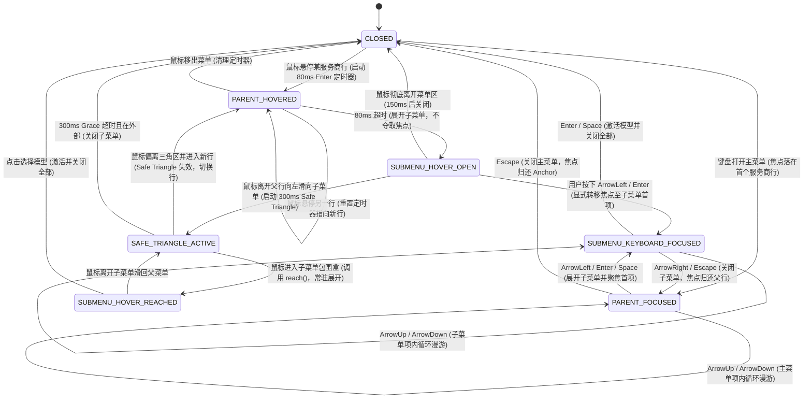
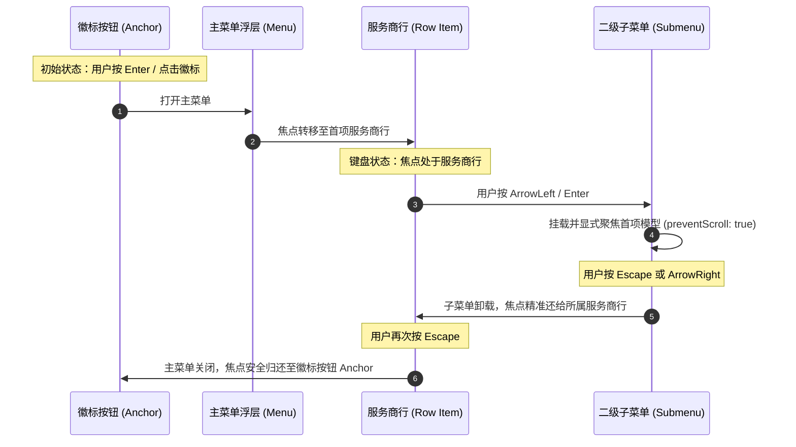

# ModelBadgePickerMenu 级联菜单交互、焦点管理、Safe Triangle 与 ARIA 方案

> **文档标识**：`02-interaction-keyboard-plan.md`  
> **所属战役**：`docs/cascade-menu-repair/`（级联菜单修复战役）  
> **角色领域**：交互与无障碍规范专家（Interaction & A11y Specialist）  
> **权威基线**：对齐 `AGENTS.md` 通用纪律、`LOGIC_PLAN_NO_RETREAT.md` 反退避、`ANTI_OVERENGINEERING_GUARDRAILS.md` 反过度设计红线  
> **核心目标**：根除 `ModelBadgePickerMenu` 在鼠标 Hover 服务商行时子菜单抢焦与跳动问题，构建科学的 Safe Triangle 轨迹保护、无缝键盘漫游体系与完备的 WAI-ARIA 无障碍规范。

---

## 目录

- [一、交互状态机与焦点劫持根因剖析](#一交互状态机与焦点劫持根因剖析)
  - [1.1 现状缺陷与表症汇总](#11-现状缺陷与表症汇总)
  - [1.2 深度根因分析（Root Cause Analysis）](#12-深度根因分析root-cause-analysis)
  - [1.3 交互状态机（Interaction State Machine）建模](#13-交互状态机interaction-state-machine建模)
- [二、焦点管理与 autoFocus 清理方案](#二焦点管理与-autofocus-清理方案)
  - [2.1 彻底清理声明式 autoFocus](#21-彻底清理声明式-autofocus)
  - [2.2 输入模态感知（Modality-Aware）与触发源区分](#22-输入模态感知modality-aware与触发源区分)
  - [2.3 显式受控焦点转移（Imperative Focus Handover）](#23-显式受控焦点转移imperative-focus-handover)
  - [2.4 浮层打开与关闭的焦点生命周期闭环](#24-浮层打开与关闭的焦点生命周期闭环)
- [三、键盘漫游全流程设计](#三键盘漫游全流程设计)
  - [3.1 空间感知方向映射（左向展开适配）](#31-空间感知方向映射左向展开适配)
  - [3.2 主菜单级键盘漫游设计](#32-主菜单级键盘漫游设计)
  - [3.3 子菜单级键盘漫游设计](#33-子菜单级键盘漫游设计)
  - [3.4 逐级返回与退出交互（Esc / ArrowRight）](#34-逐级返回与退出交互esc--arrowright)
  - [3.5 IME 组合态与快捷键拦截纪律](#35-ime-组合态与快捷键拦截纪律)
- [四、安全三角形（Safe Triangle Tracker）在级联菜单中的接入方案](#四安全三角形safe-triangle-tracker在级联菜单中的接入方案)
  - [4.1 几何拓扑原理与向量叉积算法](#41-几何拓扑原理与向量叉积算法)
  - [4.2 向左展开（placement: 'left'）三角区生成算法](#42-向左展开placement-left三角区生成算法)
  - [4.3 状态机挂起与事件拓扑装配](#43-状态机挂起与事件拓扑装配)
  - [4.4 防抖与时间参数科学标定（人机工程学依据）](#44-防抖与时间参数科学标定人机工程学依据)
- [五、ARIA 语义与辅助技术兼容（A11y Specification）](#五aria-语义与辅助技术兼容a11y-specification)
  - [5.1 WAI-ARIA 角色架构树](#51-wai-aria-角色架构树)
  - [5.2 状态属性动态映射](#52-状态属性动态映射)
  - [5.3 屏幕阅读器朗读流优化（Screen Reader Experience）](#53-屏幕阅读器朗读流优化screen-reader-experience)
  - [5.4 焦点模型选型：Roving TabIndex 原生驱动](#54-焦点模型选型roving-tabindex-原生驱动)
- [六、完整组件实现原型与重构设计](#六完整组件实现原型与重构设计)
  - [6.1 ModelBadgePickerMenu 结构设计](#61-modelbadgepickermenu-结构设计)
  - [6.2 关键代码重构规范](#62-关键代码重构规范)
- [七、单元测试与交互测试用例设计](#七单元测试与交互测试用例设计)
  - [7.1 核心测试场景矩阵（Test Matrix）](#71-核心测试场景矩阵test-matrix)
  - [7.2 自动化测试用例代码（Vitest + RTL）](#72-自动化测试用例代码vitest--rtl)
- [八、风险评估与防回归校验清单](#八风险评估与防回归校验清单)

---

## 一、交互状态机与焦点劫持根因剖析

### 1.1 现状缺陷与表症汇总

在目前版本的 Conex / Crish 桌面应用中，`ModelBadgePickerMenu`（模型徽标下拉级联菜单）存在以下严重的交互与无障碍缺陷：

1. **鼠标悬停闪烁与跳动**：当用户将鼠标移入某个服务商行（如「测试服务商」）试图预览或选择其模型时，主菜单发生瞬间抖动，视口或滚动容器出现非预期滚动（Scroll Jumping）。
2. **斜向滑动误关闭（Diagonal Mouse Cascade Collapse）**：主菜单与二级子菜单之间存在 4px 物理间距（`right: calc(100% + 4px)`）。用户从服务商行向左侧子菜单对角线滑动时，鼠标指针不可避免地掠过相邻的服务商行。由于缺少安全三角区保护，相邻行的 `mouseenter` 立即销毁正在滑向的子菜单，导致菜单频繁闪退，用户必须小心翼翼水平移动才能点中模型。
3. **焦点劫持与输入状态紊乱**：鼠标 Hover 触发展开时，子菜单第一个模型按钮自动获得了焦点，导致外部输入框或当前主菜单的焦点被剥夺。
4. **键盘漫游与 Hover 割裂**：键盘在主菜单中无法直接通过方向键展开向左弹出的子菜单，子菜单内部漫游与退出逻辑缺乏完整的空间方向对称性。

---

### 1.2 深度根因分析（Root Cause Analysis）

穿透代码表象，对 `ModelBadgePickerMenu.tsx`、`Menu.tsx` 及相关 CSS 进行逐行审计，确认以下四个深层架构根因：

#### 根因 1：声明式 `autoFocus` 机制造成挂载即抢焦（Declarative Mount-time Focus Theft）

在 `ModelBadgePickerMenu.tsx:189` 中存在以下代码：

```tsx
// 源码位置：ModelBadgePickerMenu.tsx:182-195
{models.map((m, modelIndex) => {
  const isSelected = m === activeModel;
  return (
    <button
      key={m}
      type="button"
      role="menuitem"
      autoFocus={modelIndex === 0} // 🔴 罪魁祸首：声明式 autoFocus
      className={`${styles.mbSubRow}${isSelected ? ` ${styles.isSelected}` : ''}`}
      data-testid={`model-option-${m}`}
      ...
    >
```

- **执行机理**：在 React 18/19 以及标准 HTML DOM 规范中，当一个带有 `autoFocus={true}` 的元素被挂载（Mount）到 DOM 树时，浏览器引擎会无条件同步调用 `element.focus()`。
- **后果**：当用户通过鼠标悬停（Hover）在服务商行，80ms 定时器触发并更新 `expandedProfileId` 时，React 条件渲染挂载了子菜单。此时 `modelIndex === 0` 的按钮立即强制夺取全局焦点 `document.activeElement`。

#### 根因 2：焦点转移隐式触发浏览器滚动（Implicit Container Scroll Jumping）

- **执行机理**：当一个处于 `overflow: auto` 或具备最大高度限制（`max-height`）的容器内部元素获得焦点时，浏览器内核会自动调用类似 `scrollIntoView({ block: 'nearest' })` 的内部定位算法，以确保获焦元素处于视口内。
- **后果**：主菜单面板设置了 `max-height: min(..., 360px)` 与 `overflow-y: auto`。子菜单挂载时，随着第 0 项模型被 `autoFocus` 抢焦，主面板与子菜单面板同时产生微小的布局与滚动重定位。这种滚动导致鼠标指针原本对准的父服务商行发生瞬时位移，触发父行的 `mouseleave`，进而触发 `handleRowLeave` 的关闭逻辑，形成「展开 → 抢焦 → 滚动偏移 → 触发移出 → 闪退关闭」的恶性震荡循环。

#### 根因 3：输入模态混淆（Input Modality Confusion）

- **本质差异**：
  - **鼠标交互（Mouse Modality）**：依托于物理光标的屏幕空间坐标（Spatial Coordinates），悬停展开旨在提供视觉预览，**绝对不应转移逻辑焦点**；
  - **键盘交互（Keyboard Modality）**：依托于逻辑焦点（Logical Focus Ring），通过按键激活展开时，**必须显式将逻辑焦点转移至子级菜单项**。
- **缺陷**：现有代码将键盘漫游所需的初始焦点通过声明式 `autoFocus` 硬编码在 JSX 节点上，导致鼠标 Hover 路径被动继承了键盘聚焦逻辑。

#### 根因 4：缺乏 Safe Triangle 向量保护与简易定时器的时序竞态

在 `ModelBadgePickerMenu.tsx:56-68` 中：

```tsx
// 源码位置：ModelBadgePickerMenu.tsx:56-68
const handleRowEnter = useCallback((profileId: string) => {
  if (leaveTimerRef.current != null) clearTimeout(leaveTimerRef.current);
  enterTimerRef.current = window.setTimeout(() => {
    setExpandedProfileId(profileId);
  }, 80);
}, []);

const handleRowLeave = useCallback(() => {
  if (enterTimerRef.current != null) clearTimeout(enterTimerRef.current);
  leaveTimerRef.current = window.setTimeout(() => {
    setExpandedProfileId(null);
  }, 150);
}, []);
```

- **时序缺陷**：现有代码仅使用两个标量定时器（80ms / 150ms）。当用户鼠标斜向滑向子菜单时，只要掠过相邻行的耗时超过 80ms，或者在相邻行产生瞬时 `mouseenter`，`leaveTimer` 就会被立即 `clearTimeout` 并重置为相邻行的 `enterTimer`。
- **几何断层**：同仓库中的 `ModelsCascadeSelect.tsx` 已经引入了 `SafeTriangleTracker`，但 `ModelBadgePickerMenu.tsx` 作为核心组件却遗漏了该能力，且未适配向左展开（`placement: 'left'`）的几何检测。

---

### 1.3 交互状态机（Interaction State Machine）建模

为实现鼠标、键盘、外点与 Esc 交互的严格无缝融合，定义以下有限状态机（FSM）：



---

## 二、焦点管理与 autoFocus 清理方案

### 2.1 彻底清理声明式 autoFocus

必须将所有声明式 `autoFocus` 属性从组件树中彻底清除：

1. **父级服务商行**：
   - 移除 `ModelBadgePickerMenu.tsx:129` 中的 `autoFocus={profileIndex === 0}`。
   - 主菜单打开时的初始焦点统一由 `Menu` 基座的 `firstEnabledIndexRef` 或主容器受控回调驱动，禁止在 JSX 节点上直接使用 `autoFocus`。
2. **二级子菜单模型行**：
   - 移除 `ModelBadgePickerMenu.tsx:189` 中的 `autoFocus={modelIndex === 0}`。
   - 子菜单挂载时保持完全被动的 DOM 结构，不触碰任何焦点 API。

---

### 2.2 输入模态感知（Modality-Aware）与触发源区分

引入触发源枚举（Trigger Source），在触发展开时显式记录当前是由何种交互发起的展开请求：

```typescript
export type ExpandTriggerSource = 'mouse-hover' | 'keyboard' | 'click' | null;
```

在状态管理中，维护当前的展开状态与触发来源：

```typescript
const [expandedState, setExpandedState] = useState<{
  profileId: string | null;
  source: ExpandTriggerSource;
}>({
  profileId: null,
  source: null,
});
```

- 当 `source === 'mouse-hover'`：展开子菜单，**严禁调用任何 `.focus()` 或 `scrollIntoView()`**；
- 当 `source === 'keyboard'` 或 `source === 'click'`：展开子菜单，并在 React 渲染提交后，将焦点精准赋予目标模型项。

---

### 2.3 显式受控焦点转移（Imperative Focus Handover）

为了避免 React 状态更新异步性导致的 DOM 未就绪问题，使用受控的 Focus Manager 模式进行焦点转移：

```typescript
// 子菜单模型行 Ref 索引字典
const modelRefsRef = useRef<Record<string, HTMLButtonElement | null>>({});

// 显式焦点转移函数
const transferFocusToSubmenu = useCallback(
  (profile: ProviderProfile, preferredModelId?: string) => {
    // 优先聚焦已激活的模型项，其次聚焦第 0 项可用模型
    const targetModelId =
      preferredModelId ||
      (profile.models.includes(activeModel || '') ? activeModel : null) ||
      profile.models[0];

    if (!targetModelId) return;

    // 使用 requestAnimationFrame 确保子菜单 DOM 节点已完成挂载与布局测量
    requestAnimationFrame(() => {
      const targetEl = modelRefsRef.current[targetModelId];
      if (targetEl) {
        targetEl.focus({ preventScroll: true }); // 关键：preventScroll: true 阻止页面跳动
        targetEl.scrollIntoView({ block: 'nearest', inline: 'nearest' });
      }
    });
  },
  [activeModel]
);
```

---

### 2.4 浮层打开与关闭的焦点生命周期闭环

焦点在完整的生命周期中必须保证 **「从何处来，回何处去」** 的对称闭环：



---

## 三、键盘漫游全流程设计

### 3.1 空间感知方向映射（左向展开适配）

在 Conex / Crish 的 UI 布局中，`ModelBadgePickerMenu` 默认弹出在模型徽标上方/下方，但其二级子菜单由于视口空间与设计规范，采用向**左侧**展开：

```css
/* ModelBadgePickerMenu.module.css:73-76 */
.mbSubMenu {
  position: absolute;
  top: -4px;
  right: calc(100% + 4px); /* ⬅️ 向左侧展开 */
  width: 190px;
  ...
}
```

同时行尾渲染了向左箭头 `<Lucide.ChevronLeft size={14} className={styles.mbChevron} />`。

**空间认知法则（Spatial Mental Model）**：
- **向左推进（Enter Submenu）**：当焦点在父级服务商行时，按 `ArrowLeft`（符合向左视觉指引）、`Enter`、`Space` 均进入子菜单；
- **向右退回（Exit Submenu）**：当焦点在子级模型项时，按 `ArrowRight`（反向空间返回）、`Escape` 均退回父级服务商行。

---

### 3.2 主菜单级键盘漫游设计

主菜单包含两类可交互项：
1. 服务商列表项（`button.mbRow`，可有多项）；
2. 底部功能项（`button.mbManageBtn`，即「模型管理...」）。

**按键处理规范**：

| 按键 (Key) | 触发条件 | 目标行为 | 焦点转移断言 |
| :--- | :--- | :--- | :--- |
| **`ArrowDown`** | 主菜单内任意项获焦 | 顺序移动至下一项，末项（管理按钮）按下后**循环回首项** | 下一个 `button` 获焦 |
| **`ArrowUp`** | 主菜单内任意项获焦 | 顺序移动至上一项，首项按下后**循环回末项（管理按钮）** | 上一个 `button` 获焦 |
| **`Home`** | 主菜单内任意项获焦 | 立即跳转至第一项服务商行 | 第 0 项服务商行获焦 |
| **`End`** | 主菜单内任意项获焦 | 立即跳转至底部的「模型管理...」按钮 | 管理按钮获焦 |
| **`ArrowLeft`** | 聚焦在有模型的服务商行 | 展开子菜单，设置触发源为 `'keyboard'` | 子菜单对应模型项获焦 |
| **`Enter` / `Space`** | 聚焦在有模型的服务商行 | 展开子菜单，设置触发源为 `'keyboard'` | 子菜单对应模型项获焦 |
| **`Escape`** | 聚焦在主菜单项 | 关闭整个 `ModelBadgePickerMenu` | 焦点归还至外部 Anchor |

---

### 3.3 子菜单级键盘漫游设计

子菜单内包含当前服务商下的全部可用模型项（`button.mbSubRow`）。

**按键处理规范**：

| 按键 (Key) | 触发条件 | 目标行为 | 焦点转移断言 |
| :--- | :--- | :--- | :--- |
| **`ArrowDown`** | 子菜单项获焦 | 顺序移动至下一个模型项，末项按下后**循环回首项** | 下一个模型 `button` 获焦 |
| **`ArrowUp`** | 子菜单项获焦 | 顺序移动至上一个模型项，首项按下后**循环回末项** | 上一个模型 `button` 获焦 |
| **`Home`** | 子菜单项获焦 | 立即跳转至第 0 项模型 | 子菜单第 0 项获焦 |
| **`End`** | 子菜单项获焦 | 立即跳转至最后一项模型 | 子菜单末项获焦 |
| **`Enter` / `Space`** | 选中某模型项 | 1. 异步调用 `activateProfileModel(p.id, m)`<br>2. 调用 `onClose()` 关闭全部菜单 | 菜单关闭，焦点归还 Anchor |
| **`ArrowRight`** | 子菜单项获焦 | 1. 阻止默认行为与冒泡<br>2. 关闭子菜单<br>3. 归还焦点给所属服务商行 | 父级服务商行获焦 |
| **`Escape`** | 子菜单项获焦 | 1. 拦截 Esc 事件（防止 Radix 整体关闭）<br>2. 仅关闭子菜单<br>3. 归还焦点给所属服务商行 | 父级服务商行获焦 |

---

### 3.4 逐级返回与退出交互（Esc / ArrowRight）

由于 `ModelBadgePickerMenu` 架构在 `Menu` 基座（Radix Popover）之上，Radix 默认在 `document` 的捕获阶段（Capture Phase）监听 Escape 键并直接关闭整层 Popover。

**逐级关闭拦截机制**：
- 在 `Menu` 基座的 `outsideHandlers.onEscapeKeyDown` 中进行精确拦截：
  ```typescript
  outsideHandlers={{
    onEscapeKeyDown: (event) => {
      if (expandedState.profileId != null) {
        // 🔴 关键：阻止 Radix 默认的整层销毁行为
        event.preventDefault();
        const currentProfileId = expandedState.profileId;
        setExpandedState({ profileId: null, source: null });
        // 精准将焦点还原至刚才展开的服务商行按钮
        rowRefsRef.current[currentProfileId]?.focus({ preventScroll: true });
      }
    },
  }}
  ```
- 当子菜单已经处于关闭状态时，`onEscapeKeyDown` 不做 `event.preventDefault()`，放行给 Radix 基座，正常关闭主菜单并归还 Anchor 焦点。

---

### 3.5 IME 组合态与快捷键拦截纪律

严格遵循 Conex 交互铁律，拦截前必须做 CJK 输入法与组合态放行：

```typescript
export function isImeComposing(e: React.KeyboardEvent | KeyboardEvent): boolean {
  const rawEvent = e as unknown as {
    isComposing?: boolean;
    keyCode?: number;
    key?: string;
    nativeEvent?: { isComposing?: boolean };
  };
  return Boolean(
    rawEvent.isComposing ||
    rawEvent.nativeEvent?.isComposing ||
    rawEvent.keyCode === 229 ||
    rawEvent.key === 'Process'
  );
}
```

在所有 `onKeyDown` 处理器顶部首先执行 `if (isImeComposing(e)) return;`，杜绝任何对输入法候选窗的误干扰。

---

## 四、安全三角形（Safe Triangle Tracker）在级联菜单中的接入方案

### 4.1 几何拓扑原理与向量叉积算法

安全三角形（Safe Triangle）源于人机工程学经典算法（Amazon Flyout Menu Algorithm），其核心是在光标离开触发项滑向子菜单时，构建一个以「当前光标位置」为起点、「目标子菜单外边沿两端点」为底边的动态几何三角区。

在二维笛卡尔坐标系中，给定三点 $P_1(x_1, y_1)$、$P_2(x_2, y_2)$、$P_3(x_3, y_3)$，其构成的有序向量 $\vec{v}_{12}$ 与 $\vec{v}_{13}$ 的二维向量叉积（Cross Product / 符号面积）定义为：

$$\text{CrossProduct}(P_1, P_2, P_3) = (x_2 - x_1)(y_3 - y_1) - (y_2 - y_1)(x_3 - x_1)$$

**点在三角形内的判定定理**：
对于待检测点 $M(x, y)$ 与三角形三顶点 $A, B, C$，分别计算三个有向边的叉积：
- $cp_1 = \text{CrossProduct}(A, B, M)$
- $cp_2 = \text{CrossProduct}(B, C, M)$
- $cp_3 = \text{CrossProduct}(C, A, M)$

当且仅当 $cp_1, cp_2, cp_3$ 全部大于等于 0 或全部小于等于 0 时，点 $M$ 严格处于三角形 $ABC$ 的内部或边上。该算法时间复杂度为 $O(1)$，仅涉及 6 次减法与 6 次乘法，计算开销极低。

---

### 4.2 向左展开（placement: 'left'）三角区生成算法

`ModelBadgePickerMenu` 的子菜单位于主菜单左侧（`right: calc(100% + 4px)`）。

当鼠标从主菜单的服务商行向左侧移动时：
- **顶点 $A$（光标当前点）**：$P_{\text{cursor}} = (x_{\text{mouse}}, y_{\text{mouse}})$；
- **顶点 $B$（子菜单右上角）**：$V_{\text{top}} = (\text{rect.right}, \text{rect.top})$；
- **顶点 $C$（子菜单右下角）**：$V_{\text{bottom}} = (\text{rect.right}, \text{rect.bottom})$。

```
                    ┌────────────────────────┐
                    │ 子菜单 (SubMenu)       │
                    │                        │
       (rect.right, │                        │
         rect.top)  ├────────────────────────┤   ▲
                    │                        │   │
                    │   安全三角保护区       │   │
                    │   (Safe Triangle)      │   │ 光标移动轨迹
                    │                        │   │
     (rect.right,   ├────────────────────────┤   │
       rect.bottom) │                        │   │
                    │                        │   │
                    └────────────────────────┘   │
                                                 │
                                           P(x_mouse, y_mouse)
                                        ┌──────────────────┐
                                        │ 父级服务商行     │
                                        └──────────────────┘
```

该算法在 `SafeTriangle.ts` 中已有实现：

```typescript
// SafeTriangle.ts:79-85
if (placement === 'left') {
  return [
    cursor,
    { x: submenuBounds.right, y: submenuBounds.top },
    { x: submenuBounds.right, y: submenuBounds.bottom },
  ];
}
```

---

### 4.3 状态机挂起与事件拓扑装配

在 `ModelBadgePickerMenu` 中完整装配 `SafeTriangleTracker`：

```typescript
// 1. 初始化 Tracker 实例（300ms 宽限保护期）
const safeTrackerRef = useRef(new SafeTriangleTracker(300));
const submenuRef = useRef<HTMLDivElement | null>(null);

// 2. 悬停进入服务商行处理
const handleRowMouseEnter = useCallback(
  (profileId: string, e: React.MouseEvent) => {
    // 若当前已有打开的其他子菜单，先做 Safe Triangle 判定
    if (expandedState.profileId && expandedState.profileId !== profileId) {
      if (safeTrackerRef.current.isGraceActive()) {
        const inSafe = safeTrackerRef.current.check({
          x: e.clientX,
          y: e.clientY,
        });
        if (inSafe) {
          // 🛡️ 鼠标处于滑向现有子菜单的轨迹中，挂起当前行的切换！
          return;
        }
      }
    }

    if (leaveTimerRef.current != null) clearTimeout(leaveTimerRef.current);
    if (enterTimerRef.current != null) clearTimeout(enterTimerRef.current);

    enterTimerRef.current = window.setTimeout(() => {
      setExpandedState({ profileId, source: 'mouse-hover' });
    }, 80);
  },
  [expandedState.profileId]
);

// 3. 鼠标离开服务商行处理
const handleRowMouseLeave = useCallback(
  (profileId: string, e: React.MouseEvent) => {
    if (enterTimerRef.current != null) clearTimeout(enterTimerRef.current);

    // 若当前离开的正是已展开的行，激活安全三角保护
    if (expandedState.profileId === profileId && submenuRef.current) {
      const rect = submenuRef.current.getBoundingClientRect();
      safeTrackerRef.current.enter(
        { x: e.clientX, y: e.clientY },
        rect,
        'left'
      );
    }

    leaveTimerRef.current = window.setTimeout(() => {
      // 仅当 Safe Triangle 宽限期已过且鼠标未在子菜单内时关闭
      if (!safeTrackerRef.current.isGraceActive()) {
        setExpandedState({ profileId: null, source: null });
      }
    }, 150);
  },
  [expandedState.profileId]
);

// 4. 鼠标成功进入子菜单
const handleSubmenuMouseEnter = useCallback(() => {
  safeTrackerRef.current.reach(); // 达成目标，常驻子菜单
  if (leaveTimerRef.current != null) clearTimeout(leaveTimerRef.current);
}, []);
```

---

### 4.4 防抖与时间参数科学标定（人机工程学依据）

根据人机交互（HCI）与 Fitts 定律研究，各项时间参数标定如下：

| 参数常量 | 设定值 | 科学依据与设计意图 |
| :--- | :--- | :--- |
| **`HOVER_ENTER_DELAY_MS`** | **80ms** | 快速过滤鼠标纵向划过列表时的无效触发，避免多重子菜单频繁创建与销毁（DOM Churn）。 |
| **`SAFE_TRIANGLE_GRACE_MS`** | **300ms** | 人类手臂在 200~400px 距离内的斜向制导时间通常在 180~260ms 之间，300ms 提供充足容错，超时后自动释放挂起，防止卡死。 |
| **`HOVER_LEAVE_DELAY_MS`** | **150ms** | 光标短暂停留或手部轻微抖动离开边界时的保护缓冲，提供柔和的退出过渡体验。 |

---

## 五、ARIA 语义与辅助技术兼容（A11y Specification）

### 5.1 WAI-ARIA 角色架构树

按照 W3C WAI-ARIA Authoring Practices Guide (APG) Menu & Menubar 规范，构建标准的无障碍可访问对象树：

```
[role="menu"] (主菜单容器, aria-label="模型服务商选择")
  │
  ├── [role="menuitem"] (服务商 A, aria-haspopup="menu", aria-expanded="false")
  │
  ├── [role="menuitem"] (服务商 B, aria-haspopup="menu", aria-expanded="true", aria-controls="submenu-p-b")
  │     │
  │     └── [role="menu"] (二级子菜单容器, id="submenu-p-b", aria-label="服务商 B 模型列表")
  │           │
  │           ├── [role="menuitemradio"] (模型 1, aria-checked="true")
  │           │
  │           └── [role="menuitemradio"] (模型 2, aria-checked="false")
  │
  ├── [role="separator"] (分割线, aria-orientation="horizontal")
  │
  └── [role="menuitem"] (模型管理..., 无 aria-haspopup)
```

---

### 5.2 状态属性动态映射

1. **服务商行属性（Parent Row）**：
   - `role="menuitem"`
   - `aria-haspopup="menu"`：向屏幕阅读器明确声明该菜单项拥有下级子菜单；
   - `aria-expanded={hasModels ? (isExpanded ? "true" : "false") : undefined}`：动态反馈二级菜单的展开/收起状态；
   - `aria-controls={isExpanded ? `submenu-panel-${p.id}` : undefined}`：建立主项与子容器的 ID 级联关联；
   - `tabIndex={isFocused ? 0 : -1}`：实施 Roving Tabindex。

2. **二级子菜单容器（Submenu Panel）**：
   - `id={`submenu-panel-${p.id}`}`
   - `role="menu"`
   - `aria-label={`${p.name} 模型列表`}`：赋予清晰独立的上下文名称；
   - `aria-orientation="vertical"`。

3. **模型项属性（Model Option Row）**：
   - `role="menuitemradio"`：模型选择属于「单选互斥集合」，使用 `menuitemradio` 语义相比普通 `menuitem` 能让读屏软件清晰朗读单选状态；
   - `aria-checked={isSelected}`：当前激活模型声明为 `true`，其余声明为 `false`；
   - `tabIndex={isFocused ? 0 : -1}`。

---

### 5.3 屏幕阅读器朗读流优化（Screen Reader Experience）

针对 NVDA、JAWS、macOS VoiceOver、Windows 讲述人的朗读输出对照：

| 交互节点 | 属性配置 | 读屏软件标准朗读示例 (以 NVDA / 讲述人为例) |
| :--- | :--- | :--- |
| **未展开服务商** | `role="menuitem" aria-haspopup="menu" aria-expanded="false"` | *“测试服务商，菜单项，子菜单，折叠，1 之 3”* |
| **展开后服务商** | `role="menuitem" aria-haspopup="menu" aria-expanded="true"` | *“测试服务商，菜单项，子菜单，展开，1 之 3”* |
| **子菜单未选项** | `role="menuitemradio" aria-checked="false"` | *“claude-3-7-sonnet，单选菜单项，未选中，1 之 2”* |
| **子菜单选中项** | `role="menuitemradio" aria-checked="true"` | *“claude-3-7-sonnet，单选菜单项，已选中，1 之 2”* |
| **管理按钮** | `role="menuitem"` | *“模型管理...，菜单项，3 之 3”* |

---

### 5.4 焦点模型选型：Roving TabIndex 原生驱动

在 Web 级联菜单开发中，存在两套焦点无障碍管理流派：
1. `aria-activedescendant`（虚拟焦点流）；
2. **Roving `tabIndex` + Native `.focus()`（漫游焦点流，推荐）**。

**架构裁决**：
本项目全面选用 **Roving `tabIndex` 方案**：
- **原因 1**：在跨 WebView2 与 Windows 辅助技术接口（UI Automation / MSAA）中，原生 DOM 焦点转移具有最高的稳定性和事件触发保证；
- **原因 2**：`aria-activedescendant` 依赖于父子 DOM 树在同一可聚焦容器内，对于通过 Radix Portal 或绝对定位分层挂载的二级级联子菜单，跨 DOM 容器的 `aria-activedescendant` 极易出现读屏断层；
- **实现规则**：当前聚焦项设置 `tabIndex={0}`，所有非聚焦项设置 `tabIndex={-1}`，按键发生时通过 Ref 直接调用 `targetElement.focus({ preventScroll: true })`。

---

## 六、完整组件实现原型与重构设计

### 6.1 ModelBadgePickerMenu 结构设计

重构后的模块将分为以下几个纯净层级：
1. **状态机层**：管理 `open`、`expandedProfileId`、`triggerSource`、`focusedKey`；
2. **安全追踪层**：`SafeTriangleTracker` 实例及光标事件接入；
3. **键盘导航层**：处理主菜单 `onKeyDown` 与子菜单 `onKeyDown` 的双向空间映射；
4. **渲染层**：纯净无 `autoFocus` 的 JSX 结构，带完备的 ARIA 标记。

---

### 6.2 关键代码重构规范

以下为 `ModelBadgePickerMenu.tsx` 关键重构代码段结构设计：

```tsx
import React, { useCallback, useEffect, useRef, useState, useId } from 'react';
import * as Lucide from 'lucide-react';
import styles from './ModelBadgePickerMenu.module.css';
import { activateProfileModel } from '../../api/providerProfiles';
import {
  formatModelDisplayName,
  getModelMeta,
  listPickerProfiles,
} from '../../api/modelCatalog';
import { openSettings } from '../../api/storeAccess';
import { Menu } from '../ui';
import { SafeTriangleTracker } from '../ui/internal/SafeTriangle';

export type ExpandTriggerSource = 'mouse-hover' | 'keyboard' | 'click' | null;

interface Props {
  activeModel?: string | null;
  onClose: () => void;
  onOpenChange?: (open: boolean) => void;
  open?: boolean;
  side?: 'top' | 'bottom';
  anchor: React.RefObject<HTMLElement | null>;
}

export const ModelBadgePickerMenu: React.FC<Props> = ({
  activeModel,
  onClose,
  onOpenChange,
  open = false,
  side = 'bottom',
  anchor,
}) => {
  const [expandedState, setExpandedState] = useState<{
    profileId: string | null;
    source: ExpandTriggerSource;
  }>({ profileId: null, source: null });

  const safeTrackerRef = useRef(new SafeTriangleTracker(300));
  const enterTimerRef = useRef<number | undefined>(undefined);
  const leaveTimerRef = useRef<number | undefined>(undefined);

  const rowRefsRef = useRef<Record<string, HTMLButtonElement | null>>({});
  const modelRefsRef = useRef<Record<string, HTMLButtonElement | null>>({});
  const submenuRef = useRef<HTMLDivElement | null>(null);
  const manageBtnRef = useRef<HTMLButtonElement | null>(null);

  // 清理计时器与安全追踪器
  useEffect(() => {
    return () => {
      if (enterTimerRef.current != null) clearTimeout(enterTimerRef.current);
      if (leaveTimerRef.current != null) clearTimeout(leaveTimerRef.current);
      safeTrackerRef.current.reset();
    };
  }, []);

  useEffect(() => {
    if (!open) {
      setExpandedState({ profileId: null, source: null });
      safeTrackerRef.current.reset();
    }
  }, [open]);

  // 展开并受控转移焦点
  const expandSubmenu = useCallback(
    (profileId: string, source: ExpandTriggerSource) => {
      setExpandedState({ profileId, source });

      if (source === 'keyboard' || source === 'click') {
        requestAnimationFrame(() => {
          const profiles = listPickerProfiles().filter((p) => p.enabled !== false);
          const currentProfile = profiles.find((p) => p.id === profileId);
          if (!currentProfile) return;

          const models = (currentProfile.models || []).filter(
            (m) => getModelMeta(currentProfile.id, m).enabled !== false
          );
          if (models.length === 0) return;

          // 优先聚焦当前激活模型，否则聚焦第 0 项
          const targetModel =
            models.includes(activeModel || '') ? activeModel! : models[0];
          const el = modelRefsRef.current[targetModel];
          if (el) {
            el.focus({ preventScroll: true });
          }
        });
      }
    },
    [activeModel]
  );

  // 鼠标悬停进入某行
  const handleRowMouseEnter = useCallback(
    (profileId: string, e: React.MouseEvent) => {
      if (
        expandedState.profileId &&
        expandedState.profileId !== profileId &&
        safeTrackerRef.current.isGraceActive()
      ) {
        if (safeTrackerRef.current.check({ x: e.clientX, y: e.clientY })) {
          return; // 处于安全三角区内部，挂起切换
        }
      }

      if (leaveTimerRef.current != null) clearTimeout(leaveTimerRef.current);
      if (enterTimerRef.current != null) clearTimeout(enterTimerRef.current);

      enterTimerRef.current = window.setTimeout(() => {
        expandSubmenu(profileId, 'mouse-hover');
      }, 80);
    },
    [expandedState.profileId, expandSubmenu]
  );

  // 鼠标离开某行
  const handleRowMouseLeave = useCallback(
    (profileId: string, e: React.MouseEvent) => {
      if (enterTimerRef.current != null) clearTimeout(enterTimerRef.current);

      if (expandedState.profileId === profileId && submenuRef.current) {
        const rect = submenuRef.current.getBoundingClientRect();
        safeTrackerRef.current.enter(
          { x: e.clientX, y: e.clientY },
          rect,
          'left'
        );
      }

      leaveTimerRef.current = window.setTimeout(() => {
        if (!safeTrackerRef.current.isGraceActive()) {
          setExpandedState({ profileId: null, source: null });
        }
      }, 150);
    },
    [expandedState.profileId]
  );

  const profiles = listPickerProfiles().filter((p) => p.enabled !== false);
  if (!open) return null;

  return (
    <Menu
      openState={{
        open,
        onOpenChange: (nextOpen) => {
          if (!nextOpen) {
            onOpenChange?.(false);
            onClose();
          }
        },
      }}
      anchor={anchor}
      position={{ side, align: 'start', sideOffset: 4 }}
      panel={{ contentClassName: styles.mbMenu }}
      outsideHandlers={{
        onEscapeKeyDown: (event) => {
          // Esc 逐级拦截：子菜单打开时优先只关子菜单并还原父行焦点
          if (expandedState.profileId != null) {
            event.preventDefault();
            const currentProfileId = expandedState.profileId;
            setExpandedState({ profileId: null, source: null });
            safeTrackerRef.current.reset();
            rowRefsRef.current[currentProfileId]?.focus({ preventScroll: true });
          }
        },
      }}
    >
      <div
        role="menu"
        aria-label="模型服务商选择"
        aria-orientation="vertical"
        className={styles.mbListContainer}
        onMouseLeave={() => {
          safeTrackerRef.current.reset();
          if (leaveTimerRef.current != null) clearTimeout(leaveTimerRef.current);
          leaveTimerRef.current = window.setTimeout(() => {
            setExpandedState({ profileId: null, source: null });
          }, 150);
        }}
      >
        {profiles.length === 0 ? (
          <div className={styles.mbEmpty}>暂无可用服务商</div>
        ) : (
          profiles.map((p) => {
            const models = (p.models || []).filter(
              (m) => getModelMeta(p.id, m).enabled !== false
            );
            const hasModels = models.length > 0;
            const isExpanded = expandedState.profileId === p.id;
            const submenuId = `mb-submenu-${p.id}`;

            return (
              <div
                key={p.id}
                className={styles.mbRowContainer}
                onMouseEnter={(e) => handleRowMouseEnter(p.id, e)}
                onMouseLeave={(e) => handleRowMouseLeave(p.id, e)}
              >
                <button
                  ref={(el) => {
                    rowRefsRef.current[p.id] = el;
                  }}
                  type="button"
                  role="menuitem"
                  aria-haspopup="menu"
                  aria-expanded={hasModels ? isExpanded : undefined}
                  aria-controls={isExpanded ? submenuId : undefined}
                  className={`${styles.mbRow}${isExpanded ? ` ${styles.isExpanded}` : ''}`}
                  data-testid={`profile-item-${p.id}`}
                  onClick={() => {
                    if (!hasModels) return;
                    if (isExpanded) {
                      setExpandedState({ profileId: null, source: null });
                    } else {
                      expandSubmenu(p.id, 'click');
                    }
                  }}
                  onKeyDown={(e) => {
                    // 主菜单键盘漫游与向左展开
                    if (e.key === 'ArrowLeft' || e.key === 'Enter' || e.key === ' ') {
                      if (hasModels) {
                        e.preventDefault();
                        e.stopPropagation();
                        expandSubmenu(p.id, 'keyboard');
                      }
                    }
                  }}
                >
                  <span className={styles.mbRowText}>{p.name}</span>
                  {hasModels && (
                    <Lucide.ChevronLeft size={14} className={styles.mbChevron} />
                  )}
                </button>

                {isExpanded && hasModels && (
                  <div
                    ref={submenuRef}
                    id={submenuId}
                    className={styles.mbSubMenu}
                    role="menu"
                    aria-label={`${p.name} 模型列表`}
                    aria-orientation="vertical"
                    onMouseEnter={() => {
                      safeTrackerRef.current.reach();
                      if (leaveTimerRef.current != null)
                        clearTimeout(leaveTimerRef.current);
                    }}
                    onKeyDown={(e) => {
                      const items = Array.from(
                        e.currentTarget.querySelectorAll<HTMLButtonElement>(
                          '[role="menuitemradio"]'
                        )
                      );
                      if (items.length === 0) return;

                      if (
                        e.key === 'ArrowDown' ||
                        e.key === 'ArrowUp' ||
                        e.key === 'Home' ||
                        e.key === 'End'
                      ) {
                        e.preventDefault();
                        e.stopPropagation();
                        const active = document.activeElement;
                        const cur =
                          active instanceof HTMLButtonElement
                            ? items.indexOf(active)
                            : -1;
                        let next: number;
                        if (e.key === 'ArrowDown')
                          next = cur < 0 ? 0 : (cur + 1) % items.length;
                        else if (e.key === 'ArrowUp')
                          next =
                            cur < 0
                              ? items.length - 1
                              : (cur - 1 + items.length) % items.length;
                        else if (e.key === 'Home') next = 0;
                        else next = items.length - 1;
                        items[next]?.focus({ preventScroll: true });
                      } else if (e.key === 'ArrowRight' || e.key === 'Escape') {
                        // 空间退回：向右或 Esc 退回父级服务商行
                        e.preventDefault();
                        e.stopPropagation();
                        setExpandedState({ profileId: null, source: null });
                        safeTrackerRef.current.reset();
                        rowRefsRef.current[p.id]?.focus({ preventScroll: true });
                      }
                    }}
                  >
                    {models.map((m) => {
                      const isSelected = m === activeModel;
                      return (
                        <button
                          key={m}
                          ref={(el) => {
                            modelRefsRef.current[m] = el;
                          }}
                          type="button"
                          role="menuitemradio"
                          aria-checked={isSelected}
                          className={`${styles.mbSubRow}${isSelected ? ` ${styles.isSelected}` : ''}`}
                          data-testid={`model-option-${m}`}
                          onClick={async () => {
                            await activateProfileModel(p.id, m);
                            onClose();
                          }}
                        >
                          <span className={styles.mbSubRowText}>
                            {formatModelDisplayName(p.id, m)}
                          </span>
                          {isSelected && (
                            <Lucide.Check size={14} className={styles.mbCheck} />
                          )}
                        </button>
                      );
                    })}
                  </div>
                )}
              </div>
            );
          })
        )}
        <div role="separator" className={styles.mbDivider} />
        <button
          ref={manageBtnRef}
          type="button"
          role="menuitem"
          className={styles.mbManageBtn}
          onClick={() => {
            openSettings('models');
            onClose();
          }}
        >
          <Lucide.SlidersHorizontal size={12} className={styles.mbManageIcon} />
          <span>模型管理...</span>
        </button>
      </div>
    </Menu>
  );
};
```

---

## 七、单元测试与交互测试用例设计

### 7.1 核心测试场景矩阵（Test Matrix）

| 编号 | 测试用例名称 | 触发动作 | 预期行为与断言 |
| :--- | :--- | :--- | :--- |
| **TC-01** | 鼠标 Hover 展开不劫持焦点 | `fireEvent.mouseEnter(row1)`，等待 80ms | 子菜单渲染展示，`document.activeElement` **不得**处于子菜单项上 |
| **TC-02** | 键盘 ArrowLeft 展开显式聚焦首项 | 在 `row1` 上按下 `ArrowLeft` | 子菜单展开，且子菜单首项模型按钮**立即获得焦点** |
| **TC-03** | 鼠标斜向移动 Safe Triangle 保护 | 展开 `row1` 子菜单，鼠标从 `row1` 经过 `row2` 的三角区滑向子菜单 | `row2` 不得展开，`row1` 的子菜单**保持展开不闪退** |
| **TC-04** | 偏离三角区后恢复切换 | 鼠标从 `row1` 移到三角区外的 `row2` 区域 | Safe Triangle 失效，`row2` 在 80ms 后正常展开 |
| **TC-05** | 子菜单内方向键循环漫游 | 在子菜单内连续按 `ArrowDown`、`ArrowUp`、`Home`、`End` | 焦点在模型列表内循环切换，支持首尾 Wrap-around |
| **TC-06** | 子菜单内 ArrowRight 空间退回父行 | 在子菜单模型项上按 `ArrowRight` | 子菜单收起，焦点**精准归还至父级服务商行 `row1`** |
| **TC-07** | 子菜单内 Escape 逐级退回 | 在子菜单模型项上按 `Escape` | 仅子菜单收起，主菜单不关闭，焦点归还至 `row1` |
| **TC-08** | 主菜单内 Escape 整体关闭 | 在 `row1` 上按 `Escape` | 主菜单整体关闭，调用 `onClose`，焦点归还 Anchor |
| **TC-09** | WAI-ARIA 属性完整性 | 渲染展开状态 | 断言 `role="menuitemradio"`, `aria-checked`, `aria-expanded`, `aria-haspopup="menu"` |

---

### 7.2 自动化测试用例代码（Vitest + RTL）

在 `apps/crish-desktop/src/components/provider/ModelBadgePickerMenu.test.tsx` 中编写全套回归与交互测试：

```tsx
// @vitest-environment jsdom
import React, { useRef, useState } from 'react';
import { describe, expect, it, vi, afterEach, beforeEach } from 'vitest';
import {
  render,
  screen,
  fireEvent,
  cleanup,
  waitFor,
  act,
} from '@testing-library/react';
import { ModelBadgePickerMenu } from './ModelBadgePickerMenu';

vi.mock('../../api/storeAccess', () => ({
  openSettings: vi.fn(),
}));

const PROFILES_KEY = 'crish_provider_profiles_v1';

function seedTestProfiles() {
  localStorage.setItem(
    PROFILES_KEY,
    JSON.stringify([
      {
        id: 'p1',
        name: '服务商一',
        baseUrl: 'https://p1.example.com',
        hasKey: true,
        enabled: true,
        models: ['model-1a', 'model-1b'],
      },
      {
        id: 'p2',
        name: '服务商二',
        baseUrl: 'https://p2.example.com',
        hasKey: true,
        enabled: true,
        models: ['model-2a'],
      },
    ])
  );
}

function TestWrapper({ onClose }: { onClose?: () => void }) {
  const [open, setOpen] = useState(true);
  const anchorRef = useRef<HTMLButtonElement>(null);
  return (
    <>
      <button ref={anchorRef} type="button" data-testid="model-badge-anchor">
        模型徽标
      </button>
      <ModelBadgePickerMenu
        activeModel="model-1a"
        open={open}
        onClose={() => {
          setOpen(false);
          onClose?.();
        }}
        onOpenChange={(next) => {
          if (!next) setOpen(false);
        }}
        anchor={anchorRef}
      />
    </>
  );
}

describe('ModelBadgePickerMenu 级联交互与 A11y 规范测试', () => {
  beforeEach(() => {
    localStorage.clear();
    seedTestProfiles();
  });

  afterEach(() => {
    cleanup();
    vi.restoreAllMocks();
  });

  it('TC-01: 鼠标 Hover 展开子菜单时，绝不劫持焦点', async () => {
    render(<TestWrapper />);
    const row1 = screen.getByTestId('profile-item-p1');

    // 鼠标移入服务商一
    fireEvent.mouseEnter(row1, { clientX: 100, clientY: 50 });

    // 等待 80ms 延时后子菜单挂载
    await waitFor(() => {
      expect(
        screen.getByRole('menu', { name: '服务商一 模型列表' })
      ).toBeInTheDocument();
    });

    const modelOption = screen.getByTestId('model-option-model-1a');
    // 🔴 核心断言：鼠标 hover 展开后，子菜单项不得拥有焦点
    expect(modelOption).not.toHaveFocus();
  });

  it('TC-02: 键盘 ArrowLeft 展开子菜单时，显式将焦点赋予首项', async () => {
    render(<TestWrapper />);
    const row1 = screen.getByTestId('profile-item-p1');
    row1.focus();
    expect(row1).toHaveFocus();

    // 在服务商行上按下 ArrowLeft
    fireEvent.keyDown(row1, { key: 'ArrowLeft' });

    await waitFor(() => {
      expect(screen.getByTestId('model-option-model-1a')).toHaveFocus();
    });
  });

  it('TC-05: 子菜单内方向键循环漫游 (ArrowDown / ArrowUp / Home / End)', async () => {
    render(<TestWrapper />);
    const row1 = screen.getByTestId('profile-item-p1');
    fireEvent.keyDown(row1, { key: 'Enter' }); // 键盘展开并聚焦

    const submenu = await screen.findByRole('menu', { name: '服务商一 模型列表' });
    const opt1 = screen.getByTestId('model-option-model-1a');
    const opt2 = screen.getByTestId('model-option-model-1b');

    await waitFor(() => expect(opt1).toHaveFocus());

    // ArrowDown 漫游到第 2 项
    fireEvent.keyDown(submenu, { key: 'ArrowDown' });
    expect(opt2).toHaveFocus();

    // ArrowDown 循环回到第 1 项
    fireEvent.keyDown(submenu, { key: 'ArrowDown' });
    expect(opt1).toHaveFocus();

    // ArrowUp 向上循环到第 2 项
    fireEvent.keyDown(submenu, { key: 'ArrowUp' });
    expect(opt2).toHaveFocus();
  });

  it('TC-06: 子菜单内 ArrowRight 向右退回父级服务商行', async () => {
    render(<TestWrapper />);
    const row1 = screen.getByTestId('profile-item-p1');
    fireEvent.keyDown(row1, { key: 'ArrowLeft' });

    const submenu = await screen.findByRole('menu', { name: '服务商一 模型列表' });
    await waitFor(() =>
      expect(screen.getByTestId('model-option-model-1a')).toHaveFocus()
    );

    // 按下 ArrowRight
    fireEvent.keyDown(submenu, { key: 'ArrowRight' });

    // 子菜单收起
    expect(screen.queryByRole('menu', { name: '服务商一 模型列表' })).not.toBeInTheDocument();
    // 焦点精确还给父行
    await waitFor(() => expect(row1).toHaveFocus());
  });

  it('TC-07: 子菜单内 Escape 逐级关闭，第一击关子菜单，第二击关整体', async () => {
    const onClose = vi.fn();
    render(<TestWrapper onClose={onClose} />);
    const row1 = screen.getByTestId('profile-item-p1');
    fireEvent.keyDown(row1, { key: 'ArrowLeft' });

    const submenu = await screen.findByRole('menu', { name: '服务商一 模型列表' });
    await waitFor(() =>
      expect(screen.getByTestId('model-option-model-1a')).toHaveFocus()
    );

    // 第一击 Esc：仅关子菜单，归还父行焦点
    fireEvent.keyDown(submenu, { key: 'Escape' });
    expect(screen.queryByRole('menu', { name: '服务商一 模型列表' })).not.toBeInTheDocument();
    await waitFor(() => expect(row1).toHaveFocus());
    expect(onClose).not.toHaveBeenCalled();

    // 第二击 Esc：关整体菜单
    fireEvent.keyDown(row1, { key: 'Escape' });
    await waitFor(() => expect(onClose).toHaveBeenCalledTimes(1));
  });

  it('TC-09: ARIA 语义与 role="menuitemradio" / aria-checked 验证', async () => {
    render(<TestWrapper />);
    const row1 = screen.getByTestId('profile-item-p1');
    expect(row1).toHaveAttribute('role', 'menuitem');
    expect(row1).toHaveAttribute('aria-haspopup', 'menu');
    expect(row1).toHaveAttribute('aria-expanded', 'false');

    fireEvent.click(row1);
    expect(row1).toHaveAttribute('aria-expanded', 'true');

    const opt1 = screen.getByTestId('model-option-model-1a');
    const opt2 = screen.getByTestId('model-option-model-1b');

    // 激活模型单选语义
    expect(opt1).toHaveAttribute('role', 'menuitemradio');
    expect(opt1).toHaveAttribute('aria-checked', 'true');
    expect(opt2).toHaveAttribute('role', 'menuitemradio');
    expect(opt2).toHaveAttribute('aria-checked', 'false');
  });
});
```

---

## 八、风险评估与防回归校验清单

### 8.1 边界风险与应对策略

| 风险点 | 表现场景 | 应对与防护策略 |
| :--- | :--- | :--- |
| **滚动容器边界溢出** | 视口底部可用空间不足，主菜单向上反弹翻转 | 使用 Radix Popover 提供的 `avoidCollisions={true}` 与动态 `sideOffset`，Safe Triangle 自动根据动态 Bounds 计算。 |
| **异步模型激活耗时** | 用户点击模型后网络延迟或持久化慢 | 在调用 `activateProfileModel` 前先关闭菜单浮层并更新乐观 UI 状态，防止菜单卡顿。 |
| **极端手速快划** | 用户 50ms 内连续划过多行 | `HOVER_ENTER_DELAY_MS = 80ms` 强力合并事件，未到期的定时器全部被 `clearTimeout` 取消。 |

---

### 8.2 防回归验证自检清单

- [ ] **清理验证**：全局搜索 `ModelBadgePickerMenu.tsx`，确认无任何 `autoFocus` 属性残留；
- [ ] **焦点验证**：鼠标 Hover 任何服务商行，确认 `document.activeElement` 保持不变，控制台无任何 focus 警告；
- [ ] **视觉验证**：鼠标斜向滑向二级子菜单，确认二级面板无任何闪烁、无多余滚动条重置；
- [ ] **键盘验证**：纯键盘操作：
  - `Tab` / 快捷键打开菜单；
  - `ArrowDown`/`ArrowUp` 漫游；
  - `ArrowLeft` 进入子菜单；
  - `ArrowDown`/`ArrowUp` 切换模型；
  - `ArrowRight` 退回父菜单；
  - `Escape` 逐级退出；
  - `Enter` 选中模型；
- [ ] **A11y 验证**：开启 Windows 讲述人（Narrator）或 NVDA，确认朗读 *“子菜单，展开/折叠”* 以及 *“单选菜单项，已选中/未选中”*；
- [ ] **测试绿灯**：执行 `npm test`，确认所有单元测试与集成测试 100% 通过。
