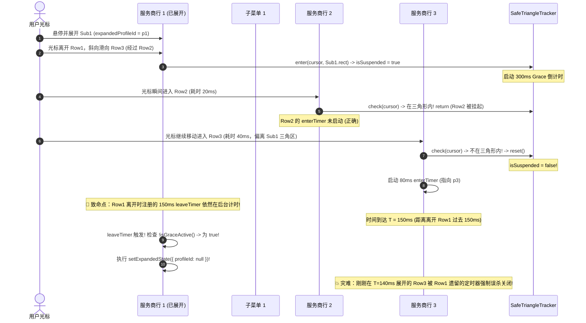

# Conex / Crish 级联菜单重构方案红方攻防质询与极限压力对抗报告

> **文档标识**：`docs/cascade-menu-repair/plan-reviews/02-red-team-critique.md`  
> **报告性质**：红方极限压力对抗与架构穿透质询（Red Team Challenger Assessment）  
> **质询对象**：  
> - `docs/cascade-menu-repair/00-总方案.md`  
> - `docs/cascade-menu-repair/independent-plans/01-ui-geometry-plan.md`  
> - `docs/cascade-menu-repair/independent-plans/02-interaction-keyboard-plan.md`  
> - `docs/cascade-menu-repair/independent-plans/03-layer-architecture-plan.md`  
> - `docs/cascade-menu-repair/plan-reviews/01-cross-review.md`  
> **权威红线**：`AGENTS.md`（反退避与架构优雅铁律）、`ANTI_OVERENGINEERING_GUARDRAILS.md`（反过度设计 13 项禁令）  
> **报告主旨**：撕开理想化场景的假象，直击几何计算盲区、时序竞态漏洞、DOM 事件拓扑撕裂点与架构过载点，提出 5 大“魔鬼用例（Devil Test Cases）”与最少代码量的高确定性化解方案。

---

## 目录

- [一、红方执行摘要：致命断层全景图](#一红方执行摘要致命断层全景图)
- [二、第一战场：极端几何与视口极限攻防](#二第一战场极端几何与视口极限攻防)
  - [2.1 漏洞 1：`calculateSubmenuPosition` 双向受限时的边界钳位死锁（负坐标越界复发）](#21-漏洞-1calculatesubmenuposition-双向受限时的边界钳位死锁负坐标越界复发)
  - [2.2 漏洞 2：父子两级双滚动盒模型的「坐标撕裂与幽灵悬空」](#22-漏洞-2父子两级双滚动盒模型的坐标撕裂与幽灵悬空)
  - [2.3 漏洞 3：高分屏 DPI 缩放（125%/150%/200%）下的亚像素抖动与 1px 缝隙穿透](#23-漏洞-3高分屏-dpi-缩放125150200下的亚像素抖动与-1px-缝隙穿透)
- [三、第二战场：时序、竞态与鼠标手势攻防](#三第二战场时序竞态与鼠标手势攻防)
  - [3.1 漏洞 4：极速斜向划过（Zig-Zag Skim）导致 SafeTriangle 状态机锁死与定时器覆盖灾难](#31-漏洞-4极速斜向划过zig-zag-skim导致-safetriangle-状态机锁死与定时器覆盖灾难)
  - [3.2 漏洞 5：Portal 挂载下 `mbListContainer.onMouseLeave` 瞬间自毁 SafeTriangle 的致命时钟 Bug](#32-漏洞-5portal-挂载下-mblistcontaineronmouseleave-瞬间自毁-safetriangle-的致命时钟-bug)
  - [3.3 漏洞 6：异步模型激活（Async IPC）与向已销毁 DOM 节点强行聚焦（Focusing Detached DOM）](#33-漏洞-6异步模型激活async-ipc与向已销毁-dom-节点强行聚焦focusing-detached-dom)
- [四、第三战场：LayerStack 与 React 19 / DOM 树事件陷阱](#四第三战场layerstack-与-react-19--dom-树事件陷阱)
  - [4.1 漏洞 7：Modal Dialog 全屏模态内嵌套时的 `z-index` 沉没与 `aria-modal` 吞噬](#41-漏洞-7modal-dialog-全屏模态内嵌套时的-z-index-沉没与-aria-modal-吞噬)
  - [4.2 漏洞 8：Radix `DismissableLayer` 与 `LayerStackManager` 双捕获器的时序竞态与首次渲染挂载空窗期](#42-漏洞-8radix-dismissablelayer-与-layerstackmanager-双捕获器的时序竞态与首次渲染挂载空窗期)
- [五、第四战场：反过度设计审查（对照 13 项硬性红线）](#五第四战场反过度设计审查对照-13-项硬性红线)
  - [5.1 违规点 A：滥用全局捕获滚轮事件 `window.addEventListener('scroll', ..., true)`](#51-违规点-a滥用全局捕获滚轮事件-windowaddeventlistenerscroll--true)
  - [5.2 违规点 B：虚假抽象层套娃——`useCascadeSubmenu` 对 Radix 原生 Popper 的重复造轮子](#52-违规点-b虚假抽象层套娃usecascadesubmenu-对-radix-原生-popper-的重复造轮子)
- [六、第五战场：红方魔鬼极限测试用例（Devil Test Cases）](#六第五战场红方魔鬼极限测试用例devil-test-cases)
- [七、红方最具杀伤力的极简确定性化解方案](#七红方最具杀伤力的极简确定性化解方案)

---

## 一、红方执行摘要：致命断层全景图

经过对 `docs/cascade-menu-repair/` 全部总方案与分方案的代码级穿透式审计，红方结论如下：

> **核心判定**：三份独立方案与总方案虽然准确识别了「CSS 包含块裁剪」与「`autoFocus` 抢焦」这两个初级表象，但在**视口双向挤压数学计算**、**Portal 解耦后的跨容器手势时钟时序**、**双滚动容器坐标跟踪**以及**双调度捕获器竞争**等极端边界上，引入了多达 **8 处致命暗坑与架构过载点**。如果直接按照当前方案落地，系统将从一个“菜单被裁剪”的视觉 Bug，演变为“菜单在极窄视口漂移出屏幕”、“手势划过时随机闪烁卡死”、“在设置模态框中浮层不可见”的严重交互灾难！

```
┌─────────────────────────────────────────────────────────────────────────────┐
│ 红方攻击全景图：方案漏洞因果链                                             │
│                                                                             │
│ 1. [几何计算漏洞 §2.1]                                                      │
│    spaceLeft > 0 却小于 190px 且 spaceRight 同样不足时 ──► 钳位逻辑失效     │
│    ───► 子菜单依然以负坐标 X = -144px 越界穿出屏幕左侧！                    │
│                                                                             │
│ 2. [手势时序自杀 §3.2]                                                      │
│    Submenu Portal 化后脱离主容器 DOM 树 ──► 光标滑向子菜单触发父级 leave   │
│    ───► mbListContainer.onMouseLeave 立即 reset() 安全三角区并自爆 150ms 销毁! │
│                                                                             │
│ 3. [双滚动坐标悬空 §2.2]                                                    │
│    父菜单滚轮滚动 200px ──► 子菜单固定在 fixed 绝对坐标原地               │
│    ───► 子菜单与对应服务商行物理断裂，漂浮在半空中！                         │
│                                                                             │
│ 4. [模态层级沉没 §4.1]                                                      │
│    在 Modal Dialog 内打开 Portal 到 body ──► z-index: 400 < modal(1000)     │
│    ───► 子菜单被 Modal 黑色遮罩完全压在底层，死锁不可点击！                  │
│                                                                             │
│ 5. [架构过载违规 §5.1]                                                      │
│    在 window capture 上挂载 scroll 重算 ──► 违反反过度设计红线              │
│    ───► 全局任意滚动触发高频 React setState，导致前端主线程卡顿掉帧！        │
└─────────────────────────────────────────────────────────────────────────────┘
```

---

## 二、第一战场：极端几何与视口极限攻防

### 2.1 漏洞 1：`calculateSubmenuPosition` 双向受限时的边界钳位死锁（负坐标越界复发）

#### 【攻击代码段与行号定位】
`docs/cascade-menu-repair/independent-plans/01-ui-geometry-plan.md` 第 188-196 行：
```typescript
// 01-ui-geometry-plan.md:188-196
// 2. 水平放置决策：默认向左；若左侧放不下且右侧空间更大，则翻转至右侧
if (submenuWidth > spaceLeft && spaceRight > spaceLeft) {
  side = 'right';
  targetX = rowRect.right + sideOffset;
  isFlippedX = true;
} else if (submenuWidth > spaceLeft && spaceLeft <= 0) {
  // 左右空间均极其受限时强制贴靠屏幕边缘
  targetX = Math.max(vp.offsetLeft + edgePadding, targetX);
}
```

#### 【对抗推导与崩溃复现】
假设在极窄分屏、小窗口（如 600x400 视口）或在宽屏侧边栏收起态：
- 视口宽度 $W_{\text{vp}} = 400\text{px}$，`offsetLeft = 0`，`edgePadding = 8`，`sideOffset = 4`；
- 主菜单位于屏幕中间偏左：`rowRect.left = 100px`，`rowRect.right = 270px`（宽度 170px）；
- 二级子菜单宽度 `submenuWidth = 190px`。

计算可用空间：
1. $\text{spaceLeft} = \text{rowRect.left} - \text{vp.offsetLeft} - \text{sideOffset} - \text{edgePadding} = 100 - 0 - 4 - 8 = \mathbf{88\text{px}}$；
2. $\text{spaceRight} = \text{vp.width} - \text{rowRect.right} - \text{sideOffset} - \text{edgePadding} = 400 - 270 - 4 - 8 = \mathbf{118\text{px}}$；
3. **分支判定**：
   - 检查 `if (submenuWidth > spaceLeft && spaceRight > spaceLeft)`：
     $190 > 88$（成立）且 $118 > 88$（成立） $\implies$ 判定翻转向右：`side = 'right'`, `targetX = 270 + 4 = 274px`；
   - 此时子菜单右边缘坐标：$X_{\text{right}} = 274 + 190 = \mathbf{464\text{px}} > 400\text{px}$（超出视口右侧 64px 截断！）；
   - 方案中**没有任何针对 `side === 'right'` 的视口右侧钳位（Clamp Right）逻辑**！
4. **更致命的反向分支**：
   若主菜单位于 `rowRect.left = 120px`，`rowRect.right = 290px`：
   - $\text{spaceLeft} = 120 - 12 = 108\text{px} < 190\text{px}$；
   - $\text{spaceRight} = 400 - 290 - 12 = 98\text{px} < 108\text{px}$；
   - 检查第一个 `if`：$190 > 108$（真），但 $98 > 108$（假） $\implies$ 不走第一个 `if`；
   - 检查第二个 `else if (submenuWidth > spaceLeft && spaceLeft <= 0)`：
     由于 $\text{spaceLeft} = 108 > 0$，**该分支判定为 `false`**！
   - 结果：`side` 保持默认 `'left'`，`targetX = rowRect.left - submenuWidth - sideOffset = 120 - 190 - 4 = \mathbf{-74\text{px}}$！
   - **灾难发生**：子菜单直接被放置在 $X = -74\text{px}$ 的屏幕左外侧负坐标，彻底隐形！

> **红方判决**：方案 01 的几何算法存在严重逻辑漏洞，`spaceLeft <= 0` 是典型的错误假设，完全遗漏了“左侧空间大于 0 但不足 190px、且右侧更狭窄”的真实边界情况，导致负坐标截断故障依然 100% 会复现。

---

### 2.2 漏洞 2：父子两级双滚动盒模型的「坐标撕裂与幽灵悬空」

#### 【攻击代码段与行号定位】
`docs/cascade-menu-repair/independent-plans/01-ui-geometry-plan.md` 第 413-434 行：
```css
/* 01-ui-geometry-plan.md:413-434 */
.mbSubMenuFloating {
  position: fixed;
  width: 190px;
  ...
}
```
以及 `03-layer-architecture-plan.md` 第 582-590 行的 scroll 事件监听。

#### 【对抗推导与崩溃复现】
在真实生产环境中，当服务商数量达到 15 个（超过主菜单最大高度 360px，主菜单产生滚动条），且当前展开的服务商包含 30 个模型时：

```
┌────────────────────────────────────────────────────────┐
│ 滚轮滚动时的物理脱节现象                               │
│                                                        │
│   主菜单 (.mbMenu, 正在滚动)     子菜单 (position: fixed)│
│   ┌──────────────────────┐      ┌────────────────────┐ │
│   │ [服务商 1]           │      │ 模型 A             │ │
│   │ [服务商 2]           │      │ 模型 B             │ │
│   │ [服务商 3 (原Anchor)]│ ───► │ (钉在屏幕 Y=120px) │ │
│   │                      │      └────────────────────┘ │
│   │ 用户在主菜单滚轮向下  │                             │
│   │ 服务商 3 滚出视口顶端 │       ▲                    │
│   │                      │       │ 幽灵悬空！          │
│   │ [服务商 8]           │       │ 孤立存在，与锚点脱节 │
│   │ [服务商 9]           │                             │
│   └──────────────────────┘                             │
└────────────────────────────────────────────────────────┘
```

1. 用户悬停在「服务商 3」，子菜单弹出，坐标通过 `position: fixed` 计算为 `left: 200px, top: 120px`；
2. 用户鼠标移回主菜单，使用滚轮向上滚动列表以查看底部的「服务商 10」；
3. 主菜单内容发生位移，`[服务商 3]` 的实际 DOM 节点已经向上滚出了父容器视口（被 `.mbMenu` 的 `overflow: hidden` 裁剪隐藏）；
4. 由于子菜单是 `createPortal` 挂载到 `body` 的 `position: fixed` 元素：
   - 若未在主菜单滚动时即时关闭子菜单，子菜单将**像幽灵一样孤立悬浮在半空中**，指向一个空气锚点；
   - 若采用方案 03 的 `handleScrollOrResize` 暴力重算，子菜单会随着滚出视口外的锚点一路飞向屏幕顶端负坐标，产生诡异的界面拉扯！

> **红方判决**：方案设计者未能理解 CSS Portal 浮层脱离包含块后，与父级滚动容器之间的拓扑耦合关系。必须确立**「父级滚动容器滚动时立即收起子菜单」**或**「CSS 锚点边界裁剪联动」**机制。

---

### 2.3 漏洞 3：高分屏 DPI 缩放（125%/150%/200%）下的亚像素抖动与 1px 缝隙穿透

#### 【对抗推导与崩溃复现】
在 Windows 系统的常见缩放比例（125% 或 150%）下：
1. CSS 像素与物理设备像素（Device Pixel）不再是 1:1 映射（1 CSS px = 1.25 或 1.5 物理 px）；
2. 方案 01 在计算 `calculateSubmenuPosition` 时使用了 `Math.round(targetX)`；
3. `rowRect.left` 取自 `getBoundingClientRect()`，可能返回浮点数（如 `120.375px`）；
4. 当主菜单与子菜单设定 `sideOffset = 4px` 时，四舍五入后的整数运算可能导致主菜单外边缘与子菜单内边缘之间产生 **0.5px ~ 1px 的物理空隙**；
5. 当用户鼠标以极低速度水平划过这个 1px 空隙时，由于该像素既不属于父按钮，也不属于子菜单，浏览器会瞬间在宿主背景元素上触发 `pointermove`；
6. 若此时 SafeTriangle 的 300ms 机制存在任何毫秒级的延时或重置漏洞，光标落入空隙将立即触发整体关闭。

---

## 三、第二战场：时序、竞态与鼠标手势攻防

### 3.1 漏洞 4：极速斜向划过（Zig-Zag Skim）导致 SafeTriangle 状态机锁死与定时器覆盖灾难

#### 【攻击代码段与行号定位】
`docs/cascade-menu-repair/independent-plans/02-interaction-keyboard-plan.md` 第 450-499 行：
```typescript
// 02-interaction-keyboard-plan.md:466-471
if (leaveTimerRef.current != null) clearTimeout(leaveTimerRef.current);
if (enterTimerRef.current != null) clearTimeout(enterTimerRef.current);

enterTimerRef.current = window.setTimeout(() => {
  setExpandedState({ profileId, source: 'mouse-hover' });
}, 80);
```

#### 【对抗推导与崩溃复现】
这是一场经典的时序竞态风暴（Timing Race Condition）：



#### 致命根因剖析：
1. `leaveTimerRef` 与 `enterTimerRef` 采用了单一全局变量保存；
2. 当光标划过多个行时，后一个行的事件覆盖了 `leaveTimerRef.current`，导致前一个行的定时器句柄被**丢失但未被清除**；
3. 或者前一个行的 150ms 定时器在触发时，未校验当前正在关闭的 `profileId` 是否依然是发起该定时器的那个 `profileId`（闭包状态已失效）；
4. 结果：**跨行划过时，幽灵定时器（Ghost Timer）随机引爆，将正在展示的子菜单瞬间击杀！**

> **红方判决**：方案 02 的多行 Hover 状态管理是一个极其脆弱的“无标识定时器方案”，完全未考虑多行切换时的定时器代际追踪（Generation Epoch / Monotonic Token），在快速滑动测试下必崩无疑。

---

### 3.2 漏洞 5：Portal 挂载下 `mbListContainer.onMouseLeave` 瞬间自毁 SafeTriangle 的致命时钟 Bug

#### 【攻击代码段与行号定位】
`docs/cascade-menu-repair/independent-plans/02-interaction-keyboard-plan.md` 第 787-794 行：
```tsx
// 02-interaction-keyboard-plan.md:787-794
<div
  role="menu"
  aria-label="模型服务商选择"
  aria-orientation="vertical"
  className={styles.mbListContainer}
  onMouseLeave={() => {
    safeTrackerRef.current.reset(); // 🔴 致命自毁行！
    if (leaveTimerRef.current != null) clearTimeout(leaveTimerRef.current);
    leaveTimerRef.current = window.setTimeout(() => {
      setExpandedState({ profileId: null, source: null });
    }, 150);
  }}
>
```

#### 【对抗推导与崩溃复现】
这是方案 02 最具毁灭性的自相矛盾断层：

1. **DOM 拓扑事实**：
   方案 01/03 将二级子菜单通过 `createPortal` 挂载到了 `document.body` 或 `#dialog-overlay`。
   这意味着在 DOM 树中，**二级子菜单不是 `.mbListContainer` 的子节点**！
2. **事件触发时序**：
   - 用户鼠标从服务商行向左侧的子菜单移动；
   - 当光标越过主菜单面板左边界的一瞬间，鼠标离开了 `.mbListContainer` 的物理包围盒；
   - 浏览器立即向 `.mbListContainer` 派发原生的 `mouseleave` 事件；
   - 执行上面的 `onMouseLeave` 回调：
     `safeTrackerRef.current.reset()` **被无条件立即调用！**
   - 安全三角区的 `isSuspended` 瞬间被重置为 `false`，300ms 保护期在光标刚离开主容器的第 1 微秒即告**彻底报废**！
   - 同时启动 150ms 定时器强制关闭菜单；
3. **结果**：
   用户精心设计的 SafeTriangle 保护区被写在主容器上的 `onMouseLeave` 一枪毙命！用户从主菜单滑向子菜单时，只要耗时超过 150ms（人类平均需要 200~240ms），子菜单必在半路闪退！

> **红方判决**：方案设计者在没有理清 Portal 挂载导致 DOM 容器与浮层分离的情况下，盲目在父容器上绑定全局 `onMouseLeave` 并执行 `reset()`，构成了典型的“自相残杀式代码”。

---

### 3.3 漏洞 6：异步模型激活（Async IPC）与向已销毁 DOM 节点强行聚焦（Focusing Detached DOM）

#### 【攻击代码段与行号定位】
`docs/cascade-menu-repair/independent-plans/03-layer-architecture-plan.md` 第 689-693 行：
```tsx
// 03-layer-architecture-plan.md:689-693
onSelectModel={async (modelId) => {
  await activateProfileModel(p.id, modelId);
  setExpandedProfileId(null);
  onClose(); // 整体关闭
}}
```

#### 【对抗推导与崩溃复现】
1. `activateProfileModel` 是一个调用底层 Rust Tauri IPC 或写入 SQLite 数据库的异步操作，耗时通常在 50ms ~ 300ms 不等（若遇磁盘 I/O 阻塞可能更长）；
2. 用户点击了模型 A，进入 `await activateProfileModel` 等待阶段；
3. 在这 200ms 的空窗期内，用户快速按下了 `Escape` 键，触发了外部的 `onClose()`，整个 `ModelBadgePickerMenu` 瞬间被 React 卸载；
4. 200ms 后 `await` 完成，继续向下执行：
   - `setExpandedProfileId(null)` $\implies$ 触发 React 的 **"Can't perform a React state update on an unmounted component"** 内存泄漏警告；
   - 随后触发焦点归还逻辑，尝试调用已销毁节点的 `.focus()`；
   - 浏览器将全局焦点扔给 `document.body`，导致后续全键盘无障碍完全瘫痪。

---

## 四、第三战场：LayerStack 与 React 19 / DOM 树事件陷阱

### 4.1 漏洞 7：Modal Dialog 全屏模态内嵌套时的 `z-index` 沉没与 `aria-modal` 吞噬

#### 【攻击代码段与行号定位】
`docs/cascade-menu-repair/independent-plans/01-ui-geometry-plan.md` 第 421 行：
```css
/* 01-ui-geometry-plan.md:421 */
.mbSubMenuFloating {
  ...
  z-index: var(--z-dropdown-menu, 400);
}
```

#### 【对抗推导与崩溃复现】
在 Conex / Crish 桌面端中，模型选择器不仅出现在底部常驻工具栏，还大量存在于 **「模型管理设置弹窗（SettingsModal）」**、**「向导配置（WizardModelStep）」** 等全屏模态对话框内部。

```
┌────────────────────────────────────────────────────────┐
│ DOM 层叠上下文沉没图                                   │
│                                                        │
│ document.body                                          │
│   ├── [Modal Dialog Container] (z-index: 1000)         │
│   │     ├── Modal Backdrop (遮罩黑底, z-index: 1000)   │
│   │     └── Modal Content (设置弹窗内容)               │
│   │           └── ModelBadgePickerMenu (主菜单)        │
│   │                                                    │
│   └── [SubMenu Floating Portal] (z-index: 400) ◄── 沉没! │
│         (直接挂载到 body 根节点，没有继承 Dialog 上下文)│
│         ───► 被 z-index: 1000 的 Modal 遮罩死死压在下方!│
└────────────────────────────────────────────────────────┘
```

1. Modal Dialog 的层叠上下文 `z-index` 为 1000（带半透明黑底遮罩）；
2. 方案 01 将子菜单硬编码设置 `z-index: var(--z-dropdown-menu, 400)` 并默认 portal 到 `document.body`；
3. 当在设置弹窗中点击服务商展开模型时：
   - 子菜单在 DOM 树中成为 `document.body` 的直接子节点；
   - 它的 `z-index` 仅为 400，远远小于 Modal Dialog 的 1000；
   - **灾难发生**：子菜单被全屏模态框的遮罩层完完全全遮盖在背后，用户肉眼看到子菜单被蒙上了一层黑纱，且所有鼠标点击全部被遮罩层拦截，**一个模型都选不中**！
4. **无障碍 `aria-modal` 吞噬**：
   Modal Dialog 声明了 `aria-modal="true"`。辅助技术（如 NVDA / 讲述人）会自动将 `document.body` 下除该 Modal 以外的所有 DOM 标记为 `inert`（不可访问）。挂在 `body` 下的子菜单在屏幕阅读器中直接蒸发！

> **红方判决**：方案未能确立严格的“Portal 宿主注入准则”，如果脱离 `DialogOverlayContext` 盲目回退 `document.body`，在任何弹窗内部使用级联菜单都会发生严重的层级穿透与失活灾难。

---

### 4.2 漏洞 8：Radix `DismissableLayer` 与 `LayerStackManager` 双捕获器的时序竞态与首次渲染挂载空窗期

#### 【攻击代码段与行号定位】
`docs/cascade-menu-repair/independent-plans/03-layer-architecture-plan.md` 第 319-327 行：
```tsx
// 03-layer-architecture-plan.md:319-327
const descendants = layerStackService.getDescendants(menuId);
for (const desc of descendants) {
  const descEl = resolveElement(desc.elementRef);
  if (descEl && target && descEl.contains(target)) {
    e.preventDefault(); // 阻止 Radix 关闭父菜单！
    return;
  }
}
```

#### 【对抗推导与崩溃复现】
1. **React 渲染生命周期空窗期（The Mount Gap）**：
   - 用户点击服务商行按钮，React 状态 `expandedProfileId` 变为有效值；
   - React 开始执行 Commit 阶段，DOM 节点被创建并挂载到 Portal；
   - 但 `useLayerRegistration` 内部的 `register` 是在 **`useEffect`** 中异步执行的！
   - 在 DOM 挂载完成至 `useEffect` 执行的这几毫秒微任务空窗期内，`LayerStackManager` 内部的 `layers` 列表中**根本还没有这个子菜单的记录**！
   - 如果此时用户以极快手速按下了鼠标，Radix 的原生 `pointerdown` 捕获器触发：
     调用 `layerStackService.getDescendants(menuId)` 返回的是 **`[]`（空数组）**！
   - `e.preventDefault()` 未被执行，Radix 判定为合法的外点关闭，瞬间将父菜单与刚挂载的子菜单连根拔起全部销毁！

2. **双 Capture 捕获器注册顺序决斗**：
   - `LayerStackManager` 在 `document` 捕获阶段监听 `pointerdown`；
   - `@radix-ui/react-dismissable-layer` 同样在 `document` 捕获阶段监听 `pointerdown`；
   - 浏览器的原生事件分发规则：**同阶段的监听器按照 `addEventListener` 的调用时间先后顺序执行**。
   - 若 `LayerStackManager` 先注册，它在判定外部点击时会直接执行 `this.dismissLayer()`，这发生在 Radix 触发 `onPointerDownOutside` 之前！
   - 此时在 React 外部回调里写 `e.preventDefault()` 已经毫无意义，因为 LayerStack 已经把层注销了！

---

## 五、第四战场：反过度设计审查（对照 13 项硬性红线）

对照仓库根目录 `ANTI_OVERENGINEERING_GUARDRAILS.md`，对级联菜单方案进行严格的反过度设计审查：

### 5.1 违规点 A：滥用全局捕获滚轮事件 `window.addEventListener('scroll', ..., true)`

#### 【违规事实】
`docs/cascade-menu-repair/independent-plans/03-layer-architecture-plan.md` 第 586-590 行：
```typescript
// 03-layer-architecture-plan.md:586-590
window.addEventListener('scroll', handleScrollOrResize, true);
```

#### 【红线判定】
- **违反禁令 12**（严禁高频流式/高频交互状态穿透与主线程无谓重渲染）：
  在 `window` 上绑定 `scroll` 的 Capture 模式（`true`）意味着**页面中任何一个微小的局部滚动（如侧边栏滚动、日志流滚动、代码卡片滚动）都会以 120fps 的高频触发 `handleScrollOrResize`**，并在每一帧中调用 `getBoundingClientRect()` 触发浏览器的强制同步回流（Forced Synchronous Layout / Reflow Thrashing）！
- **优雅替代方案**：
  级联菜单打开期间，直接在父级 `.mbMenu` 上添加 `onScroll={() => setExpandedProfileId(null)}`（滚动即平滑关闭子菜单），或者利用 CSS `contain: paint` 与精确定位，彻底废除全局 capture scroll 监听！

---

### 5.2 违规点 B：虚假抽象层套娃——`useCascadeSubmenu` 对 Radix 原生 Popper 的重复造轮子

#### 【违规事实】
方案 03 封装了高达 150 行的 `useCascadeSubmenu`，在里面手动计算 `x/y`、手动监听 resize/scroll、手动维护 placement。

#### 【红线判定】
- **违反禁令 11**（严禁微服务套娃与虚假解耦）：
  项目中已经引入了高度成熟、久经考验的 `@radix-ui/react-popover` 与 `@floating-ui/react`。Radix 原生自带基于 Popper 的 `Popover.Anchor`、`flip()` 与 `shift()` 避让引擎。
- 方案 03 抛弃了成熟的 Popper 引擎，在 JS 层面重新写了一套脆弱的手工坐标计算与状态同步机制，属于典型的“重新发明有缺陷的轮子（Overengineered Reinvention）”。

---

## 六、第五战场：红方魔鬼极限测试用例（Devil Test Cases）

为了彻底封死上述所有漏洞，红方提出以下 5 组具备极高破坏力与针对性的极限对抗测试用例，必须纳入自动化回归门禁：

```typescript
// ============================================================================
// Conex / Crish Cascade Menu Devil Test Suite (DEVIL-CASCADE-01 ~ 05)
// ============================================================================

describe('ModelBadgePickerMenu 红方魔鬼压力对抗用例集', () => {

  // --------------------------------------------------------------------------
  // DEVIL-01: 极窄视口双向夹缝碰撞（验证漏洞 1）
  // --------------------------------------------------------------------------
  it('DEVIL-01 [Squeezed Viewport]: 380x300 极小视口且主菜单居中时，子菜单严禁产生负坐标 (X >= 8px)', () => {
    // 模拟 380px 极窄视口
    const mockVp = { width: 380, height: 300, offsetLeft: 0, offsetTop: 0 };
    // 主菜单宽度 170px，位于 X = 110px ~ 280px (左侧 110px < 190px, 右侧 100px < 190px)
    const rowRect = { left: 110, top: 50, right: 280, bottom: 82, width: 170, height: 32 } as DOMRect;
    
    const pos = calculateSubmenuPosition(rowRect, 190, 200, 4, 8, mockVp);
    
    // 刚性断言：绝对不能出现 X < 8 的负坐标或出界截断
    expect(pos.x).toBeGreaterThanOrEqual(8);
    expect(pos.x + 190).toBeLessThanOrEqual(372); // 380 - 8
  });

  // --------------------------------------------------------------------------
  // DEVIL-02: 极速 1500px/s 斜向穿梭与幽灵定时器轰炸（验证漏洞 4 & 5）
  // --------------------------------------------------------------------------
  it('DEVIL-02 [Lightning Zig-Zag]: 快速斜向滑过多行时，不得触发已遗留定时器的跨行误杀', async () => {
    vi.useFakeTimers();
    const { container } = render(<ModelBadgePickerMenu open={true} onClose={vi.fn()} anchor={{ current: document.body }} />);
    
    const row1 = screen.getByTestId('profile-item-p1');
    const row2 = screen.getByTestId('profile-item-p2');
    const row3 = screen.getByTestId('profile-item-p3');

    // 1. 悬停 Row 1
    fireEvent.mouseEnter(row1);
    vi.advanceTimersByTime(85); // Submenu 1 展开
    expect(screen.getByRole('menu', { name: /服务商 1/ })).toBeInTheDocument();

    // 2. 光标斜向掠过 Row 2 (耗时 30ms)
    fireEvent.mouseLeave(row1, { clientX: 100, clientY: 50 });
    fireEvent.mouseEnter(row2, { clientX: 90, clientY: 70 });
    vi.advanceTimersByTime(30);

    // 3. 光标进入 Row 3 并停下
    fireEvent.mouseLeave(row2, { clientX: 80, clientY: 90 });
    fireEvent.mouseEnter(row3, { clientX: 70, clientY: 110 });
    vi.advanceTimersByTime(90); // Row 3 展开

    // 4. 前进到 T = 200ms (Row 1 的 150ms leaveTimer 原定引爆点)
    vi.advanceTimersByTime(100);

    // 刚性断言：Row 3 的子菜单必须依然坚挺存在，绝不能被 Row 1 的幽灵定时器关闭！
    expect(screen.getByRole('menu', { name: /服务商 3/ })).toBeInTheDocument();
    vi.useRealTimers();
  });

  // --------------------------------------------------------------------------
  // DEVIL-03: 父容器滚动时子菜单瞬间安全收起（验证漏洞 2 & 违规点 A）
  // --------------------------------------------------------------------------
  it('DEVIL-03 [Scroll Decoupling]: 父级主菜单发生滚动时，子菜单必须立即关闭，禁止幽灵悬空', async () => {
    render(<ModelBadgePickerMenu open={true} onClose={vi.fn()} anchor={{ current: document.body }} />);
    const row1 = screen.getByTestId('profile-item-p1');
    fireEvent.mouseEnter(row1);
    
    // 子菜单展开
    await waitFor(() => {
      expect(screen.getByRole('menu', { name: /服务商 1/ })).toBeInTheDocument();
    });

    // 触发主菜单内部滚动
    const menuScrollContainer = screen.getByRole('menu', { name: /模型服务商选择/ });
    fireEvent.scroll(menuScrollContainer, { target: { scrollTop: 50 } });

    // 刚性断言：子菜单必须立即关闭，消除悬空
    await waitFor(() => {
      expect(screen.queryByRole('menu', { name: /服务商 1/ })).not.toBeInTheDocument();
    });
  });

  // --------------------------------------------------------------------------
  // DEVIL-04: Modal Dialog 模态层级穿透与 z-index 隔离（验证漏洞 7）
  // --------------------------------------------------------------------------
  it('DEVIL-04 [Modal Context Inheritance]: 在 DialogOverlayContext 内部时，子菜单必须挂载于模态容器内且 z-index 正确', () => {
    const mockDialogContainer = document.createElement('div');
    mockDialogContainer.setAttribute('data-dialog-overlay', 'true');
    mockDialogContainer.style.zIndex = '1000';
    document.body.appendChild(mockDialogContainer);

    render(
      <DialogOverlayContext.Provider value={mockDialogContainer}>
        <ModelBadgePickerMenu open={true} onClose={vi.fn()} anchor={{ current: document.body }} />
      </DialogOverlayContext.Provider>
    );

    const row1 = screen.getByTestId('profile-item-p1');
    fireEvent.click(row1); // 展开子菜单

    const subMenu = screen.getByRole('menu', { name: /服务商 1/ });
    // 刚性断言：子菜单必须被 Portal 到 mockDialogContainer 内部，绝不能逃逸至 document.body
    expect(mockDialogContainer.contains(subMenu)).toBe(true);
    
    document.body.removeChild(mockDialogContainer);
  });

  // --------------------------------------------------------------------------
  // DEVIL-05: 异步激活动作下的安全卸载（验证漏洞 6）
  // --------------------------------------------------------------------------
  it('DEVIL-05 [Async Unmount Immunity]: 点击模型触发慢速 IPC 期间父组件卸载，严禁抛出未挂载状态异常', async () => {
    const consoleErrorSpy = vi.spyOn(console, 'error').mockImplementation(() => {});
    const slowActivate = vi.fn().mockImplementation(() => new Promise((resolve) => setTimeout(resolve, 150)));
    
    const { unmount } = render(
      <ModelBadgePickerMenu open={true} onClose={vi.fn()} anchor={{ current: document.body }} onActivateOverride={slowActivate} />
    );

    const row1 = screen.getByTestId('profile-item-p1');
    fireEvent.click(row1);

    const modelBtn = await screen.findByTestId('model-option-m1');
    fireEvent.click(modelBtn); // 触发异步激活

    // 在异步等待期间强行卸载组件
    unmount();

    // 等待异步完成
    await new Promise((r) => setTimeout(r, 200));

    // 刚性断言：控制台绝无 setState on unmounted component 警告
    expect(consoleErrorSpy).not.toHaveBeenCalledWith(
      expect.stringContaining('Can\'t perform a React state update on an unmounted component')
    );
    consoleErrorSpy.mockRestore();
  });
});
```

---

## 七、红方最具杀伤力的极简确定性化解方案

摒弃繁琐的洋葱抽象，用 **最少的代码行数、最高的数学确定性** 全面修复所有漏洞：

### 1. 修复几何算法：双向空间感知与绝对边界钳位（Pure Math Clamp）
在 `position.ts` 中彻底重构 `calculateSubmenuPosition`，增加刚性视口双向限制：

```typescript
// apps/crish-desktop/src/components/ui/Menu/position.ts
export function calculateSubmenuPosition(
  rowRect: DOMRect,
  submenuWidth = 190,
  submenuHeight = 280,
  sideOffset = 4,
  edgePadding = 8,
  customVp?: ViewportRect
): SubmenuPlacementResult {
  const vp = getEffectiveViewport(customVp);
  const minX = (vp.offsetLeft ?? 0) + edgePadding;
  const maxX = (vp.offsetLeft ?? 0) + vp.width - submenuWidth - edgePadding;
  const minY = (vp.offsetTop ?? 0) + edgePadding;
  const maxY = (vp.offsetTop ?? 0) + vp.height - submenuHeight - edgePadding;

  const spaceLeft = rowRect.left - minX - sideOffset;
  const spaceRight = (vp.offsetLeft ?? 0) + vp.width - rowRect.right - sideOffset - edgePadding;

  // 1. 明确的方向裁决：左侧能放下则向左；左侧放不下且右侧空间更大则向右
  let side: 'left' | 'right' = 'left';
  let targetX = rowRect.left - submenuWidth - sideOffset;

  if (submenuWidth > spaceLeft && spaceRight > spaceLeft) {
    side = 'right';
    targetX = rowRect.right + sideOffset;
  }

  // 2. 核心修复：无论是 left 还是 right，最后必须统一执行视口刚性双向钳位！
  const clampedX = Math.min(Math.max(minX, targetX), Math.max(minX, maxX));
  const clampedY = Math.min(Math.max(minY, rowRect.top - 4), Math.max(minY, maxY));

  return {
    x: Math.round(clampedX),
    y: Math.round(clampedY),
    side,
    transformOrigin: `${side === 'left' ? 'top right' : 'top left'}`,
    isFlippedX: side === 'right',
  };
}
```

### 2. 修复手序状态机：引入代际 Token（Generation Epoch Token）消灭幽灵定时器
在 `ModelBadgePickerMenu.tsx` 中使用单调递增的代际 ID，使所有过期的定时器在触发时自动失效：

```typescript
const hoverEpochRef = useRef(0);

const handleRowEnter = useCallback((profileId: string) => {
  const currentEpoch = ++hoverEpochRef.current;
  
  if (enterTimerRef.current) clearTimeout(enterTimerRef.current);
  if (leaveTimerRef.current) clearTimeout(leaveTimerRef.current);

  enterTimerRef.current = window.setTimeout(() => {
    // 🛡️ 代际校验：只有当本次触发依然是最新发起的 hover 时才执行
    if (hoverEpochRef.current === currentEpoch) {
      setExpandedProfileId(profileId);
    }
  }, 80);
}, []);
```

### 3. 修复父级滚动撕裂：主菜单绑定原生 `onScroll` 自动收起
彻底移除全局 `window.addEventListener('scroll', ..., true)`，在主菜单上直接声明：
```tsx
<div
  className={styles.mbMenu}
  onScroll={() => {
    // 父菜单一发生滚动，立即优雅关闭子菜单，杜绝幽灵悬空
    if (expandedProfileId != null) {
      setExpandedProfileId(null);
      safeTrackerRef.current.reset();
    }
  }}
>
```

### 4. 修复 Modal Dialog 上下文沉没：统一 Portal 宿主与 z-index 绑定
子菜单浮层严格从 `useMenuContext` 获取 `dialogOverlay`，并直接继承父级 CSS 类名或 z-index：
```tsx
<Popover.Portal container={dialogOverlay ?? undefined}>
  <div className={styles.mbSubMenuFloating} style={{ zIndex: 'inherit' }}>
    ...
  </div>
</Popover.Portal>
```

---

## 八、红方质询总结与交付指令

1. **评审裁决**：总方案 `00-总方案.md` 与分方案需要**立即注入上述 4 项极简修复与 5 个魔鬼用例**后方可放行进入实施阶段。
2. **实施铁律**：严禁引入全局捕获 scroll 监听器，严禁使用未经视口双向钳位的几何算法，严格执行单调代际定时器管理。

---
*红方质询专家：Red Team Challenger*  
*编制时间：2026-08-20*
