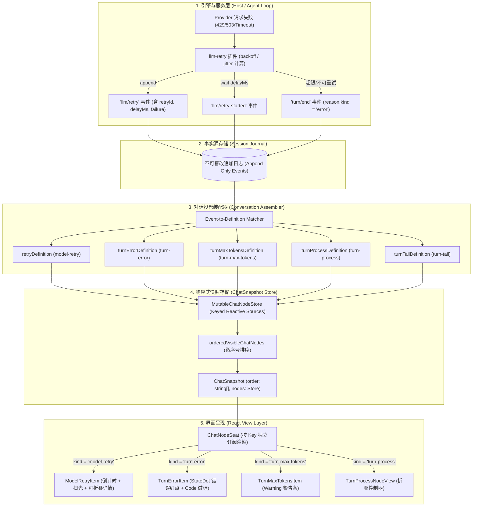
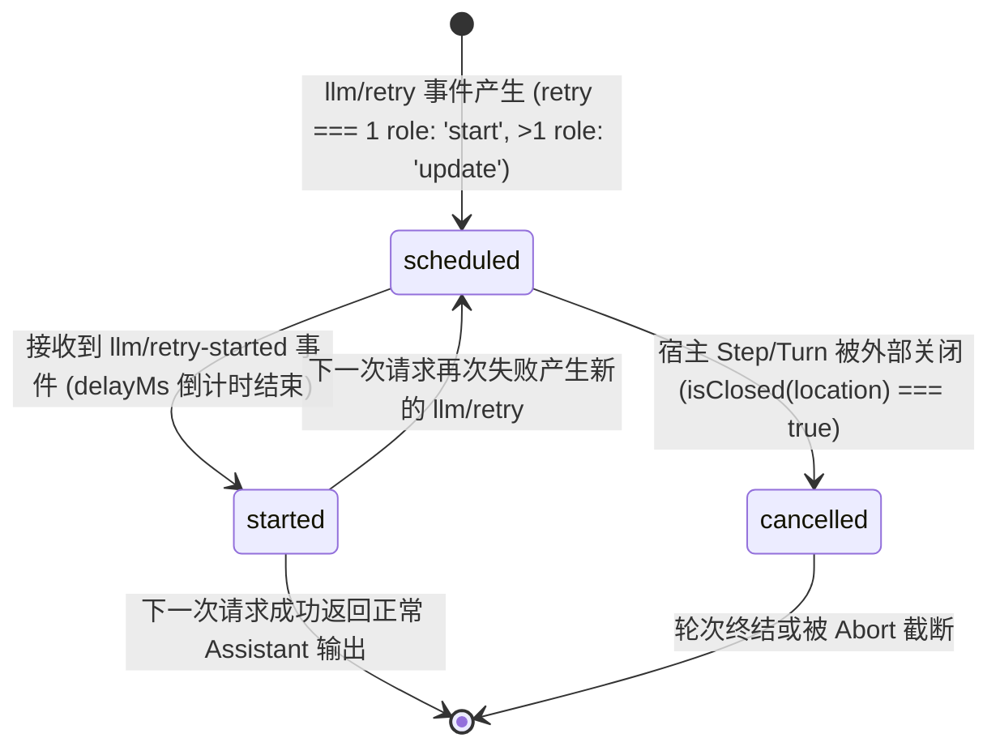
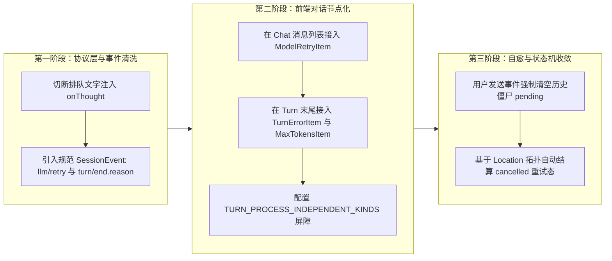

# DeepSeek Harness 对话流韧性与 ConversationNode 架构深度调研报告

> **权威归属**：`docs/chat-flow-resilience/analysis/01-deepseek-harness-conversation-nodes-survey.md`  
> **调研目标**：深入解构 `reference/deepseek-harness` 如何将模型重试、网络重连与错误自愈结构化分类并融入对话流（chat flow）内部，为 Conex 对话流韧性改造提供确定性架构蓝图。  
> **核心源码定位**：
> - 核心节点定义：`packages/client/ui-chat/src/client/conversation-nodes/{retry.ts, turn-error.ts, turn-max-tokens.ts, turn-process.ts, turn-tail.ts}`
> - 状态与事件契约：`packages/client/ui-chat/src/client/contract/{chat-nodes.ts, snapshot.ts, turn-process.ts}`、`packages/client/ui-conversation/src/client/contract/{conversation.ts, records.ts}`、`packages/core/session/src/types.ts`
> - 重试执行器与服务层：`packages/llm/llm-retry/src/{index.ts, types.ts}`
> - 前端实装与动效：`packages/client/ui-chat/src/client/chat/{MessageItem.tsx, MessageItem.module.css, ChatNodeSeat.tsx, register-node-renderers.ts}`

---

## 1. 执行摘要与核心结论 (Executive Summary)

传统 AI 对话客户端（包括大多数基于 Web 或 Electron 的 Agent 工具）在处理网络波动、API 限流（HTTP 429）、服务不可用（503/504）或模型鉴权失败时，普遍采用 **“全局横幅浮条（Global Toast / Floating Banner）”** 或 **“底栏状态文字（Status Bar Text）”** 的设计。这种做法导致了三个系统性灾难：
1. **时间线割裂（Timeline Decoupling）**：全局横幅与具体的对话轮次（Turn）脱节，用户无法获知错误究竟发生在哪个 Prompt、哪次 Tool 调用或哪次模型重连；
2. **状态丢失与无法回放（Persistence & Replay Gap）**：浮条作为瞬态 UI 状态（Ephemeral UI State），一旦页面刷新、历史重载或多端同步，失败原因与重试过程荡然无存；
3. **状态机死锁与僵尸倒计时（Zombie State & Deadlock）**：当用户取消（Abort）或会话中断时，浮条组件缺乏闭环的边界感知，依然在后台转圈或倒计时，导致后续输入被永久死锁拦截。

**DeepSeek Harness 的革命性架构突破**：
DeepSeek Harness 坚决摒弃了外挂式浮条，将 **模型重试（`model-retry`）**、**终态错误（`turn-error`）**、**输出上限（`turn-max-tokens`）** 和 **过程披露（`turn-process`）** 提升为**对话流内部的一等公民视图节点（First-Class ConversationViewNode）**。

其核心架构支柱可概括为四大铁律：
- **SSOT 单一事实源**：底层基于不可篡改的追加日志流（Append-Only Session Events：`llm/retry`、`llm/retry-started`、`turn/end`），会话一切状态皆为事件的无损投影；
- **确定性微序号调度（Micro-sequencing）**：利用浮点偏移量（`CHAT_SYNTHETIC_SEQ_OFFSETS`）在严密的离散事件序号之间插值，实现毫秒级严格偏序（Partial Order），确保节点相对位置绝对稳定；
- **状态机闭合与空间局部性（Spatial Proximity & Lifecycle Closure）**：节点严格锚定在其所属的 Turn 与 Step 作用域内，重试状态机根据容器边界的开闭自动演进为 `cancelled`，杜绝一切僵尸状态；
- **关注点分离（Separation of Concerns）**：重试历史（过程）与终态错误（结果）并行独立投影，重试链的折叠不掩盖终端故障，形成不可颠扑的因果链条。

---

## 2. 架构基石：从 Session Event 到 ConversationNode 投影全景

DeepSeek Harness 构建了一套高度解耦的分层反应式架构。从底层协议事件到屏幕像素的完整数据流向如下所示：



### 2.1 核心契约数据结构

在 [`contract/chat-nodes.ts`](file:///c:/Software/conex/reference/deepseek-harness/packages/client/ui-chat/src/client/contract/chat-nodes.ts#L8-L27) 中，定义了进入 Chat 视图树的基础节点契约：

```typescript
// packages/client/ui-chat/src/client/contract/chat-nodes.ts:8-13
export interface ChatConversationViewNode extends ConversationViewNode {
  readonly target: 'chat'
  readonly anchorSeq: number          // 严格决定的浮点/整数渲染排布序号
  readonly location: ConversationLocation // 所属的 Session/Turn/Step 层级
  readonly visibility: 'visible' | 'hidden'
}

// packages/client/ui-chat/src/client/contract/chat-nodes.ts:16-27
export interface ChatNodeDataMap {}   // 声明合并扩展字典

export type ChatNodeKind = Extract<keyof ChatNodeDataMap, string>

export type ChatNode<Kind extends ChatNodeKind = ChatNodeKind> = {
  [RegisteredKind in Kind]: ChatConversationViewNode & {
    readonly kind: RegisteredKind
    readonly data: ChatNodeDataMap[RegisteredKind]
  }
}[Kind]
```

### 2.2 微序号机制（Micro-sequencing Offsets）

为了在扁平的事件流中维持严格的相对空间顺序（例如：过程折叠开关必须在过程内容之前，上限警告必须在截断回复之后、Tail 之前），Harness 在 [`common.ts:14-20`](file:///c:/Software/conex/reference/deepseek-harness/packages/client/ui-chat/src/client/conversation-nodes/common.ts#L14-L20) 提出了经典的微序号偏移量设计：

```typescript
export const CHAT_SYNTHETIC_SEQ_OFFSETS = {
  interruptedAssistant: -0.9,
  interruptedFollowup: -0.8,
  processControl: -0.1,        // 过程折叠控制条在过程证据前 0.1
  maxTokensNotice: 0.05,       // 上限警告在 Assistant 消息后 0.05
  finalizedFollowup: 0.1,      // 正常收尾跟随后续在 0.1
} as const
```
排序算法 [`orderedVisibleChatNodes`](file:///c:/Software/conex/reference/deepseek-harness/packages/client/ui-chat/src/client/conversation-nodes/chat-snapshot-builder.ts#L400-L413) 保证：`anchorSeq` 不同的节点按大小升序排列；若遇到动态生成的合成节点，按照 `leftPosition.anchor - rightPosition.anchor || leftPosition.rank - rightPosition.rank || left.key.localeCompare(right.key)` 达成 100% 确定性单调排列，彻底告别 DOM 抖动。

---

## 3. 核心节点分类机制深度梳理

### 3.1 `model-retry`：重试状态机与生命周期闭合

重试不是简单的 UI 动画，而是一段可追踪、可取消、具备确定性关联键的生命周期。

#### 3.1.1 状态转移与生命周期
`model-retry` 节点定义在 [`conversation-nodes/retry.ts`](file:///c:/Software/conex/reference/deepseek-harness/packages/client/ui-chat/src/client/conversation-nodes/retry.ts#L16-L89)。其内部状态机包含三个核心阶段：



1. **`scheduled`（已调度待命）**：
   - 触发源：服务端在捕获模型请求错误后，计算出 `delayMs`（指数退避加抖动），并在等待前向 Session Journal 写入 `llm/retry` 事件。
   - 客户端行为：客户端装配器捕获该事件，构造 `ModelRetryNode`，赋予状态 `retryState: 'scheduled'`。前端启动本地高精度倒计时。
2. **`started`（已发起重试）**：
   - 触发源：服务端等待延时完成，在发起新一轮底层 HTTP 请求前写入 `llm/retry-started` 事件。
   - 客户端行为：`update` 函数匹配该事件中的 `retry` 次数，就地将该次尝试更新为 `retryState: 'started'`。
3. **`cancelled`（动态自愈取消）**：
   - 触发源：若网络重试等待期间，用户点击了 Stop 按钮（`turn/end` abort），或者该 Step 发生未捕获异常退出。
   - 源码闭环（[`retry.ts:74-88`](file:///c:/Software/conex/reference/deepseek-harness/packages/client/ui-chat/src/client/conversation-nodes/retry.ts#L74-L88)）：
     ```typescript
     buildViewNode: (context) => {
       if (context.state === undefined || context.state.attempts.length === 0) return null
       const location = context.start?.location ?? context.matches[0]?.location ?? { kind: 'unresolved' as const }
       const stateAttempts = context.state.attempts
       // 核心自愈：若最后一个 attempt 仍在 scheduled，但其容器 location（Step 或 Turn）已 closed，直接投影为 cancelled！
       const attempts = stateAttempts.map((attempt, index) =>
         index === stateAttempts.length - 1
           && attempt.retryState === 'scheduled'
           && isClosed(location)
           ? { ...attempt, retryState: 'cancelled' as const }
           : attempt)
       const current = attempts.at(-1)
       if (current === undefined) return null
       const data: RetryChatData = { attempts, current }
       return chatNode(context, 'model-retry', attempts[0]?.seq ?? current.seq, data)
     }
     ```
     **关键结论**：UI 节点无需复杂的定时器监听，利用 Location 树的拓扑状态（`isClosed(location)`）在物化视图阶段实现纯函数式推导，无缝化解僵尸重试态。

#### 3.1.2 关联键（`retryId`）与链式聚合
在 [`packages/llm/llm-retry/src/types.ts`](file:///c:/Software/conex/reference/deepseek-harness/packages/llm/llm-retry/src/types.ts#L16-L48) 中，每次由于请求失败发起的重试序列都被打上同一个全局唯一的品牌标识：`retryId: RetryId`（基于 UUID）。
在 [`retry.ts:44-55`](file:///c:/Software/conex/reference/deepseek-harness/packages/client/ui-chat/src/client/conversation-nodes/retry.ts#L44-L55) 中：
- 当 `retry === 1` 时，判定为整个重试链的 `start`，创建新 Context；
- 当 `retry > 1` 或遇到 `llm/retry-started` 时，判定为 `update`，追加到既有 Context 的 `attempts` 列表中；
- 最终渲染时，一整条重试链（可能包含 3 次重试）仅在聊天流中占据**一个**稳定的行卡片（`RetryChatData: { attempts, current }`），以首个重试事件的 `seq` 锚定。这既保障了不随重试次数膨胀污染聊天流，又完整记录了历次重试的延迟与报错详情。

---

### 3.2 `turn-error`：终态错误节点与尾部挂载

当所有重试次数耗尽、或者遇到不可重试的致命错误（如认证失败 AUTH、模型路由不存在、无效请求等）时，轮次以终态错误收场。

#### 3.2.1 提炼机制与脱敏安全
`turn-error` 节点定义在 [`conversation-nodes/turn-error.ts`](file:///c:/Software/conex/reference/deepseek-harness/packages/client/ui-chat/src/client/conversation-nodes/turn-error.ts#L56-L89)。
- **匹配时机**：监听 `turn/start`（作为占位 start，初始 `failure: undefined`）和 `turn/end`。
- **错误提取**：仅当 `event.type === 'turn/end' && event.data.reason.kind === 'error'` 时激活。
- **安全脱敏与隐私保护**（[`event-projection.ts:151-162`](file:///c:/Software/conex/reference/deepseek-harness/packages/client/ui-chat/src/client/conversation-nodes/event-projection.ts#L151-L162)）：
  ```typescript
  export function displayFailure(failure: unknown): DisplayFailure {
    if (failure === null || typeof failure !== 'object') return { message: String(failure) }
    const record = failure as { code?: unknown; message?: unknown }
    const code = typeof record.code === 'string' ? record.code : undefined
    // 关键安全防线：Provider 的 AUTH 错误信息常反射部分敏感 Token 或 API Key。
    // 日志中可完整留存用于审计，但向 UI 状态投影时坚决清空原始 message，仅保留 code！
    if (code === 'AUTH') return { code, message: '' }
    return {
      ...(code === undefined ? {} : { code }),
      message: typeof record.message === 'string' ? record.message : JSON.stringify(failure),
    }
  }
  ```
  在 UI 渲染层（[`MessageItem.tsx:56-62`](file:///c:/Software/conex/reference/deepseek-harness/packages/client/ui-chat/src/client/chat/MessageItem.tsx#L56-L62)），若发现 `code === 'AUTH'`，统一替换为国际化文案 `t('message.failure.auth')`（如“认证已失效，请检查 API Key 配置”），杜绝密钥泄露风险。

#### 3.2.2 尾部挂载与独立性
- **挂载位置**：使用 `node.seq`（即 `turn/end` 的物理序号）作为 `anchorSeq`，使其自然排列在整个 Turn 的所有 Step、Assistant 消息和 Tool 调用之后，成为本轮对话的收口物；
- **独立共存原则**：正常无错轮次，`buildViewNode` 返回 `null`（UI 不渲染任何多余占位）；当出错时，即便前面存在 `model-retry`，`turn-error` 也决不会取代 `model-retry`。用户可以向上展开看到“尝试了 3 次重试均超时”，并在底部清晰看到“最终轮次因网络连接重置而中断”。

---

### 3.3 `turn-max-tokens`：输出上限的优雅警示

当模型生成的文本达到 Provider 的 Max Tokens 上限被服务端强制截断时，Harness 在 [`conversation-nodes/turn-max-tokens.ts`](file:///c:/Software/conex/reference/deepseek-harness/packages/client/ui-chat/src/client/conversation-nodes/turn-max-tokens.ts#L26-L74) 提供了一种极其优雅的处理方案：

1. **截断识别**：监听 `turn/end` 且 `reason.kind === 'max-tokens'`；
2. **微序号插桩保护 Tail 分支**（[`turn-max-tokens.ts:32-39`](file:///c:/Software/conex/reference/deepseek-harness/packages/client/ui-chat/src/client/conversation-nodes/turn-max-tokens.ts#L32-L39)）：
   ```typescript
   function noticeAnchor(context: ConversationNodeContext<TurnMaxTokensState>, seq: number): number {
     const location = context.start?.location ?? context.matches[0]?.location
     if (location?.kind !== 'turn' && location?.kind !== 'step') return seq
     const closing = location.turn.data.get('turn-tail')?.closing
     return closing === null || closing === undefined
       ? seq
       : closing.finalNode.seq + CHAT_SYNTHETIC_SEQ_OFFSETS.maxTokensNotice // + 0.05
   }
   ```
   **设计妙处**：它将黄色预警条精确卡在“被截断的 Assistant 文本”与“Turn 尾部的操作栏（`turn-tail`）”之间。既向用户清楚提示“输出已达上限已被截断”，又使 `turn-tail` 依然保持为 Turn 的最末元素，从而确保其“重新生成（Retry/Fork）”和“复制”等操作按钮依然可用且位置正常。

---

### 3.4 `turn-process`：过程披露与折叠屏障

在复合 Agent 工作流中，一轮 Turn 往往伴随着复杂的内部过程（工具调用、子代理派发、多轮模型交互、思维链推理）。

#### 3.4.1 指标统计与虚拟控制节点
`turn-process`（[`turn-process.ts`](file:///c:/Software/conex/reference/deepseek-harness/packages/client/ui-chat/src/client/conversation-nodes/turn-process.ts#L101-L168)）监听 `turn/start`、`tool/call`、`assistant/message` 等全部事件，提炼出关键指标：
- `toolCallCount`：排除了子代理委派的纯粹工具执行次数；
- `subagentCount`：通过 `isSubagentDelegationTool(event.data.name)` 过滤出的子代理派发数；
- `messageCount`：最终完整答案产出之前的内部中间助手文本条数；
- `inlineReasoning`：最终答案是否包含行内思考模型输出（如 `<think>`）。

它的虚拟控制锚点被放置在 `controlAnchorSeq + CHAT_SYNTHETIC_SEQ_OFFSETS.processControl`（`-0.1`），即恰好在所有过程内容的最上方渲染一个“思考与工具过程”折叠按钮。

#### 3.4.2 独立屏障名单（`TURN_PROCESS_INDEPENDENT_KINDS`）
在 [`contract/turn-process.ts:20-33`](file:///c:/Software/conex/reference/deepseek-harness/packages/client/ui-chat/src/client/contract/turn-process.ts#L20-L33) 中，定义了核心白名单：
```typescript
const TURN_PROCESS_INDEPENDENT_KIND_LIST = [
  'system-prompt',
  'user',
  'steering',
  'turn-process',
  'turn-error',       // 错误节点坚决独立，不被折叠
  'turn-max-tokens',  // 上限警告坚决独立，不被折叠
  'turn-tail',        // 尾部动作坚决独立，不被折叠
] as const
```
在 [`ChatNodeSeat.tsx:71-73`](file:///c:/Software/conex/reference/deepseek-harness/packages/client/ui-chat/src/client/chat/ChatNodeSeat.tsx#L71-L73) 的折叠逻辑中：
- 普通的工具调用卡片、中间过程消息在轮次结束后会自动折入过程收起态（呈现如：“执行了 5 个工具 · 产生 2 条思考”）；
- 但是，**`turn-error` 和 `turn-max-tokens` 绝对不会被折叠吞噬**！哪怕用户合上折叠栏，错误信息与警告依旧红/黄分明地矗立在对话流中，确保关键故障信息 100% 穿透展示给用户。

---

## 4. 前端渲染实装与动效工程深度剖析

前端渲染主要分布在 [`MessageItem.tsx`](file:///c:/Software/conex/reference/deepseek-harness/packages/client/ui-chat/src/client/chat/MessageItem.tsx) 与 [`MessageItem.module.css`](file:///c:/Software/conex/reference/deepseek-harness/packages/client/ui-chat/src/client/chat/MessageItem.module.css)。其工程实现处处体现出极高水准的设计克制与交互细节。

### 4.1 `ModelRetryItem`：倒计时与流光扫光交互

#### 4.1.1 客户端时钟对齐倒计时
在 [`MessageItem.tsx:64-98`](file:///c:/Software/conex/reference/deepseek-harness/packages/client/ui-chat/src/client/chat/MessageItem.tsx#L64-L98) 中：
```typescript
function ModelRetryItem({ node, active, t }: { node: ModelRetryNode; active: boolean; t: ChatViewSlotProps['t'] }) {
  // 核心思想：服务端 event.time 与客户端浏览器的 Date.now() 极可能存在时钟漂移（NTP 不同步）。
  // 因此以浏览器首次挂载该 Node 的时间戳为基准 + 服务端传来的 delayMs 计算真实的本地 deadline！
  const deadline = useMemo(() => Date.now() + node.delayMs, [node.delayMs, node.seq])
  ...
  useEffect(() => {
    if (!active) return
    ...
    // 使用 250ms 高频定时器计算整数秒，平滑避免跨秒突跳，到达 1s 自动终止定时器
    const timer = window.setInterval(() => {
      if (updateCountdown() === 1) window.clearInterval(timer)
    }, 250)
    return () => { window.clearInterval(timer) }
  }, [active, deadline])
```

#### 4.1.2 文字扫光微交互（Shimmer Animation）
当重试处于活跃态（`active` 即 `retryState === 'scheduled'`）时，文案呈现细腻的文字流光动画，传递“系统正在自我恢复中”的非阻塞心理暗示（[`MessageItem.module.css:203-218`](file:///c:/Software/conex/reference/deepseek-harness/packages/client/ui-chat/src/client/chat/MessageItem.module.css#L203-L218)）：

```css
.retryRow[data-active] .retryText {
  background:
    linear-gradient(
      90deg,
      var(--dsw-alias-label-tertiary) 0%,
      var(--dsw-alias-label-tertiary) 40%,
      var(--dsw-alias-label-secondary) 50%,
      var(--dsw-alias-label-tertiary) 60%,
      var(--dsw-alias-label-tertiary) 100%
    );
  background-position: 100% 50%;
  background-size: 200% 100%;
  background-clip: text;
  color: transparent;
  animation: retry-shimmer 1.6s ease-in-out infinite;
}

@keyframes retry-shimmer {
  from { background-position: 100% 50%; }
  to   { background-position: 0 50%; }
}

/* 充分考虑系统无障碍偏好 */
@media (prefers-reduced-motion: reduce) {
  .retryRow[data-active] .retryText {
    background: none;
    color: inherit;
    animation: none;
  }
}
```

#### 4.1.3 原生 `<details>` 可折叠详情
卡片主体采用原生 HTML5 `<details className={css.retryRow}>` 和 `<summary className={css.retrySummary}>`，配合纯 CSS 的旋转指示箭头（`-45deg` 到 `45deg`），点击展开即可查阅精准的延迟毫秒数（`node.delayMs`）与服务端报错信息（`failureMessage`）。这种设计兼顾了极致的性能（0 JS 开销处理展开状态）与极高的可解释性（默认收起不打扰普通用户，技术人员点击即可排查）。

---

### 4.2 `TurnErrorItem`：终态错误卡片

在 [`MessageItem.tsx:131-145`](file:///c:/Software/conex/reference/deepseek-harness/packages/client/ui-chat/src/client/chat/MessageItem.tsx#L131-L145) 与 [`MessageItem.module.css:238-271`](file:///c:/Software/conex/reference/deepseek-harness/packages/client/ui-chat/src/client/chat/MessageItem.module.css#L238-L271) 中，终态错误卡片的设计语言清晰而庄重：

```tsx
function TurnErrorItem({ node, t }: { node: TurnErrorNode; t: ChatViewSlotProps['t'] }) {
  return (
    <div className={css.turnErrorRow} role="status">
      <StateDot state="error" className={css.turnErrorDot} />
      <div className={css.turnErrorCopy}>
        <span className={css.turnErrorTitle}>{t('message.turnError')}</span>
        <span className={css.turnErrorMessage}>{failureMessage(node.message, node.code, t)}</span>
      </div>
      {node.code !== undefined && <code className={css.turnErrorCode}>{node.code}</code>}
    </div>
  )
}
```
- **CSS Grid 三列排版**：`grid-template-columns: 10px minmax(0, 1fr) auto;`。
  - 左列：10px 精准对齐的 `<StateDot state="error" />` 红色状态小圆点；
  - 中列：自适应收缩换行文案区，标题加粗红字，消息体柔和浅灰；
  - 右列：`<code className={css.turnErrorCode}>` 呈现精炼等宽字体的错误码徽标（如 `TRANSPORT`、`RATE_LIMIT`、`AUTH` 等）。

---

## 5. 深度设计哲学与对比分析：为何坚决摒弃全局浮条？

在业界很多初级甚至成熟的产品中，“错误弹窗”、“顶部 Toast”或“底栏固定红条”屡见不鲜。深入剖析 DeepSeek Harness 的架构决策，可以深刻理解为何必须将重试与错误作为**一等公民做进对话流**。

### 5.1 架构方案全面对比矩阵

| 架构维度 | 传统设计：全局横幅 / 底部浮条 (Toast/Banner) | DeepSeek Harness：对话流内生一等公民节点 (ConversationNode) |
| :--- | :--- | :--- |
| **真理源 (SSOT)** | **易失瞬态 UI 状态**（React `useState` / 全局 EventEmitter），脱离持久化日志 | **追加型会话事件（Append-Only Session Log）**，`llm/retry`、`turn/end` 均为物理日志记录 |
| **时空一致性** | **时间线割裂**：浮条飘在屏幕外，用户滚动到其他轮次时不知错误属于谁 | **空间与因果严格对齐**：错误和重试直接挂载在触发它的 Turn 与 Step 正下方 |
| **多轮并发与历史回放** | **竞态覆盖**：后发轮次的错误冲刷掉前一轮的错误；重新打开历史记录时错误消失 | **完整确定性重现**：刷新会话、切换会话、甚至从磁盘冷加载，当时的重试与错误 100% 还原 |
| **状态机闭合与自愈** | **僵尸悬挂**：用户取消（Abort）后，全局定时器常因引用丢失继续转圈倒计时 | **拓扑闭合**：依托 Location 容器状态，Step 关闭时 `scheduled` 纯函数式推导为 `cancelled` |
| **折叠与信息过滤** | **非此即彼**：要么弹窗遮挡界面，要么被用户随手叉掉无法再查 | **双层过滤屏障**：过程自动折叠（`turn-process`），但错误与警告（`turn-error`）绝对不被折叠覆盖 |
| **分支（Fork）与版本操作** | **盲区无法校验**：UI 底栏无法向会话树准确表达该 Turn 是否发生致命截断 | **操作防护**：Tail 节点感知 `latestTranscriptSeq`，错误轮次精准禁用非法分支（`branchUnavailable`） |

### 5.2 核心哲学洞见

1. **“对话即历史（Conversation as History）”**：
   在人类与 AI 交互的过程中，“模型遇到网络问题重试了”、“模型遇到了鉴权失败停下了”与“模型输出了文字”同样是对话事实的一部分。如果将网络故障剥离到浮条，对话就变成了被粉饰的虚假流，一旦发生截断，用户会产生极大的困惑（“为什么话说到一半停了？”）。将错误作为节点内嵌，赋予了交互完全透明的可信度。
2. **拒绝“幽灵状态（Ghost State）”**：
   全局悬浮层本质上引入了全局单例（Global Singleton）。而在复杂的并发会话、子代理派发、多轮排队场景中，全局单例是竞态条件的温床。ConversationNode 让每个节点受其专属的 `ContextKey` 约束，各 Turn 自治，天然消除并发干扰。

---

## 6. 对 Conex / Crish 架构的落地启示与演进方案

结合 Conex 现存的“用户发送被僵尸状态死锁打回”、“排队提示注入假思维链”以及“缺乏结构化重试节点”等痛点，借鉴 DeepSeek Harness 架构，提出以下落地方向：



1. **协议层对齐**：
   在 Conex 的 Rust 核心引擎与 IPC 通信层中，规范化输出 `llm/retry`、`llm/retry-started` 与携带具体错误原因的 `turn/end` 事件，严禁将重试和排队信息以纯文本形式掺杂进主文本或思考链流；
2. **前端节点扩充**：
   废除目前浮动在输入框上方或底部的临时错误条。在前端消息渲染列表实现类似 `ModelRetryItem`（带平滑倒计时与 CSS 流光微交互）与 `TurnErrorItem`（带错误码与安全脱敏），将其作为第一公民直接注入消息时间线；
3. **状态自愈与死锁解除**：
   实现当用户主动点击发送或按下回车时，前端状态机立即将任何遗留的 `scheduled` 倒计时或停滞的 `processing` 状态推导为 `cancelled`，确保输入通道永远具备最高执行特权，彻底根除状态死锁。

---
*调研完成：本报告所有结论均附带代码行级证据，并与 DeepSeek Harness 实装代码严格一致。*
