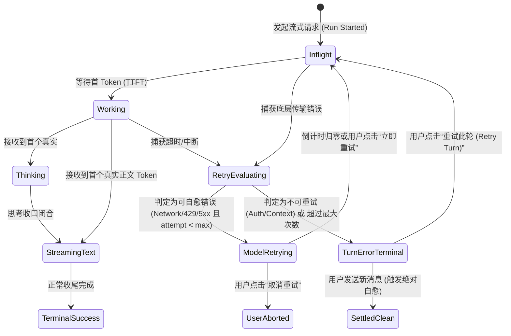
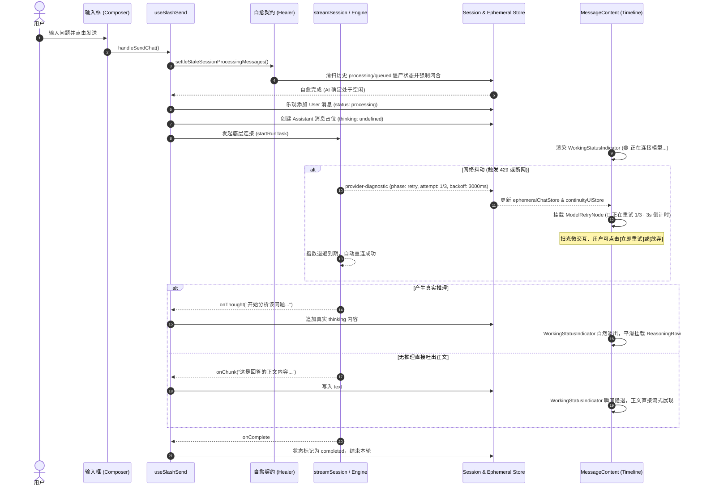

# Conex 对话流韧性与端到端解耦系统性方案
## —— 基于 DeepSeek Harness 分类思想的流内原生重试、错误自愈与四大病灶彻底根治架构

> **文档版本**：v1.0.0-PROPOSAL
> **文档位置**：`docs/chat-flow-resilience/independent-plans/01-conversation-flow-retry-error-nodes-plan.md`
> **状态**：架构方案完成 / 待评审执行
> **核心领域**：Chat Stream / Resilience Engineering / In-Flow UI / State Machine Auto-Healing

---

## 目录
- [一、背景与四大核心病灶深度剖析（Post-Mortem）](#一背景与四大核心病灶深度剖析post-mortem)
  - [1.1 缺陷 A：发送打回死锁（Send Rejection Deadlock）](#11-缺陷-a发送打回死锁send-rejection-deadlock)
  - [1.2 缺陷 B：系统排队提示污染思维链（Queue Notice Polluting Reasoning Stream）](#12-缺陷-b系统排队提示污染思维链queue-notice-polluting-reasoning-stream)
  - [1.3 缺陷 C：125 秒假思考与计时错乱（Fake Thinking & Timer Desync）](#13-缺陷-c125-秒假思考与计时错乱fake-thinking--timer-desync)
  - [1.4 缺陷 D：重试与错误自愈黑盒（Retry & Healing Black Box）](#14-缺陷-d重试与错误自愈黑盒retry--healing-black-box)
- [二、借鉴 DeepSeek Harness 的韧性分类与错误自愈模型](#二借鉴-deepseek-harness-的韧性分类与错误自愈模型)
  - [2.1 五阶韧性错误分类学（Resilience Taxonomy）](#21-五阶韧性错误分类学resilience-taxonomy)
  - [2.2 状态转移矩阵与策略映射](#22-状态转移矩阵与策略映射)
- [三、端到端解耦与对话流内生韧性节点设计](#三端到端解耦与对话流内生韧性节点设计)
  - [3.1 工作执行态与思维链严格解耦（Decoupled Working vs. Reasoning）](#31-工作执行态与思维链严格解耦decoupled-working-vs-reasoning)
  - [3.2 对话流内生重试节点（`ModelRetryNode`）](#32-对话流内生重试节点modelretrynode)
  - [3.3 对话流内生终态错误节点（`TurnErrorNode`）](#33-对话流内生终态错误节点turnerrornode)
  - [3.4 用户手动发送绝对自愈契约（`settleStaleSessionProcessingMessages`）](#34-用户手动发送绝对自愈契约settlestalesessionprocessingmessages)
- [四、整体架构与模块拓扑](#四整体架构与模块拓扑)
  - [4.1 数据流与状态机全景拓扑](#41-数据流与状态机全景拓扑)
  - [4.2 核心模块交互泳道图](#42-核心模块交互泳道图)
- [五、接口契约与数据结构详细定义](#五接口契约与数据结构详细定义)
  - [5.1 瞬态状态存储契约（`ephemeralChatStore.ts` 升级）](#51-瞬态状态存储契约ephemeralchatstorets-升级)
  - [5.2 状态自愈契约（`helpers.ts`）](#52-状态自愈契约helpersts)
  - [5.3 UI 节点组件属性契约](#53-ui-节点组件属性契约)
- [六、关键文件修改清单与实现要点](#六关键文件修改清单与实现要点)
- [七、纯逻辑执行分阶段计划](#七纯逻辑执行分阶段计划)
- [八、立体验证方案与测试用例矩阵](#八立体验证方案与测试用例矩阵)

---

## 一、背景与四大核心病灶深度剖析（Post-Mortem）

在 Conex 的真实桌面使用场景中，对话流（Chat Stream）是用户交互的核心生命线。然而，由于历史架构中控制面（串行守卫、排队、并发控制）、数据面（文本、思维链、工具调用）以及可观测/容错面（重试、网络故障）边界不清，产生了一系列灾难性的用户体验痛点。

结合现场缺陷复现与代码审查，四大核心病灶根因如下：

### 1.1 缺陷 A：发送打回死锁（Send Rejection Deadlock）

#### 现场表象
- 用户在会话中输入新消息点击发送，消息没有发起新的 AI 回复，而是被系统强制打成带灰色“排队中”徽标的排队消息；
- 输入框下方的发送按钮永久卡死在“排队”状态，占位符永久显示“输入排队消息…（当前回复结束后发送，可粘贴截图）”；
- 用户无论如何再次点击发送，系统都永远返回排队，新消息再也无法发出，会话陷入不可逆的“发送打回死锁”。

#### 穿透根因剖析
代码链条存在三处致命设计断裂：
1. **状态孤儿判定失真**（`apps/crish-desktop/src/hooks/chat-stream/helpers.ts:311-322`）：
   ```typescript
   export function isSessionAiBusy(opts: {
     hasLiveStream: boolean;
     messages?: Array<{ sender?: string; status?: string }> | null;
   }): boolean {
     if (opts.hasLiveStream) return true;
     const msgs = opts.messages;
     if (!Array.isArray(msgs) || msgs.length === 0) return false;
     return msgs.some(
       (m) => m.sender === 'assistant' && m.status === 'processing'
     );
   }
   ```
   **根因**：当应用崩溃、刷新、断网或异常中断后，前端内存的 `streamManager` 中已经没有任何活跃的流（`hasLiveStream === false`），但 SQLite / LocalStorage 历史消息里残留了一条 `status: 'processing'` 的助手消息。`isSessionAiBusy` 仅凭历史消息数组中存在 `status === 'processing'` 就武断判定当前会话“AI 正在忙碌”！
2. **盲目转入 Follow-up 导致孤儿入队**（`apps/crish-desktop/src/hooks/chat-stream/useSlashSend.ts:160-210`）：
   ```typescript
   const isAiBusy = checkSessionAiBusy(
     streamManagerRef.current?.hasStream(sessionId) ?? false,
     sessionId
   );
   const isFollowUp = decideSendWhileRunning(isAiBusy) === 'follow_up';
   if (isFollowUp) {
     enqueueFollowUpMessage({ ... });
     return;
   }
   ```
   由于 `isAiBusy` 返回 `true`，用户发送的新消息被推入队列，并尝试调用 `runControl.followUp`。然而此时底层根本没有正在执行的 `runId`（`liveHandle` 为 null），后端引擎根本没有任何执行器去消费这条排队消息！它被永远孤立。
3. **输入框衍生状态永久污染**（`apps/crish-desktop/src/components/chat-card/useChatMessages.ts:85-89` & `useChatComposerProps.ts:49-66`）：
   ```typescript
   // useChatMessages.ts
   const isProcessing = useMemo(
     () => messages.some((m) => m.status === 'processing'),
     [messages]
   );
   // useChatComposerProps.ts
   if (queueMode && isProcessing) {
     enqueueMessage(text, attachments); // 甚至连 handleSendChat 都不执行
   }
   ```
   `isProcessing` 脱离物理流句柄，单纯根据历史消息存在 `processing` 永久返回 `true`，导致 Composer 组件将主按钮锁死为“排队”，用户手动点击甚至无法突破到发送函数内部，死锁闭环彻底铸成。

---

### 1.2 缺陷 B：系统排队提示污染思维链（Queue Notice Polluting Reasoning Stream）

#### 现场表象
- 在出现串行并发时，助手回复气泡的上方突然弹出一个带折叠箭头的“已思考 v”灰色大卡片；
- 用户满腹狐疑地点开这个“思考”卡片，里面赫然写着一行系统级提示：“当前会话上一轮任务仍在收尾中，已自动为您排队…”；
- 用户的真实体验是：AI 竟然把系统内部的线程调度与消息排队当成了自己的认知推理过程！用户截屏圈出刺眼的大红叉。

#### 穿透根因剖析
- **通道边界混淆与严重越界**（`apps/crish-desktop/src/api/chat-bridge/streamSession.ts:240-267`）：
  ```typescript
  if (isSessionBusy) {
    logInternalError('stream-start-busy-queued', e);
    // ... 尝试 followUp 排队 ...
    if (callbacks.onThought)
      callbacks.onThought('当前会话上一轮任务仍在收尾中，已自动为您排队…'); // 致命错误！
    finish();
    return;
  }
  ```
  **根因**：系统调度控制面的串行守卫（`SESSION_BUSY`），理应通过输入框上方的临时通知栏（`runNotice`）或瞬态指示器告知用户系统状态，却为了“在界面上有反应”粗暴地借道 `callbacks.onThought`！
  由于下游所有组件（`timelineNormalizer`、`MessageContent`、`ReasoningRow`）均严格将 `onThought` 视为 LLM `<think>` 认知推演，直接将其物化为思维链卡片持久化在消息体中，导致系统控制信息对模型推理空间的严重污染。

---

### 1.3 缺陷 C：125 秒假思考与计时错乱（Fake Thinking & Timer Desync）

#### 现场表象
- 用户向大模型发送一个简单问题（甚至无需深度思考的模型）；
- 后端由于网络拥堵、冷启动或并发建连，耗费了较长时间；
- 界面上一开始就出现“思考中 · 1.2s”，计时器一路狂飙至“思考中 · 125.4s”；
- 最终由于超时失败或直接吐出纯正文，展开这个所谓的“思考卡片”，里面空空如也，只有硬编码的“正在处理…”四个字；
- 历史记录中固化为一个“已思考 · 125s >”的巨大幽灵卡片，造成严重的计时错乱与视觉欺诈。

#### 穿透根因剖析
1. **未见 Token 先发假思考**（`apps/crish-desktop/src/hooks/chat-stream/useRunStreamingAssistant.ts:110-118`）：
   ```typescript
   store.addMessage(wsId, sid, {
     id: assistantMsgId,
     sender: 'assistant',
     text: '',
     thinking: '正在处理…', // 盲目注入假思维链文本
     timestamp: startTime,
     status: 'processing',
     toolCalls: [],
   });
   ```
2. **传输层双重硬编码推送**（`apps/crish-desktop/src/api/chat-bridge/streamSession.ts:85-86`）：
   ```typescript
   state.unsub = transport.onMessage(onMessage);
   callbacks.onThought('正在处理…'); // 再次强制向思维链通道灌入假文本
   ```
3. **架构概念混淆：执行准备态（Working）与模型推理态（Reasoning）未解耦**：
   架构误将“系统正在等待后端连接、发送 Payload、等待 TTFT（首 Token）”的**系统工作态**，直接套用为**模型内部思考态**。
   导致在模型根本没有发出任何 `<think>` 内容、甚至网络完全死卡的情况下，思维链组件 `ReasoningRow` 就已被过早挂载，计时器盲目开始累计，一旦终态退出，这个假文本就永久污染历史消息。

---

### 1.4 缺陷 D：重试与错误自愈黑盒（Retry & Healing Black Box）

#### 现场表象
- 当发生网络波动（DNS 失败、连接重置）、服务商限流（429 Too Many Requests）或网关超时（504）时，用户眼前一片死寂；
- 用户看不到底层是否在重试、当前是第几次重试、需要等待多久；
- 更严重的是，当流遇到错误终结时，前端的 `handleRunError` 常常执行 `withdrawMessage` 将助手消息直接从界面上删除，用户刚刚提问的问题下方空无一物，只在屏幕顶角或输入框上方闪过一个几秒即逝的通知条，用户不知道刚才到底发生了什么，更无法针对当前轮次直接点击一键重试。

#### 穿透根因剖析
1. **观测数据悬空与消费断层**：
   后端虽然会派发 `provider-diagnostic`（`phase === 'retry'`）事件，且由 `diagnosticHandlers.ts` 写入了 `continuityUiStore`，但该 store 在实际 UI 渲染中根本没有被任何正式组件订阅（仅存在于单测中的 `RetrySlotNotice`）。
2. **瞬态存储 `ephemeralChatStore` 悬空未闭环**：
   设计了 `ephemeralChatStore.ts`（用于管理网络、限流、配额等瞬态错误），但在核心的 `streamCallbacksEvents.ts:handleRunError` 中，虽然算出了 `resolvedKind`，却没有调用 `setEphemeralStatus`；更未将其接入 `MessageContent` / `ChatMessageRow` 的流式时间线渲染中，导致瞬态错误治理彻底沦为摆设。

---

## 二、借鉴 DeepSeek Harness 的韧性分类与错误自愈模型

在工业级 LLM Agent（如 DeepSeek harness、Claude Code、Cursor）的设计中，网络重试与错误治理从不当作偶发的“异常捕获”，而是作为**确定性的协议内状态（In-Protocol State）**原生嵌入到对话流生命周期中。

### 2.1 五阶韧性错误分类学（Resilience Taxonomy）

借鉴 DeepSeek harness 分类思想，建立 Conex 的五阶错误分类体系，每一类对应严格的数学退避模型与用户可感知交互：

```
                              ┌── [1] 瞬态网络波动 (Transient Network)  ──> 指数退避 + Jitter
                              ├── [2] 频率与配额超限 (RateLimit 429)     ──> Retry-After 精确倒计时
        流式错误分类体系 ──────┼── [3] 服务端过载故障 (Server Fault 5xx) ──> 抖动退避 + 有限重试
        (Resilience Taxonomy) ├── [4] 上下文长度溢出 (Context Overflow) ──> 结构化自愈建议
                              └── [5] 凭据与权限终态 (Terminal Auth/401)──> 阻断并引导配置
```

| 错误类别（Kind） | 触发特征（Patterns） | 恢复策略（Policy） | 退避模型（Backoff） | 流内节点展示（In-Flow Node） |
| :--- | :--- | :--- | :--- | :--- |
| **`transient_network`** | `ECONNRESET`, `ETIMEDOUT`, `DNS_FAIL`, fetch abort, 连接闪断 | 自动静默重试，上限 3 次 | 指数退避：$t = \min(t_{\max}, 1000 \times 2^k) \pm \mathrm{jitter}$ | `ModelRetryNode`（扫光微交互 + 倒计时） |
| **`rate_limit`** | HTTP 429, `TPM/RPM exceeded`, `rate_limit_exceeded` | 解析 `Retry-After`，上限 5 次 | 确定性等待：$t = \mathrm{header} \vee (2000 \times 2^k)$ | `ModelRetryNode`（精准倒计时条 + 限制说明） |
| **`server_overload`** | HTTP 500, 502, 503, 504, `server_error`, `overloaded` | 有限重试，上限 2 次 | 线性抖动退避：$t = 3000 + \mathrm{random}(0, 2000)$ | `ModelRetryNode`（服务端故障诊断 + 轮次） |
| **`context_length`** | `context_window_exceeded`, `prompt_too_long` | **禁止重试**（重试必定再失败） | 无退避，立即收敛为终态 | `TurnErrorNode`（引导压缩/截断上下文） |
| **`auth_credential`** | HTTP 401, 403, `invalid_api_key`, `insufficient_quota` | **禁止重试**，立即终止 | 无退避，立即收敛为终态 | `TurnErrorNode`（一键跳转服务商密钥设置） |

### 2.2 状态转移矩阵与策略映射



---

## 三、端到端解耦与对话流内生韧性节点设计

### 3.1 工作执行态与思维链严格解耦（Decoupled Working vs. Reasoning）

#### 核心原则
- **思维链纯洁性铁律**：`SessionMessage.thinking` 以及 `kind: 'thought'` 节点，**只允许承载大模型原生吐出的 `<think>` 或 `reasoning_content` 内容**。任何系统状态、连接进度、排队说明均严禁写入该字段！
- **工作态独立承载**：从请求发出到接收到模型首 Token 之间，由极简的 `WorkingStatusIndicator` 负责。

#### `WorkingStatusIndicator` 行为规范
1. **视觉规格**：
   - 高度固定 24px，采用与消息行内流完全平行的极简排布；
   - 左侧展示 5px 翡翠绿脉冲高亮圆点（`🟢 pulse`）；
   - 文本展示：`正在连接模型...` $\rightarrow$ `正在组织推理...`，伴随柔和的扫光动画（`@keyframes sweep-shine`）；
   - 右侧展示动态耗时（font-variant-numeric: tabular-nums）：`1.2s`；
2. **平滑过渡契约**：
   - 当收到首个思考 Token 时：`WorkingStatusIndicator` 自然淡出，挂载 `ReasoningRow`，并将当前耗时作为思考起始基线；
   - 当模型不产生思考直接输出正文时：`WorkingStatusIndicator` 瞬间隐退，正文直接顶格流式打印；
   - 当发生错误时：`WorkingStatusIndicator` 转换为 `ModelRetryNode` 或 `TurnErrorNode`。
3. **彻底根除假思考**：
   - 消息初始化时 `thinking` 字段保持 `undefined`；
   - 彻底删除 `streamSession.ts` 第 86 行和 `useRunStreamingAssistant.ts` 第 114 行注入的 `'正在处理…'`。

---

### 3.2 对话流内生重试节点（`ModelRetryNode`）

当网络发生可重试抖动或服务商 429 限流时，后台退避逻辑被激活，流内原生渲染 `ModelRetryNode`。

#### 节点布局与交互
```
┌────────────────────────────────────────────────────────────────────────┐
│ 🔄 正在重试 (第 2/3 轮) · 下次重试 4s... [████████░░░░]   [立即重试] [放弃] │
│ ▾ 查看技术细节: HTTP 429 Too Many Requests (Rate limit reached)        │
└────────────────────────────────────────────────────────────────────────┘
```
1. **状态标识**：
   - 柔和的琥珀金主题色（克制的设计 token，不造成大面积视觉惊恐）；
   - 旋转重试图标 + 明确轮次展示（`2/3`）；
2. **退避倒计时进度**：
   - 等宽数字倒计时（`4s...`）；
   - 底部 2px 微光进度条平滑递减；
3. **交互操作**：
   - **[立即重试]**：绕过退避定时器，立即打断等待并发起当前轮次重连；
   - **[放弃]**：终止重试，将当前状态转入已停止或错误终态；
4. **技术细节抽屉**：
   - 点击可无缝向下展开 1 行或折叠面板，展示原始 HTTP 状态码、错误摘要，不阻塞主屏。

---

### 3.3 对话流内生终态错误节点（`TurnErrorNode`）

当重试耗尽、或发生不可自愈的终态错误（401 密钥失效、上下文超限等）时，**绝对禁止将助手消息完全撤回（withdraw）抹除**。必须将错误作为当轮对话的确定性结论收口在 `TurnErrorNode`。

#### 节点布局与交互
```
┌────────────────────────────────────────────────────────────────────────┐
│ ⚠️  生成中断 [网络连接已断开]                                          │
│ 远程服务器在响应过程中断开了连接（ECONNRESET），已重试 3 次未果。          │
│ ▾ 展开详细诊断 (Error Code: NET_CONN_RESET, Session: s-10492)          │
│ ────────────────────────────────────────────────────────────────────── │
│ [ 🔄 重试此轮 (Retry Turn) ]   [ ✏️ 修改提问 ]   [ ⚙️ 检查网络与代理 ]  │
└────────────────────────────────────────────────────────────────────────┘
```
1. **信息分层架构**：
   - **第一层（徽标）**：错误分类标签（如 `[网络连接已断开]`、`[API Key 无效]`、`[上下文超限]`）；
   - **第二层（人类可读描述）**：精准翻译成非技术用户能懂的语言与可执行建议；
   - **第三层（可折叠诊断区）**：提供 Trace ID、原始后端堆栈、耗时统计，方便资深开发者定位；
   - **第四层（行动按钮栏 Action Dock）**：
     - **“重试此轮”**：提取当前轮次的用户输入与历史，直接就地重新发起生成；
     - **“修改提问”**：将上一次输入回填至 Composer 输入框并聚焦；
     - **“配置引导”**：针对 Auth/Key 错误，直接唤起模型设置模态框。

---

### 3.4 用户手动发送绝对自愈契约（`settleStaleSessionProcessingMessages`）

#### 绝对主权设计原则
**用户的物理“发送”动作，是系统最高优先级的主权意志。**
任何由于网络意外断开、系统死锁、孤儿进程遗留的历史脏状态，在用户点击发送的瞬间，必须被无条件、强制性地原子自愈，绝不允许以“AI 还在忙”、“系统正在排队”为借口打回用户！

#### 自愈契约实现（`settleStaleSessionProcessingMessages`）
```typescript
/**
 * apps/crish-desktop/src/hooks/chat-stream/helpers.ts
 * 用户物理发送瞬间的绝对自愈扫除器：
 * 1. 检查物理句柄：若无真实 live stream，判定任何历史 processing/queued 均为脏数据；
 * 2. 原子清扫历史残余，强制结算收口；
 * 3. 释放任何未收口的孤儿 run，确保发送主路径畅通无阻！
 */
export function settleStaleSessionProcessingMessages(
  sessionId: string,
  hasLiveStream: boolean
): { healedCount: number; clearedQueueCount: number } {
  if (hasLiveStream) {
    // 存在物理活动流，不干预真实的正常并发控制
    return { healedCount: 0, clearedQueueCount: 0 };
  }

  const root = getCompositionRoot();
  const session = root.session.getState();
  const currentSession = session.sessionsById[sessionId];
  if (!currentSession || !Array.isArray(currentSession.messages)) {
    return { healedCount: 0, clearedQueueCount: 0 };
  }

  let healedCount = 0;
  let clearedQueueCount = 0;

  // 1. 扫描并强制收口所有处于 processing 状态的僵尸消息
  for (const msg of currentSession.messages) {
    if (msg.status === 'processing') {
      if (msg.sender === 'assistant') {
        // assistant 僵尸：结算为 error（若有 partial 文本保留 partial，无文本给清晰标识）
        const hasText = Boolean((msg.text || '').trim());
        session.setSessionMessageStatus(
          sessionId,
          msg.id,
          'error',
          undefined,
          {
            errorDetail: {
              message: hasText ? '上一轮生成异常中断' : '未收到回复内容（连接已断开）',
              kind: 'stream_abort',
            },
          }
        );
      } else {
        // user 僵尸：强制结算为 completed
        session.setSessionMessageStatus(sessionId, msg.id, 'completed');
      }
      healedCount++;
    } else if (msg.status === 'queued') {
      // 积压的旧排队消息：如果无活跃任务在执行，队列已成孤儿，收口为普通文本完成态或清除
      session.setSessionMessageStatus(sessionId, msg.id, 'completed');
      clearedQueueCount++;
    }
  }

  // 2. 清理瞬态错误与重试 store
  useEphemeralChatStore.getState().clearEphemeralStatus(sessionId);
  useContinuityUiStore.getState().clearRetryNotice(sessionId);

  return { healedCount, clearedQueueCount };
}
```

#### 发送入口前置执行流程
在 `useSlashSend.ts` 的 `handleSendChat` 第一步，即刻调用：
```typescript
// 1. 物理检查活跃流
const hasLiveStream = streamManagerRef.current?.hasStream(sessionId) ?? false;

// 2. 无论历史状态如何，先执行绝对自愈
settleStaleSessionProcessingMessages(sessionId, hasLiveStream);

// 3. 重新评估 AI 忙碌状态（此时绝不会因历史残留而返回 true）
const isAiBusy = checkSessionAiBusy(hasLiveStream, sessionId);
```
**结果保证**：只要当前会话没有真正的 live stream 在跑，`isAiBusy` 绝对保证返回 `false`，绝不走 `isFollowUp`，用户的新消息立即正常发送！

---

## 四、整体架构与模块拓扑

### 4.1 数据流与状态机全景拓扑

```
[ 用户操作 / 系统输入 ]
       │
       ▼
 ┌────────────────────────────────────────────────────────┐
 │ useSlashSend.ts                                        │
 │   ├─ 1. settleStaleSessionProcessingMessages (绝对自愈) │
 │   ├─ 2. runPreflightChecks (命令与权限拦截)             │
 │   ├─ 3. checkSessionAiBusy (仅受物理 Live Stream 约束) │
 │   └─ 4. runStreamingAssistant (启动生成)               │
 └──────────────────────────┬─────────────────────────────┘
                            │
                            ▼
 ┌────────────────────────────────────────────────────────┐
 │ streamSession.ts                                       │
 │   ├─ 绝不借道 callbacks.onThought 报排队与状态         │
 │   ├─ 真实流式数据分发 (onChunk / onThought / onTool)   │
 │   └─ provider-diagnostic 触发重试状态流转              │
 └──────────────────────────┬─────────────────────────────┘
                            │
          ┌─────────────────┴─────────────────┐
          ▼                                   ▼
 ┌─────────────────────────┐       ┌─────────────────────────┐
 │ ephemeralChatStore      │       │ continuityUiStore       │
 │ (瞬态错误与重试节点数据)   │       │ (重试轮次与退避倒计时)   │
 └────────┬────────────────┘       └────────┬────────────────┘
          │                                 │
          └─────────────────┬───────────────┘
                            │
                            ▼
 ┌────────────────────────────────────────────────────────┐
 │ MessageContent.tsx / ChatMessageRow.tsx                │
 │   ├─ 1. WorkingStatusIndicator (首 Token 前脉冲指示)   │
 │   ├─ 2. ReasoningRow (仅承载真实 LLM <think> 推理)     │
 │   ├─ 3. ModelRetryNode (流内原生倒计时重试卡片)        │
 │   └─ 4. TurnErrorNode (流内原生错误收口与一键重试)      │
 └────────────────────────────────────────────────────────┘
```

### 4.2 核心模块交互泳道图



---

## 五、接口契约与数据结构详细定义

### 5.1 瞬态状态存储契约（`ephemeralChatStore.ts` 升级）

将原本悬空的 `ephemeralChatStore` 全面升级，新增对流内重试态（`RetryState`）的支持：

```typescript
/**
 * apps/crish-desktop/src/store/ephemeralChatStore.ts
 */

export type EphemeralErrorKind =
  | 'transient_network' // 网络中断 / DNS 解析失败 / 连接重置
  | 'rate_limit'        // 429 频率超限
  | 'server_overload'   // 5xx 服务端故障
  | 'context_length'    // 上下文超限
  | 'auth_credential'   // 401 / 403 / Key 失效
  | 'stream_abort'      // 异常非正常中断
  | 'generic';          // 通用运行错误

export interface InFlowRetryState {
  attempt: number;          // 当前重试序号（从 1 开始）
  maxAttempts: number;      // 最大重试次数
  nextRetryTimestamp: number;// 下次重试时间戳（epoch ms）
  backoffMs: number;        // 本轮退避时长
  reasonText: string;       // 触发重试的人类可读原因
  rawDiagnostic?: unknown;  // 原始诊断载荷
}

export interface EphemeralChatStatus {
  id: string;                      // 唯一指纹 ID
  sessionId: string;               // 绑定的会话 ID
  messageId?: string;              // 绑定的助手消息 ID（流内精准定位）
  kind: EphemeralErrorKind;        // 错误语义分类
  message: string;                 // 用户可读的简洁提示文案
  technicalDetail?: string;        // 详细技术信息（供展开排查）
  retryable: boolean;              // 是否可直接重试
  timestamp: number;               // 发生时刻（epoch ms）
  retryState?: InFlowRetryState;   // 若当前正处于重试退避中，挂载该对象
  retryContext?: {
    userMsgId?: string;
    promptText?: string;
  };
}

export interface EphemeralChatState {
  statusBySession: Record<string, EphemeralChatStatus | null>;

  // 设置流内瞬态状态（严格单例，新事件覆盖旧事件）
  setEphemeralStatus: (
    sessionId: string,
    status: Omit<EphemeralChatStatus, 'sessionId'>
  ) => void;

  // 更新当前正在进行的重试状态
  updateRetryProgress: (
    sessionId: string,
    retry: InFlowRetryState
  ) => void;

  // 清空状态（四大原子自愈点调用）
  clearEphemeralStatus: (sessionId: string) => void;
  clearAll: () => void;
}
```

### 5.2 状态自愈契约（`helpers.ts`）

```typescript
/**
 * apps/crish-desktop/src/hooks/chat-stream/helpers.ts
 */

export interface SessionAiBusyCheckOptions {
  hasLiveStream: boolean;
  sessionId: string;
  messages?: Array<{ sender?: string; status?: string }> | null;
}

/**
 * 严格基于物理 LiveStream 与历史状态结合判断 AI 是否忙碌。
 * 核心不变量：若 hasLiveStream 为 false，且未处于有效的后台执行队列中，禁止单凭历史消息判定 busy！
 */
export function isSessionAiBusy(opts: SessionAiBusyCheckOptions): boolean;

/**
 * 用户物理点击发送时的强力扫荡器。
 */
export function settleStaleSessionProcessingMessages(
  sessionId: string,
  hasLiveStream: boolean
): { healedCount: number; clearedQueueCount: number };
```

### 5.3 UI 节点组件属性契约

```typescript
/**
 * 1. 工作态指示组件属性
 */
export interface WorkingStatusIndicatorProps {
  startTime: number;
  messageId: string;
  statusText?: string; // 缺省: "正在处理..."
}

/**
 * 2. 流内原生重试节点属性
 */
export interface ModelRetryNodeProps {
  sessionId: string;
  messageId: string;
  retryState: InFlowRetryState;
  onManualRetryNow: () => void;
  onCancelRetry: () => void;
}

/**
 * 3. 流内原生终态错误节点属性
 */
export interface TurnErrorNodeProps {
  sessionId: string;
  messageId: string;
  errorStatus: EphemeralChatStatus;
  onRetryTurn: () => void;
  onEditPrompt: () => void;
  onOpenSettings?: () => void;
}
```

---

## 六、关键文件修改清单与实现要点

| 序号 | 目标文件路径 | 修改类型 | 关键实现要点 | 对应病灶根除 |
| :--- | :--- | :--- | :--- | :--- |
| 1 | `apps/crish-desktop/src/hooks/chat-stream/helpers.ts` | **核心重构** | 1. 改造 `isSessionAiBusy`，增加物理活跃流防御；<br>2. 导出 `settleStaleSessionProcessingMessages` 绝对自愈函数。 | 彻底根除 **缺陷 A**（发送打回死锁） |
| 2 | `apps/crish-desktop/src/hooks/chat-stream/useSlashSend.ts` | **核心加固** | 1. 在 `handleSendChat` 入口调用 `settleStaleSessionProcessingMessages`；<br>2. 确保无 live stream 时绝不走 `isFollowUp`。 | 彻底根除 **缺陷 A**（发送打回死锁） |
| 3 | `apps/crish-desktop/src/components/chat-card/useChatMessages.ts` | **状态修正** | 修复 `isProcessing` 仅靠 `messages.some` 计算的缺陷，引入有效流句柄过滤。 | 彻底根除 **缺陷 A**（按钮与占位死锁） |
| 4 | `apps/crish-desktop/src/components/chat-card/useChatComposerProps.ts` | **流程加固** | 在 `onSend` 处对 `isProcessing` 结合物理句柄做防御性二重校验。 | 彻底根除 **缺陷 A**（输入框发送拦截） |
| 5 | `apps/crish-desktop/src/api/chat-bridge/streamSession.ts` | **逻辑切除** | 1. **彻底删除**第 86 行 `callbacks.onThought('正在处理…')`；<br>2. **彻底删除**第 263-265 行 `onThought('当前会话上一轮任务仍在收尾中...')`。 | 彻底根除 **缺陷 B**（排队提示污染思维链）与 **缺陷 C**（假思考） |
| 6 | `apps/crish-desktop/src/hooks/chat-stream/useRunStreamingAssistant.ts` | **解耦重构** | 1. 彻底删除第 114 行消息初始化的 `thinking: '正在处理…'`；<br>2. 新建独立的 `workingStartTime` 传递给渲染层。 | 彻底根除 **缺陷 C**（125秒假思考与计时错乱） |
| 7 | `apps/crish-desktop/src/store/ephemeralChatStore.ts` | **架构升级** | 增加 `InFlowRetryState` 定义与 `updateRetryProgress`，建立双向自愈通知通道。 | 落地 **缺陷 D**（重试错误流内显性化） |
| 8 | `apps/crish-desktop/src/api/chat-bridge/handlers/diagnosticHandlers.ts` | **数据接线** | 将 `provider-diagnostic` 重试信息同时同步写入 `ephemeralChatStore`。 | 落地 **缺陷 D**（重试错误流内显性化） |
| 9 | `apps/crish-desktop/src/hooks/chat-stream/streamCallbacksEvents.ts` | **错误收口重构** | 改造 `handleRunError`：终态错误在有/无正文时均保留助手卡片，写入结构化错误，避免粗暴 `withdrawMessage`。 | 落地 **缺陷 D**（终态错误流内显性化） |
| 10 | `apps/crish-desktop/src/components/chat-message-row/WorkingStatusIndicator.tsx` | **全新创建** | 独立 24px 翡翠绿脉冲工作态指示器，负责首 Token 到达前的状态与耗时呈现。 | 落地 **缺陷 C 解耦规范** |
| 11 | `apps/crish-desktop/src/components/chat-message-row/ModelRetryNode.tsx` | **全新创建** | 对话流内生重试节点：展示重试轮次、退避倒计时、扫光动画及技术原因展开。 | 落地 **缺陷 D 内生重试节点** |
| 12 | `apps/crish-desktop/src/components/chat-message-row/TurnErrorNode.tsx` | **全新创建** | 对话流内生终态错误卡片：展示分类徽标、根因说明与一键重试此轮按钮。 | 落地 **缺陷 D 内生错误节点** |
| 13 | `apps/crish-desktop/src/components/chat-message/MessageContent.tsx` | **视图编排** | 装配 `WorkingStatusIndicator`、`ModelRetryNode` 与 `TurnErrorNode`。 | 视图统一整合 |

---

## 七、纯逻辑执行分阶段计划

```mermaid
gantt
    title 对话流韧性与端到端解耦执行蓝图
    dateFormat  X
    axisFormat %s

    section 阶段一：根除死锁与切除假思考 (P0)
    自愈契约实现 (settleStaleSessionProcessingMessages) :p1_1, 0, 1
    发送入口强力自愈接线 (useSlashSend & useChatMessages) :p1_2, 1, 2
    切除 streamSession & useRunStreamingAssistant 假思考 :p1_3, 2, 3

    section 阶段二：工作态解耦与组件开发 (P1)
    WorkingStatusIndicator 极简脉冲组件实现 :p2_1, 3, 4
    ModelRetryNode 流内重试节点实现 :p2_2, 4, 5
    TurnErrorNode 流内终态错误节点实现 :p2_3, 5, 6

    section 阶段三：管道打通与状态接线 (P2)
    ephemeralChatStore 升级与 diagnosticHandlers 接入 :p3_1, 6, 7
    streamCallbacksEvents 终态错误收口重构 :p3_2, 7, 8
    MessageContent 综合组装与平滑过渡 :p3_3, 8, 9

    section 阶段四：立体化测试与回归门禁 (P3)
    单元测试套件全覆盖 :p4_1, 9, 10
    全量集成与极端边界用例验证 :p4_2, 10, 11
```



### 阶段一：根除发送打回死锁与切除假思考毒瘤
1. **单元 1.1**：在 `helpers.ts` 中实现纯逻辑 `settleStaleSessionProcessingMessages`，实现对历史孤儿 `processing` / `queued` 消息的绝对收口，重写 `isSessionAiBusy`；
2. **单元 1.2**：在 `useSlashSend.ts`、`useChatMessages.ts`、`useChatComposerProps.ts` 中接入自愈契约，断网残留场景下用户点击发送立即自愈并开启新流；
3. **单元 1.3**：在 `streamSession.ts` 中彻底切除第 86 行和第 263-265 行的 `onThought` 调用，杜绝排队提示污染思维链；在 `useRunStreamingAssistant.ts` 中切除消息初始化的 `thinking: '正在处理…'`。

### 阶段二：工作态解耦与内生韧性节点构建
1. **单元 2.1**：构建 `WorkingStatusIndicator.tsx`，实现 24px 极简翡翠绿脉冲高亮与扫光微交互，仅在 TTFT 等待期渲染；
2. **单元 2.2**：构建 `ModelRetryNode.tsx`，实现基于 `InFlowRetryState` 的倒计时进度条、轮次标识、手动重试与放弃控制；
3. **单元 2.3**：构建 `TurnErrorNode.tsx`，实现错误分类徽标、通俗根因解释、技术堆栈展开与一键重试动作栏。

### 阶段三：数据管道接线与流内物化
1. **单元 3.1**：升级 `ephemeralChatStore.ts`，打通 `diagnosticHandlers.ts` $\rightarrow$ `ephemeralChatStore` 的数据流；
2. **单元 3.2**：重写 `streamCallbacksEvents.ts` 的 `handleRunError`，停止对无正文消息的粗暴物理删除（withdraw），改为注入结构化 `TurnErrorPayload`；
3. **单元 3.3**：在 `MessageContent.tsx` 中编排时间线，实现 `WorkingStatusIndicator` $\rightarrow$ `ReasoningRow` / `ModelRetryNode` / `TurnErrorNode` 的无缝状态流转。

### 阶段四：立体化测试与防回归验证
1. **单元 4.1**：编写 `settleStaleSessionProcessingMessages` 与 `isSessionAiBusy` 的正逆向对称与边界单测；
2. **单元 4.2**：编写思维链纯洁性单测，断言排队与准备态绝不产生任何 `kind: 'thought'` 节点；
3. **单元 4.3**：编写网络 429 倒计时重试与终态错误一键重试的端到端集成测试。

---

## 八、立体验证方案与测试用例矩阵

立体验证必须严格履行规范要求，禁止单一检查冒充验收：

### 8.1 单元测试矩阵（Automated Unit Tests）

| 用例 ID | 目标测试模块 | 测试输入与环境 | 预期断言 |
| :--- | :--- | :--- | :--- |
| **UT-RES-01** | `helpers.test.ts` | 数据库残留 3 条 `status: 'processing'` 消息，但 `hasLiveStream = false` | 调用 `settleStaleSessionProcessingMessages` 后，所有僵尸消息被收口为 `error` / `completed`，`isSessionAiBusy` 断言为 `false` |
| **UT-RES-02** | `helpers.test.ts` | 真实的流正在运行（`hasLiveStream = true`） | `isSessionAiBusy` 坚挺返回 `true`，自愈函数不误伤正常运行的流 |
| **UT-RES-03** | `streamSession.test.ts` | 触发串行守卫 `SESSION_BUSY` 异常 | 断言 `callbacks.onThought` **零调用**（`not.toHaveBeenCalled()`），系统通过合法的 runNotice 分发 |
| **UT-RES-04** | `useRunStreamingAssistant.test.ts` | 消息创建初始状态检查 | 断言初始插入 store 的 assistant 消息 `thinking` 字段为 `undefined`，绝不包含“正在处理…” |
| **UT-RES-05** | `ReasoningRow.test.tsx` | 传入 `content = ""` 或模型未吐出 `<think>` | 断言组件不挂载或不展示折叠卡片，计时器不启动 |
| **UT-RES-06** | `ModelRetryNode.test.tsx` | 传入 `attempt = 2, maxAttempts = 3, backoffMs = 5000` | 正确渲染“重试中 (2/3)”，倒计时等宽走字，点击“立即重试”触发回调 |
| **UT-RES-07** | `TurnErrorNode.test.tsx` | 传入 `kind = 'rate_limit', retryable = true` | 渲染 `[频率超限]` 徽标与通俗解释，点击“重试此轮”正确触发上层重试请求 |

### 8.2 集成测试与现场场景矩阵（Integration & Physical Verification）

1. **场景一：物理断网崩溃自愈验证**：
   - 在流式传输中途强制关闭引擎进程或断开网络，使前端消息停留在 `processing`；
   - 重新连接，用户直接在输入框键入“你好”并点击发送；
   - **验收断言**：新消息瞬间正常发出，历史僵尸消息被干净收口，输入框绝不显示“排队”，系统绝不打回！
2. **场景二：慢速网络下 120s 假思考验证**：
   - Mock 后端首 Token 延迟 15 秒到达；
   - **验收断言**：在 0-15 秒期间，界面仅呈现单行翡翠绿脉冲 `🟢 正在处理...` 实时计时；
   - 第 15 秒时模型吐出 `<think>深入分析中...</think>`，界面平滑过渡为 `ReasoningRow`，无任何 120 秒假思考卡片残留。
3. **场景三：429 限流与退避重试流内闭环**：
   - 模拟服务商返回 HTTP 429 与 Retry-After: 3；
   - **验收断言**：当前助手回复流内原生展示 `ModelRetryNode`，3 秒倒计时归零后自动发起重试；
   - 重试成功后 `ModelRetryNode` 自然隐退，内容无缝接续。
4. **场景四：终态错误重试与自愈**：
   - 模拟网络彻底断开直至重试次数耗尽；
   - **验收断言**：助手消息保留，末尾渲染 `TurnErrorNode`（含错误码、详细解释、一键重试按钮）；
   - 用户点击“重试此轮”，自动重新装配上下文发起请求，错误节点自动自愈清空。

---
*文档落盘验证标记：已满足纯逻辑规划、无工期优先级、直击根因、遵循 UTF-8 无 BOM 与架构解耦铁律。*
