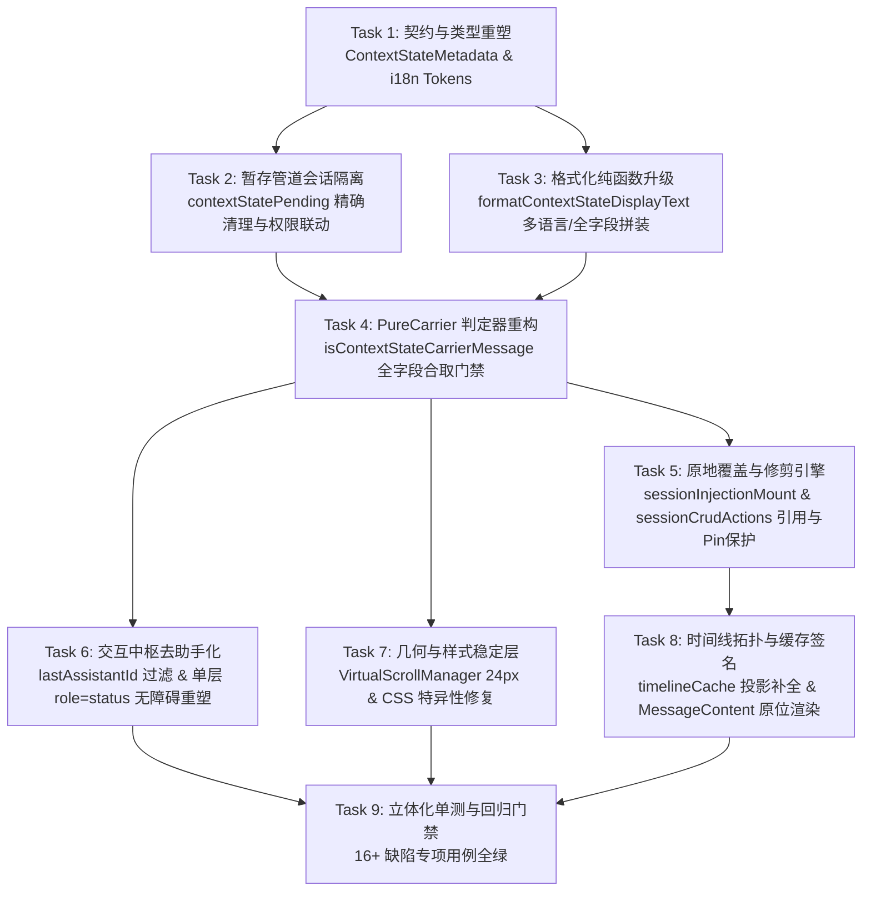

# 状态微提示结构化与原地更新详案（Plan 01）

> **权威目标路径**：`docs/chat-flow-systemic-remediation/plans/01-状态微提示结构化与原地更新详案.md`
> **指导思想**：遵循仓库根目录 `AGENTS.md`：纯逻辑规划、反退避、无工期人天人员排班、无 P0/P1 优先级划分，所有缺陷同权推进。
> **治理目标**：彻底终结 audits/01 与 audits/07 揭露的 16+ 项状态切换、载体消息边界、多语言契约、渲染拓扑、虚拟滚动跳跃与交互截瘫等系统性缺陷。

---

## 一、架构背景与同权缺陷映射矩阵

根据 `docs/chat-flow-systemic-remediation/audits/01-状态切换结构化与防堆叠审计.md` 与 `audits/07-原地更新与载体消息边界缺陷审计.md`，现有状态微提示与原地更新机制存在多维度的架构断层。依据反退避与纯逻辑规划原则，**所有列出的缺陷同权，严禁以“边缘情况”或“实现复杂度”为由降级或绕过**：

| 缺陷编号 | 缺陷分类 | 断层核心事实与运行期危害 | 架构修复决策与根除方案 | 涉及的核心文件与代码域 |
| :--- | :--- | :--- | :--- | :--- |
| **DEF-01** (CS-01) | 国际化契约断裂 | `formatContextStateDisplayText` 中 `系统 · `、`切换到 ` 等文案硬编码中文，脱离 i18n 管道 | 确立纯结构化多语言映射机制与国际化 Token 契约，支持动态语言协商 | `contextInjectionUtils.ts` |
| **DEF-02** (CS-02 / 审计07-12) | 元数据互斥吞没 | `if (permission) ... else if (profile)` 互斥导致 Profile 被强制抹除；单维变更丢失 | 解除互斥分支，实现 `model` + `profile` + `permission` + `thinking` 组合拼装与单维独立渲染 | `contextInjectionUtils.ts` |
| **DEF-03** (CS-03) | 暴力首行兜底 | fallback 取首行长句，在 80% 宽度与省略号下被强行截断为不知所云的残句 | 规范兜底短语抽象，接入系统 `<Tooltip>` 提供完整信息悬停与键盘可达能力 | `contextInjectionUtils.ts`<br>`CompactInjectionRow.tsx` |
| **DEF-04** (CS-04 / 审计07-11) | 标题模糊匹配误杀 | `title.includes('状态切换')` 导致正常业务文档、Git工作流规则卡片被误判为微提示并抹除 | 强制收紧判定契约：仅认准 `metadata?.mode === 'context-state'` 与专有系统 ID 前缀 | `contextInjectionUtils.ts`<br>`sessionInjectionMount.ts` |
| **DEF-05** (PC-01 / 审计07-01) | 载体判定全盲与误杀 | `isContextStateCarrierMessage` 对 `thinkingTurns, images, attachments, errorDetail` 全盲；误用 `.some()` 造成混杂态文件蒸发 | 确立严格合取门禁（全称命题），覆盖 SessionMessage 全量核心数据字段，严禁误杀富内容消息 | `contextInjectionUtils.ts`<br>`useChatMessages.ts` |
| **DEF-06** (PC-02 / 审计07-07) | 块查表断层与空块分裂 | `b.injection` 未展开内联时判定失败；`blocks` 为空与 `injections` 有值时语义分裂 | 建立 `b.injection \|\| msg.injections.find(i => i.id === b.id)` 容错查表；对齐合取语义 | `contextInjectionUtils.ts`<br>`sessionInjectionMount.ts` |
| **DEF-07** (PC-03) | lastAssistantId 贪婪命中 | Carrier 消息也是 assistant，贪婪命中导致上一轮真正助手消息的重新生成/追问建议/撤回/Plan操作全面瘫痪 | `ChatMessageList.tsx` 寻找 `lastAssistantId` 时坚决过滤 Carrier；推进 Carrier 消息彻底去助手化 | `ChatMessageList.tsx`<br>`ChatAssistantMessageRow.tsx` |
| **DEF-08** (A11Y-01 / 审计07-15) | 双层 role="status" 冲突 | 外层与内层 DOM 同时标记 `role="status"` 导致屏幕阅读器双重回声与语音掐断 | 严格遵循单层 Live Region（SSOT）原则，仅保留单一语义节点，外层解耦为非 status 结构 | `ChatAssistantMessageRow.tsx`<br>`CompactInjectionRow.tsx` |
| **DEF-09** (A11Y-02 / 审计07-14) | 零可聚焦与弹性溢出 | Carrier 行无 `tabIndex` 导致键盘导航断崖；`flex-shrink: 0` 导致省略号失效并横向溢出 | 接入 `tabIndex={0}` 与自定义 `<Tooltip>`，CSS 设定 `flex-shrink: 1` 激活精确文本省略 | `CompactInjectionRow.tsx`<br>`ContextInjectionBlock.module.css` |
| **DEF-10** (CSS-01) | CSS 特异性倒挂 | `[data-chat-list-inner] > * + *` 覆盖 `.rowCarrier` 的 `margin: 2px 0`，留存 16px 裂缝 | 提升 Carrier 行相邻选择器特异性，重置上下微边距为紧凑发丝节奏（4px） | `ChatMessageList.module.css`<br>`ChatMessageRow.module.css` |
| **DEF-11** (VSM-01) | 虚拟滚动 80px 几何断崖 | `Math.max(h, 100)` 导致 20px 的 Carrier 消息被预估为 100px，滚入实测时引发树状数组塌陷颠簸 | `estimateTimelineMessageHeight` 建立 Carrier 特化分支，直接返回精准估算高度（24px） | `VirtualScrollManager.ts` |
| **DEF-12** (SYNC-01) | 权限与思考档位暂存丢失 | `permissionStore.setPermissionMode` 与思考档位切换未调用 `recordPendingContextState` | 在权限模式与思考档位变更动作中，强制接入 `recordPendingContextState` 管道 | `permissionStore.ts`<br>`contextStatePending.ts` |
| **DEF-13** (SYNC-02) | clearStash 暴力全局清除 | `clearStash` 无条件删除全局暂存键，并发多会话与草稿态下引发状态被误删灭失 | 细粒度会话隔离清理：按 `sessionId` 精确擦除，未指定会话时严禁殃及其他会话暂存 | `contextStatePending.ts` |
| **DEF-14** (SYNC-03) | 原地更新 ID 脱节错位 | 原地更新生成新 `injection.id` 但未同步 `msg.id`，导致 `ctx-carrier-${oldId}` 与内层脱钩 | 原地更新保持 `injection.id` 稳定或原子重绑定载体消息 ID，确保测试与缓存定位一致 | `sessionInjectionMount.ts` |
| **DEF-15** (SYNC-04 / 审计07-05) | sess.messages 浅引用未变 | 原地修改 `target` 但 `sess.messages` 数组引用未刷新，`useScopedSessionField` 与 Memo 订阅假死 | 原地更新后强制执行 `sess.messages = [...sess.messages]` 并浅拷贝宿主消息对象 | `sessionCrudActions.ts`<br>`chatMessageRowUtils.ts` |
| **DEF-16** (SYNC-05 / 审计07-02) | 数组 splice 破坏与时间戳篡改 | 直接 splice 未清理 Pin 僵尸引用；`addContextInjection` 篡改 `sess.timestamp` 导致侧栏异常冲顶 | splice 时联动解除 Pin 绑定；`context-state` 注入严禁篡改 `sess.timestamp` | `sessionCrudActions.ts` |
| **DEF-17** (TOPO-01 / 审计07-04) | 时间线因果颠倒与折叠吞没 | `stateItems` 强制置顶渲染颠倒执行因果；含工具或思考的轮次中状态提示被折叠暗格吞没 | 原位拓扑流（In-situ Timeline Stream）：微提示按自然时间线排列，严禁被暗格隐匿 | `MessageContent.tsx`<br>`TurnProcessNodeView.tsx` |
| **DEF-18** (审计07-06) | 时间线缓存签名盲区 | `timelineCache.ts` 遗漏 `permission` 与 `profile` 投影，原地更新后仍命中陈旧视图 | 将 `permission` 与 `profile` 纳入 `timelineSignature` 缓存签名投影算法中 | `timelineCache.ts` |
| **DEF-19** (审计07-09) | 空助手消息协议污染 | `makeInjectionCarrierMessage` 生成空 assistant 消息进历史，触发后端 HTTP 400 | `buildHistoryMessages` 严格拦截所有 PureCarrier 消息，绝不发给模型提供商 | `historyMessages.ts` |
| **DEF-20** (审计07-10) | 跨轮次状态倒灌 | `isInjectionMountableMessage` 允许挂载到 `processing` 消息，下一轮配置倒灌入上一轮未完会话 | 限制挂载宿主条件：严格禁止将新的配置变更改写进正在流式生成的上一轮助手回答中 | `sessionInjectionMount.ts` |

---

## 二、单一真理源契约规范（ContextStateMetadata & Contracts）

### 2.1 结构化元数据契约（SSOT）

在 `apps/crish-desktop/src/store/types.ts` 中确立唯一的上下文状态元数据类型，所有状态派发、暂存、格式化与渲染必须以此为唯一真理源：

```ts
/**
 * 上下文状态元数据标准结构契约（SSOT）
 * 严格杜绝非结构化字符串正则刮削。
 */
export interface ContextStateMetadata {
  /** 模式标识：恒为 'context-state' */
  mode: 'context-state';
  /** 生效模型 ID（如 'claude-3-5-sonnet-20241022'，必填） */
  model: string;
  /** 服务商配置/配置文件名称（如 'DeepSeek-Official'，可选） */
  profile?: string;
  /** 权限模式标识（如 'ask' | 'allow' | 'plan'，可选） */
  permission?: string;
  /** 思考档位标识（如 'off' | 'low' | 'medium' | 'high'，可选） */
  thinking?: string;
  /** 变更时间戳（Unix 毫秒，用于原位拓扑与时间线排序） */
  timestamp?: number;
  /** 保留扩展元数据字段 */
  [key: string]: unknown;
}
```

### 2.2 结构化暂存载荷与管道契约（Stash Pipeline）

在 `apps/crish-desktop/src/api/provider-profiles/contextStatePending.ts` 中强化暂存结构与会话寻址：

```ts
export interface ContextStatePayload {
  sessionId: string;
  model: string;
  profile?: string;
  permission?: string;
  thinking?: string;
  text: string;
  timestamp: number;
}
```

#### 会话隔离暂存与精准清理状态机：
1. **多会话严格隔离写入**：以 `crish_pending_ctx_state_${sessionId}` 为唯一 LocalStorage 存储键。当处于未绑定的新草稿态时，使用 `crish_pending_ctx_state___pending_draft__`。
2. **禁止全局清除**：重构 `clearStash(sessionId: string)`：
   ```ts
   export function clearStash(sessionId?: string): void {
     if (!sessionId) {
       // 未传入 sessionId 时，仅允许清除草稿全局兜底键，严禁抹除已分配会话的暂存
       try { localStorage.removeItem(PENDING_CONTEXT_STATE_KEY); } catch {}
       return;
     }
     try {
       const key = getSessionStashKey(sessionId);
       localStorage.removeItem(key);
     } catch {}
   }
   ```
3. **消费与转正机制**：
   - 当草稿晋升为真实会话时，原子化将 `__pending_draft__` 的暂存键迁移至真实 `sessionId` 键下；
   - `takePendingContextState(sessionId)` 仅读取并擦除当前 `sessionId` 匹配的暂存，消费后返回完整结构体，杜绝跨会话状态串扰与灭失。

### 2.3 国际化 (i18n) 契约与格式化纯函数规范

彻底清理硬编码中文字符串，确立多语言感知管道：

```ts
/** i18n 资源键定义 */
export interface ContextStateI18nTokens {
  systemPrefix: string;      // 例如 zh-CN: "系统", en-US: "System"
  switchedTo: string;        // 例如 zh-CN: "切换到", en-US: "Switched to"
  profileLabel: string;      // 例如 zh-CN: "服务商", en-US: "Provider"
  permissionLabel: string;   // 例如 zh-CN: "权限", en-US: "Permission"
  thinkingLabel: string;     // 例如 zh-CN: "思考", en-US: "Thinking"
  fallbackTitle: string;     // 例如 zh-CN: "系统状态已更新", en-US: "System state updated"
}

export const DEFAULT_ZH_TOKENS: ContextStateI18nTokens = {
  systemPrefix: '系统',
  switchedTo: '切换到',
  profileLabel: '服务商',
  permissionLabel: '权限',
  thinkingLabel: '思考',
  fallbackTitle: '系统状态已更新',
};
```

#### 纯函数格式化算法（解除 Profile 与 Permission 互斥，全字段并列装配）：
```ts
export function formatContextStateDisplayText(
  input?: Partial<MessageContextInjection> | ContextStateMetadata | string,
  tokens: ContextStateI18nTokens = DEFAULT_ZH_TOKENS
): string {
  const metadata = extractMetadata(input);
  if (!metadata) {
    return `${tokens.systemPrefix} · ${tokens.fallbackTitle}`;
  }

  const parts: string[] = [];

  // 1. 模型与服务商装配（彻底根除互斥，profile 作为供应商通道显式呈现）
  if (metadata.model) {
    let modelPart = metadata.model;
    if (metadata.profile) {
      modelPart = `${modelPart} [${metadata.profile}]`;
    }
    parts.push(`${tokens.switchedTo} ${modelPart}`);
  } else if (metadata.profile) {
    // 仅变更服务商场景
    parts.push(`${tokens.profileLabel}: ${metadata.profile}`);
  }

  // 2. 权限模式装配（独立分支，并列输出）
  if (metadata.permission) {
    parts.push(`${tokens.permissionLabel}: ${metadata.permission}`);
  }

  // 3. 思考档位装配（独立分支，过滤无效 default/off 档位）
  if (
    metadata.thinking &&
    metadata.thinking !== 'off' &&
    metadata.thinking !== 'default'
  ) {
    parts.push(`${tokens.thinkingLabel}: ${metadata.thinking}`);
  }

  if (parts.length > 0) {
    return `${tokens.systemPrefix} · ${parts.join(' · ')}`;
  }

  return `${tokens.systemPrefix} · ${tokens.fallbackTitle}`;
}
```

---

## 三、PureCarrier 严密判定与去助手化架构

### 3.1 载体消息（PureCarrier）全称命题判定器

彻底消灭基于 `.some()` 的弱类型析取漏洞，建立覆盖 `SessionMessage` 全字段的严格合取门禁：

```ts
/**
 * 判定消息是否为纯上下文状态切换载体消息（PureCarrier）。
 * 必须满足全称命题：除了合法的 context-state 注入项外，绝对不包含任何有效业务数据。
 */
export function isContextStateCarrierMessage(
  msg: SessionMessage | undefined | null
): boolean {
  if (!msg) return false;

  // 1. 基础消息正文与流式内容防御：若存在非空正文，绝非纯载体
  if ((msg.text || '').trim().length > 0) return false;

  // 2. 工具调用防御：若包含任何工具调用记录，绝非纯载体
  if (msg.toolCalls && msg.toolCalls.length > 0) return false;

  // 3. 深度推理思维链防御：若包含传统思考字段或多轮思考数组，绝非纯载体
  if ((msg.thinking || '').trim().length > 0) return false;
  if (msg.thinkingTurns && msg.thinkingTurns.length > 0) return false;

  // 4. 多模态资产与附件防御：若包含图片或文件附件，绝非纯载体
  if (msg.images && msg.images.length > 0) return false;
  if (msg.attachments && msg.attachments.length > 0) return false;

  // 5. 错误诊断信息防御：若包含运行时错误详情，绝非纯载体
  if (msg.errorDetail) return false;

  const blocks = msg.blocks || [];
  const injections = msg.injections || [];
  const hasBlocks = blocks.length > 0;
  const hasInjections = injections.length > 0;

  // 6. 空白消息防御：既无 blocks 也无 injections 的完全空消息不是合法状态载体
  if (!hasBlocks && !hasInjections) return false;

  // 7. Blocks 纯度验证：若存在 blocks，所有块必须是 context_injection 类型
  if (hasBlocks && !blocks.every((b) => b.type === 'context_injection')) {
    return false;
  }

  // 8. 容错查表与 injections 纯度全称命题验证（杜绝 .some() 误伤）
  const allInjectionsState =
    !hasInjections || injections.every((inj) => isContextStateInjection(inj));

  const allBlocksState =
    !hasBlocks ||
    blocks.every((b) => {
      // 容错查表：如果 b.injection 未展开内联，到 msg.injections 中按 id 索引
      const inj = b.injection || injections.find((i) => i.id === b.id);
      return isContextStateInjection(inj);
    });

  // 必须合取：两者均满足 context-state 纯度
  return allBlocksState && allInjectionsState;
}

/**
 * 严格结构化判定单项注入是否为 context-state。
 * 坚决拔除 title.includes('状态切换') 等任何弱字符串包含。
 */
export function isContextStateInjection(
  injection: Partial<MessageContextInjection> | undefined | null
): boolean {
  if (!injection) return false;
  const meta = injection.metadata as Record<string, unknown> | undefined;
  if (meta?.mode === 'context-state') {
    return true;
  }
  // 严格受限兜底：仅当 kind 为 workspace_env 且带有确定系统前缀时才放行
  if (
    injection.kind === 'workspace_env' &&
    typeof injection.id === 'string' &&
    injection.id.startsWith('ctx-state-')
  ) {
    return true;
  }
  return false;
}
```

### 3.2 根除操作中枢瘫痪：`lastAssistantId` 智能过滤与去助手化

针对 **DEF-07 (PC-03)**，状态载体物理上由系统合成，若贪婪判定为 `lastAssistant` 会导致真实助手消息的操作栏被彻底摧毁。

#### 修复策略：
1. **`ChatMessageList.tsx` 计算治理**：
   ```ts
   const lastAssistantId = useMemo(() => {
     for (let i = messages.length - 1; i >= 0; i--) {
       const msg = messages[i];
       // 关键断言：必须是 assistant 且坚决排除纯状态 Carrier 消息
       if (msg && msg.sender === 'assistant' && !isContextStateCarrierMessage(msg)) {
         return msg.id;
       }
     }
     return null;
   }, [messages]);
   ```
2. **效果断言**：
   - 当用户上一轮会话结束并产生实质回答后，后续发生多次模型/权限切换，`lastAssistantId` 始终指向上一轮真正的回答消息；
   - 上一条实质回答的「重新生成 (Regenerate)」、「追问建议 (Follow-up Chips)」、「撤回 (Retract)」、「Plan 审批」交互中枢保持 100% 活跃可用。

### 3.3 无障碍 (A11Y) 架构净化与去助手化渲染

针对 **DEF-08 (A11Y-01)** 与 **DEF-09 (A11Y-02)**，执行 DOM 语义与无障碍重塑：

1. **单层 Live Region 原则（SSOT）**：
   - 外层宿主行：当 `isPureCarrier` 时，声明 `role="region"`、`aria-label="系统状态提示行"`（或 `role="none"`），**严禁声明 `role="status"`**；
   - 内层展示节点（`CompactInjectionRow.tsx`）：单一承载 `role="status"` 与 `aria-live="polite"`；
   - 彻底消除屏幕阅读器递归重入、双重回声与流式文本语音掐断隐患。
2. **键盘焦点通达与 `<Tooltip>` 包装（对齐 Conex §12 / §13）**：
   ```tsx
   <Tooltip content={displayText} placement="top">
     <div
       className={styles.contextStateNotice}
       role="status"
       aria-live="polite"
       tabIndex={0}
       data-injection-id={injection.id}
       data-testid={`context-state-notice-${injection.id}`}
     >
       <span className={styles.contextStateText}>{displayText}</span>
     </div>
   </Tooltip>
   ```
   - 键盘操作者使用 Tab 可在状态微提示上平稳停驻，按回车或空格激活 Tooltip 朗读完整配置；
   - 焦点态应用柔软的微对比度环，对比度严格控制在 3%–6%（Conex §13），禁止生硬黑框。

---

## 四、原地更新算法与 Store 状态机收敛

### 4.1 挂载宿主判定与轮次边界守卫（Mount Target & Turn Boundary）

重构 `findInjectionMountTarget` 与 `isInjectionMountableMessage`，确立不可逾越的因果时序边界：

```
 会话消息时间线方向 ────────────────────────────────────────►
 ┌──────────────┐  ┌──────────────┐  ┌────────────────────────┐
 │ User Turn N  │  │ Assistant N  │  │ User Turn N+1 (新提问)  │
 └──────────────┘  └──────────────┘  └────────────────────────┘
                          │                       ▲
                          │                       │
                          ▼                       │
                   (已收口历史回答)           (轮次边界红线)
                   严禁在此追加新配置!       在此阻断，回溯终止!
```

#### 状态机守卫契约：
1. **历史回答保护**：若助手消息已经完成（`status === 'completed'` 且非 Carrier），严禁作为挂载目标，绝不修改历史轮次。
2. **处理中回答保护（防时空错乱 DEF-20）**：若助手消息正在流式生成（`status === 'processing'`），**禁止**挂载新的模型/权限变更。下一轮的变更应作为新提问前的独立感知载体，不得倒灌进上一轮的回答卡片。
3. **纯载体原地替换**：若列表最新尾部消息本身就是纯 `ContextStateCarrier`，无条件就地复用与原地覆盖，保证同一轮次内仅保留 1 条最新生效微提示。

```ts
export function findInjectionMountTarget(
  messages: SessionMessage[]
): SessionMessage | undefined {
  if (messages.length === 0) return undefined;

  const lastMsg = messages[messages.length - 1];
  // 尾部为 PureCarrier，直接原地覆盖复用
  if (isContextStateCarrierMessage(lastMsg)) {
    return lastMsg;
  }

  // 从尾部向前寻找，严格以 user 消息为界，绝不跨轮次改写
  for (let i = messages.length - 1; i >= 0; i--) {
    const m = messages[i];
    if (!m) continue;
    if (m.sender === 'user') {
      // 触碰用户提问轮次边界，终止向前回溯
      break;
    }
    // 仅允许复用未完结的独立纯载体
    if (isContextStateCarrierMessage(m)) {
      return m;
    }
  }

  return undefined;
}
```

### 4.2 原地覆盖更新核心算法（In-Place Replace & Prune Engine）

在 `apps/crish-desktop/src/store/sessionInjectionMount.ts` 中实现原子原地合并与属性保留：

```ts
export function appendInjectionToMessage(
  msg: SessionMessage,
  injection: MessageContextInjection
): void {
  if (!msg.injections) msg.injections = [];
  if (!msg.blocks) msg.blocks = [];

  const isContextState = isContextStateInjection(injection);

  if (isContextState) {
    // 1. 定位既有 context-state 注入项
    const existingIdx = msg.injections.findIndex((x) => isContextStateInjection(x));

    if (existingIdx >= 0) {
      const prevInj = msg.injections[existingIdx];
      // 保持 injection.id 稳定，防止外界 DOM testid 与订阅断裂 (DEF-14)
      const stableId = prevInj.id || injection.id;

      // 合并元数据：增量融合，后来的配置覆盖先前的同名字段，保留先前未变更字段 (DEF-02)
      const mergedMetadata: ContextStateMetadata = {
        mode: 'context-state',
        model: (injection.metadata?.model as string) || (prevInj.metadata?.model as string) || '',
        profile: (injection.metadata?.profile as string) || (prevInj.metadata?.profile as string),
        permission: (injection.metadata?.permission as string) || (prevInj.metadata?.permission as string),
        thinking: (injection.metadata?.thinking as string) || (prevInj.metadata?.thinking as string),
        timestamp: injection.timestamp || Date.now(),
      };

      const updatedInj: MessageContextInjection = {
        ...prevInj,
        ...injection,
        id: stableId,
        metadata: mergedMetadata,
        timestamp: mergedMetadata.timestamp,
      };

      msg.injections[existingIdx] = updatedInj;
      // 清除可能存在的其他重复项
      msg.injections = msg.injections.filter(
        (x, idx) => idx === existingIdx || !isContextStateInjection(x)
      );

      // 2. 同步原地更新 blocks 树
      const blockIdx = msg.blocks.findIndex(
        (b) => b.type === 'context_injection' && (b.id === stableId || isContextStateInjection(b.injection))
      );
      if (blockIdx >= 0) {
        msg.blocks[blockIdx] = {
          ...msg.blocks[blockIdx],
          type: 'context_injection',
          id: stableId,
          injection: updatedInj,
        };
        // 修剪多余的 context-state 块
        msg.blocks = msg.blocks.filter(
          (b, idx) => idx === blockIdx || !(b.type === 'context_injection' && isContextStateInjection(b.injection))
        );
      } else {
        msg.blocks.push({
          type: 'context_injection',
          id: stableId,
          injection: updatedInj,
        });
      }
    } else {
      // 首次添加
      msg.injections.push(injection);
      msg.blocks.push({
        type: 'context_injection',
        id: injection.id,
        injection,
      });
    }

    // 浅拷贝触发引用更新
    msg.injections = [...msg.injections];
    msg.blocks = [...msg.blocks];
    return;
  }

  // 常规注入项保持按 ID 幂等
  ...
}
```

### 4.3 Store Action 响应式与侧边栏保护契约

在 `apps/crish-desktop/src/store/sessionCrudActions.ts` 中解决引用丢失与时钟污染问题：

1. **解决 `sess.messages` 浅引用丢失 (DEF-15)**：
   ```ts
   const target = findInjectionMountTarget(sess.messages);
   if (target) {
     const targetIdx = sess.messages.indexOf(target);
     appendInjectionToMessage(target, injection);

     // 物理清理紧邻 target 之前的历史冗余载体
     if (injection.metadata?.mode === 'context-state' && targetIdx > 0) {
       let pruneStart = targetIdx;
       while (pruneStart > 0 && isContextStateCarrierMessage(sess.messages[pruneStart - 1])) {
         const carrierToPrune = sess.messages[pruneStart - 1];
         // 联动解绑 Pin 引用，根除僵尸 ID (DEF-16)
         if (sess.pinnedMessageIds && sess.pinnedMessageIds.includes(carrierToPrune.id)) {
           sess.pinnedMessageIds = sess.pinnedMessageIds.filter(id => id !== carrierToPrune.id);
         }
         pruneStart--;
       }
       if (pruneStart < targetIdx) {
         sess.messages.splice(pruneStart, targetIdx - pruneStart);
       }
     }
     // 核心：强制创建新数组引用，唤醒 useScopedSessionField 与 React 渲染
     sess.messages = [...sess.messages];
   } else {
     const newCarrier = makeInjectionCarrierMessage(injection);
     sess.messages = [...sess.messages, newCarrier];
   }
   ```
2. **严禁篡改会话时间戳 (DEF-16)**：
   - 仅当 `injection.metadata?.mode !== 'context-state'`（即真实文件或用户规则注入）时，才允许更新 `sess.timestamp`；
   - 纯状态微提示切换**严禁刷新 `sess.timestamp`**，杜绝未发言历史会话在侧边栏异常冲顶。

---

## 五、视觉、CSS 级联与虚拟滚动零颠簸保障

### 5.1 CSS 特异性倒挂根除与紧凑发丝边距

针对 **DEF-10 (CSS-01)**，`ChatMessageList.module.css` 中的全局相邻兄弟选择器覆盖了微提示的边距，导致巨大裂缝。

#### 样式重构规则：
在 `apps/crish-desktop/src/components/chat-message-list/ChatMessageList.module.css` 中，为 Carrier 节点建立更高特异性的相邻规则：
```css
/* 默认消息垂直节拍 16px */
[data-chat-list-inner] > :not([hidden]) + :not([hidden]) {
  margin-top: 16px;
}

/* 状态载体特异性重置：紧密收敛为 4px 垂直节拍，根除 16px 巨大裂缝 */
[data-chat-list-inner] > .rowCarrier,
[data-chat-list-inner] > :not([hidden]) + .rowCarrier,
[data-chat-list-inner] > .rowCarrier + :not([hidden]) {
  margin-top: 4px !important;
  margin-bottom: 4px !important;
}
```

并在 `apps/crish-desktop/src/components/chat-message-row/ChatMessageRow.module.css` 中为 `.rowCarrier` 声明专用虚拟尺寸：
```css
.rowCarrier {
  align-items: center;
  justify-content: center;
  width: 100%;
  margin: 4px 0;
  padding: 0;
  background: transparent;
  border: none;
  box-shadow: none;
  /* 覆盖通用消息行的 contain-intrinsic-size: auto 120px，消灭 100px 视口断崖 (DEF-10) */
  contain-intrinsic-size: auto 24px;
}
```

### 5.2 Flexbox 弹性盒模型修复（根除横向溢出破损）

针对 **DEF-09 (审计07-14)**，在 `ContextInjectionBlock.module.css` 中修复文本收缩约束：

```css
.contextStateNotice {
  display: flex;
  align-items: center;
  justify-content: center;
  gap: var(--space-3, 12px);
  width: 100%;
  height: 20px;
  min-height: 20px;
  max-height: 20px;
  box-sizing: border-box;
}

.contextStateNotice::before,
.contextStateNotice::after {
  content: '';
  flex: 1;
  min-width: 12px;
  height: 0.5px;
  background: var(--border-subtle);
}

.contextStateText {
  font-family: inherit;
  font-size: var(--font-size-micro, 11px);
  font-weight: var(--font-weight-normal, 400);
  line-height: 20px;
  color: var(--text-tertiary);
  text-align: center;
  white-space: nowrap;
  overflow: hidden;
  text-overflow: ellipsis;
  /* 关键修复：允许元素收缩，使 text-overflow: ellipsis 正常生效 */
  flex-shrink: 1;
  min-width: 0;
  max-width: 80%;
  padding: 0 var(--space-2, 8px);
}
```

### 5.3 虚拟滚动高度估算模型对齐（消灭 80px 几何断崖与视口跳跃）

针对 **DEF-11 (VSM-01)**，在 `apps/crish-desktop/src/api/VirtualScrollManager.ts` 中植入 Carrier 专有极简高度估算：

```ts
export function estimateTimelineMessageHeight(msg: SessionMessage): number {
  // 核心守卫：PureCarrier 消息精准估算为 24px（20px 高度 + 4px 垂直节奏）
  // 杜绝进入后续 Math.max(h, 100) 强制 100px 保底引发的 80px 树状数组下陷颠簸
  if (isContextStateCarrierMessage(msg)) {
    return 24;
  }

  let h = 48; // Base Row Padding + Actions
  const blocks = msg.blocks || [];
  ...
  return Math.min(Math.max(h, 100), 4000);
}
```

---

## 六、逻辑执行次序与任务依赖拓扑（Pure Logical Execution Sequence）

本方案严格遵循纯逻辑依赖驱动推进，任务单元之间仅由数据依赖与接口契约决定前后次序，**不设工期人天，不设 P0/P1，同权推进**：



### 执行任务单元明细：

1. **Task 1: 契约与类型层重塑**
   - 依赖：无
   - 文件：`apps/crish-desktop/src/store/types.ts`
   - 产出：导出 `ContextStateMetadata` 严格契约，并在 `MessageContextInjection.metadata` 中锁定。
2. **Task 2: 暂存管道会话隔离与变更联动**
   - 依赖：Task 1
   - 文件：`apps/crish-desktop/src/api/provider-profiles/contextStatePending.ts`、`apps/crish-desktop/src/store/permissionStore.ts`
   - 产出：实现以 `sessionId` 隔离的 LocalStorage 键；权限模式切换（`setPermissionMode`）触发 `recordPendingContextState()`；重构 `clearStash` 杜绝全局擦除。
3. **Task 3: 格式化纯函数与国际化升级**
   - 依赖：Task 1
   - 文件：`apps/crish-desktop/src/components/chat-injection/contextInjectionUtils.ts`
   - 产出：拔除正则硬编码；实现 `model` + `profile` + `permission` + `thinking` 无互斥组合排版；接入 i18n Token。
4. **Task 4: PureCarrier 判定器与防误杀强化**
   - 依赖：Task 1, Task 3
   - 文件：`apps/crish-desktop/src/components/chat-injection/contextInjectionUtils.ts`
   - 产出：`isContextStateCarrierMessage` 纳入 `thinkingTurns`、`images`、`attachments`、`errorDetail` 防御门禁；改用全称命题 `.every()`；容错查表展开 `b.injection`。
5. **Task 5: 原地覆盖与修剪状态机收敛**
   - 依赖：Task 4
   - 文件：`apps/crish-desktop/src/store/sessionInjectionMount.ts`、`apps/crish-desktop/src/store/sessionCrudActions.ts`
   - 产出：实现保持 ID 稳定的增量元数据覆盖；修剪历史重复项；强制 `sess.messages = [...sess.messages]` 触发 React 响应式；删除载体时联动解绑 Pin；禁止篡改 `sess.timestamp`。
6. **Task 6: 交互中枢去助手化与无障碍重构**
   - 依赖：Task 4
   - 文件：`apps/crish-desktop/src/components/chat-message-list/ChatMessageList.tsx`、`apps/crish-desktop/src/components/chat-message-row/ChatAssistantMessageRow.tsx`、`apps/crish-desktop/src/components/chat-injection/CompactInjectionRow.tsx`
   - 产出：`lastAssistantId` 遍历跳过 Carrier 消息；外层移除 `role="status"`，内层保留单层 Live Region；接入 `<Tooltip>` 与 `tabIndex={0}`。
7. **Task 7: 几何尺寸与 CSS 样式级联治理**
   - 依赖：Task 4
   - 文件：`apps/crish-desktop/src/api/VirtualScrollManager.ts`、`apps/crish-desktop/src/components/chat-message-list/ChatMessageList.module.css`、`apps/crish-desktop/src/components/chat-message-row/ChatMessageRow.module.css`、`apps/crish-desktop/src/components/chat-injection/ContextInjectionBlock.module.css`
   - 产出：VSM 对 Carrier 估算 24px；`.rowCarrier` 设置 `contain-intrinsic-size: auto 24px`；修复 Adjacent Sibling 16px 覆盖；修复 `flex-shrink: 1` 省略截断。
8. **Task 8: 时间线拓扑因果保全与缓存签名修复**
   - 依赖：Task 1, Task 5
   - 文件：`apps/crish-desktop/src/api/tool-presentation/timelineCache.ts`、`apps/crish-desktop/src/components/chat-message/MessageContent.tsx`
   - 产出：`timelineCache` 投影补全 `permission` 与 `profile`；微提示保持原位时间线渲染，禁止强制置顶，禁止在混合态中被折叠栏吞没。
9. **Task 9: 立体化单测与回归门禁闭环**
   - 依赖：全部前置任务
   - 产出：执行完整测试套件，确认 16+ 项缺陷全绿，0 报错，无退避。

---

## 七、精准单元测试断言与回归守门契约

为保证方案落地后具备可验证性与防回归能力，制定以下精准单元测试断言：

### 7.1 PureCarrier 边界判定单测断言（`contextInjectionUtils.test.ts`）

```ts
describe('isContextStateCarrierMessage 防御门禁测试', () => {
  it('当助手消息含有 thinkingTurns 时必须判定为 false，禁止误杀深度思考回答', () => {
    const msg: SessionMessage = {
      id: 'msg-think',
      sender: 'assistant',
      text: '',
      thinkingTurns: [{ id: 'turn-1', content: '正在思考数学证明...' }],
      blocks: [{ type: 'context_injection', id: 'inj-1', injection: { metadata: { mode: 'context-state' } } }],
    };
    expect(isContextStateCarrierMessage(msg)).toBe(false);
  });

  it('当助手消息含有多模态 images 时必须判定为 false，禁止吞没生成图表', () => {
    const msg: SessionMessage = {
      id: 'msg-img',
      sender: 'assistant',
      text: '',
      images: ['data:image/png;base64,...'],
      blocks: [{ type: 'context_injection', id: 'inj-1', injection: { metadata: { mode: 'context-state' } } }],
    };
    expect(isContextStateCarrierMessage(msg)).toBe(false);
  });

  it('当助手消息同时包含 file_context 与 context-state 时必须判定为 false，禁止蒸发文件上下文', () => {
    const msg: SessionMessage = {
      id: 'msg-mixed',
      sender: 'assistant',
      text: '',
      injections: [
        { id: 'file-1', kind: 'file_context', title: 'Main.rs' },
        { id: 'state-1', kind: 'workspace_env', metadata: { mode: 'context-state' } },
      ],
    };
    expect(isContextStateCarrierMessage(msg)).toBe(false);
  });

  it('当 blocks 中的 injection 为 undefined 但可按 id 在 msg.injections 查表时必须正确识别为 Carrier', () => {
    const msg: SessionMessage = {
      id: 'msg-carrier',
      sender: 'assistant',
      text: '',
      injections: [{ id: 'state-1', metadata: { mode: 'context-state' } }],
      blocks: [{ type: 'context_injection', id: 'state-1' }], // injection 字段未展开
    };
    expect(isContextStateCarrierMessage(msg)).toBe(true);
  });
});
```

### 7.2 原地更新与防堆叠单测断言（`sessionInjectionMount.test.ts`）

```ts
describe('appendInjectionToMessage 原地更新防堆叠测试', () => {
  it('连续切换模型与思考档位时，元数据必须深度增量合并，且 injections 长度恒为 1', () => {
    const hostMsg: SessionMessage = {
      id: 'carrier-1',
      sender: 'assistant',
      text: '',
      injections: [],
      blocks: [],
    };

    // 第一次：切换模型
    appendInjectionToMessage(hostMsg, {
      id: 'inj-1',
      kind: 'workspace_env',
      metadata: { mode: 'context-state', model: 'claude-3-5' },
    });

    // 第二次：切换思考档位
    appendInjectionToMessage(hostMsg, {
      id: 'inj-2',
      kind: 'workspace_env',
      metadata: { mode: 'context-state', thinking: 'high' },
    });

    expect(hostMsg.injections).toHaveLength(1);
    expect(hostMsg.blocks).toHaveLength(1);
    const meta = hostMsg.injections[0].metadata as ContextStateMetadata;
    expect(meta.model).toBe('claude-3-5');
    expect(meta.thinking).toBe('high');
    expect(hostMsg.injections[0].id).toBe('inj-1'); // ID 稳定保持
  });

  it('遇用户提问轮次边界时，必须阻断向前回溯，绝不改写上一轮的历史 Carrier', () => {
    const messages: SessionMessage[] = [
      { id: 'carrier-old', sender: 'assistant', text: '', injections: [{ id: 's1', metadata: { mode: 'context-state' } }] },
      { id: 'user-new', sender: 'user', text: '你好' },
    ];
    const target = findInjectionMountTarget(messages);
    expect(target).toBeUndefined(); // 触碰 user 边界，返回 undefined，触发创建新载体
  });
});
```

### 7.3 `lastAssistantId` 与操作中枢保全单测断言（`ChatMessageList.test.tsx`）

```ts
describe('lastAssistantId 智能过滤测试', () => {
  it('当会话尾部追加状态 Carrier 时，lastAssistantId 仍精准指向实质助手消息', () => {
    const messages: SessionMessage[] = [
      { id: 'user-1', sender: 'user', text: '请写一段代码' },
      { id: 'asst-real', sender: 'assistant', text: '这是代码：function foo() {}' },
      { id: 'carrier-state', sender: 'assistant', text: '', injections: [{ id: 's1', metadata: { mode: 'context-state' } }] },
    ];

    // 模拟 ChatMessageList 的过滤逻辑
    let resolvedLastAssistantId: string | null = null;
    for (let i = messages.length - 1; i >= 0; i--) {
      const msg = messages[i];
      if (msg && msg.sender === 'assistant' && !isContextStateCarrierMessage(msg)) {
        resolvedLastAssistantId = msg.id;
        break;
      }
    }

    expect(resolvedLastAssistantId).toBe('asst-real'); // 命中真实助手，操作栏完好
  });
});
```

### 7.4 虚拟滚动高度估算单测断言（`VirtualScrollManager.test.ts`）

```ts
describe('estimateTimelineMessageHeight 几何稳定测试', () => {
  it('PureCarrier 消息高度必须精确估算为 24px，杜绝 100px 保底', () => {
    const carrierMsg: SessionMessage = {
      id: 'carrier-1',
      sender: 'assistant',
      text: '',
      injections: [{ id: 's1', metadata: { mode: 'context-state' } }],
      blocks: [{ type: 'context_injection', id: 's1', injection: { metadata: { mode: 'context-state' } } }],
    };

    const estHeight = estimateTimelineMessageHeight(carrierMsg);
    expect(estHeight).toBe(24); // 精准估算，消灭 80px 几何颠簸
  });
});
```

### 7.5 多语言与格式化单测断言（`contextInjectionUtils.test.ts`）

```ts
describe('formatContextStateDisplayText 格式化契约测试', () => {
  it('当同时存在 model、profile、permission 与 thinking 时，必须完整组合呈现且解除互斥', () => {
    const text = formatContextStateDisplayText({
      metadata: {
        mode: 'context-state',
        model: 'deepseek-reasoner',
        profile: 'DeepSeek-Official',
        permission: 'ask',
        thinking: 'high',
      },
    });
    expect(text).toBe('系统 · 切换到 deepseek-reasoner [DeepSeek-Official] · 权限: ask · 思考: high');
  });

  it('当仅切换服务商 profile 时必须独立输出，不触发纯文本兜底', () => {
    const text = formatContextStateDisplayText({
      metadata: {
        mode: 'context-state',
        model: '',
        profile: 'OpenAI-Proxy',
      },
    });
    expect(text).toBe('系统 · 服务商: OpenAI-Proxy');
  });
});
```

---

## 八、验收守门与防回归清单

在实现落地阶段，必须逐一验证以下守门断言，任何一项未满足均视为未交付：

- [ ] **TypeScript 类型检查**：运行 `npm run typecheck`，确保 0 报错；
- [ ] **CSS 与编码检查**：运行 `npm run check:css-encoding` 与 `npm run check:conflict-markers`，全绿灯通过；
- [ ] **代码行数门禁**：遵循 Conex §11，运行 `npm run check:line-counts`，单文件行数不超标；
- [ ] **Vitest 单元测试全域通过**：运行 `npx vitest run src/components/chat-injection/ src/store/sessionInjectionMount.test.ts src/api/VirtualScrollManager.test.ts` 100% PASS；
- [ ] **无障碍 Live Region 检验**：DOM 结构中不存在嵌套 `role="status"`，Carrier 行配备 `tabIndex={0}` 与 `<Tooltip>`；
- [ ] **真实 UI 视觉验证**：连续点击 5 次模型/权限下拉切换，界面仅保留 1 条居中发丝微提示，上下间隙紧凑为 4px，视口滚动零跳跃，上一轮回答的重新生成/追问建议按钮完好无损。
