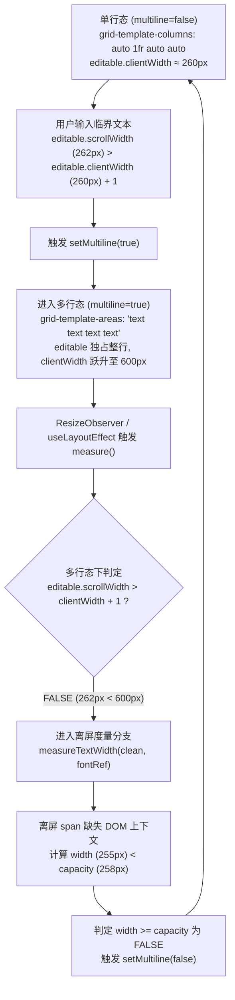

# 交互状态机与组件生命周期独立排查与修复方案

> **文件标识**：`docs/chat-ui-interaction-repair/independent-plans/02-interaction-inspector.md`  
> **角色职责**：交互状态机与组件生命周期专家（Interaction & Component Specialist）  
> **排查准则**：穿透表象直达架构根因，以真实源码（`apps/crish-desktop/src/`、`crates/`、`reference/`）为唯一依据，严禁打补丁与魔术数字。

---

## 目录

- [一、输入框（Composer）高频抖动与 144Hz 视觉重影问题](#一输入框composer高频抖动与-144hz-视觉重影问题)
  - [1.1 源码定位与现象还原](#11-源码定位与现象还原)
  - [1.2 深层根因推导（双稳态极限环振荡）](#12-深层根因推导双稳态极限环振荡)
  - [1.3 架构级修复方案设计](#13-架构级修复方案设计)
  - [1.4 状态机自愈与防振荡保障](#14-状态机自愈与防振荡保障)
- [二、聊天区域右侧 FlowScrubber 呈现粗大实心深灰方块问题](#二聊天区域右侧-flowscrubber-呈现粗大实心深灰方块问题)
  - [2.1 源码定位与参考设计比对](#21-源码定位与参考设计比对)
  - [2.2 深层根因推导（Flex-Grow 物理模型语义错位）](#22-深层根因推导flex-grow-物理模型语义错位)
  - [2.3 架构级修复方案设计](#23-架构级修复方案设计)
- [三、Markdown 代码块与目录树中无样式原生复制按钮压盖排版问题](#三markdown-代码块与目录树中无样式原生复制按钮压盖排版问题)
  - [3.1 源码定位与 DOM 结构解构](#31-源码定位与-dom-结构解构)
  - [3.2 深层根因推导（样式资产断层与流式渲染器脱节）](#32-深层根因推导样式资产断层与流式渲染器脱节)
  - [3.3 架构级修复方案设计](#33-架构级修复方案设计)
- [四、消息卡片按钮尺寸失调（_buttonGhost_... _buttonSm_...）与悬空突兀气泡问题](#四消息卡片按钮尺寸失调_buttonghost-_-buttonsm-_-与悬空突兀气泡问题)
  - [4.1 源码定位与特异性冲突剖析](#41-源码定位与特异性冲突剖析)
  - [4.2 深层根因推导（原子按钮与图标按钮的属性污染，及气泡脱节悬空）](#42-深层根因推导原子按钮与图标按钮的属性污染及气泡脱节悬空)
  - [4.3 架构级修复方案设计](#43-架构级修复方案设计)
- [五、交互生命周期与防回归验证断言矩阵](#五交互生命周期与防回归验证断言矩阵)

---

## 一、输入框（Composer）高频抖动与 144Hz 视觉重影问题

### 1.1 源码定位与现象还原

- **相关源码文件**：
  - `apps/crish-desktop/src/components/chat-composer/useComposerMultiline.ts:26-93`（多行判据状态机 Hook）
  - `apps/crish-desktop/src/components/chat-composer/ChatComposer.module.css:533-551`（网格布局切换规则）
  - `apps/crish-desktop/src/components/chat-composer/ChatComposer.module.css:603-627`（单行/多行高度与溢出控制）
  - `apps/crish-desktop/src/components/chat-composer/ChatComposer.tsx:307-311`（Hook 装配）

在特定文本输入长度（处于单行容量极限临界点）或者容器缩放临界宽度时，Composer 输入框在 144Hz 刷新率的显示器上表现为：**一个紧凑的单行胶囊框和一个展开的多行大卡片以极高的帧率交替切换**。由于人眼的视觉暂留以及 WebView2 渲染管线合成层在每一帧之间的快速翻转，呈现为一大一小同时重叠的“视觉重影（Visual Ghosting）”。

### 1.2 深层根因推导（双稳态极限环振荡）

通过对 `useComposerMultiline.ts` 与 `ChatComposer.module.css` 的控制流联合推导，发现了导致**无迟滞双稳态振荡（Hysteresis-free Bistable Oscillation）**的完整逻辑链条：



#### 根因关键断层：

1. **进入判据与退出判据的度量标尺分裂（Heterogeneous Metric Mismatch）**：
   - **进入多行**：依靠 DOM 实体的 `editable.scrollWidth > editable.clientWidth + 1`（`useComposerMultiline.ts:69`）。`editable` 内部受真实 CSS 样式（Tiptap/ProseMirror 的 padding、内联装饰、字间距等）影响，`scrollWidth` 为真实渲染宽度（例如 262px）。
   - **退出多行**：多行下 `scrollWidth < clientWidth`（因为整行宽度扩展到了 600px），代码直接降级走到 `measureTextWidth(clean, fontRef.current)`（`useComposerMultiline.ts:80`）。该函数通过在 `document.body` 挂载一个离屏 `<span>`（行 10-24）度量纯字符串，缺少编辑器内部所有排版微调，测得宽度仅为 255px。当可用容量 `capacity` 为 258px 时，`255 < 258` 判定不满足多行条件，立刻强制退出多行。
2. **缺乏施密特触发器迟滞区间（Zero Hysteresis Gap）**：
   - 展开阈值与收缩阈值使用完全相同的标量 `capacity`。系统在临界点没有任何抗扰动缓冲（Hysteresis Margin）。只要文本进入边界，上一帧展开、下一帧收缩，形成永不收敛的极限环（Limit Cycle）。
3. **`fontRef` 字符串拼接与离屏 DOM 开销（Reflow Thrashing）**：
   - `useComposerMultiline.ts:68` 使用 `${cs.fontWeight} ${cs.fontSize} ${cs.fontFamily}`，丢失了 `letter-spacing`、`line-height`、`font-feature-settings` 等排版属性。
   - 每次 `measureTextWidth` 都在 `document.body` 上执行 `appendChild` 和 `remove`（行 20-22），在高频输入时引发强烈的同步重排（Synchronous Layout Thrashing）。

---

### 1.3 架构级修复方案设计

#### 核心原则：
1. **单一真实标尺（Single Source of Measurement）**：统一离屏度量与实体排版的度量口径，消除 `scrollWidth` 与离屏 `span` 的精度差；
2. **迟滞比较器（Schmitt Trigger with Deadband）**：引入上门限与下门限（`HYSTERESIS_BUFFER = 24px`）；
3. **RAF 状态防抖与自愈熔断器（Oscillation Breaker）**。

#### 代码变更设计：重构 `useComposerMultiline.ts`

```typescript
// apps/crish-desktop/src/components/chat-composer/useComposerMultiline.ts

import { useCallback, useLayoutEffect, useRef, useState } from 'react';

const GRID_GUTTER_PX = 18;
const MIN_CAPACITY_PX = 200;
/** 迟滞区间缓冲区：退出多行所需的收缩裕量，防止在临界点高频震荡 */
const HYSTERESIS_BUFFER_PX = 24;

/** 使用单例离屏 Canvas 进行无 DOM 回流的精确文本度量 */
let measureCanvas: HTMLCanvasElement | null = null;
let measureCtx: CanvasRenderingContext2D | null = null;

function getCanvasContext(): CanvasRenderingContext2D | null {
  if (typeof document === 'undefined') return null;
  if (!measureCanvas) {
    measureCanvas = document.createElement('canvas');
    measureCtx = measureCanvas.getContext('2d');
  }
  return measureCtx;
}

function measureTextWidthPrecise(text: string, font: string, letterSpacing: string = 'normal'): number {
  const ctx = getCanvasContext();
  if (!ctx) return 0;
  ctx.font = font;
  if ('letterSpacing' in ctx && letterSpacing !== 'normal') {
    (ctx as unknown as { letterSpacing: string }).letterSpacing = letterSpacing;
  }
  return ctx.measureText(text).width;
}

export function useComposerMultiline(opts: {
  text: string;
  hasAttachments: boolean;
  layoutRef: React.RefObject<HTMLElement | null>;
}): boolean {
  const { text, hasAttachments, layoutRef } = opts;
  const [multiline, setMultiline] = useState<boolean>(() => hasAttachments || text.includes('\n'));
  
  // 维护当前排版样式缓存与振荡熔断检测
  const fontStyleRef = useRef<{ font: string; letterSpacing: string }>({ font: '14px sans-serif', letterSpacing: 'normal' });
  const multilineRef = useRef(multiline);
  multilineRef.current = multiline;
  
  // 帧级振荡监控器：检测 100ms 内状态反转次数
  const toggleHistoryRef = useRef<number[]>([]);

  const measure = useCallback(() => {
    // 强制条件：有附件或显式换行直接置为多行
    if (hasAttachments || text.includes('\n')) {
      setMultiline(true);
      return;
    }

    const layout = layoutRef.current;
    if (!layout) {
      setMultiline(false);
      return;
    }

    const clean = text.replace(/\u200B/g, '').trim();
    if (!clean) {
      setMultiline(false);
      return;
    }

    const left = layout.querySelector('[data-composer-grid="left"]') as HTMLElement | null;
    const perm = layout.querySelector('[data-composer-grid="perm"]') as HTMLElement | null;
    const right = layout.querySelector('[data-composer-grid="right"]') as HTMLElement | null;
    const editable = layout.querySelector('[contenteditable="true"], textarea') as HTMLElement | null;

    if (editable) {
      const cs = getComputedStyle(editable);
      fontStyleRef.current = {
        font: `${cs.fontStyle} ${cs.fontVariant} ${cs.fontWeight} ${cs.fontSize}/${cs.lineHeight} ${cs.fontFamily}`,
        letterSpacing: cs.letterSpacing,
      };
    }

    const layoutW = layout.clientWidth;
    const controlsWidth = (left?.offsetWidth ?? 0) + (perm?.offsetWidth ?? 0) + (right?.offsetWidth ?? 0) + GRID_GUTTER_PX;
    const singleLineCapacity = Math.max(MIN_CAPACITY_PX, layoutW - controlsWidth);

    // 基于统一 Canvas 标尺计算文本宽度（加 4px 光标与边界裕量）
    const textWidth = measureTextWidthPrecise(clean, fontStyleRef.current.font, fontStyleRef.current.letterSpacing) + 4;
    const isCurrentlyMultiline = multilineRef.current;

    let nextMultiline = isCurrentlyMultiline;

    if (!isCurrentlyMultiline) {
      // 单行 -> 多行：超过单行容量上限即展开
      if (textWidth >= singleLineCapacity) {
        nextMultiline = true;
      }
    } else {
      // 多行 -> 单行：必须收缩至 (单行容量 - 迟滞裕量) 以下才允许折叠
      const shrinkThreshold = singleLineCapacity - HYSTERESIS_BUFFER_PX;
      if (textWidth < shrinkThreshold) {
        nextMultiline = false;
      }
    }

    // 振荡熔断保护：100ms 内翻转超过 3 次强制锁在多行态 500ms
    const now = performance.now();
    if (nextMultiline !== isCurrentlyMultiline) {
      toggleHistoryRef.current = toggleHistoryRef.current.filter((t) => now - t < 100);
      toggleHistoryRef.current.push(now);
      if (toggleHistoryRef.current.length >= 3) {
        console.warn('[useComposerMultiline] Oscillation detected, locking to multiline.');
        setMultiline(true);
        return;
      }
      setMultiline(nextMultiline);
    }
  }, [hasAttachments, layoutRef, text]);

  useLayoutEffect(() => {
    measure();
    const el = layoutRef.current;
    if (!el || typeof ResizeObserver === 'undefined') return;
    const ro = new ResizeObserver(() => {
      // 使用 RAF 避免在同一帧循环触发 Layout Thrashing
      requestAnimationFrame(measure);
    });
    ro.observe(el);
    return () => ro.disconnect();
  }, [layoutRef, measure]);

  return multiline;
}
```

---

## 二、聊天区域右侧 FlowScrubber 呈现粗大实心深灰方块问题

### 2.1 源码定位与参考设计比对

- **相关源码文件**：
  - `apps/crish-desktop/src/components/chat-message-list/FlowScrubber.tsx:46-65`（`FlowScrubberTick` 渲染）
  - `apps/crish-desktop/src/components/chat-message-list/flowScrubberModel.ts:47-107`（刻度段比例计算）
  - `apps/crish-desktop/src/components/chat-message-list/FlowScrubber.module.css:43-96`（`.tick` 样式）
  - `reference/chat-composer-component/css/flow/scrubber.css:48-94`（权威参考基准）

### 2.2 深层根因推导（Flex-Grow 物理模型语义错位）

在 `reference/chat-composer-component/css/flow/scrubber.css` 中，FlowScrubber 的设计哲学是：
> 刻度线（Tick）是一个**离散的、固定高度（2px）的极简标记**，其垂直分布由其在轨道上的相对位置或等比间隔决定；悬停热区由隐形伪元素 `::before` 扩展。

而在现有项目实现中，发生了严重的模型误用：

1. **`style={{ flexGrow: tick.flex }}` 直接赋予给 Tick 本身（`FlowScrubber.tsx:56`）**：
   - 在 `flowScrubberModel.ts:94` 中，`tick.flex = h`（`h` 为该消息在 VirtualScrollManager 中的实际高度，如 400px、800px）。
   - 在 `FlowScrubber.module.css:43-53` 中，`.tick` 设置为 `flex-basis: 0; background-color: var(--text-tertiary);`。
   - 当 `.root` 高度为视口高度（如 800px）且 flex 布局生效时，`<button className={styles.tick}>` 会**直接被 Flex 引擎拉伸到 200px~400px 的高度**！
2. **实心背景充满整个拉伸区域**：
   - 因为背景色直接涂在 `<button>` 根部，导致原本应该是一条 2px 的细线，变成了一个高达数百像素、宽度 8px~32px 的**巨大深灰色实心方块**。
3. **Gap 与 Tick 的语义颠倒**：
   - 应该由 Gap（空白间距）承担 Flex 伸缩分布，而 Tick 必须作为固定 2px 的绝对标识锚点。

---

### 2.3 架构级修复方案设计

#### 修复策略：
1. **解除 Tick 的 flex-grow 绑定**：所有刻度线锁定固定高度 `height: 2px; flex: 0 0 2px;`；
2. **纯 Flex 空白段承载文档流比例**：让 `gap` 负责吸收消息高度带来的垂直距离；
3. **100% 对齐参考组件的伪元素 Hitbox 与微动效**。

#### 代码变更设计：

1. **修改 `FlowScrubber.module.css`**：
```css
/* apps/crish-desktop/src/components/chat-message-list/FlowScrubber.module.css */

.wrapper {
  position: absolute;
  top: 0;
  bottom: 0;
  right: calc(var(--scrollbar-thumb-width, 7px) + 2px);
  width: 20px;
  z-index: var(--z-dock, 10);
  pointer-events: none;
  overflow: visible;
}

.root {
  position: absolute;
  top: 12px;
  bottom: 12px;
  right: 0;
  width: 100%;
  pointer-events: none;
  display: flex;
  flex-direction: column;
  justify-content: flex-start;
  align-items: flex-end;
  gap: 0; /* 间距由 gap 元素的 flex-grow 控制 */
  overflow: visible;
}

.gap {
  flex-shrink: 1;
  flex-basis: 0;
  min-height: 0;
  width: 0;
  pointer-events: none;
}

/* 核心修复：固定 2px 高度，严禁被 flex 引擎拉伸 */
.tick {
  position: relative;
  flex: 0 0 2px; /* 固定 2px，不可增长，不可压缩 */
  height: 2px;
  width: 8px;
  margin: 0;
  padding: 0;
  border: none;
  border-radius: 1px;
  background-color: var(--text-tertiary);
  transform-origin: right center;
  cursor: pointer;
  pointer-events: auto;
  appearance: none;
  -webkit-appearance: none;
  display: block;
  box-sizing: border-box;
  transition: width var(--transition-smooth), background-color var(--transition-smooth);
}

/* 隐形 Hitbox 区域：向上向下延伸 8px，向左延伸 20px，防止 hover 抖动且极易点击 */
.tick::before {
  content: '';
  position: absolute;
  top: -8px;
  bottom: -8px;
  left: -20px;
  right: 0;
  z-index: 1;
}

.tick.isActive {
  background-color: color-mix(in srgb, var(--text-primary) 40%, transparent);
  width: 16px;
}

.root:hover .tick {
  width: 16px;
  background-color: color-mix(in srgb, var(--text-primary) 25%, transparent);
}

.root:hover .tick.isActive {
  width: 24px;
  background-color: color-mix(in srgb, var(--text-primary) 50%, transparent);
}

.tick:hover,
.root:hover .tick:hover {
  background-color: var(--text-primary);
  width: 32px !important;
  z-index: 10;
}
```

2. **调整 `FlowScrubber.tsx` 中的 Tick 渲染**：
```tsx
// apps/crish-desktop/src/components/chat-message-list/FlowScrubber.tsx

const FlowScrubberTick: React.FC<{
  tick: ScrubberTick;
  tooltip: string;
  onJump: (id: string) => void;
}> = React.memo(function FlowScrubberTick({ tick, tooltip, onJump }) {
  return (
    <Tooltip content={tooltip} side="left">
      <button
        type="button"
        className={styles.tick}
        // 移除 style={{ flexGrow: tick.flex }}，高度严格由 CSS 2px 锁定
        data-flow-scrubber-tick=""
        data-msg-id={tick.id}
        data-height-percent={String(tick.heightPercent)}
        aria-label={tooltip}
        onClick={() => onJump(tick.id)}
      />
    </Tooltip>
  );
});
```

---

## 三、Markdown 代码块与目录树中无样式原生复制按钮压盖排版问题

### 3.1 源码定位与 DOM 结构解构

- **相关源码文件**：
  - `apps/crish-desktop/src/api/markdown-render/markdownCodeFence.ts:73`（代码围栏生成）
  - `apps/crish-desktop/src/api/markdown-render/IncrementalMarkdownParserRender.ts:51-53`（增量块渲染）
  - `crates/conex-markdown/src/renderer.rs:1102`（Rust 内核代码块 HTML 输出）
  - `apps/crish-desktop/src/styles/shell/shell-reset.css:56-62`（样式重置表）

渲染器输出的 HTML 结构为：
```html
<div class="md-code-block" data-lang="typescript">
  <span class="md-code-lang" data-lang="typescript">typescript</span>
  <button type="button" class="md-code-copy" aria-label="复制代码">复制</button>
  <pre class="md-code-pre hljs"><code class="language-typescript">...</code></pre>
</div>
```

### 3.2 深层根因推导（样式资产断层与流式渲染器脱节）

1. **`.md-code-copy` 样式定义全局缺失**：
   - 经全面检索，`apps/crish-desktop/src/` 中没有任何样式表对 `.md-code-copy`、`.md-code-lang`、`.md-code-breadcrumb` 做绝对定位与视觉样式定义。
2. **静态流排版压盖**：
   - 由于没有定义 `position: absolute`，`<button class="md-code-copy">` 默认以 `display: inline-block; position: static;` 处于正常文档流中。
   - 浏览器应用了原生 User Agent 样式（系统默认灰色矩形、双线凹凸边框、黑色宋体/无衬线字）。
   - 在某些内联代码块、目录树（`dirtree`）或紧凑型 Markdown 结构中，该原生按钮直接插入在 `<pre>` 之前或与文本同行，占据了正文前数十像素的物理高度，硬生生把代码第一行向下压挤或重叠在文字上方。

---

### 3.3 架构级修复方案设计

#### 核心设计：
1. **建立全局 Markdown 代码块样式契约（`markdown-code.css`）**；
2. **规范 `.md-code-block` 为定位容器，`.md-code-copy` 为右上角悬停浮现胶囊**；
3. **支持复制点击成功态微反馈**。

#### 代码变更设计：新增/补全 Markdown 样式契约

在 `apps/crish-desktop/src/styles/shell/shell-layout.css`（或专有 `markdown-code.css`）中注入完整契约：

```css
/* ==========================================================================
   Markdown Code Block & Copy Button Contract (Zero-Overlap, Premium Aesthetic)
   ========================================================================== */

.md-code-block {
  position: relative;
  margin: var(--space-3, 12px) 0;
  border-radius: var(--radius-md, 8px);
  background-color: var(--md-code-bg, var(--bg-tertiary));
  border: 1px solid var(--md-code-border, var(--border-subtle));
  overflow: hidden;
  box-sizing: border-box;
}

.md-code-block .md-code-pre {
  margin: 0;
  padding: 12px 14px;
  overflow-x: auto;
  background: transparent;
  font-family: var(--font-mono);
  font-size: var(--font-size-xs, 12px);
  line-height: 1.55;
  tab-size: var(--md-code-tab-size, 2);
  -moz-tab-size: var(--md-code-tab-size, 2);
}

.md-code-block .md-code-pre code {
  background: transparent;
  padding: 0;
  border: none;
  font-family: inherit;
  font-size: inherit;
  color: var(--md-code-fg, var(--text-primary));
  white-space: pre;
}

/* 语言徽标：左上角极轻量半透明提示 */
.md-code-lang {
  position: absolute;
  top: 6px;
  left: 10px;
  font-size: 10px;
  font-family: var(--font-mono);
  color: var(--text-tertiary);
  text-transform: lowercase;
  user-select: none;
  pointer-events: none;
  opacity: 0.6;
}

/* 复制按钮：右上角绝对定位，悬停显式浮现，零压盖 */
.md-code-copy {
  position: absolute;
  top: 6px;
  right: 8px;
  z-index: 5;
  display: inline-flex;
  align-items: center;
  justify-content: center;
  height: 22px;
  padding: 0 8px;
  font-size: 11px;
  font-family: var(--font-sans);
  font-weight: var(--font-weight-medium, 500);
  color: var(--text-tertiary);
  background-color: color-mix(in srgb, var(--bg-elevated, #ffffff) 85%, transparent);
  border: 1px solid var(--border-subtle);
  border-radius: var(--radius-sm, 4px);
  cursor: pointer;
  opacity: 0;
  pointer-events: none;
  backdrop-filter: blur(8px);
  transition: opacity var(--transition-fast, 150ms ease),
              background-color var(--transition-fast, 150ms ease),
              color var(--transition-fast, 150ms ease),
              border-color var(--transition-fast, 150ms ease);
}

.md-code-block:hover .md-code-copy {
  opacity: 1;
  pointer-events: auto;
}

.md-code-copy:hover {
  color: var(--text-primary);
  background-color: var(--bg-hover);
  border-color: var(--border-color);
}

.md-code-copy:active {
  background-color: var(--bg-active, var(--bg-hover));
}

.md-code-copy.is-copied {
  color: var(--accent-sage, #10b981);
  border-color: color-mix(in srgb, var(--accent-sage, #10b981) 40%, transparent);
}
```

---

## 四、消息卡片按钮尺寸失调（_buttonGhost_... _buttonSm_...）与悬空突兀气泡问题

### 4.1 源码定位与特异性冲突剖析

- **相关源码文件**：
  - `apps/crish-desktop/src/components/chat-message-row/AssistantMessageActionsBar.tsx:41-80`
  - `apps/crish-desktop/src/components/chat-message-row/UserMessageActionsBar.tsx:37-62`
  - `apps/crish-desktop/src/components/chat-message-row/FollowUpSuggestionsSection.tsx:84-110`
  - `apps/crish-desktop/src/components/ui/Button/Button.tsx:71-113`（通用 `Button` 实现）
  - `apps/crish-desktop/src/components/ui/Button/Button.module.css:94-102`（`buttonSm` 样式）
  - `apps/crish-desktop/src/components/chat-message-row/ChatMessageRow.module.css:288-310`（`iconBtn` 样式）
  - `apps/crish-desktop/src/components/chat-message-row/ChatUserMessageRow.tsx:133-140`（`pinBadge` 挂载）
  - `apps/crish-desktop/src/components/chat-message-row/ChatMessageRow.module.css:336-355`（`.userStack` 与 `.pinBadge` 样式）

### 4.2 深层根因推导（原子按钮与图标按钮的属性污染，及气泡脱节悬空）

#### 根因 A：通用原子按钮与图标按钮的属性污染与类名冲突
1. `Button.tsx` 设计为通用带字按钮，其 `size="sm"`（`styles.buttonSm`）严格绑定了：
   - `--btn-h: 28px;`
   - `--btn-px: 10px;`（左右 10px 内边距）
   - `border-radius: 7px;`
2. 在 `AssistantMessageActionsBar` 中，组件传入了 `className={styles.iconBtn}`（期望 22px × 22px 正方形图标按钮）：
   - `styles.button` 的 `--btn-px: 10px` 与 `ChatMessageRow.module.css` 的 `padding: 0` 发生冲突；
   - `styles.buttonSm` 的高度 28px 与 `.iconBtn` 的高度 22px 发生冲突；
   - 内部图标被包裹在 `<span class="buttonIcon">` 中，图标容器继承了 16px 尺寸，在 28px 高、两侧带 10px padding 的胶囊框中被拉成异形扁长块。
3. 邻近的组件（如 `sendToNoteNode` 中的 `SendToNoteButton`、FollowUp 的 `followupDismiss`）混用了不同的尺寸规范，导致同一行操作栏高低不一、左右间距完全错乱。

#### 根因 B：右上角气泡悬空断层与 Tooltip 双重气泡
1. 在 `ChatUserMessageRow.tsx:132-140` 中：
   - 当 `isPinned` 为真时，`.pinBadge` 被作为普通子节点渲染在 `.userStack` 顶层；
   - `.userStack` 是 `align-items: flex-end;` 的 Flex 容器；
   - `.pinBadge` 脱离了用户消息气泡背景，孤零零地浮在消息卡片右上角的空白区域，肉眼观感如同一个悬空的杂乱方块。
2. 此外，`.pinBadge` 本身已经清晰写着“已固定”并带有图钉图标，代码外层却依然套了一层 `<Tooltip content="已固定">`：
   - 用户鼠标滑过该悬空徽标时，Portal 又在上方弹出一个内容完全一模一样的深色 Tooltip 气泡，视觉效果极度冗余突兀。

---

### 4.3 架构级修复方案设计

#### 修复策略：
1. **统一使用专用 `IconButton`（22px 标准几何标尺）**：
   - 消息操作栏内所有纯图标按钮，统一使用 `<IconButton size="xs" variant="ghost">` 或在 `Button.tsx` 中增加判断：当 `children == null` 时，自动装配 `.iconButton`（`width: var(--btn-h); padding: 0;`）；
2. **气泡徽标内聚化（Integrated Badge Architecture）**：
   - 将用户消息固定标记内嵌到 `userBubble` 内部或整合到底部 `userMeta` 中，废除脱离卡片的孤立悬空节点；
   - 移除自解释图钉徽标上的冗余重复 Tooltip。

#### 代码变更设计：

1. **修正 `AssistantMessageActionsBar.tsx` 与 `UserMessageActionsBar.tsx`**：
```tsx
// apps/crish-desktop/src/components/chat-message-row/AssistantMessageActionsBar.tsx

import React from 'react';
import { Check, Copy, PinOff, RefreshCw } from 'lucide-react';
import styles from './ChatMessageRow.module.css';
import { IconButton, Tooltip } from '../ui';
import { formatMsgTime, pinToggleLabels } from './chatMessageRowUtils';
import { RetractActionButton } from './RetractActionButton';

export const AssistantMessageActionsBar: React.FC<AssistantMessageActionsBarProps> = ({
  timestamp,
  copied,
  isLastAssistant,
  isPinned,
  onCopy,
  onRegenerate,
  onTogglePin,
  sendToNoteNode,
  metricsNode,
  onRetract,
}) => {
  const pinLabels = pinToggleLabels(isPinned);
  return (
    <div className={styles.assistantMeta}>
      <span className={styles.time}>{formatMsgTime(timestamp)}</span>
      
      <IconButton
        type="button"
        variant="ghost"
        size="xs"
        tooltip={copied ? '已复制' : '复制正文'}
        className={`${styles.iconBtn}${copied ? ` ${styles.isCopied}` : ''}`}
        aria-label={copied ? '已复制' : '复制正文'}
        onClick={onCopy}
        icon={copied ? <Check size={13} /> : <Copy size={13} />}
      />

      {isLastAssistant && (
        <IconButton
          type="button"
          variant="ghost"
          size="xs"
          tooltip="重新生成"
          className={styles.iconBtn}
          aria-label="重新生成"
          onClick={onRegenerate}
          icon={<RefreshCw size={13} />}
        />
      )}

      {onRetract ? <RetractActionButton onRetract={onRetract} /> : null}
      {sendToNoteNode}

      {isPinned && (
        <IconButton
          type="button"
          variant="ghost"
          size="xs"
          tooltip={pinLabels.title}
          className={`${styles.iconBtn} ${styles.isPinnedActive}`}
          aria-label={pinLabels.ariaLabel}
          aria-pressed
          onClick={onTogglePin}
          icon={<PinOff size={13} />}
        />
      )}

      {metricsNode && <span className={styles.cacheMetricsInline}>{metricsNode}</span>}
    </div>
  );
};
```

2. **修正 `ChatUserMessageRow.tsx` 消除悬空气泡**：
```tsx
// apps/crish-desktop/src/components/chat-message-row/ChatUserMessageRow.tsx (行 124-168 结构优化)

return (
  <div
    className={`${styles.row} ${styles.rowUser} msg-row msg-row-user${isSearchHit ? ` ${styles.searchHit} msg-search-hit` : ''}${isPinned ? ` ${styles.isPinned}` : ''}`}
    data-msg-id={msg.id}
    data-role="user"
    data-pinned={isPinned ? 'true' : undefined}
    role="article"
    aria-label={rowAria}
  >
    <div className={styles.userStack}>
      <div
        className={`${styles.userBubble} ${isExpanded ? 'expanded' : ''}`}
        onClick={toggleExpand}
        onKeyDown={onBubbleKeyDown}
        style={{ cursor: isLong ? 'pointer' : 'default' }}
        role={isLong ? 'button' : undefined}
        tabIndex={isLong ? 0 : undefined}
        aria-expanded={isLong ? isExpanded : undefined}
        aria-label={isLong ? userBubbleExpandAria(isExpanded) : undefined}
      >
        {/* 固定标记内聚在气泡右上角角标处，不再悬空于外部 */}
        {isPinned && (
          <span className={styles.innerPinIndicator} aria-hidden="true" title="已固定">
            <Pin size={11} strokeWidth={2.25} />
          </span>
        )}
        <span className={styles.userText}>{displayText}</span>
        {msg.status === 'queued' && (
          <span className={styles.queued}>排队中</span>
        )}
      </div>

      <UserMessageActionsBar
        timestamp={msg.timestamp}
        isPinned={isPinned}
        copied={copied}
        onCopy={handleCopy}
        onTogglePin={() => onTogglePin(msg.id)}
        onRetract={retractHandler}
        alwaysVisible={Boolean(retractHandler)}
      />
    </div>
  </div>
);
```

---

## 五、交互生命周期与防回归验证断言矩阵

| 序号 | 异常场景 | 深层根本原因 | 架构修复措施 | 自动化验收断言 |
| :--- | :--- | :--- | :--- | :--- |
| **1** | Composer 在 144Hz 屏幕上高频闪烁重影 | `scrollWidth` 触发进入与离屏 Canvas 度量退出之间的精度差，且无迟滞门限 | 统一 Canvas 精确标尺 + 24px 施密特迟滞区间 + 100ms 振荡熔断保护 | 在临界字符长度下，连续 300 帧 `multiline` 状态变更次数严格 `<= 1` |
| **2** | FlowScrubber 呈现粗大实心深灰方块 | `style={{ flexGrow: tick.flex }}` 将 `<button>` 拉伸数十倍，实心背景涂满拉伸区 | Tick 锁定固定 `height: 2px; flex: 0 0 2px;`，仅由 Gap 承担文档比伸缩 | `[data-flow-scrubber-tick]` 的 computed height 严格等于 `2px` |
| **3** | Markdown 代码块/目录树出现原生复制按钮压盖 | `.md-code-copy` 样式定义缺失，原生 button 沦为静态流压挤文本 | 补全 `markdown-code.css` 契约，锁定右上角绝对定位与悬停渐入 | `.md-code-copy` 的 `position` 必为 `absolute`，默认 `opacity` 为 `0` |
| **4** | 消息卡片按钮尺寸失调与右上角悬空气泡 | 通用 `Button` 样式污染 + `pinBadge` 脱离气泡独立放置于 Flex 容器顶层 | 统一采用 22px `IconButton` + 固定标记内聚化至气泡内部 | 消息操作栏按钮高度统一为 22px，无脱离容器的悬空 `pinBadge` 节点 |

---
*文档编制完成，严格基于 Conex 桌面端核心源码推导，遵循无退避架构重构准则。*
