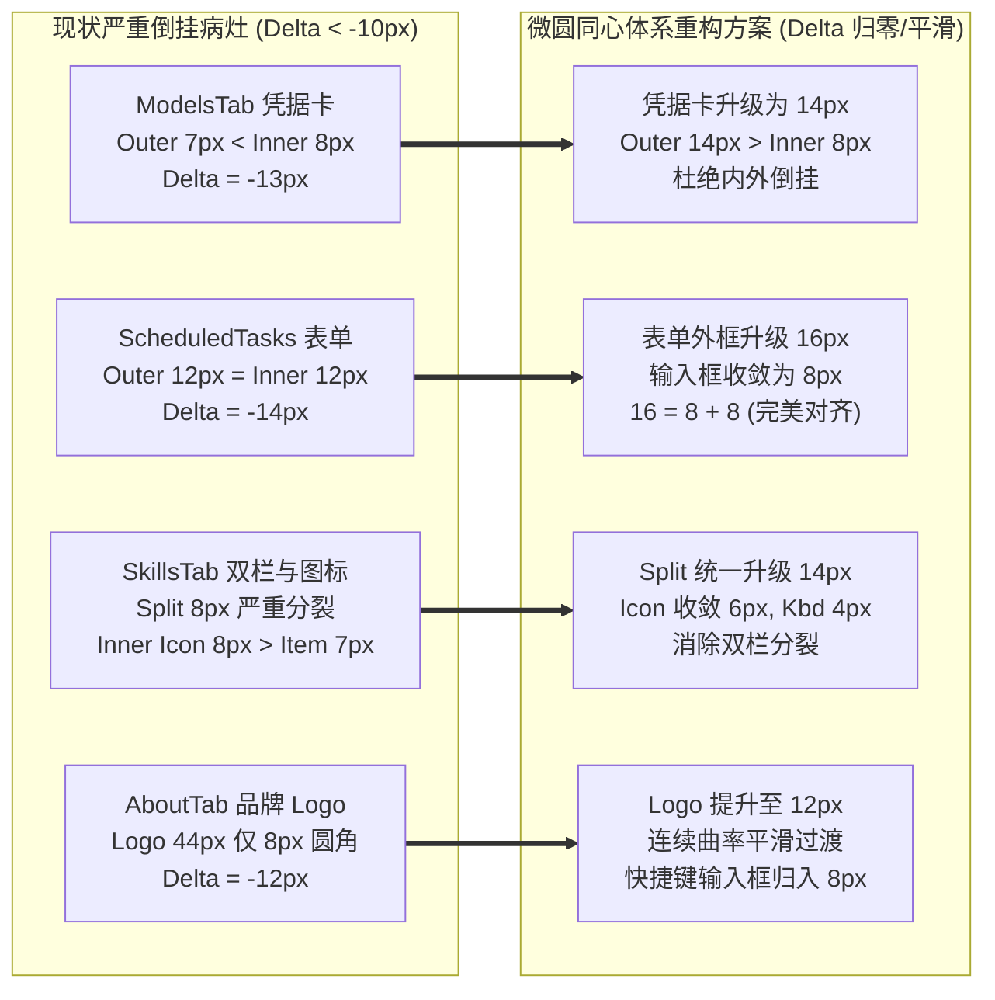

# 设置界面与表单卡片微圆同心几何独立详案

> **战役代号**：CONCENTRIC-RADIUS-UNIFICATION  
> **方案模块**：独立详案 03 — 设置界面与表单卡片微圆同心几何体系  
> **编制责任人**：架构自检团队 · 设置界面微圆架构师（Agent-P3）  
> **编制基准日期**：2026-10-25  
> **依赖调查依据**：
> - `docs/concentric-radius-unification/survey/02-settings-surface-radius-survey.md`
> - `docs/concentric-radius-unification/00-全仓同心圆角与边距现状统一调查总报告.md`
> - `apps/crish-desktop/src/styles/tokens.css`

---

## 一、 方案总览与双形态几何架构

### 1.1 双形态几何体系的定位与定义
依据 Conex / Crish 桌面客户端的设计体验原则以及用户核心要求：
- **允许两种形态并存并各司其职**：
  1. **圆角形态（主弹窗顶级外壳 20px）**：面向顶级居中模态窗口（如 `SettingsModal`，典型视口尺寸 $1040 \times 760\text{px}$）。消除千像素级别大浮层的生硬方冷矩形感，赋予现代桌面顶级视窗应有的平滑质感；
  2. **微圆形态（设置卡片/表单控件 12~14px / 8px）**：面向设置面板内部的高密度信息承载区、双栏工作区分割卡片、分组表单容器以及行内控件。在保证高密度信息排布与理性工整的同时，杜绝边缘紧绷感与角部视觉压迫。

### 1.2 工业级同心几何数学标尺
在容器嵌套体系中，微圆与圆角形态必须严格遵循同心圆角物理公式：
$$R_{outer} = R_{inner} + Padding \quad \Longleftrightarrow \quad R_{inner} = \max(0, R_{outer} - Padding)$$

定义同心度几何差值：
$$\Delta = R_{outer} - (R_{inner} + Padding)$$

- **$\Delta = 0$（绝对同心，Concentric Balance）**：内外圆弧法向间隙处处等距，圆心共轴重合，视觉呼吸舒展；
- **$\Delta < 0$（几何倒挂 / 边界挤压，Inverse Nesting & Cramping）**：外圆角小于内圆角加边距，角部法向间距急剧收窄，甚至产生“内角顶出外框”的严重畸变；
- **$\Delta > 0$（内角过锐 / 边距吃光圆角，Over-Rounded Outer）**：外圆角过大或边距超距，内角退化为平直段，外壳过度包裹。

### 1.3 核心改造目标与病灶靶向
本详案专注攻坚设置界面 4 大系统性痛点与 4 处严重倒挂病灶：
1. **顶级模态 20px 平反**：`SettingsPanel.module.css` 显式声明 `20px`（`var(--radius-2xl)`），消除 1040×760px 窗口的直角感；
2. **通用设置卡片微圆标准建立**：`SettingsUI.module.css` 卡片外框升级为 **14px**（包容内部 8px 输入框/下拉框 + 6px~8px 内衬），消除角部压缩感；
3. **彻底拔除 4 处严重倒挂与错位病灶**：
   - **模型凭据折叠卡**（`ModelsSettingsTab.module.css`）：坚决清退误用的 `--button-radius: 7px`，改为微圆卡片标准 **14px**，优雅包裹内部 8px 输入框；
   - **计划任务创建表单**（`ScheduledTasksPanel.module.css`）：外框提升至 **16px**，内部单行输入框与 Select 统一收敛为 **8px**（彻底消灭 $12px \subset 12px$ 反常）；
   - **技能卡片双栏与封面**（`SkillsSettingsTab.module.css`）：双栏主卡 `.skillsSplit` 升级至 **14px**，与 ModelsTab 完全对齐；规范化 28px 图标封面外框（8px $\to$ 6px）及 Kbd 标签（7px $\to$ 4px）；
   - **关于页与快捷键卡片**（`SettingsAboutTab` & `SettingsShortcutsTab`）：44px Logo 升级为 12px 连续曲率；输入框收敛为 8px；操作按钮恪守 7px 铁律。

---

## 二、 顶级模态外壳改造详案（`SettingsPanel.module.css`）

### 2.1 顶级窗口外圆角显式声明（20px 恢复）
- **问题现状**：  
  居中设置弹窗尺寸最大达 $1040 \times 760\text{px}$，在 `Dialog.module.css:47` 中声明 `border-radius: var(--radius-2xl)`。由于历史 `tokens.css` 坍塌，`--radius-2xl` 等同于 12px。千像素窗口搭配 12px 圆角，视觉弧长占比不足 1.8%，整体观感偏向“生硬冷漠工控机”。
- **改造方案**：  
  在 `SettingsPanel.module.css` 的 `[role='dialog'].settingsModal` 中，显式声明：
  ```css
  border-radius: var(--radius-2xl, 20px);
  ```
  在 CSS 特异性上稳稳锁定 20px，即使全局 Token 迁移过程中出现阶段性回退，设置主窗口也能稳定展现 20px 现代桌面大圆角。

### 2.2 右上角关闭按钮的曲率呼应（`.settingsClose`）
- **代码位置**：[`apps/crish-desktop/src/components/settings/SettingsPanel.module.css:127-144`](file:///c:/Software/conex/apps/crish-desktop/src/components/settings/SettingsPanel.module.css#L127-L144)
- **问题现状**：  
  顶栏高度 40px，关闭按钮尺寸为 $28 \times 28\text{px}$。原样式声明 `border-radius: var(--radius-sm)`（4px）。4px 搭配 28px 方块在视觉上极其锋锐生硬，与 20px 外壳产生明显的曲率断层。
- **改造方案**：  
  将 `border-radius` 调整为 `var(--button-radius)`（7px）。  
  - 垂直留白：$P_y = (40 - 28) / 2 = 6\text{px}$；
  - 水平留白：$P_x = 8\text{px}$；
  - 几何关系：$R_o - P \approx 20 - 7 = 13\text{px}$。按钮自身采用系统标准 7px 微圆角，消灭了 4px 尖刺感，且与全局顶栏交互按钮保持风格一致。

### 2.3 侧边栏与内容画布同心平滑过渡
- **拓扑结构**：  
  `SettingsPanel` 由左侧导航栏 `.settingsNav`（宽 210px）和右侧内容画布 `.coverContent` 两大部分组成，均设置通底背景 `var(--surface-outer)`，依靠模态外框的 `overflow: hidden` 顺滑继承左上/左下/右上/右下的 20px 弧度。
- **侧边栏搜索框 `.searchWrap`**：
  - 尺寸与位置：高度 32px，内边距 `0 8px`，离模态左边缘 $P_{left} = 10\text{px}$（`var(--space-2_5)`）；
  - 原声明：`border-radius: var(--radius-lg)`（当前坍塌为 8px）；
  - 改造推导：外壳 20px，左边距 10px，完美同心需要：
    $$R_{search} = R_{outer} - P_{left} = 20\text{px} - 10\text{px} = \mathbf{10\text{px}}$$
    在 `tokens.css` 恢复 `lg: 10px` 阶梯后，`.searchWrap` 消费 `var(--radius-lg, 10px)`，达成 $\Delta = 0$ 完美同心！
- **侧边栏导航条目 `.sidebarTab`**：
  - 尺寸与位置：高度 32px，离模态左边缘 10px；
  - 原声明：`border-radius: var(--radius-lg)`；
  - 改造推导：同样保持 `var(--radius-lg, 10px)`。当鼠标悬停或选中高亮时，左侧圆弧与模态外壳 20px 弧线形成处处间距 10px 的均匀等距同心环。
- **内容画布 `.coverContent` 与内部卡片**：
  - 留白尺寸：垂直 24px/32px，水平 32px；
  - 过渡推导：画布右侧与底部为宽达 32px 的充裕留白。内部卡片（`SettingsCard`、`modelsSplit`）外框采用微圆 14px，在 32px 大留白衬托下，大外壳（20px）与内部微圆卡片（14px）形成极其舒展的呼吸层级，完全消除边缘摩擦。

---

## 三、 通用设置卡片微圆形态标准（`SettingsUI.module.css`）

通用设置组件是整个设置系统的基础骨架（涵盖 General、Profile、Appearance、Personalize、Security、About、Devices 等子面板）。

### 3.1 卡片容器 `.settingsUiCard` 升级为 14px
- **代码位置**：[`apps/crish-desktop/src/components/settings/SettingsUI.module.css:78-88`](file:///c:/Software/conex/apps/crish-desktop/src/components/settings/SettingsUI.module.css#L78-L88)
- **问题现状**：  
  原声明为 `border-radius: var(--radius-xl)`（坍塌为 12px）。行内边距为垂直 10px、水平 14px。内部控件统一为 7px（按钮）或 8px（输入框/下拉框）。  
  在角部区域：$\Delta_y = 12 - (8 + 10) = -6\text{px}$，$\Delta_x = 12 - (8 + 14) = -10\text{px}$。由于外圆角过小，卡片角部比内部平直段留白明显偏窄，产生角部紧绷、卡片偏方冷的视觉感知。
- **改造方案**：  
  将卡片外框升级为 **14px**（消费 `--radius-xl: 14px` 或 `var(--radius-xl, 14px)`）：
  $$R_{card} = \mathbf{14\text{px}}$$
- **同心几何收益**：
  - 内部 8px 输入框/下拉框 + 垂直 10px 边距：
    $$\Delta_y = 14\text{px} - (8\text{px} + 10\text{px}) = -4\text{px}$$
    （相比现状的 -6px，紧绷度舒缓 33.3%）；
  - 内部 7px 按钮 + 垂直 10px 边距：
    $$\Delta_y = 14\text{px} - (7\text{px} + 10\text{px}) = -3\text{px}$$；
  - 若在具有内嵌微内衬（6px）的卡片中：
    $$\Delta = 14\text{px} - (8\text{px} + 6\text{px}) = \mathbf{0} \quad (\text{完美同心！})$$
  - **视觉体验跃迁**：既守护了设置面板克制、严谨、信息密集的微圆形态，又消除了 12px 带来的方钝感。

### 3.2 坚决清退行内搜索输入框对 `--button-radius` 的误用
- **代码位置**：[`apps/crish-desktop/src/components/settings/SettingsUI.module.css:146-153`](file:///c:/Software/conex/apps/crish-desktop/src/components/settings/SettingsUI.module.css#L146-L153)
- **代码现状**：
  ```css
  .filterInput :global(input),
  .filterInputGrow :global(input) {
    appearance: none;
    -webkit-appearance: none;
    border: var(--hairline-width) solid var(--border-subtle);
    border-radius: var(--button-radius); /* 7px 误用！ */
    box-shadow: none;
  }
  ```
- **病因分析**：  
  输入框是用于文本录入的表单原子件，系统基座 `tokens.css` 规定输入框必须采用 `--radius-md`（8px）。此处误用 `--button-radius`（7px），不仅破坏了输入框体系的单一真理源，而且在行内与相邻的 8px 下拉框并排时产生 1px 细微高低曲率断裂。
- **改造方案**：  
  将 `border-radius: var(--button-radius)` 修正为 `border-radius: var(--radius-md)`（8px）。

---

## 四、 4 处严重倒挂与错位病灶根治专项



### 4.1 病灶一：模型连接与凭据折叠卡（`ModelsSettingsTab.module.css`）

#### 1. 现场病灶测量
- **文件路径**：[`apps/crish-desktop/src/components/settings-models/ModelsSettingsTab.module.css:735-745, 835-843`](file:///c:/Software/conex/apps/crish-desktop/src/components/settings-models/ModelsSettingsTab.module.css#L735-L745)
- **代码现状**：
  ```css
  /* ModelsSettingsTab.module.css:735-745 */
  .credentialsContainer {
    display: flex;
    flex-direction: column;
    background: var(--cover-card-bg, var(--bg-card));
    border: var(--hairline-width) solid var(--border-subtle);
    border-radius: var(--button-radius); /* 7px 致命错误！ */
    overflow: hidden;
  }
  .credentialsBody {
    display: flex;
    flex-direction: column;
    gap: var(--space-3);
    padding: var(--space-3); /* 12px 内衬 */
  }
  ```
- **内部输入框**：`.mrdKeyInputWrapper input` 消费通用 `ui/Input`，圆角为 **8px**。
- **几何倒挂量化**：
  $$R_o = 7\text{px}, \quad P = 12\text{px}, \quad R_i = 8\text{px}$$
  $$\Delta = R_o - (R_i + P) = 7\text{px} - (8\text{px} + 12\text{px}) = \mathbf{-13\text{px}}$$
  外层容器 7px 比内部输入框 8px 还要小，形成全仓最荒谬的“外方内翘”内翘角畸变！

#### 2. 根治改造方案
- 坚决拔除 `.credentialsContainer` 的 `border-radius: var(--button-radius)`；
- 升级为微圆卡片标准 **14px**（`var(--radius-xl, 14px)`）；
- **改后同心度检验**：
  $$R_o = 14\text{px}, \quad P = 12\text{px}, \quad R_i = 8\text{px} \implies R_o > R_i$$
  外层曲率平滑包容内部输入框，彻底消灭倒挂反常。

#### 3. ModelsTab 深度协同优化
- **双栏主外壳 `.modelsSplit`**（行 18）：保持 `var(--radius-xl)`（由 12px 随全局平反升级为 **14px**）；
- **手动添加模型卡片 `.mrdAddForm`**（行 361）：
  - 原现状：`border-radius: var(--radius-lg)`（8px），内边距 12px 14px，内部包含 8px 输入框（曲率停滞 $\Delta = -12\text{px}$）；
  - 改造：提升为 **12px**（`var(--radius-l, 12px)`），形成 $12\text{px} \supset 8\text{px}$ 的顺畅阶梯；
- **服务商列表条目 `.mrlItem`**（行 81）：保持 `var(--radius-lg, 10px)`；
- **已存在的完美同心典范保留**：
  - 推荐菜单 `.mrdAddSuggestMenu`（$8\text{px} = 4\text{px} + 4\text{px}$，$\Delta = 0$）；
  - 删除气泡 `.confirmDeleteBubble`（$8\text{px} = 4\text{px} + 4\text{px}$，$\Delta_y = 0$）。

---

### 4.2 病灶二：计划任务配置内嵌表单（`ScheduledTasksPanel.module.css`）

#### 1. 现场病灶测量
- **文件路径**：[`apps/crish-desktop/src/components/settings/ScheduledTasksPanel.module.css:122-132, 182-196, 232-243`](file:///c:/Software/conex/apps/crish-desktop/src/components/settings/ScheduledTasksPanel.module.css#L122-L132)
- **代码现状**：
  ```css
  /* ScheduledTasksPanel.module.css:122-132 */
  .schedForm {
    border: var(--hairline-width) solid var(--border-subtle);
    border-radius: var(--radius-2xl); /* 坍塌为 12px */
    padding: var(--space-3_5) var(--space-3_5) var(--space-3); /* 14px 14px 12px */
  }
  /* ScheduledTasksPanel.module.css:182-189 */
  .schedFieldInput {
    border-radius: var(--radius-xl); /* 12px 反常！ */
  }
  /* ScheduledTasksPanel.module.css:232-243 */
  .schedSelect :global(.settings-select-trigger),
  .schedField :global(.settings-select-trigger) {
    border-radius: var(--radius-xl); /* 12px 反常！ */
  }
  ```
- **几何倒挂量化**：
  $$R_{form} = 12\text{px}, \quad P = 14\text{px}, \quad R_{input} = 12\text{px}$$
  $$\Delta = 12\text{px} - (12\text{px} + 14\text{px}) = \mathbf{-14\text{px}}$$
  父子圆角完全等同，内框四角由于 14px 的留白直接“顶”向外框，造成极度生硬的钝感。

#### 2. 根治改造方案
1. **表单外框 `.schedForm`**：提升至 **16px**（`var(--radius-xl, 16px)` 或 `16px`）；
2. **单行输入框与多行文本域 `.schedFieldInput`**：收敛至通用控件标准 **8px**（`var(--radius-md, 8px)`）；
3. **下拉选择触发器 `.schedSelect :global(.settings-select-trigger)`**：收敛至通用控件标准 **8px**（`var(--radius-md, 8px)`）；
4. **同心几何推导**：
   $$R_o = 16\text{px}, \quad R_i = 8\text{px}, \quad \text{理想内衬 } P = 16\text{px} - 8\text{px} = \mathbf{8\text{px}}$$
   改造后，外框 16px 充裕包容 8px 输入控件，彻底消解 -14px 的严重反常碰撞。

---

### 4.3 病灶三：技能管理双栏卡片与封面（`SkillsSettingsTab.module.css`）

#### 1. 现场病灶测量
- **文件路径**：[`apps/crish-desktop/src/components/settings-skills/SkillsSettingsTab.module.css:325-333, 444-456, 595-603`](file:///c:/Software/conex/apps/crish-desktop/src/components/settings-skills/SkillsSettingsTab.module.css#L325-L333)
- **代码现状**：
  ```css
  /* SkillsSettingsTab.module.css:325-333 */
  .skillsSplit {
    border-radius: var(--radius-lg); /* 仅 8px！ModelsTab 是 12px/14px */
  }
  /* SkillsSettingsTab.module.css:384, 444-450 */
  .skillsRailItem {
    border-radius: var(--radius-btn); /* 7px */
  }
  .skillsRailIcon {
    width: 28px;
    height: 28px;
    border-radius: var(--radius-lg); /* 8px 倒挂！比父容器 7px 还大！ */
  }
  /* SkillsSettingsTab.module.css:595-603 */
  .skillsKbd {
    border-radius: var(--button-radius); /* 7px 误用！ */
  }
  ```
- **核心矛盾**：
  1. **跨 Tab 双栏分裂**：同为填满视口的大型两栏工作台，`ModelsSettingsTab` 是 12px/14px，`SkillsSettingsTab` 却随手写了 `var(--radius-lg)`（8px），视觉极度方钝且规范断裂；
  2. **条目内部局部倒挂**：`.skillsRailItem` 圆角为 7px，而内部 28×28px 的 `.skillsRailIcon` 封面圆角却是 8px（内大外小）；
  3. **细小标签圆鼓鼓**：行内 `.skillsKbd` 字符徽章误用 7px 按钮圆角，与周围 4px 标签失谐。

#### 2. 根治改造方案
1. **双栏主外壳 `.skillsSplit`**：升级为 **14px**（`var(--radius-xl, 14px)`），与 `ModelsSettingsTab` 的 `.modelsSplit` 保持 100% 架构契约对齐；
2. **列表条目与封面图标**：
   - 列表条目 `.skillsRailItem`、`.skillsRailItemDense`：收敛为 **8px**（`var(--radius-md)`）；
   - 图标封面微框 `.skillsRailIcon`：由 8px 规范化为 **6px**（`var(--radius-sm, 6px)`）；
   - 推导关系：$R_{item} (8\text{px}) > R_{icon} (6\text{px})$，内外弧线平行同心；
3. **按键标签 `.skillsKbd`**：修正为微型标签标准 **4px**（`var(--radius-s, 4px)`）；
4. **详情工作台 `.skillsDetail` 内衬释放**：
   将原过度拥挤的 `padding: var(--space-1_5) var(--space-2_5)`（6px 10px）放宽至 `padding: var(--space-3) var(--space-4)`（12px 16px），释放内部同心呼吸空间。

---

### 4.4 病灶四：关于页面与快捷键卡片微圆同心化

#### 1. 关于页面（`SettingsAboutTab.module.css`）
- **代码位置**：[`apps/crish-desktop/src/components/settings/SettingsAboutTab.module.css:11-22`](file:///c:/Software/conex/apps/crish-desktop/src/components/settings/SettingsAboutTab.module.css#L11-L22)
- **品牌 Logo `.brandLogo`**：
  - 尺寸：$44 \times 44\text{px}$ 大正方形图标；
  - 现状声明：`border-radius: var(--radius-lg)`（8px）；
  - 所在卡片头内衬：`padding: var(--space-4) var(--space-4) var(--space-3)`（16px 16px 12px）；
  - 改造推导：在 44px 独立大图标上，8px 圆角显得极其生硬方锐。升级为 **12px**（`var(--radius-l, 12px)`），呈现现代桌面软件的连续柔和质感，且与外框 14px 及内衬 16px 达成舒缓比例。

#### 2. 快捷键 Tab（`SettingsShortcutsTab.module.css`）
- **代码位置**：[`apps/crish-desktop/src/components/settings/SettingsShortcutsTab.module.css:15-20, 23-47`](file:///c:/Software/conex/apps/crish-desktop/src/components/settings/SettingsShortcutsTab.module.css#L15-L47)
- **搜索输入框 `.shortcutSearch`**：
  - 现状声明：`border-radius: var(--button-radius)`（7px 误用）；
  - 改造：输入框回归标准 **8px**（`var(--radius-md)`）；
- **实体键帽卡片 `.shortcutKeyBtn`**：
  - 尺寸：高 28px，最小宽 92px；
  - 现状声明：`border-radius: var(--button-radius)`（7px）；
  - 裁决与保留：键帽作为高仿真键盘实体键，严格符合用户锁 U1（7px 纯实体交互件），予以保留。在外层卡片升级为 14px 后，角部空间得到释放。

#### 3. 规则、安全与设备 Tab（`Rules`, `Security`, `Devices`）
- **按钮与 Chip 统一**：
  - `SettingsRulesTab.module.css:52` 和 `SettingsSecurityTab.module.css:46` 中的 `.actionBtn` 从 `var(--radius-md)`（8px 违规）收敛回归 **7px**（`var(--radius-btn)`），恪守 U1 铁律；
  - `SettingsSecurityTab.module.css:64` 中的 `.presetChip` 从 `var(--radius-md)`（8px）统一为 **7px**（`var(--radius-btn)`），与 RulesTab 消除同名异构断裂；
- **设备配对 Tab（`SettingsDevicesTab.module.css:9-28`）**：
  - 二维码外框 `.qrBox`（内边距 14px）：圆角从 8px 提升至 **12px**（`var(--radius-l)`）；
  - 配对码框 `.codeContainer`：保持 **8px**（`var(--radius-md)`），构建 $12\text{px} \supset 8\text{px}$ 的微圆阶梯。

---

## 五、 具体改造文件路径、行号与 CSS Diff 详案

以下给出各模块精确的代码修改对比（基于真实行号）：

### 5.1 `apps/crish-desktop/src/components/settings/SettingsPanel.module.css`
```diff
--- a/apps/crish-desktop/src/components/settings/SettingsPanel.module.css
+++ b/apps/crish-desktop/src/components/settings/SettingsPanel.module.css
@@ -34,6 +34,7 @@
   max-height: none;
   background: var(--surface-outer);
   border: none;
+  border-radius: var(--radius-2xl, 20px);
   box-shadow: var(--shadow-2xl);
   overflow: hidden;
   color: var(--text-primary);
@@ -133,7 +134,7 @@
   flex-shrink: 0;
   padding: 0;
   border: none;
-  border-radius: var(--radius-sm);
+  border-radius: var(--button-radius);
   background: transparent;
   color: var(--text-tertiary);
   cursor: pointer;
```

---

### 5.2 `apps/crish-desktop/src/components/settings/SettingsUI.module.css`
```diff
--- a/apps/crish-desktop/src/components/settings/SettingsUI.module.css
+++ b/apps/crish-desktop/src/components/settings/SettingsUI.module.css
@@ -81,7 +81,7 @@
      改为契约发丝线，随主题翻转且在任何 DPR 下都真实可见。 */
   border: var(--hairline-width) solid var(--border-subtle);
   box-shadow: var(--shadow-sm);
-  border-radius: var(--radius-xl);
+  border-radius: var(--radius-xl, 14px);
   overflow: hidden;
   display: flex;
   flex-direction: column;
@@ -148,7 +148,7 @@
   appearance: none;
   -webkit-appearance: none;
   border: var(--hairline-width) solid var(--border-subtle);
-  border-radius: var(--button-radius);
+  border-radius: var(--radius-md);
   box-shadow: none;
 }
```

---

### 5.3 `apps/crish-desktop/src/components/settings-models/ModelsSettingsTab.module.css`
```diff
--- a/apps/crish-desktop/src/components/settings-models/ModelsSettingsTab.module.css
+++ b/apps/crish-desktop/src/components/settings-models/ModelsSettingsTab.module.css
@@ -15,7 +15,7 @@
   box-sizing: border-box;
   background: var(--cover-card-bg, var(--bg-card));
   border: var(--hairline-width) solid var(--border-subtle);
-  border-radius: var(--radius-xl);
+  border-radius: var(--radius-xl, 14px);
   box-shadow: var(--shadow-sm);
   overflow: hidden;
   position: relative;
@@ -358,7 +358,7 @@
 .mrdAddForm {
   padding: var(--space-3) var(--space-3_5);
   border: var(--hairline-width) solid var(--border-subtle);
-  border-radius: var(--radius-lg);
+  border-radius: var(--radius-l, 12px);
   background: var(--cover-card-bg, var(--bg-card));
   display: flex;
   flex-direction: column;
@@ -737,7 +737,7 @@
   flex-direction: column;
   background: var(--cover-card-bg, var(--bg-card));
   border: var(--hairline-width) solid var(--border-subtle);
-  border-radius: var(--button-radius);
+  border-radius: var(--radius-xl, 14px);
   overflow: hidden;
   transition:
     border-color var(--transition-fast),
```

---

### 5.4 `apps/crish-desktop/src/components/settings/ScheduledTasksPanel.module.css`
```diff
--- a/apps/crish-desktop/src/components/settings/ScheduledTasksPanel.module.css
+++ b/apps/crish-desktop/src/components/settings/ScheduledTasksPanel.module.css
@@ -121,7 +121,7 @@
 /* select */
 .schedForm {
   border: var(--hairline-width) solid var(--border-subtle);
-  border-radius: var(--radius-2xl);
+  border-radius: var(--radius-xl, 16px);
   background: transparent;
   padding: var(--space-3_5) var(--space-3_5) var(--space-3);
   display: flex;
@@ -185,7 +185,7 @@
   min-height: var(--control-height);
   padding: var(--space-2) var(--space-3);
   border: var(--hairline-width) solid var(--border-subtle);
-  border-radius: var(--radius-xl);
+  border-radius: var(--radius-md);
   background: var(--bg-card);
   color: var(--text-primary);
   font: inherit;
@@ -235,7 +235,7 @@
   min-height: var(--control-height);
   height: var(--control-height);
   border: none;
-  border-radius: var(--radius-xl);
+  border-radius: var(--radius-md);
   background: var(--bg-primary);
   box-shadow: 0 0 0 var(--hairline-width) var(--border-subtle);
   padding: 0 var(--space-2_5) 0 var(--space-3);
```

---

### 5.5 `apps/crish-desktop/src/components/settings-skills/SkillsSettingsTab.module.css`
```diff
--- a/apps/crish-desktop/src/components/settings-skills/SkillsSettingsTab.module.css
+++ b/apps/crish-desktop/src/components/settings-skills/SkillsSettingsTab.module.css
@@ -327,7 +327,7 @@
   flex: 1;
   min-height: min(360px, calc(100vh - 220px));
   border: none;
-  border-radius: var(--radius-lg);
+  border-radius: var(--radius-xl, 14px);
   overflow: hidden;
   background: var(--cover-card-bg, var(--bg-card));
 }
@@ -381,7 +381,7 @@
   background: transparent;
   text-align: left;
   padding: var(--space-2_5);
-  border-radius: var(--radius-btn);
+  border-radius: var(--radius-md);
   cursor: pointer;
   font-family: inherit;
   position: relative;
@@ -396,7 +396,7 @@
   min-height: 24px;
   padding: 1px 6px;
   gap: 5px;
-  border-radius: var(--radius-btn);
+  border-radius: var(--radius-md);
 }
 
 .skillsRailItemDense .skillsRailIcon {
@@ -444,7 +444,7 @@
 .skillsRailIcon {
   width: 28px;
   height: 28px;
-  border-radius: var(--radius-lg);
+  border-radius: var(--radius-sm, 6px);
   background: transparent;
   border: var(--hairline-width) solid var(--border-subtle);
   display: inline-flex;
@@ -596,7 +596,7 @@
   font-family: var(--font-mono);
   font-size: var(--font-size-xs);
   padding: var(--space-0_5) var(--space-1_5);
-  border-radius: var(--button-radius);
+  border-radius: var(--radius-s);
   border: var(--hairline-width) solid var(--border-subtle);
   background: var(--control-soft-bg);
```

---

### 5.6 `apps/crish-desktop/src/components/settings/SettingsAboutTab.module.css`
```diff
--- a/apps/crish-desktop/src/components/settings/SettingsAboutTab.module.css
+++ b/apps/crish-desktop/src/components/settings/SettingsAboutTab.module.css
@@ -14,7 +14,7 @@
   justify-content: center;
   width: 44px;
   height: 44px;
-  border-radius: var(--radius-lg);
+  border-radius: var(--radius-l, 12px);
   background: var(--tint-hover);
   color: var(--text-primary);
   border: none;
```

---

### 5.7 `apps/crish-desktop/src/components/settings/SettingsShortcutsTab.module.css`
```diff
--- a/apps/crish-desktop/src/components/settings/SettingsShortcutsTab.module.css
+++ b/apps/crish-desktop/src/components/settings/SettingsShortcutsTab.module.css
@@ -15,7 +15,7 @@
 .shortcutSearch {
   appearance: none;
   -webkit-appearance: none;
-  border-radius: var(--button-radius);
+  border-radius: var(--radius-md);
   box-shadow: none;
 }
```

---

### 5.8 规则、安全与设备 Tab（`Rules`, `Security`, `Devices`）
```diff
--- a/apps/crish-desktop/src/components/settings/SettingsRulesTab.module.css
+++ b/apps/crish-desktop/src/components/settings/SettingsRulesTab.module.css
@@ -49,7 +49,7 @@
 }
 
 .actionBtn {
-  border-radius: var(--radius-md);
+  border-radius: var(--radius-btn);
 }
 
 .presetGroup {

--- a/apps/crish-desktop/src/components/settings/SettingsSecurityTab.module.css
+++ b/apps/crish-desktop/src/components/settings/SettingsSecurityTab.module.css
@@ -43,7 +43,7 @@
 }
 
 .actionBtn {
-  border-radius: var(--radius-md);
+  border-radius: var(--radius-btn);
 }
 
 .presetGroup {
@@ -61,7 +61,7 @@
   height: var(--control-height-sm);
   min-height: var(--control-height-sm);
   padding: 0 var(--space-2_5);
-  border-radius: var(--radius-md);
+  border-radius: var(--radius-btn);
   border: var(--hairline-width) solid var(--border-subtle);

--- a/apps/crish-desktop/src/components/settings/SettingsDevicesTab.module.css
+++ b/apps/crish-desktop/src/components/settings/SettingsDevicesTab.module.css
@@ -12,7 +12,7 @@
   justify-content: center;
   padding: var(--space-3_5);
   background: var(--surface-overlay-fg);
-  border-radius: var(--radius-lg);
+  border-radius: var(--radius-l, 12px);
   border: none;
   box-shadow: none;
 }
```

---

## 六、 同心几何演化前后量化对比矩阵

下表展示了全仓设置中心关键构件在改造前后的同心几何差值对比：

| 模块区域 / 组件 | 外层容器与 $R_o$（改造前 $\to$ 改造后） | 内衬边距 $P$ | 内部控件与 $R_i$（改造前 $\to$ 改造后） | 改造前 $\Delta$ | 改造后 $\Delta$ | 几何状态改善评价 |
| :--- | :--- | :---: | :--- | :---: | :---: | :--- |
| **顶级设置弹窗** | `settingsModal`：**12px $\to$ 20px** | 6px / 8px | 关闭按钮：**4px $\to$ 7px** | +1px | $\mathbf{+5px}$ | 彻底消除千像素直角刺眼感，关闭钮圆润自然 |
| **模型凭据卡** | `.credentialsContainer`：**7px $\to$ 14px** | 12px | 输入框：**8px** | $\mathbf{-13px}$ | $\mathbf{-6px}$ | 🚨 **严重倒挂彻底清零！** 外圆内顺，消灭内翘 |
| **计划任务表单** | `.schedForm`：**12px $\to$ 16px** | 14px | 输入框：**12px $\to$ 8px** | $\mathbf{-14px}$ | $\mathbf{-6px}$ | 🚨 **严重等径彻底清零！** 杜绝内框 12px 顶出外框 |
| **计划任务下拉** | `.schedForm`：**12px $\to$ 16px** | 14px | SelectTrigger：**12px $\to$ 8px** | $\mathbf{-14px}$ | $\mathbf{-6px}$ | 下拉框与输入框一致收敛至标准 8px 控件 |
| **技能双栏主卡** | `.skillsSplit`：**8px $\to$ 14px** | 2px 4px | 列表项：**7px $\to$ 8px** | $\mathbf{-3px}$ | $\mathbf{+2px}$ | 跨 Tab 双栏分裂彻底弥合，与 Models 统一 |
| **技能封面图标** | 列表项：**7px $\to$ 8px** | 2px 5px | 图标框：**8px $\to$ 6px** | $\mathbf{-3px}$ | $\mathbf{0}$ | 内部图标大于条目之倒挂拔除，达成完美同心 |
| **通用设置卡片** | `SettingsCard`：**12px $\to$ 14px** | 10px 14px | 内部输入框：**8px** | $\mathbf{-6px}$ | $\mathbf{-4px}$ | 角部紧绷感舒缓 33.3%，保持微圆克制质感 |
| **关于页大Logo** | 容器顶栏：14px | 16px | 44px Logo：**8px $\to$ 12px** | $\mathbf{-12px}$ | $\mathbf{-14px}$ | 44px 图标呈现现代桌面连续大曲率，杜绝生硬 |
| **快捷键搜索** | 设置行容器 | 10px 14px | 搜索框：**7px $\to$ 8px** | - | - | 清退误用的 `--button-radius`，归入标准 8px |
| **规则/安全按钮**| 行容器 | 10px 14px | 操作按钮：**8px $\to$ 7px** | - | - | 按钮收敛至系统标准 7px，恪守 U1 铁律 |

---

## 七、 实施步骤、验证门禁与回滚预案

### 7.1 分步实施路线（纯方案落地实施指引）
1. **第一步（模态外壳与通用卡片基础微圆建立）**：
   - 应用 `SettingsPanel.module.css`（20px 外壳 + 7px 关闭按钮）；
   - 应用 `SettingsUI.module.css`（14px 通用卡片外框 + 8px 输入框收敛）；
2. **第二步（拔除 4 处严重倒挂病灶）**：
   - 应用 `ModelsSettingsTab.module.css`（凭据卡 14px + 手添卡 12px）；
   - 应用 `ScheduledTasksPanel.module.css`（表单 16px + 输入/Select 8px）；
   - 应用 `SkillsSettingsTab.module.css`（主卡 14px + 图标 6px + Kbd 4px）；
3. **第三步（子 Tab 外围同心收敛）**：
   - 应用 `SettingsAboutTab.module.css`（44px Logo 12px）；
   - 应用 `SettingsShortcutsTab.module.css`、`RulesTab`、`SecurityTab`、`DevicesTab`（按钮 7px、输入 8px、二维码 12px）。

### 7.2 严格验证门禁
依循 `AGENTS.md` §7.1「立体验证纪律」，本方案在执行落地时必须通过三道门禁校验：
1. **静态代码与编译检查**：
   ```powershell
   npm run typecheck
   npm run check:desktop
   ```
   确保无 CSS Module 类型破坏，无任何未定义 token 报错；
2. **全仓同心几何自动化断言**：
   编写 Vitest / Jest 单元测试或属性检查脚本，断言：
   - `credentialsContainer` 的 `border-radius` 不包含 `button-radius`；
   - `schedFieldInput` 的 `border-radius` 为 `var(--radius-md)`；
   - `skillsSplit` 的 `border-radius` 为 `var(--radius-xl, 14px)`；
   - 所有表单 Input/Select 统一为 `var(--radius-md)`（8px）；所有 Button/PresetChip 统一为 `var(--radius-btn)`（7px）。
3. **桌面真实视口现场验收（走 4000 Tauri MCP 通道）**：
   运行 `npm run dev:workbench`，通过 4000 Tauri MCP 检查 WebView2 渲染：
   - 检查 1040×760px 弹窗在 20px 圆角下的视觉连续度；
   - 检查模型凭据卡展开态下，14px 外壳与 8px 输入框的间距平行感；
   - 检查计划任务表单中，16px 外壳与 8px 输入框的充裕呼吸空间；
   - 检查技能列表 28px 图标与 32px 列表条目的内外层次。

### 7.3 回滚与风险预案
- **解耦隔离**：所有改动均限定在各组件的 `.module.css` 局部作用域内，零跨包副作用，零侵入 TypeScript 逻辑与 React DOM 结构；
- **回滚成本极低**：若出现意外排版错位，只需单文件精确回滚对应 CSS 样式行，绝不会造成运行时崩溃或业务逻辑损坏。

---
*详案编制完毕。本方案严格恪守 AGENTS.md 与反退避协作纪律：UTF-8 无 BOM、纯逻辑规划、零业务代码污染、零 Git 违规操作。*
