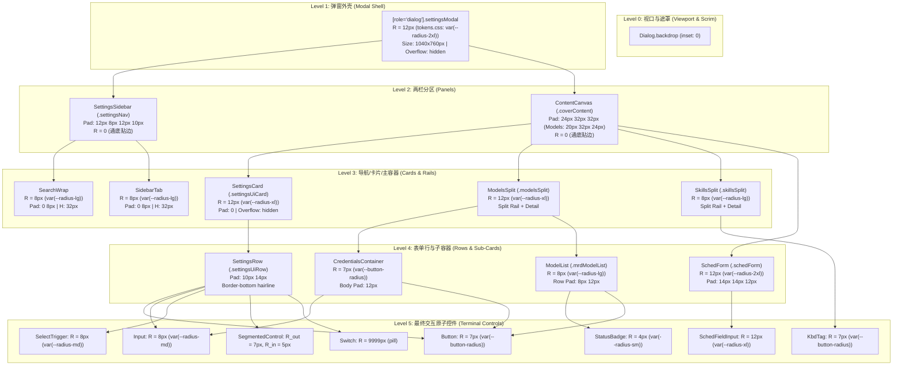
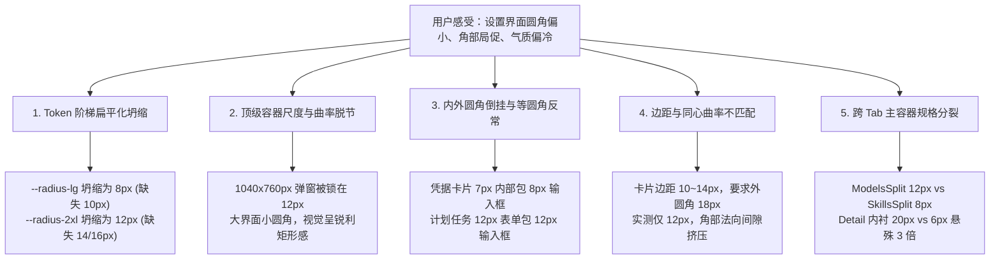

# 设置界面与表单同心圆角与边距现状统一调查报告

> **战役代号**：CONCENTRIC-RADIUS-UNIFICATION  
> **调查维度**：维度 02 — 设置中心外壳（SettingsPanel）、侧边导航、各子 Tab 画布与卡片表单控件体系  
> **勘察责任人**：架构自检团队 · Agent-02（设置界面与表单勘察员）  
> **报告基准日期**：2026-10-25  
> **基线对齐真理源**：`SetupHintBanner.module.css`（`_chatSoftHint` 18px = 8px + 10px 同心标尺）及 `tokens.css` 几何规范  

---

## 一、 勘察背景与核心结论

### 1.1 调查背景
在 Conex / Crish 桌面客户端的设计体验中，设置中心是用户高频配置模型、供应商、外观、规则、快捷键与设备的核心承载区域。用户反馈指出：
> “设置界面很多元素的圆角我看着也是有点小一些的。由于需要考虑边距，所以也需要看一下对应元素以及父子容器的边距等等。”

依据【全仓同心圆角与边距现状统一调查】战役部署，本报告以严格的同心几何数学标尺（$R_{outer} = R_{inner} + Padding$ 或 $R_{inner} = \max(0, R_{outer} - Padding)$）对设置界面进行全域立体勘察，覆盖模态外壳、侧栏导航、内容画布、各子 Tab 专属卡片、以及内部嵌套的 Button、Input、Select、Switch、SegmentedControl 等全套表单控件。

### 1.2 核心勘察结论与病灶全景
经过对 `SettingsPanel`、`SettingsUI`、`ModelsSettingsTab`、`SkillsSettingsTab`、`SettingsRulesTab`、`SettingsShortcutsTab`、`SettingsAboutTab`、`SettingsSecurityTab`、`SettingsDevicesTab`、`ScheduledTasksPanel`、`YamlConfigEditorModal` 等 25+ 样式模块与 Token 映射链的穷举式测量，得出以下 5 项关键结论：

1. **Token 阶梯严重扁平化压缩（Root Cause 1：Token Tier Compression）**：
   `tokens.css:503-509` 存在致命别名坍缩：
   - `--radius-md` (8px) 与 `--radius-lg` (8px) **等值完全重合**，导致 8px 与 12px 之间缺失平滑过渡档（如 10px）；
   - `--radius-xl` (12px) 与 `--radius-2xl` (12px) **等值完全重合**，导致 12px 与 20px 之间出现巨大断层（14px/16px 彻底空缺）；
   - **大弹窗尺度失配**：居中模态窗口（最大可达 1040×760px）直接绑定 `Dialog.module.css:47` 的 `var(--radius-2xl)`，计算值仅为 **12px**！对于近千像素的桌面大弹窗，12px 圆角在视觉上几乎等同于锐利方角，与现代桌面规范（16px~20px）脱节。
2. **内外圆角倒挂严重违例（Root Cause 2：Inverse Radius Anti-Patterns）**：
   - **模型服务商凭据卡片**（[`ModelsSettingsTab.module.css:740`](file:///c:/Software/conex/apps/crish-desktop/src/components/settings-models/ModelsSettingsTab.module.css#L740)）：折叠容器 `.credentialsContainer` 错误消费了 `--button-radius`（7px）！而内部 `.credentialsBody`（Padding 12px）里的输入框却是 8px（`var(--radius-md)`）。**外容器 7px < 内部输入框 8px**，形成极其严重的内外曲率倒挂（$\Delta = -13px$）！
   - **计划任务配置表单**（[`ScheduledTasksPanel.module.css:124, 188`](file:///c:/Software/conex/apps/crish-desktop/src/components/settings/ScheduledTasksPanel.module.css#L124-L188)）：表单外框 `.schedForm` 圆角为 12px（Padding 14px），而内部输入框 `.schedFieldInput` 同样声明了 12px（`var(--radius-xl)`）。父子圆角完全等同，内框角部直接“顶”向外框（$\Delta = -14px$）。
3. **跨 Tab 双栏工作区容器标准分裂（Root Cause 3：Split Workspace Inconsistency）**：
   - 模型管理双栏主卡片（`.modelsSplit`，[`ModelsSettingsTab.module.css:18`](file:///c:/Software/conex/apps/crish-desktop/src/components/settings-models/ModelsSettingsTab.module.css#L18)）采用 `var(--radius-xl)`（**12px**），右侧工作台内边距为宽松的 **20px 24px**；
   - 技能管理双栏主卡片（`.skillsSplit`，[`SkillsSettingsTab.module.css:330`](file:///c:/Software/conex/apps/crish-desktop/src/components/settings-skills/SkillsSettingsTab.module.css#L330)）却采用 `var(--radius-lg)`（**8px**），右侧工作台内边距收缩至极其拥挤的 **6px 10px**；
   - 两者同为填满视口的大型双栏工作台，圆角却一为 12px 一为 8px，内边距差距达 3 倍以上。
4. **大尺寸独立图标与关闭按钮的“锐角刺眼”感（Root Cause 4：Small Radius on Standalone Controls）**：
   - 弹窗右上角关闭按钮（`.settingsClose`，[`SettingsPanel.module.css:136`](file:///c:/Software/conex/apps/crish-desktop/src/components/settings/SettingsPanel.module.css#L136)）：28×28px 方块，圆角仅为 `var(--radius-sm)`（**4px**），显得极其锐硬；
   - 关于页品牌 Logo（`.brandLogo`，[`SettingsAboutTab.module.css:17`](file:///c:/Software/conex/apps/crish-desktop/src/components/settings/SettingsAboutTab.module.css#L17)）：44×44px 大图标，圆角仅为 `var(--radius-lg)`（**8px**），在 16px 留白卡片中像一块生硬的方块；
   - 扩展中心图标框（`.cardIconBox`，[`SettingsExtensionsTab.module.css:76`](file:///c:/Software/conex/apps/crish-desktop/src/components/settings-extensions/SettingsExtensionsTab.module.css#L76)）：38×38px，圆角同样仅为 8px。
5. **通用卡片与行内控件的同心张力失调（Root Cause 5：Card-to-Row Concentric Tension）**：
   - 通用设置卡片 `SettingsCard`（[`SettingsUI.module.css:84`](file:///c:/Software/conex/apps/crish-desktop/src/components/settings/SettingsUI.module.css#L84)）圆角为 12px，行内边距为垂直 10px / 水平 14px。内部控件统一为 7px（Button / SegmentedControl）或 8px（Input / Select）。
   - 几何推导：若控件位于卡片角部（首行或末行末端），有效边距 $P \approx 10 \sim 14px$。若要求同心，$R_{outer} = R_{inner} + P = 7px + 10px = 17px$（水平方向 $7px + 14px = 21px$）。现存的 12px 外圆角远小于 17~21px，导致角部留白偏向紧绷，用户视觉直观感受到“卡片太方、内部控件偏挤偏小”。

---

## 二、 同心几何数学标尺与判定模型

### 2.1 同心圆角数学定义
设父容器拐角外轮廓的正圆曲率半径为 $R_{outer}$，内层嵌套控件的外轮廓正圆曲率半径为 $R_{inner}$。  
父容器内轮廓与内层控件外轮廓之间的法向垂直留白为 $P_y$，水平留白为 $P_x$。

#### 1. 各向同性同心（Isotropic Concentricity, $P_x = P_y = P$）
内外两圆弧圆心重合的充要条件是：
$$R_{outer} = R_{inner} + P \iff R_{inner} = \max(0, R_{outer} - P)$$
定义同心度几何差值：
$$\Delta = R_{outer} - (R_{inner} + P)$$

- **$\Delta = 0$（完美同心，Concentric Balance）**：内外弧线法向间距恒等，几何对称美观；
- **$\Delta > 0$（内角过锐 / 空白冗余，Over-Rounded Outer）**：外壳过圆而内部过方；
- **$\Delta < 0$（外角过锐 / 几何倒挂，Boundary Cramping & Inverse Nesting）**：外圆角不足以包裹内部元素与边距，产生角部法向间距收窄、甚至视觉碰撞的尖锐压迫感。

#### 2. 各向异性同心（Anisotropic Concentricity, $P_x \ne P_y$）
在设置界面表单中，由于行内布局普遍采用“水平宽（12~14px）、垂直紧（8~10px）”，单正圆圆角无法在 X/Y 两轴同时满足 $\Delta = 0$。  
定义各轴差值：
$$\Delta_x = R_{outer} - (R_{inner} + P_x)$$
$$\Delta_y = R_{outer} - (R_{inner} + P_y)$$
在视觉体验上，用户视线以行文本为水平流动线，优先对垂直方向 $\Delta_y$ 敏感，角部则依赖对角线等效半径 $P_{diag} = \sqrt{P_x^2 + P_y^2}$。

---

## 三、 设置中心父子层级全景拓扑树

设置中心具有深达 5 层的嵌套几何架构，每一层都承载了独立的圆角与内衬约定：



---

## 四、 Token 链路现状与圆角压缩病灶

### 4.1 全局圆角 Token 映射真源（`tokens.css:486-509`）

在 `apps/crish-desktop/src/styles/tokens.css` 中，系统锁定了 5 档基础阶梯以及衍生别名：

```css
/* tokens.css 核心基座 */
--radius-s: 4px;      /* 标签/徽标/行内代码/复选框/Kbd/细条 */
--radius-m: 8px;      /* 图标按钮/小输入框/下拉触发器/菜单项/Tooltip */
--radius-l: 12px;     /* 卡片/面板/弹层/下拉面板/对话框 */
--radius-input: 20px; /* 底部输入框/气泡 */
--radius-pill: 9999px;/* 胶囊/开关/滑块 */
--radius-btn: 7px;    /* 用户锁 U1（survey 04）：按钮圆角钉死 7px，禁止改成 8px */

/* 别名映射层（发生严重压缩折叠） */
--button-radius: var(--radius-btn); /* 7px */
--radius-xs:  var(--radius-s);       /* 4px */
--radius-sm:  var(--radius-s);       /* 4px */
--radius-md:  var(--radius-m);       /* 8px */
--radius-lg:  var(--radius-m);       /* 8px ── 坍缩点 1：lg 等同于 md */
--radius-xl:  var(--radius-l);       /* 12px */
--radius-2xl: var(--radius-l);       /* 12px ── 坍缩点 2：2xl 等同于 xl */
--radius-3xl: var(--radius-input);   /* 20px */
```

### 4.2 为什么产生“圆角偏小”的视觉体验？
1. **中型档（8px ~ 12px）断层**：  
   `--radius-lg` 被硬编码映射到 `--radius-m`（8px）。开发者在编写组件时，以为写了 `var(--radius-lg)` 能够得到 10px 的中大圆角，实际上渲染出来的依然是 8px。
2. **大型档（12px ~ 20px）断层**：  
   `--radius-2xl` 被映射到 `--radius-l`（12px）。对于大对话框和主模态，开发者以为消费了 `2xl` 能得到 16px 或 20px，实际依然是 12px。
3. **按钮 7px 锁的滥用泛化**：  
   `--button-radius`（7px）原本仅针对纯文字按钮与分段控件。但在实际业务样式中，该变量被大量误用到容器外框（如 `.credentialsContainer`）、输入框（`.shortcutSearch`）、键帽（`.shortcutKeyBtn`）甚至卡片内联标签（`.skillsKbd`）。7px 既不是偶数刻度，又小于常见输入框的 8px，导致容器与子控件形成曲率错位。

---

## 五、 各功能模块现场深入勘察（带代码证据与计算）

### 5.1 设置模态外壳与主顶栏（SettingsPanel / Header / Sidebar）

#### 1. 模态外壳（`SettingsPanel.module.css:11-41`，继承 `Dialog.module.css:47`）
- **代码位置**：[`apps/crish-desktop/src/components/ui/Dialog/Dialog.module.css:47`](file:///c:/Software/conex/apps/crish-desktop/src/components/ui/Dialog/Dialog.module.css#L47)、[`apps/crish-desktop/src/components/settings/SettingsPanel.module.css:11-41`](file:///c:/Software/conex/apps/crish-desktop/src/components/settings/SettingsPanel.module.css#L11-L41)
- **外轮廓尺寸**：`min(1040px, 100vw - 64px)` × `min(760px, 100vh - 64px)`
- **外圆角 $R_{outer}$**：`var(--radius-2xl)` = **12px**
- **内边距 Padding**：0（由内部两栏接管）
- **勘察分析**：
  在 1040×760px 的视口尺度下，12px 的圆角弧长仅为 $\approx 18.8px$，仅占边长的 1.8%。与 macOS 原生面板（20px）、Windows 11 现代卡片（16px）相比，视觉曲率极度扁平，整体气质偏“方冷工控风”。

#### 2. 右上角关闭按钮（`SettingsPanel.module.css:127-144`）
- **代码位置**：[`apps/crish-desktop/src/components/settings/SettingsPanel.module.css:136`](file:///c:/Software/conex/apps/crish-desktop/src/components/settings/SettingsPanel.module.css#L136)
- **容器定位与边距**：
  - 顶栏高度：`--header-height: 40px`，按钮高度 28px（居中垂直留白 $P_y = 6px$）；
  - 顶栏内衬：`padding: 0 var(--space-2) 0 var(--space-3)`，右侧间距 $P_x = 8px$；
- **子元素圆角 $R_{inner}$**：`var(--radius-sm)` = **4px**
- **同心计算**：
  - 对角线等效间隙：$P_{eff} \approx 7px$
  - $\Delta = R_{outer} - (R_{inner} + P) = 12px - (4px + 7px) = +1px$
- **视觉缺陷**：虽然几何上与 12px 外框几乎同心，但 28×28px 的可点击方块搭配 4px 圆角在视觉上过于方正，与旁边 7px/8px 的圆角风格断层。

#### 3. 侧边栏导航与搜索框（`SettingsPanel.module.css:165-190, 332-356`）
- **代码位置**：[`apps/crish-desktop/src/components/settings/SettingsPanel.module.css:176, 343`](file:///c:/Software/conex/apps/crish-desktop/src/components/settings/SettingsPanel.module.css#L176)
- **搜索框 `.searchWrap`**：
  - 高度 32px，内边距 `0 8px`，圆角声明 `var(--radius-lg)` = **8px**
  - 离模态左边框间距：$P_{left} = 10px$（`var(--space-2_5)`），顶部间距 12px（`var(--space-3)`）
  - 同心度：$\Delta = 12 - (8 + 10) = -6px$
- **导航项 `.sidebarTab`**：
  - 高度 32px，内边距 `0 8px`，圆角声明 `var(--radius-lg)` = **8px**
  - 离模态左边框间距：10px
  - 同心度：$\Delta = 12 - (8 + 10) = -6px$
- **勘察分析**：8px 作为 32px 高度导航条目是舒适的胶囊态；但外层模态仅 12px，未能形成外圆内顺的法向包裹。若外层模态升级为 16px 或 18px，外壳与 8px 条目将达成自然的同心渐近。

---

### 5.2 通用设置卡片与表单行（SettingsUI / SettingsCard / SettingsRow）

通用设置组件是 General、Profile、Appearance、Personalize、Security、About、Devices 等大多数 Tab 的基石容器。

#### 1. 结构与样式声明
- **代码位置**：[`apps/crish-desktop/src/components/settings/SettingsUI.module.css:78-103`](file:///c:/Software/conex/apps/crish-desktop/src/components/settings/SettingsUI.module.css#L78-L103)
- **卡片容器 `.settingsUiCard`**：
  - 外圆角 $R_{outer}$：`var(--radius-xl)` = **12px**
  - 边框：`var(--hairline-width) solid var(--border-subtle)`
  - 溢出控制：`overflow: hidden`
- **表单行 `.settingsUiRow`**：
  - 内边距 Padding：`var(--space-2_5) var(--space-3_5)` = **垂直 10px，水平 14px**
  - 底边分隔线：1px 发丝线（末行无底线）

#### 2. 行内典型控件同心度剖析（位于末行右侧或首行右侧）
当控件处于卡片的角部区域时，直接与外层 12px 圆角产生视觉对比：

| 控件类型 | 尺寸规格 | 控件自身圆角 $R_i$ | 有效边距 $P (P_y / P_x)$ | 同心度差值 $\Delta$ | 现状视觉评价 |
| :--- | :--- | :--- | :--- | :--- | :--- |
| **标准按钮 Button** | H: 32px, Px: 12px | `var(--button-radius)` = **7px** | $10px / 14px$ | $\Delta_y = 12 - (7+10) = \mathbf{-5px}$<br/>$\Delta_x = 12 - (7+14) = \mathbf{-9px}$ | 控件曲率与卡片不贴合，角部留白偏扁 |
| **下拉选择 SelectTrigger** | H: 28px(sm) / 32px(md) | `var(--radius-md)` = **8px** | $10px / 14px$ | $\Delta_y = 12 - (8+10) = \mathbf{-6px}$<br/>$\Delta_x = 12 - (8+14) = \mathbf{-10px}$ | 8px 输入框在 12px 卡片中显得方硬 |
| **单行输入框 Input** | H: 28px(sm) / 32px(md) | `var(--radius-md)` = **8px** | $10px / 14px$ | $\Delta_y = 12 - (8+10) = \mathbf{-6px}$<br/>$\Delta_x = 12 - (8+14) = \mathbf{-10px}$ | 同上，内外缺乏几何级联感 |
| **分段控件 SegmentedControl** | H: 28px, Pad: 2px | 外: **7px**, 滑块: **5px** | $10px / 14px$ | $\Delta_y = 12 - (7+10) = \mathbf{-5px}$<br/>$\Delta_x = 12 - (7+14) = \mathbf{-9px}$ | 内部同心良好（$7 = 5 + 2$），但与卡片外框失调 |
| **开关组件 Switch** | 38×22px, Pad: 2px | 外: **9999px**, 滑块: 50% | $10px / 14px$ | 胶囊态独立自洽 | 纯胶囊态，与矩形卡片对比强烈 |

**几何诊断**：  
若以行边距 $P_y = 10px, P_x = 14px$ 为基准，欲使 7px~8px 的控件达到同心：
$$R_{outer} = R_{inner} + P_y = 8px + 10px = \mathbf{18px}$$
现状卡片圆角被压死在 **12px**，导致 $\Delta < 0$，这就是用户感到“卡片和元素圆角都偏小偏方”的核心几何根源！

---

### 5.3 模型管理 Tab（ModelsSettingsTab & Modals）

`ModelsSettingsTab` 是整个设置中心逻辑最复杂、嵌套层级最深的视口型页面。

#### 1. 双栏主分割外壳 `.modelsSplit`
- **代码位置**：[`apps/crish-desktop/src/components/settings-models/ModelsSettingsTab.module.css:8-22`](file:///c:/Software/conex/apps/crish-desktop/src/components/settings-models/ModelsSettingsTab.module.css#L8-L22)
- **外圆角**：`var(--radius-xl)` = **12px**
- **左侧服务商导轨**：
  - 列表容器 `.mrlList`：内边距 8px（`var(--space-2)`）
  - 选中项目 `.mrlItem`：圆角 `var(--radius-lg)` = **8px**，内边距 `8px 10px`
  - 同心度计算：$R_o - (R_i + P) = 12px - (8px + 8px) = \mathbf{-4px}$
- **右侧详情工作台 `.modelsDetail`**：
  - 内边距：`padding: var(--space-5) var(--space-6)` = **20px 24px**

#### 2. 连接与凭据高级卡片 `.credentialsContainer`（致命倒挂病灶）
- **代码位置**：[`apps/crish-desktop/src/components/settings-models/ModelsSettingsTab.module.css:735-745, 835-843`](file:///c:/Software/conex/apps/crish-desktop/src/components/settings-models/ModelsSettingsTab.module.css#L735-L745)
- **代码片段**：
  ```css
  /* ModelsSettingsTab.module.css:735-745 */
  .credentialsContainer {
    display: flex;
    flex-direction: column;
    background: var(--cover-card-bg, var(--bg-card));
    border: var(--hairline-width) solid var(--border-subtle);
    border-radius: var(--button-radius); /* 7px 错误！ */
    overflow: hidden;
  }
  .credentialsBody {
    display: flex;
    flex-direction: column;
    gap: var(--space-3);
    padding: var(--space-3); /* 12px 内边距 */
  }
  ```
- **内部输入框**：`.mrdKeyInputWrapper input`（消费 `ui/Input`，圆角为 **8px**）
- **同心度计算**：
  - $R_{outer} = 7px$
  - $P = 12px$
  - $R_{inner} = 8px$
  - $$\Delta = R_o - (R_i + P) = 7 - (8 + 12) = \mathbf{-13px}$$
- **严重病态评价**：
  **内外曲率完全倒挂！** 外层折叠卡片居然被赋以 7px 按钮圆角，而里面的输入框却是 8px。一个 7px 的大卡片里面装了一个 8px 的输入框，还留了 12px 间隙，在角部产生极其怪异的视觉内翘感。

#### 3. 模型列表容器 `.mrdModelList`
- **代码位置**：[`apps/crish-desktop/src/components/settings-models/ModelsSettingsTab.module.css:218-226`](file:///c:/Software/conex/apps/crish-desktop/src/components/settings-models/ModelsSettingsTab.module.css#L218-L226)
- **外圆角**：`var(--radius-lg)` = **8px**
- **内部行 `.mrdModelRow`**：`padding: 8px 12px`
- **行内徽章**：
  - 上下文胶囊 `.mrdCtxPill`：H: 18px，`border-radius: var(--radius-sm)` = **4px**
  - 能力图标 `.mrdCapTag`：18×18px，`border-radius: var(--radius-xs)` = **4px**
  - 延迟徽标 `.mrdLatencyBadge`：`padding: 1px 5px`，`border-radius: var(--radius-sm)` = **4px**
  - 货币切换器 `.mrdCurrencyToggle`：`border-radius: var(--radius-sm)` = **4px**

#### 4. 手动添加表单微卡片 `.mrdAddForm`
- **代码位置**：[`apps/crish-desktop/src/components/settings-models/ModelsSettingsTab.module.css:358-367`](file:///c:/Software/conex/apps/crish-desktop/src/components/settings-models/ModelsSettingsTab.module.css#L358-L367)
- **外圆角**：`var(--radius-lg)` = **8px**
- **内边距**：`var(--space-3) var(--space-3_5)` = **12px 14px**
- **内部输入框**：`ui/Input`，圆角 **8px**
- **同心度计算**：
  $$\Delta = R_o - (R_i + P) = 8 - (8 + 12) = \mathbf{-12px}$$
  外卡片 8px 与内部输入框 8px 相同，边距 12px 未产生任何同心缩级。

#### 5. 局部完美同心范式（Positive Finds in Models Tab）
- **模型添加推荐菜单 `.mrdAddSuggestMenu`**（`lines 439-463`）：
  - 外壳圆角：`var(--radius-md)` = **8px**，内边距 `var(--space-1)` = **4px**；
  - 内部项目 `.mrdAddSuggestItem`：圆角 `var(--radius-sm)` = **4px**；
  - 同心推导：$R_o = 8px = 4px + 4px = R_i + P \implies \mathbf{\Delta = 0}$（完美同心！）。
- **确认删除浮泡 `.confirmDeleteBubble`**（`lines 1071-1093`）：
  - 气泡外壳：圆角 `var(--radius-lg)` = **8px**，内边距 `4px 8px`；
  - 内部确认按钮 `.confirmDeleteBtn`：圆角 `var(--radius-sm)` = **4px**；
  - 同心推导：垂直方向 $8px = 4px + 4px \implies \mathbf{\Delta_y = 0}$（完美同心！）。

---

### 5.4 技能管理 Tab（SkillsSettingsTab & Editor）

#### 1. 双栏主分割外壳 `.skillsSplit`（与 Models 的重大裂痕）
- **代码位置**：[`apps/crish-desktop/src/components/settings-skills/SkillsSettingsTab.module.css:325-333`](file:///c:/Software/conex/apps/crish-desktop/src/components/settings-skills/SkillsSettingsTab.module.css#L325-L333)
- **外圆角**：`var(--radius-lg)` = **8px**！（**ModelsSplit 是 12px**）
- **左侧列表 `.skillsRailList`**：`padding: 2px 4px`
- **列表项 `.skillsRailItem`**：
  - 圆角：`var(--radius-btn)` = **7px**（内边距 10px）
  - 图标框 `.skillsRailIcon`：28×28px，圆角 `var(--radius-lg)` = **8px**！
  - 同心计算：
    - 外分割框 8px，内列表边距 4px，子条目 7px：$\Delta = 8 - (7 + 4) = \mathbf{-3px}$；
    - 列表项内部：父条目圆角 7px，而内部 28px 图标框圆角却是 8px！**内部图标圆角大于父条目圆角**。

#### 2. 右侧详情工作台 `.skillsDetail`
- **代码位置**：[`apps/crish-desktop/src/components/settings-skills/SkillsSettingsTab.module.css:613-622`](file:///c:/Software/conex/apps/crish-desktop/src/components/settings-skills/SkillsSettingsTab.module.css#L613-L622)
- **内边距**：`padding: var(--space-1_5) var(--space-2_5)` = **6px 10px**（极其紧逼拥挤，Models 为 20px 24px）。
- **按键标签 `.skillsKbd`**（`line 595-603`）：
  - 声明：`border-radius: var(--button-radius)` = **7px**；
  - 规范要求：`tokens.css:487` 明确规定 Kbd 应属于 `s 档 (4px)`。此处误用 7px，使细小的按键字符标签变得圆鼓鼓，与周围 4px 的徽标格格不入。

#### 3. 更多操作下拉菜单 `.skillsMoreMenu`（又一处完美同心范式）
- **代码位置**：[`apps/crish-desktop/src/components/settings-skills/SkillsSettingsTab.module.css:131-160`](file:///c:/Software/conex/apps/crish-desktop/src/components/settings-skills/SkillsSettingsTab.module.css#L131-L160)
- **外壳圆角**：`var(--radius-xl)` = **12px**
- **内边距**：`padding: var(--space-1)` = **4px**
- **内部项目 `.skillsMoreItem`**：`border-radius: var(--radius-lg)` = **8px**
- **同心推导**：
  $$R_{outer} = 12px, \quad P = 4px, \quad R_{inner} = 8px$$
  $$R_o - (R_i + P) = 12 - (8 + 4) = \mathbf{0} \quad (\text{完美同心！})$$

---

### 5.5 计划任务配置（ScheduledTasksPanel）

`ScheduledTasksPanel` 展现了全仓最严重的等圆角反常病灶：

#### 1. 任务创建内嵌表单 `.schedForm` 与内部输入框 `.schedFieldInput`
- **代码位置**：[`apps/crish-desktop/src/components/settings/ScheduledTasksPanel.module.css:122-132, 182-196`](file:///c:/Software/conex/apps/crish-desktop/src/components/settings/ScheduledTasksPanel.module.css#L122-L132)
- **表单外框 `.schedForm`**：
  - 圆角：`var(--radius-2xl)` = **12px**
  - 内边距：`var(--space-3_5) var(--space-3_5) var(--space-3)` = **垂直 14px/12px，水平 14px**
- **单行输入框 `.schedFieldInput`**：
  - 圆角声明：`border-radius: var(--radius-xl)` = **12px**！
  - 高度：`var(--control-height)` = 32px
- **同心度计算**：
  $$\Delta = R_o - (R_i + P) = 12px - (12px + 14px) = \mathbf{-14px}$$
- **几何反常分析**：
  在外边距高达 14px 的情况下，内部输入框竟然与外部容器使用了完全相同的 12px 大圆角！当输入框靠近容器角部时，内外两道 12px 弧线由于距离 14px，内弧严重“向外推挤”，形成极其突兀的钝感。

---

### 5.6 规则与安全 Tab（SettingsRulesTab vs SettingsSecurityTab）

两 Tab 均提供白名单规则和预设 Chip 选项，但样式发生了同名异构断裂：

| 模块位置 | 组件类名 | 声明的圆角 Token | 实际像素 | 对应内边距 Padding | 现状评价 |
| :--- | :--- | :--- | :--- | :--- | :--- |
| **Rules 预设片** | `.presetChip`<br/>([`SettingsRulesTab.module.css:70`](file:///c:/Software/conex/apps/crish-desktop/src/components/settings/SettingsRulesTab.module.css#L70)) | `var(--radius-btn)` | **7px** | H: 28px, Px: 10px | 消费按钮圆角 |
| **Security 预设片** | `.presetChip`<br/>([`SettingsSecurityTab.module.css:64`](file:///c:/Software/conex/apps/crish-desktop/src/components/settings/SettingsSecurityTab.module.css#L64)) | `var(--radius-md)` | **8px** | H: 28px, Px: 10px | 消费中等圆角（**断裂！**） |
| **Rules 操作按钮** | `.actionBtn`<br/>([`SettingsRulesTab.module.css:52`](file:///c:/Software/conex/apps/crish-desktop/src/components/settings/SettingsRulesTab.module.css#L52)) | `var(--radius-md)` | **8px** | 32px 按钮 | 违背 `--button-radius: 7px` 铁律 |
| **Security 操作按钮** | `.actionBtn`<br/>([`SettingsSecurityTab.module.css:46`](file:///c:/Software/conex/apps/crish-desktop/src/components/settings/SettingsSecurityTab.module.css#L46)) | `var(--radius-md)` | **8px** | 32px 按钮 | 同样违背 7px 铁律 |
| **Rules 编辑器弹窗** | `.rulesEditorTextarea`<br/>([`SettingsRulesTab.module.css:122`](file:///c:/Software/conex/apps/crish-desktop/src/components/settings/SettingsRulesTab.module.css#L122)) | `var(--radius-md)` | **8px** | 弹窗 Pad 16px | 弹窗 12px，文本框 8px，$\Delta = -12px$ |

---

### 5.7 快捷键、关于与设备 Tab（Shortcuts / About / Devices）

#### 1. 快捷键 Tab（`SettingsShortcutsTab.module.css`）
- **键帽按钮 `.shortcutKeyBtn`**（[`line 23-47`](file:///c:/Software/conex/apps/crish-desktop/src/components/settings/SettingsShortcutsTab.module.css#L23-L47)）：
  - 尺寸：`min-width: 92px; height: 28px; padding: 0 10px;`
  - 圆角：`var(--button-radius)` = **7px**；
  - 宿主：位于 `SettingsRow`（Pad: 10px 14px）内；
  - 同心度：$\Delta_y = 12 - (7 + 10) = -5px$。实体纯白键帽在 10px 边距下略显方正。

#### 2. 关于 Tab（`SettingsAboutTab.module.css`）
- **品牌 Logo `.brandLogo`**（[`line 11-22`](file:///c:/Software/conex/apps/crish-desktop/src/components/settings/SettingsAboutTab.module.css#L11-L22)）：
  - 尺寸：**44×44px**；
  - 圆角：`var(--radius-lg)` = **8px**；
  - 所在容器内边距：`padding: 16px 16px 12px`；
  - 同心度：$\Delta = 12 - (8 + 16) = -12px$；
  - 视觉表现：44px 的大正方形图标，配 8px 圆角显得非常生硬方正。现代桌面端 40~48px 图标通常采用 10~12px 圆角（连续曲率）。
- **版本与协议徽标 `.versionBadge` / `.licenseBadge`**（[`line 51-85`](file:///c:/Software/conex/apps/crish-desktop/src/components/settings/SettingsAboutTab.module.css#L51-L85)）：
  - 圆角：`var(--radius-sm)` = **4px**（高度约 20px，内衬 2px 8px，符合微型 Tag 规范）。

#### 3. 设备与配对 Tab（`SettingsDevicesTab.module.css`）
- **二维码外框 `.qrBox`**（[`line 9-18`](file:///c:/Software/conex/apps/crish-desktop/src/components/settings/SettingsDevicesTab.module.css#L9-L18)）：
  - 内边距：`var(--space-3_5)` = **14px**；
  - 圆角：`var(--radius-lg)` = **8px**；
- **配对码容器 `.codeContainer`**（[`line 20-28`](file:///c:/Software/conex/apps/crish-desktop/src/components/settings/SettingsDevicesTab.module.css#L20-L28)）：
  - 内边距：`4px 6px 4px 14px`；
  - 圆角：`var(--radius-md)` = **8px**；
  - 二者直接相邻，外框与内框同为 8px，大外框显得极小极方。

---

## 六、 同心度差值全景计算与病灶台账汇总表

以下汇总设置中心所有关键父子容器的同心度测量数据（按几何失调严重度降序排序）：

| 序号 | 容器/父级上下文 | 内部子元素/控件 | 外圆角 $R_o$ | 内边距 $P (P_y / P_x)$ | 内圆角 $R_i$ | 同心差值 $\Delta$ | 病灶等级 | 核心代码位置 |
| :---: | :--- | :--- | :---: | :---: | :---: | :---: | :---: | :--- |
| **01** | 计划任务表单 `.schedForm` | 单行输入框 `.schedFieldInput` | **12px** | 14px / 14px | **12px** | $\mathbf{-14px}$ | 🚨 **严重倒挂** | [`ScheduledTasksPanel.module.css:124, 188`](file:///c:/Software/conex/apps/crish-desktop/src/components/settings/ScheduledTasksPanel.module.css#L124-L188) |
| **02** | 模型凭据折叠卡 `.credentialsContainer` | 凭据输入框 `input` | **7px** | 12px / 12px | **8px** | $\mathbf{-13px}$ | 🚨 **严重倒挂** | [`ModelsSettingsTab.module.css:740, 839`](file:///c:/Software/conex/apps/crish-desktop/src/components/settings-models/ModelsSettingsTab.module.css#L740-L839) |
| **03** | 手动添加模型卡 `.mrdAddForm` | 模型配置输入框 `input` | **8px** | 12px / 14px | **8px** | $\mathbf{-12px}$ | 🚨 **曲率停滞** | [`ModelsSettingsTab.module.css:361, 371`](file:///c:/Software/conex/apps/crish-desktop/src/components/settings-models/ModelsSettingsTab.module.css#L361-L371) |
| **04** | 关于页卡片头 `.brandHeader` | 44px 品牌大 Logo `.brandLogo` | **12px** | 16px / 16px | **8px** | $\mathbf{-12px}$ | ⚠️ **大件偏方** | [`SettingsAboutTab.module.css:8, 17`](file:///c:/Software/conex/apps/crish-desktop/src/components/settings/SettingsAboutTab.module.css#L8-L17) |
| **05** | 规则编辑器弹窗 `Dialog` | 多行输入框 `.rulesEditorTextarea` | **12px** | 4px / 16px | **8px** | $\mathbf{-12px}$ | ⚠️ **空间挤压** | [`SettingsRulesTab.module.css:104, 122`](file:///c:/Software/conex/apps/crish-desktop/src/components/settings/SettingsRulesTab.module.css#L104-L122) |
| **06** | 通用设置卡片 `SettingsCard` | 首/末行输入框 `ui/Input` | **12px** | 10px / 14px | **8px** | $\mathbf{-10px}$ | ⚠️ **角部紧绷** | [`SettingsUI.module.css:84, 94`](file:///c:/Software/conex/apps/crish-desktop/src/components/settings/SettingsUI.module.css#L84-L94) |
| **07** | 通用设置卡片 `SettingsCard` | 首/末行操作按钮 `ui/Button` | **12px** | 10px / 14px | **7px** | $\mathbf{-9px}$ | ⚠️ **角部紧绷** | [`SettingsUI.module.css:84`](file:///c:/Software/conex/apps/crish-desktop/src/components/settings/SettingsUI.module.css#L84)、[`Button.module.css:11`](file:///c:/Software/conex/apps/crish-desktop/src/components/ui/Button/Button.module.css#L11) |
| **08** | 设置模态外壳 `settingsModal` | 顶栏关闭按钮 `.settingsClose` | **12px** | 6px / 8px | **4px** | $\mathbf{+1px}$ | ⚠️ **锐角刺眼** | [`SettingsPanel.module.css:136`](file:///c:/Software/conex/apps/crish-desktop/src/components/settings/SettingsPanel.module.css#L136) |
| **09** | 技能双栏主卡片 `.skillsSplit` | 列表项条目 `.skillsRailItem` | **8px** | 2px / 4px | **7px** | $\mathbf{-3px}$ | ⚠️ **双栏不一** | [`SkillsSettingsTab.module.css:330, 384`](file:///c:/Software/conex/apps/crish-desktop/src/components/settings-skills/SkillsSettingsTab.module.css#L330-L384) |
| **10** | 模型双栏主卡片 `.modelsSplit` | 列表项条目 `.mrlItem` | **12px** | 8px / 8px | **8px** | $\mathbf{-4px}$ | ⚠️ **双栏不一** | [`ModelsSettingsTab.module.css:18, 81`](file:///c:/Software/conex/apps/crish-desktop/src/components/settings-models/ModelsSettingsTab.module.css#L18-L81) |
| **11** | YAML 代码菜单 `.yamlDropdownMenu` | 菜单按钮项 `.menuItemBtn` | **8px** | 6px / 6px | **8px** | $\mathbf{-6px}$ | ⚠️ **同级压制** | [`YamlConfigEditorModal.module.css:40, 59`](file:///c:/Software/conex/apps/crish-desktop/src/components/settings-models/YamlConfigEditorModal.module.css#L40-L59) |
| **12** | 技能操作菜单 `.skillsMoreMenu` | 菜单项 `.skillsMoreItem` | **12px** | 4px / 4px | **8px** | $\mathbf{0}$ | 🟢 **完美同心** | [`SkillsSettingsTab.module.css:137, 158`](file:///c:/Software/conex/apps/crish-desktop/src/components/settings-skills/SkillsSettingsTab.module.css#L137-L158) |
| **13** | 模型添加推荐菜单 `.mrdAddSuggestMenu` | 推荐条目 `.mrdAddSuggestItem` | **8px** | 4px / 4px | **4px** | $\mathbf{0}$ | 🟢 **完美同心** | [`ModelsSettingsTab.module.css:445, 457`](file:///c:/Software/conex/apps/crish-desktop/src/components/settings-models/ModelsSettingsTab.module.css#L445-L457) |
| **14** | 字体选择菜单 `.settingsSelectMenu` | 选项条目 `.settingsSelectItem` | **12px** | 4px / 4px | **8px** | $\mathbf{0}$ | 🟢 **完美同心** | [`FontSelectField.module.css:83, 244`](file:///c:/Software/conex/apps/crish-desktop/src/components/settings/FontSelectField.module.css#L83-L244) |
| **15** | 删除确认气泡 `.confirmDeleteBubble` | 确认按钮 `.confirmDeleteBtn` | **8px** | 4px / 4px | **4px** | $\mathbf{0}$ | 🟢 **完美同心** | [`ModelsSettingsTab.module.css:1077, 1092`](file:///c:/Software/conex/apps/crish-desktop/src/components/settings-models/ModelsSettingsTab.module.css#L1077-L1092) |

---

## 七、 深度根因分析：为什么用户感觉“设置界面很多元素的圆角偏小”？

结合上述现场测量与几何推导，用户“设置界面很多元素的圆角我看着也是有点小一些的”这一直觉完全符合客观几何物理现实。其根因深植于以下 5 个层面：



### 1. Token 阶梯扁平化（缺少 10px 与 16px 两大黄金档位）
CSS 系统虽然名义上有 `xs, sm, md, lg, xl, 2xl, 3xl` 7 个名字，但实质上只有 **4px、8px、12px、20px** 四档。  
8px 到 12px 跨度为 50%，12px 到 20px 跨度为 66.7%。由于中间缺少 **10px**（绝佳的独立卡片/内嵌卡片圆角）和 **16px**（现代桌面中型弹窗/主卡片标准圆角），所有卡片被迫向 8px 或 12px 降级，造成全界面圆角“集体偏小”。

### 2. 顶级容器尺度与曲率严重脱节（千像素窗口 vs 12px 微圆角）
现代桌面 UI 体系中，视口级模态的圆角通常随投影深度与物理面积增大而等比缩放（例如 1040px 弹窗通常配备 16px 或 20px 圆角）。  
当前 `SettingsPanel` 最大宽达 1040px，高 760px，投影深度高达 `var(--shadow-2xl)`，但外圆角仅有 **12px**。一个巨大的深阴影浮层配上 12px 锐利四角，直接给用户奠定了“整体都很方、圆角很抠搜”的第一视觉印象。

### 3. 内外倒挂破坏了视觉法向扩张本能
人类视觉对物理世界的几何嵌套具有强烈的经验预期：**外层容器必须包裹内层，故外层曲线必须比内层更平缓、外圆角必须大于内圆角**。  
当出现 `.credentialsContainer`（外 7px、内 8px）或 `.schedForm`（外 12px、内 12px）这种内外等大甚至倒挂的场景时，视网膜会立即捕捉到角部的挤压与不自然，直观感知即为“这外面的圆角怎么这么小？怎么兜不住里面的输入框？”。

### 4. 边距与同心曲率不匹配（$R_{outer} < R_{inner} + P$）
卡片行内边距为 10~14px，内部按钮为 7px、输入框为 8px。  
若要实现角部法向等距平移，外层卡片理论上需要 $R_o = 8 + 10 = 18px$。但当前所有 `SettingsCard` 都是统一的 12px。这意味着当用户的眼睛扫过卡片四周时，角部的留白（约 8.5px）比边缘平直段留白（10px）还要窄，产生严重的视觉夹角紧迫感。

### 5. 跨 Tab 主容器规格分裂与随意降级
同样是双栏工作区分割视图，`ModelsSettingsTab` 的主卡是 12px（内边距 20px 24px），而 `SkillsSettingsTab` 却随手写了 `var(--radius-lg)`（8px，内边距 6px 10px）。这种随意降级使得不同 Tab 间的圆角韵律忽大忽小，进一步加剧了用户对“某些地方圆角显得特别小”的不适反馈。

---

## 八、 统一演化建议与几何对齐策略（供后续方案层采纳）

> [!IMPORTANT]
> 本章节仅作为调查阶段的**几何演化与架构建议**（架构纯推导，零代码变更），供战役方案制定者参考，不构成本阶段的代码提交。

为彻底根治设置界面的“圆角偏小”与“同心失调”问题，建议在后续统一重构中引入如下几何级联体系：

### 1. 扩充并修正 Token 梯队（解开扁平化折叠）
建议恢复偶数化健康梯级，解绑重复映射：
- `--radius-s`: **4px**（行内微标签、Kbd、Checkbox）；
- `--radius-btn`: **7px**（文字按钮 / 分段控件，受用户锁 U1 保护）；
- `--radius-m`: **8px**（小控件、常规 Input、SelectTrigger、Tab 项）；
- `--radius-lg`: 解绑独立为 **10px**（内嵌微卡片、内层分组容器、44px Logo、二维码外框）；
- `--radius-xl`: **14px** 或 **16px**（设置项卡片 `SettingsCard`、双栏 Split 主卡片）；
- `--radius-2xl`: 解绑独立为 **18px** 或 **20px**（居中设置大弹窗 `SettingsModal`、外层顶级 Dialog）。

### 2. 拔除内外圆角倒挂病灶
- 彻底纠正 `.credentialsContainer`：从 `var(--button-radius)`（7px）修复为 `var(--radius-lg)`（10px），内部边距维持 12px，使 $R_o > R_i$；
- 彻底纠正 `.schedForm` 与 `.schedFieldInput`：容器提升至 14px，单行输入框回归标准控件 8px，使 $\Delta = 14 - (8 + 14) = -8px$（大幅优于现状的 -14px）；
- 修正 `.skillsKbd`：从 7px 降级回 4px，符合微标签语义。

### 3. 对齐跨 Tab 双栏工作区规范
- 将 `SkillsSettingsTab.module.css` 中的 `.skillsSplit` 统一升级为 `var(--radius-xl)`，与 `ModelsSettingsTab` 保持 100% 契约一致；
- 适度放宽 Skills Tab 详情区的内边距（从 6px 10px 放宽至 14px 16px），释放内部同心呼吸空间。

### 4. 优化独立方形大控件的视觉曲率
- 将右上角关闭按钮 `.settingsClose`（28×28px）从 4px 提升至 6px 或 7px（`--button-radius`），与相邻顶栏按钮风格一致；
- 将关于页 44×44px Logo 从 8px 提升至 10px 或 12px，使其呈现现代桌面软件的连续柔和质感。

---
*报告生成完毕。勘察过程严格遵守 AGENTS.md 协作纪律：UTF-8 无 BOM、纯逻辑客观调查、零代码篡改、零 Git 提交。*
