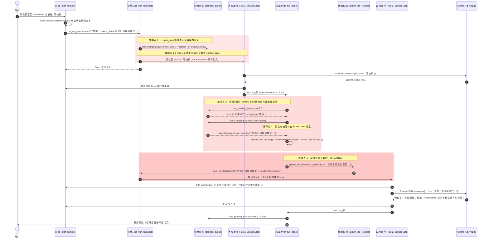

# Rust 引擎 Steering 队列与 Idle-Resume 异常唤醒专项审计报告

> **审计专题**：模型/配置切换提示被错误转化为独立用户消息并异常唤醒 LLM Run 的根因追踪与架构重构方案  
> **审计范围**：`apps/agent-workbench`（`run_launch.rs`, `run_idle.rs`, `engine_build.rs`）、`crates/session-loop`、`crates/orchestrator`（`steering_queue.rs`）及前端交互桥  
> **报告归档**：`docs/context-state-prompt-audit/audits/01-Rust引擎Steering队列与IdleResume异常唤醒审计.md`  
> **审计结论**：确认存在严重架构阻抗失配（Impedance Mismatch）与时序语义错位。系统配置切换快照被错误塞入后台异步唤醒队列 `pending_queue`，在真实用户 Run 期间完全缺席，而在该 Run 正常结束后被判定为唤醒信号，转化为 `role: User` 的伪用户消息并强行拉起全新一轮 `idle-resume` Run，导致模型向用户做出荒谬的“配置确认”自言自语。

---

## 1. 核心异常现象复现与问题定性

### 1.1 异常现象（现场还原）

用户在 Crish 桌面端前端通过设置或顶部状态栏切换模型/服务商/思考档位（例如切换为 Ollama 的 `ornith:latest`、权限模式 `full`、思考档位 `Max`），随后在对话框输入一条真实提问：“帮我写一个快速排序算法”。

**预期表现**：

1. 本次对话由 `ornith:latest` 处理；
2. 模型直接回答快速排序代码；
3. 对话流中仅有用户的一条消息与 AI 的一条回答；若有配置提示，应为顶部的静默元信息胶囊。

**实际异常表现**：

1. 用户消息发出后，AI 完成快速排序代码的生成并收尾；
2. 紧接着，时间线中**凭空出现一条新的用户气泡**（`role: User`），正文赫然写着：  
   `「当前已切换到模型 ornith:latest（服务商 ollama）。权限模式：full。思考档位：Max。」`
3. 随后，模型被**自动触发了全新一轮 Run**，AI 认真回复道：  
   `「明白了。当前配置：模型：ornith:latest（服务商 ollama）。权限模式：full。思考档位：Max。请问有什么我可以帮您的吗？」`

### 1.2 问题本质定性

这是一起由**三重架构错位**交织导致的系统性缺陷：

1. **语义错位（Semantic Drift）**：`pending_queue` 本是承载定时器（Timer）、周期任务（Cron）、子代理完成（Subagent）及崩溃恢复（Recovery）等**后台事件从休眠中唤醒 Agent** 的专用通道。实现者误将其当作“跨 Run 消息暂存箱”，将即时发生的前端 UI 状态切换快照（`context_state`）塞入其中。
2. **时序断裂（Timing Disconnect）**：代码注释声称“下一次用户提交边界 drain 注入”，但在真实的用户提交入口 `run_launch.rs` 中**根本没有任何排空（drain）逻辑**。导致当次真正的用户 Run 对状态一无所知；而在 Run 收尾进入 Idle 时，`run_idle.rs` 却将遗留在队列里的条目当成“待处理的外部唤醒信号”。
3. **角色混淆（Role Confusion）**：系统环境变量与模型配置告知绝不是“人类用户的自然对话输入”。但在 `drain_pending_to_inject_messages` 中，该条目被硬编码包装为 `role: AgentMessageRole::User`，导致底层 `session-loop` 和外部 LLM 无法区分，误以为用户特意发送了一条提示语要求确认配置。

---

## 2. 逐行调用链深度追踪与代码铁证

### 2.1 路径一：前端提交与入站阶段（`run_launch.rs`）

#### 代码证据 1：入站契约中的虚假注释

位于 [`apps/agent-workbench/src-tauri/src/run/run_launch.rs:263-270`](file:///c:/Software/conex/apps/agent-workbench/src-tauri/src/run/run_launch.rs#L263-L270)：

```rust
    /// I1-α②（扩展点 A）：context-state 感知注入文本（前端 provider-profiles
    /// 状态切换产生器在 `emitUiEvent('profiles-changed')` 处生成的快照文本：
    /// 「当前已切换到模型 X / 权限 Y / 思考档位 Z」；None = 无状态切换告知）。
    /// 装配：run_task_impl 收到后经 [PendingMessageQueue::replace_or_enqueue]
    /// （group_id = [CONTEXT_STATE_GROUP] 去重）排入跨 run 队列——下一次
    /// 用户提交边界注入时间线（详案 I1-α② 注入载体契约）。
    #[serde(default, skip_serializing_if = "Option::is_none")]
    pub context_state: Option<String>,
```

- **行号 352-355**：`run_task_impl` 解析出前端携带的 `let context_state = options.context_state;`。

#### 代码证据 2：误入歧途的队列投递与缺席的当次 Run 装配

位于 [`apps/agent-workbench/src-tauri/src/run/run_launch.rs:792-819`](file:///c:/Software/conex/apps/agent-workbench/src-tauri/src/run/run_launch.rs#L792-L819)：

```rust
    // ── I1-α②（扩展点 A）：context-state 感知注入 ─────────────────
    // 前端 provider-profiles 状态切换产生器（emitUiEvent('profiles-changed')
    // 处生成「当前已切换到模型 X / 权限 Y / 思考档位 Z」快照文本）经
    // run-task `contextState` 入站 → 本处经 PendingMessageQueue
    // replace_or_enqueue（group_id = CONTEXT_STATE_GROUP 去重——连切两次
    // 只注入一次）排入跨 run 队列 → 下一次用户提交边界
    // drain_pending_to_inject_messages 按 User 文本注入时间线（详案 I1-α②
    // 注入载体契约；17 审计纪律：仅「状态切换发生」感知注入进 seq，
    // 配置/偏好本身不进消息流）。
    if let Some(text) = context_state.filter(|t| !t.trim().is_empty()) {
        let now = now_ms_internal();
        let entry = orchestrator::steering_queue::SteeringInputEntry::context_state(
            format!("context-state-{run_id}-{now}"),
            text,
            now,
        )
        .with_session(&session_id);
        state
            .pending_queue
            .lock()
            .unwrap_or_else(|e| e.into_inner())
            .replace_or_enqueue(entry);
        tracing::info!(
            target: "run",
            session_id = %session_id,
            "context-state 感知注入已排入跨 run 队列（下一次用户提交边界注入时间线）"
        );
    }
```

**严重断层核查**：

1. **当次 Run 毫无所知**：
   - 查看第 736-737 行：`o.assembly.system_prompt = assemble_system_prompt_with_stages(&state, &session_id, system_prompt);`，此处**完全没有传入或合并 `context_state`**！
   - 查看第 786-790 行：`let message = crate::engine::user_message_with_content(&prompt.unwrap_or_default(), ...);`，当次 Run 的用户消息只包含了前端传来的真实 `prompt`，**根本没有包含 `context_state`**！
   - 查看第 846-858 行：`SessionLoopProducer::new` 初始化时，`options` 与 `message` 均与 `context_state` 无关。
2. **“下一次用户提交边界注入”是彻底的谎言**：
   - 全局搜索 `run_launch.rs`，**全文零处调用 `drain_pending_to_inject_messages`**！
   - 用户提交边界只做了 `replace_or_enqueue`（入队），压根没有任何出队/注入逻辑！
   - 该条目被硬生生遗留在 `state.pending_queue` 之中，成为一颗等待在 Run 结束时引爆的“定时炸弹”。

---

### 2.2 路径二：Run 收尾与 Idle 阶段的错误判续（`run_idle.rs`）

当用户的当次 Run（Run 1）完成其 LLM 交互后，驱动任务进入 [`drive_run_loop`](file:///c:/Software/conex/apps/agent-workbench/src-tauri/src/run/run_idle.rs#L1306) 的末尾收口阶段。

#### 代码证据 3：误判队列非空为唤醒信号

位于 [`apps/agent-workbench/src-tauri/src/run/run_idle.rs:114-157`](file:///c:/Software/conex/apps/agent-workbench/src-tauri/src/run/run_idle.rs#L114-L157)：

```rust
                // ── 四源判定：队列（首要唤醒源）/ 定时器 / Cron / goal_pending ──
                let queue_pending = {
                    let queue = state
                        .pending_queue
                        .lock()
                        .unwrap_or_else(|e| e.into_inner());
                    queue.has_pending_for(&active.session_id)
                };
...
                if !(queue_pending || timer_active || cron_enabled || goal_pending) {
                    // 四源全空：run 正常收场，AI 休眠待用户（硬条件）
                    return None;
                }
```

- 正常情况下，用户对话完成后四源全空，函数返回 `None`，Agent 应当进入正常的 Idle 休眠状态等待用户下一次输入。
- 然而，由于刚才在 `run_launch.rs:813` 塞入的 `context_state` 仍然孤零零地躺在 `pending_queue` 中，`queue.has_pending_for(&active.session_id)` **直接命中为 `true`**！
- 引擎判定：“有待处理的后台唤醒源！不能休眠！”

#### 代码证据 4：排出队列并生成 ResumeDecision

位于 [`apps/agent-workbench/src-tauri/src/run/run_idle.rs:223-248`](file:///c:/Software/conex/apps/agent-workbench/src-tauri/src/run/run_idle.rs#L223-L248)：

```rust
                let inject = if queue_pending {
                    let mut queue = state
                        .pending_queue
                        .lock()
                        .unwrap_or_else(|e| e.into_inner());
                    let drained = drain_pending_to_inject_messages(&mut queue, &active.session_id);
                    match (drained.into_iter().next(), goal_text) {
                        (Some(mut message), Some(text)) => {
                            message.blocks.push(AgentMessageBlock::Text { text });
                            vec![message]
                        }
                        (Some(message), None) => vec![message],
                        (None, Some(text)) => vec![goal_continue_message(&active.session_id, text)],
                        (None, None) => Vec::new(),
                    }
                } else if let Some(text) = goal_text {
                    vec![goal_continue_message(&active.session_id, text)]
                } else {
                    Vec::new()
                };
                let mode = if goal_pending {
                    "goal-continue"
                } else {
                    "idle-resume"
                };
                Some(ResumeDecision { mode, inject })
```

- 这里执行了 `drain_pending_to_inject_messages`，并生成了决策：
  `ResumeDecision { mode: "idle-resume", inject: vec![message] }`！

#### 代码证据 5：启动全新 Run

位于 [`apps/agent-workbench/src-tauri/src/run/run_idle.rs:1619-1644`](file:///c:/Software/conex/apps/agent-workbench/src-tauri/src/run/run_idle.rs#L1619-L1644)：

```rust
            if let Some(decision) = decide_idle_resume(
                &state,
                &active,
                resume_reason,
                resume_turn_index > 0 || resume_tool_calls > 0,
                &resume_signals,
            )
            .await
            {
                tracing::info!(
                    target: "run",
                    session_id = %session_id,
                    run_id = %run_id,
                    inject_messages = decision.inject.len(),
                    "idle 待命命中：自动续开一轮 run（队列条目批量注入 / 定时器 / Cron / goal / 恢复源）"
                );
                let launcher = state
                    .resume_launcher
                    .lock()
                    .unwrap_or_else(|e| e.into_inner())
                    .clone();
                match launcher {
                    Some(launcher) => {
                        launcher(&state, &session_id, decision.mode, decision.inject).await
                    }
...
```

`launcher` 被调用，直接进入生产拉起器 `production_resume_launcher`，进而调用 `idle_resume::spawn_idle_resume_run`。

---

### 2.3 路径三：将系统状态硬编码包装为 `role: User` 并向模型提问

#### 代码证据 6：罪魁祸首——硬编码包装为 User 消息

查看 [`apps/agent-workbench/src-tauri/src/run/run_idle.rs:619-633`](file:///c:/Software/conex/apps/agent-workbench/src-tauri/src/run/run_idle.rs#L619-L633)：

```rust
        // 全为 context-state 条目：逐条注入（各带 kind=context-state）
        context_states
            .into_iter()
            .map(|entry| AgentMessage {
                id: entry.id,
                role: AgentMessageRole::User, // <--- 关键铁证：将系统切换告知硬编码为用户身份！
                created_at: crate::engine::now_iso_utc(),
                blocks: vec![AgentMessageBlock::Text { text: entry.text }],
                metadata: Some(serde_json::json!({
                    "kind": AgentMessageMetadataKind::ContextState
                })),
                client_message_id: None,
                content: None,
            })
            .collect()
```

#### 代码证据 7：提取为文本作为 prompt 拉起新 Run

位于 [`apps/agent-workbench/src-tauri/src/run/run_idle.rs:1226-1281`](file:///c:/Software/conex/apps/agent-workbench/src-tauri/src/run/run_idle.rs#L1226-L1281)：

```rust
    pub(crate) async fn spawn_idle_resume_run(
        state: Arc<CoreRunState>,
        session_id: String,
        mode: &str,
        inject: Vec<AgentMessage>,
    ) {
        let mut text = inject
            .iter()
            .map(|message| message.text())
            .collect::<Vec<_>>()
            .join("\n");
...
        let options = RunTaskOptions {
            run_id: crate::engine::new_message_id("idle-resume"),
            session_id: session_id.clone(),
            prompt: Some(text),
            mode: Some(mode.to_string()),
            ...
        };
        if let Err(error) = run_task_impl(Arc::clone(&state), options).await {
...
```

- `text` 被拼装为：`"当前已切换到模型 ornith:latest（服务商 ollama）。权限模式：full。思考档位：Max。"`。
- 新的 `RunTaskOptions` 以该文本为 `prompt`，以模式 `"idle-resume"` 再次调用 `run_task_impl`！

#### 代码证据 8：`session-loop` 收到新的用户消息并请求模型

在新的 Run（Run 2）中：

1. `run_task_impl`（`run_launch.rs:786-790`）根据 `prompt` 创建消息：
   ```rust
   let message = crate::engine::user_message_with_content(&prompt.unwrap_or_default(), ...);
   ```
2. 传入 `SessionLoopProducer::new`，并在 `produce`（`engine_build.rs:1626`）中执行：
   ```rust
   let mut outcome = session_loop.run(self.user_message.clone()).await;
   ```
3. 在 `AgentSessionLoop::run`（[`crates/session-loop/src/loop/loop_exec.rs:112`](file:///c:/Software/conex/crates/session-loop/src/loop/loop_exec.rs#L112)）中：
   ```rust
   self.state.input_queue.enqueue_force(input);
   ```
4. 进入状态机的 `AwaitingInput` -> `PreparingTurn` -> `Streaming`。
5. Provider 将会话历史与最后一条“用户消息”组合发送给 LLM：
   ```json
   [
     { "role": "user", "content": "帮我写一个快速排序算法" },
     { "role": "assistant", "content": "好的，这是快速排序算法实现..." },
     {
       "role": "user",
       "content": "当前已切换到模型 ornith:latest（服务商 ollama）。权限模式：full。思考档位：Max。"
     }
   ]
   ```
6. **LLM 的视角**：
   LLM 发现用户突然在对话中发送了一句状态描述，作为遵从指令的对话助手，LLM 必然会对此做出回应：
   `"明白了。当前配置：模型：ornith:latest（服务商 ollama）。权限模式：full。思考档位：Max。请问有什么我可以帮您的吗？"`
7. **前端的视角**：
   在前端（`apps/crish-desktop`），由于这条新消息是作为一轮真实 Run 由引擎广播的，`sender` 为 `'user'`，`text` 为非空文本。前端组件 [`sessionInjectionMount.ts:36`](file:///c:/Software/conex/apps/crish-desktop/src/store/sessionInjectionMount.ts#L36) 的过滤规则为：
   ```typescript
   if (!msg || msg.sender !== 'assistant') return false; // 只有 assistant 且 text 为空的消息才会被当作纯状态载体微提示折叠
   ```
   因此前端无法将其识别为状态胶囊，只能将其作为一个硕大的**用户消息气泡**渲染在时间线上，并随之渲染出 AI 的无用回复！

---

## 3. 全链路时序图（Mermaid Sequence Diagram）

以下 Mermaid 时序图完整再现了从用户发起请求到异常唤醒发生的全过程：



---

## 4. 根因剖析与架构阻抗分析

### 4.1 根因一：`PendingMessageQueue` 的“唤醒”职责被越界污染

查看 `crates/orchestrator/src/steering_queue.rs` 与 `apps/agent-workbench/src-tauri/src/run/run_core.rs`：

- `pending_queue` 的真正宿主是 `engine.timer_steering_queue()`。
- 它的入队方是：
  - 定时器到期（`TimerRegistry`）；
  - 定时调度到期（`CronManager`）；
  - 子 Agent 异步执行完毕（`SubagentSpawner`）；
  - 瞬态网络错误重试（`RecoveryManager`）。
- **这些事件的唯一共同特征是：Agent 当前处于 Idle 静默状态，外部世界发生了一件需要唤醒 Agent 做出反应的事。**
- 而“前端用户修改了配置并在当次点击了发送”，这是一个**同步伴随当前请求的上下文属性**，绝非需要 Agent 在事后“惊醒并答复”的异步事件。将其放入 `pending_queue`，直接触发了 `decide_idle_resume` 的四源命中逻辑（`queue_pending == true`），导致 Agent 在收工后被瞬间误唤醒。

### 4.2 根因二：入队处声称“下次提交排空”与实际零调用的虚妄承诺

在 `run_launch.rs:797-798` 中：

> `// ...排入跨 run 队列 → 下一次用户提交边界 drain_pending_to_inject_messages 按 User 文本注入时间线`

设计者在构思时可能设想了一个模型：
“用户切了模型 -> 暂存入队列 -> 下次用户发消息时 -> 在 `run_launch` 中 drain 出来合并”。
但**实际编码时完全遗漏了在 `run_launch.rs` 中消费并排空队列的代码**！导致：

- 任何通过 `run_task` 入站的 `context_state` 都只进不出；
- 唯一调用 `drain_pending_to_inject_messages` 的地方恰恰是 `run_idle.rs` 中的收尾逻辑；
- 于是本想在“下一次提交注入”的条目，变成了“在本次完成时强制续跑”。

### 4.3 根因三：将系统环境信息伪造成用户自然语言输入

在 `run_idle.rs:623` 中：
`role: AgentMessageRole::User`
环境状态切换本质上是系统的元信息（System Context / Metadata），不是 User 对话。
在大语言模型的 Prompt 工程中：

- `role: system`：用于规定 AI 的运行环境、规则与当前状态；
- `role: user`：代表人类用户的意图。
  将系统状态伪造成 `role: user`，不仅诱导模型做出无谓的寒暄回复，更严重污染了上下文缓存（Prompt Cache）和历史对话语义。

---

## 5. 根治性重构方案设计

为彻底根治此问题，必须推翻“通过 `pending_queue` 传递 `context_state`”的错误设计，将其还原为“**当前 Run 的 System Prompt 上下文装配**”。

### 5.1 方案架构原则

1. **零队列依赖（Zero Queue Coupling）**：`context_state` 严禁碰触 `PendingMessageQueue`，从根源切断触发 `decide_idle_resume` 的物理路径。
2. **即时当次生效（Immediate Single-Run Assembly）**：用户发起的当次 Run（Run 1）必须在启动时即可感知状态，汇入 `options.assembly.system_prompt` 或提示词注入器。
3. **禁止自动续跑（No Idle-Resume Trigger）**：配置变更属于环境切变，不产生独立的消息回合，不发射 `role: User` 消息，不唤醒新的 LLM Run。
4. **与前端 UI 显式通知对齐**：前端（`slashSendQueueHelper.ts`）已通过 `contextInjectionDispatcher.inject` 在本地挂载了视觉提示胶囊（`ContextStateNotice`），后端只需专注将状态传递给 LLM，无需在时间线中画蛇添足。

---

### 5.2 核心重构落地点与代码改动方案

#### 改造点 1：修改 `run_launch.rs`，将 `context_state` 移出 `pending_queue`，直接汇入 `system_prompt`

**原代码（`apps/agent-workbench/src-tauri/src/run/run_launch.rs:736-737, 801-819`）**：

- 删除第 801-819 行的 `state.pending_queue.lock().replace_or_enqueue(entry)`；
- 在第 736 行装配 `system_prompt` 时，将 `context_state` 作为环境感知段直接拼接进去。

**拟定重构实现**：

```rust
    // ── 改造：context_state 直接汇入当前 run 的 system_prompt ──
    let effective_system_prompt = match (system_prompt, context_state.filter(|t| !t.trim().is_empty())) {
        (Some(sp), Some(cs)) => Some(format!("{sp}\n\n[环境状态感知]\n{cs}")),
        (None, Some(cs)) => Some(format!("[环境状态感知]\n{cs}")),
        (sp, None) => sp,
    };

    let options = {
        let mut o = SessionLoopOptions::default();
        o.tool_exec.cwd = cwd.clone();
        o.tool_exec.assistant_client_message_id = assistant_client_message_id.clone();
        o.assembly.system_prompt =
            assemble_system_prompt_with_stages(&state, &session_id, effective_system_prompt);
        // ... 其余装配保持不变 ...
        o
    };
```

或者利用现有的 `ContextInjector`（若非子代理模式也可以挂载系统注入项）：
在 `SessionLoopProducer` 的 `produce` 阶段渲染进 `system_prompt` 面，保证其不占用压缩预算。

#### 改造点 2：清理 `run_idle.rs` 中的异常注入逻辑

查看 [`apps/agent-workbench/src-tauri/src/run/run_idle.rs:550-633`](file:///c:/Software/conex/apps/agent-workbench/src-tauri/src/run/run_idle.rs#L550-L633)：

- 由于 `pending_queue` 不再接收 `CONTEXT_STATE_GROUP`，`drain_pending_to_inject_messages` 中的 `context_states` 分支实际上已变成死逻辑。
- 应当彻底清理 `drain_pending_to_inject_messages` 中生成 `AgentMessageRole::User` 的 `context_states` 转换块；
- 确保 `drain_pending_to_inject_messages` 仅用于合法的后台通知（定时器、Cron、子代理、错误恢复）。

#### 改造点 3：裁剪 `orchestrator::steering_queue` 的残留定义与测试配平

查看 [`crates/orchestrator/src/steering_queue.rs:96-117`](file:///c:/Software/conex/crates/orchestrator/src/steering_queue.rs#L96-L117)：

- 评估是否保留 `SteeringInputEntry::context_state`；若保留，必须添加清晰的弃用（deprecated）或仅限内部测试的注释，并在文档中明示：**严禁将 UI 配置状态放入本队列，否则将导致 Idle-Resume 异常唤醒**。
- 同步更新或移除相关的去重测试（如 `context_state_entry_dedups_and_marks_kind`）。

---

## 6. 验证方案与验收标准

在后续执行阶段落地该重构后，必须执行以下验收程序：

1. **单元与集成测试层**：
   - 编写针对 `core_run_task` 的集成测试：传入包含 `context_state = Some("当前已切换...")` 的 `RunTaskOptions`；
   - 断言 1：`state.pending_queue` 在 Run 发起后**依然为空**（`has_pending_for == false`）；
   - 断言 2：`decide_idle_resume` 在 Run 结束后**返回 `None`**；
   - 断言 3：`active_runs` 结束后，不会触发第二次 `spawn_idle_resume_run`；
   - 断言 4：`options.assembly.system_prompt` 确实包含了 `[环境状态感知]` 字符串。

2. **端到端真机桌面运行层（桌面 MCP / 真实 UI）**：
   - 在前端点击切换模型至任意本地或远端模型（如 Ollama `ornith:latest`）；
   - 输入“你好”，等待模型流式输出完毕；
   - **验收断言**：
     - AI 回复完成后，对话立即进入空闲就绪态；
     - 没有任何后续自动弹出的“当前已切换到模型...”用户气泡；
     - 模型不会输出“明白了，当前配置...”的冗余回复；
     - 控制台日志中绝不出现 `idle 待命命中：自动续开一轮 run`。

---

## 7. 审计总结

本专项审计彻底查清了模型切换提示被异常转化为用户消息并触发自动回复的底层链路。
该缺陷是由**I1-α② 方案在落地时，错误混淆了“跨 Run 异步唤醒队列”与“单次请求配置注入”的职责界限**所引发的。

通过将 `context_state` 从 `pending_queue` 中彻底解耦、直接注入当前 Run 的 `system_prompt`，能够一举达成三个目标：

1. **解决假唤醒**：消除多余的 Run，保护用户 Token 与 API 额度；
2. **净化时间线**：彻底消灭幽灵用户气泡与无意义的模型确认回复；
3. **真实赋能上下文**：让当前生效的模型在当次请求时就正确感知自身所处的环境配置。
