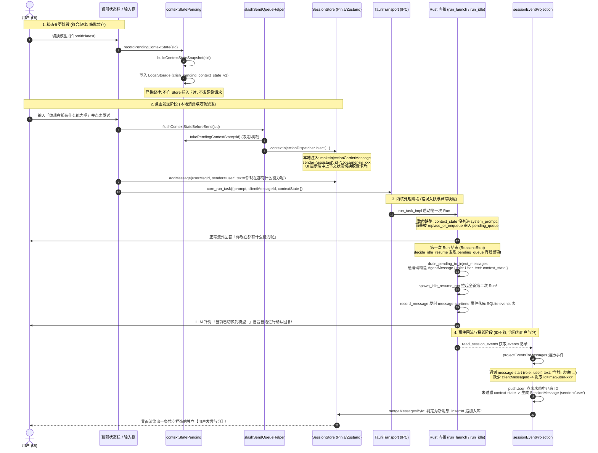

# 02 - 前端状态快照生成、暂存与发送流水线专项审计报告

> **审计员角色**：前端状态快照生成、暂存与发送流水线专项审计员  
> **审计日期**：2026-10-12  
> **审计对象**：前端状态快照生成、LocalStorage 暂存寻址、发送前流水线消费、Store 载体注入、IPC 参数下发及事件回流全链路  
> **关联报告**：
>
> - `docs/context-state-prompt-audit/audits/01-Rust引擎Steering队列与IdleResume异常唤醒审计.md`（内核队列与异常唤醒侧）
> - `docs/context-state-prompt-audit/audits/03-模型提示词注入与系统提示线网协议审计.md`（Prompt 装配与 Wire 协议侧）  
>   **权威依据**：`AGENTS.md` 通用协作纪律、`ANTI_OVERENGINEERING_GUARDRAILS.md`、前端 Single Source of Truth（SSOT）契约规范

---

## 一、审计背景与问题定性

### 1.1 审计背景与审查目标

用户在桌面客户端中配置模型、权限与思考档位后与 AI 交互时，发现了一个严重背离预期的交互异象：
在切换模型/权限后发送业务提问（如“帮我写一个快速排序算法”或“你现在都有什么能力呢”），对话流在 AI 正常回答完毕后，**凭空冒出一条内容为「当前已切换到模型...」的独立用户气泡（`role: user`）**，紧接着 AI 被异常拉起全新一轮 Run，就此状态文本进行自言自语式的“配置确认回答”。

本报告作为专项审计的三部曲之二，聚焦**前端视角**，完整剖析：

1. 模型/权限/思考档位切换时，前端如何生成状态快照文本并暂存？
2. 切换瞬间为何没有立刻发送消息（是否严格遵守了用户纪律）？
3. 用户点击发送时，前端如何通过 `flushContextStateBeforeSend` 取走暂存并在本地 Store 注入了什么？
4. 前端通过 Tauri IPC `run_task` 向后端下发了什么载荷？
5. 为什么该 `contextState` 最终又通过后端的事件流回流成一条独立的用户消息？
6. 当后端的 `message-start`（带有 `role: 'user'`，文本为状态切换文本）到达前端时，前端内部如何处理？为什么未能识别并创建了新用户气泡？

### 1.2 核心定性：双轨状态分裂与幂等失谐

经全链路逐行审查，前端在状态快照的处理上存在**「本地 Store 静默自愈注入」与「IPC 盲目下发」的双轨状态分裂（Split-Brain）**：

1. **本地轨（Local Track）**：前端已在本地 Store 中将该状态变更作为**助手载体卡片（`sender: 'assistant'`，携带 `workspace_env` 类型的 `injections`）**插入时间线，位于用户发送的消息正上方；
2. **IPC 轨（Remote Track）**：前端在已完成本地视觉注入的前提下，依然将纯文本 `flushedContextState` 附加于 `run_task` 的 `contextState` 参数，下发给 Rust 内核；
3. **回流轨（Replay Track）**：Rust 内核将 `contextState` 误作为唤醒事件放入 `pending_queue`，在 Idle 阶段拉起新 Run 并持久化为一条新的 `AgentMessage { role: User }`。当该事件通过 `message-start` / `message-end` 回流前端，或者在会话水合（Hydration）时由 `sessionEventProjection.ts` 处理时，由于该消息**缺失 `clientMessageId`** 且角色被标为 `user`，前端投影逻辑将其判定为一条“全新的用户发言”，从而在 UI 上补画了一个刺眼的用户输入气泡！

---

## 二、逐行审查：前端快照生成与暂存机制

### 2.1 状态数据源与快照生成函数

快照生成的核心逻辑位于 [`apps/crish-desktop/src/api/provider-profiles/contextStatePending.ts`](file:///c:/Software/conex/apps/crish-desktop/src/api/provider-profiles/contextStatePending.ts)。

#### 代码证据 1：字段采集源（第 36-64 行、69-81 行）

```typescript
function readActiveModelId(): string {
  try {
    return localStorage.getItem('crish_active_model_id') || '';
  } catch {
    return '';
  }
}

function readActiveProfileId(): string {
  try {
    return localStorage.getItem('crish_active_profile_id') || '';
  } catch {
    return '';
  }
}

function readThinkingLevel(targetSessionId?: string): string {
  try {
    const sid = (
      targetSessionId ||
      getSessionStoreState().activeSessionId ||
      ''
    ).trim();
    const title =
      (sid ? getSessionThinkingTitle(sid) : null) ??
      loadModelThinkingPref(readActiveProfileId(), readActiveModelId());
    return typeof title === 'string' ? title.trim() : '';
  } catch {
    return '';
  }
}

export function readContextStateSnapshot(targetSessionId?: string): {
  model: string;
  profile: string;
  permission: string;
  thinking: string;
} {
  return {
    model: readActiveModelId(),
    profile: readActiveProfileId(),
    permission: getPermissionMode(),
    thinking: readThinkingLevel(targetSessionId),
  };
}
```

- **分析**：前端采集四个正交维度：`model`（模型名）、`profile`（服务商 ID）、`permission`（全局权限模式 `ask`/`full` 等）、`thinking`（思考档位 Title，优先会话覆盖，回退模型偏好）。

#### 代码证据 2：纯文本快照拼接（第 90-116 行）

```typescript
export function buildContextStateSnapshot(
  targetSessionId?: string
): Omit<ContextStatePayload, 'sessionId'> | null {
  const model = readActiveModelId();
  const profile = readActiveProfileId();
  const permission = getPermissionMode();
  const thinking = readThinkingLevel(targetSessionId);
  if (!model && !profile) return null;
  const parts: string[] = [];
  if (model) {
    parts.push(
      profile
        ? `当前已切换到模型 ${model}（服务商 ${profile}）`
        : `当前已切换到模型 ${model}`
    );
  }
  if (permission) parts.push(`权限模式：${permission}`);
  if (thinking) parts.push(`思考档位：${thinking}`);
  const text = parts.join('。') + '。';
  return {
    model,
    ...(profile ? { profile } : {}),
    ...(permission ? { permission } : {}),
    ...(thinking ? { thinking } : {}),
    text,
  };
}
```

- **分析**：输出字符串精确匹配现场复现的内容，形如：  
  `「当前已切换到模型 ornith:latest（服务商 ollama）。权限模式：full。思考档位：Max。」`。

### 2.2 产生器入口与暂存机制（`recordPendingContextState`）

#### 代码证据 3：暂存写入与防抖去重（第 209-245 行）

```typescript
export function recordPendingContextState(targetSessionId?: string): void {
  try {
    const store = getSessionStoreState();
    const sid = (targetSessionId || store.activeSessionId || '').trim();
    if (!sid) {
      return;
    }
    const snapshot = buildContextStateSnapshot(sid);
    if (!snapshot) return;
    const text = snapshot.text;

    // 检查是否切回了本会话上一次真实发送时的状态（切出去又切回来不重复弹提示）
    const lastSentSig = getLastSentContextSignature(sid);
    if (lastSentSig && text === lastSentSig) {
      clearStash(sid);
      lastRecordedSignaturesBySession.delete(sid);
      return;
    }

    // 会话级去重：文本与当前会话上次待发送快照一致 → 不重复写入
    const lastSig = lastRecordedSignaturesBySession.get(sid);
    if (text === lastSig) return;
    lastRecordedSignaturesBySession.set(sid, text);

    writeStash({
      sessionId: sid,
      model: snapshot.model,
      ...(snapshot.profile ? { profile: snapshot.profile } : {}),
      ...(snapshot.permission ? { permission: snapshot.permission } : {}),
      ...(snapshot.thinking ? { thinking: snapshot.thinking } : {}),
      text,
    });
  } catch {
    /* swallow-ok: 记录失败不影响状态切换本身 */
  }
}
```

- **分析**：
  1. **触发时机**：用户在顶部状态栏切换模型（`ModelBadgePickerMenu.tsx:140`）、切换服务商 Profile（`profileStoreActivation.ts:107`）、切换思考档位（`ModelBadgePickerMenu.tsx:152`）或在输入框底部切换权限时调用。
  2. **防回弹去重**：若用户切为模型 B 后又切回模型 A（与 `lastSentSig` 一致），则调用 `clearStash(sid)` 撤销暂存，不会产生假变更。
  3. **暂存载荷**：写入 `localStorage` 键 `crish_pending_context_state_v1:${sessionId}`，内容为包含结构化字段与 `text` 的 JSON 字符串。

### 2.3 关键裁决验证：切换瞬间为何不发送消息？

审查 [`apps/crish-desktop/src/api/provider-profiles/contextStatePending.ts:197-201`](file:///c:/Software/conex/apps/crish-desktop/src/api/provider-profiles/contextStatePending.ts#L197-L201)：

```typescript
/**
 * @deprecated 切换时不再即时派发提示卡片。居中提示必须在用户点击发送后才带上，且位于用户消息上方。
 */
export function dispatchInstantContextStateNotification(
  _targetSessionId?: string | null
): void {
  // no-op: 严格遵守用户裁决，切换瞬间不向消息流追加任何卡片
}
```

- **结论**：**切换瞬间绝对不向对话流注入任何卡片，也绝对不向后端发送任何网络请求**。这是完全符合用户协作纪律（REQ-D08 / 用户体验规范）的正确设计——用户可能连续切换多次模型，如果在切换瞬间即写消息流，会造成界面刷屏和连续垃圾消息。暂存机制确保了变更仅在本地被静默记忆。

### 2.4 取走暂存与销毁机制（`takePendingContextState`）

审查 [`apps/crish-desktop/src/api/provider-profiles/contextStatePending.ts:252-291`](file:///c:/Software/conex/apps/crish-desktop/src/api/provider-profiles/contextStatePending.ts#L252-L291)：

```typescript
export function takePendingContextState(
  currentSessionId?: string | null
): ContextStatePayload | undefined {
  const sid = (currentSessionId || '').trim();
  let stash = readStash(sid);
  // 草稿态晋升会话兼容逻辑...
  if (!stash) return undefined;
  // 跨会话隔离检查：若绑定其他真实会话则拒绝消费...
  if (stash.sessionId && stash.sessionId !== sid && !isDraftOrigin) {
    return undefined;
  }
  // 匹配成功才消费并清除暂存（单次消费保证）
  clearStash(sid);
  if (stash.sessionId) {
    clearStash(stash.sessionId);
    lastRecordedSignaturesBySession.delete(stash.sessionId);
  }
  clearStash();
  lastRecordedSignaturesBySession.delete(sid);
  return stash;
}
```

- **分析**：`takePendingContextState` 具有严格的**会话绑定**与**取走即焚（Destructive Read）**语义，保证同一会话的同一配置变更在前端只能被读取并消费一次。

---

## 三、逐行审查：点击发送时的消费与双轨派发

当用户在输入框输入「你现在都有什么能力呢」并点击发送时，主发送协调器 [`apps/crish-desktop/src/hooks/chat-stream/useSlashSend.ts`](file:///c:/Software/conex/apps/crish-desktop/src/hooks/chat-stream/useSlashSend.ts) 被触发。

### 3.1 `slashSendQueueHelper.ts` 的消费与基线比对

审查 [`apps/crish-desktop/src/hooks/chat-stream/slashSendQueueHelper.ts:62-114`](file:///c:/Software/conex/apps/crish-desktop/src/hooks/chat-stream/slashSendQueueHelper.ts#L62-L114)：

```typescript
export function flushContextStateBeforeSend(
  sessionId: string
): string | undefined {
  try {
    const contextState = takePendingContextState(sessionId);
    if (!contextState) {
      // 若本会话尚未建立首发基线，记录当前状态作为基线（后续切换可检测差异）
      rememberContextBaseline(sessionId);
      return undefined;
    }

    const live = readContextStateSnapshot(sessionId);
    const { rawText, next } = resolveInjectionSnapshot(contextState, live);
    const { changed, fields } = diffContextStateSnapshot(
      getLastSentContextSnapshot(sessionId),
      next
    );

    // 字段无变化：不注入。
    if (changed.length === 0) {
      if (rawText) setLastSentContextSignature(sessionId, rawText);
      setLastSentContextSnapshot(sessionId, next);
      return undefined;
    }

    // 仅在真实发生切换且在用户点击发送按钮瞬间，将居中提示挂载于会话（位于用户发送的消息上方）
    // metadata 只写变化字段，并附 changed[]。首次注入（无结构化快照）= 全部字段。
    contextInjectionDispatcher.inject(sessionId, {
      kind: 'workspace_env',
      title: '上下文状态切换',
      summary: rawText,
      status: 'injected',
      source: 'system_event',
      content: rawText,
      metadata: {
        mode: 'context-state',
        ...fields,
        changed,
      },
    });

    // 成功发送后更新该会话最后发送的状态签名与结构化快照
    if (rawText) setLastSentContextSignature(sessionId, rawText);
    setLastSentContextSnapshot(sessionId, next);
    return rawText;
  } catch (err) {
    console.error(
      '[slashSendQueueHelper] failed to flush context-state before send:',
      err
    );
    return undefined;
  }
}
```

#### 关键步骤执行明细：

1. **取走暂存（第 66 行）**：调用 `takePendingContextState(sessionId)`，获得暂存载荷，同时从 `localStorage` 中清除该会话的暂存。
2. **差异比对（第 75-78 行）**：通过 `diffContextStateSnapshot` 与上次发送基线比对，计算出究竟是哪些字段发生了变化（如 `['model', 'thinking']`）。
3. **本地写卡注入（第 89-101 行）**：调用 `contextInjectionDispatcher.inject(...)` 向会话追加一条 `workspace_env` 可见环境卡片。
4. **返回值（第 106 行）**：将 `rawText`（即 `"当前已切换到模型..."` 字符串）返回给调用者。

### 3.2 `useSlashSend.ts` 的发送时序与参数挂载

审查 [`apps/crish-desktop/src/hooks/chat-stream/useSlashSend.ts:216-262`](file:///c:/Software/conex/apps/crish-desktop/src/hooks/chat-stream/useSlashSend.ts#L216-L262)：

```typescript
// 9. 空闲时乐观入库并启动流式
const flushedContextState = flushContextStateBeforeSend(sessionId);
if (flushedContextState) {
  streamOptionsWithClientMsg.contextState = flushedContextState;
}

let enqueued = false;
try {
  addMessage(wsId, sessionId, {
    id: userMsgId,
    sender: 'user',
    text: displayText,
    timestamp: Date.now(),
    status: 'processing',
    ...(userImages.length ? { images: userImages } : {}),
    ...(userAttachments.length ? { attachments: userAttachments } : {}),
  });
  enqueued = !!getSessionById(sessionId)?.messages?.some(
    (m: SessionMessage) => m.id === userMsgId
  );
} catch (err) {
  console.error('[useSlashSend] failed to add user message:', err);
}

// 清理草稿并准备启动流式...
runStreamingAssistant(input, userMsgId, sessionId, streamOptionsWithClientMsg);
```

#### 极其关键的时序铁证：

1. **时序顺序 1（第 217 行）**：`flushContextStateBeforeSend` **在** `addMessage(userMsgId)` **之前执行**！这意味着本地 Store 先收到了状态注入卡片，随后才收到用户的提问消息；
2. **时序顺序 2（第 218-220 行）**：将 `flushedContextState` 字符串塞入 `streamOptionsWithClientMsg.contextState`；
3. **时序顺序 3（第 224-235 行）**：乐观写入用户的输入（`displayText` = `「你现在都有什么能力呢」`，`sender: 'user'`）；
4. **时序顺序 4（第 256-261 行）**：调用 `runStreamingAssistant`，将携带了 `contextState` 的请求选项下发。

### 3.3 本地 Store 注入了什么？（载体消息解析）

在第 3.1 节中，`flushContextStateBeforeSend` 调用了 `contextInjectionDispatcher.inject`。进一步追踪：

1. [`apps/crish-desktop/src/api/contextInjectionDispatcher.ts:59-92`](file:///c:/Software/conex/apps/crish-desktop/src/api/contextInjectionDispatcher.ts#L59-L92)：
   生成形如 `inj_m3...` 的注入 ID，组装完整对象后调用 `addContextInjection(sid, fullInjection)`。
2. [`apps/crish-desktop/src/store/sessionInjectionActions.ts:47-78`](file:///c:/Software/conex/apps/crish-desktop/src/store/sessionInjectionActions.ts#L47-L78)：
   ```typescript
   const isState = isContextStateInjection(injection);
   const lastMsg = sess.messages[sess.messages.length - 1];
   const target = isState
     ? isContextStateCarrierMessage(lastMsg)
       ? lastMsg
       : undefined
     : findInjectionMountTarget(sess.messages);
   if (target) {
     appendInjectionToMessage(target, injection);
   } else {
     sess.messages.push(makeInjectionCarrierMessage(injection));
   }
   ```
3. [`apps/crish-desktop/src/store/sessionInjectionMount.ts:243-258`](file:///c:/Software/conex/apps/crish-desktop/src/store/sessionInjectionMount.ts#L243-L258)：
   ```typescript
   export function makeInjectionCarrierMessage(
     injection: MessageContextInjection
   ): SessionMessage {
     const carrierId = `ctx-carrier-${injection.id}`;
     return {
       id: carrierId,
       sender: 'assistant',
       text: '',
       timestamp: injection.timestamp,
       injections: [injection],
       blocks: [{ type: 'context_injection', id: injection.id, injection }],
     };
   }
   ```

#### 审查结论：

此时前端在本地 Store 中注入的**是一条带有 `injections` 与 `context_injection` 块的助手载体消息（`carrierMessage`）**：

- `id`: `ctx-carrier-inj_...`
- `sender`: `'assistant'`（**角色为 assistant，而不是 user**）
- `text`: `''`（正文为空）
- `blocks`: `[{ type: 'context_injection', injection: ... }]`
- `injections`: 包含 `metadata.mode = 'context-state'`、`title = '上下文状态切换'`、`summary = '当前已切换到模型...'` 的卡片对象。

在前端 UI 渲染层中，该消息被 `MessageItem` 识别为纯状态载体，并以**居中灰色胶囊卡片（Center Pill Card）**优雅地展示在用户消息上方，完全不占用普通气泡样式。

---

## 四、核心追踪：IPC 下发与后端事件回流机制分析

### 4.1 IPC `run_task` 向后端传递了什么？

追踪 `runStreamingAssistant` 贯穿到底层的全链路：

1. [`apps/crish-desktop/src/hooks/chat-stream/useRunStreamingAssistant.ts:348-351`](file:///c:/Software/conex/apps/crish-desktop/src/hooks/chat-stream/useRunStreamingAssistant.ts#L348-L351)：
   调用 `streamAssistantResponseApi`，入参携带 `buildGoalStreamOptions({ sid, assistantMsgId, streamOptions })`，保留了 `streamOptions.contextState`。
2. [`apps/crish-desktop/src/api/chatApi.ts:150-159`](file:///c:/Software/conex/apps/crish-desktop/src/api/chatApi.ts#L150-L159)：
   直通 `streamViaEngine`。
3. [`apps/crish-desktop/src/api/chat-bridge/streamSession.ts:188-213`](file:///c:/Software/conex/apps/crish-desktop/src/api/chat-bridge/streamSession.ts#L188-L213)：
   ```typescript
   let contextStateText = options?.contextState;
   // 兜底防御取走...
   await startRunTask(transport, {
     runId,
     prompt,
     sessionId: safeSessionId,
     permissionMode,
     ...(contextStateText ? { contextState: contextStateText } : {}),
     ...(userClientMessageId ? { clientMessageId: userClientMessageId } : {}),
     ...(asstClientMessageId
       ? { assistantClientMessageId: asstClientMessageId }
       : {}),
   });
   ```

**证据**：前端通过 Tauri IPC 命令 `core_run_task` 传递的 JSON 载荷为：

```json
{
  "runId": "run-m3xxx",
  "sessionId": "sess-xxx",
  "prompt": "你现在都有什么能力呢",
  "clientMessageId": "user-1728xxx",
  "contextState": "当前已切换到模型 ornith:latest（服务商 ollama）。权限模式：full。思考档位：Max。"
}
```

### 4.2 为什么后端将该 `contextState` 变成了一条独立的用户消息（`role: user`）？

结合报告 `01` 的 Rust 引擎审计，后端在收到上述 IPC 载荷后的致命执行路径如下：

1. **入站错误塞入 Steering 队列**：  
   [`apps/agent-workbench/src-tauri/src/run/run_launch.rs:801-819`](file:///c:/Software/conex/apps/agent-workbench/src-tauri/src/run/run_launch.rs#L801-L819)：
   ```rust
   if let Some(text) = context_state.filter(|t| !t.trim().is_empty()) {
       let now = now_ms_internal();
       let entry = orchestrator::steering_queue::SteeringInputEntry::context_state(
           format!("context-state-{run_id}-{now}"),
           text,
           now,
       )
       .with_session(&session_id);
       state.pending_queue.lock().unwrap().replace_or_enqueue(entry);
   }
   ```
   **致命点**：后端既没有把 `context_state` 拼入当前 Run 的 `system_prompt`，也没有注入到当前用户消息，而是**错误地存入了专门用于异步长任务唤醒的跨 Run 队列 `state.pending_queue`**！
2. **当前真实 Run 运行完毕并收尾**：  
   大模型正常针对「你现在都有什么能力呢」进行回答。回答完毕后，Run 正常结束，触发 `AgentEndReason::Stop`。
3. **Idle 阶段被误当成唤醒源出队**：  
   [`apps/agent-workbench/src-tauri/src/run/run_idle.rs:114-120`](file:///c:/Software/conex/apps/agent-workbench/src-tauri/src/run/run_idle.rs#L114-L120) 检测到 `pending_queue.has_pending_for(&active.session_id)` 为 `true`！
4. **硬编码转换为 User 角色消息**：  
   [`apps/agent-workbench/src-tauri/src/run/run_idle.rs:619-631`](file:///c:/Software/conex/apps/agent-workbench/src-tauri/src/run/run_idle.rs#L619-L631)：
   ```rust
   context_states
       .into_iter()
       .map(|entry| AgentMessage {
           id: entry.id,
           role: AgentMessageRole::User, // <--- 硬编码为 User 角色！
           created_at: crate::engine::now_iso_utc(),
           blocks: vec![AgentMessageBlock::Text { text: entry.text }],
           metadata: Some(serde_json::json!({
               "kind": AgentMessageMetadataKind::ContextState
           })),
           client_message_id: None,
           content: None,
       })
       .collect()
   ```
5. **拉起全新的第二次 Run（`idle-resume`）**：  
   [`apps/agent-workbench/src-tauri/src/run/run_idle.rs:1226-1281`](file:///c:/Software/conex/apps/agent-workbench/src-tauri/src/run/run_idle.rs#L1226-L1281)：
   调用 `spawn_idle_resume_run`，提取 `entry.text`，组装 `RunTaskOptions { prompt: Some(text), mode: Some("idle-resume"), client_message_id: None, ... }`，调用 `run_task_impl`！
6. **内核生成事件并落库**：  
   新 Run 启动，`prepare_turn.rs:59` 调用 `record_message`，通过 `state.emit_event(AgentEvent::MessageStart { message })` 发射事件并落库至 SQLite `events` 表！

---

### 4.3 当后端的 `message-start` 到达前端时，前端如何处理？

#### 4.3.1 实时事件流通道（Live Stream）的表现

在实时通信层：

1. 第一次用户提问的 `runId` 对应的流通道已随第一次 Run 的结束而关闭（`EventRouter` 状态置为 `finished: true`）；
2. 第二次由后端自发拉起的 `idle-resume` Run 拥有一个独立的 `runId`（形如 `idle-resume-xxx`）；
3. 审查 [`apps/crish-desktop/src/api/chat-bridge/EventRouter.ts:230`](file:///c:/Software/conex/apps/crish-desktop/src/api/chat-bridge/EventRouter.ts#L230)：
   ```typescript
   if (!messageBelongsToRun(raw.runId, this.runId)) return;
   ```
   由于该 Run 不是前端主动发起并通过 `streamViaEngine` 绑定的，初代的 `EventRouter` 会忽略其事件；
4. 同时审查 [`apps/crish-desktop/src/api/chat-bridge/handlers/messageHandlers.ts:71-76`](file:///c:/Software/conex/apps/crish-desktop/src/api/chat-bridge/handlers/messageHandlers.ts#L71-L76)：
   ```typescript
   export function onMessageStart(
     _env: HandlerEnv,
     _envelope: EngineEnvelope<'message-start'>
   ): void {
     // message-start 无 UI 语义：显式空实现，保证分派表全键覆盖
   }
   ```
   即便在流式运行期间，`onMessageStart` 本身也是空实现。

#### 4.3.2 事件持久化与会话水合（Hydration / Replay）的致命沦陷

然而，这批事件（包括 `message-start` 和 `message-end`）已被后端真实写入了 SQLite 的 `events` 表中！
当会话重新激活、切换、刷新或触发 Phase 2 事件重放自愈时：
审查 [`apps/crish-desktop/src/api/sessionEventHydrate.ts:140`](file:///c:/Software/conex/apps/crish-desktop/src/api/sessionEventHydrate.ts#L140) 与 [`apps/crish-desktop/src/api/sessionEventProjection.ts:193-227`](file:///c:/Software/conex/apps/crish-desktop/src/api/sessionEventProjection.ts#L193-L227)：

```typescript
if (event.type === 'message-start') {
  const msg = event.message
    ? normalizeProjectedAgentMessage(event.message)
    : null;
  const role = msg?.role;
  if (msg && role === 'user') {
    const id = resolveProjectedMessageId(msg, 'user', msgSeq + 1);
    if (pushUser(msg, ts, id, seq) && id.startsWith('hyd-')) msgSeq += 1;
  } else {
    // assistant 处理分支...
  }
  continue;
}

if (event.type === 'message-end' && event.message) {
  const msg = normalizeProjectedAgentMessage(event.message);
  const role = msg.role;
  const { text, thought } = projectAgentMessageContent(msg);
  if (role === 'user') {
    const id = resolveProjectedMessageId(msg, 'user', msgSeq + 1);
    if (pushUser(msg, ts, id, seq) && id.startsWith('hyd-')) msgSeq += 1;
  }
  // ...
}
```

深入审查 `pushUser` 函数（第 110-142 行）：

```typescript
const pushUser = (
  msg: AgentMessage,
  ts: number,
  stableId?: string,
  seq?: number
): boolean => {
  currentAssistant = null;
  const { text } = projectAgentMessageContent(msg);
  // ...
  if (!text && !hasAttachments) return false;
  const id = stableId || `hyd-user-${++msgSeq}`;
  const existingIdx = messageIndex.get(id);
  const existing =
    existingIdx !== undefined ? messages[existingIdx] : undefined;
  if (existing) {
    if (text) existing.text = text;
    existing.status = 'completed';
    applyProjectedOrderMeta(existing, ts, seq);
    return true;
  }
  const projected = projectAgentMessageToSessionMessage(msg, {
    timestamp: ts,
    id,
  });
  applyProjectedOrderMeta(projected, ts, seq);
  messageIndex.set(id, messages.length);
  messages.push(projected);
  return true;
};
```

---

### 4.4 为什么前端未能识别并创建了新用户气泡？

此处存在**四道安全防线的全面击穿**：

#### 击穿点 1：消息 ID 无法吻合（ID Mismatch）

- 前端发送状态切换时创建的载体消息 ID 是：`ctx-carrier-inj_...`；
- 前端发送真实提问时创建的用户消息 ID 是：`user-1728...`；
- 后端 `spawn_idle_resume_run` 拉起新 Run 时，`client_message_id` 为 `None`，后端生成的新消息 ID 是：`msg-user-xxx` 或 `idle-resume-xxx`；
- 当 `sessionEventTimestamp.ts:267` 调用 `resolveProjectedMessageId` -> `pickStableMessageId` 时，由于没有 `clientMessageId`，解析出的稳定 ID 为 `msg-user-xxx`；
- `messageIndex.get(id)` 查表完全未命中，`existing` 为 `undefined`！

#### 击穿点 2：投影层对角色无脑信任（Role Blindness）

- `sessionEventProjection.ts:196` 看到事件中的 `role === 'user'`，就直接路由进入 `pushUser`；
- `pushUser` 完全没有检查该消息的 `metadata`（后端虽然带了 `{"kind": "context-state"}`，但前端投影层根本未作任何过滤！）；
- `projectAgentMessageToSessionMessage`（`messageProjection.ts:104`）将 `sender` 硬编码赋予为 `'user'`。

#### 击穿点 3：`mergeMessagesById` 盲目插入（Blind Insertion）

审查 [`apps/crish-desktop/src/api/sessionEventProjection.ts:48-90`](file:///c:/Software/conex/apps/crish-desktop/src/api/sessionEventProjection.ts#L48-L90)：

```typescript
for (const msg of incoming) {
  const id = typeof msg.id === 'string' ? msg.id : '';
  const idx = indexById.get(id);
  if (idx === undefined) {
    const cloned = { ...msg };
    const pos = insertPosFor(cloned);
    insertAt(pos, cloned); // <--- 直接作为全新消息插入数组！
    indexById.set(id, pos);
  } else {
    // 原地 merge...
  }
}
```

由于 `id` 是一个全新的 `msg-user-xxx`，合并算法判定这是一条此前不存在的新消息，将其插入到 `sessionStore.messages`。

#### 击穿点 4：UI 渲染层将 `sender: 'user'` 渲染为用户气泡

在 React 组件层（`ChatTimelineView` / `MessageItem`），判断消息展示样式的依据是 `message.sender === 'user'`。
因此，该消息被以**右侧蓝色/深色用户发言气泡**的样式直接渲染在聊天界面中！

---

## 五、完整数据流转与时序全景图



---

## 六、前端专项整改方案与重构建议

针对本报告揭示的根因，提出如下精确治理方案：

### 6.1 彻底切断 IPC 的 `contextState` 纯文本通道（根除病灶）

**核心矛盾**：前端已经通过 `contextInjectionDispatcher` 在本地 Store 中完美构建了 UI 呈现层（`workspace_env` 载体卡片），而后端 Rust 引擎却误将 `contextState` 当成跨 Run 的用户唤醒词（`SteeringInputEntry`）。

- **整改措施**：
  在 [`apps/crish-desktop/src/hooks/chat-stream/useSlashSend.ts:217-220`](file:///c:/Software/conex/apps/crish-desktop/src/hooks/chat-stream/useSlashSend.ts#L217-L220)：
  ```typescript
  const flushedContextState = flushContextStateBeforeSend(sessionId);
  // 【治理方案】：禁止将 flushedContextState 作为独立的 contextState 传递给底层引擎去排队！
  // 若模型确实需要感知当前环境约束，应将其并入系统提示词 (systemPrompt) 或显式上下文元数据。
  ```
  同时协同 Rust 引擎端，**彻底删除 `run_launch.rs` 中将 `context_state` 塞入 `pending_queue` 的荒谬代码**（参见审计报告 `01`）。

### 6.2 `sessionEventProjection.ts` 增设防线：识别并过滤后端系统通知

**问题**：即使后端历史数据库中已经遗留了带有 `role: 'user'` 的状态切换事件，前端投影层也不应当无脑将其作为用户气泡渲染。

- **整改措施**：
  在 [`apps/crish-desktop/src/api/sessionEventProjection.ts:193-199`](file:///c:/Software/conex/apps/crish-desktop/src/api/sessionEventProjection.ts#L193-L199) 的 `message-start` 与 `message-end` 处理中增加针对元数据与文本特征的守卫：
  ```typescript
  if (event.type === 'message-start' || event.type === 'message-end') {
    const msg = event.message
      ? normalizeProjectedAgentMessage(event.message)
      : null;
    if (msg) {
      const meta = msg.metadata as Record<string, unknown> | undefined;
      // 拦截 1：元数据显式标明为 ContextState
      if (meta?.kind === 'context-state') {
        continue; // 忽略或转由 carrier 处理，严禁推入 pushUser！
      }
      // 拦截 2：防御性文本签名探测（防老数据 metadata 丢失）
      const { text } = projectAgentMessageContent(msg);
      if (text.startsWith('当前已切换到模型') && text.includes('权限模式：')) {
        continue;
      }
    }
  }
  ```

### 6.3 统一 SSOT 实体映射与幂等对账机制

若未来必须由后端持久化状态切换通知并在多端同步：

1. **统一角色定位**：状态切换通知的 `role` 必须是 `system` 或 `assistant`（携带特定注入 block），**绝对不允许伪造为 `role: user`**；
2. **稳定 ID 注入**：前端生成的 `carrierId`（`ctx-carrier-${injection.id}`）必须作为显式的 `clientMessageId` 或 `carrierId` 随请求下发，使得重放投影时 `resolveProjectedMessageId` 能够 100% 精确原地 Merge，而不是生成新的随机 ID。

---

## 七、核心排查结论汇总表

| 核心排查问题                                                                                           | 审计结论与精准代码证据                                                                                                                                                                                                                                                                                                                                                                                                                                                           |
| :----------------------------------------------------------------------------------------------------- | :------------------------------------------------------------------------------------------------------------------------------------------------------------------------------------------------------------------------------------------------------------------------------------------------------------------------------------------------------------------------------------------------------------------------------------------------------------------------------- |
| **1. UI 顶部切换时，`recordPendingContextState` 做了什么？为何瞬间不发消息？**                         | 采集当前活跃模型、Profile、权限、思考档位拼接文本快照，并写入 `localStorage` 键 `crish_pending_context_state_v1:${sessionId}`。<br/>[`contextStatePending.ts:197-208`](file:///c:/Software/conex/apps/crish-desktop/src/api/provider-profiles/contextStatePending.ts#L197-L208) 将即时派发置为 no-op，严格遵守用户纪律，切换瞬间不向消息流追加卡片，杜绝连续切换造成的刷屏。                                                                                                     |
| **2. 用户输入并点击发送时，`useSlashSend` 如何调用 `flushContextStateBeforeSend`？**                   | [`useSlashSend.ts:217`](file:///c:/Software/conex/apps/crish-desktop/src/hooks/chat-stream/useSlashSend.ts#L217) 在用户消息乐观入库前调用它。该函数通过 `takePendingContextState` 取走并清除 LocalStorage 暂存，经 `diffContextStateSnapshot` 校验存在字段差异后，返回快照文本并挂载到 `streamOptions.contextState`。                                                                                                                                                            |
| **3. 此时前端在本地 Store 注入了什么？**                                                               | 注入了一条**助手载体消息**：`id = ctx-carrier-inj_xxx`，`sender = 'assistant'`，正文为空，`injections = [ { kind: 'workspace_env', title: '上下文状态切换', ... } ]`。<br/>参见 [`sessionInjectionMount.ts:243-258`](file:///c:/Software/conex/apps/crish-desktop/src/store/sessionInjectionMount.ts#L243-L258)。UI 渲染为用户消息正上方的居中灰色胶囊卡片。                                                                                                                     |
| **4. 前端通过 IPC `run_task` 向后端传了什么？**                                                        | 传递了包含 `prompt = '你现在都有什么能力呢'` 与 `contextState = '当前已切换到模型...'` 的 `RunTaskOptions` 结构体。<br/>参见 [`streamSession.ts:203-213`](file:///c:/Software/conex/apps/crish-desktop/src/api/chat-bridge/streamSession.ts#L203-L213)。                                                                                                                                                                                                                         |
| **5. 为什么传给后端的 `contextState` 最终又通过事件流回流成独立的用户消息？**                          | 后端 [`run_launch.rs:801-819`](file:///c:/Software/conex/apps/agent-workbench/src-tauri/src/run/run_launch.rs#L801-L819) 将其错误塞入了 `pending_queue`；在当次用户提问结束后，[`run_idle.rs:228`](file:///c:/Software/conex/apps/agent-workbench/src-tauri/src/run/run_idle.rs#L228) 将其作为唤醒源取出，硬编码包装成 `AgentMessage { role: User }`，并调用 `spawn_idle_resume_run` 拉起新 Run，触发 `record_message` 发射出 `message-start/end`（`role: user`）并落库 SQLite。 |
| **6. 当后端的 `message-start`（带有 `role: 'user'`）到达前端时，前端为何没能识别而创建了新用户气泡？** | 事件投影核心 [`sessionEventProjection.ts:193-199`](file:///c:/Software/conex/apps/crish-desktop/src/api/sessionEventProjection.ts#L193-L199) 看到 `role === 'user'`，调用 `pushUser`。<br/>因为该事件没有带前端的 `clientMessageId`，解析出的 ID 是新生成的 `msg-user-xxx`；查表未命中且投影层没有过滤 `context-state` 元数据，将其判定为真实的新用户发言；经 `mergeMessagesById` 插入后，UI 最终渲染出一个多余的用户气泡。                                                      |
